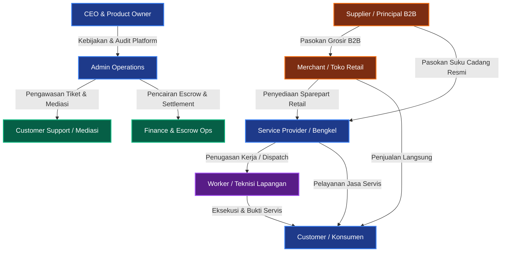
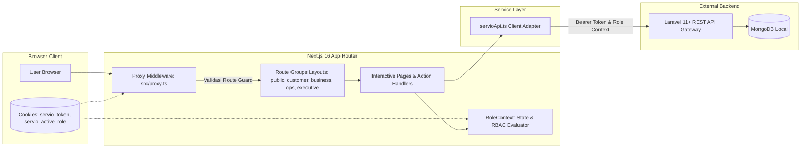
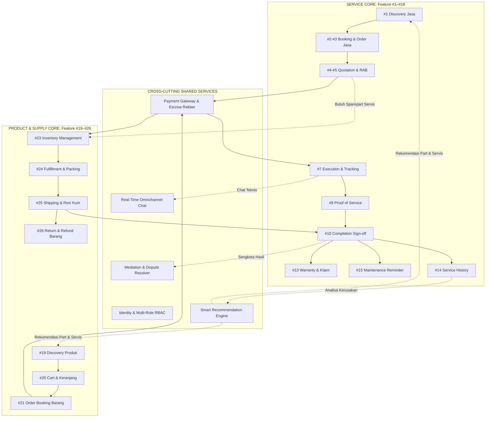
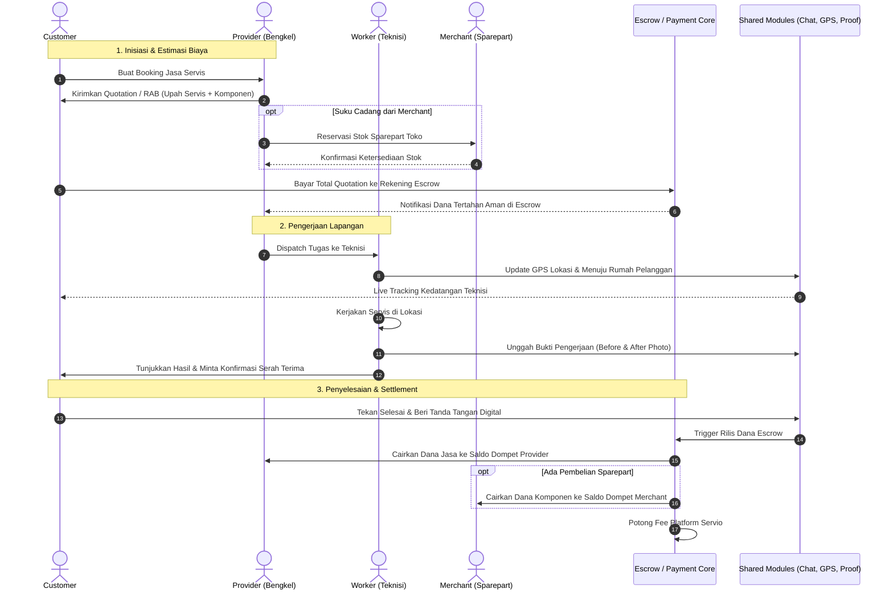
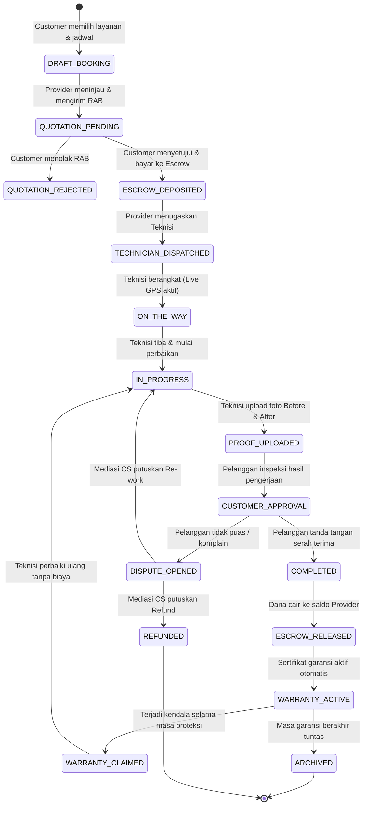
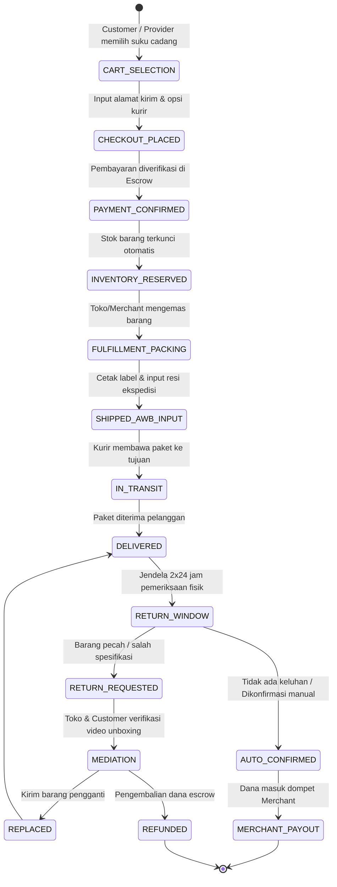

# DOKUMENTASI DATA GLOBAL SERVIO
## Master Checklist Persiapan Global, Arsitektur Frontend, RBAC 9 Role, dan Relasi Antarmodul

> **Versi:** 1.1.0 (LOCKED BASELINE — ZERO ASSET)  
> **Tanggal Rilis:** Oktober 2026  
> **Status:** Terverifikasi & Komprehensif  
> **Target Ekosistem:** Platform Servio (Frontend Next.js, Backend Laravel, Database MongoDB Local)  
> **Dokumen Terkait:** [PRD Frontend](file:///d:/website%20latihan/servio_web%20-%20Copy/docs/Front%20end/PRD_FRONTEND.md), [Global Development Rules](file:///d:/website%20latihan/servio_web%20-%20Copy/docs/GLOBAL%20DEVELOPMENT%20RULES.md), [Design System](file:///d:/website%20latihan/servio_web%20-%20Copy/docs/Front%20end/SERVIO_DESIGN_SYSTEM_FINAL.md)

---

## DAFTAR ISI
1. [Ringkasan Eksekutif & Status Checklist](#1-ringkasan-eksekutif--status-checklist)
2. [Checklist 1: Daftar 9 Role SERVIO (Wajib)](#2-checklist-1-daftar-9-role-servio-wajib)
   - 2.1 [Hirarki & Kategorisasi Role](#21-hirarki--kategorisasi-role)
   - 2.2 [Profil Mendalam 9 Role & Akun Canonical](#22-profil-mendalam-9-role--akun-canonical)
   - 2.3 [Batasan Kewenangan & Guardrail Prinsip Akses](#23-batasan-kewenangan--guardrail-prinsip-akses)
3. [Checklist 2: Informasi Frontend SERVIO (Wajib)](#3-checklist-2-informasi-frontend-servio-wajib)
   - 3.1 [Spesifikasi Core Framework & Library](#31-spesifikasi-core-framework--library)
   - 3.2 [Sistem Desain & Token Styling](#32-sistem-desain--token-styling)
   - 3.3 [Struktur Arsitektur Routing (Next.js App Router)](#33-struktur-arsitektur-routing-nextjs-app-router)
   - 3.4 [Mekanisme Autentikasi & Proxy Middleware](#34-mekanisme-autentikasi--proxy-middleware)
   - 3.5 [State Management Otorisasi (RoleContext)](#35-state-management-otorisasi-rolecontext)
4. [Checklist 3: Role & Permission Matrix (Opsional / Lengkap)](#4-checklist-3-role--permission-matrix-opsional--lengkap)
   - 4.1 [Definisi 28 Business Resource Platform (Tanpa Asset)](#41-definisi-28-business-resource-platform-tanpa-asset)
   - 4.2 [Tabel Matriks Akses Komprehensif (9 Role x 28 Resource)](#42-tabel-matriks-akses-komprehensif-9-role-x-28-resource)
   - 4.3 [Dimensi Permission Scope & Rule Evaluasi](#43-dimensi-permission-scope--rule-evaluasi)
5. [Checklist 4: Dokumentasi Relasi Antarmodul & Business Flow (Opsional / Lengkap)](#5-checklist-4-dokumentasi-relasi-antarmodul--business-flow-opsional--lengkap)
   - 5.1 [Peta Arsitektur Ekosistem Layanan (Jasa vs Barang)](#51-peta-arsitektur-ekosistem-layanan-jasa-vs-barang)
   - 5.2 [Diagram Relasi Antarmodul Global](#52-diagram-relasi-antarmodul-global)
   - 5.3 [Diagram Business Flow End-to-End Jasa](#53-diagram-business-flow-end-to-end-jasa)
   - 5.4 [Diagram Business Flow End-to-End Barang / Commerce](#54-diagram-business-flow-end-to-end-barang--commerce)
   - 5.5 [Sinergi Cross-Domain (Integrasi Jasa Servis + Suku Cadang Barang)](#55-sinergi-cross-domain-integrasi-jasa-servis--suku-cadang-barang)
   - 5.6 [Katalog REST API Terkonsolidasi (Prinsip Anti-Redundansi Request)](#56-katalog-rest-api-terkonsolidasi-prinsip-anti-redundansi-request)

---

# 1. Ringkasan Eksekutif & Status Checklist

Dokumen ini disusun untuk menyelesaikan secara tuntas seluruh persiapan global platform **SERVIO** sebagai landasan integrasi frontend Next.js, backend Laravel API, dan skema database MongoDB Local. 

> [!NOTE]
> **Keputusan Arsitektur Final (Zero Asset Policy):** Seluruh konsep dan modul Asset telah dihapus secara menyeluruh dari platform. Layanan perbaikan dan pemeliharaan beroperasi secara langsung (*direct service on demand*) tanpa dependensi entitas inventaris kepemilikan aset.

### Status Evaluasi Checklist Global:
- [x] **Daftar 9 role SERVIO (Wajib):** 9 role terdefinisi lengkap beserta fungsi, hierarki, batasan wewenang, dan akun autentikasi canonical bawaan.
- [x] **Informasi frontend SERVIO (Wajib):** Bedah tuntas stack Next.js 16, React 19, Tailwind CSS v4, pola routing App Router, manajemen cookie sesi, serta proxy middleware.
- [x] **Role & Permission Matrix (Opsional / Lengkap):** Matriks otoritas granular mencakup 28 Business Resource (murni transaksi, operasi, dan tata kelola tanpa resource Asset) dan 11 Action Type dengan pembagian 7 Scope Level.
- [x] **Dokumentasi relasi antarmodul (Opsional / Lengkap):** Blueprint hubungan modular Jasa (#1–#18), Barang (#19–#26), Shared Escrow/Logistics, diagram alur bisnis Mermaid, serta konsolidasi reusable REST API.

---

# 2. Checklist 1: Daftar 9 Role SERVIO (Wajib)

Ekosistem SERVIO membedakan pengguna ke dalam **4 Platform Core Roles**, **3 Operational Sub-Roles**, dan **2 Commerce/Supply Chain Roles**. Setiap aktor memiliki peran spesifik dan tidak diperbolehkan melompati otoritas tanpa delegasi resmi.



---

## 2.1 Hirarki & Kategorisasi Role

| Kategori | Role Key (`UserRole`) | Deskripsi Posisi | Ruang Lingkup Otoritas |
| :--- | :--- | :--- | :--- |
| **Platform Core** | `CEO_PRODUCT_OWNER` | Eksekutif & Pemilik Platform | Global Strategic, Governance, Analytics Aggregate, Audit Platform |
| **Platform Core** | `ADMIN_OPERATIONS` | Manajemen Operasional & Verifikasi | Verifikasi KYB/KYC, Moderasi Katalog, Platform Control, User Governance |
| **Platform Core** | `CUSTOMER` | Konsumen Akhir / Klien Jasa | Discovery, Pemesanan, Pembayaran, Pelacakan, Approval, Garansi & Riwayat |
| **Platform Core** | `SERVICE_PROVIDER` | Mitra Bengkel & Badan Usaha Jasa | Profil Bisnis, Katalog Servis, RAB/Quotation, Dispatch Teknisi, Finansial Bengkel |
| **Operational Sub-Role** | `WORKER_TECHNICIAN` | Tenaga Kerja Teknis Lapangan | Menerima Task yang Ditugaskan (Assigned), Tracking GPS, Bukti Kerja (Proof of Service) |
| **Operational Sub-Role** | `CUSTOMER_SUPPORT` | Tim Bantuan & Mediasi Dispute | Penanganan Tiket, Mediasi Sengketa Komplain Jasa & Retur Barang |
| **Operational Sub-Role** | `FINANCE_PAYMENT_OPS` | Pengelola Escrow & Keuangan | Rekonsiliasi Gateway Pembayaran, Approval Refund, Eksekusi Payout Mitra |
| **Commerce / Supply** | `MERCHANT` | Toko Retail Suku Cadang/Produk | Katalog Suku Cadang, Stok Gudang Retail, Pemrosesan Pesanan, Pengiriman Logistik |
| **Commerce / Supply** | `SUPPLIER` | Pemasok Grosir / Distributor B2B | Katalog Grosir, Manajemen Stok Bulk, Pemenuhan Purchase Order Mitra & Toko |

---

## 2.2 Profil Mendalam 9 Role & Akun Canonical

Sesuai ketetapan platform pada `GLOBAL DEVELOPMENT RULES.md`, sistem memiliki 9 akun terverifikasi bawaan yang digunakan untuk pengujian operasional tanpa membuat akun dummy baru:

### 1. CEO & Product Owner (`CEO_PRODUCT_OWNER`)
* **Fungsi Utama:** Mengawasi kesehatan operasional ekosistem secara makro, menetapkan kebijakan komisi platform, mengelola master taksonomi kategori, meninjau analitik pendapatan/GMV, serta memeriksa audit log kepatuhan.
* **Karakteristik Akses:** Read-Only & Analytical terhadap data transaksi harian; dilarang mengeksekusi langsung pekerjaan teknis atau melakukan manipulasi invoice transaksi.
* **Akun Canonical:**
  * **Nama:** Michael Surya
  * **Email:** `ceo@servio.id`
  * **Password:** `ServioCeo2026!`
  * **Identitas:** NIP: `CEO-001` | Dept: `Executive Office` | Status: `ACTIVE`
  * **Portal Path:** `/ceo/dashboard`

### 2. Admin Operations (`ADMIN_OPERATIONS`)
* **Fungsi Utama:** Melakukan verifikasi legalitas dokumen mitra (NIB, SIUP, KTP), memoderasi katalog layanan jasa dan produk barang, menangguhkan akun pelanggar aturan (suspend/freeze), serta mengelola konfigurasi taksonomi dan master data platform.
* **Karakteristik Akses:** Memiliki wewenang lintas organisasi level platform (`PLATFORM`), namun dilarang memalsukan bukti kerja teknisi atau menyetujui konfirmasi penyelesaian sepihak atas nama customer.
* **Akun Canonical:**
  * **Nama:** Siti Rahmawati
  * **Email:** `admin@servio.id`
  * **Password:** `ServioAdmin2026!`
  * **Identitas:** NIP: `ADM-001` | Dept: `Operations & Verification` | Status: `ACTIVE`
  * **Portal Path:** `/admin/dashboard`

### 3. Customer / Konsumen (`CUSTOMER`)
* **Fungsi Utama:** Mencari layanan jasa atau produk fisik, membuat permintaan perbaikan/booking langsung, bernegosiasi estimasi biaya (Quotation/RAB), membayar ke rekening escrow aman, memantau kedatangan teknisi secara real-time, menyetujui atau menolak laporan hasil kerja (Proof of Service), memberikan ulasan bintang, melihat catatan buku logbook riwayat servis, serta mengajukan klaim garansi atau komplain sengketa jika terjadi ketidaksesuaian.
* **Karakteristik Akses:** Dibatasi ketat hanya pada data milik pribadi (`OWN`) atau pesanan yang melibatkan dirinya (`RELATED`).
* **Akun Canonical:**
  * **Nama:** Ahmad Fauzi
  * **Email:** `customer@servio.id`
  * **Password:** `ServioCustomer2026!`
  * **Identitas:** NIK: `3174051208880001` | Status KTP: `TERVERIFIKASI`
  * **Portal Path:** `/orders`, `/bookings`, `/profile`

### 4. Service Provider / Bengkel Mitra (`SERVICE_PROVIDER`)
* **Fungsi Utama:** Mendaftarkan badan usaha atau workshop perbaikan, mempublikasikan paket jasa, menerima permintaan booking, menyusun Rencana Anggaran Biaya (Quotation/RAB) termasuk biaya tenaga dan komponen, menugaskan teknisi internal ke order pelanggan, memonitor progres kerja lapangan, mengelola persediaan stok internal bengkel, menanggapi klaim garansi, dan mengajukan pencairan dana (payout) hasil pengerjaan servis.
* **Karakteristik Akses:** Terbatas pada organisasi bengkel miliknya (`ORGANIZATION`) beserta teknisi dan transaksi pelanggan yang ditanganinya.
* **Akun Canonical:**
  * **Nama:** Budi Santoso
  * **Email:** `provider@servio.id`
  * **Password:** `ServioProvider2026!`
  * **Identitas Bisnis:** PT Servio Mandiri Teknik (Brand: Bintang Teknik Mandiri) | NIB: `9120001234567` | No Reg: `REG-2026-0001`
  * **Portal Path:** `/provider/dashboard`

### 5. Worker / Teknisi Lapangan (`WORKER_TECHNICIAN`)
* **Fungsi Utama:** Menerima surat perintah tugas pekerjaan yang didelegasikan oleh Provider, memperbarui status keberangkatan dan kehadiran di lokasi pelanggan, mengunggah bukti foto/video sebelum dan sesudah perbaikan (*Before & After Proof of Service*), mendokumentasikan catatan teknis pengerjaan, dan meminta persetujuan tanda tangan digital pelanggan di lapangan.
* **Karakteristik Akses:** **Strict Assigned Work Only** (`ASSIGNED`). Tidak memiliki akses melihat pembagian laba/margin bengkel, transaksi order teknisi lain, atau merubah konfigurasi tarif jasa.
* **Akun Canonical:**
  * **Nama:** Bambang Sudirman
  * **Email:** `worker@servio.id`
  * **Password:** `ServioWorker2026!`
  * **Identitas:** NIP: `WRK-001` | NIK: `3175082104920004` | Afiliasi: `PT Servio Mandiri Teknik` | Spesialisasi: `AC & HVAC Specialist`
  * **Portal Path:** `/worker/dashboard`

### 6. Customer Support (`CUSTOMER_SUPPORT`)
* **Fungsi Utama:** Melayani tiket kendala pengguna, melakukan mediasi sengketa hasil kerja atau retur barang antara customer dan mitra, meninjau bukti rekaman pengerjaan (*Proof of Service*) saat terjadi komplain, serta mengeluarkan rekomendasi investigasi apakah komplain valid untuk refund atau pengerjaan ulang (re-work).
* **Karakteristik Akses:** Membaca data tiket dan transaksi terkait kasus secara terisolasi (`RELATED` / `PLATFORM`), tidak memiliki kewenangan mengubah saldo escrow atau mengeksekusi payout sepihak tanpa persetujuan tim Finance.
* **Akun Canonical:**
  * **Nama:** Rina Oktaviani
  * **Email:** `support@servio.id`
  * **Password:** `ServioSupport2026!`
  * **Identitas:** NIP: `CS-001` | Dept: `Customer Care & Mediation` | Status: `ACTIVE`
  * **Portal Path:** `/support/dashboard`

### 7. Finance & Escrow Operations (`FINANCE_PAYMENT_OPS`)
* **Fungsi Utama:** Memvalidasi settlement pembayaran dari Payment Gateway, mengelola penahanan saldo transaksi di rekening bersama (Escrow/Rekber), menyetujui dan mentransfer permintaan penarikan saldo (Payout) milik Provider dan Merchant setelah masa garansi/retur selesai, serta memproses pencairan dana refund konsumen akibat pembatalan atau putusan sengketa.
* **Karakteristik Akses:** Terfokus penuh pada resource Finansial, Escrow, dan Settlement (`FINANCE_OPS`, `PAYMENT`). Tidak mencampuri teknis pekerjaan fisik atau moderasi isi katalog.
* **Akun Canonical:**
  * **Nama:** Hendrik Wijaya
  * **Email:** `finance@servio.id`
  * **Password:** `ServioFinance2026!`
  * **Identitas:** NIP: `FIN-001` | Dept: `Finance & Escrow` | Status: `ACTIVE`
  * **Portal Path:** `/finance/dashboard`

### 8. Merchant / Toko Sparepart Retail (`MERCHANT`)
* **Fungsi Utama:** Menjual barang fisik, komponen suku cadang (spare parts), peralatan teknis, dan perlengkapan servis kepada pelanggan umum maupun mitra bengkel; mengelola persediaan stok toko retail; memproses pengemasan barang (fulfillment); menginput nomor resi kurir logistik; serta menangani permintaan retur/tukar barang yang rusak akibat pengiriman.
* **Karakteristik Akses:** Terbatas pada domain katalog barang miliknya, manajemen inventaris retail, pesanan barang masuk, dan rekening saldo penjualan miliknya (`ORGANIZATION`).
* **Akun Canonical:**
  * **Nama:** Ko Hendra
  * **Email:** `merchant@servio.id`
  * **Password:** `ServioMerchant2026!`
  * **Identitas Bisnis:** CV Sinar Sentra Abadi (Toko: Sinar AC & Sparepart Glodok) | NIB: `8120009922331` | No Reg: `REG-2026-0002`
  * **Portal Path:** `/merchant/dashboard`

### 9. Supplier / Distributor B2B (`SUPPLIER`)
* **Fungsi Utama:** Berperan sebagai prinsipal atau distributor resmi yang memasok suku cadang grosir dalam volume besar kepada Merchant retail dan Workshop Service Provider; menerbitkan invoice Purchase Order (PO); mengelola gudang suplai bulk; serta menangani klaim garansi cacat produksi pabrik.
* **Karakteristik Akses:** Dikhususkan untuk transaksi B2B tingkat grosir, inventaris massal, dan logistik kargo partai besar (`ORGANIZATION`).
* **Akun Canonical:**
  * **Nama:** Suryanto Wijaya
  * **Email:** `supplier@servio.id`
  * **Password:** `ServioSupplier2026!`
  * **Identitas Bisnis:** PT Nusantara Parts Prima (Principal Parts Distributor) | NIB: `9120005544332` | No Reg: `REG-2026-0003`
  * **Portal Path:** `/supplier/dashboard`

---

## 2.3 Batasan Kewenangan & Guardrail Prinsip Akses

Sistem otorisasi SERVIO beroperasi dengan formula ketat:
$$\text{ACCESS DECISION} = \text{Auth} + \text{Active Role} + \text{Permission} + \text{Resource} + \text{Scope} + \text{Relation} + \text{Business State}$$

1. **Prinsip Separation of Concerns (Pemisahan Kekuasaan):**
   * Admin tidak berhak mengatasnamakan Worker untuk mengunggah bukti pengerjaan teknis fiktif.
   * Admin/Finance tidak berhak mengatasnamakan Customer untuk menekan tombol "Terima Hasil Pekerjaan / Konfirmasi Selesai".
2. **Prinsip Assigned Work Only untuk Teknisi:**
   * Teknisi hanya memiliki hak akses baca dan tulis pada tiket pengerjaan yang secara eksplisit mencantumkan `workerId === context.id`. Upaya mengakses order teknisi lain akan ditolak (`DENIED_SCOPE`).
3. **Prinsip Tata Kelola Eksekutif (CEO):**
   * Akun CEO memiliki wewenang analitik makro (`ANALYZE`, `VIEW`). Tindakan operasional mikro transaksional seperti `SUBMIT` atau `EXECUTE` diblokir oleh guardrail otorisasi agar integritas pemisahan tugas terjaga.

---

# 3. Informasi Frontend SERVIO (Wajib)

Platform web frontend dibangun sebagai aplikasi Single Page / Server Rendered hybrid berperforma tinggi yang responsif, modular, dan siap dihubungkan langsung ke REST API backend.



---

## 3.1 Spesifikasi Core Framework & Library

| Kategori | Paket & Versi | Peran & Alasan Penggunaan |
| :--- | :--- | :--- |
| **Framework Web** | `next: 16.3.5` | Menggunakan arsitektur App Router terbaru dengan Server Components, Nested Layouts, Streaming, dan Route Groups. |
| **Runtime Core** | `react: 19.2.8`<br>`react-dom: 19.2.8` | Versi React modern dengan dukungan penuh Server Actions dan optimasi render. |
| **Bahasa Pemrograman** | `typescript: ^5.0.0` | Menjamin *type-safety* ketat untuk seluruh model domain bisnis, parameter API, dan payload otorisasi. |
| **Mesin CSS** | `tailwindcss: ^4.0.0`<br>`@tailwindcss/postcss: ^4.0.0` | Tailwind CSS v4 berbasis PostCSS murni dengan performa kompilasi ultra cepat dan integrasi CSS Variables. |
| **Ikon Antarmuka** | `@phosphor-icons/react: ^2.1.10` | Koleksi ikon komprehensif, modern, dan konsisten (regular, bold, fill, duotone) untuk kebutuhan teknis & navigasi. |
| **Mesin Animasi** | `framer-motion: ^13.4.0` | Menghadirkan micro-interactions, modal transitions, layout animations, dan dynamic feedback yang halus. |
| **Manajemen Form** | `react-hook-form: ^7.88.0` | Manajemen form performa tinggi tanpa re-render berlebih, esensial untuk wizard booking dan quotation builder. |
| **Validasi Skema** | `zod: ^4.6.5`<br>`@hookform/resolvers: ^5.9.1` | Validasi input form di sisi client sebelum dikirim ke backend API. |
| **Utility Styling** | `clsx: ^2.1.1`<br>`tailwind-merge: ^3.7.0` | Menggabungkan kelas utilitas Tailwind secara dinamis tanpa konflik CSS. |

---

## 3.2 Sistem Desain & Token Styling

Sistem visual SERVIO mengacu pada panduan [SERVIO_DESIGN_SYSTEM_FINAL.md](file:///d:/website%20latihan/servio_web%20-%20Copy/docs/Front%20end/SERVIO_DESIGN_SYSTEM_FINAL.md) dan token fondasi JSON [servio-design-tokens-foundation.json](file:///d:/website%20latihan/servio_web%20-%20Copy/docs/Front%20end/servio-design-tokens-foundation.json):

* **Palette Warna Utama:**
  * **Brand Deep Navy:** `#0F172A` (Latar belakang sidebar, header enterprise, status bar netral tinggi).
  * **Primary Tech Blue:** `#2563EB` (Aksi primer, status order aktif, call to action utama).
  * **Accent Emerald:** `#059669` (Konfirmasi berhasil, status garansi aktif, pembayaran lunas, rating tinggi).
  * **Alert Amber:** `#D97706` (Menunggu tindakan, status pending quotation, jadwal reminder).
  * **Destructive Crimson:** `#DC2626` (Pembatalan, dispute, peringatan bahaya, stok habis).
  * **Surface Light / Dark:** `#F8FAFC` / `#020617` (Pengaturan kontras tinggi untuk kenyamanan mata pengguna).
* **Tipografi:** Menggunakan hierarki sans-serif modern (`Inter` / `Plus Jakarta Sans`) dengan kontras teks tajam dan keterbacaan tinggi di berbagai resolusi layar.

---

## 3.3 Struktur Arsitektur Routing (Next.js App Router)

Routing aplikasi dikelompokkan secara terisolasi menggunakan **Next.js Route Groups** `(...)` guna menerapkan layout, header navigasi, dan izin akses yang berbeda tanpa memengaruhi struktur URL browser:

```text
src/app/
├── (public)/                 --> Ruang publik tanpa kewajiban login
│   ├── page.tsx              --> Landing Page Utama Platform
│   ├── services/             --> Katalog Penjelajahan Jasa Servis
│   ├── products/             --> Katalog Pembelian Produk & Sparepart
│   ├── smart-discovery/      --> Fitur Pencarian Cerdas & Rekomendasi AI
│   ├── categories/           --> Navigasi Kategori Layanan
│   ├── auth/
│   │   ├── login/            --> Halaman Masuk Akun Bersama
│   │   └── register/         --> Halaman Pendaftaran Pengguna & Calon Mitra
│   └── layout.tsx            --> Layout Publik (Navbar Publik + Footer Komprehensif)
│
├── (customer)/               --> Portal Terproteksi Khusus Pengguna / Konsumen
│   ├── orders/               --> Riwayat & Status Pesanan Transaksi
│   ├── bookings/             --> Daftar & Form Permintaan Servis Langsung
│   ├── quotations/           --> Tinjauan & Negosiasi RAB / Penawaran Biaya
│   ├── checkout/             --> Alur Checkout Transaksi Jasa & Barang
│   ├── payments/             --> Halaman Pembayaran & Status Escrow Rekber
│   ├── tracking/             --> Live GPS Tracking Kedatangan Teknisi & Kurir
│   ├── proof/                --> Inspeksi Bukti Kerja Teknisi (Before & After)
│   ├── completion/           --> Form Konfirmasi Selesai & Tanda Tangan Konsumen
│   ├── reviews/              --> Input Ulasan & Rating Pelayanan
│   ├── complaints/           --> Pusat Pengaduan & Tiket Dispute
│   ├── warranties/           --> Kartu Garansi Digital & Alur Klaim Garansi
│   ├── maintenance/          --> Jadwal & Peringatan Servis Berkala
│   ├── history/              --> Logbook Riwayat Perawatan & Penggantian Part
│   ├── loyalty/              --> Katalog Poin Reward & Kupon Diskon
│   ├── chat/                 --> Obrolan Real-time Konsumen dengan Mitra/Teknisi
│   ├── profile/              --> Manajemen Data Profil & Verifikasi KTP
│   └── layout.tsx            --> Layout Konsumen (Customer Navigation Bar)
│
├── (business)/               --> Portal Mitra Bisnis Terverifikasi
│   ├── provider/             --> Dashboard & Operasional Bengkel Mitra
│   │   ├── dashboard/        --> Ringkasan Job, Teknisi, & Pendapatan
│   │   ├── bookings/         --> Penerimaan & Konfirmasi Permintaan Jasa
│   │   ├── quotations/       --> Pembuatan & Pengiriman Rencana Anggaran Biaya
│   │   ├── dispatch/         --> Penugasan & Manajemen Teknisi Lapangan
│   │   ├── warranties/       --> Manajemen & Investigasi Klaim Garansi Masuk
│   │   └── payouts/          --> Rekening Bank & Pengajuan Penarikan Saldo
│   ├── worker/               --> Antarmuka Khusus Teknisi Lapangan (Mobile-First)
│   │   ├── dashboard/        --> Tiket Pekerjaan Hari Ini
│   │   ├── execution/        --> Checklist Pengerjaan & Start/Pause Servis
│   │   └── proof-upload/     --> Kamera & Unggah Foto Before/After Lapangan
│   ├── merchant/             --> Portal Toko Penjual Sparepart & Perlengkapan
│   │   ├── dashboard/        --> Statistik Penjualan & Order Masuk
│   │   ├── products/         --> Manajemen Katalog & Harga Suku Cadang
│   │   ├── inventory/        --> Manajemen Stok Gudang & Restock Alert
│   │   └── fulfillment/      --> Pengemasan Barang & Cetak Label Pengiriman
│   └── supplier/             --> Portal Distributor Grosir B2B
│       ├── dashboard/        --> Ringkasan Volume Suplai & PO Masuk
│       └── orders/           --> Pemrosesan Pesanan Grosir Mitra
│
├── (ops)/                    --> Portal Operasional Internal Platform
│   ├── admin/                --> Konsol Admin Operasional
│   │   ├── dashboard/        --> Matriks Kesehatan Ekosistem
│   │   ├── verifications/    --> Antrean Validasi KYB Mitra & KYC Pengguna
│   │   ├── catalog-review/   --> Moderasi Layanan Jasa & Produk Baru
│   │   └── users/            --> Tata Kelola Akun & Penangguhan Pelanggar
│   ├── support/              --> Konsol Tim Customer Care & Mediasi
│   │   ├── tickets/          --> Antrean Tiket Bantuan
│   │   └── disputes/         --> Meja Mediasi Sengketa Hasil Pekerjaan
│   └── finance/              --> Konsol Keuangan & Escrow Rekber
│       ├── escrow/           --> Monitoring Saldo Tertahan di Rekening Bersama
│       ├── settlements/      --> Rekonsiliasi Gateway Pembayaran Masuk
│       └── payouts/          --> Validasi & Eksekusi Transfer Payout Mitra
│
└── (executive)/              --> Portal Pimpinan & Strategi
    └── ceo/
        ├── dashboard/        --> Executive GMV, Net Revenue, & Pertumbuhan Ekosistem
        ├── taxonomy/         --> Konfigurasi Master Taksonomi & Standar Biaya
        └── audit-trail/      --> Log Audit Aktivitas Platform & Kepatuhan Hukum
```

---

## 3.4 Mekanisme Autentikasi & Proxy Middleware

Alur autentikasi dan otorisasi dikawal langsung di level edge sebelum halaman dirender menggunakan `src/proxy.ts`:

1. **Penyimpanan Status Sesi (Session Cookies):**
   * `servio_token` / `servio_session`: Menyimpan token akses JWT/Sanctum pengguna.
   * `servio_active_role`: Menyimpan kode role aktif yang sedang dipilih (`CUSTOMER`, `SERVICE_PROVIDER`, `WORKER_TECHNICIAN`, dsb.).
   * `servio_guest`: Indikator mode tamu (`"1"` untuk pengunjung tanpa login, `"0"` jika terotentikasi).
2. **Pencegahan Akses Ilegal (Route Protection):**
   * Jika pengunjung berstatus tamu (`isGuest === true`) mencoba membuka URL yang terdaftar dalam daftar rute terproteksi (`PROTECTED_CUSTOMER_ROUTES` atau `OPERATIONAL_PREFIXES`), proxy secara instan membelokkan arah (*redirect*) ke:
     ```text
     /auth/login?returnUrl=<pathname_asal>
     ```
3. **Penyaluran Otomatis Saat Login Ulang:**
   * Jika pengguna yang sudah login mencoba mengakses `/auth/login` atau `/login`, proxy secara cerdas mengarahkan pengguna ke dashboard yang sesuai dengan active role mereka:
     * `CEO_PRODUCT_OWNER` $\rightarrow$ `/ceo/dashboard`
     * `ADMIN_OPERATIONS` $\rightarrow$ `/admin/dashboard`
     * `SERVICE_PROVIDER` $\rightarrow$ `/provider/dashboard`
     * `WORKER_TECHNICIAN` $\rightarrow$ `/worker/dashboard`
     * `MERCHANT` $\rightarrow$ `/merchant/dashboard`
     * `SUPPLIER` $\rightarrow$ `/supplier/dashboard`
     * `CUSTOMER_SUPPORT` $\rightarrow$ `/support/dashboard`
     * `FINANCE_PAYMENT_OPS` $\rightarrow$ `/finance/dashboard`
     * `CUSTOMER` $\rightarrow$ `/orders` (atau `/`)
4. **URL Aliasing / Rewriting Transparan:**
   * Proxy menangani keseragaman URL operasional internal tanpa mengubah struktur backend (contoh: me-rewrite `/ops/admin` menjadi `/admin`, `/business/provider` menjadi `/provider`, dan `/executive/ceo` menjadi `/ceo`).

---

## 3.5 State Management Otorisasi (RoleContext)

Otorisasi di sisi antarmuka dikelola secara reaktif oleh `src/context/RoleContext.tsx`:
* **Multi-Role Persona Switching:** Pengguna yang memiliki beberapa penugasan peran (misal akun Service Provider yang juga bertindak sebagai Customer saat memesan barang) dapat berpindah persona seketika via `switchRole('CUSTOMER')` tanpa perlu logout.
* **Evaluasi Hak Akses Granular (`checkPermission`):**
  Komponen antarmuka memanfaatkan fungsi evaluasi `checkPermission(action, resource, options)` untuk menentukan apakah tombol, menu, atau kartu data tertentu harus **ditampilkan**, **dinonaktifkan (disabled)**, atau **disembunyikan (hidden)**:
  ```tsx
  // Contoh pengecekan hak akses di halaman teknisi
  const canUploadProof = checkPermission("CREATE", "PROOF", {
    scope: "ASSIGNED",
    condition: (ctx, record) => record?.workerId === ctx.id && record?.status === "IN_PROGRESS"
  });
  ```

---

# 4. Checklist 3: Role & Permission Matrix (Opsional / Lengkap)

Otorisasi SERVIO tidak bersifat biner sederhana (izinkan/tolak), melainkan berlandaskan granularitas **Resource**, **Action**, dan **Scope**.

## 4.1 Definisi 28 Business Resource Platform (Tanpa Asset)

| No | Kode Resource | Entitas Bisnis & Cakupan Data |
| :---: | :--- | :--- |
| 1 | `DISCOVERY` | Pencarian layanan jasa servis, bengkel terdekat, dan filter kategori. |
| 2 | `BOOKING_JASA` | Formulir pemesanan, jadwal kunjungan, dan data alamat pemohon. |
| 3 | `ORDER_JASA` | Surat Perintah Kerja (SPK), status alur pengerjaan, dan riwayat pesanan jasa. |
| 4 | `QUOTATION` | Rencana Anggaran Biaya (RAB), rincian estimasi biaya part, dan upah teknisi. |
| 5 | `CHAT` | Percakapan teks, gambar, dan voice note antar pihak dalam transaksi. |
| 6 | `PAYMENT` | Transaksi pembayaran, invoice, voucher diskon, dan metode gateway. |
| 7 | `EXECUTION` | Aktivitas pengerjaan fisik di lokasi, status pengerjaan, dan catatan kendala. |
| 8 | `TRACKING` | Titik koordinat GPS real-time posisi teknisi atau kurir logistik barang. |
| 9 | `PROOF` | Bukti kerja validasi foto/video sebelum perbaikan (*before*) dan sesudah perbaikan (*after*). |
| 10 | `COMPLETION` | Tanda tangan digital berita acara serah terima pekerjaan oleh pelanggan. |
| 11 | `REVIEW` | Skor bintang penilaian (1-5) dan ulasan testimoni kualitas pekerjaan. |
| 12 | `DISPUTE` | Pengaduan sengketa, klaim pekerjaan tidak tuntas, dan proses mediasi. |
| 13 | `WARRANTY` | Sertifikat garansi digital, masa aktif proteksi, dan riwayat klaim komplain perbaikan. |
| 14 | `SERVICE_HISTORY` | Catatan buku logbook riwayat servis dan perbaikan yang tersimpan permanen. |
| 15 | `MAINTENANCE` | Notifikasi pengingat otomatis jadwal cuci/servis berkala perangkat. |
| 16 | `LOYALTY` | Saldo poin keanggotaan pengguna, tingkatan tier akun, dan penukaran reward. |
| 17 | `SMART_RECOMMENDATION`| Engine rekomendasi AI berbasis gejala kendala dan kebutuhan suku cadang. |
| 18 | `PRODUCT` | Katalog barang fisik, spesifikasi teknis, harga retail, dan varian suku cadang. |
| 19 | `CART` | Keranjang belanja suku cadang dan produk perlengkapan servis. |
| 20 | `PRODUCT_ORDER` | Surat pesanan pembelian barang fisik retail dari toko merchant. |
| 21 | `INVENTORY` | Data kuantitas stok barang di gudang merchant, bengkel, atau supplier. |
| 22 | `FULFILLMENT` | Proses verifikasi pesanan, picking barang di rak, packing rapi, dan serah terima kurir. |
| 23 | `SHIPPING` | Nomor resi ekspedisi, jadwal penjemputan (*pick-up*), dan status pengantaran barang. |
| 24 | `RETURN_REFUND` | Permintaan retur fisik suku cadang yang cacat dan pengembalian uang barang. |
| 25 | `USER_MANAGEMENT` | Tata kelola akun, verifikasi identitas (KYC/KYB), dan status keaktifan user. |
| 26 | `TAXONOMY` | Hirarki master kategori jasa, kategori barang, dan standar tarif industri. |
| 27 | `FINANCE_OPS` | Pengelolaan saldo escrow rekber, komisi platform, dan persetujuan payout mitra. |
| 28 | `EXECUTIVE_GOVERNANCE` | Laporan kepatuhan hukum, data analitik strategis, dan audit trail sistem. |

---

## 4.2 Tabel Matriks Akses Komprehensif (9 Role x 28 Resource)

**Keterangan Simbol Izin:**
* `C` = Create (Membuat data baru)
* `R` = Read / View (Melihat data)
* `U` = Update (Mengedit data)
* `D` = Delete / Cancel (Membatalkan / Menghapus)
* `A` = Approve / Reject (Menyetujui atau Menolak)
* `E` = Execute (Menjalankan aksi pengerjaan lapangan)
* `M` = Manage / Administer (Konfigurasi penuh / Override)
* `-` = No Access (Akses Ditolak)

| No | Business Resource | Customer | Service Provider | Worker / Teknisi | Customer Support | Finance & Escrow | Merchant Retail | Supplier B2B | Admin Operations | CEO / Owner |
| :---: | :--- | :---: | :---: | :---: | :---: | :---: | :---: | :---: | :---: | :---: |
| 1 | `DISCOVERY` | R | R | R | R | - | R | R | R, M | R, M |
| 2 | `BOOKING_JASA` | C, R, U, D | R, A, U | R | R | - | - | - | R, M | R |
| 3 | `ORDER_JASA` | R, D | C, R, U, A | R, U | R, U | R | - | - | R, M | R |
| 4 | `QUOTATION` | R, A | C, R, U, D | R | R | - | - | - | R, M | R |
| 5 | `CHAT` | C, R | C, R | C, R | C, R | - | C, R | C, R | R (Audit) | - |
| 6 | `PAYMENT` | C, R | R | - | R | C, R, U, A | R | R | R, M | R |
| 7 | `EXECUTION` | R | R, U, A | C, R, U, E | R | - | - | - | R | R |
| 8 | `TRACKING` | R | R | C, R, U | R | - | - | - | R | R |
| 9 | `PROOF` | R | R, A | C, R, U | R | - | - | - | R | R |
| 10 | `COMPLETION` | R, A | R | C, R (Submit)| R | - | - | - | R | R |
| 11 | `REVIEW` | C, R, U | R | R | R | - | R | - | R, M | R |
| 12 | `DISPUTE` | C, R, U | R, U | - | C, R, U, A | R | R, U | - | R, M | R |
| 13 | `WARRANTY` | C, R (Klaim)| R, A | R, E | R | - | - | - | R, M | R |
| 14 | `SERVICE_HISTORY` | R | R | R | R | - | - | - | R | R |
| 15 | `MAINTENANCE` | C, R, U | R | - | R | - | - | - | R, M | R |
| 16 | `LOYALTY` | R, U (Redeem)| - | - | R | - | - | - | R, M | R |
| 17 | `SMART_RECOMMENDATION`| R | R | - | - | - | R | R | R, M | R, M |
| 18 | `PRODUCT` | R | R | R | R | - | C, R, U, D | C, R, U, D | R, M | R |
| 19 | `CART` | C, R, U, D | C, R, U, D | - | - | - | - | - | - | - |
| 20 | `PRODUCT_ORDER` | C, R, D | C, R, D | - | R | R | R, A, U | R, A, U | R, M | R |
| 21 | `INVENTORY` | - | R, U (Internal)| - | - | - | C, R, U, D | C, R, U, D | R, M | R |
| 22 | `FULFILLMENT` | R | R | - | R | - | C, R, U, E | C, R, U, E | R, M | R |
| 23 | `SHIPPING` | R | R | - | R | - | C, R, U | C, R, U | R, M | R |
| 24 | `RETURN_REFUND` | C, R | R | - | R, A | R, A (Refund)| R, A | R, A | R, M | R |
| 25 | `USER_MANAGEMENT` | R (Self) | R (Staff) | R (Self) | R | - | R (Staff) | R (Staff) | C, R, U, M | R, M |
| 26 | `TAXONOMY` | R | R | R | R | - | R | R | C, R, U, M | C, R, U, M |
| 27 | `FINANCE_OPS` | - | R (Payout) | - | - | C, R, U, A | R (Payout) | R (Payout) | R, M | R, M |
| 28 | `EXECUTIVE_GOVERNANCE`| - | - | - | - | - | - | - | R | C, R, U, M |

---

## 4.3 Dimensi Permission Scope & Rule Evaluasi

Setiap akses diikat dengan **Scope Level** yang menentukan seberapa luas jangkauan data yang boleh dibaca atau dimodifikasi oleh aktor:

| Scope Code | Definisi Jangkauan | Contoh Penerapan |
| :--- | :--- | :--- |
| `OWN` | Hanya data yang secara langsung dibuat atau dimiliki oleh entitas user bersangkutan. | Customer melihat daftar pesanan miliknya sendiri (`customerId === user.id`). |
| `ASSIGNED` | Data yang ditugaskan secara eksplisit oleh atasan atau sistem kepada user. | Teknisi hanya melihat tiket pekerjaan yang ditugaskan padanya (`workerId === user.id`). |
| `ORGANIZATION`| Seluruh data dalam batas satu perusahaan, bengkel, toko, atau distributor. | Owner bengkel melihat seluruh kinerja teknisi dan order dalam bengkelnya. |
| `RELATED` | Data pihak ketiga yang terikat dalam satu kontrak transaksi aktif. | Customer Support melihat data customer dan provider yang sedang bersengketa. |
| `PLATFORM` | Seluruh data operasional di dalam platform Servio. | Admin Operations meninjau seluruh permohonan verifikasi mitra baru di Indonesia. |
| `AGGREGATE` | Data hasil agregasi kalkulasi statistik tanpa menampilkan identitas mentah sensitif. | Finance dan CEO melihat laporan total GMV harian dan rasio pertumbuhan bulanan. |

---

# 5. Checklist 4: Dokumentasi Relasi Antarmodul & Business Flow (Opsional / Lengkap)

Platform SERVIO memadukan dua ekosistem besar yang saling melengkapi: **Ekosistem Jasa Servis (Feature #1–#18)** dan **Ekosistem Produk & Suku Cadang (Feature #19–#26)**.



---

## 5.1 Peta Arsitektur Ekosistem Layanan (Jasa vs Barang)

1. **Service Core Module (Jasa Servis):**
   * Berorientasi pada alokasi tenaga kerja ahli, estimasi biaya berbasis diagnosa langsung di lapangan, validasi pengerjaan sebelum-sesudah (*Proof of Service*), penyerahan berita acara selesai, dan perlindungan masa garansi servis.
2. **Product Core Module (Barang & Komponen Fisik):**
   * Berorientasi pada manajemen rantai pasok (supply chain), ketersediaan unit stok di multi-gudang, penyiapan paket fisik, penempelan airway bill ekspedisi pihak ketiga, serta jendela masa retur barang jika ditemukan cacat pabrik.
3. **Cross-Cutting Shared Module (Layanan Bersama):**
   * **Escrow Engine:** Satu gerbang pembayaran aman yang menahan dana baik untuk jasa servis maupun barang fisik hingga pelanggan puas atau batas komplain terlampaui.
   * **Chat & Communication:** Kanal komunikasi langsung yang menautkan order ID dan quotation ID di dalam ruang obrolan.
   * **Dispute Center:** Meja penengah sengketa netral yang mengintegrasikan bukti kerja jasa dan bukti kondisi fisik barang.

---

## 5.2 Diagram Relasi Antarmodul Global

Diagram berikut merinci bagaimana data mengalir antar modul saat transaksi berlangsung:



---

## 5.3 Diagram Business Flow End-to-End Jasa

Alur operasional penanganan jasa servis dari tahap reservasi hingga berakhirnya masa garansi:



---

## 5.4 Diagram Business Flow End-to-End Barang / Commerce

Alur perdagangan suku cadang dan produk perlengkapan dari toko retail maupun distributor:



---

## 5.5 Sinergi Cross-Domain (Integrasi Jasa Servis + Suku Cadang Barang)

Keunggulan utama arsitektur SERVIO adalah kemampuan menjembatani **kebutuhan suku cadang di tengah-tengah pengerjaan jasa perbaikan**:

1. **Skenario Diagnosa Lapangan:**
   * Teknisi memeriksa AC pelanggan dan menemukan bahwa kapasitor kompresor rusak terbakar.
   * Melalui aplikasi mobile, teknisi mengajukan penambahan suku cadang `Kapasitor 35uF` yang otomatis terhubung ke katalog Merchant terdekat.
2. **Penerbitan Revised Quotation:**
   * Provider memvalidasi dan mengirimkan revisi Quotation ke aplikasi Customer:
     $$\text{Total Revisi} = \text{Jasa Servis Tetap} + \text{Harga Kapasitor Merchant} + \text{Ongkos Kirim Kurir Cepat}$$
3. **Persetujuan & Instant Fulfillment:**
   * Begitu Customer menekan persetujuan dan menambah setoran escrow, pesanan instan terkirim ke Merchant via fitur Fulfillment barang.
   * Kurir instan mengambil barang dari Merchant dan mengantarkannya langsung ke alamat pengerjaan teknisi.
4. **Satu Faktur Konsolidasi:**
   * Customer hanya berinteraksi dengan satu transaksi terpadu, sementara sistem backend memecah pencairan dana secara otomatis ke dompet Provider dan dompet Merchant.

---

## 5.6 Katalog REST API Terkonsolidasi (Prinsip Anti-Redundansi Request)

Sesuai aturan ketat pada `GLOBAL DEVELOPMENT RULES.md` (Aturan #3):
> *"aku tidak mau setiap fitur 1 API, jika fitur A butuh API A maka jangan di buat langsung, cari API A yang udah di pake oleh fitur lain agar tidak memakan banyak request"*

Frontend mengonsolidasikan pemanggilan API ke dalam endpoint serbaguna (*reusable endpoints*) berbasis filter parameter dan context header:

| Endpoint Reusable (Laravel) | Method | Modul & Fitur yang Memanfaatkan Bersama | Deskripsi Parameter / Payload |
| :--- | :---: | :--- | :--- |
| `/api/v1/auth/me` | `GET` | Seluruh 9 Role (Auth, Navigation, RoleContext, Multi-Role Switcher) | Mengembalikan profil pengguna, daftar role yang dimiliki, role aktif, dan permission array lengkap. |
| `/api/v1/catalog/items` | `GET` | Discovery Jasa (#1), Discovery Produk (#19), Quotation Builder (#4), Bengkel Inventory (#21) | Filter `?type=SERVICE\|PRODUCT&category=...&merchant_id=...&lat=...&lng=...`. Tidak membuat API terpisah untuk pencarian barang dan jasa. |
| `/api/v1/orders` | `GET` | Customer Orders, Provider Orders, Merchant Orders, Admin Monitoring | Filter otomatis berbasis active role header (`?scope=OWN\|ORGANIZATION\|ASSIGNED&status=...`). Satu endpoint menangani pesanan jasa maupun barang. |
| `/api/v1/orders` | `POST` | Booking Jasa (#2), Order Barang (#21), Quotation Acceptance (#5) | Payload `order_type: "SERVICE" \| "PRODUCT" \| "COMBINED"`. Menghindari duplikasi endpoint pembuatan pesanan. |
| `/api/v1/orders/{id}/lifecycle` | `PATCH` | Execution Teknis (#7), Dispatch (#7), Fulfillment Barang (#24), Resi Kurir (#25) | Mengubah status state-machine transaksi (`action: "DISPATCH" \| "START_JOB" \| "PACK_ITEM" \| "ATTACH_AWB"`). |
| `/api/v1/orders/{id}/proofs` | `POST` | Proof of Service Jasa (#9), Unboxing Return Barang (#26), Bukti Mediasi (#12) | Unggah lampiran foto/video bukti dengan atribut `proof_type: "BEFORE" \| "AFTER" \| "DEFECT_UNBOXING"`. |
| `/api/v1/escrow/transactions` | `GET`, `POST` | Pembayaran Konsumen (#6), Refund Sengketa (#12, #26), Payout Mitra | Mengelola seluruh aliran kas masuk dan keluar di rekening bersama platform. |
| `/api/v1/tracking/coordinates` | `POST`, `GET` | Live Tracking Teknisi (#8), Tracking Kurir Ekspedisi (#25) | Satu mekanisme websocket / pooling koordinat latitude-longitude untuk semua jenis mobilitas. |
| `/api/v1/disputes` | `POST`, `PATCH` | Komplain Hasil Servis (#12), Komplain Kerusakan Barang (#26) | Menyatukan penanganan tiket keluhan dan investigasi Customer Support. |

---

# 6. Kesimpulan & Panduan Implementasi Selanjutnya

Dokumen ini menjadi **standar rujukan mutlak** bagi seluruh pengembangan lanjutan:
1. **Frontend Next.js:** Seluruh antarmuka tetap menggunakan struktur Route Groups yang ada (`(public)`, `(customer)`, `(business)`, `(ops)`, `(executive)`), memanfaatkan data context dari `RoleContext.tsx`, dan mempertahankan aturan tidak menghapus UI yang sudah dibangun. Seluruh fitur berjalan murni on-demand tanpa dependensi Asset.
2. **Backend Laravel:** Pembuatan controller dan middleware harus mengikuti formulasi RBAC 9 Role di atas, memanfaatkan konsolidasi endpoint (aturan #3), dan mengimplementasikan token session cookie yang terbaca oleh proxy Next.js.
3. **Database MongoDB Local:** Skema koleksi data (misal `users`, `roles`, `orders`, `quotations`, `proofs`, `escrow_transactions`) harus mendukung relasi fleksibel antara domain jasa dan barang sesuai rancangan relasi antarmodul di dokumen ini tanpa ada koleksi `assets`.
