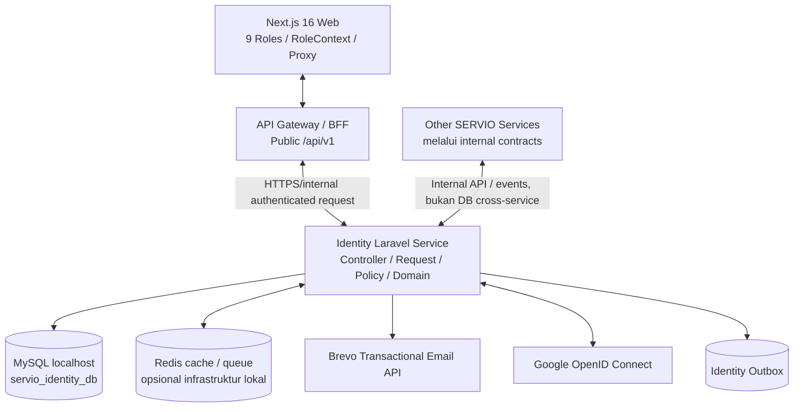
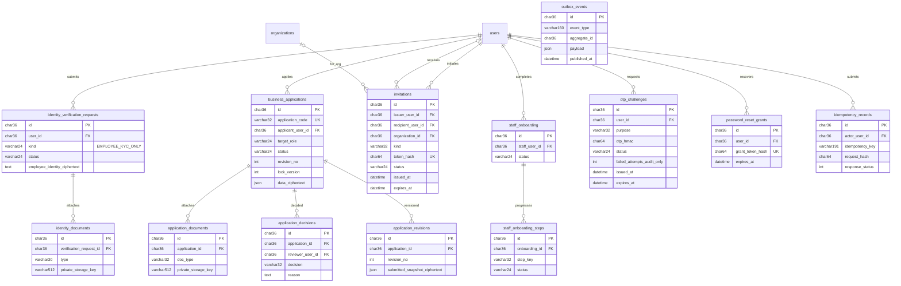
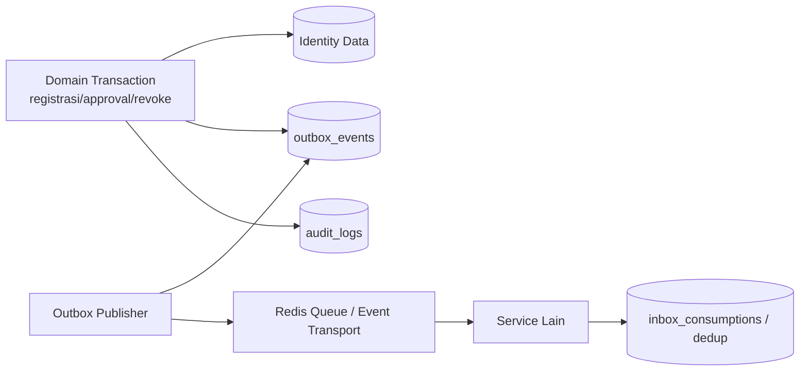
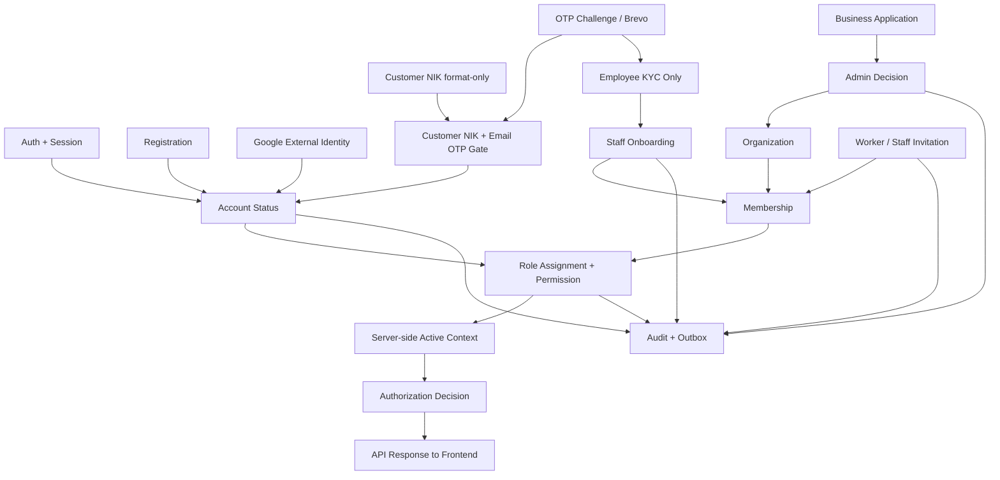
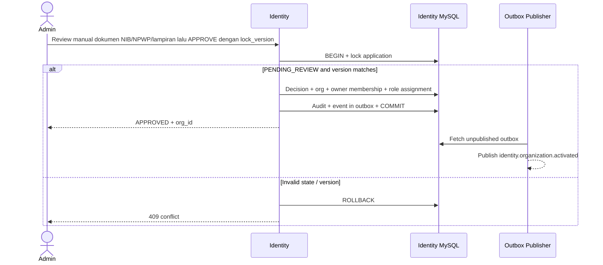

# SERVIO — BACKEND TECHNICAL SPECIFICATION
## Modul 01 — Identity & Access Service (CR-02 FINAL LOCKED)

| Metadata | Nilai |
|---|---|
| Kode modul | `01` |
| Microservice | `identity-service` |
| Output | `docs/backend/01-identity-access/01-identity-access.md` |
| Business source of truth | `PHASE-01-PLAN.md` — **LOCKED**, v1.1/CR-01; ditambah `PHASE-01-CR02-DECISIONS.md` — **APPROVED/LOCKED** 2026-10-13 |
| Konteks global | `SERVIO_GLOBAL_DATA_PREPARATION.md` (gunakan dengan koreksi/keputusan global yang disetujui) |
| Status dokumen ini | **TECHNICAL_SPEC_FINAL_LOCKED** — ACC pengguna 2026-10-13; belum diimplementasikan |
| Versi revisi | 1.3 — CR-02: CEO satu-satunya reviewer Employee KYC; NIK semua pengguna terkunci permanen setelah input pertama (meneruskan CR-01) |
| Basis desain | Laravel microservice independen; MySQL **localhost**; Next.js 16 / React 19 / TypeScript |
| Batasan | Hanya Modul 01; ASSET **tidak termasuk**; Recommendation adalah modul terpisah di masa depan |
| Credential | Pengguna mengisi `BREVO_API_KEY` dan credential OAuth sendiri di `.env`; jangan taruh secret dalam dokumen/repository |
| Konvensi status | **[B]** aturan bisnis LOCKED; **[T]** keputusan/usulan implementasi teknis; **[P]** pending verifikasi kode/keputusan/dependensi |

> **Aturan prioritas:** `PHASE-01-PLAN.md` v1.1/CR-01 yang LOCKED beserta perubahan terbatas `PHASE-01-CR02-DECISIONS.md` yang APPROVED/LOCKED menentukan perilaku bisnis. Untuk EC-17 dan akses verifikasi Employee KYC, keputusan CR-02 mengungguli kalimat CR-01 yang bertentangan. Detail endpoint, tabel, struktur Laravel, angka keamanan, dan protokol di bawah merupakan **rancangan teknis [T]**, tidak otomatis mengubah planning. Konflik dengan dokumen global diselesaikan dengan keputusan terbaru pengguna dan dicatat; perubahan aturan bisnis butuh change review dan re-lock. **Satu modul = satu microservice = satu database milik service.** Kontrak antarservice yang belum dibahas adalah **PROVISIONAL**, bukan endpoint yang sudah diimplementasikan service tujuan.

### Ringkasan sasaran implementasi
- Lima jalur pembuatan akun: Customer self-register/Google + NIK 16 digit (validasi format saja) + OTP email Brevo 30 detik **tanpa KYC Customer**; Business Provider/Merchant/Supplier + review dokumen legal **manual Admin Operations**; Worker via undangan Provider 12 jam; Internal Staff via undangan CEO 12 jam/onboarding Employee KYC+NDA; CEO bootstrap melalui seed.
- Identity memegang akun, role, permission, organization, membership, profil dasar, KYC, autentikasi, sesi, lifecycle, dan audit.
- Authorization tidak hanya role: juga status akun, role assignment, organization, membership, permission, kepemilikan resource, serta business state yang dimiliki domain terkait.
- Output teknis terdiri dari tepat **10 komponen utama** berikut; semua implementasi harus dapat ditelusuri dari requirement → DB → API → role/policy → UI → test.

### Register keputusan CR-01 dan revisi implementasi (pengikat seluruh 10 komponen)

| ID | Ketetapan | Dampak wajib |
|---|---|---|
| CR01-CUST | Customer memasukkan NIK **tepat 16 digit numerik** dan melakukan verifikasi OTP email Brevo sebelum `ACTIVE`. **Tidak ada Customer KYC**, e-KTP, Dukcapil, KYC vendor, atau approval manual Customer. | Gunakan `user_nik_records` untuk bukti **format valid saja**, bukan `identity_verification_requests` KYC; V11 menyimpan NIK terenkripsi; verifikasi OTP tetap V01–V03. |
| CR01-OTP | OTP kedaluwarsa **30 detik sejak diterbitkan**; tidak ada batas kumulatif OTP salah per challenge ataupun status `LOCKED` karena jumlah salah. | `429` dan `Retry-After` untuk pembatasan kecepatan per identifier/IP; `410` expired; `422` salah; audit aman. Resend setelah challenge lama expired adalah **usulan teknis**, bukan business rule baru. |
| CR01-INV | Undangan Worker **dan** Staff berlaku **12 jam sejak issuance**, sekali pakai. | Server menetapkan `expires_at=issued_at + 12 hours`; abaikan TTL yang dikirim klien. |
| CR01-BIZ | Verifikasi dokumen legal Provider/Merchant/Supplier oleh **Admin Operations SERVIO secara manual**; tidak menggunakan pihak ketiga KYC/KYB atau pemeriksa legal otomatis. | Review melalui B09–B13, termasuk akses berizin ke dokumen legal, keputusan + reason + reviewer + waktu + histori; status hanya `APPROVED/REVISION_REQUIRED/REJECTED` dengan validasi state dan concurrency. |
| CR01-STAFF | Employee KYC, NDA, konfirmasi akses internal staff tetap wajib. | Endpoint V04–V10 diperuntukkan Employee KYC; pemeriksaan internal sesuai otorisasi, tidak memerlukan vendor eksternal. |
| CR02-CEO-KYC | **Hanya `CEO_PRODUCT_OWNER`** yang boleh membaca antrean bukti Employee KYC dan memutuskan `VERIFY/REJECT`. | V08–V09 berada pada route `/ceo/identity/verifications*`; V07/V10 document review hanya staff pemilik atau CEO berizin; permission `identity.kyc.review` eksklusif CEO, dengan version lock, audit dan larangan self-review. Admin Operations tidak mendapatkan grant ini. |
| CR02-NIK-IMMUTABLE | **NIK bersifat write-once/immutable permanen sejak penyimpanan pertama yang berhasil** untuk setiap user; Customer tetap diperiksa format 16 digit tanpa Customer KYC. | Data di `user_nik_records` encrypted, PK user, insert-only; V11 dan first-write Employee KYC menolak input kedua/overwrite/reset sekalipun nilainya identik; P02/P03/P13 dan semua bulk/import/admin/CEO actions memblokir mutation NIK. Tidak ada endpoint perbaikan NIK atau bypass admin. |
| CR01-AUTH | Browser menggunakan **Laravel Sanctum SPA stateful session**, cookie `HttpOnly` dan perlindungan CSRF; tidak memakai bearer fallback untuk sesi browser. | Integrasi Next.js diperiksa pada tahap terpisah sebelum dianggap berjalan. |
| ARCH-DB | **MySQL localhost per logical microservice DB**. | Bukan MongoDB, tanpa cross-service FK atau koneksi/query langsung ke DB lain. |

**Prioritas lintas dokumen:** Jika dokumen global lama atau contoh teknis versi lama bertentangan dengan CR-01, CR-02, dan keputusan manual terbaru, aturan pada tabel ini berlaku. Revisi ini **tidak mengubah planning LOCKED**. Semua kode API, tabel dan pesan di bawah yang bertanda `[T]` merupakan baseline rancangan teknis yang disetujui pada ACC dokumen ini (dengan `[P]` tetap terbuka sesuai catatannya). **Backend Laravel dan integrasi Next.js dikerjakan dengan dua prompt terpisah; §08 hanya pemetaan dalam tahap backend.**

---

# 01. Service Architecture & Boundary

## 1.1 Tanggung jawab, ownership, dan larangan

**CR-02 wajib:** CEO saja menjadi reviewer Employee KYC; Admin Operations tetap reviewer manual dokumen legal bisnis. NIK yang telah tersimpan tidak dapat diubah oleh peran mana pun, termasuk CEO. Aturan ini juga harus dilindungi oleh service/model/database, bukan hanya UI.

| Area | Identity owner? | Data/aksi yang dimiliki | Batasan |
|---|---|---|---|
| User/account | Ya | User ID, email/telepon, credential hash, account status | Bukan owner order/payment |
| Authentication | Ya | Password, Google external identity, sessions, reset, OTP challenge | Google sign-in ≠ KYC |
| Customer NIK & Employee KYC | Ya | NIK tersimpan satu kali per user dalam **immutable user NIK record** (Customer hanya validasi format); Employee KYC dan review bukti internal staff | **CEO satu-satunya reviewer Employee KYC**; tidak ada KYC/e-KTP Customer; NIK tidak dapat diganti kapan pun; Brevo hanya OTP delivery |
| RBAC/authorization | Ya | Role utama, permission registry/assignment, role membership, keputusan identitas/akses | Domain lain tetap memeriksa kepemilikan resource miliknya sendiri |
| Organization/membership | Ya | Organization jenis Provider/Merchant/Supplier/Internal, user affiliation dan lifecycle | Bukan owner transaksi, katalog, saldo |
| Business application | Ya | Pendaftaran, dokumen legal, **review manual Admin Operations**, alasan keputusan dan histori | Tidak ada integrasi KYC/KYB/legal-check eksternal; approval bukan persetujuan produk/jasa |
| Worker & internal staff | Ya | Undangan, membership worker, pembuatan/onboarding staf, NDA acknowledgement | Task/dispatch worker milik Order/Service |
| Profile | Ya | Profil personal, identitas legal/bisnis, verification state | Harga jasa, stok, rekening bank, rating di domain lain |
| Session & account security | Ya | Logout, revoke, suspension, audit | Dilarang menyimpan plain password/OTP |
| External integrations | Ya (use-case) | Panggilan outbound Brevo OTP dan Google OAuth | Notifikasi bisnis tetap di Notification Service |

**Tidak ada** implementasi Asset, Smart Recommendation, Product, Category, Service offering, Order, Finance, Escrow, Tax, Affiliate calculation, Warranty, Dispute atau Analytics di database modul ini.

## 1.2 Diagram komponen



**[T]** Gateway menangani jalur publik dan pengiriman konteks yang telah terverifikasi; pemeriksaan hak akses definitif berada di Identity dan service pemilik resource. `RoleContext`/cookie frontend bukan security authority. Jangan meneruskan header `X-User-*` dari browser tanpa dihapus dan diterbitkan ulang oleh gateway tepercaya.

## 1.3 Struktur source dan lingkungan localhost

```text
servio/
├── docs/backend/
│   ├── SERVIO_GLOBAL_DATA_PREPARATION.md
│   └── 01-identity-access/
│       ├── PHASE-01-PLAN.md
│       └── 01-identity-access.md              <-- dokumen ini
├── backend/
│   ├── services/
│   │   └── identity-service/                 <-- project Laravel mandiri
│   │       ├── app/
│   │       │   ├── Domain/Identity/{Actions,Enums,Events,Policies}/
│   │       │   ├── Application/{Commands,Queries,DTOs}/
│   │       │   ├── Infrastructure/{Persistence,Google,Brevo,Outbox}/
│   │       │   └── Http/{Controllers,Requests,Resources,Middleware}/
│   │       ├── bootstrap/app.php
│   │       ├── routes/{api.php,internal.php,web.php}
│   │       ├── database/{migrations,seeders,factories}/
│   │       ├── tests/{Unit,Feature,Contract,Integration}/
│   │       ├── config/servio.php
│   │       ├── .env / .env.example
│   │       ├── composer.json
│   │       └── Dockerfile
│   └── gateway/                            <-- komponen infrastruktur, bukan modul domain
└── docker-compose.yml
```

Struktur `Domain/Application/Infrastructure` adalah **[T] modular layers di dalam satu Laravel service**, bukan microservice tambahan. Gunakan controller tipis → FormRequest → application action → transaction/repository → response resource; integrasi eksternal melalui adapter yang dapat di-mock.

```dotenv
APP_NAME=SERVIO_Identity
APP_ENV=local
APP_DEBUG=true
APP_URL=http://localhost:8001
DB_CONNECTION=mysql
DB_HOST=127.0.0.1
DB_PORT=3306
DB_DATABASE=servio_identity_db
DB_USERNAME=servio_identity
DB_PASSWORD=CHANGE_ME_LOCAL_ONLY
SESSION_DRIVER=database
SESSION_LIFETIME=120
SESSION_SECURE_COOKIE=false
SESSION_SAME_SITE=lax
CACHE_STORE=database
QUEUE_CONNECTION=database
REDIS_HOST=127.0.0.1
BREVO_API_KEY=
BREVO_SENDER_EMAIL=
BREVO_SENDER_NAME=SERVIO
GOOGLE_CLIENT_ID=
GOOGLE_CLIENT_SECRET=
GOOGLE_REDIRECT_URI=http://localhost:8001/auth/google/callback
IDENTITY_OTP_HASH_KEY=GENERATE_PRIVATE_LOCAL_SECRET
IDENTITY_INTERNAL_SERVICE_KEY=GENERATE_PRIVATE_LOCAL_SECRET
IDENTITY_SESSION_INTROSPECTION_TTL_SECONDS=15
CEO_BOOTSTRAP_EMAIL=
CEO_BOOTSTRAP_PASSWORD=
```

**Catatan:** Ini contoh **tanpa credential aktif**. `APP_KEY` harus di-generate Laravel; `.env` masuk `.gitignore`. Jika Laravel dijalankan dari Docker, `DB_HOST` menjadi nama service MySQL, misalnya `mysql`, bukan `127.0.0.1`. Database per service tetap berada dalam satu MySQL instance lokal. `APP_DEBUG=false`, secure cookies/HTTPS, dan pengelola secret wajib untuk deployment publik. Tentukan satu hostname localhost konsisten untuk Next.js/gateway/Laravel pada penggunaan cookie agar tidak memunculkan masalah SameSite/session lintas host.

## 1.4 Keputusan mekanisme auth [T]

**Keputusan CR-01 (LOCKED):** browser web first-party menggunakan **Laravel Sanctum SPA stateful session** (cookie HTTP-only, CSRF protection), terintegrasi melalui Gateway/BFF. Next.js dapat melakukan render/middleware routing dari indikator sesi, tetapi tidak memutuskan otorisasi dari nilai `servio_active_role` yang bisa dimanipulasi. Untuk lintas-service, gateway meneruskan **trusted request identity context** setelah pemeriksaan session di Identity; service downstream menerapkan policy atas resource-nya. Antarservice wajib autentikasi machine-to-machine; jangan kirim cookie browser secara langsung ke service domain untuk dipercaya secara buta.

Alasan: frontend web adalah Next.js first-party, membutuhkan logout semua sesi dan pencabutan akses. **Sanctum SPA tidak menggunakan bearer token untuk sesi browser**; bila frontend existing masih bergantung pada `servio_token`, perlu adapter/migrasi UI terkontrol alih-alih mengklaim cookie itu token Sanctum. Rujukan: https://laravel.com/docs/sanctum . **[P]** Pilihan Sanctum SPA **sudah final**; hanya detail kompatibilitas host/cookie, gateway, CSRF, dan source `src/proxy.ts`, `RoleContext.tsx`, `servioApi.ts` yang wajib diaudit sebelum integrasi UI.

**Kontrak session/introspection [T]:** gateway memperoleh keputusan Identity untuk request terlindungi, meneruskan user ID, active role assignment, org ID, authz version, trace ID melalui saluran internal tepercaya; service domain tetap mengecek resource ownership dan state. Caching konteks hanya TTL singkat dan invalidation saat revoke; kegagalan validasi = **fail closed**. Jangan gunakan HMAC key sama untuk OTP, internal service auth, dan session encryption.

## 1.5 Multi-role / multi-organization

- `users` = individu, unik lintas jalur pendaftaran. Customer dapat kemudian mempunyai role bisnis, selama business approval selesai; applicant baru dapat membuat **akun owner individual** sebelum approval tanpa memperoleh role bisnis. Login tidak membuat user baru.
- `organizations` = Provider, Merchant, Supplier atau Internal. `memberships` = keanggotaan user dalam org tertentu dan statusnya; `role_assignments` = hubungan role user/global atau dalam membership.
- `active_role_assignment_id` (bukan sekadar role string) dan `active_organization_id` disimpan dalam **server-side session**; pergantian persona diproses endpoint terproteksi dan divalidasi server.
- Worker boleh memiliki beberapa riwayat membership, tetapi **maksimal satu ACTIVE Provider Worker membership** pada satu waktu. Ini ditegakkan transaksional + database uniqueness (lihat §03).
- Admin **bukan superuser otomatis**; CEO hanya authority yang diizinkan planning. Domain staff/onboarding tetap dibatasi status `OPERATIONAL_READY`.

## 1.6 Batas integrasi

Identity hanya mengirim **ID stabil dan status minimal** ke service lain; tidak menyebarkan KTP/NIK/NPWP mentah sebagai field authorization. Event perubahan status, role, membership membantu invalidasi cache, tetapi consumer harus tetap mampu memverifikasi konteks ke Identity ketika diperlukan. Nomor 07 di bawah memuat kontrak provisional.

## 1.7 Keputusan/risiko yang masih terbuka (bukan perubahan bisnis)

| ID | Topik | Status & penanganan |
|---|---|---|
| O-01 | Customer NIK / verifikasi legal bisnis | **[B]** Customer tidak menjalani KYC; NIK hanya diperiksa 16 digit format tanpa klaim identitas verified. **[B]** Dokumen legal bisnis direview manual oleh Admin Operations, tanpa vendor KYC/KYB. Employee KYC internal tetap berlaku. |
| O-02 | Session auth Next.js sekarang (`servio_token`, `servio_session`) | **[P]** Audit kode frontend sebelum mengubah session adapter. Metode Sanctum stateful session **sudah LOCKED**; kompatibilitas implementasi Next.js belum diverifikasi. |
| O-03 | Parameter OTP/invitation dan login | **[B]** OTP TTL tepat 30 detik, tanpa total wrong-attempt cap/lock; undangan Worker/Staff 12 jam. **[T]** Angka throttle kecepatan login/OTP dan reset grant masih usulan. |
| O-04 | Penyimpanan e-KTP/legal file | **[T]** Laravel private disk lokal saat dev, object storage private saat produksi; metadata di MySQL. |
| O-05 | Notification Service vs Brevo | **[B]** Identitas/OTP milik Identity dan Brevo mengirim OTP; event status bisa dikonsumsi Notification, tetapi tidak memindahkan OTP verification. |
| O-06 | Route frontend global vs plan (`/auth/login` vs `/login`) | **[P]** Kontrak backend satu, UI mapping final setelah verifikasi source aktual; jangan menghapus route berdasarkan daftar dokumentasi saja. |
| O-07 | Employee KYC/NDA dan business documents | **[B]** Wajib sebelum operational-ready. **[T]** Bukti ditautkan dengan versi dokumen, persetujuan, serta audit. |
| O-08 | Kebutuhan S-Pay dan katalog | Di luar scope Modul 01; legal review Provider/Merchant/Supplier **tetap dalam Identity** oleh Admin, tanpa verifikasi vendor. |

---

# 02. Entity Relationship Diagram (ERD)

## 2.1 Diagram konseptual lengkap (Mermaid)

> Diagram dikelompokkan untuk keterbacaan; seluruh tabel tetap milik **satu** database `servio_identity_db`. Relasi ke service eksternal adalah ID referensi **tanpa foreign key lintas database**. PK default `UUID` tersimpan sebagai `CHAR(36)` (pilihan implementasi [T]); Application ID manusiawi tetap terpisah dan immutable.

### A. Akun, profil, role, organisasi dan sesi

```mermaid
erDiagram
  users ||--|| user_profiles : has
  users ||--o| user_nik_records : has_permanent_nik
  users ||--o{ external_auth_identities : links
  users ||--o{ role_assignments : granted
  roles ||--o{ role_assignments : assigned
  memberships o|--o{ role_assignments : scopes
  roles ||--o{ role_permissions : includes
  permissions ||--o{ role_permissions : defines
  users ||--o{ memberships : joins
  organizations ||--o{ memberships : contains
  organizations ||--|| organization_profiles : describes
  users ||--o{ auth_sessions : owns
  users ||--o{ sessions : authenticated
  users ||--o{ audit_logs : acts
  users ||--o{ profile_change_requests : requests
  users {
    char36 id PK
    varchar191 email UK
    varchar20 phone_e164 UK
    varchar255 password_hash
    varchar32 status
    bigint authz_version
    datetime email_verified_at
    datetime phone_verified_at
    datetime created_at
  }
  user_profiles {
    char36 user_id PK,FK
    varchar160 display_name
    varchar512 photo_path
    varchar40 employee_id
    varchar100 department
  }
  user_nik_records {
    char36 user_id PK,FK
    text nik_ciphertext
    datetime locked_at
    datetime format_validated_at
    datetime updated_at
  }
  organizations {
    char36 id PK
    varchar24 type
    varchar24 status
    char36 approved_application_id
  }
  organization_profiles {
    char36 organization_id PK,FK
    varchar190 legal_name
    text nib_ciphertext
    text npwp_ciphertext
    json address_json
  }
  memberships {
    char36 id PK
    char36 user_id FK
    char36 organization_id FK
    varchar24 kind
    varchar24 status
    tinyint active_worker_guard UK
  }
  roles {
    char36 id PK
    varchar64 code UK
  }
  permissions {
    char36 id PK
    varchar128 code UK
    varchar64 resource
    varchar32 action
  }
  role_permissions {
    char36 role_id PK,FK
    char36 permission_id PK,FK
  }
  role_assignments {
    char36 id PK
    char36 user_id FK
    char36 role_id FK
    char36 membership_id FK
    varchar24 status
  }
  external_auth_identities {
    char36 id PK
    char36 user_id FK
    varchar20 provider
    varchar191 provider_subject UK
  }
  sessions {
    varchar255 id PK
    char36 user_id FK
    text payload
    bigint last_activity
  }
  auth_sessions {
    char36 id PK
    varchar255 session_id FK
    char36 user_id FK
    char36 active_role_assignment_id FK
    char36 active_organization_id FK
    datetime revoked_at
  }
  profile_change_requests {
    char36 id PK
    char36 user_id FK
    varchar32 status
    json requested_fields_ciphertext
  }
  audit_logs {
    char36 id PK
    char36 actor_user_id FK
    varchar100 event_code
    json safe_metadata
    datetime occurred_at
  }
```



### B. Employee KYC, NIK format-only Customer, aplikasi bisnis, invitation, onboarding dan lifecycle



### C. Keterkaitan audit dan reliable integration



## 2.2 Kardinalitas dan invariant utama

| Hubungan | Kardinalitas | Invariant |
|---|---|---|
| User–Profile | 1:1 | Profil wajib setelah onboarding, dapat dibuat pending saat akun awal dibuat |
| User–NIK permanen | 1:0..1 | NIK per user, terenkripsi, pertama kali disimpan tidak dapat diganti atau dihapus; input Customer hanya validasi `^[0-9]{16}$` **bukan verified identity/KYC**. NIK pada Employee KYC jika diminta harus konsisten dengan record permanen ini. |
| User–External OAuth | 1:N | `(provider, provider_subject)` unik global, tidak boleh terhubung dua user |
| User–Membership–Organization | N:M melalui membership | Hanya membership ACTIVE yang memberi org authority |
| User–Role | N:M melalui role_assignment | Penugasan dapat global atau context-specific, tidak boleh self-elevate |
| Role–Permission | N:M | Permission milik Identity registry, spesifikasi bisnis detail dirujuk dari modul domain |
| Organization–Business Profile | 1:1 | Data legal terproteksi, business application APPROVED menghasilkan org |
| Application–Decision/Revision | 1:N | Application ID tetap, keputusan dan revisi immutable/audited |
| User–OTP challenge | 1:N sepanjang histori | Maks satu challenge ACTIVE per `(user/identifier,purpose)` dengan lock/invalidasi |
| Invitation–Membership | 0/1 membership hasil penerimaan | Invite existing user tidak membuat duplicate user |
| User–Session | 1:N | Semua session dapat dicabut saat suspend/reset/logout-all |
| User–Audit | 1:N | Append-only dan PII-minimal |

---

# 03. Database Schema & Laravel Migrations Design

## 3.1 Konvensi data

- MySQL **8.4 LTS** disarankan pada localhost, InnoDB dan `utf8mb4`; `timestamps(6)` UTC; `CHAR(36)` untuk ID (opsi optimasi `BINARY(16)` **bukan** perubahan diam-diam).
- `PK` UUID service-owned, `FK` hanya tabel dalam `servio_identity_db`; setiap sensitive document disimpan di **private disk**, tabel menyimpan storage pointer + checksum + mime + encryption metadata.
- PII seperti **NIK Customer** (format saja, tanpa pembuktian keaslian), NPWP/NIB bisnis, kontak legal dan dokumen **Employee KYC** dienkripsi saat disimpan. Jika exact lookup benar-benar diperlukan dan disetujui, gunakan blind index/HMAC terpisah; **jangan mengasumsikan NIK Customer adalah identitas yang diverifikasi**.
- Password memakai Laravel `Hash` (Argon2id/bcrypt konfigurabel), OTP dan invitation/reset token **hash/HMAC only**, never log raw values.
- Semua tabel bisnis yang perlu audit memakai `created_at`, `updated_at`; record historis wajib mempertahankan jejak; `deleted_at` hanya pada item yang aman secara compliance, **tidak** untuk menyembunyikan perubahan keputusan, audit atau ledger akses.
- Status sebagai string (`VARCHAR`) + application enum/validation & state transition policy; jangan campur `account_status` dengan `application_status`, `membership_status`, `onboarding_status`.
- Referential action: `RESTRICT` untuk identitas/histori; tidak cascade delete user yang sudah punya transaksi. Perubahan role berlaku via revocation status.

## 3.2 Kamus tabel — seluruh data ownership Modul 01

> Semua tabel secara default memiliki `id CHAR(36) PK`, `created_at DATETIME(6)`, `updated_at DATETIME(6)`, kecuali pivot/laravel sessions yang disebut khusus. Singkatan `UK` = unique, `IX` = non-unique index, `FK` = foreign key dalam service. Tipe/limit adalah **[T]** dan perlu penyesuaian berdasar migration/runtime aktual.

| Tabel | Kolom penting (tipe) | Key, constraint, index | Lifecycle/catatan |
|---|---|---|---|
| `users` | `id`, `email VARCHAR(191) NULL`, `phone_e164 VARCHAR(20) NULL`, `password_hash VARCHAR(255) NULL`, `status VARCHAR(32)`, `authz_version BIGINT DEFAULT 1`, `email_verified_at`, `phone_verified_at`, `last_login_at`, `suspended_at` | UK email ter-normalisasi, UK phone; IX status | `PENDING`, `VERIFICATION_REQUIRED`, `ACTIVE`, `SUSPENDED`, `DEACTIVATED`; salah satu email/phone wajib; Google-only boleh tanpa password |
| `user_profiles` | `user_id CHAR(36) PK/FK`, `display_name VARCHAR(160)`, `photo_path VARCHAR(512) NULL`, `employee_id VARCHAR(40) NULL`, `department VARCHAR(100) NULL`, `locale VARCHAR(12) NULL` | FK users, UK employee_id bila terisi | Profil dasar; Customer NIK disimpan terpisah, tidak dianggap identity verified |
| `user_nik_records` | `user_id CHAR(36) PK/FK`, `nik_ciphertext TEXT NOT NULL`, `format_validated_at DATETIME(6) NOT NULL`, `locked_at DATETIME(6) NOT NULL`, `created_at`, `updated_at` | PK/FK `users.id` (satu NIK per user); **tanpa UNIQUE pada nilai NIK** karena Customer tidak menjalani verifikasi identitas. DB trigger atau kontrol setara harus menolak UPDATE nilai NIK dan DELETE row, di samping policy service. | **Insert-once immutable** bagi semua user yang menyimpan NIK. Customer hanya `FORMAT_VALID` setelah validasi 16 digit; Employee KYC terpisah tetap perlu persetujuan CEO. Tidak boleh upsert, replace, reset, atau edit oleh Admin/CEO. |
| `external_auth_identities` | `id`, `user_id FK`, `provider VARCHAR(24)`, `provider_subject VARCHAR(191)`, `provider_email VARCHAR(191) NULL`, `email_verified_at`, `linked_at`, `unlinked_at` | UK `(provider,provider_subject)`; IX user_id | Google `sub` immutable, jangan gunakan email sebagai primary external key |
| `roles` | `id`, `code VARCHAR(64)`, `name VARCHAR(100)`, `is_system BOOLEAN`, `is_active BOOLEAN` | UK code | Seed 9 role dari baseline; tidak ada role arbitrer via public API |
| `permissions` | `id`, `code VARCHAR(128)`, `resource VARCHAR(64)`, `action VARCHAR(32)`, `scope_type VARCHAR(24)`, `owner_service VARCHAR(40)`, `is_active` | UK code; IX owner_service/resource | Registry identity/authorization; permission domain lain ditentukan saat modulnya siap |
| `role_permissions` | `role_id FK`, `permission_id FK`, `created_at` | Composite PK `(role_id,permission_id)` | Tidak ada auto grant admin=* |
| `organizations` | `id`, `type VARCHAR(24)`, `status VARCHAR(24)`, `approved_application_id CHAR(36) NULL`, `activated_at`, `deactivated_at` | UK approved_application_id; IX `(type,status)` | `PROVIDER/MERCHANT/SUPPLIER/INTERNAL`, status lifecycle sendiri |
| `organization_profiles` | `organization_id PK/FK`, `legal_name`, `display_name`, `business_email`, `business_phone`, `address_json JSON`, `nib_ciphertext TEXT NULL`, `nib_lookup_hash CHAR(64) NULL`, `npwp_ciphertext TEXT NULL`, `npwp_lookup_hash CHAR(64) NULL`, `specialization_json JSON` | FK org; IX legal_name; sensitive hashes indexed as necessary | Legal changes memerlukan review; tidak berisi stok/jasa/harga/bank |
| `memberships` | `id`, `user_id FK`, `organization_id FK`, `kind VARCHAR(24)`, `status VARCHAR(24)`, `invitation_id FK NULL`, `started_at`, `ended_at`, `active_worker_guard TINYINT GENERATED` | UK/guard worker pada `(user_id,active_worker_guard)`; UK `(id,user_id)`; IX org/status, user/status | `OWNER/WORKER/STAFF` dan `INVITED/ACTIVE/DEACTIVATED/EXPIRED`; single active worker provider enforcement |
| `role_assignments` | `id`, `user_id FK`, `role_id FK`, `membership_id FK NULL`, `status VARCHAR(24)`, `assigned_by FK NULL`, `assigned_at`, `revoked_at`, `reason` | UK logical assignment, IX `(user_id,status)`; FK role/membership | Membership-scoped role harus mengacu membership user yang sama; application validation + composite FK bila didukung migration |
| `business_applications` | `id`, `application_code VARCHAR(32)`, `applicant_user_id FK`, `target_role VARCHAR(24)`, `status VARCHAR(24)`, `revision_no INT DEFAULT 0`, `lock_version INT DEFAULT 1`, `draft_data_ciphertext LONGTEXT`, `submitted_at`, `reviewed_at` | UK application_code; IX applicant/status, target_role/status | `DRAFT/PENDING_REVIEW/REVISION_REQUIRED/APPROVED/REJECTED`; Application ID sama lintas revisi |
| `application_revisions` | `id`, `application_id FK`, `revision_no INT`, `snapshot_ciphertext LONGTEXT`, `submitted_at`, `submitted_by FK` | UK `(application_id,revision_no)` | Snapshot submitted immutable; metadata no secrets/PII logs |
| `application_documents` | `id`, `application_id FK`, `revision_no`, `doc_type VARCHAR(40)`, `private_storage_key VARCHAR(512)`, `sha256 CHAR(64)`, `mime VARCHAR(80)`, `size_bytes BIGINT`, `verification_status` | IX application/revision/doc_type | Private object; signed/authorized retrieval; malware/file validation |
| `application_decisions` | `id`, `application_id FK`, `reviewer_user_id FK`, `decision VARCHAR(32)`, `reason TEXT`, `required_changes_json JSON NULL`, `from_status`, `to_status`, `lock_version`, `decided_at` | IX application/decided_at | Append-only audit of APPROVE/REVISION/REJECT; approved state creates organization in same transaction |
| `identity_verification_requests` | `id`, `user_id FK`, `kind VARCHAR(32)` dibatasi `EMPLOYEE_KYC`, `status VARCHAR(24)`, `employee_identity_ciphertext LONGTEXT NULL` (**tidak menjadi tempat mutable NIK**), `reviewed_by FK NULL`, `reviewed_at`, `rejection_reason`, `lock_version` | IX user/kind/status; `reviewed_by` wajib merujuk CEO yang terotorisasi pada keputusan | **Employee KYC saja**; **CEO saja reviewer/decision maker**, tanpa vendor. NIK staff jika dikumpulkan ditulis pertama kali ke `user_nik_records` dan tidak dapat diganti melalui resubmission KYC. |
| `identity_documents` | `id`, `verification_request_id FK`, `type VARCHAR(32)`, `private_storage_key`, `sha256`, `mime`, `size_bytes`, `uploaded_at` | IX verification/type | Hanya dokumen Employee KYC/identitas staf yang disyaratkan; **tidak menerima e-KTP Customer** |
| `profile_change_requests` | `id`, `user_id FK`, `target_type VARCHAR(24)`, `target_id`, `requested_fields_ciphertext LONGTEXT`, `status`, `reviewed_by FK NULL`, `review_reason`, `reviewed_at` | IX `(user_id,status)`; allowlist field ketat, reject JSON path `nik`/`nik_ciphertext`/alias | **TIDAK untuk NIK dalam kondisi apa pun.** Hanya perubahan data sensitif lain yang diizinkan; NIB/NPWP bisnis direview **Admin Operations** secara manual. Employee KYC ditangani V08/V09 oleh CEO, bukan P13. |
| `invitations` | `id`, `kind VARCHAR(24)`, `issuer_user_id FK`, `recipient_user_id FK NULL`, `recipient_email VARCHAR(191)`, `organization_id FK NULL`, `target_role`, `token_hash CHAR(64)`, `status`, `issued_at DATETIME(6) NOT NULL`, `expires_at DATETIME(6) NOT NULL`, `accepted_at`, `revoked_at` | UK token_hash; IX recipient/status, org/kind/status | `WORKER/STAFF`: `expires_at=issued_at+12 jam` **LOCKED**, sekali pakai, token lama invalid saat resend yang menghasilkan token baru |
| `staff_onboarding` | `id`, `staff_user_id FK`, `status VARCHAR(32)`, `completed_at`, `created_by FK`, `last_verified_at` | UK staff_user_id | `INVITED/ONBOARDING/OPERATIONAL_READY/SUSPENDED/DEACTIVATED` |
| `staff_onboarding_steps` | `id`, `onboarding_id FK`, `step_key VARCHAR(32)`, `status`, `evidence_document_id FK NULL`, `document_version NULL`, `completed_at`, `reviewed_by FK NULL` | UK `(onboarding_id,step_key)` | PROFILE, EMPLOYEE_KYC, NDA, ACCESS_CONFIRMATION; persetujuan NDA versioned |
| `otp_challenges` | `id`, `user_id FK NULL`, `identifier_hash CHAR(64)`, `purpose VARCHAR(32)`, `otp_hmac CHAR(64)`, `status`, `failed_attempts_audit_only INT DEFAULT 0`, `issued_at DATETIME(6) NOT NULL`, `expires_at DATETIME(6) NOT NULL`, `resend_available_at DATETIME(6) NULL`, `consumed_at`, `delivery_message_id VARCHAR(255) NULL`, `delivery_state` | IX identifier/purpose/status, expires_at | `expires_at=issued_at + 30 detik` **LOCKED**; counter hanya telemetry, **bukan lock/limit total percobaan**; enforce burst rate limiting per IP/identifier dan one-time verification |
| `password_reset_grants` | `id`, `user_id FK`, `challenge_id FK`, `grant_token_hash CHAR(64)`, `expires_at`, `consumed_at` | UK grant_token_hash; IX user/expires | OTP verify mints restricted one-time reset grant, no password reset with OTP reused |
| `sessions` | Laravel `id VARCHAR(255) PK`, `user_id FK NULL`, `ip_address`, `user_agent`, `payload LONGTEXT`, `last_activity INT` | IX user_id/last_activity | Laravel database session driver; no raw tokens logged |
| `auth_sessions` | `id`, `session_id VARCHAR(255) FK/UK`, `user_id FK`, `active_role_assignment_id FK NULL`, `active_organization_id FK NULL`, `device_name`, `created_ip`, `last_seen_at`, `revoked_at` | IX user/revoked_at | Server-side persona; listing and revocation, `logout-all` deletes matching sessions |
| `audit_logs` | `id`, `actor_user_id FK NULL`, `event_code VARCHAR(100)`, `target_type`, `target_id`, `result`, `ip_hash`, `user_agent_hash`, `request_id`, `safe_metadata JSON`, `occurred_at` | IX event/occurred_at, target, actor | Append-only; exclude secret, NIK, KTP, OTP, passwords |
| `idempotency_records` | `id`, `actor_user_id FK NULL`, `scope VARCHAR(128)`, `idempotency_key VARCHAR(191)`, `request_hash CHAR(64)`, `response_status SMALLINT`, `response_json JSON NULL`, `expires_at` | UK `(scope,actor_bucket,idempotency_key)` dengan `actor_bucket VARCHAR(128) NOT NULL`; expiration IX | At-most-once logical submission; handle null actor using normalized actor/identifier bucket |
| `outbox_events` | `id`, `aggregate_type`, `aggregate_id`, `event_type`, `schema_version`, `payload_json JSON`, `occurred_at`, `published_at`, `attempts`, `last_error` | IX published_at/occurred_at, aggregate ID | Write with same DB transaction as mutation |
| `inbox_consumptions` | `id`, `consumer_name`, `source_event_id`, `processed_at`, `status`, `error_code` | UK `(consumer_name,source_event_id)` | Only for inbound consumed events; dedup repeat delivery |

**Jumlah: 29 tabel** termasuk tabel `user_nik_records`, Laravel session, audit, dan reliable messaging. Penambahan/pengurangan tabel pada implementasi harus tetap menjaga seluruh invariant, bukan demi mencapai angka tertentu.


### CR-02: Immutability NIK pada MySQL + aplikasi (WAJIB)

- **Satu user, maksimal satu rekaman NIK:** `user_nik_records.user_id` PK/FK ke `users.id`. Simpan ciphertext terenkripsi dan `locked_at` hanya saat INSERT pertama; tidak ada penggantian NIK oleh siapa pun, bahkan bila NIK semula salah ketik. Tidak menganggap NIK Customer valid secara hukum hanya karena 16 digit.
- **Pengendalian race:** operasi input NIK dijalankan dalam transaction, `INSERT` eksklusif, tangani duplicate PK menjadi `409 IDENTITY_NIK_PERMANENTLY_LOCKED`, bukan `upsert`, `updateOrCreate`, `ON DUPLICATE KEY UPDATE`, atau overwrite data existing.
- **Pertahanan MySQL:** implement `BEFORE UPDATE` dan `BEFORE DELETE` trigger pada `user_nik_records` yang melempar `SIGNAL SQLSTATE '45000'` untuk setiap perubahan atau penghapusan record, disertai privilege database minimal agar aplikasi tidak bisa melepas trigger. Perubahan teknis administratif tingkat database di luar jalur aplikasi harus tunduk proses keamanan/kepatuhan; tidak ada API override. Uji migrasi dan trigger pada database testing terisolasi.
- **Jika staff mengirim NIK sebagai bagian Employee KYC:** tulis ke `user_nik_records` hanya jika belum ada; bila sudah tersimpan, jangan menulis NIK baru. Field `employee_identity_ciphertext` dan dokumen verifikasi tidak boleh menjadi cara menimpa NIK permanen; periksa kecocokan record dengan akses data minimal. CEO hanya memutuskan status Employee KYC, bukan mengedit NIK.
- **Larangan API:** V11 ulang ditolak `409`; NIK pada P02/P03/P07/P13, bulk/import, staff KYC resubmission dan jalur role switch ditolak; tidak ada endpoint `PATCH/DELETE` NIK. Seluruh error tanpa echo nilai NIK mentah.
- **Retensi/privacy:** "permanen terkunci" berarti **tidak dapat diedit dalam lifecycle aplikasi**. Kewajiban hukum yang mungkin mengatur penghapusan/retensi data pribadi harus diperlakukan sebagai proses kepatuhan terpisah, bukan sebagai izin penggantian NIK.

## 3.3 Model status dan transisi tegas

| Aggregate | Transisi valid | Transisi yang ditolak |
|---|---|---|
| Account | `PENDING → VERIFICATION_REQUIRED → ACTIVE`; `ACTIVE → SUSPENDED/DEACTIVATED`; `SUSPENDED → ACTIVE` hanya authority sah | `SUSPENDED → use protected business API`, `REJECTED business → active user role` |
| Business application | `DRAFT → PENDING_REVIEW → APPROVED / REVISION_REQUIRED / REJECTED`; `REVISION_REQUIRED → PENDING_REVIEW` | edit saat `PENDING_REVIEW` tanpa review/revision, approve dua kali |
| Worker membership | `INVITED → ACTIVE → DEACTIVATED`; undangan kedaluwarsa → `EXPIRED` | 2 ACTIVE Provider Worker pada user sama |
| Staff onboarding | `INVITED → ONBOARDING → OPERATIONAL_READY` setelah 4 steps; `OPERATIONAL_READY → SUSPENDED/DEACTIVATED` | memberi operational access sebelum ready |
| OTP | `ISSUED → SENT → VERIFIED/CONSUMED` atau `EXPIRED/DELIVERY_FAILED/CANCELLED` | OTP expired/consumed dipakai ulang; **tidak ada OTP lock berdasarkan jumlah salah** |
| Role assignment | `ACTIVE → REVOKED`; grant baru memerlukan authorized actor | self-grant, self-escalation |

**Ketelitian penting:** Sebelum business application di-APPROVE, Admin Operations **secara manual** meninjau dokumen legal, data PIC, dan persyaratan akun pemohon sesuai planning, tanpa verifikasi KYC/KYB vendor. Account owner yang sudah memenuhi syarat dan belum tersuspensi dapat menjadi `ACTIVE` dalam proses approval; **jangan** menghasilkan business membership operasional efektif untuk account yang masih `VERIFICATION_REQUIRED` atau `SUSPENDED`. Access memerlukan kombinasi account ACTIVE + org ACTIVE + membership ACTIVE + role assignment ACTIVE + permission. `Application ACTIVE` dalam diagram bisnis direpresentasikan sebagai *organization/membership activated after approval*; jangan memasukkan `ACTIVE` dua kali menjadi state approval ambigu.

## 3.4 Constraint race-condition terpenting

**Satu Worker–satu ACTIVE Provider** (MySQL generated column; ilustrasi desain):

```sql
ALTER TABLE memberships
  ADD COLUMN active_worker_guard TINYINT
    GENERATED ALWAYS AS (
      CASE WHEN kind = 'WORKER' AND status = 'ACTIVE' THEN 1 ELSE NULL END
    ) STORED,
  ADD UNIQUE KEY memberships_one_active_provider_worker
    (user_id, active_worker_guard);
```

Semua membership WORKER mengarah organization type PROVIDER (dicek application/domain transaction), dan menerima undangan harus memanggil transaksi dengan `SELECT ... FOR UPDATE` pada user/membership, lalu menangani duplicate-key. Index hanya melindungi constraint tunggal; validitas recipient/org/status undangan dicek secara terpisah.

**Business review concurrency:** ambil row `business_applications` dengan `lockForUpdate()`, verifikasi `status=PENDING_REVIEW` dan `lock_version` dari klien, tambah `lock_version`, catat keputusan, aktifkan organization/membership bila approve, tulis audit + outbox **dalam satu DB transaction**. Dua Admin tidak bisa melakukan keputusan yang saling bertabrakan.

## 3.5 Contoh migration Laravel (ilustratif, bukan pengganti seluruh blueprint)

```php
// database/migrations/YYYY_MM_DD_000001_create_users_table.php
Schema::create('users', function (Blueprint $table) {
    $table->uuid('id')->primary();
    $table->string('email', 191)->nullable()->unique();
    $table->string('phone_e164', 20)->nullable()->unique();
    $table->string('password_hash')->nullable();
    $table->string('status', 32)->default('PENDING')->index();
    $table->unsignedBigInteger('authz_version')->default(1);
    $table->timestamp('email_verified_at', 6)->nullable();
    $table->timestamp('phone_verified_at', 6)->nullable();
    $table->timestamp('last_login_at', 6)->nullable();
    $table->timestamp('suspended_at', 6)->nullable();
    $table->timestamps(6);
});
```

```php
// Bagian migration business_applications
Schema::create('business_applications', function (Blueprint $table) {
    $table->uuid('id')->primary();
    $table->string('application_code', 32)->unique();
    $table->foreignUuid('applicant_user_id')->constrained('users')->restrictOnDelete();
    $table->string('target_role', 24);
    $table->string('status', 24)->default('DRAFT')->index();
    $table->unsignedInteger('revision_no')->default(0);
    $table->unsignedInteger('lock_version')->default(1);
    $table->longText('draft_data_ciphertext')->nullable();
    $table->timestamp('submitted_at', 6)->nullable();
    $table->timestamp('reviewed_at', 6)->nullable();
    $table->timestamps(6);
    $table->index(['applicant_user_id', 'status']);
});
```

```php
// Business review application service (pseudo Laravel)
DB::transaction(function () use ($applicationId, $expectedVersion, $reviewer, $decision) {
    $app = BusinessApplication::query()->lockForUpdate()->findOrFail($applicationId);
    abort_unless($app->status === 'PENDING_REVIEW', 409);
    abort_unless($app->lock_version === $expectedVersion, 409);
    // Check reviewer authority, decision reason and data/verification completeness.
    // Append application_decisions; APPROVE -> create organization + membership + role.
    $app->lock_version++;
    $app->save();
    // Append audit_logs and outbox_events in SAME transaction.
});
```

`restrictOnDelete` pada data historis, unique email ter-normalisasi (trim/lowercase, peraturan normalisasi domain) dan `phone_e164` dicek oleh FormRequest + service; MySQL collation case-sensitivity harus diputuskan secara eksplisit. Jangan jadikan kolom `name`/URL sebagai identifier kanonis.

### Contoh migration NIK permanen (rancangan [T] konsisten dengan CR-01 + CR-02)

```php
Schema::create('user_nik_records', function (Blueprint $table) {
    $table->uuid('user_id')->primary();
    $table->foreign('user_id')->references('id')->on('users')->restrictOnDelete();
    $table->text('nik_ciphertext');  // dienkripsi di application layer
    $table->timestamp('format_validated_at', 6); // BUKAN identity_verified_at
    $table->timestamp('locked_at', 6); // diisi pada INSERT pertama, tidak berubah
    $table->timestamps(6);
});
```

**MySQL guard wajib** (ilustrasi migration `DB::unprepared` setelah pembuatan tabel, pada DB testing terlebih dahulu):

```sql
CREATE TRIGGER user_nik_records_prevent_update
BEFORE UPDATE ON user_nik_records
FOR EACH ROW
SIGNAL SQLSTATE '45000'
SET MESSAGE_TEXT = 'NIK_RECORD_IMMUTABLE';

CREATE TRIGGER user_nik_records_prevent_delete
BEFORE DELETE ON user_nik_records
FOR EACH ROW
SIGNAL SQLSTATE '45000'
SET MESSAGE_TEXT = 'NIK_RECORD_IMMUTABLE';
```

Rollback migration **khusus database pengujian/development kosong** wajib menjatuhkan kedua trigger sebelum drop tabel. Runtime DB user minimal privilege; migrator punya hak khusus. Ini defense-in-depth dan **bukan** pengganti otorisasi backend.

Nilai `nik` harus lolos validasi string `regex:/^[0-9]{16}$/D` sebelum dienkripsi. `format_validated_at` merekam pengecekan pola, **bukan bukti NIK sah**. **CR-02:** `V11` hanya insert pertama pada onboarding Customer, tanpa `upsert`/`updateOrCreate`. Jalankan transaksi/unique-PK guard; ketika row sudah ada selalu tolak `409 IDENTITY_NIK_PERMANENTLY_LOCKED`, termasuk nilai NIK yang sama. `locked_at` ditetapkan pada insert pertama. DB-level no-update/no-delete trigger atau perlindungan setara perlu diuji pada MySQL. Saat Employee KYC mencakup NIK, lakukan first insert ke record yang sama jika belum ada, dan tolak nilai lain/overwrite; ini **bukan** mengganti NIK melalui proses review. Record permanen tidak dihapus oleh suspend/deactivate/reset. **Multi-role:** jika user sudah mempunyai NIK permanen karena onboarding role sebelumnya, flow Customer baru membaca status existing dan tidak meminta penulisan V11 ulang; NIK lama tetap tidak berubah. Pemenuhan permintaan hukum terkait data pribadi dinilai melalui kebijakan kepatuhan terpisah, bukan endpoint perubahan NIK biasa.

## 3.6 Seeder dan data keamanan

1. Seed **9 role keys**: `CUSTOMER`, `SERVICE_PROVIDER`, `WORKER_TECHNICIAN`, `MERCHANT`, `SUPPLIER`, `CUSTOMER_SUPPORT`, `FINANCE_PAYMENT_OPS`, `ADMIN_OPERATIONS`, `CEO_PRODUCT_OWNER`.
2. Seed Identity permissions yang memang diotorisasi planning, misalnya `identity.profile.read_own`, `identity.profile.update_own`, `identity.business.application.submit`, `identity.business.application.review`, `identity.provider.worker.invite`, `identity.staff.create`, `identity.staff.access.manage`, `identity.account.suspend`, `identity.audit.read_scoped` — **kode adalah kontrak teknis [T]**.
3. Tidak otomatis me-seed semua 29 resource bisnis sebagai izin operasional aktif sebelum owner domain dan granularity-nya disetujui; global matrix menjadi referensi, **bukan wildcard `*`**.
4. CEO seeded memakai email/password **dari `.env` lokal/provisioning**, `Hash::make()`, idempotent seed tanpa menimpa kredensial saat dijalankan ulang; force password rotation pada first login bila disepakati. Jangan copy password contoh dari dokumen global.
5. Contoh data Customer/Provider/dsb sebaiknya factory sintetis `.env.testing`, bukan NIK nyata atau hardcoded private credential. Seeder **tidak** boleh otomatis menandai Customer sebagai KYC-verified; hanya NIK format-valid + OTP terverifikasi yang memberi aktivasi.
6. Setiap migration dapat di-*rollback* lokal secara aman, tetapi **jangan menjalankan `migrate:fresh` pada database non-test yang berisi data nyata**.


## 3.7 Urutan migration, constraint tambahan dan kebijakan soft-delete

**Urutan migration yang disarankan** (agar seluruh FK internal valid):

1. `users`, `roles`, `permissions`, `organizations` (tanpa optional back-reference approval yang membuat siklus).
2. `user_profiles`, `user_nik_records`, `organization_profiles`, `memberships`, `role_permissions`, `role_assignments`, `external_auth_identities`.
3. `identity_verification_requests`, `identity_documents`, `business_applications`, `application_revisions`, `application_documents`, `application_decisions`, `profile_change_requests`.
4. `invitations`, `staff_onboarding`, `staff_onboarding_steps`, `otp_challenges`, `password_reset_grants`, `sessions`, `auth_sessions`.
5. `audit_logs`, `idempotency_records`, `outbox_events`, `inbox_consumptions`, lalu optional FK/back-reference cyclic setelah kedua tabel tersedia.

| Constraint/Index khusus | Implementasi [T] | Mengapa |
|---|---|---|
| Email & telephone uniqueness | normalized email + E.164, unique nullable MySQL | mencegah duplikasi akun |
| Google identity ownership | UK `(provider,provider_subject)` | `sub` tidak ter-link ke dua akun |
| Invitation active dedup | transaksi `lockForUpdate` + unique logical invitation identity via generated guard bila perlu | menghindari dua undangan yang sama aktif |
| Role assignment consistency | FK user, role, membership + verifikasi matching membership user; UK aktif via generated key atau serialized transaction | mencegah duplikasi grant |
| App revision identity | UK `(application_id,revision_no)` | revision stabil tanpa Application ID baru |
| App review version | index `(id,status,lock_version)` + row lock | anti lost-update/approval bersamaan |
| OTP one-active-per-purpose | `identifier_hash,purpose,status` lookup index + serialized locking/unique active marker | satu challenge aktif per identifier/purpose; expired setelah 30 detik, tanpa wrong-attempt lock |
| Staff onboarding one per user | UK `staff_onboarding.staff_user_id` | tidak ada multiple parallel onboarding |
| Session list/revocation | IX user ID + active/revoked, UK session_id | logout-all akurat |
| Idempotency request | UK `(scope,actor_bucket,idempotency_key)` dengan actor_bucket **NOT NULL** | MySQL UNIQUE mengizinkan banyak NULL; anonymous request harus tetap terdedup |
| Event consumer dedup | UK `(consumer_name,source_event_id)` | exactly-once processing *effect* pada handler idempotent |

`idempotency_records.actor_user_id` tetap nullable untuk FK optional tetapi tambahkan `actor_bucket VARCHAR(128) NOT NULL` berisi identifier-hash/IP bucket untuk request anonim; **gunakan actor_bucket dalam unique composite**. SQL migration harus mengimplementasikan ini, bukan mengandalkan `UNIQUE` dengan nullable user ID. **Tidak ada delete cascade pada users, organizations, applications, decisions, audits.** Gunakan status `DEACTIVATED`/`REVOKED`; penghapusan konten sementara atau file orphan sesuai retention policy, sedangkan audit/decision append-only. Setiap FK siklik harus dibuat pada migration alter tahap akhir.


---

# 04. API Endpoint Specification & JSON Contract

## 4.1 Konvensi API

**Public prefix:** `/api/v1`; **internal prefix:** `/internal/v1` pada jaringan internal. Satu URL publik tidak berarti satu controller/gateway memiliki seluruh domain. `Content-Type: application/json` kecuali multipart upload. Response menggunakan `request_id` untuk tracing, `code` stabil untuk handler frontend, dan `data` atau `error`.

**Authentication marker:** `PUB` = tanpa session (masih rate-limited); `AUTH` = user session valid; `STEP` = pre-activation/onboarding-limited session; `STAFF` = internal staff + permission spesifik; `SYS` = authenticated service-to-service only. Untuk mutasi sensitif gunakan `Idempotency-Key` atau `If-Match`/`lock_version` sesuai endpoint.

Contoh response sukses `200/201` (isi `data` mengikuti schema operasi):

```json
{
  "success": true,
  "code": "IDENTITY_OK",
  "data": { "id": "uuid", "status": "ACTIVE" },
  "meta": { "request_id": "req_01", "version": "v1" }
}
```

Contoh error terpadu:

```json
{
  "success": false,
  "code": "IDENTITY_PERMISSION_DENIED",
  "message": "Akses tidak diizinkan untuk konteks ini.",
  "error": {
    "details": [],
    "field_errors": {},
    "retry_after_seconds": null
  },
  "meta": { "request_id": "req_01" }
}
```

Status dasar: `200` read/action success; `201` created; `202` process queued/pending; `204` tanpa body; `400` malformed; `401` unauthenticated; `403` authenticated but forbidden; `404` tidak ditemukan/hidden resource; `409` state/version conflict; `410` expired token/invite; `422` invalid fields; `423` temporarily locked pada mekanisme **non-OTP** yang secara terpisah diotorisasi (bukan wrong-attempt OTP); `429` rate limit; `502` dependency failed; `503` temporarily unavailable. Jangan kembalikan detail apakah email user terdaftar pada endpoint recovery publik (anti-enumeration).

**ID:** UUID internal; business application `APP-YYYY-XXXXXX` manusiawi dengan transaksi/alokasi aman. **Pagination:** `?cursor=&limit=20` (maks 100) pada list; `sort` hanya allowlist; filter `status`, `role`, `organization_id` selalu dibatasi server-side scope. **PII:** field NIK mentah dan storage key tidak pernah ikut response biasa; `nik_masked` dan `verification_status` boleh bila perlu.

## 4.2 Schema objek respons reusable

Contoh schema `USER_CONTEXT` untuk `GET /auth/me`:

```json
{
  "success": true,
  "code": "IDENTITY_CONTEXT_LOADED",
  "data": {
    "user": { "id": "u-uuid", "name": "Customer Contoh", "email": "user@example.test", "status": "ACTIVE" },
    "roles": [
      { "assignment_id": "ra-uuid", "code": "CUSTOMER", "organization_id": null, "membership_status": null },
      { "assignment_id": "ra2-uuid", "code": "SERVICE_PROVIDER", "organization_id": "org-uuid", "membership_status": "ACTIVE" }
    ],
    "active_context": { "role_assignment_id": "ra-uuid", "role": "CUSTOMER", "organization_id": null },
    "permissions": ["identity.profile.read_own", "identity.profile.update_own"],
    "onboarding": { "kind": "CUSTOMER", "status": "COMPLETE" },
    "authorization_version": 3
  },
  "meta": { "request_id": "req_01", "version": "v1" }
}
```

**Schema identifiers untuk tabel endpoint:**

| Alias | Bentuk/field utama | Aturan redaction |
|---|---|---|
| `AuthContext` | USER_CONTEXT di atas | hanya role assignment milik user; permission sesuai active context |
| `SessionView` | `{id,device_name,created_at,last_seen_at,current,active_role,organization_id}` | tidak mengembalikan Laravel session ID/cookie |
| `UserProfile` | `{id,name,email,phone_masked,photo_url,nik_masked,nik_format_status,nik_locked,email_otp_verified,account_status}` | `nik_format_status=FORMAT_VALID` **bukan KYC/verified identity**; tidak mengembalikan raw NIK/e-KTP |
| `OrganizationView` | `{id,type,status,display_name,legal_name,verification_status}` | NIB/NPWP masked kecuali flow verifikasi berizin |
| `ApplicationView` | `{id,application_code,target_role,status,revision_no,lock_version,applicant,pic,business,required_changes,submitted_at}` | legal docs menjadi descriptor/id, bukan public URL |
| `ApplicationDecisionView` | `{decision,reason,required_changes,reviewer_id,decided_at,from_status,to_status}` | reviewer sesuai scope |
| `InvitationView` | `{id,kind,target_role,organization,recipient_masked,status,expires_at}` | token mentah hanya di delivery/first-time invite link |
| `WorkerView` | `{user_id,display_name,membership_id,organization_id,membership_status}` | bukan task/earning data |
| `StaffView` | `{user_id,display_name,role,status,onboarding_status,department}` | email/sensitif dibatasi CEO/own |
| `VerificationView` | `{id,kind:"EMPLOYEE_KYC",status,documents:[{id,type,verification_status}],reason_masked}` | hanya Employee KYC untuk staff/reviewer; private attachment akses dengan policy |
| `AuditView` | `{id,event_code,actor_user_id,target_type,target_id,result,occurred_at,safe_metadata}` | tidak memuat PII/sessions/secret |
| `ListPage<T>` | `{items:[T],next_cursor,has_more}` | filter server-side, bukan filter frontend saja |
| `MutationResult` | `{id,status,version?,effective_at?}` | tidak membocorkan internal error |
| `AcceptedResult` | `{request_id,status:"ACCEPTED"|"PENDING",next_step?}` | cocok untuk delivery async |

## 4.3 Katalog seluruh endpoint eksternal (rancangan kontrak Modul 01)

### A. Authentication, session, Google linking — 18 endpoint

| ID | Method & URL | Auth | Input wajib / query | Response (status & schema) | Aturan penting |
|---|---|---|---|---|---|
| A01 | `POST /auth/register` | PUB | `{name,email?,phone?,password?,registration_type:"CUSTOMER"|"BUSINESS_APPLICANT"}` | `201 MutationResult {user_id,status:"VERIFICATION_REQUIRED",next_step}` | Tipe BUSINESS_APPLICANT hanya akun owner tahap awal, **bukan grant SERVICE_PROVIDER/MERCHANT/SUPPLIER**; password wajib kecuali flow OAuth sah; unique/idempotent |
| A02 | `POST /auth/login` | PUB | `{identifier,password}` + CSRF web | `200 AuthContext` + HttpOnly session cookie | credential, status, attempt policy; stage-limited session bila belum onboarding |
| A03 | `GET /auth/google/redirect` | PUB | `?intent=login|link&return_url=allowlisted` | `302` Google consent | server-generated one-time state/nonce, PKCE bila digunakan |
| A04 | `GET /auth/google/callback` | PUB (state required) | `code,state` dari Google | `302` ke onboarding/dashboard sesuai result | verify issuer/audience/nonce/email_verified/subject; never auto-merge by unverified email |
| A05 | `POST /auth/google/link/start` | AUTH | `{}` setelah step-up auth bila sensitif | `200 {authorization_url}` | session & verification required; same flow dengan redirect intent=link |
| A06 | `GET /auth/google/link/callback` | AUTH + state | `code,state` | `302` atau `200 MutationResult` | provider subject global unique; audit linking |
| A07 | `DELETE /auth/google/link` | AUTH | `{reauth_proof}` | `204` | jangan mencabut satu-satunya metode login tanpa recovery alternatif |
| A08 | `GET /auth/me` | AUTH/STEP | — | `200 AuthContext` | role list dan context hanya milik user, account status dicek |
| A09 | `PATCH /auth/context` | AUTH | `{role_assignment_id,organization_id?}` | `200 AuthContext` | valid ownership, membership ACTIVE, role ACTIVE, bump session context |
| A10 | `POST /auth/logout` | AUTH | `{}` | `204` | invalidate current session + rotate CSRF/session cookie |
| A11 | `POST /auth/logout-all` | AUTH | `{current_password?}` atau step-up proof | `204` | revoke semua sessions, termasuk current; audit |
| A12 | `GET /auth/sessions` | AUTH | `?cursor&limit` | `200 ListPage<SessionView>` | hanya sessions sendiri |
| A13 | `DELETE /auth/sessions/{session_id}` | AUTH | path public UUID session view id | `204` | user dapat revoke session sendiri; prevent IDOR |
| A14 | `POST /auth/forgot-password` | PUB | `{identifier}` | `202 AcceptedResult` generik | no enumeration, rate limit, kirim OTP reset bila eligible |
| A15 | `POST /auth/reset-password` | PUB + grant | `{reset_grant,new_password,confirm_password}` | `200 MutationResult` | grant sekali pakai; seluruh sessions lama revoked |
| A16 | `POST /auth/password/change` | AUTH | `{current_password,new_password,confirm_password}` | `200 MutationResult` | authenticated step-up; revoke other sessions sesuai policy keamanan |
| A17 | `GET /auth/onboarding/status` | AUTH/STEP | — | `200 {account_status,requirements,next_step}` | stage-specific minimal access |
| A18 | `POST /auth/account/deactivate-request` | AUTH | `{reason,reauth_proof}` | `202 AcceptedResult` | deactivation ≠ hard delete; transaksi aktif/legal retention policy dapat menahan eksekusi |

**Catatan A18:** Permintaan deactivation bukan hak menghapus data fisik; bila planning tidak mengatur self-service deactivation UI, endpoint ini **[T][P] optional**, jangan aktifkan/mapping UI tanpa authority yang disepakati. Google A05/A06 merupakan variasi implementasi aman dari Google Account Linking yang eksplisit dalam scope.

### B. OTP, Customer NIK format-only, Employee KYC dan protected documents — 11 endpoint

| ID | Method & URL | Auth | Input wajib / query | Response | Aturan penting |
|---|---|---|---|---|---|
| V01 | `POST /otp/challenges` | PUB/STEP/AUTH | `{purpose,identifier?}` (`ACCOUNT_VERIFICATION`,`PASSWORD_RESET`,`ACCOUNT_LINKING`,`STEP_UP`) | `202 {challenge_id,masked_destination,expires_at,resend_after}` | anti-enumeration; purpose/ownership validation; generated OTP hash-only |
| V02 | `POST /otp/challenges/{id}/verify` | PUB/STEP/AUTH | `{otp}` | `200 {verified:true,next_step,reset_grant?}` | `issued_at + 30 detik`; atomically consume; salah dapat diulang selama belum expired dengan rate-limit throughput, **tanpa attempt lock** |
| V03 | `POST /otp/challenges/{id}/resend` | PUB/STEP/AUTH | `{}` | `202 {challenge_id,resend_after}` | **[T]** usulan resend setelah challenge lama expired (30 detik); challenge lama dibatalkan; throttle anti-abuse tanpa fixed 60-second cooldown |
| V04 | `POST /identity/verifications` | AUTH/STEP | `{kind:"EMPLOYEE_KYC",employee_identity?,document_ids:[...]}` | `201 VerificationView` | **Staff Employee KYC saja**; reviewer internal sesuai otorisasi, tidak ada Customer KYC maupun vendor eksternal |
| V05 | `GET /identity/verifications/me` | AUTH/STEP | `?kind=EMPLOYEE_KYC` | `200 ListPage<VerificationView>` | Employee KYC milik staff sendiri; bukan Customer NIK |
| V06 | `POST /identity/documents` | AUTH/STEP | multipart `file,document_type,verification_request_id?` | `201 {document_id,verification_status:"PENDING"}` | dokumen Employee KYC **saja**; Customer **tidak perlu upload e-KTP**; private storage + validation |
| V07 | `GET /identity/documents/{id}/download` | AUTH/STAFF | path id | `200 binary` or `302` short signed URL | staff pemilik bukti atau CEO dengan `identity.kyc.review` saja; audit downloads; Admin Operations tidak boleh mengunduh bukti Employee KYC staff lain |
| V08 | `GET /ceo/identity/verifications` | STAFF (CEO only) | `?status,kind=EMPLOYEE_KYC,cursor,limit` | `200 ListPage<VerificationView>` | **Hanya CEO_PRODUCT_OWNER** dengan `identity.kyc.review`; Admin/role lain ditolak; daftar hanya Employee KYC |
| V09 | `POST /ceo/identity/verifications/{id}/decision` | STAFF (CEO only) | `{decision:"VERIFY"|"REJECT",reason,lock_version}` | `200 VerificationView` | **CEO_PRODUCT_OWNER eksklusif**, manual check, no self-review, `lockForUpdate`/version lock, audit; Staff hanya `OPERATIONAL_READY` setelah seluruh onboarding terpenuhi |
| V10 | `GET /identity/verifications/{id}` | AUTH/STAFF | — | `200 VerificationView` | Employee KYC milik staff sendiri atau CEO reviewer berizin saja |
| V11 | `POST /identity/customer/nik` | STEP/AUTH | `{nik:"<16 digit numerik>"}` | `201 {nik_masked,nik_format_status:"FORMAT_VALID",nik_locked:true,next_step:"VERIFY_EMAIL_OTP"}` | **Hanya input pertama** (Customer onboarding email/password/Google); 16 digit, encrypt-at-rest, insert-once, DB unique user, `locked_at`; bila sudah pernah ada → `409 IDENTITY_NIK_PERMANENTLY_LOCKED` tanpa mengubah record; tidak ada e-KTP/KYC/vendor. Account tetap VERIFICATION_REQUIRED hingga OTP sah |

**Pemisahan semantik wajib:** `V11` adalah penyimpanan **NIK Customer berstatus `FORMAT_VALID`** (tidak pernah menjadi `KYC_VERIFIED`, `IDENTITY_VERIFIED`, atau `LEGAL_VERIFIED`). Tidak ada pengiriman NIK Customer ke service lain. Endpoint V04–V10 hanya untuk **Employee KYC internal staff**; **CEO saja** yang mereview bukti staf melalui V08/V09, bukan Admin. NIK first-write di setiap flow tidak boleh ditulis ulang. Verifikasi legal Provider/Merchant/Supplier **bukan** V04–V10 dan bukan API vendor: gunakan review application B09–B12 oleh Admin Operations SERVIO. Customer ACTIVE setelah NIK format valid **dan** OTP email Brevo berhasil; urutan kedua aksi boleh berbeda, tetapi kedua flag wajib ada.

### C. Business registration & admin review — 13 endpoint

| ID | Method & URL | Auth | Input wajib / query | Response | Aturan penting |
|---|---|---|---|---|---|
| B01 | `POST /business/applications` | AUTH/STEP | `{target_role:"SERVICE_PROVIDER"|"MERCHANT"|"SUPPLIER",pic,business,legal,specialization}` + idempotency | `201 ApplicationView` DRAFT | owner account required; no grant role before approval |
| B02 | `GET /business/applications` | AUTH | `?status,cursor,limit` | `200 ListPage<ApplicationView>` | own applications only |
| B03 | `GET /business/applications/{id}` | AUTH | — | `200 ApplicationView` | applicant or reviewer; mask sensitive fields |
| B04 | `PATCH /business/applications/{id}` | AUTH | editable `pic,business,legal,specialization,lock_version` | `200 ApplicationView` | only DRAFT/REVISION_REQUIRED; lock version check |
| B05 | `POST /business/applications/{id}/documents` | AUTH | multipart `file,doc_type,revision_no` | `201 {document_id,verification_status}` | private storage, matching editable state |
| B06 | `POST /business/applications/{id}/submit` | AUTH | `{lock_version}` + idempotency | `200 ApplicationView` PENDING_REVIEW | validate required fields/docs/identity prerequisites |
| B07 | `POST /business/applications/{id}/resubmit` | AUTH | `{lock_version}` + idempotency | `200 ApplicationView` PENDING_REVIEW | only REVISION_REQUIRED; same Application ID, new revision snapshot |
| B08 | `GET /business/applications/{id}/history` | AUTH/STAFF | — | `200 {revisions,decisions}` | own or reviewer only |
| B09 | `GET /admin/business/applications` | STAFF | `?target_role,status,cursor,limit` | `200 ListPage<ApplicationView>` | ADMIN_OPERATIONS permission, scoped queue |
| B10 | `GET /admin/business/applications/{id}` | STAFF | — | `200 ApplicationView` + document metadata/history | no approval without authorization |
| B11 | `POST /admin/business/applications/{id}/decisions` | STAFF | `{decision:"APPROVE"|"REQUEST_REVISION"|"REJECT",reason,required_changes?,lock_version}` + idempotency | `200 {application,decision,organization_id?}` | **Admin Operations memeriksa legal bisnis manual**, PENDING_REVIEW only; reason/reviewer/timestamp/history; `lockForUpdate`/version, no self-approval |
| B12 | `GET /admin/business/applications/{id}/history` | STAFF | — | `200 {revisions,decisions}` | audit review access |
| B13 | `GET /business/applications/{id}/documents/{document_id}/download` | AUTH/STAFF | application & document IDs | `200 binary` atau `302` private signed short-lived URL | hanya applicant pemilik atau Admin Operations reviewer berizin; gunakan private storage, record akses audit, jangan gunakan Employee KYC V07 |

**Ketentuan review legal manual yang wajib dipertahankan:** `B09` menampilkan antrean `PENDING_REVIEW` ke Admin Operations berizin. `B10` mengembalikan rincian PIC/legal & daftar `application_documents`, `B13` menyediakan pratinjau/unduh lampiran melalui otorisasi dan audit. Admin membandingkan data/dokumen **secara manual** dan merekam catatan evaluasi. `B11` menolak tindakan tanpa keputusan yang sah, alasan/reviewer/timestamp dan `lock_version` terbaru; `APPROVE` hanya setelah persyaratan dokumen terpenuhi, `REQUEST_REVISION` mencatat bagian perbaikan, `REJECT` menyimpan alasan. Tidak ada callback KYB/KYC vendor atau aktivasi otomatis hanya karena dokumen diunggah. Status aplikasi `APPROVED` memicu aktivasi organization/membership secara transaksional. **Belum ada pemeriksaan eksternal untuk legal bisnis dan jangan menambahkannya.**

`/register/business` UI menggunakan akun owner yang sudah ada atau A01 dengan `registration_type=BUSINESS_APPLICANT` (akun individual tanpa business role), lalu B01–B07. Business applicant yang masih pending hanya mendapat session terbatas untuk proses aplikasi; kelayakan identitas diperiksa sebelum Admin approve. **Tidak membuat `POST /auth/register-provider` yang otomatis memberi Provider role**.

### D. Organization, role, membership, profiles — 13 endpoint

| ID | Method & URL | Auth | Input | Response | Aturan penting |
|---|---|---|---|---|---|
| P01 | `GET /profiles/me` | AUTH/STEP | — | `200 UserProfile` | user sendiri |
| P02 | `PATCH /profiles/me` | AUTH | allowlisted `{display_name,photo_document_id?,phone?}` | `200 UserProfile` | **NIK permanently immutable**: reject input field NIK/aliases walaupun user belum ACTIVE, CEO/Admin, atau nilai sama; Employee KYC evidence/role/permission juga tidak editable |
| P03 | `POST /profiles/change-requests` | AUTH | `{target_type,target_id,fields,reason,document_ids?}` | `201 {id,status:"PENDING_REVIEW"}` | **Tidak menerima NIK atau alias NIK** sebagai field change request; penolakan `422 IDENTITY_NIK_IMMUTABLE_FIELD`; NIB/NPWP bisnis bisa direview manual Admin Operations sesuai policy |
| P04 | `GET /profiles/change-requests/{id}` | AUTH/STAFF | — | `200 {id,status,requested_fields_masked,review_reason}` | pemohon atau reviewer legal bisnis Admin Operations berizin, tanpa raw NIK |
| P05 | `GET /organizations/me` | AUTH | — | `200 ListPage<OrganizationView>` | only organizations through valid memberships |
| P06 | `GET /organizations/{id}` | AUTH | — | `200 OrganizationView` | own org or explicit reviewer |
| P07 | `PATCH /organizations/{id}/profile` | AUTH | editable `{display_name,contact,address}` | `200 OrganizationView` | owner org; verified legal fields via P03 |
| P08 | `GET /organizations/{id}/memberships` | AUTH | `?status,cursor,limit` | `200 ListPage<{membership_id,user,kind,status}>` | org manager only; least privilege |
| P09 | `GET /roles/me` | AUTH/STEP | — | `200 {roles:[{assignment_id,code,organization_id,status}]}` | no other user's grants |
| P10 | `GET /permissions/me` | AUTH/STEP | — | `200 {active_role,permissions,scope,authorization_version}` | effective only; never accept client permission claim |
| P11 | `POST /profiles/me/avatar` | AUTH | multipart `{file}` | `200 {photo_url,profile_version}` | personal avatar only, file validation & private/media delivery policy; never use KYC upload for public avatar |
| P12 | `GET /admin/profiles/change-requests` | STAFF (Admin Operations) | `?status,target_type,cursor,limit` | `200 ListPage<{id,requester,fields_masked,status}>` | Admin Operations berizin, **hanya perubahan profil legal bisnis NIB/NPWP yang diizinkan**, tidak ada NIK atau Employee KYC |
| P13 | `POST /admin/profiles/change-requests/{id}/decisions` | STAFF (Admin Operations) | `{decision:"APPROVE"|"REJECT",reason,lock_version}` | `200 {id,status,profile_version}` | Admin Operations memutuskan **hanya perubahan NIB/NPWP bisnis** yang diizinkan; NIK dan Employee KYC tidak termasuk; version lock, reason/audit, reject payload legacy NIK |

### E. Provider invitations / worker membership — 8 endpoint

| ID | Method & URL | Auth | Input | Response | Aturan penting |
|---|---|---|---|---|---|
| W01 | `GET /provider/workers` | AUTH | `?status,cursor,limit` | `200 ListPage<WorkerView>` | Provider organization bound |
| W02 | `GET /provider/workers/{membership_id}` | AUTH | — | `200 WorkerView` | own organization only |
| W03 | `POST /provider/worker-invitations` | AUTH | `{organization_id,recipient_email}` + idempotency | `201 InvitationView` | server menetapkan TTL **12 jam**; Provider authority, same org, dedup active invitations; client tidak bisa override TTL |
| W04 | `GET /provider/worker-invitations` | AUTH | `?status,cursor,limit` | `200 ListPage<InvitationView>` | own org |
| W05 | `POST /provider/worker-invitations/{id}/resend` | AUTH | `{}` | `202 AcceptedResult` | resend token baru dengan TTL **12 jam sejak token baru issued**, token lama invalid; rate-limit anti-abuse |
| W06 | `GET /invitations/{token}/preview` | PUB | opaque token | `200 {kind,organization_name,masked_recipient,expires_at}` | one-time short token, no sensitive user lookup disclosure |
| W07 | `POST /invitations/{token}/accept` | AUTH/STEP | `{accept:true}` | `200 {kind,user_id,membership_id?,next_step}` | existing user link / new registration & verified recipient; enforce single active Provider; staff invitation uses same endpoint |
| W08 | `POST /provider/workers/{membership_id}/deactivate` | AUTH | `{reason}` | `200 WorkerView` DEACTIVATED | revoke role assignment/context/derived access; audit + event |

**W01–W08 adalah 8 endpoint** untuk alur invitation dan worker membership. Worker public-registration endpoint **tidak ada**; invite acceptance dapat diawali pembuatan akun dengan flow onboarding terproteksi, bukan self-selection role.

### F. Internal staff / CEO authority / account controls — 16 endpoint

| ID | Method & URL | Auth | Input | Response | Aturan penting |
|---|---|---|---|---|---|
| S01 | `POST /ceo/staff` | STAFF (CEO) | `{name,email,role:"ADMIN_OPERATIONS"|"CUSTOMER_SUPPORT"|"FINANCE_PAYMENT_OPS",department,access_template?}` + idempotency | `201 StaffView` INVITED | CEO only, no password exposure, invitation **12 jam** sejak issued, tetap Employee KYC/NDA |
| S02 | `GET /ceo/staff` | STAFF (CEO) | `?role,status,cursor,limit` | `200 ListPage<StaffView>` | CEO-only scoped |
| S03 | `GET /ceo/staff/{user_id}` | STAFF (CEO) | — | `200 StaffView` | CEO-only |
| S04 | `PATCH /ceo/staff/{user_id}/access` | STAFF (CEO) | `{role_assignments,permission_overrides?,reason,lock_version}` | `200 {user_id,authorization_version}` | least privilege, prevent self-alteration, audit/revoke effective access |
| S05 | `POST /ceo/staff/{user_id}/suspend` | STAFF (CEO) | `{reason}` | `200 StaffView` SUSPENDED | revoke sessions, audit, event |
| S06 | `POST /ceo/staff/{user_id}/activate` | STAFF (CEO) | `{reason}` | `200 StaffView` | ready & evidence still valid, no bypass onboarding |
| S07 | `POST /ceo/staff/{user_id}/deactivate` | STAFF (CEO) | `{reason}` | `200 StaffView` DEACTIVATED | historical retention, revoke sessions |
| S08 | `GET /staff/onboarding/me` | AUTH/STEP | — | `200 {status,steps:[{key,status}]}` | only relevant invited staff |
| S09 | `PATCH /staff/onboarding/profile` | AUTH/STEP | `{display_name,phone,employee_id?}` | `200 {step:"PROFILE",status}` | staff own onboarding only |
| S10 | `POST /staff/onboarding/kyc` | AUTH/STEP | `{verification_request_id}` | `202 {step:"EMPLOYEE_KYC",status:"PENDING"}` | requires verified decision before step COMPLETE |
| S11 | `POST /staff/onboarding/nda` | AUTH/STEP | `{nda_version,accepted:true,signature_proof?}` | `200 {step:"NDA",status}` | audit immutable version/signature |
| S12 | `POST /staff/onboarding/confirm-access` | AUTH/STEP | `{acknowledged_permission_version,accepted:true}` | `200 {status:"OPERATIONAL_READY"|"ONBOARDING",requirements}` | all steps complete, no bypass |
| S13 | `POST /admin/users/{user_id}/suspend` | STAFF (Admin) | `{reason}` | `200 {user_id,status:"SUSPENDED"}` | requires explicit suspend permission, excludes CEO/self and restricted targets |
| S14 | `POST /admin/users/{user_id}/reactivate` | STAFF (Admin) | `{reason}` | `200 {user_id,status}` | policy/verification checks; permission constrained |
| S15 | `GET /admin/users` | STAFF (Admin) | `?status,role,cursor,limit` | `200 ListPage<{user_id,email_masked,status,roles}>` | scoped user governance |
| S16 | `GET /admin/users/{user_id}` | STAFF (Admin) | — | `200 {user_id,profile_masked,status,roles}` | data minimization |

**S01–S16 adalah 16 endpoint**. S13–S16 adalah **[T]** konkretisasi account governance yang berada pada scope & role planning; scope enforcement harus sesuai authority, bukan superuser.

### G. Audit dan verifikasi internal — 5 endpoint

| ID | Method & URL | Auth | Input | Response | Aturan penting |
|---|---|---|---|---|---|
| U01 | `GET /audit/identity` | STAFF | `?actor,target_type,target_id,event_code,from,to,cursor,limit` | `200 ListPage<AuditView>` | CEO/auditor authorized, field redacted, audit access |
| I01 | `POST /internal/v1/auth/sessions/introspect` | SYS | `{session_reference,request_context}` trusted gateway channel | `200 {active,user_id,role_assignment_id,organization_id,authz_version,expires_at}` | internal mTLS/service credential; never exposed browser |
| I02 | `POST /internal/v1/authorization/evaluate` | SYS | `{actor_user_id,active_role_assignment_id,organization_id,permission,resource_owner_context?}` | `200 {allow,reason_code,authz_version}` | only Identity-owned checks; domain final resource policy still downstream |
| I03 | `GET /internal/v1/users/{user_id}/access-context` | SYS | `?purpose=authorization` | `200 {user_id,status,roles,memberships,authz_version}` | minimized, auditable purpose, no KYC images/raw NIK |
| I04 | `GET /internal/v1/organizations/{id}/status` | SYS | — | `200 {organization_id,type,status,authorization_version}` | avoid cross-database query |

Internal endpoints memakai port/jaringan internal dan autentikasi service credential dengan rotasi/mTLS sesuai deployment. Mereka **tidak** boleh dipanggil browser. Respons error seperti access denied dipakai untuk invalid permission/membership, tanpa mengekspos alasannya ke pengguna akhir.

## 4.4 Contoh JSON request/response per alur penting

### Customer register/Google → NIK format-only → OTP Brevo → ACTIVE

```http
POST /api/v1/auth/register
Idempotency-Key: e7f87b6f-...
Content-Type: application/json

{
  "name": "Contoh Pelanggan",
  "email": "pelanggan@example.test",
  "phone": "+628111111222",
  "password": "[PRIVATE_INPUT]",
  "registration_type": "CUSTOMER"
}
```

```json
{
  "success": true,
  "code": "IDENTITY_REGISTRATION_CREATED",
  "data": { "user_id": "be9ef771-a0cb-4a6d-8eb9-f8f8fa17347a", "status": "VERIFICATION_REQUIRED", "next_step": "SUBMIT_NIK_FORMAT" },
  "meta": { "request_id": "req_001", "version": "v1" }
}
```

```http
POST /api/v1/identity/customer/nik
Content-Type: application/json

{ "nik": "1234567890123456" }
```

```json
{
  "success": true,
  "code": "IDENTITY_CUSTOMER_NIK_FORMAT_VALID",
  "data": { "nik_masked": "************3456", "nik_format_status": "FORMAT_VALID", "next_step": "VERIFY_EMAIL_OTP" },
  "meta": { "request_id": "req_002", "version": "v1" }
}
```

Contoh NIK di atas **sintetis**, dicek hanya tepat 16 digit angka. Data disimpan terenkripsi dalam `user_nik_records`, tidak diperiksa ke Dukcapil/vendor, tidak diminta e-KTP, tidak melalui review Admin, **tidak dilabeli identitas VERIFIED**.

```http
POST /api/v1/otp/challenges
Content-Type: application/json

{ "purpose": "ACCOUNT_VERIFICATION", "identifier": "pelanggan@example.test" }
```

```json
{
  "success": true,
  "code": "IDENTITY_OTP_REQUEST_ACCEPTED",
  "data": { "challenge_id": "otp-uuid", "masked_destination": "p***@example.test", "issued_at": "2026-10-13T08:20:00Z", "expires_at": "2026-10-13T08:20:30Z", "resend_after": "2026-10-13T08:20:30Z" },
  "meta": { "request_id": "req_003", "version": "v1" }
}
```

```http
POST /api/v1/otp/challenges/otp-uuid/verify
Content-Type: application/json

{ "otp": "[OTP_ENTERED_BY_USER]" }
```

```json
{
  "success": true,
  "code": "IDENTITY_OTP_VERIFIED",
  "data": { "verified": true, "next_step": "CUSTOMER_ACTIVE", "account_status": "ACTIVE" },
  "meta": { "request_id": "req_004", "version": "v1" }
}
```

**Aturan aktivasi CR-01:** Customer `ACTIVE` **hanya** jika `nik_format_status=FORMAT_VALID` **dan** OTP email `ACCOUNT_VERIFICATION` sah serta telah dikonsumsi sekali pakai dalam jendela **30 detik**. Jika OTP diverifikasi lebih dulu, proses menunggu NIK format-valid; jika NIK lebih dulu, proses menunggu OTP. Google OAuth untuk Customer baru **tetap wajib dua langkah ini**; akun Google bukan bukti identitas NIK. Response `next_step` disesuaikan kondisi state aktual, tidak boleh mengaku aktif sebelum kedua syarat terpenuhi.

### Login, active role switch, dan logout

```http
POST /api/v1/auth/login
Content-Type: application/json

{ "identifier": "pelanggan@example.test", "password": "[PRIVATE_INPUT]" }
```

```json
{
  "success": true,
  "code": "IDENTITY_LOGIN_SUCCESS",
  "data": {
    "user_id": "u-uuid",
    "session": { "id": "sess-public-uuid", "expires_at": "2026-10-12T10:00:00Z" },
    "active_context": { "role_assignment_id": "ra-customer-uuid", "role": "CUSTOMER", "organization_id": null }
  },
  "meta": { "request_id": "req_login", "version": "v1" }
}
```

Browser menggunakan `Set-Cookie: [HttpOnly Secure production cookie]` dari backend/gateway, bukan menyimpan bearer token dalam localStorage. Jika sesi belum eligible bisnis, response mengarahkan ke onboarding yang diizinkan (stage-limited).

```http
PATCH /api/v1/auth/context
Content-Type: application/json

{ "role_assignment_id": "ra-provider-uuid", "organization_id": "org-provider-uuid" }
```

```json
{
  "success": true,
  "code": "IDENTITY_CONTEXT_SWITCHED",
  "data": {
    "active_context": { "role_assignment_id": "ra-provider-uuid", "role": "SERVICE_PROVIDER", "organization_id": "org-provider-uuid" },
    "authorization_version": 5
  },
  "meta": { "request_id": "req_switch", "version": "v1" }
}
```

### Business application draft → decision (dengan concurrency)

```http
POST /api/v1/business/applications
Idempotency-Key: app-create-unique-key
Content-Type: application/json

{
  "target_role": "SERVICE_PROVIDER",
  "pic": { "name": "PIC Contoh", "contact": "+6281212345678" },
  "business": { "legal_name": "PT Contoh Layanan", "address": { "city": "Jakarta" } },
  "legal": { "nib": "[PRIVATE_INPUT]", "npwp": "[PRIVATE_INPUT]" },
  "specialization": ["HVAC"]
}
```

```json
{
  "success": true,
  "code": "IDENTITY_APPLICATION_CREATED",
  "data": {
    "id": "app-uuid", "application_code": "APP-2026-000123",
    "target_role": "SERVICE_PROVIDER", "status": "DRAFT", "revision_no": 0, "lock_version": 1
  },
  "meta": { "request_id": "req_biz", "version": "v1" }
}
```

```http
POST /api/v1/admin/business/applications/app-uuid/decisions
Idempotency-Key: decision-unique-key
Content-Type: application/json

{ "decision": "REQUEST_REVISION", "reason": "Dokumen legal belum lengkap", "required_changes": ["legal.nib_document"], "lock_version": 2 }
```

```json
{
  "success": true,
  "code": "IDENTITY_APPLICATION_REVISION_REQUIRED",
  "data": {
    "application": { "id": "app-uuid", "application_code": "APP-2026-000123", "status": "REVISION_REQUIRED", "revision_no": 1, "lock_version": 3 },
    "decision": { "decision": "REQUEST_REVISION", "reason": "Dokumen legal belum lengkap", "reviewer_id": "admin-uuid" }
  },
  "meta": { "request_id": "req_review", "version": "v1" }
}
```

Contoh `409` bila Admin lain sudah menyelesaikan review:

```json
{
  "success": false,
  "code": "IDENTITY_APPLICATION_VERSION_CONFLICT",
  "message": "Aplikasi telah diperbarui. Muat ulang sebelum membuat keputusan.",
  "error": { "details": [], "field_errors": {}, "retry_after_seconds": null },
  "meta": { "request_id": "req_review_conflict" }
}
```

### Worker invitation, existing-account linking, staff onboarding

```http
POST /api/v1/provider/worker-invitations
Idempotency-Key: invite-worker-key
Content-Type: application/json

{ "organization_id": "org-provider-uuid", "recipient_email": "teknisi@example.test" }
```

```json
{
  "success": true,
  "code": "IDENTITY_WORKER_INVITED",
  "data": { "id": "inv-uuid", "kind": "WORKER", "organization": { "id": "org-provider-uuid" }, "status": "INVITED", "issued_at": "2026-10-13T12:00:00Z", "expires_at": "2026-10-14T00:00:00Z" },
  "meta": { "request_id": "req_invite", "version": "v1" }
}
```

```http
POST /api/v1/invitations/[OPAQUE_ONE_TIME_TOKEN]/accept
Content-Type: application/json

{ "accept": true }
```

```json
{
  "success": true,
  "code": "IDENTITY_INVITATION_ACCEPTED",
  "data": { "kind": "WORKER", "user_id": "existing-user-uuid", "membership_id": "membership-uuid", "next_step": "COMPLETE_PROFILE_IF_REQUIRED" },
  "meta": { "request_id": "req_accept", "version": "v1" }
}
```

Token hanya disampaikan ke recipient yang diverifikasi; jangan menyimpan atau menampilkan raw invite token dalam log. Jika recipient belum punya akun, wizard account creation mengikat undangan ke email yang diundang, lalu mengaktifkan membership setelah validasi ownership dan onboarding.

```http
POST /api/v1/staff/onboarding/confirm-access
Content-Type: application/json

{ "acknowledged_permission_version": 4, "accepted": true }
```

```json
{
  "success": true,
  "code": "IDENTITY_STAFF_ONBOARDING_UPDATED",
  "data": { "status": "ONBOARDING", "requirements": ["EMPLOYEE_KYC_VERIFICATION_PENDING"] },
  "meta": { "request_id": "req_onboarding", "version": "v1" }
}
```

### Internal authorization evaluation

```http
POST /internal/v1/authorization/evaluate
Authorization: [MACHINE_CREDENTIAL_NOT_BROWSER]
Content-Type: application/json

{
  "actor_user_id": "user-uuid",
  "active_role_assignment_id": "role-assignment-uuid",
  "organization_id": "org-uuid",
  "permission": "identity.provider.worker.invite",
  "resource_owner_context": { "organization_id": "org-uuid" }
}
```

```json
{
  "success": true,
  "code": "IDENTITY_AUTHORIZATION_EVALUATED",
  "data": { "allow": true, "reason_code": "POLICY_ALLOW", "authz_version": 10 },
  "meta": { "request_id": "req_internal", "version": "v1" }
}
```

**Error CR-02:** `409 IDENTITY_NIK_PERMANENTLY_LOCKED` untuk ulang tulis V11 (termasuk sama nilainya); `422 IDENTITY_NIK_IMMUTABLE_FIELD` bila mutation NIK disisipkan ke request profil/change request; `403 IDENTITY_PERMISSION_DENIED` untuk reviewer Employee KYC selain CEO. Jangan tampilkan isi NIK dalam body error.

## 4.5 Validator per kelompok endpoint

| Kelompok | Validasi wajib |
|---|---|
| Account | canonical email/phone, password policy, unique, Google claims verified, account status, anti-automated abuse |
| OTP | purpose whitelisted, challenge binding to identifier/user, expiry **30 detik**, one-time consume, rate-limit kecepatan per identifier/IP (`429`), **tanpa batas salah total** |
| Customer NIK format & Employee KYC | Customer: `^[0-9]{16}$` saja, simpan encrypted tanpa e-KTP/reviewer. Employee: dokumen KYC staff dengan validasi file dan review internal sesuai authority; **tanpa vendor eksternal** |
| Business | allowed role type, PIC & legal required, **manual legal review Admin Operations** (tanpa KYC/KYB eksternal), document completeness, status/version, audit decisions, duplicate submit/no self-approval |
| Worker | provider membership authorized, recipient proof, invitation valid, no concurrent second ACTIVE Provider |
| Staff | CEO only, role in 3 internal roles, onboarding completion and NDA version, permission changes audit |
| Profile | editable field allowlist, sensitive Customer NIK (walau format-only), Employee KYC dan legal fields melalui change request, file IDs belong to actor and purpose |
| Session | CSRF/cookie hardening, valid session, context valid per request, revoke on suspension/reset |
| Internal | service auth, rate limit, allowed calling service/audience, response minimization, trace ID |

## 4.6 Inventaris API dan jumlah untuk audit

- A01–A18: **18** endpoints authentication/session (A18 `[P] optional`).
- V01–V11: **11** endpoints OTP/Customer NIK/Employee KYC (V08/V09 reviewer authority Employee KYC `[P]`).
- B01–B13: **13** endpoints business application.
- P01–P13: **13** endpoints profile/organization/RBAC (P12/P13 reviewer policy `[P]`).
- W01–W08: **8** endpoints worker/invitation.
- S01–S16: **16** endpoints staff/account governance.
- U01 dan I01–I04: **5** endpoints audit/internal.

**Total rancangan: 84 endpoint operasi** (termasuk internal dan optional/pending). Bukan berarti 79 HTTP request terjadi pada setiap page; UI memanggil yang diperlukan, menggunakan cache/context dan reuse endpoint. Endpoint dapat digabung/direfaktor bila semantik, otorisasi, dan kontraknya tetap terpenuhi; setiap perubahan harus diperbarui pada mapping dan pengujian. Tidak ada endpoint Asset atau fitur domain lain.


---

# 05. Role-Based Access & Authorization Matrix

## 5.1 Sembilan role kanonis — tidak boleh diubah

| Role key | Jalur memperoleh role | Cakupan dan pembatasan utama |
|---|---|---|
| `CUSTOMER` | Self-registration/Google + NIK 16 digit format-only + email OTP Brevo | `OWN` profile, transaksi milik sendiri di domain terkait; **tanpa KYC Customer** |
| `SERVICE_PROVIDER` | Business application approved + membership owner ACTIVE | `ORGANIZATION` hanya Provider sendiri, worker invitation |
| `WORKER_TECHNICIAN` | Undangan Provider + membership ACTIVE | `ASSIGNED` task di domain lain; 1 provider ACTIVE baseline |
| `MERCHANT` | Business application approved | `ORGANIZATION` Merchant sendiri, bukan Merchant lain |
| `SUPPLIER` | Business application approved | `ORGANIZATION` Supplier sendiri, B2B bila modul terkait aktif |
| `CUSTOMER_SUPPORT` | Dibuat CEO + onboarding ready | Restricted case access; tidak mengubah escrow atau auth privilege |
| `FINANCE_PAYMENT_OPS` | Dibuat CEO + onboarding ready | Finance domain scope; tidak mengubah role sendiri atau business application |
| `ADMIN_OPERATIONS` | Dibuat CEO + onboarding ready | Review business/identity operational actions sesuai grant; **bukan superuser** |
| `CEO_PRODUCT_OWNER` | Seeded master account | Buat staff, atur internal access, governance sesuai authority; bukan unrestricted transaksi domain lain |

**[B]** Role tidak sama dengan permission. Identity authorization: `authenticated AND account eligible AND role assignment ACTIVE AND (membership ACTIVE if context-bound) AND organization ACTIVE AND permission grant AND applicable scope AND resource/context match`. Untuk pekerjaan di Service/Order, domain owner tetap memverifikasi `ASSIGNED` dan state pekerjaan, bukan hanya menerima `allow=true` dari Identity.

## 5.2 Permission matrix untuk endpoint Modul 01

Keterangan `O` own/self, `ORG` organisasi sendiri, `REV` reviewer, `CEO` master-authority internal, `-` tidak boleh. Permission diberikan eksplisit (bukan dari URL/label menu saja). State guard berlaku **di luar** tabel ini.

| Aktivitas (API IDs) | Customer | Provider | Worker | Merchant | Supplier | CS | Finance | Admin | CEO |
|---|---|---|---|---|---|---|---|---|---|
| Public Customer registration and OTP flows (A01,V01–V03) | PUB/O | PUB/O | PUB/O | PUB/O | PUB/O | PUB/O | PUB/O | PUB/O | PUB/O |
| Customer NIK format-only onboarding (V11) | O* | - | - | - | - | - | - | - | - |
| Login/Google/reset/session (A02–A17) | O | O | O | O | O | O | O | O | O |
| Own profile (P01–P04,P11) | O | O | O | O | O | O | O | O | O |
| Employee KYC own submission/read (V04–V07,V10) | - | - | - | - | - | O | O | O | - |
| Own roles/permissions/context (A08,A09,P09,P10) | O | O | O | O | O | O | O | O | O |
| Create/edit/submit business application (B01–B08) | O | O* | - | O* | O* | - | - | - | - |
| Read private legal document B13 | O* | O* | - | O* | O* | - | - | REV | authority** |
| Review business application (B09–B12) | - | - | - | - | - | - | - | REV | oversight** |
| Manage org business profile (P05–P08) | - | ORG | - | ORG | ORG | - | - | assigned authority | oversight** |
| Invite/deactivate worker (W01–W05,W08) | - | ORG | - | - | - | - | - | - | authority** |
| Preview/accept own invitation (W06–W07) | O | O | O | O | O | O | O | O | O |
| Create/manage staff/access (S01–S07) | - | - | - | - | - | - | - | - | CEO |
| Complete own staff onboarding (S08–S12) | - | - | - | - | - | O | O | O | - |
| Admin suspend/read users (S13–S16) | - | - | - | - | - | - | - | REV | authority** |
| Reviewer Employee KYC internal (V08,V09) | - | - | - | - | - | - | - | - | CEO (exclusive) |
| Audit read (U01) | - | - | - | - | - | - | - | permissioned | permissioned |
| Internal service API (I01–I04) | - | - | - | - | - | - | - | - | - (SYS only) |

`*` berarti hanya konteks **user/business miliknya**, bukan reviewer atau bypass approval; akun multi-role dapat mengakses V11 **hanya bila mempunyai penugasan Customer yang sah dan sedang menyelesaikan onboarding Customer**, bukan karena role bisnis/staff sendiri. `**` artinya sesuai authority khusus planning, **bukan wildcard akses**. Endpoint customer registration bersifat publik, tetapi tidak menciptakan role selain CUSTOMER; login/OTP tersedia lintas actor tanpa membocorkan data user lain.

## 5.3 Permission codes dan action → API

| Code [T] | Endpoint operasional | Policy utama |
|---|---|---|
| `identity.profile.read_own` | P01, V05, V10 (own) | `user_id = actor`; V05/V10 Employee KYC hanya jika staf internal sah |
| `identity.profile.update_own` | P02,P03,P11 | editable fields allowlist; **NIK selalu dilarang** bahkan tanpa verified state |
| `identity.customer.nik.submit_format` | V11 | **one-time insert** pada Customer onboarding STEP/AUTH milik sendiri, 16 digit, bukan KYC; tidak boleh overwrite |
| `identity.kyc.submit_own` | V04,V06 | **Employee KYC only**; first-write NIK staff jika diperlukan, record terkunci setelah insert |
| `identity.kyc.review` | V07,V08,V09,V10 (reviewer scopes only) | **Eksklusif CEO_PRODUCT_OWNER**, Employee KYC staff saja, no self-review; Admin tidak pernah mendapat grant ini |
| `identity.profile.sensitive_change.review` | P12,P13 | **Admin Operations** untuk perubahan data legal bisnis NIB/NPWP saja; **NIK permanen tidak boleh berubah**, Employee KYC hanya V08/V09 oleh CEO, no self-review |
| `identity.business.application.create` | B01 | must be eligible account; target business role whitelisted |
| `identity.business.application.update_own` | B03–B08 | applicant ID, version, editable state |
| `identity.business.application.document.read_scoped` | B13 | applicant sendiri atau Admin reviewer aplikasi yang berwenang; no cross-application/organization leaks |
| `identity.business.application.review` | B09–B12 | ADMIN_OPERATIONS, no own application, valid state; B13 untuk dokumen dalam review |
| `identity.organization.profile.manage` | P06–P08 | membership owner active & same organization |
| `identity.provider.worker.manage` | W01–W05,W08 | Provider active membership, org exact match |
| `identity.staff.create` | S01 | CEO only, allowed role set |
| `identity.staff.read` | S02,S03 | CEO only |
| `identity.staff.access.manage` | S04 | CEO only, no self-escalation, role/permission whitelist |
| `identity.staff.lifecycle.manage` | S05–S07 | CEO only, mandatory reason |
| `identity.account.suspend` | S13,S14 | authorized Admin, protected targets excluded |
| `identity.account.read_scoped` | S15,S16 | authorized Admin, minimum field subset |
| `identity.audit.read_scoped` | U01 | explicitly granted audit access |
| `identity.auth.session.manage_own` | A09–A13 | actor=current session owner, switch within own grants |

Login, account recovery, OTP redemption tetap tunduk **purpose-based operation policy** meski belum mempunyai role ACTIVE; jangan memblokir proses verifikasi user yang belum aktif dengan middleware `mustBeActive` terlalu dini.


### CR-02: Pembatasan Employee KYC dan NIK pada authorization (WAJIB)

1. `V08/V09` dan akses reviewer pada `V07/V10` mensyaratkan `role.code === CEO_PRODUCT_OWNER`, role assignment efektif, akun ACTIVE, dan permission eksplisit `identity.kyc.review`. Semua role lain termasuk `ADMIN_OPERATIONS` harus memperoleh `403` (atau `404` untuk menyamarkan resource sesuai kontrak). Review tidak boleh dilakukan oleh staff yang mengajukan sendiri.
2. `P12/P13` hanya untuk Admin Operations dengan `identity.profile.sensitive_change.review` dan resource **legal bisnis NIB/NPWP**, bukan NIK atau Employee KYC. Tidak ada grant NIK edit pada role mana pun.
3. Jangan percaya `servio_active_role`, header client, atau RoleContext sebagai bukti identitas CEO. Audit setiap keputusan CEO (`actor_user_id`, decision, reason, reviewed_at, request_id, lock_version) tanpa menyimpan raw NIK.
4. Deny-by-default NIK field bukan hanya pada FormRequest: validasi ulang allowlist di application action, model persistence, dan DB trigger untuk menolak jalur write yang terlewat.

## 5.4 Policy/gate pseudo-code (backend Laravel)

```php
// Conceptual rule, not a drop-in class
function canUseContext(User $user, RoleAssignment $assignment, ?Organization $org): bool
{
    if ($user->status !== 'ACTIVE') return false;
    if ($assignment->user_id !== $user->id || $assignment->status !== 'ACTIVE') return false;
    if ($assignment->membership_id !== null) {
        $membership = $assignment->membership;
        if (!$membership || $membership->status !== 'ACTIVE') return false;
        if ($membership->user_id !== $user->id) return false;
        if (!$org || $membership->organization_id !== $org->id || $org->status !== 'ACTIVE') return false;
    }
    if ($assignment->role->code === 'WORKER_TECHNICIAN' && !$assignment->membership) return false;
    if (in_array($assignment->role->code, ['CUSTOMER_SUPPORT','FINANCE_PAYMENT_OPS','ADMIN_OPERATIONS'], true)
        && $user->staffOnboarding?->status !== 'OPERATIONAL_READY') return false;
    return true;
}
```

```php
// Example resource policy
public function reviewBusinessApplication(User $actor, BusinessApplication $app): bool
{
    return $actor->status === 'ACTIVE'
        && $actor->hasPermission('identity.business.application.review')
        && $actor->hasActiveRole('ADMIN_OPERATIONS')
        && $actor->staffOnboarding?->status === 'OPERATIONAL_READY'
        && $actor->id !== $app->applicant_user_id
        && $app->status === 'PENDING_REVIEW';
}
```

**Tolak** perubahan role/permission pada diri sendiri termasuk operasi CEO yang rawan self-privilege change; perubahan own profile biasa tetap diizinkan. Semua keputusan sensitif harus tercatat di `audit_logs` dengan `actor`, target, context, reason/result, request ID.

## 5.5 Organisasi dan multi-tenant isolation

1. Session menyimpan `active_role_assignment_id` dan `active_org_id` **server-side**; bukan membaca `servio_active_role` secara otoritatif.
2. Query membership selalu `WHERE memberships.organization_id = active_org_id` **dan** `memberships.status=ACTIVE`, bukan sekadar `WHERE role=PROVIDER`.
3. `UserProfile` own access tidak memberikan hak membaca identitas lengkap semua staff/worker dalam organisasi.
4. Public API tidak menerima `user_id` pada aksi own sebagai sumber kepemilikan; actor dari session yang tervalidasi.
5. Jika organization DEACTIVATED, akses operasional semua membership turun segera; Identity menginvalidasi cache dan konteks session.
6. Query lintas domain: Identity menjawab identitas/org/membership; Order tetap memutuskan apakah order milik actor/org dan apakah statusnya mengizinkan aksi tertentu.

---

# 06. Internal Feature Integration

## 6.1 Peta dependency antar-subfitur *dalam* Identity



## 6.2 Internal integration matrix

| Trigger | Komponen internal yang berinteraksi | Perubahan data/status | Transaction boundary & proteksi |
|---|---|---|---|
| Customer register | Registration → User/Profile → RoleAssignment | `users=VERIFICATION_REQUIRED`; CUSTOMER role restricted until **NIK 16 digit format-valid + email OTP verified** | atomic create; unique email/phone + idempotency |
| Customer NIK submitted | Customer onboarding → `user_nik_records` | `FORMAT_VALID` saja (bukan verified identity/KYC); menunggu email OTP jika belum terverifikasi | **insert-only atomik** dengan unique `user_id`, no upsert/update/delete, locked forever, `409` bila sudah ada; tidak ada e-KTP/vendor/review |
| Employee KYC request | Staff onboarding → IdentityVerification → Documents | `PENDING_REVIEW` staff; protected evidence | NIK staff jika diminta harus first-write/consistent dengan `user_nik_records`; **CEO** melakukan manual review V08/V09, tidak boleh mengubah NIK |
| OTP send | OTP → Outbound Brevo Adapter | ISSUED → SENT/DELIVERY_FAILED | challenge committed before send, async retry safety; delivery ≠ verified |
| OTP verified + Customer NIK format-valid | OTP/NIK → Customer Account | eligible Customer → ACTIVE | atomic condition check for both flags, mark OTP consumed, audit/outbox; no Customer KYC |
| Google login/new account | ExternalIdentity → Account → Onboarding | link existing or create PENDING account | unique Google subject + secure link flow |
| Business draft/submit | Application → Document → RevisionSnapshot | DRAFT → PENDING_REVIEW | idempotent submit, version check, immutable snapshot |
| Admin approve | **Manual legal document review** → Organization/Profile → Membership/Role | PENDING_REVIEW → APPROVED, business context ACTIVE | Admin Operations checks business evidence manually; reason/history, single MySQL transaction & outbox; no vendor API |
| Admin request revision | Review → ApplicationRevision | PENDING_REVIEW → REVISION_REQUIRED | decision history + consistent Application ID |
| Worker invite | ProviderContext → Invitation | INVITED, membership not yet ACTIVE, expiry issued_at+12 jam | rate limit, dedup, one-time token |
| Worker accept | Invitation → ExistingUser/new onboarding → Membership/Role | INVITED → ACTIVE | lock user + generated uniqueness worker guard |
| CEO staff create | StaffCreate → Invitation → Onboarding | INVITED (12 jam TTL) → ONBOARDING | never assign full operational access before Employee KYC + NDA + confirmation ready |
| Staff completes 4 steps | KYC/NDA/Access → StaffOnboarding → Authz | ONBOARDING → OPERATIONAL_READY | Employee KYC ditetapkan `VERIFIED` **oleh CEO saja**, NDA+profil+access confirmation lengkap; atomically evaluate requirements |
| Active role switch | Session → RoleAssignment → Org/Membership | session role/org updated only | regenerate session if needed; no privilege escalation |
| Account suspended | User → Sessions/AuthzVersion → Audit/Outbox | ACTIVE → SUSPENDED, sessions revoked | transaction plus safe outbox; downstream invalidation |
| Membership revoked | Membership → RoleAssignment/SessionContext | membership DEACTIVATED, related grants ineffective | authz_version bump, context invalidation, audit |
| Password reset | OTP → ResetGrant → Password → Sessions | new password hash, all sessions revoked | grant one-use, atomically consume, audit |
| Profile sensitive edit | ChangeRequest → Admin Operations → Business Legal Profile | perubahan NIB/NPWP bisnis terbatas, **bukan NIK** | reject NIK field at request/controller/service/model/DB; review legal bisnis by Admin with audit/version check |

## 6.3 Lifecycle/sequence diagram penting

### OTP dan verifikasi tanpa salah-claim delivery

```mermaid
sequenceDiagram
  actor U as User
  participant UI as Next.js
  participant I as Identity Laravel
  participant DB as MySQL
  participant B as Brevo
  U->>UI: Request OTP
  UI->>I: POST /otp/challenges
  I->>DB: Create hashed OTP challenge (ISSUED)
  I->>B: Send transactional email
  alt Accepted by Brevo
    B-->>I: messageId
    I->>DB: Mark delivery SENT
    I-->>UI: 202 request accepted
  else Delivery failed
    B-->>I: timeout / 4xx / 5xx
    I->>DB: Record failure / retry-eligible
    I-->>UI: controlled error or accepted pending (no false VERIFIED)
  end
  U->>UI: Enter OTP
  UI->>I: POST /otp/challenges/{id}/verify
  I->>DB: Lock challenge, check expiry (30s)/HMAC + request rate limit
  alt Valid
    I->>DB: Consume OTP, update verification state
    I-->>UI: Verified; next onboarding step
  else Invalid or expired
    I->>DB: Audit failed attempt (tanpa lock jumlah total) / expire bila TTL habis
    I-->>UI: 422 salah / 410 expired / 429 burst rate-limit
  end
```

**CR-01 Customer activation gate:** Setelah OTP valid dan consumed, Identity memeriksa `user_nik_records.format_validated_at` dan `email_verified_at` secara transaksional. Jika Customer baru belum memasukkan NIK valid, simpan status verifikasi email dan biarkan account `VERIFICATION_REQUIRED`; jangan memanggil V04/V08/V09 untuk Customer.

### Business approval konsisten



### Worker menerima undangan

```mermaid
sequenceDiagram
  actor W as Worker
  participant I as Identity
  participant DB as MySQL
  W->>I: Accept token (authenticated or onboarding)
  I->>DB: Check hashed token and recipient ownership
  I->>DB: Lock user and current worker memberships
  alt No other active Provider Worker membership
    I->>DB: Reuse/create valid user; assign membership & role
    I->>DB: Mark invite accepted; audit + outbox; COMMIT
    I-->>W: ACTIVE membership
  else Already active elsewhere
    I->>DB: ROLLBACK
    I-->>W: 409 WORKER_ACTIVE_PROVIDER_CONFLICT
  end
```

## 6.4 Invariants di boundary use-case

- `APPROVED` application tidak diterbitkan sebelum `organization + membership + role assignment` dibuat secara konsisten atau dijadwalkan aman via compensating flow jika ada dependency eksternal (tidak diperlukan untuk tabel intra-Identity).
- Brevo timeout **bukan** konfirmasi delivery dan **bukan** OTP verification. Retry pengiriman tidak boleh menyebabkan challenge ganda yang sama-sama aktif; expiry dihitung dari `issued_at`, **bukan saat email diterima**.
- Worker membership change wajib memicu perhitungan ulang active session/context dan invalidate derived permission.
- Account `SUSPENDED/DEACTIVATED` diblokir pada backend meskipun sesi lama belum kedaluwarsa.
- Internal staff belum `OPERATIONAL_READY` hanya dapat menjalankan onboarding/self endpoints yang eksplisit; access matrix UI tidak menggantikan filter backend.
- Jangan simpan remote Product/Order IDs sebagai FK ke identity DB; jika diperlukan audit lintas domain, gunakan target `{service,type,id}` sebagai string referensi.

---

# 07. Inter-Microservice API/Event Contract

## 7.1 Prinsip integrasi

**Larangan integrasi KYC/KYB eksternal:** Tidak perlu API Dukcapil, vendor KYC identitas Customer, KYB perusahaan, auto-approve NIB/NPWP, atau service penilai dokumen legal pihak ketiga. **Pengecualian layanan eksternal yang tetap berlaku:** Google OAuth untuk autentikasi dan Brevo untuk OTP email; keduanya **bukan** verifikator legal bisnis. Employee KYC berjalan sebagai proses review internal sebagaimana planning. Jangan memindahkan review bisnis ke Modul 10 Notification atau membuat service tambahan.

1. **Identitas adalah source of truth untuk user, organization, membership, access status dan assignments.** Tidak ada service lain yang meng-`UPDATE servio_identity_db`.
2. **Business domain masing-masing memiliki resource.** Identity dapat mengevaluasi status/persetujuan identitas; Order/Finance/Product/Service harus mengecek ownership dan business state miliknya sendiri.
3. **Synchronous HTTP** untuk keputusan akses yang membutuhkan hasil segera; **asynchronous event** untuk perubahan state/cache/projection yang dapat ditangani eventually consistent.
4. Semua event memiliki `event_id` unik, `aggregate_id`, `version`, `occurred_at`, `correlation_id`, dan `payload` minimal. Consumer dedup menggunakan event ID, retry dengan backoff, dead-letter/review bila gagal berulang.
5. Semua kontrak ke service yang belum dirancang diberi label **PROVISIONAL**; ini hanya sisi Identity, bukan klaim service downstream telah tersedia.
6. Jangan jadikan gateway sebagai pemilik domain data; jangan membuat satu endpoint agregasi sebagai alasan melakukan SQL join ke database service lain.

## 7.2 Integrasi antarmodul yang relevan

| Modul tujuan | Kebutuhan Identity yang diekspos | Pola & arah | Kepemilikan/Status |
|---|---|---|---|
| 02 Category Management | Admin/CEO identity, permission manage taxonomy | Module 02 → gateway/Identity auth context | **PROVISIONAL** hingga Modul 02 |
| 03 Product/Catalog | Merchant org ACTIVE, owner membership, operator identity | Module 03 → I02/I03/I04 + events | **PROVISIONAL** |
| 04 Service/Jasa | Provider + Worker affiliation/active membership, permission context | Module 04 → I02/I03/I04 + member revoke event | **PROVISIONAL**; skill/capability domain Service |
| 05 Order/Pesanan | Customer ID, provider/merchant org, valid session actor, membership status | Module 05 → I01/I03/I04 + events | **PROVISIONAL**; order ownership di Modul 05 |
| 06 Finance & Payment | Finance staff permission/ready, user/org eligibility (legal bisnis APPROVED, account ACTIVE) & not suspended | Module 06 → I02/I03/I04 + events | **PROVISIONAL**; saldo/kartu/bank bukan identity |
| 07 After-Sales & Feedback | Pengaju/penilai, organisasi mitra, account status | Module 07 → I02/I03/I04 | **PROVISIONAL** |
| 08 Affiliate | Referral actor identity/eligibility dasar | Module 08 → I03 + status events | **PROVISIONAL**; attribution/commission bukan identity |
| 09 Support & Dispute | CS staff identity/ready, related user IDs, case permission | Module 09 → I02/I03 | **PROVISIONAL**; ticket/dispute bukan identity |
| 10 Notification | Event non-OTP bisnis/identitas jika disetujui; email OTP saat ini via Brevo langsung | Identity → optional event; Notification owns business alerts | **PROVISIONAL**; tidak menduplikasi OTP generation/validation |
| 11 Analytics | Minimal changes/audit projections tanpa raw PII | Identity → safe events | **PROVISIONAL**; aggregation bukan identity |

**Penting:** Modul 01 tetap membahas **kontrak dari sisi Identity** saja. Detail endpoint milik Modul 02–11 tidak dirancang secara sepihak di dokumen ini.

## 7.3 Shared internal endpoints & trust boundary

| Endpoint Identity | Kapan digunakan | Respons minimum | Jika error/down |
|---|---|---|---|
| `POST /internal/v1/auth/sessions/introspect` | Gateway memeriksa sesi cookie di request frontend | active, actor ID, role assignment ID, org ID, authz version | **fail closed** (`401/503` sesuai sebab), jangan hanya percaya cookie role |
| `POST /internal/v1/authorization/evaluate` | Service meminta penilaian identity permission/actor | `{allow,reason_code,authz_version}` | deny bila tidak dapat dipercaya; retry singkat terbatas tanpa bypass |
| `GET /internal/v1/users/{id}/access-context` | Service memerlukan user/account context sah | user status, grants, memberships minim | fail closed untuk aksi mutasi; read-only cached view bila policy membolehkan TTL singkat |
| `GET /internal/v1/organizations/{id}/status` | Service memeriksa org eligible | id/type/status/version | fail closed transaksi/sensitif |

**Service authentication [T]:** internal network + service-specific key/HMAC signature, key rotation, request timestamp/nonce, replay protection, caller allowlist, TLS; untuk production prefer mTLS atau workload identity. Jangan gunakan `IDENTITY_INTERNAL_SERVICE_KEY` sama di semua service bila memungkinkan. Log request IDs, bukan internal auth secret.

**Idempotent HTTP use-case:** caller mengirim `Idempotency-Key` saat provisioning/invitation/decision; Identity menyimpan request hash dan response final. Key sama payload berbeda → `409 IDEMPOTENCY_KEY_REUSED`. Callers tidak boleh membuat user/organization melalui API internal generik tanpa business flow yang sah.

## 7.4 Kontrak event yang dipublikasikan Identity

| Event name `identity.*.v1` [T] | Producer aggregate | Payload minimal | Consumers yang mungkin | Tujuan |
|---|---|---|---|---|
| `identity.user.activated.v1` | user | `user_id,account_status,authz_version` | Order/Support/Analytics | eligible account cache update |
| `identity.user.suspended.v1` | user | `user_id,account_status,authz_version` | semua domain perlu auth | invalidate cached access, block mutasi |
| `identity.user.deactivated.v1` | user | `user_id,account_status,authz_version` | terkait | cleanup projection without historical deletion |
| `identity.organization.activated.v1` | organization | `organization_id,type,status,owner_user_id` | Catalog/Service/Finance | org eligible operations |
| `identity.organization.deactivated.v1` | organization | `organization_id,type,status` | Catalog/Service/Order/Finance | revoke org business access |
| `identity.membership.activated.v1` | membership | `membership_id,user_id,organization_id,kind` | Service/Order | refresh membership affiliations |
| `identity.membership.revoked.v1` | membership | `membership_id,user_id,organization_id,authz_version` | Service/Order/Finance | remove context/assignment projection |
| `identity.role_assignment.changed.v1` | role assignment | `user_id,role_code,organization_id,authz_version` | API gateway/domain caches | invalidate permission version |
| `identity.business_application.decided.v1` | application | `application_id,target_role,decision,organization_id?` | Notification/Analytics | application status projection |
| `identity.staff.operational_ready.v1` | staff | `user_id,role_code,authz_version` | Support/Finance | invalidate staff eligibility caches |
| `identity.security.sessions_revoked.v1` | user | `user_id,reason,authz_version` | Gateway | emergency invalidate sessions/cache |

**Tidak diterbitkan:** raw NIK Customer (format-only), dokumen Employee KYC, NIB/NPWP bisnis, password, OTP, secret token, Google access/refresh tokens, raw session cookie atau sensitive document URL. Event `identity.user.activated.v1` **tidak menyiratkan KYC Customer pernah terjadi**.

```json
{
  "event_id": "a01b942d-7407-4215-846c-c0478661fd91",
  "event_type": "identity.membership.revoked.v1",
  "schema_version": 1,
  "aggregate_id": "membership-uuid",
  "occurred_at": "2026-10-12T08:15:00Z",
  "correlation_id": "req_revocation_01",
  "producer": "identity-service",
  "payload": {
    "membership_id": "membership-uuid",
    "user_id": "user-uuid",
    "organization_id": "org-uuid",
    "authz_version": 11
  }
}
```

## 7.5 Failure, retry, ordering, and consistency

| Kasus | Strategi teknis | Perhatian keamanan |
|---|---|---|
| Identity introspection timeout | bounded timeout, circuit breaker, fail-closed for protected writes | jangan bypass untuk keep UI working |
| Event duplicate | idempotent consumer using `event_id` unique | replay tidak menyebabkan status lama aktif lagi |
| Event out-of-order | track `authz_version`/aggregate version and ignore stale events | authoritative check Identity ketika ragu |
| Publish gagal | outbox stored in same MySQL transaction, publish worker retry + monitoring | transaksi bisnis tidak rollback setelah commit karena broker down |
| Brevo unavailable | OTP send retry limited with same challenge/single-active rule | jangan pernah mengklaim VERIFIED |
| Service lain belum tersedia | document PROVISIONAL; mock contract tests; pending integration | jangan menyatakan end-to-end sudah sukses |
| Identity MySQL outage | no new identity decisions; monitored `503` | no stale auth elevation |
| Org/user suspend mid-request | final guard on sensitive mutation and authz version | checks di service domain sebelum commit, event reconciliation setelahnya |

## 7.6 Arah komunikasi yang *tidak* boleh dilakukan

```text
Order Service --SQL--> servio_identity_db        DILARANG
Finance Service --SQL--> users/roles Identity    DILARANG
Next.js --API--> internal/v1/*                   DILARANG
Browser --X-Role: CEO--> Gateway (trusted)      DILARANG
Identity --SQL--> servio_order_db                DILARANG
```

Pengecualian hanya untuk proses migrasi/admin tooling yang terpisah dan diaudit, bukan jalur runtime microservice.


---

# 08. Frontend–Backend API Mapping

## 8.1 Sumber UI dan aturan audit

**Batas dua prompt implementasi:** Tahap **Prompt 01 — Backend** memakai tabel mapping §08 untuk menyiapkan API, kontrak dan test, **tanpa mengedit frontend**. Tahap **Prompt 02 — Frontend–Backend Integration** baru menghubungkan halaman/aksi Next.js setelah backend direview dan di-ACC. Status `SUPPORTED_BY_MOD01_DESIGN` **tidak menyatakan API terimplementasi**.

- **Planning Modul 01** menyebut rute seperti `/login`, `/register`, `/forgot-password`, `/verify-otp`, `/customer/profile`, `/register/business`, `/admin/applications`, `/provider/workers`, `/worker/activate`, `/ceo/staff` serta `/profile` (lihat UI specification pada sumber).
- **Dokumen global Next.js App Router** menyebut sebagian rute berbeda, misalnya `/auth/login`, `/auth/register`, `(customer)/profile`, dan route groups. Karena file `src/app/**`, `src/proxy.ts`, `src/context/RoleContext.tsx`, dan adapter `servioApi.ts` **belum diperiksa langsung**, rute pada tabel di bawah adalah **UI alias planning**; verifikasi URL fisik menjadi tugas pertama implementasi, bukan alasan menambah endpoint atau menghapus UI yang valid.
- Komponen action/form/list harus menggunakan **satu sumber shared API client** dengan typed interfaces dan error mapping. GET context `A08` dapat dipakai navbar, route guard, role switcher, dan profile header (anti-redundansi fetch).
- Status: `SUPPORTED_BY_MOD01_DESIGN` berarti endpoint telah dirancang **belum dibuktikan implemented**; `PENDING_OTHER_MODULE` berarti layanan pemilik belum dibahas; `OUT_OF_SCOPE` berarti benar-benar tak ada owner dalam scope; `PENDING_UI_AUDIT` berarti keberadaan rute/komponen harus dicocokkan dengan source frontend.

## 8.2 Matrix setiap layar dan interaksi utama Modul 01

| UI/route sumber | Interaksi yang harus dihubungkan | Endpoint Modul 01 | State & error UI | Status |
|---|---|---|---|---|
| `/login` atau `/auth/login` | Email/phone + password; submit; remember redirect | A02,A08 | loading; wrong credentials; account suspended; onboarding required | SUPPORTED_BY_MOD01_DESIGN / PENDING_UI_AUDIT |
| Same login screen | Tombol Continue with Google | A03,A04 | provider redirect; callback failure; user linking/onboarding | SUPPORTED_BY_MOD01_DESIGN |
| `/register` atau `/auth/register` | Customer form, submit + NIK 16 digit pada onboarding | A01,V11 | disabled pending; validation 16 digits, duplicate account, OTP next step | SUPPORTED_BY_MOD01_DESIGN |
| `/register` Google entry | New Customer Google onboarding: NIK 16 digit format-only + OTP | A03,A04,V11,V01–V03 | menunggu NIK/OTP; tanpa Customer KYC, tidak ACTIVE prematur | SUPPORTED_BY_MOD01_DESIGN |
| `/verify-otp` | Input OTP digits, verify | V02 | salah 422, expired 410, burst throttle 429; **tidak ada locked karena total salah** | SUPPORTED_BY_MOD01_DESIGN |
| `/verify-otp` | Resend OTP | V03 | countdown server 30 detik [T] sesudah expired; throttle 429, challenge lama invalid | SUPPORTED_BY_MOD01_DESIGN |
| `/customer/profile` / `/profile` | Load own profile, masked NIK & `FORMAT_VALID` (bukan KYC) | P01,A08 | skeleton, email OTP status, error | SUPPORTED_BY_MOD01_DESIGN / PENDING_UI_AUDIT |
| `/customer/profile` / `/profile` | Edit editable personal fields | P02,P11 (avatar) | NIK **readonly permanen** setelah V11 first-save, tidak tampil tombol ubah/reset; backend reject semua NIK mutations | SUPPORTED_BY_MOD01_DESIGN |
| `/customer/security` | Change password | A16 | strength validation, step-up, success | SUPPORTED_BY_MOD01_DESIGN |
| `/customer/security` | List device sessions; logout one/all | A12,A13,A11 | modal confirmation, revoked indicator | SUPPORTED_BY_MOD01_DESIGN |
| `/forgot-password` | Submit identifier | A14 | generic accepted response, no enumeration | SUPPORTED_BY_MOD01_DESIGN |
| `/reset-password` | OTP/grant and new password | V02,A15 | expired/reused grant; redirect to login | SUPPORTED_BY_MOD01_DESIGN |
| Profile security section | Link/unlink Google | A05–A07 | require reauth, explain method availability | SUPPORTED_BY_MOD01_DESIGN |
| Header / role switcher | Load active role & permissions | A08,P09,P10 | unknown role, expired session, empty valid grants | SUPPORTED_BY_MOD01_DESIGN |
| Header / role switcher | Switch active persona | A09,A08 | spinner, 403 when revoked, refresh role-specific nav | SUPPORTED_BY_MOD01_DESIGN |
| `/register/business` | Create owner account (registration_type `BUSINESS_APPLICANT`) if new, then draft PIC/legal/specialization | A01,B01 | wizard draft autosave; no business role until approval | SUPPORTED_BY_MOD01_DESIGN |
| `/application/:id` | View/edit/save draft | B03,B04 | `lock_version` conflict, draft saved, invalid doc | SUPPORTED_BY_MOD01_DESIGN |
| `/application/:id` | Upload dan unduh dokumen legal milik sendiri | B05,B13 | upload progress, file invalid, secure preview | SUPPORTED_BY_MOD01_DESIGN |
| `/application/:id/status` | Status tracker | B03,B08 | pending/approved/rejected; no privileged data | SUPPORTED_BY_MOD01_DESIGN |
| `/application/:id/revision` | Correct fields and resubmit | B03,B04,B07 | required changes, preserve `application_code` | SUPPORTED_BY_MOD01_DESIGN |
| `/admin/applications` | Review queue/filter/pagination | B09 | empty state, loading, scope denied | SUPPORTED_BY_MOD01_DESIGN |
| `/admin/applications/:id` | View PIC, docs, history | B10,B12,B13 for authorized legal-business documents | redact sensitive; reviewer read auditing | SUPPORTED_BY_MOD01_DESIGN |
| `/admin/applications/:id` | Approve, Request Revision, Reject | B11 | reason required, double click guarded, conflict refresh | SUPPORTED_BY_MOD01_DESIGN |
| `/provider/workers` | List active/invited workers | W01,W04 | filtered by org, error/empty state | SUPPORTED_BY_MOD01_DESIGN |
| `/provider/workers/invite` | Invite Worker (new/existing) | W03 | cooldown, duplicate invitation, success | SUPPORTED_BY_MOD01_DESIGN |
| `/provider/workers/:id` | Worker profile and deactivate | W02,W08 | confirm modal, permission, revoked state | SUPPORTED_BY_MOD01_DESIGN |
| `/worker/activate` | Accept invitation & verify identity linkage | W06,W07 | token expired, mismatch, existing provider conflict | SUPPORTED_BY_MOD01_DESIGN |
| `/worker/profile` | View/edit own profile, Provider context | P01,P02,P05 | editing restrictions, membership suspended | SUPPORTED_BY_MOD01_DESIGN |
| `/ceo/staff` | Staff list + filter | S02 | role/status/pagination, secure visibility | SUPPORTED_BY_MOD01_DESIGN |
| `/ceo/staff/create` | Create CS/Finance/Admin user | S01 | duplicate email, invitation queued | SUPPORTED_BY_MOD01_DESIGN |
| `/ceo/staff/:id` | View staff & set internal access | S03,S04 | changes audited; readonly CEO-self guard | SUPPORTED_BY_MOD01_DESIGN |
| `/ceo/staff/:id` | Suspend/activate/deactivate | S05–S07 | confirm reason, no access bypass | SUPPORTED_BY_MOD01_DESIGN |
| Staff invitation link / onboarding wizard | Complete profile/KYC/NDA/access acknowledgement | W06,W07,S08–S12 | stage-progress; cannot enter ops before ready | SUPPORTED_BY_MOD01_DESIGN / PENDING_UI_AUDIT |
| Admin user governance (`/admin/users` global) | List users, inspect, suspend/re-enable | S15,S16,S13,S14 | protected target/read scope, audit | SUPPORTED_BY_MOD01_DESIGN / PENDING_UI_AUDIT |
| CEO Employee KYC reviewer UI (not explicitly designed) | CEO review **staff Employee KYC** secara manual | V07,V08,V09,V10 | hanya CEO; reviewer reason/version/audit; Admin tidak boleh melihat antrean; bukan Customer KYC | **PENDING_UI_AUDIT** |
| Change sensitive business legal data form (not explicit screen) | Request change NIB/NPWP bisnis saja | P03,P04 | permintaan/field NIK atau aliasnya ditolak; tidak ada jalur edit NIK | **PENDING_UI_AUDIT** |
| Admin business legal profile change-review (not explicit screen) | List & decide **NIB/NPWP bisnis** only | P12,P13 | review manual Admin Operations; NIK tidak dapat diubah; reason/audit | **PENDING_UI_AUDIT** |
| Profile photo upload | Upload avatar user sendiri | P11 (avatar-specific), **bukan** V06 Employee KYC | progress, MIME/size invalid, refresh profile | **SUPPORTED_BY_MOD01_DESIGN / PENDING_UI_AUDIT** |

**Avatar vs Employee KYC:** `P11 /profiles/me/avatar` adalah media personal (restricted upload, format/size allowlist), terpisah dari `V06 /identity/documents` yang **khusus** bukti Employee KYC sensitif. Customer tidak melakukan upload e-KTP. P02 boleh memperbarui `display_name` dan metadata editable; perubahan avatar berkas selalu menggunakan P11. Tidak ada penambahan domain baru.

## 8.3 Scope audit UI lintas modul (jangan buat API fiktif)

| Contoh UI yang ada/tercantum global | Backend owner | Keputusan integrasi ketika Modul 01 dibangun |
|---|---|---|
| `/orders`, `/bookings`, `/quotations`, tracking worker | Modul 05 Order (dan 04 Service sesuai pembagian) | **PENDING_OTHER_MODULE** — pertahankan UI, jangan implement order di Identity |
| `/products`, `/merchant/products`, inventory | Modul 03 Product/Catalog, bagian order di 05 | **PENDING_OTHER_MODULE** |
| `/payments`, `/finance/escrow`, payouts | Modul 06 Finance | **PENDING_OTHER_MODULE** |
| `/complaints`, `/support/disputes` | Modul 09 Support (dan 07 untuk keputusan after-sales) | **PENDING_OTHER_MODULE** |
| `/reviews`, `/warranties` | Modul 07 After-Sales | **PENDING_OTHER_MODULE** |
| Notifikasi umum | Modul 10 Notification | **PENDING_OTHER_MODULE** (OTP tetap Identity/Brevo) |
| Executive Analytics | Modul 11 Analytics | **PENDING_OTHER_MODULE** |
| `My Assets`/`/assets`/Customer Asset | Tidak ada pada backend scope SERVIO saat ini | **OUT_OF_SCOPE** — sembunyikan/hapus komponen setelah verifikasi aktual; **TIDAK ADA** tabel/API Asset |
| Smart Recommendation | Modul Recommendation masa depan terpisah | **FUTURE_MODULE** — tunda integrasi, bukan pura-pura API sekarang |

Jika fitur frontend **tidak ada** di planning Modul 01 tetapi mungkin di modul 02–11, **jangan menyimpulkan OUT_OF_SCOPE** sampai owner dicek. Penghapusan kode UI hanya setelah source code diaudit dan user menyetujui tindakan permanen.

## 8.4 Pola client Next.js / state

```typescript
// Ilustrasi interface; implementasi nyata harus menyesuaikan servioApi.ts
export type ApiEnvelope<T> = {
  success: true;
  code: string;
  data: T;
  meta: { request_id: string; version?: string };
};
export type ApiFailure = {
  success: false;
  code: string;
  message: string;
  error: { field_errors: Record<string, string[]>; retry_after_seconds?: number | null };
};
export type ActiveContext = {
  role_assignment_id: string;
  role: string;
  organization_id: string | null;
};
```

### Integrasi proses auth pada browser

1. Login UI mengirim kredensial melalui `servioApi` ke gateway/Identity (cookie CSRF bila Sanctum SPA). Server mengembalikan HttpOnly session cookie; JS tidak membaca secret.
2. `GET /auth/me` menjadi sumber `RoleContext`: user, active role assignment, org context, permission dan onboarding/status; data UI caching harus dibuang saat switch/logout/revoke.
3. `src/proxy.ts` memutuskan redirect/route visibility secara konservatif. **Backend selalu melakukan authoritative authorization**; jangan mempercayai `servio_guest=0` atau `servio_active_role=CEO` sebagai bukti izin.
4. Panggilan form selalu menangani `401` (redirect login), `403` (no access), `409` (reload/reconcile), `410` (new invitation/OTP), `422` (form errors), `429` (countdown), `502/503` (retry/backoff/user-facing maintenance).
5. Semua list memakai server-filtered scope+cursor; jangan ambil seluruh records lintas organisasi lalu memfilter di React.
6. File **Employee KYC** dan dokumen legal bisnis tidak boleh diletakkan pada `public/`, CORS terbuka, atau URL yang dapat dibagikan permanen.

## 8.5 Batas concurrency dan optimisasi request

- `A08 /auth/me` dipakai bersama global header, role navigation, avatar/personal summary; tidak perlu API satu tombol bila informasi sudah ada dalam response ini.
- Setelah `A09` switch, invalidasi cache navigation, profile role-specific, serta queries yang tergantung org; request lama harus dibatalkan/dihindari menimpa data persona baru.
- OTP verification/resend dan business decisions tidak bisa dipicu dua kali oleh double-click; frontend disable saat pending **dan backend tetap idempotent**.
- Polling application status ketika perlu menggunakan interval sewajarnya atau event dari service, bukan memukul server pada setiap render.
- Deactivation/suspension lintas device harus memicu re-login atau invalidation saat API berikutnya; UI tidak boleh menunjukkan akses sukses bila response backend sudah 403.

---

# 09. Error Handling, Edge Cases & Testing Scenarios

## 9.1 Katalog kode error kanonis [T]

| Code | HTTP | Momen | Perilaku backend/UI |
|---|---:|---|---|
| `IDENTITY_VALIDATION_FAILED` | 422 | input invalid | field_errors per field, jangan echo secret |
| `IDENTITY_INVALID_CREDENTIALS` | 401 | login gagal | generic message, increment rate limiter |
| `IDENTITY_ACCOUNT_NOT_ACTIVE` | 403 | belum eligible/verification | onboarding-specific safe next_step |
| `IDENTITY_ACCOUNT_SUSPENDED` | 403 | suspend | revoke session; do not allow operations |
| `IDENTITY_PERMISSION_DENIED` | 403 | RBAC/ownership fail | no privileged details |
| `IDENTITY_AUTH_UNAUTHENTICATED` | 401 | no valid session | redirect login |
| `IDENTITY_OTP_INVALID` | 422 | OTP salah | audit aman; boleh ulang selama 30 detik dan dalam throughput limit, tanpa total-attempt lock |
| `IDENTITY_OTP_EXPIRED` | 410 | OTP expired | request new challenge |
| `IDENTITY_OTP_DELIVERY_FAILED` | 502/503 | Brevo failure | not verified, controlled retry |
| `IDENTITY_RATE_LIMITED` | 429 | excessive attempts | Retry-After header |
| `IDENTITY_EMAIL_ALREADY_REGISTERED` | 409 | account duplicate (registration) | login/recovery hint; recovery endpoints generic |
| `IDENTITY_INVITATION_EXPIRED` | 410 | old invitation | ask issuer resend |
| `IDENTITY_INVITATION_RECIPIENT_MISMATCH` | 403 | wrong account accepting | require identity proof |
| `IDENTITY_INVITATION_ALREADY_USED` | 409 | repeated accept | preserve original result/idempotency |
| `IDENTITY_WORKER_ACTIVE_PROVIDER_CONFLICT` | 409 | >1 active Provider Worker | reject second membership |
| `IDENTITY_APPLICATION_VERSION_CONFLICT` | 409 | stale form/admin review | reload latest state |
| `IDENTITY_APPLICATION_INVALID_STATE` | 409 | invalid transition | show current status |
| `IDENTITY_GOOGLE_LINK_CONFLICT` | 409 | `sub` bound to different user | secure account recovery, no auto-merge |
| `IDENTITY_ONBOARDING_INCOMPLETE` | 403 | staff not ready | onboarding only |
| `IDENTITY_EMPLOYEE_KYC_REVIEW_REQUIRED` | 409/202 | Employee KYC staff belum diperiksa | staff tetap ONBOARDING hingga review internal; **tidak berlaku untuk Customer** |
| `IDENTITY_IDEMPOTENCY_KEY_REUSED` | 409 | same key/different body | client generate new logical command ID |
| `IDENTITY_RESOURCE_NOT_FOUND` | 404 | IDOR/inaccessible record | avoid existence leak |
| `IDENTITY_DEPENDENCY_UNAVAILABLE` | 503 | DB/Google/internal dependency | fail closed for auth changes |
| `IDENTITY_PRECONDITION_REQUIRED` | 428 | missing lock version on sensitive mutation | request latest version |

## 9.2 Security/rate-limit baseline [T — angka belum LOCKED]

| Item | Usulan konfigurasi awal [T] | Tetap wajib meskipun angka berubah |
|---|---|---|
| OTP generation | 6-digit secure RNG | HMAC/hash stored, expiry, purpose binding |
| OTP TTL | **30 detik sejak `issued_at` [B/LOCKED]** | expired ditolak meskipun Brevo delivery terlambat |
| OTP wrong attempts | **Tanpa batas total salah per challenge [B/LOCKED]** | tidak ada `LOCKED` karena wrong count; rate limiting kecepatan per identifier/IP (`429`) |
| OTP resend | **[T]** setelah challenge lama expired (30 detik) | tidak ada cooldown tetap 60 detik; challenge lama dibatalkan ketika diterbitkan pengganti |
| OTP sends | max 5/jam/identifier + per-IP cap | anti-abuse, enumeration-safe |
| Login | 5 percobaan/15 menit/identifier+IP (sliding) | rate limit plus progressive temporary protection |
| Invitation TTL | **12 jam sejak issuance untuk Worker & Staff [B/LOCKED]** | token sekali pakai dan tidak berlaku setelah expiry |
| Reset grant TTL | 10 menit, single-use | no replay, revoke sessions on success |
| Web session | Laravel session lifetime 120 menit inactivity proposal | configurable policy; revoke all devices supported |
| Internal auth introspection cache | maks 15 detik | event bust + revocation barrier; fail closed sensitive actions |
| Uploaded docs | MIME allowlist, max 10 MiB/file proposal | private storage, malware protections, encryption |
| Google linking | verified `sub`, state/nonce, verified email + reauth | no automatic duplicate linking |

**Keputusan bisnis yang LOCKED (CR-01):** OTP expire **30 detik**, **tidak ada batas jumlah OTP salah total** dan tetap memakai rate limiting kecepatan per identifier/IP; undangan Worker & Staff **12 jam**. Customer Google/password memerlukan NIK **format valid** + OTP email (bukan KYC). Angka throttle teknis, login, reset grant dan detail [T] lainnya bukan business rule terkunci; review angka tersebut sebelum production. Uji konfigurasi melalui config/env bukan literal angka hardcoded di controller.

## 9.3 Pemetaan semua 25 Business Rules ke implementasi & test

| Business Rule sumber | Implementasi terverifikasi oleh komponen | Minimal skenario tes |
|---|---|---|
| BR-01 Unique Account | `users` UK, `external_auth_identities` UK, A01/A04/W07 | duplicate email/phone/external `sub` tidak mencipta user kedua |
| BR-02 Role Cannot Be Self-Selected | A01/B01, role seed/policy | public payload `ADMIN_OPERATIONS` ditolak |
| BR-03 Business Requires Approval | B06/B09–B13, manual Admin legal review, organization & role activation | submitted tidak punya provider permission sebelum APPROVED, tidak ada vendor |
| BR-04 Worker No Public Registration | W03/W07, no worker registration endpoint | anonymous request role WORKER ditolak |
| BR-05 Staff No Public Registration | S01 CEO guard | user umum tidak create staff |
| BR-06 CEO Seeded | seed idempotent | public CEO register 422/403; seeded account exists sekali |
| BR-07 Google Does Not Bypass Customer Onboarding | A04,V11,V02 | Google-new belum ACTIVE sampai NIK 16 digit format-valid + email OTP, **tanpa KYC/e-KTP** |
| BR-08 Brevo Is Delivery | OTP service, Brevo adapter | mocked Brevo success tidak otomatis VERIFY |
| BR-09 OTP Must Expire at 30 Seconds | `expires_at=issued_at+30s` | OTP pada/di atas expiry ditolak `410`; uji boundary tepat |
| BR-10 Unlimited Wrong OTP per Challenge + Rate Limit Speed | V02 + throughput limiter + audit counter only | tidak ada max wrong count/`423`; wrong masih boleh selama TTL, burst `429` + `Retry-After` |
| BR-11 Existing Account Not Duplicated | OAuth `sub` and invitation matching | existing email invite links one user only |
| BR-12 Application ID Persists | B04,B07 + code UK | same code across revisions |
| BR-13 Application Decision Audited | decisions + audit + outbox | approve/revision/reject each records actor/reason/time |
| BR-14 Profile Self Access | P01 scope | own yes, others no |
| BR-15 Sensitive Profile Protected **+ CR-02 override** | P02/P03/P13 + insert-only user NIK | **Semua perubahan NIK selalu ditolak** meski belum identity-verified, termasuk Admin/CEO; NIB/NPWP hanya review Admin |
| BR-16 No Self Role Change | S04/role assignment policy | own arbitrary change denied |
| BR-17 No Self Authorization Escalation | role_permissions/assignments policy | user cannot grant permission |
| BR-18 Organization Isolation | memberships, policy & I04 | Provider A cannot read B |
| BR-19 Worker Single Active Provider | generated unique guard, W07 | concurrent second active membership rejected |
| BR-20 Deactivation Retains History | soft lifecycle, audit retention | user and membership history remain |
| BR-21 Suspended No Operational Access | auth middleware + session revoke | suspended session cannot call protected endpoint |
| BR-22 Staff Operational Ready | staff_onboarding 4 steps | missing NDA/KYC blocks operational actions |
| BR-23 Admin Not Superuser | permission-specific policy | Admin cannot become CEO/pay finance |
| BR-24 CEO Master Identity Authority | S01–S07/seed | authorized CEO manages staff, cannot bypass other service policy |
| BR-25 Respect Domain Ownership | I01–I04 + service DB isolation | no cross-service database connection for business writes |

## 9.4 Pemetaan seluruh 24 Edge Cases ke respons & test

| Edge Case sumber | Tes failure/handling yang wajib | Expected |
|---|---|---|
| EC-01 OTP Expired | clock advanced to `issued_at+30s` | `410`, challenge inactive |
| EC-02 Multiple Wrong OTP | percobaan salah berulang selama 30 detik, termasuk melewati lima kali | tidak pernah locked karena total salah; bila kecepatan berlebihan `429`, jika expired `410` |
| EC-03 Email Already Registered | duplicate A01 | `409`, no second user |
| EC-04 Browser Closed During Registration | reopen account/application draft | restore unexpired draft; no duplicate |
| EC-05 Double Submit Application | same idempotency key twice / concurrent | only one submission/revision |
| EC-06 Admin Approve While Applicant Editing | stale `lock_version` | `409`, no lost updates |
| EC-07 Two Admins Same Application | simultaneous decisions | exactly one valid decision; one `409` |
| EC-08 Worker Invitation Expired | expired token W07 | `410`, Provider may resend |
| EC-09 Worker Already Invited | duplicate W03 active invite | idempotent/`409`, no duplicate active |
| EC-10 Worker Already Has Account | W07 existing email identity | one user reused, membership new |
| EC-11 Google Email Matches Existing | Google account login/link | secure linking verified + reauth, no duplicate |
| EC-12 Google Identity Does Not Match | mismatching subject/claims | no auto-merge, explicit error |
| EC-13 Staff Incomplete Onboarding | call operations during ONBOARDING | `403`, permitted onboarding screens only |
| EC-14 Suspend While Logged In | suspend session on another device | next protected call blocked; sessions revoked |
| EC-15 Worker Membership Revoked | revoke W08 mid-session | provider-scoped action 403, history intact |
| EC-16 Organization Deactivated | org.status=DEACTIVATED | membership grants ineffective immediately |
| EC-17 Sensitive Data Change **+ CR-02 override** | PATCH NIK Customer/staff, POST ulang V11, P03/P13 NIK, direct DB update/delete; NIB/NPWP change request | **NIK ditolak permanen tanpa jalur review** (`409/422/403` sesuai konteks); hanya NIB/NPWP legal memakai P03/P13 Admin |
| EC-18 Password Reset | complete A15 | all prior sessions invalidated |
| EC-19 Invitation Existing User | same recipient account | no duplicate account; bound membership |
| EC-20 Business Application Rejected | reject B11 | no org activation/role assignment |
| EC-21 Access Other Organization | cross-org P06/W02 | 403/404, no data leak |
| EC-22 Modify Own Permission | direct/request crafted S04 | 403 |
| EC-23 Duplicate Google Link | `sub` already owned | `409`, no duplicate linked identity |
| EC-24 Brevo API Failure | mock 5xx/timeout | `DELIVERY_FAILED`/retry; OTP not marked verified |


### CR-02: Test tambahan yang bersifat blocking untuk `READY_FOR_REVIEW`

| Test wajib | Hasil yang harus dibuktikan |
|---|---|
| `NikPermanentLockTest` | V11 pertama `201`, V11 kedua NIK sama/berbeda `409`; setelah login/logout, password reset, suspend/reactivate, invitation, role switch tetap tak dapat ubah NIK |
| `NikNoAdministrativeOverrideTest` | Customer, Admin, CEO, staff dan internal API tidak bisa PATCH/DELETE/reset NIK; P02/P03/P13 dan mass assignment dengan alias/field nested ditolak |
| `NikDbImmutabilityTest` | MySQL UPDATE/DELETE row NIK gagal karena trigger; race dua request menghasilkan tepat satu INSERT yang sukses; data lama tetap sama |
| `EmployeeNikFirstWriteTest` | NIK staff jika dikumpulkan terkunci setelah input pertama; submit ulang KYC atau keputusan CEO tidak bisa mengubahnya |
| `EmployeeKycCeoOnlyTest` | CEO berizin dapat GET queue/detail/doc lalu VERIFY/REJECT dengan lock/version/audit; Admin, CS, Finance, Worker, Provider, Merchant, Supplier, Customer memperoleh deny |
| `BusinessLegalReviewerSeparationTest` | Admin berizin tetap boleh review legal bisnis serta NIB/NPWP change request; CEO-only KYC review tidak mencampuri kontrak legal bisnis; tidak ada rute edit NIK |

## 9.5 Test suite yang harus tersedia

| Level | Kode usulan | Cakupan wajib |
|---|---|---|
| Unit | `IdentityAuthorizationPolicyTest` | truth table role/account/member/org/scope/grant/status |
| Unit | `OtpChallengeServiceTest` | HMAC, exact 30s expiry, unlimited wrong count, throttle 429, consume atomically, resend after expiry [T] |
| Unit | `BusinessApplicationTransitionTest` | lifecycle legal/illegal, immutable ID & revisions |
| Unit | `WorkerMembershipInvariantTest` | only one active Provider membership |
| Unit | `GoogleAccountLinkPolicyTest` | verified `sub`, email proof, no auto-merge |
| Feature | `CustomerRegistrationFeatureTest` | complete A01,V11 first-write only (`201`), second V11 (`409`) even same NIK; NIK format-only + OTP; no e-KTP/KYC |
| Feature | `AuthenticationSessionFeatureTest` | login/logout/session switch/revoke/forgot/reset |
| Feature | `BusinessApplicationFeatureTest` | B01–B13, **manual Admin legal review** (approve/revision/reject + private document access) with audit & version lock, no vendor checks |
| Feature | `WorkerInvitationFeatureTest` | W01–W08 incl existing/new account |
| Feature | `StaffOnboardingFeatureTest` | CEO creation; Employee KYC `VERIFY/REJECT` CEO-only; Admin/Finance/CS/other denied; staff only ready after CEO verification + NDA/access |
| Feature | `ProfileSecurityFeatureTest` | P02/P03/P13 reject NIK and aliases for all roles (including CEO), NIB/NPWP legal change only via Admin manual review; docs private |
| Feature | `SuspensionRevocationFeatureTest` | all sessions plus permission revocation |
| Contract | `IdentityPublicApiContractTest` | HTTP method/path/schema/status/code, OpenAPI consistency |
| Contract | `IdentityInternalApiContractTest` | I01–I04, caller auth, redacted payload, fail closed |
| Contract | `IdentityEventSchemaTest` | v1 fields/PII blacklist, event dedup/version |
| Integration | `BrevoAdapterTest` | HTTP mock success/4xx/5xx/timeout, no secret leak |
| Integration | `GoogleOidcFlowTest` | state/nonce/replay/verified issuer/audience/sub |
| Integration | `DatabaseConcurrencyTest` | two admins/two invites/worker race/duplicate submit |
| Security | `RBACHorizontalPrivilegeEscalationTest` | cross-user, cross-org, cross-provider, self-escalation |
| Security | `SessionCookieCsrfTest` | HttpOnly/SameSite/CSRF/secure production flags |
| Security | `SensitiveDataHandlingTest` | encrypted + masked immutable user NIK; DB trigger/no-update/no-delete verified; staff NIK also locked; Employee KYC files CEO-scoped; no secrets in logs |
| Resilience | `IdentityFailureModeTest` | MySQL/Brevo/Google/internal down; no false positive auth |
| E2E (when UI available) | `NextIdentityFlowsTest` | real browser forms, role switch, session expire, error states |

### Database isolation saat testing

- Gunakan `servio_identity_test_db` terpisah, `APP_ENV=testing`; gunakan `RefreshDatabase` hanya pada test DB.
- Integration tests dengan MySQL nyata untuk unique generated column/locking; SQLite in-memory **tidak cukup** untuk menguji concurrency/SQL MySQL.
- Brevo/Google default **faked** untuk tests; e2e live provider hanya di staging terkontrol, kredensial di secret store.
- Snapshot JSON kontrak dan event versioning menjadi gate CI agar perubahan yang merusak diketahui sebelum Modul 02 bergantung padanya.

## 9.6 Security threat register ringkas

| Risiko | Pencegahan | Verifikasi |
|---|---|---|
| Account enumeration | generik password reset/OTP, rate limit | public endpoints cannot reveal registered emails |
| Credential stuffing | throttle, temporary protection, audit anomalies | many failed logins test |
| Session fixation/CSRF | regenerate session on login/context-sensitive changes, CSRF session cookie | forged POST blocked |
| OAuth login CSRF/account takeover | `state`, `nonce`, `sub`, issuer/audience verified, safe linking | invalid callback rejected |
| Multi-tenant IDOR | check membership + owner server-side | Provider A cross-org tests |
| OTP brute-force | secret RNG/HMAC, **30s TTL**, per-identifier/IP **throughput throttle** tanpa cumulative wrong-attempt lock | expire/excess burst/429/no-total-lock/concurrent tests |
| Duplicate staff or approval | idempotency + unique constraints + row locks | concurrent test |
| Sensitive document exposure | private storage, signed short-lived URL, least privilege, logging redaction | fetch other user's KTP rejected |
| Forged internal headers | gateway strips browser headers, internal caller credentials | browser cannot impersonate CEO |
| Stale authorization event | authz_version, fail-closed checks, session revoke | suspended member remains denied |
| Secret exposure | `.env` not committed; rotation; protected logs | repo scan no Brevo/Google/CEO secrets |
| Audit tampering | append-only rights, restricted writer, retention policy | ordinary user can't modify audit rows |

---

# 10. Final Technical Audit & Implementation Checklist

## 10.1 Audit kelengkapan 10 komponen

| No. | Deliverable wajib | Ada di dokumen? | Status implementasi kode |
|---|---|---|---|
| 01 | Boundary, ownership, dependency, service architecture | Ya (§01) | NOT_IMPLEMENTED / belum diuji |
| 02 | ERD lengkap, relasi & kardinalitas | Ya (§02) | NOT_IMPLEMENTED |
| 03 | Schema, index, FK internal, constraints, migrations blueprint | Ya (§03) | NOT_IMPLEMENTED |
| 04 | API endpoints, JSON, validation/status/error | Ya (§04) | NOT_IMPLEMENTED |
| 05 | 9-role RBAC, endpoint permission, scope, policies | Ya (§05) | NOT_IMPLEMENTED |
| 06 | Internal subfeature integration, lifecycle & transaction | Ya (§06) | NOT_IMPLEMENTED |
| 07 | Cross-module HTTP/event, payload, retry, data ownership | Ya (§07, provisional dependencies) | NOT_IMPLEMENTED |
| 08 | UI-to-API mapping, out-of-scope/pending states | Ya (§08, route source audit pending) | NOT_IMPLEMENTED |
| 09 | Error/edge cases, unit/feature/contract/integration/security tests | Ya (§09) | NOT_IMPLEMENTED |
| 10 | Traceability, implementation checklist & review decisions | Ya (§10) | NOT_IMPLEMENTED |

**Arti `NOT_IMPLEMENTED`:** file ini spesifikasi, bukan kode Laravel yang berjalan. Tidak ada klaim migration telah dieksekusi, API berhasil di-call, atau frontend sudah diganti.

## 10.2 Source-of-truth traceability: acceptance criteria

Seluruh kriteria di planning perlu tercakup. Berikut pemetaan implementasi/tes, tidak mengubah penerimaan bisnis.

| Acceptance Criteria dari planning | Penanggung jawab (DB/API/test) | Audit status |
|---|---|---|
| Customer dapat self-register | users, A01, `CustomerRegistrationFeatureTest` | SPECIFIED |
| Customer Google Login | external_auth_identities, A03/A04 | SPECIFIED |
| Google tidak bypass NIK 16 digit + email OTP | V11+V02 gating, BR-07 test; **tanpa Customer KYC** | SPECIFIED |
| OTP melalui Brevo | otp_challenges, adapter, V01/V03 | SPECIFIED |
| Credential Brevo di env | `.env.example`, adapter config | SPECIFIED (user mengisi key) |
| OTP 30s & unlimited wrong + throttle | otp table (`issued_at+30s`), V02, 429 rate limiter | SPECIFIED — **30s dan no-total-cap LOCKED**, throttle values [T] |
| Customer ACTIVE setelah NIK format valid + email OTP verified | `user_nik_records` + OTP, atomic account transition | SPECIFIED — **tanpa Customer KYC/reviewer** |
| Provider business application | B01–B08 target provider | SPECIFIED |
| Merchant business application | B01–B08 target merchant | SPECIFIED |
| Supplier business application | B01–B08 target supplier | SPECIFIED |
| Application ID | application_code immutable UK | SPECIFIED |
| Admin Approve dokumen legal secara manual | B09–B13 + private doc review + atomic org activation + reviewer/reason/audit | SPECIFIED — **tanpa vendor KYC/KYB** |
| Admin Request Revision | B11 + revisions | SPECIFIED |
| Admin Reject | B11 | SPECIFIED |
| Revision mempertahankan Application ID | B07 + code immutable | SPECIFIED |
| Decision history audited | decision table, audit_logs | SPECIFIED |
| Worker no public registration | W03/W07 invite only | SPECIFIED |
| Provider invites Worker (TTL 12 jam) | W03, W06/W07, issued_at+12h | SPECIFIED |
| Existing user accepts invitation w/o duplicate | W07, unique account constraints | SPECIFIED |
| Worker membership lifecycle | memberships status + revoke | SPECIFIED |
| Worker one active Provider | generated-column unique guard + locks | SPECIFIED |
| Staff CEO only (invitation TTL 12 jam) | S01 with CEO policy, issued_at+12h | SPECIFIED |
| Staff onboarding required | staff_onboarding + S08–S12 | SPECIFIED |
| Staff not operational until ready | middleware and role guard | SPECIFIED |
| CEO seeded | seed idempotent/secret env | SPECIFIED |
| No self-role change | authorization guard | SPECIFIED |
| No self-permission escalation | permission policy | SPECIFIED |
| Organization isolation | membership/org scope | SPECIFIED |
| All roles profile | P01/P02 + profile model | SPECIFIED |
| Sensitive data protection | encryption/private storage/change request | SPECIFIED |
| Forgot Password | A14,V02,A15 | SPECIFIED |
| Session revocation | A10–A13, user suspension | SPECIFIED |
| Suspended account blocked | middleware + session invalidation | SPECIFIED |
| Role/membership revoked w/o delete | status transitions/events | SPECIFIED |
| Google linking avoids duplicate | A05–A07 + `sub` uniqueness | SPECIFIED |
| Audit sensitive activity | audit_logs & U01 | SPECIFIED |
| No takeover other domains | owned tables only, internal contracts | SPECIFIED |

**Tidak ada kriteria Asset**, sesuai penghapusan disetujui. `Customer Asset` dari versi sebelum revisi **tidak** diwujudkan sebagai entity, endpoint, event, atau UI baru.

## 10.3 Checklist implementasi AI Coding (per modul, jangan mencampur)

### A. Preflight repository & dokumen

- [ ] Tetapkan `MODUL_AKTIF=01`; temukan planning revisi Modul 01, data global dan file spesifikasi ini di `docs/backend/01-identity-access/`.
- [ ] Periksa apakah project Laravel service sudah ada; **jangan overwrite** kode/service lain tanpa izin.
- [ ] Audit Next.js `src/app`, `src/proxy.ts`, `src/context/RoleContext.tsx`, `servioApi.ts` dan route alias; buat mapping URL aktual, jangan menebak.
- [ ] Periksa MySQL local dan buat `servio_identity_db` / user database khusus; credential dari `.env` local.
- [ ] Kelompokkan `[B]` vs `[T]` vs `[P]` dari spesifikasi sebelum coding.

### B. Foundation & database

- [ ] Install Laravel independen `backend/services/identity-service`, `.env.example`, health endpoint terbatas infrastruktur (bukan fitur domain), log redaction.
- [ ] Install dan konfigurasi auth stateful/cookie/CSRF sesuai keputusan mekanisme auth; cek kompatibilitas Next.js.
- [ ] Buat **semua migration/schema yang diperlukan** dari §03; inisialisasi index dan FK internal.
- [ ] Buat model, enums/state machine, policies, seed 9 roles + controlled permission registry, CEO idempotent bootstrap.
- [ ] Pastikan generated unique worker guard berlaku pada MySQL dan lulus concurrency test.
- [ ] Private disk + encryption untuk KYC/legal documents; upload scanning/validation.

### C. Authentication, onboarding, bisnis

- [ ] Implement register/login/Google with safe link, password reset, sessions/revocation, role switch, `/auth/me`.
- [ ] Implement OTP challenge/delivery via Brevo adapter; user mengisi key `BREVO_API_KEY` sendiri.
- [ ] Implement Customer **NIK 16 digit format-only dan immutable permanen** (V11 first-write `201`, subsequent `409`, encrypted, masked, no e-KTP/KYC/reviewer); staff NIK jika ada memakai record yang sama dan tetap terkunci; OTP Brevo **30 detik**, no-total-wrong-attempt limit, throughput throttle `429`; baru ACTIVE setelah kedua syarat terpenuhi.
- [ ] Implement business application draft/submit dan review dokumen legal Provider/Merchant/Supplier **manual oleh Admin Operations**, approve/revision/reject dengan Application ID tetap, immutable decision history, tanpa vendor KYC/KYB.
- [ ] Implement worker invite existing/new user dengan TTL **12 jam** dari issued, enforce one active provider, lifecycle/deactivation.
- [ ] Implement CEO staff seed/create, invitation TTL **12 jam**, **Employee KYC internal hanya boleh direview/di-approve oleh CEO** via V08/V09, NDA/access confirmation sampai OPERATIONAL_READY; uji seluruh non-CEO ditolak.
- [ ] Implement profile basic/biz/verified-data-change policy, sensitive documents review.
- [ ] Implement audit all sensitive actions, outbox, idempotency, concurrency control.

### D. API, RBAC, frontend, integration

- [ ] Implement semua **applicable** API specs §04; tandai `[P]`/optional sebagai decisions, tidak mengaku implemented.
- [ ] Gunakan Laravel FormRequest, Policies, error envelope, OpenAPI v1, correct status codes.
- [ ] Terapkan 9-role scope matrix dan denial test secara nyata, bukan sekadar hide/show Next.js.
- [ ] Buat I01–I04 internal endpoints dengan caller authentication; no raw PII.
- [ ] Buat outbox event schemas serta simulated consumers/mocks untuk service lain yang belum ada.
- [ ] **Prompt 01 (Backend):** buat dan validasi seluruh API contract + mapping §08 tanpa mengedit frontend. **Prompt 02 (setelah ACC backend):** integrasikan layar Identity Next.js yang benar-benar ada, tandai missing/pending UI; jangan mencampurkan tahap.
- [ ] Pertahankan UI modul lain untuk integrasi kemudian, hapus/sembunyikan hanya Asset out-of-scope setelah audit file dan persetujuan kode.

### E. Quality gates

- [ ] Unit tests untuk lifecycle/permissions/OTP/Google/worker.
- [ ] Feature tests seluruh active API, error mapping, 25 BR/24 EC.
- [ ] MySQL integration tests untuk race/stale version/unique constraints.
- [ ] Contract tests HTTP & event untuk downstream; fail-closed when Identity unavailable.
- [ ] Security tests KYC files, secrets, CSRF, IDOR, enumeration, session revoke.
- [ ] `php artisan migrate --database=mysql --env=testing` hanya pada DB testing saat uji otomatis; jangan `migrate:fresh` production.
- [ ] Jalankan static analysis, formatter, `php artisan test`, lint frontend/typecheck bila frontend diubah; **laporkan hasil sesungguhnya**.
- [ ] Dokumentasikan local run commands, current environment requirements, API examples, dan unresolved integrations.

## 10.4 Open decisions, dependency registry, dan audit lintas-modul

| ID | Keputusan/ketergantungan | Apa yang perlu dilakukan sebelum menganggap implementasi benar-benar final |
|---|---|---|
| D-01 | Sanctum SPA stateful + Next.js cookies | **Metode auth sudah LOCKED CR-01**; verifikasi host/cookie, source proxy, gateway, CSRF & session flow pada tahap integrasi |
| D-02 | Verifikasi legal bisnis manual Admin | **Sudah diputuskan: Admin Operations reviewer manual**; implement review docs dan audit, **tidak perlu KYC/KYB vendor**. Employee KYC tetap internal; Customer tidak KYC. |
| D-03 | OTP/invitation LOCKED; rate-limit angka [T] | Implement OTP TTL 30s, tanpa max wrong cap, undangan Worker/Staff 12h; konfirmasi hanya angka throttle teknis dan login protection |
| D-04 | Notification Service delivery ownership | Pada Modul 10 cek agar OTP tetap source of truth Identity; hindari duplicate email delivery |
| D-05 | Role/permission granular domain | Saat modul 02–11 dibahas, sinkronkan registry kode permission dan policy domain owner; jangan menebak sekarang |
| D-06 | Global profile route mismatch | Cocokkan Next.js source dan mapping, catat alias/rewrite aktual |
| D-07 | Backend avatar upload | P11 merupakan kontrak upload avatar tersendiri; cocokkan frontend aktual dan pastikan penyimpanan/aksesnya tidak memakai endpoint e-KTP |
| D-08 | CEO/master internal access | **CR-02 diputuskan:** CEO_PRODUCT_OWNER saja Employee KYC reviewer (V08/V09); deny-by-default bagi Admin dan semua role lain; no self-review, audit reason/version. |
| D-09 | Employee NDA/KYC proof | Evidence Employee KYC direview manual oleh CEO; NDA/version/access confirmation wajib, tidak memberi operational access sebelum ready; NIK employee immutable bila dikumpulkan |
| D-10 | Roles owner di user multi-role | Business applicant owner dapat memiliki CUSTOMER existing role; role bisnis grant hanya setelah approved |
| D-11 | Communication reliability | Implement outbox delivery/replay/ordering; kontrak downstream provisional sampai modul owner selesai |
| D-12 | Account deactivation A18 | Optional/provisional; jangan expose UI sebelum self-deactivation policy & legal retention approved |

### Catatan kesiapan setelah ACC FINAL (bukan izin membuat keputusan baru)

- **Boleh mulai Prompt 01** dengan baseline business rules dan API yang sudah disepakati. Semua status `IMPLEMENTED/PASS` tetap harus dibuktikan dari kode dan hasil test, bukan dari ACC dokumen.
- **Dua keputusan reviewer/NIK sudah DIKUNCI oleh CR-02:** `CEO_PRODUCT_OWNER` reviewer eksklusif Employee KYC (V08–V09); `ADMIN_OPERATIONS` reviewer manual perubahan legal bisnis NIB/NPWP (P12–P13) dengan grant terbatas; NIK tidak boleh diubah lewat proses review mana pun setelah first-write. Tidak ada lagi `PENDING_POLICY` untuk dua keputusan ini.
- **A18 self-service account deactivation bersifat optional/provisional**: jangan aktifkan atau ekspos pada frontend sebelum scope, retention dan authority disetujui. Ini tidak boleh menghalangi lifecycle suspension/deactivation administratif yang sudah tercantum.
- **Parameter numerik rate limit/login dan reset grant** adalah konfigurasi keamanan teknis, bukan perubahan business rules CR-01. Agent boleh mengusulkan nilai konservatif yang dapat dikonfigurasi dan diuji; jangan membuat total-batas salah OTP atau memperpanjang TTL OTP secara sepihak.
- **Audit repository Next.js/cookie/CSRF, ketersediaan Brevo/Google credential, dan service modul lain** adalah *verification/dependency work*, bukan alasan menganggap integrasi telah berjalan. Kontrak downstream tetap `PROVISIONAL` sampai pemilik modul mengimplementasikannya.

## 10.5 Checklist akhir *source coverage* dan larangan scope creep

- **Planning**: 5 jalur account, 9 roles, auth/email+Google, Brevo OTP, profile, Org/Membership, application review, worker invite, staff onboarding, CEO, sessions, suspension, audit — **tercakup**.
- **Business rules**: 25/25 terpetakan §09.3; **Edge cases**: 24/24 terpetakan §09.4.
- **Integrasi antarfitur**: §06; **antarservice**: §07; **UI**: §08; **security**: §05/§09.
- **DB**: MySQL localhost (bukan MongoDB), isolated per service, FK internal only; Customer NIK **encrypted format-only**, legal business **manual Admin**, **Brevo key** di `.env` diisi pengguna sendiri.
- **Perubahan scope**: tidak ada Asset; Recommendation modul terpisah kelak; tidak membuat database/query domain lain.
- **Dependency honesty**: endpoint/event service tujuan **PROVISIONAL**, frontend route **PENDING_UI_AUDIT**; OTP **30 detik/no total wrong** dan invitation **12 jam** LOCKED; angka throttle [T], CEO-only Employee KYC review **FINAL CR-02**, NIK immutable first-write **FINAL CR-02**, **tidak ada Customer KYC/vendor eksternal**.
- **Status output**: satu file `.md` berisi 10 komponen. **Belum** merupakan Laravel source code berjalan; **telah menerima ACC final pengguna** untuk baseline spesifikasi. Item `[P]` dan kontrak antarservice provisional tetap belum dinyatakan terimplementasi.

## 10.6 Handoff ke modul lain (setelah ACC dokumen ini)

Gunakan file ini sebagai **baseline teknis Identity & Access**. Modul 02–11 harus memakai `user_id`, `organization_id`, `membership_id`, `active_role_assignment_id`, `authorization_version`, serta internal contracts/events sebagaimana disepakati. Jika modul berikut membutuhkan perubahan kontrak Identity: catat change request → jelaskan impact → review → revisi dokumen → re-lock. **Jangan mengedit Modul 01 diam-diam.**

## 10.7 Referensi teknis eksternal (bukan pengganti planning bisnis)

- Laravel Sanctum, SPA cookie & session authentication: https://laravel.com/docs/sanctum
- Laravel database & migrations: https://laravel.com/docs/migrations
- Google OpenID Connect server flow (`state`, ID token, verified `sub`): https://developers.google.com/identity/openid-connect/openid-connect
- Brevo transactional email API (`POST /v3/smtp/email`, `api-key` header, `messageId`): https://developers.brevo.com/docs/send-a-transactional-email

---

**SERVIO Modul 01 — Technical specification CR-01 + CR-02 lengkap 10 komponen | STATUS: TECHNICAL_SPEC_FINAL_LOCKED (ACC dan keputusan CR-02 pengguna 2026-10-13); backend dan frontend belum terimplementasi.**
