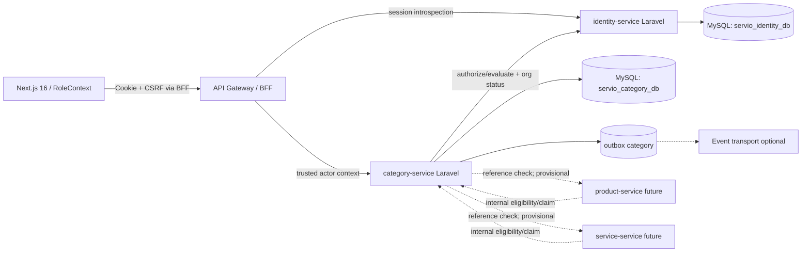
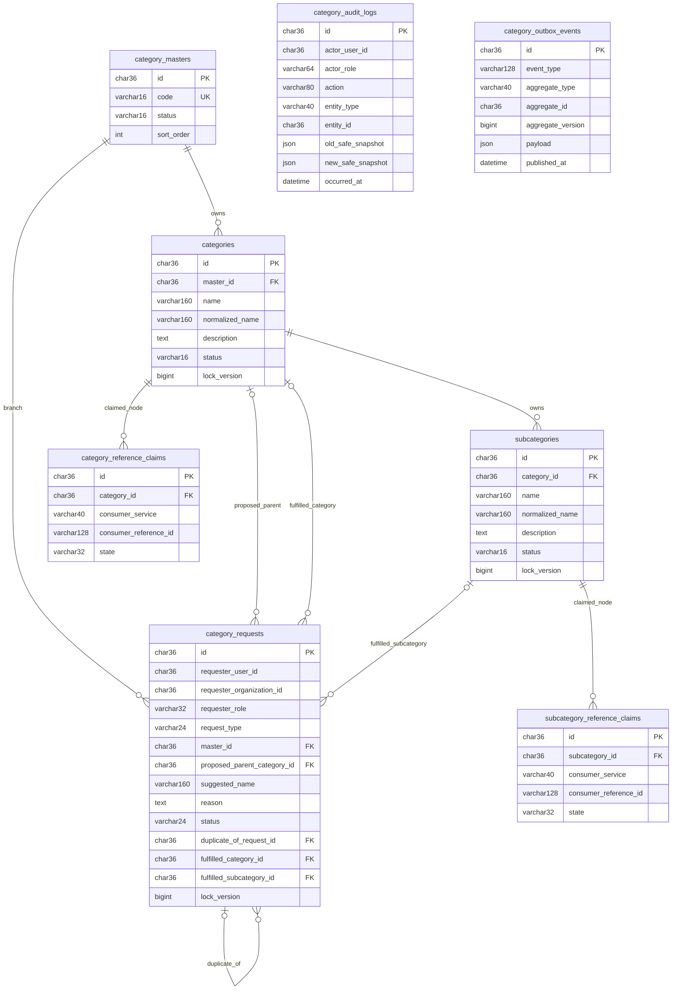
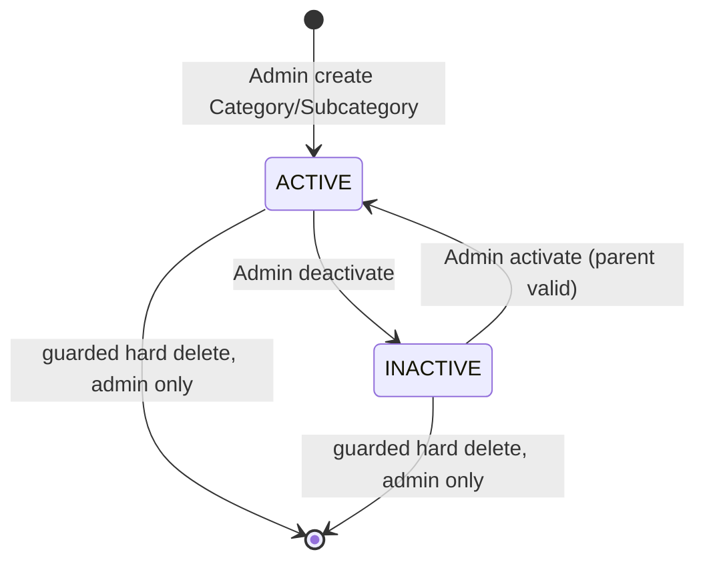
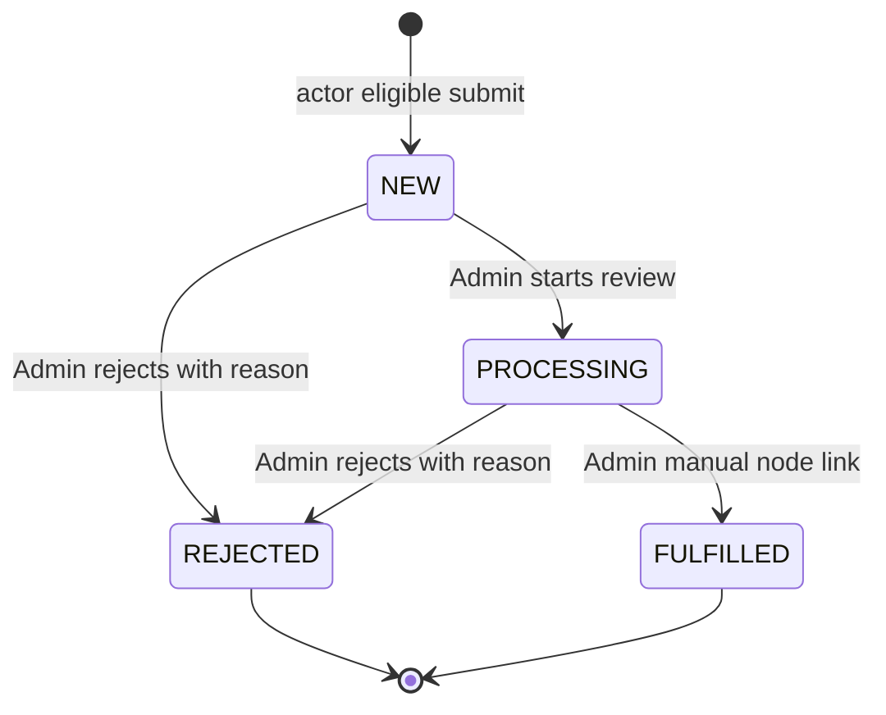
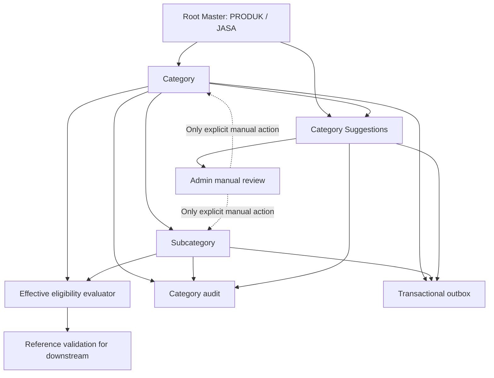
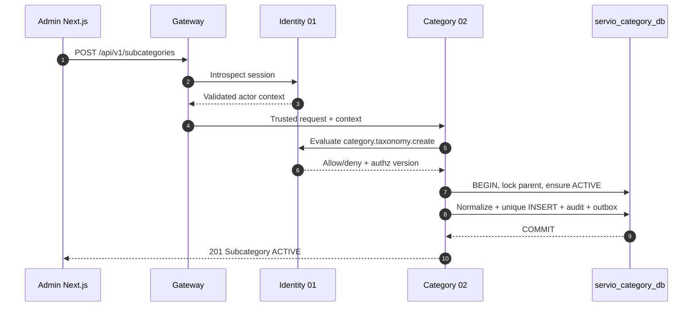
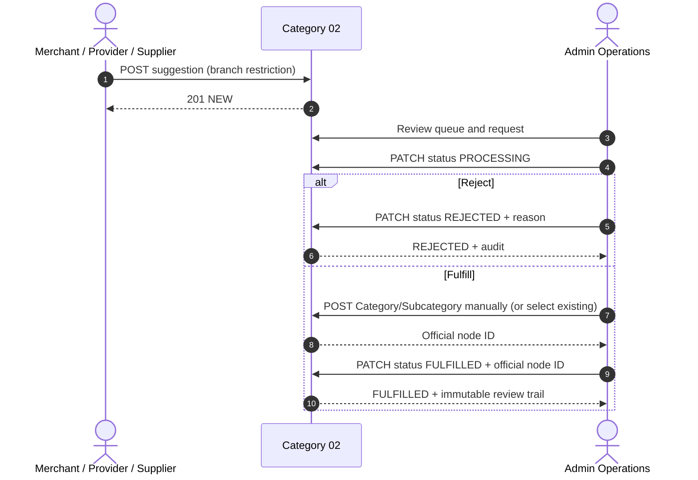

# SERVIO — BACKEND TECHNICAL SPECIFICATION
## MODUL 02 — CATEGORY MANAGEMENT SERVICE
### 10 Komponen Terintegrasi | Technical Draft for Final Review

| Metadata | Nilai |
|---|---|
| Kode/domain | `02` — Category Management |
| Microservice | `category-service` (**Laravel project independen**) |
| Target dokumen repository | `docs/backend/02-category-management/02-category-management.md` |
| Implementasi service | `backend/services/category-service/` |
| Database | MySQL localhost; database eksklusif `servio_category_db` |
| Frontend konsumen | Next.js 16 / React 19 / TypeScript / `RoleContext` |
| Baseline bisnis | `PHASE-02-CATEGORY - PLAN.md` (33 bagian, 34 BR, 13 EC) + ACC keputusan `DEC-01`–`DEC-14` pada pembahasan planning |
| Baseline integrasi | Modul 01 `01-identity-access-CR02-BACKEND.md` — **TECHNICAL_SPEC_FINAL_LOCKED** |
| Keputusan framework | Laravel; Sanctum SPA stateful session **milik Identity**; komunikasi internal service authenticated |
| Status file ini | **TECHNICAL_SPEC_DRAFT_FOR_FINAL_REVIEW** — 10 komponen selesai disusun; **BELUM** `TECHNICAL_SPEC_FINAL_LOCKED` sampai ACC dokumen dari pengguna |
| Lingkup | Category-only. Tidak membuat Product, Service, Order, Payment atau Asset |
| Keterangan | `[B]` = business rule locked; `[T]` = keputusan desain teknis untuk ACC dokumen; `[P]` = provisional/pending integration; `[ND]` = detail perlu keputusan/konfirmasi, tidak boleh diam-diam menjadi aturan bisnis |

> **Aturan prioritas.** Planning dan keputusan bisnis ACC adalah sumber kebenaran business behavior. Modul 01 FINAL mengatur user/organization/session/role/permission. Keputusan terbaru mengganti referensi MongoDB lama: semua microservice memakai **MySQL localhost** dan database logis masing-masing. Referensi di file planning yang masih menyatakan `DRAFT FOR REVIEW`, MongoDB, atau tidak memuat DEC-01..14 adalah *baseline historis* yang harus dibaca bersama keputusan yang sudah ACC. Dokumen ini merancang teknis kategori, bukan merevisi planning ataupun Modul 01. Nama permission domain Category adalah **kebutuhan kontrak** dan harus diaktifkan melalui proses change request/grant Identity; jangan mengklaim seed permission Modul 01 telah tersedia tanpa pemeriksaan kode.

> **Batas pembuktian.** Technical specification ≠ source code. Belum ada klaim migrasi dijalankan, API hidup, auth terintegrasi, UI terhubung, pengujian lulus, ataupun downstream service tersedia. Endpoint antarservice ke Modul 03/04 diberi `[P]`. Angka batas input, format event, serta desain claim/guard termasuk `[T]`, bukan perubahan business rule.

### Registry keputusan bisnis Modul 02 yang mengikat kesepuluh komponen

| ID | Keputusan yang harus dipertahankan | Dampak |
|---|---|---|
| DEC-01 | Category Assignment ditentukan domain pemakai (Product/Service), bukan dipindahkan ke Category | Reference ID/eligibility disediakan Category; assignment tetap downstream |
| DEC-02 | Perubahan parent Category/Subcategory dilarang setelah pembuatan | Parent immutable melalui API, model action, dan DB guard |
| DEC-03 | Parent `INACTIVE` membuat turunannya tidak eligible untuk pemakaian baru, tanpa mengubah stored status child | Gunakan `effective_active` yang dihitung, jangan cascade perubahan status |
| DEC-04 | Subcategory baru berstatus `ACTIVE` (seperti Category) | Default server+database `ACTIVE` |
| DEC-05 | Selain deactivate, ada **Hard Delete** hanya oleh Admin dengan syarat ketat | Tidak boleh root/ada child/referensi aktif atau historis; audit retained; bila referensi tak dapat diverifikasi, fail-closed |
| DEC-06 | Suggestion mempunyai lifecycle `NEW`, `PROCESSING`, `REJECTED`, `FULFILLED` | Status terpisah dari status kategori; transisi tervalidasi |
| DEC-07 | Suggested branch/parent dicatat terstruktur | `master_code`, `proposed_parent_category_id`, request type |
| DEC-08 | Duplicate suggestion dapat ditandai/di-link, tanpa otomatis menghasilkan kategori duplikat | Relasi `duplicate_of_request_id`; tidak mengganti review manual |
| DEC-09 | Permission pengajuan juga mensyaratkan konteks Identity/organization yang eligible | Pemeriksaan role + status account/assignment/org/membership |
| DEC-10 | Node INACTIVE terbaca hanya bagi Admin/CEO yang berwenang | API non-governance tidak membocorkan metadata node inactive |
| DEC-11 | Merchant lihat PRODUK+JASA, suggestion **PRODUK**; Provider lihat/suggest **JASA**; Supplier lihat/suggest **PRODUK** | Read scope dan submit scope sengaja dibedakan |
| DEC-12 | `FULFILLED` hanya setelah Admin secara manual membuat/memilih node resmi dan mengaitkannya ke request | Tidak ada auto-create dari request; simpan target node referensi |
| DEC-13 | CEO oversight/audit, Admin operator/reviewer | CEO tidak memperoleh CRUD operasional |
| DEC-14 | Otorisasi mengikuti kontrak Identity Modul 01 yang FINAL | Integrasi role assignment, permission, membership, account state melalui internal API |
| DEC-15 | Node INACTIVE dapat dilihat oleh Admin/CEO via parameter `include_inactive=1` dan tab segmented (Semua, Aktif, Nonaktif) | Data nonaktif tidak hilang dari interface pengawasan dan dapat diaktifkan kembali (Reactivated) via switch |
| DEC-16 | Hard Delete wajib menyertakan alasan minimal 5 karakter dan form konfirmasi ketik nama | Body `{ reason: string }` wajib, audit log terjaga, anti salah klik |
| DEC-17 | Penemuan publik untuk Guest & Customer mendukung Multi-Select Kategori, Subkategori, dan Filter Merek Independen | Query string fleksibel, brand cross-category tanpa terkunci hierarki, node inactive disaring ketat |
| DEC-18 | Seluruh antarmuka taksonomi wajib menyediakan tombol Perbarui Data in-app asynchronous | Refresh data live tanpa me-reload browser Chrome |

---

# 01. Service Architecture & Boundary

## 1.1 Domain responsibility, business invariants, data ownership

`category-service` adalah **satu Laravel application yang dapat berjalan, diuji, dideploy, dimigrasi, dan diskalakan terpisah** dari `identity-service`. Ia menguasai hanya hierarki resmi `MASTER(PRODUK/JASA) → CATEGORY → SUBCATEGORY`, pengelolaan status, request/suggestion, audit, dan metadata pengaman referensi teknis untuk hard delete. Root **tetap tepat dua nilai**, dibuat lewat seeder idempotent; tidak ada endpoint create/update/delete root.

| Entity/fitur | Owner | Kewenangan Modul 02 | Batas tegas |
|---|---|---|---|
| Master Category | Category | Seed dua root, baca | Tidak ada CRUD root |
| Category/Subcategory | Category | CRUD sesuai aturan (termasuk Hard Delete eligible), hirarki, status, audit | Tidak memuat harga, stok, service offerings |
| Suggestion + manual fulfillment | Category | Pengajuan, review, status, link node resmi | Suggestion bukan Category; tidak membuat kategori otomatis |
| Category audit/event | Category | Immutable append-only trace dan event domain | Tidak menggantikan global audit identity |
| Category reference eligibility | Category | Verifikasi node valid dan `effective_active` untuk referensi baru | Consumer memutuskan assignment, transaksi, stok, booking |
| Data user/role/org | Identity 01 | Hanya ID/hasil izin dan status minimum | Tidak menyimpan password, NIK, KYC, membership master |
| Product/Service assignment | Product 03 / Service 04 | Memvalidasi ID via kontrak atau request internal | Tidak ada join DB atau cross-DB FK |
| Hard-delete reference verification | Konsumen masing-masing + Category guard | Memeriksa semua pemilik referensi sebelum penghapusan | Tidak boleh mengasumsikan layanan lain tersedia |

**Explicit out of scope:** Master root CRUD, product catalog dan inventory, varian/harga/stok, canonical service/offering, price/survey/availability, order/cart/booking/diagnosis, pembayaran, afiliasi, garansi, support, notification bisnis, analytics, Asset, AI Recommendation. `audit` lokal Category masih termasuk scope.

## 1.2 Arsitektur komponen dan request path



**Trust model [T]:** First-party browser memakai Sanctum SPA session **pada Identity**. Browser **tidak** memanggil Category sebagai service yang dipercaya hanya karena ada role cookie. Gateway memvalidasi sesi lewat `POST /internal/v1/auth/sessions/introspect`, menghapus spoofable `X-User-*`, lalu menyampaikan actor context via jalur terautentikasi. Category dapat meminta keputusan `POST /internal/v1/authorization/evaluate` dan status organisasi pada Identity; otorisasi domain akhir dan status node tetap diperiksa Category. Timeout pada pemeriksaan izin untuk mutasi = **deny/fail-closed**. `RoleContext` hanya optimisasi tampilan.

## 1.3 Struktur project independen (tidak di bawah folder Identity)

```text
servio/
├── backend/
│   ├── services/
│   │   ├── identity-service/                 # Modul 01, jangan diubah langsung
│   │   └── category-service/                 # PROJECT LARAVEL BARU DAN MANDIRI
│   │       ├── app/
│   │       │   ├── Domain/Category/{Actions,DTOs,Enums,Policies}/
│   │       │   ├── Application/{Commands,Queries}/
│   │       │   ├── Infrastructure/{Identity,ReferenceChecks,Outbox}/
│   │       │   ├── Http/{Controllers,Requests,Resources,Middleware}/
│   │       │   └── Models/
│   │       ├── routes/{api.php,internal.php}
│   │       ├── database/{migrations,seeders,factories}/
│   │       ├── tests/{Unit,Feature,Contract,Integration,Security}/
│   │       ├── config/{category.php,services.php}
│   │       ├── composer.json
│   │       ├── artisan
│   │       └── .env.example
│   └── gateway/                           # infrastructural routing, bukan domain service
└── docs/backend/02-category-management/
    ├── planning.md
    └── 02-category-management.md
```

Contoh `.env.example` **tanpa secret**:

```dotenv
APP_NAME=SERVIO_Category
APP_ENV=local
APP_DEBUG=true
APP_URL=http://localhost:8002
DB_CONNECTION=mysql
DB_HOST=127.0.0.1
DB_PORT=3306
DB_DATABASE=servio_category_db
DB_USERNAME=servio_category
DB_PASSWORD=SET_LOCALLY
IDENTITY_INTERNAL_BASE_URL=http://localhost:8001
CATEGORY_INTERNAL_SERVICE_CREDENTIAL=SET_LOCALLY
CATEGORY_REFERENCE_CHECK_TIMEOUT_MS=1200
CATEGORY_REFERENCE_FENCE_ENABLED=false
QUEUE_CONNECTION=database
CACHE_STORE=database
```

`APP_KEY`, internal credentials, TLS, trusted-proxy, token signing dan key rotation dikonfigurasi dari environment/secrets. `CATEGORY_REFERENCE_FENCE_ENABLED=false` berarti **Hard Delete harus deny**, bukan bypass fence. Detail hostname/cookie BFF mengikuti keputusan implementasi Identity; tidak menjadikan Category pemilik session browser.

## 1.4 API boundary dan dependensi

- **Synchronous:** Identity untuk authorize/session/organization status; Product/Service untuk verifikasi referensi sebelum Hard Delete (hanya ketika kontraknya diimplementasi dan aman).
- **Asynchronous [T]:** Category events untuk invalidasi read model/cache domain lain; outbox lokal di commit yang sama dengan mutasi.
- **Read:** tree/list/detail dapat di-cache berdasarkan branch + view scope, dengan invalidasi/TTL; jangan cache detail inactive untuk publik.
- **Fallback:** pembacaan katalog aktif saat Identity tidak tersedia boleh untuk **guest anonymous** hanya jika kebijakan endpoint publik disetujui; aksi mutasi/privileged view wajib fail-closed.

---

# 02. Entity Relationship Diagram (ERD)

## 2.1 Mermaid ERD — Category-owned tables



> Diagram `category_reference_claims` dan `subcategory_reference_claims` adalah **[P/T] opsi infrastruktur anti-race**, bukan assignment Product/Service. Keduanya mencatat *claim/guard terhadap ID*, bukan entitas Product, Service atau FK lintas service. Kontrak claim wajib dibuktikan dapat menjaga referensi historis; tidak cukup dengan menghapus claim setelah Product/Service dinonaktifkan. Bila protokol consumer belum terpasang, **Hard Delete tidak boleh dieksekusi**. Tabel `category_delete_guards` dan `category_idempotency_records` dijelaskan pada schema sebagai komponen teknis penopang ERD, tanpa mengubah hierarki 3 tingkat.

## 2.2 Kardinalitas dan invariants

| Relasi | Kardinalitas | Invariant |
|---|---|---|
| Master → Category | 1:N | Category tepat satu Master; `master_id` immutable |
| Category → Subcategory | 1:N | Subcategory tepat satu Category; `category_id` immutable |
| Root PRODUK/JASA | Tepat dua rows | Seeder idempotent; endpoint root read-only; hard delete dilarang |
| Category Request → root | N:1 | Branch ditetapkan sejak pengajuan; Merchant/Provider/Supplier sesuai izin |
| Request → proposed parent | 0..1:1 | Wajib ketika type `SUBCATEGORY`; parent pada branch yang sama dan valid |
| Request → duplicate request | 0..1:1 | Self-link, circular link, atau beda scope dilarang |
| Request → fulfillment node | 0..1:1 | Saat `FULFILLED`, tepat satu official node sesuai type/branch; dibuat/dipilih manual |
| Category/Subcategory → consumer claim | 1:N opsional | Claim bukan hak mengubah catalog downstream; status harus bisa diaudit |
| Audit events | N:1 logical reference | Snapshot audit independen dari FK ke node yang dapat di-hard-delete |

**Tidak ada** foreign key dari `requester_user_id`, `requester_organization_id`, `actor_user_id`, ataupun consumer IDs ke `servio_identity_db` atau database service lain. Semua adalah external stable ID, divalidasi melalui API sesuai keperluan.

## 2.3 Lifecycle state diagram





`NEW → FULFILLED` langsung dan reopen terminal **[ND]**; desain aman awal membatasi fulfillment melalui `PROCESSING` dan menolak transisi yang belum disetujui. `MASTER` tidak memiliki lifecycle mutasi user.

---

# 03. Database Schema & Laravel Migrations Design

## 3.1 Konvensi basis data

- MySQL localhost (`InnoDB`, `utf8mb4`, waktu UTC, `DATETIME(6)`), satu database `servio_category_db`; database user hak hanya pada DB ini.
- ID `CHAR(36)` UUID [T] kompatibel dengan baseline Identity; unique string normalisasi per-parent.
- `normalized_name` dihitung **di backend** dari `trim` → collapse whitespace → unicode-aware lowercase; aturan normalisasi lanjutan (mis. diacritics) adalah `[ND]`, jangan diam-diam mengubah definisi duplicate.
- Untuk unique constraint gunakan collation/bytes deterministik, misalnya `utf8mb4_bin` pada `normalized_name`. Simpan canonical normalization konsisten; indeks DB menjadi pengaman terakhir race condition.
- Semua mutation yang rawan lost update memakai `lock_version BIGINT NOT NULL DEFAULT 1` dan `If-Match`/`expected_version`, plus row lock di transaction.
- Hard Delete physical hanya untuk node yang lolos semua guard. Audit tidak di-cascade delete. Downstream historical references harus dibuktikan **tidak ada**; soft-delete downstream tidak dianggap hilang.

## 3.2 Kamus tabel dengan kolom, nullability, indeks, constraints

Semua `created_at`, `updated_at`, `occurred_at` UTC dengan presisi microsecond. `PK` = primary, `FK` internal = foreign key hanya di database Category, `UK` = unique, `IX` = index.

| Tabel | Kolom utama dan tipe | Constraint/index | Catatan |
|---|---|---|---|
| `category_masters` | `id CHAR(36) PK`; `code VARCHAR(16) NOT NULL`; `name VARCHAR(50) NOT NULL`; `status VARCHAR(16) NOT NULL DEFAULT 'ACTIVE'`; `sort_order SMALLINT NOT NULL`; timestamps | `UK(code)`, `UK(sort_order)` | Tepat `PRODUK`, `JASA`; seed-only; DB trigger/policy boleh enforce non-mutation |
| `categories` | `id CHAR(36) PK`; `master_id CHAR(36) NOT NULL`; `name VARCHAR(160) NOT NULL`; `normalized_name VARCHAR(160) NOT NULL`; `description TEXT NULL`; `status VARCHAR(16) NOT NULL DEFAULT 'ACTIVE'`; `lock_version BIGINT UNSIGNED NOT NULL DEFAULT 1`; timestamps | `FK(master_id)` RESTRICT; `UK(master_id,normalized_name)`; `IX(master_id,status)` | Parent immutable; status hanya `ACTIVE/INACTIVE` |
| `subcategories` | `id CHAR(36) PK`; `category_id CHAR(36) NOT NULL`; `name VARCHAR(160) NOT NULL`; `normalized_name VARCHAR(160) NOT NULL`; `description TEXT NULL`; `status VARCHAR(16) NOT NULL DEFAULT 'ACTIVE'`; `lock_version BIGINT UNSIGNED NOT NULL DEFAULT 1`; timestamps | `FK(category_id)` RESTRICT; `UK(category_id,normalized_name)`; `IX(category_id,status)` | Tidak boleh child pada parent inactive saat create |
| `category_requests` | `id CHAR(36) PK`; `request_type VARCHAR(24)` (`CATEGORY/SUBCATEGORY`); `master_id CHAR(36) NOT NULL`; `proposed_parent_category_id CHAR(36) NULL`; `requester_user_id CHAR(36) NOT NULL`; `requester_role VARCHAR(64) NOT NULL`; `requester_org_id CHAR(36) NOT NULL`; `suggested_name VARCHAR(160) NOT NULL`; `normalized_suggested_name VARCHAR(160) NOT NULL`; `reason TEXT NOT NULL`; `additional_information TEXT NULL`; `status VARCHAR(24) NOT NULL DEFAULT 'NEW'`; `duplicate_of_request_id CHAR(36) NULL`; `fulfilled_category_id CHAR(36) NULL`; `fulfilled_subcategory_id CHAR(36) NULL`; `reviewer_user_id CHAR(36) NULL`; `review_reason TEXT NULL`; `lock_version BIGINT UNSIGNED NOT NULL DEFAULT 1`; `reviewed_at DATETIME(6) NULL`; timestamps | FK internal master/parent/duplicate/fulfillment nodes; `IX(status,created_at)`, `IX(requester_user_id,created_at)`, `IX(master_id,request_type,status)`, `IX(proposed_parent_category_id)` | Identity IDs scalar only; normalization; no auto-create |
| `category_audit_logs` | `id CHAR(36) PK`; `request_id VARCHAR(96)`; `actor_user_id CHAR(36)`; `actor_role VARCHAR(64)`; `actor_org_id CHAR(36) NULL`; `action VARCHAR(80)`; `entity_type VARCHAR(40)`; `entity_id CHAR(36)`; `old_safe_snapshot JSON NULL`; `new_safe_snapshot JSON NULL`; `reason TEXT NULL`; `occurred_at DATETIME(6)`; `correlation_id VARCHAR(96) NULL` | `IX(entity_type,entity_id,occurred_at)`, `IX(actor_user_id,occurred_at)`, `IX(action,occurred_at)` | Append-only; no FK ke entity agar audit tetap ada setelah hard delete; redact PII/credential |
| `category_outbox_events` | `id CHAR(36) PK`; `event_type VARCHAR(128)`; `aggregate_type VARCHAR(32)`; `aggregate_id CHAR(36)`; `aggregate_version BIGINT`; `payload JSON`; `correlation_id VARCHAR(96)`; `occurred_at DATETIME(6)`; `published_at DATETIME(6) NULL`; `attempts SMALLINT DEFAULT 0`; timestamps | `IX(published_at,occurred_at)`, `IX(aggregate_type,aggregate_id,aggregate_version)` | Transactional outbox; dedup by event `id` at consumer |
| `category_idempotency_records` | `id CHAR(36)`; `actor_user_id CHAR(36)`; `idempotency_key VARCHAR(191)`; `request_hash CHAR(64)`; `response_status SMALLINT`; `response_body JSON`; `expires_at DATETIME(6)`; timestamps | `UK(actor_user_id,idempotency_key)`; `IX(expires_at)` | For POST/review/destructive mutasi bila retries; tidak menyimpan cookie/secret |
| `category_delete_guards` **[T/P]** | `id CHAR(36)`; `node_type VARCHAR(16)`; `node_id CHAR(36)`; `fence_generation BIGINT`; `fenced_at DATETIME(6)`; `released_at DATETIME(6) NULL`; `reference_check_evidence JSON NULL`; timestamps | `UK(node_type,node_id)`; `IX(released_at)` | Guard teknis agar pemakaian baru ditolak saat delete; integrasi consumer fence wajib terbukti |
| `category_reference_claims` **[T/P]** | `id CHAR(36)`; `category_id CHAR(36) FK`; `consumer_service VARCHAR(40)`; `consumer_reference_id VARCHAR(128)`; `state VARCHAR(32)`; `created_at`, `updated_at` | `UK(consumer_service,consumer_reference_id,category_id)`; `IX(category_id,state)` | Evidence internal pemakaian kategori; klaim historis tetap dihitung; jangan auto-release bila soft-delete |
| `subcategory_reference_claims` **[T/P]** | seperti kategori, tetapi `subcategory_id FK` | `UK(consumer_service,consumer_reference_id,subcategory_id)`; `IX(subcategory_id,state)` | Klaim subcategory; untuk Hard Delete Category harus evaluasi turunan dahulu |

**Constraints tambahan [T]:**

1. `CHECK(code IN ('PRODUK','JASA'))` untuk root; seed assertions memastikan **exactly** two rows (CHECK sendiri tidak membatasi jumlah rows).
2. `CHECK(status IN ('ACTIVE','INACTIVE'))` untuk nodes; request enum 4 nilai; `CHECK(request_type IN ('CATEGORY','SUBCATEGORY'))`.
3. Pair `request_type=SUBCATEGORY` membutuhkan `proposed_parent_category_id`; `CATEGORY` justru harus null. Cek parent cocok master di transaction.
4. Saat `FULFILLED` tepat satu target node sesuai request type; pada `REJECTED` harus ada alasan; `PROCESSING/FULFILLED/REJECTED` mempunyai reviewer. Validasi cross-table via domain service/transaction (CHECK saja tidak mampu memeriksa FK grandparent).
5. `master_id` dan `category_id` tidak boleh berubah setelah insert; Request `master_id/request_type/proposed_parent_category_id/requester` immutable. Enforcement ganda: FormRequest whitelist, service action, dan **MySQL BEFORE UPDATE trigger** (atau desain DB immutable ekivalen) agar jalur import/bulk tak bypass.
6. Hard Delete hanya melalui action terproteksi, bukan Model delete generik; DB restrict child dan claim; sebelum delete, transaction membuat audit snapshot dan outbox. Bila FK request fulfillment masih ada, jangan cascade; referensi internal itu sendiri membuat penghapusan tidak aman kecuali kebijakan retensi eksplisit disetujui.

## 3.3 Laravel migration blueprint dan seed contoh

```php
// migration: create_category_masters_table (ringkasan executable-style)
Schema::create('category_masters', function (Blueprint $table) {
    $table->uuid('id')->primary();
    $table->string('code', 16)->unique();
    $table->string('name', 50);
    $table->string('status', 16)->default('ACTIVE');
    $table->smallInteger('sort_order')->unique();
    $table->timestamps(6);
});

Schema::create('categories', function (Blueprint $table) {
    $table->uuid('id')->primary();
    $table->foreignUuid('master_id')->constrained('category_masters')->restrictOnDelete();
    $table->string('name', 160);
    $table->string('normalized_name', 160)->collation('utf8mb4_bin');
    $table->text('description')->nullable();
    $table->string('status', 16)->default('ACTIVE');
    $table->unsignedBigInteger('lock_version')->default(1);
    $table->timestamps(6);
    $table->unique(['master_id', 'normalized_name'], 'uk_category_parent_normalized');
    $table->index(['master_id', 'status']);
});

Schema::create('subcategories', function (Blueprint $table) {
    $table->uuid('id')->primary();
    $table->foreignUuid('category_id')->constrained('categories')->restrictOnDelete();
    $table->string('name', 160);
    $table->string('normalized_name', 160)->collation('utf8mb4_bin');
    $table->text('description')->nullable();
    $table->string('status', 16)->default('ACTIVE');
    $table->unsignedBigInteger('lock_version')->default(1);
    $table->timestamps(6);
    $table->unique(['category_id', 'normalized_name'], 'uk_subcategory_parent_normalized');
    $table->index(['category_id', 'status']);
});
```

Migration lain wajib mengimplementasikan **seluruh** kolom/indeks/kendala §3.2, bukan diganti JSON opaque. Gunakan seeder `firstOrCreate` berdasarkan `code`, tidak membuat akun/organisasi pengguna baru:

```php
foreach ([['PRODUK', 'Produk', 1], ['JASA', 'Jasa', 2]] as [$code, $name, $order]) {
    CategoryMaster::query()->firstOrCreate(['code' => $code], [
        'id' => (string) Str::uuid(), 'name' => $name,
        'status' => 'ACTIVE', 'sort_order' => $order,
    ]);
}
```

**Catatan migration:** `foreignUuid` pada Laravel biasanya membentuk `CHAR(36)`; periksa output `SHOW CREATE TABLE` agar konsisten dengan key type/collation. MySQL Trigger untuk parent immutability dan root protection dibuat dengan raw SQL migration teruji (`DB::unprepared`) setelah tabel terbentuk; trigger harus memperbolehkan update `name/description/status/lock_version` node sesuai policy, tetapi menolak update key parent. Down-migration sengaja tidak dijalankan di production tanpa backup/review.

## 3.4 Concurrency & integrity transaction patterns

**Create/Edit:** normalize pada server, lock parent row (`SELECT ... FOR UPDATE`) saat perlu validasi status, query duplicate untuk UX; lakukan INSERT/UPDATE, tangkap MySQL duplicate key `1062` → `409 CATEGORY_DUPLICATE_NAME`. Jangan hanya mengandalkan pre-check.

**Deactivate:** lock node dan periksa authorization; ubah `status` node saja (tidak cascade children). Jika parent menjadi inactive saat create child berlangsung, transaksi dengan parent lock dan konsisten lock order memastikan tidak tercipta child baru setelah parent inactive.

**Activate Subcategory:** lock parent; aktifkan hanya bila parent `ACTIVE`. **Activate Category:** master tetap root `ACTIVE`. Bila parent inactive meskipun stored child ACTIVE, `effective_active=false`.

**Hard Delete:** `DELETE` fisik hanya setelah **fence** melarang pemakaian baru, pemeriksaan semua reference-owner authoritative berhasil dalam batas freshness+race protocol, tanpa child, tanpa lokal request/reference FK yang memblokir, dan audit commit. Jika satu consumer down/unknown, registry tidak lengkap, lock konflik, atau jaminan fence belum diadopsi oleh semua consumer: **409/503 dan rollback/no-delete**. **Read-only `GET references=0` tanpa sinkronisasi write-barrier tidak cukup aman** karena time-of-check/time-of-use. Desain claim/verification adalah kontrak `[P]` sampai seluruh owner mengimplementasikannya. Secara aman, Hard Delete dapat dinonaktifkan operasional sementara, walaupun business rule-nya tetap disetujui.

---
# 04. API Endpoint Specification & JSON Contract

## 4.1 Konvensi semua endpoint

- **Public/gateway prefix:** `/api/v1`. **Internal service-only:** `/internal/v1`. Semua jalur dikaitkan ke `category-service`, bukan `identity-service` route folder.
- Response envelope sejalan dengan Modul 01: `{success, code, data, meta:{request_id,version}}`; error `{success:false,code,message,error:{field_errors,details,retry_after_seconds},meta}`.
- `Content-Type: application/json`, `Accept: application/json`; context browser melalui Sanctum session di Gateway/Identity (cookies HttpOnly + CSRF); internal memakai service authentication; tidak ada bearer token browser fallback.
- Kode status: `200` success, `201` created, `204` void response bila dibutuhkan, `400` malformed, `401` belum login untuk endpoint protected, `403` unauthorized role/scope, `404` unknown/hidden inactive, `409` duplicate/version/invalid transition/ref conflict, `422` field validation, `429` throttle, `502/503` dependency/error sementara. Request access denied default **tidak membocorkan keberadaan** data lintas tenant.
- Read `limit=20` (maks 100), `cursor` opaque, `sort` allowlist `name,-name,created_at,-created_at`, `search` dinormalisasi, `master=PRODUK|JASA`, `status=ACTIVE|INACTIVE` **hanya Admin/CEO**. Pagination menggunakan stable key order (mis. `(normalized_name,id)`), bukan offset tanpa snapshot saat concurrency.
- Mutasi update/status/review pakai `If-Match: "<lock_version>"`; missing version → `428 CATEGORY_PRECONDITION_REQUIRED` [T], stale → `409 CATEGORY_VERSION_CONFLICT` (pilihan status `412` [ND]—pilih satu secara konsisten saat ACC).
- `Idempotency-Key` diwajibkan untuk request create/review/hard-delete yang akan di-retry di network; key scoped actor+endpoint+payload hash, re-use beda payload → `409 CATEGORY_IDEMPOTENCY_KEY_REUSED`.
- `UUID` versi canonical service, tidak memakai slug/name sebagai persistent reference. Cache key memuat branch + access scope + authz version bila sensitive.
- **Kontrak list/tree saat inactive:** Role biasa hanya melihat node yang **stored ACTIVE dan seluruh ancestornya ACTIVE**; Admin/CEO berizin dapat melihat stored inactive, dengan `effective_active` dibedakan dari `status` tersimpan. Tidak ada enumerasi inactive via guessed ID untuk role lain.

## 4.2 Resource JSON canonical

```json
{
  "master": {"id":"master-uuid", "code":"PRODUK", "name":"Produk", "status":"ACTIVE"},
  "category": {
    "id":"category-uuid", "master_id":"master-uuid", "master_code":"PRODUK",
    "name":"Elektronik", "description":null, "status":"ACTIVE",
    "effective_active":true, "lock_version":1,
    "created_at":"2026-10-15T02:00:00Z", "updated_at":"2026-10-15T02:00:00Z"
  },
  "subcategory": {
    "id":"subcategory-uuid", "category_id":"category-uuid",
    "name":"Peralatan Pendingin", "description":null, "status":"ACTIVE",
    "effective_active":true, "lock_version":1,
    "created_at":"2026-10-15T02:00:00Z", "updated_at":"2026-10-15T02:00:00Z"
  }
}
```

`normalized_name` boleh ada di admin-only debugging namun tidak dibutuhkan UI biasa. `effective_active` untuk subcategory = `status == ACTIVE && category.status == ACTIVE && master.status == ACTIVE`; root dimutasi hanya oleh seeder. `selected/assigned_to_product` tidak ada di payload Category karena milik downstream.

```json
{
  "id":"request-uuid", "request_type":"SUBCATEGORY", "master_code":"JASA",
  "proposed_parent_category_id":"category-uuid", "suggested_name":"Perawatan AC",
  "reason":"Dibutuhkan pengelompokan layanan perawatan AC",
  "additional_information":null, "status":"NEW", "duplicate_of_request_id":null,
  "requester_user_id":"user-uuid", "requester_organization_id":"org-uuid",
  "requester_role":"SERVICE_PROVIDER", "reviewer_user_id":null,
  "review_reason":null, "fulfilled_node":null, "lock_version":1,
  "created_at":"2026-10-15T02:00:00Z"
}
```

**PII minimum:** Admin/CEO melihat request dan actor IDs beserta konteks yang perlu untuk audit; pengaju hanya melihat request miliknya. Jangan menyertakan NIK, Employee KYC, legal docs atau kontak pribadi dalam Category API.

## 4.3 Endpoint inventory: daftar utama (bukan one-feature-one-API)

Legenda: `PUBLIC_READ` = hanya data active, guest support `[T/ND]` mengikuti route discovery global; `R` = authenticated read; `ADMIN` = Admin operations; `GOV` = Admin/CEO; `SUG` = Merchant/Provider/Supplier eligible; `OWN` = own request or operator; `SYS` = service authenticated. Semua permission penentu tetap server-side.

| ID | Method | URI setelah `/api/v1` | Actor | Input / use case | Output & status |
|---|---|---|---|---|---|
| C01 | GET | `/category-masters` | PUBLIC_READ/GOV | Root 2 fixed | `200 List<Master>`; root metadata, no mutation |
| C02 | GET | `/categories/tree` | PUBLIC_READ/GOV | `master`, `include_inactive` privileged | `200 Tree<Master,Category,Subcategory>` |
| C03 | GET | `/categories` | PUBLIC_READ/GOV | branch/status/search/cursor/limit/sort + `include_inactive=1` (Admin/CEO) | `200 ListPage<Category>` |
| C04 | GET | `/categories/{id}` | PUBLIC_READ/GOV | detail ID | `200 Category` / `404` |
| C05 | POST | `/categories` | ADMIN | `master_id,name,description?` | `201 Category`, audit |
| C06 | PATCH | `/categories/{id}` | ADMIN | `name?,description?` + `If-Match` | `200 Category` / conflict |
| C07 | PATCH | `/categories/{id}/status` | ADMIN | `status: ACTIVE|INACTIVE`, version, reason? | `200 Category` |
| C08 | DELETE | `/categories/{id}` | ADMIN | Hard Delete guarded, `If-Match`, idempotency, `reason` (min. 5 chars) | `200 DeletionReceipt` or fail-closed |
| S01 | GET | `/subcategories` | PUBLIC_READ/GOV | `category_id`, `master`, search/status/cursor + `include_inactive=1` (Admin/CEO) | `200 ListPage<Subcategory>` |
| S02 | GET | `/subcategories/{id}` | PUBLIC_READ/GOV | detail | `200 Subcategory` / `404` |
| S03 | POST | `/subcategories` | ADMIN | `category_id,name,description?` | `201 Subcategory` |
| S04 | PATCH | `/subcategories/{id}` | ADMIN | `name?,description?` + `If-Match` | `200 Subcategory` |
| S05 | PATCH | `/subcategories/{id}/status` | ADMIN | `status`, `If-Match`, reason? | `200 Subcategory` |
| S06 | DELETE | `/subcategories/{id}` | ADMIN | Hard Delete guarded, `If-Match`, idempotency, `reason` (min. 5 chars) | `200 DeletionReceipt` or fail-closed |
| R01 | GET | `/category-requests` | GOV/OWN | Admin status/type/branch filters; requester self scope | `200 ListPage<Request>` |
| R02 | GET | `/category-requests/{id}` | GOV/OWN | request detail | `200 Request` / masked `404` |
| R03 | POST | `/category-requests` | SUG | type, branch, parent, name, reason, info | `201 Request(status=NEW)` |
| R04 | PATCH | `/category-requests/{id}/review` | ADMIN | status transition/reason/duplicate/link, version | `200 Request` |
| A01 | GET | `/category-audit` | GOV | action/entity/actor/date/cursor filters | `200 ListPage<AuditView>` |

> **Catatan Integrasi Public Discovery (Guest & Customer):** Endpoint pembacaan katalog hilir (`/api/v1/products` dan `/api/v1/services`) mengonsumsi data taksonomi dari Category Service dengan parameter multi-select:
> - `categories`: multi-select array / query string (contoh: `?categories=elk,oto`)
> - `subcategories`: multi-select array / query string (contoh: `?subcategories=kap,kmp`)
> - `brands`: multi-select array independen cross-category (contoh: `?brands=daikin,panasonic,motul`)
> - Seluruh query publik otomatis difilter dengan kondisi `status = ACTIVE` (`effective_active = true`), sehingga node `INACTIVE` tidak pernah bocor ke publik.

**19 operasi public/gateway** dengan dua resource CRUD, satu tree master, satu suggestion resource, satu audit read; tidak perlu endpoint tersendiri untuk setiap halaman/tab/role. `GET /categories?master=...` dipakai semua domain sesuai izin, tidak digandakan `/merchant/categories` atau `/provider/categories`. Hard Delete memakai `DELETE` berbeda dari deactivate sesuai DEC-05. Endpoint admin-only *tidak* mengubah root.

## 4.4 Internal endpoints (owner Category) dan consumer contracts

| ID | Method | URI setelah `/internal/v1` | Pemanggil | Request/response | Status |
|---|---|---|---|---|---|
| I01 | POST | `/taxonomy/eligibility/check` | Product/Service dan domain lain, SYS | `{node_type,node_id,operation:"NEW_ASSIGNMENT"}` → `{exists,master_code,effective_active,version}` | `[T]` Category-owned, consumer `[P]` |
| I02 | GET | `/taxonomy/masters` | Authenticated SYS | `{masters:[{id,code,status}]}` | `[T]` |
| I03 | GET | `/taxonomy/tree` | Authenticated SYS | branch + node lifecycle; inactive only authorized internal use | `[T]` |
| I04 | POST | `/taxonomy/reference-claims` | Product/Service, SYS | `{consumer_service,consumer_reference_id,node_type,node_id,operation_id}` → `{claim_id,eligibility_version}` | `[P]` concurrency guard; **not** Product assignment |
| I05 | GET | `/taxonomy/reference-claims/{id}` | same service owner | inspect technical claim | `[P]` |
| I06 | POST | `/taxonomy/reference-checks/prepare` | Category delete orchestrator only | start delete fence + reference check job/operation ID (private route, not external user) | `[P]` |

Satu klaim referensi untuk Product/Service harus dibuat secara atomik/protokol terkoordinasi terhadap waktu penetapan referensi downstream. **Desain I04/I06 perlu disepakati bersama Modul 03/04**. Bila tidak dapat menjamin claim-before-reference dan pencegahan writers sesudah delete fence, endpoint DELETE menolak, bukan menerima `reference_count=0` yang tak terjamin. Detail `/internal/v1/product/.../references` pada sisi Product/Service **tidak boleh diklaim telah ada**; yang ada hanya contoh `[P]` pada §07.

## 4.5 Contoh JSON penuh: success, error, CRUD, review, hard delete

**A. Create Category (C05)**

```http
POST /api/v1/categories
Content-Type: application/json
Idempotency-Key: 4ad8fc1e-ef5e-45b3-974b-d4cb9a725bc7

{"master_id":"master-produk-uuid", "name":"  Elektronik  ", "description":"Perangkat dan perlengkapan elektronik"}
```

```json
{
  "success":true, "code":"CATEGORY_CREATED",
  "data":{"id":"category-uuid","master_id":"master-produk-uuid","master_code":"PRODUK","name":"Elektronik","description":"Perangkat dan perlengkapan elektronik","status":"ACTIVE","effective_active":true,"lock_version":1,"created_at":"2026-10-15T02:00:00Z","updated_at":"2026-10-15T02:00:00Z"},
  "meta":{"request_id":"req-abc","version":"v1"}
}
```

`POST` payload `status`, `master_code` buatan klien, `normalized_name` atau ID actor tidak dipercaya/ditolak; server menentukan default dan actor dari konteks terverifikasi. Bila user mencoba `master_id=null` → `422`; Master bukan PRODUK/JASA yang valid → `422/404`; normalized duplicate pada parent sama → `409`; Master lain dengan nama sama **boleh**.

**B. Create Subcategory (S03)**

```json
{"category_id":"category-uuid","name":"Peralatan Pendingin","description":"Aksesori peralatan pendingin"}
```

S03 → `201` `Subcategory` termasuk `status="ACTIVE"` dan `effective_active=true`; parent stored INACTIVE → `409 CATEGORY_PARENT_INACTIVE`; unauthorized → `403`.

**C. Edit Category (C06), larangan reparent**

```http
PATCH /api/v1/categories/category-uuid
If-Match: "1"
Content-Type: application/json

{"name":"Elektronik & Kelistrikan", "description":"Kebutuhan perangkat kelistrikan"}
```

Success `200` updated object `lock_version=2`; field `master_id` atau `parent_id` dikirim pada update → `422 CATEGORY_PARENT_IMMUTABLE` (tidak diabaikan diam-diam). Rename collision → `409 CATEGORY_DUPLICATE_NAME`; same-version concurrent update hanya satu menang.

**D. Deactivation (C07)**

```http
PATCH /api/v1/categories/category-uuid/status
If-Match: "2"
Content-Type: application/json

{"status":"INACTIVE", "reason":"Klasifikasi tidak dipakai untuk pengajuan baru"}
```

```json
{
  "success":true, "code":"CATEGORY_STATUS_CHANGED",
  "data":{"id":"category-uuid","status":"INACTIVE","lock_version":3,"children_updated":0},
  "meta":{"request_id":"req-def","version":"v1"}
}
```

Tidak mengubah status tersimpan subcategory. `GET` publik ke node tersebut mengembalikan `404`; Admin/CEO melihat stored status beserta `effective_active=false`. Deactivate ≠ hard delete.

**E. Submit suggestion (R03)**

```http
POST /api/v1/category-requests
Idempotency-Key: 5f766b79-9a52-498b-9c1a-8e628f8fb1ea
Content-Type: application/json

{"request_type":"SUBCATEGORY","master_code":"JASA","proposed_parent_category_id":"category-jasa-uuid","suggested_name":"Perawatan AC","reason":"Layanan perawatan AC belum memiliki subkategori yang sesuai","additional_information":null}
```

```json
{
  "success":true, "code":"CATEGORY_REQUEST_CREATED",
  "data":{"id":"request-uuid","status":"NEW","request_type":"SUBCATEGORY","master_code":"JASA","proposed_parent_category_id":"category-jasa-uuid","suggested_name":"Perawatan AC","duplicate_of_request_id":null,"lock_version":1},
  "meta":{"request_id":"req-ghi","version":"v1"}
}
```

`requester_user_id`, `requester_role`, `requester_org_id` selalu dari validated server-side Identity context, **bukan dari body**. Provider mengajukan PRODUK ditolak `403 CATEGORY_SUGGESTION_BRANCH_DENIED`. Merchant boleh melihat JASA tetapi **tidak** mengajukan suggestion JASA. Request existing-dupe dapat ditandai dan di-link setelah pemeriksaan; duplicate suggestion **tidak** otomatis membuat official Category.

**F. Admin review (R04)**

```http
PATCH /api/v1/category-requests/request-uuid/review
If-Match: "2"
Idempotency-Key: 853c3693-3f31-47dd-8ba2-7d82dc90bd28
Content-Type: application/json

{"to_status":"FULFILLED","review_reason":"Subkategori telah dibuat manual dan diverifikasi","fulfilled_node":{"node_type":"SUBCATEGORY","node_id":"official-subcategory-uuid"}}
```

Success `200` `status=FULFILLED, fulfilled_node={...}, reviewer_user_id, reviewed_at, lock_version=3`. Kondisi awal harus `PROCESSING`; target official node harus cocok type, parent dan branch; request **tidak** memanggil `POST /subcategories` otomatis. Untuk `REJECTED`, `review_reason` wajib. `duplicate_of_request_id` boleh dicatat/ditinjau sesuai aturan DEC-08, tetapi tidak mem-bypass review.

**G. Hard Delete (C08/S06), hanya ketika semua verification guard aktif**

```http
DELETE /api/v1/subcategories/subcategory-uuid
If-Match: "4"
Idempotency-Key: 2a3518bb-230a-4cb7-85a2-aec92759e83b
Content-Type: application/json

{"reason":"Node tidak pernah dipakai dan tidak memiliki referensi"}
```

```json
{
  "success":true, "code":"CATEGORY_NODE_HARD_DELETED",
  "data":{"node_type":"SUBCATEGORY","deleted_id":"subcategory-uuid","deleted_at":"2026-10-15T02:30:00Z","audit_event_id":"audit-uuid","reference_guard_verified":true},
  "meta":{"request_id":"req-delete","version":"v1"}
}
```

**Contoh success ini adalah kontrak target, bukan bukti Hard Delete sudah aman/berjalan.** Bila service consumer belum siap, beri error `503 CATEGORY_REFERENCE_VERIFICATION_UNAVAILABLE`; bila ada child/reference historis → `409 CATEGORY_DELETE_BLOCKED_BY_REFERENCES`; akses selain Admin → `403`. Audit log tetap tersimpan walau node telah dihapus.

**H. Error envelope standar**

```json
{
  "success":false,
  "code":"CATEGORY_DUPLICATE_NAME",
  "message":"Nama kategori sudah digunakan pada parent yang sama.",
  "error":{"field_errors":{"name":["Nama sudah tersedia pada parent ini."]},"details":[],"retry_after_seconds":null},
  "meta":{"request_id":"req-error","version":"v1"}
}
```

## 4.6 Validation matrix, sorting/filtering, idempotency

| Operasi | Validasi server-side [T] | Konsekuensi |
|---|---|---|
| Create Category | Admin + active account; `master_id` exists root; `name` trim nonempty `<=160`; `description<=2000`; normalized duplicate | 201 / 403 / 409 / 422 |
| Create Subcategory | Admin; `category_id` exists ACTIVE; `name` nonempty; duplicate `(category_id,normalized_name)` | 201 / 409 / 422 |
| Edit Category/Subcategory | Update whitelist `name,description`; parent immutable; version match; rename duplicate check | 200 / 409 / 422 |
| Status | Admin; `ACTIVE/INACTIVE`; parent effective active saat activation; version; audit reason optional kecuali kebijakan mensyaratkan | 200 / 409 / 422 |
| List/tree/detail | Scope active-only bagi non-governance; inactive optional gov; sort/filter allowlist | 200 / masked 404 |
| Suggest | Eligible business role + active org; branch enforced; type; parent branch/status; name/reason nonempty; normalized dupe hint | 201 / 403 / 409 / 422 |
| Review | Admin; request status transition; version; reason wajib reject; fulfilled link existing official node | 200 / 403 / 409 / 422 |
| Delete | Admin; version; node not root; no child, request FK, claim, historical refs; reference fence+checks complete; audit | 200 / 409 / 503; never unsafe delete |

`reason` length `<=2000`, `additional_information<=4000`, search `<=160`, per-IP/user rate caps dan cache TTL adalah **konfigurasi teknis [T]**; jangan tafsir sebagai aturan bisnis baru. Jika user tidak login, public read hanya jika scope guest telah diputuskan saat UI mapping; selain itu `401`.

---

# 05. Role-Based Access & Authorization Matrix

## 5.1 Matrix seluruh 9 role + Persona Guest (berlaku untuk Category resources)

Kode `R` = melihat active eligible; `RA` = active+inactive termasuk audit; `C/E/S/D` = Category/Subcategory create/edit/status/hard delete; `Q` = submit suggestion; `V` = review suggestion; `-` = tidak ada akses. Semua hak berlaku hanya bila Identity context memenuhi readiness/status; tabel ini tidak memberi akses bypass.

| Role / Persona | Cabang read | Create/Edit/Status | Hard Delete | Suggestion submit | Review suggestions | Audit & Oversight | Fitur Khusus UI / Discovery |
|---|---|---|---|---|---|---|---|
| `ADMIN_OPERATIONS` | PRODUK+JASA, termasuk inactive (`include_inactive=1`) | Ya | Ya, guarded (Modal Form alasan min 5 char + nama konfirmasi) | Tidak perlu sebagai business requester | Ya | Ya | Segmented status tabs (Semua, Aktif, Nonaktif), counter badges, reaktivasi instan via switch hijau, in-app refresh button. |
| `CEO_PRODUCT_OWNER` | PRODUK+JASA, termasuk inactive (`include_inactive=1`) | Tidak | Tidak | Tidak | Oversight read, bukan review operasional | Ya | Read-only oversight, segmented status tabs, KPI metrics taksonomi, in-app refresh button. |
| `MERCHANT` | PRODUK+JASA (active) | Tidak | Tidak | PRODUK | Tidak | Tidak | Pengajuan taksonomi mandiri via `/provider/taxonomy-request`, riwayat usulan, in-app refresh. |
| `SERVICE_PROVIDER` | JASA (active) | Tidak | Tidak | JASA | Tidak | Tidak | Pengajuan taksonomi mandiri via `/provider/taxonomy-request`, riwayat usulan, in-app refresh. |
| `SUPPLIER` | PRODUK (active) | Tidak | Tidak | PRODUK | Tidak | Tidak | Pengajuan taksonomi mandiri via `/provider/taxonomy-request`, riwayat usulan, in-app refresh. |
| `CUSTOMER` | PRODUK & JASA (active discovery) | Tidak | Tidak | Tidak | Tidak | Tidak | Filter penemuan katalog (`/products`, `/services`): Multi-select kategori, multi-select subkategori, filter independen brand (cross-category), sync URL query string. |
| `GUEST` *(Unauthenticated)* | PRODUK & JASA (active discovery) | Tidak | Tidak | Tidak | Tidak | Tidak | Public discovery (`/products`, `/services`): Identik dengan CUSTOMER (Multi-select kategori & subkategori, independent brand filter, node inactive 100% terisolasi/hidden). |
| `WORKER_TECHNICIAN` | Active sesuai kebutuhan UI | Tidak | Tidak | Tidak | Tidak | Tidak | - |
| `CUSTOMER_SUPPORT` | Active sesuai kebutuhan | Tidak | Tidak | Tidak | Tidak | Tidak | - |
| `FINANCE_PAYMENT_OPS` | Active sesuai kebutuhan | Tidak | Tidak | Tidak | Tidak | Tidak | - |

**Keputusan yang dikoreksi dari file DRAFT & Penambahan Terkini:**
1. Merchant boleh **melihat** JASA (DEC-11), bukan berarti boleh menyarankan JASA.
2. CEO **tidak** punya operational CRUD walaupun matriks global lama mencantumkan TAXONOMY `C,R,U,M` — aturan planning Modul 02 yang sudah ACC lebih spesifik dan harus diutamakan.
3. Root tetap non-CRUD untuk semua role.
4. **CUSTOMER & GUEST** mendapatkan fasilitas Discovery Filter canggih pada katalog publik (`/products` & `/services`), mencakup multi-selection kategori & subkategori serta brand filtering independen (cross-category) tanpa terpengaruh oleh node yang berstatus `INACTIVE` (DEC-17).
5. **ADMIN_OPERATIONS** memiliki kemampuan mengelola node nonaktif secara visual melalui Segmented Status Tabs (Semua / Aktif / Nonaktif) dengan reaktivasi instan (DEC-15), guarded hard delete dengan validasi form ketat (DEC-16), dan pembaruan data asinkron in-app tanpa reload browser (DEC-18).

## 5.2 Permission code registry & integrasi Identity

Code domain berikut **[T] proposed contract** untuk di-register/di-grant melalui change process Identity. **Tidak mengklaim code ini sudah ada pada Identity Modul 01 atau permission migrasi telah terpasang.** Hindari membuat tabel `users/roles/permissions` baru pada Category.

| Permission code yang dibutuhkan | Semantik | Role eligible |
|---|---|---|
| `category.taxonomy.read_active` | Read tree/list/detail active sesuai cabang | Semua role yang boleh read; guest unauthenticated public read |
| `category.taxonomy.read_inactive` | Read inactive nodes (`include_inactive=1`) | Admin, CEO |
| `category.taxonomy.create` | Create Category/Subcategory | Admin |
| `category.taxonomy.update` | Edit name/description (bukan parent) | Admin |
| `category.taxonomy.change_status` | Activate/deactivate (termasuk reaktivasi instan via switch) | Admin |
| `category.taxonomy.hard_delete` | Hard Delete with guards & validated form reason | Admin |
| `category.request.submit` | Suggestion submit | Merchant/Provider/Supplier dengan branch filter |
| `category.request.read_own` | List/detail permintaan milik sendiri | Pengaju terotorisasi |
| `category.request.review` | Review/status/manual fulfillment | Admin |
| `category.request.read_all` | Global request queue/oversight | Admin, CEO |
| `category.audit.read` | Audit read | Admin, CEO |

**Identity CR gate:** sebelum permission ini dinyatakan READY, periksa permission registry existing di Modul 01. Jika butuh penambahan grant/seed atau contract change, ajukan change request yang scoped dan tidak merusak kontrak FINAL. Sampai itu terpenuhi: `PENDING_DEPENDENCY`, bukan permissive fallback berdasarkan string role saja.

## 5.3 Enforcement policy dan organization scope

Urutan pemeriksaan protected endpoint:

```text
Incoming HTTP -> trusted gateway actor
  -> authenticated session introspected Identity
  -> user ACTIVE; authz_version not revoked
  -> active role assignment valid
  -> organization/membership current ACTIVE if business role
  -> permission Category granted (Identity evaluation)
  -> category-specific branch, owner, entity lifecycle, lock_version
  -> execute domain action or deny
```

**Kebutuhan organisasi untuk suggestion:** `MERCHANT` harus berafiliasi dengan organization merchant approved/active, `SERVICE_PROVIDER` dengan provider approved/active, `SUPPLIER` dengan supplier approved/active. Pengajuan tidak boleh menggunakan role di cookie, `X-Org-ID` buatan browser atau body `requester_user_id` untuk mengganti scope; match ke signed/trusted `role_assignment_id`, `active_organization_id`, account/member status. CEO/Admin staff internal harus memenuhi `OPERATIONAL_READY` bila kontrak Identity mensyaratkan.

Pseudo-code Laravel (ilustratif):

```php
public function submitRequest(UserAccessContext $actor, SubmitCategoryRequestData $data): CategoryRequest
{
    $this->identityAuthorization->require($actor, 'category.request.submit');
    $allowedBranch = match ($actor->activeRoleCode()) {
        'MERCHANT', 'SUPPLIER' => 'PRODUK',
        'SERVICE_PROVIDER' => 'JASA',
        default => throw new AuthorizationException(),
    };
    if ($data->masterCode !== $allowedBranch) {
        throw new AuthorizationException('CATEGORY_SUGGESTION_BRANCH_DENIED');
    }
    $this->identityAuthorization->requireActiveBusinessContext($actor);
    return $this->requestWriter->create($actor, $data); // transaction/audit/outbox
}
```

**No privilege escalation:** Tidak cukup menyembunyikan tombol di frontend. Direct API abuse oleh Customer/Worker/CEO terhadap CRUD → `403`; Admin dari akun suspended → deny; worker invited tetapi belum ACTIVE → deny sesuai Identity. Jika active role berganti di tengah proses, cek authz version pada mutation sensitif dan `409/403` saat stale.

## 5.4 Endpoint → authorization mapping

| Endpoint IDs | Policy mandatory | Scope |
|---|---|---|
| C01–C04, S01–S02 | `read_active`; read_inactive for privileged option | Branch + effective-active + optional guest policy |
| C05, S03 | `create` | Admin only, parent valid |
| C06, S04 | `update` | Admin only, immutable parent |
| C07, S05 | `change_status` | Admin, validate parent/state |
| C08, S06 | `hard_delete` | Admin + complete reference safe guards |
| R01–R02 | `read_own` or `read_all` | Exact requester ID vs all governance |
| R03 | `submit` | 3 business roles with branch/org eligibility |
| R04 | `review` | Admin only; decision lifecycle |
| A01 | `audit.read` | Admin/CEO only |
| I01–I06 | Machine authentication + allowlist caller + operation scope | Internal only; never exposed as open browser endpoint |

---
# 06. Internal Feature Integration

## 6.1 Hubungan fitur dalam satu `category-service`



Setiap subfitur memakai reusable domain actions dan policy, **bukan** microservice Laravel baru. Modul 02 hanya mendefinisikan kategori, tidak otomatis membuat product/service dari category choice.

## 6.2 Internal feature dependencies dan transaction boundaries

| Alur | Dependensi di service | Transaction boundary | Failure handling |
|---|---|---|---|
| Seed masters | `category_masters` | Seeder idempotent per code | Jika root berubah/duplikat, fail deployment readiness; jangan overwrite manual |
| Create Category | Master lookup, normalize, duplicate guard, audit, outbox | Satu DB transaction | rollback + 409/422/503; no partial audit |
| Create Subcategory | Parent row lock/status, normalize/duplicate, audit/outbox | Satu DB transaction | parent inactive/duplicate fail |
| Edit node | Version lock, immutable parent, uniqueness, audit/outbox | Satu DB transaction | stale edit/duplicate rollback |
| Activate/deactivate | Parent availability, own version, local audit/outbox | Satu DB transaction | no cascade child status; eligibility computed |
| Submit suggestion | Identity checked before write; branch+parent, normalization, duplicate association, audit/outbox | Satu local DB transaction | deny if Identity/parent invalid; no category creation |
| Review suggestion | Record lock, status, duplicate link, existing official fulfillment target, audit/outbox | Satu local DB transaction | concurrent reviewer 409; no auto-create |
| Read tree | Parent/child status & visibility policy | Read consistent snapshot/cache policy | no inactive leakage; reload as needed |
| Hard Delete | Identity, node lock, fence, downstream claims/verification, audit/outbox | Coordinated external check + local guarded transaction; no distributed SQL transaction | fail closed if guarantee incomplete |

## 6.3 Sequence: creation, update, audit



## 6.4 Sequence: suggestion review dan manual fulfillment



`PROCESSING` bukan otomatis menjadi Category. Bila manual create berhasil tetapi link request gagal, official node tetap ada; Admin harus retry/reconcile memakai ID yang sudah tercipta (idempotent), bukan membuat duplikat otomatis. Final linking validation memastikan type, branch, parent, dan canonical node benar.

## 6.5 Lifecycle invariants dan domain event inventory

| Event [T] | Trigger | Minimal safe payload | Consumer potensial |
|---|---|---|---|
| `category.category.created.v1` | Admin create Category | `category_id,master_code,status,version` | Product/Service cache [P] |
| `category.category.updated.v1` | Admin rename/description edit | `category_id,master_code,version` | Discovery/read models |
| `category.category.status_changed.v1` | Admin activate/deactivate | `category_id,status,version` | Product/Service eligibility cache |
| `category.category.deleted.v1` | Guarded hard delete | `category_id,deleted_at,version` | Consumer invalidation [P] |
| `category.subcategory.created.v1` | Admin create Subcategory | `subcategory_id,category_id,status,version` | Product/Service |
| `category.subcategory.updated.v1` | Admin edit | `subcategory_id,version` | Read models |
| `category.subcategory.status_changed.v1` | Admin change status | `subcategory_id,status,version` | Downstream eligibility cache |
| `category.subcategory.deleted.v1` | Guarded hard delete | `subcategory_id,deleted_at,version` | Consumer cache |
| `category.request.created.v1` | Eligible actor submit | `request_id,request_type,master_code,status` | Optional Notification [P] |
| `category.request.reviewed.v1` | Admin moves PROCESSING/REJECTED/FULFILLED | `request_id,status,fulfilled_node_id?` | Optional Notification [P] |

Audit per planning: `CATEGORY_CREATED/UPDATED/ACTIVATED/DEACTIVATED`, `SUBCATEGORY_CREATED/UPDATED/ACTIVATED/DEACTIVATED`, `CATEGORY_REQUEST_CREATED/REVIEWED/REJECTED`, plus `CATEGORY_HARD_DELETED`, `SUBCATEGORY_HARD_DELETED`, `CATEGORY_REQUEST_FULFILLED` [T additions to cover DEC-05/12]. **Audit tetap disimpan** setelah delete; actor ID, role, timestamp, old/new safe snapshot, reason, request correlation; append-only.

**Eventual consistency:** commit Category tidak bergantung pada broker; outbox worker retry. Kesegaran cache tidak boleh dipakai sebagai satu-satunya bukti Hard Delete aman. Eligibility ketika membuat referensi baru memerlukan authoritative validation/claim; stale status cache tidak boleh membuat child/assignment baru.

## 6.6 Error transitions dan invariants tak bisa dinegosiasikan

1. Root hanya 2; tidak ada root CRUD.
2. Hirarki fixed 3 tingkat; tidak bisa category sebagai child subcategory atau subcategory langsung root.
3. Parent ID immutable; rename harus menjaga normalized uniqueness per parent.
4. Stored status child tidak ikut berubah saat parent deactivated; `effective_active` false.
5. Rejected/Fulfilled request tidak boleh otomatis mengubah resmi taxonomy.
6. Manual fulfillment disertai link valid ke node resmi.
7. Hard delete tidak berjalan bila referensi historis apa pun/child/claim/undetermined dependency masih ada.
8. Mutasi dan audit/outbox di commit lokal yang sama; never success response sebelum committed.

---

# 07. Inter-Microservice API/Event Contract

## 7.1 Security/trust dan kontrak Modul 01 yang FINAL

**Existing Identity contract — final sebagai desain Modul 01, status runtime tetap harus diperiksa saat implementasi:**

| Identity endpoint | Direction | Kebutuhan Category | Error/guard |
|---|---|---|---|
| `POST /internal/v1/auth/sessions/introspect` | Gateway → Identity | Browser cookie session sah, actor/user/assignment/org/authz version | fail closed on 401, unavailable on 503 |
| `POST /internal/v1/authorization/evaluate` | Category → Identity | Evaluate permission Category setelah permission registry compatible | deny if no grant/context or outage |
| `GET /internal/v1/users/{id}/access-context` | Category → Identity | Optional enrich account/role/membership status minimal | non-sensitive actor only; no NIK/KYC |
| `GET /internal/v1/organizations/{id}/status` | Category → Identity | `ACTIVE/APPROVED` business org readiness untuk suggestion | mutation fail closed jika status tak terkonfirmasi |

Kontrak sesi browser adalah Laravel Sanctum SPA cookie CSRF lewat gateway/BFF, **bukan** bearer fallback. Internal key/signature berbeda dari client cookie, request timestamp/nonce, TLS/mTLS sesuai lingkungan, service allowlist, trace ID. Category tidak membaca langsung tabel `users`, `roles`, `organizations` Identity.

**Contoh internal Identity authorization request untuk Category (kebutuhan baru, permission harus diregister):**

```json
{
  "actor_user_id":"admin-user-uuid",
  "active_role_assignment_id":"identity-assignment-uuid",
  "organization_id":null,
  "permission":"category.taxonomy.create",
  "resource_owner_context":{"domain":"CATEGORY", "master_code":"PRODUK"}
}
```

```json
{
  "success":true,
  "code":"IDENTITY_AUTHORIZATION_EVALUATED",
  "data":{"allow":true,"reason_code":"POLICY_ALLOW","authz_version":11},
  "meta":{"request_id":"req_int","version":"v1"}
}
```

**Permission registration Identity:** nama `category.*` di atas adalah kebutuhan modul ini `[T]`; sebelum menerapkan guard live, lakukan CR/penambahan grant kompatibel Identity FINAL dan verifikasi actual method availability. Jangan ubah file Modul 01 atau seed permission secara sepihak tanpa pencatatan perubahan.

## 7.2 Category sebagai penyedia referensi untuk Modul 03/04 (provisional)

| Consumer | Arah & kontrak | Payload minimal | Status |
|---|---|---|---|
| Product 03 | Product → Category I01 eligibility | `{node_type:"SUBCATEGORY",node_id,operation:"NEW_ASSIGNMENT"}` → `{exists,master_code:"PRODUK",effective_active:true,version}` | `[P]` hingga Modul 03 desain/implementasi |
| Service 04 | Service → Category I01 eligibility | `{node_type:"SUBCATEGORY",node_id,operation:"NEW_ASSIGNMENT"}` → `{exists,master_code:"JASA",effective_active:true,version}` | `[P]` hingga Modul 04 |
| Product/Service | Consumer → Category I04 reference claim (teknis) | `{consumer_service,consumer_reference_id,node_type,node_id,operation_id}` | `[P]` precondition untuk aman hard delete |
| Category | Category → Product/Service authoritative historical-reference check | Contoh kontrak `POST /internal/v1/category-references/check` dengan `{node_type,node_id,fence_generation}` → `{has_any_current_or_historical_reference,version,evidence}` | `[P]` **contoh tujuan**, bukan API yang sudah ada |
| Product/Service | Category → consumer `category.*` events via transport | ID/status/versi minimal | `[P]`; idempotent cache update |
| Notification 10 | Category event → Notification consumer | request reviewed status + requester stable ID | `[P]`; modul 10 belum final, tidak buat email di Category |
| Analytics 11 | Category events → Analytics aggregate | count/status IDs minimal | `[P]`; tanpa membuat analytics DB di Category |

Untuk hierarki yang menjadi referensi, Category mengembalikan **status dan ID**, bukan data produk/jasa. `category-service` tidak mempunyai endpoint untuk membuat product/service assignment. Jika downstream belum ada: interface diimplementasikan sebagai adapter yang jelas bertanda pending dan diuji contract mock, **bukan stub sukses palsu** di runtime.

### Contoh request I01 dan response

```http
POST /internal/v1/taxonomy/eligibility/check
Authorization: [SIGNED_SERVICE_CREDENTIAL]
Content-Type: application/json

{"node_type":"SUBCATEGORY","node_id":"subcat-uuid","operation":"NEW_ASSIGNMENT"}
```

```json
{
  "success":true,"code":"CATEGORY_ELIGIBILITY_CHECKED",
  "data":{"exists":true,"node_type":"SUBCATEGORY","node_id":"subcat-uuid",
          "master_code":"PRODUK","stored_status":"ACTIVE","effective_active":true,
          "eligibility_version":9,"claim_required_for_safe_reference":true},
  "meta":{"request_id":"req_ref","version":"v1"}
}
```

**Anti-TOCTOU:** `effective_active` check sendiri adalah pembacaan pada satu waktu. Untuk memastikan tidak ada referensi yang tersisip selama Hard Delete, seluruh writer downstream harus mengikuti fencing/claim protocol; klaim reference dibuat sebelum/bersamaan dengan commit downstream melalui pola handshaking terkonfirmasi, atau desain distributed write coordination ekuivalen. Jika tidak dapat dibuktikan, **Hard Delete fail-closed**. Tidak ada transaksi MySQL lintas microservice atau cross-service FK.

## 7.3 Kontrak Hard Delete: dependency proof + fail-closed

Preconditions minimum yang harus **semua** benar:

1. Actor `ADMIN_OPERATIONS`, account/role/version/permission sah; user memasukkan reason (field diwajibkan sebagai `[T]`).
2. Node Category/Subcategory ada dan tidak termasuk root (`category_masters` tidak mempunyai endpoint delete).
3. Tidak ada child lokal; DB FK `RESTRICT` menjadi second-line guard.
4. Tidak ada referensi internal suggestion/fulfillment/claim yang disyaratkan tetap historis.
5. Semua owner downstream terdaftar pada registry verifikasi; setiap owner merespons authoritative **zero current + historical references**; tidak ada owner unknown/pending/unreachable.
6. **Fence** kategori/subkategori mencegah assignment/claim baru selama verifikasi dan commit deletion; consumer writers mendukung fence yang dapat diverifikasi. Fence dianggap infrastruktur dan tidak memutasi stored ACTIVE/INACTIVE.
7. Jika race, timeout, consumer state berubah, unknown service, stale proof, atau hasil yang inkonsisten → rollback; jangan delete dan jangan menganggap event sebagai pengganti proof.
8. Audit snapshot/actor/reason+outbox delete dicatat sebelum/bersamaan dengan physical delete di database Category; audit tidak FK ke row terhapus.

| Kondisi | Hasil HTTP operasional | Alasan |
|---|---|---|
| Ada child, request fulfillment FK, claim, atau bukti reference lama | `409 CATEGORY_DELETE_BLOCKED_BY_REFERENCES` | Invariant referensial |
| Product/Service belum memiliki kontrak verifikasi yang aman | `503 CATEGORY_REFERENCE_VERIFICATION_UNAVAILABLE` | Pending dependency; fail-closed |
| Service response timeout/error | `503 CATEGORY_REFERENCE_VERIFICATION_UNAVAILABLE` | Tidak terbukti zero references |
| Fence/write-barrier belum siap | `503 CATEGORY_REFERENCE_GUARD_NOT_READY` | Race unsafe |
| Version mismatch atau edit bersamaan | `409 CATEGORY_VERSION_CONFLICT` | Retry with current state |
| Seluruh bukti authoritative valid, no references | Hard delete + audit+outbox; `200` | Baru boleh physical deletion |

**Tradeoff yang harus diketahui:** syarat historis ketat berarti banyak kategori yang pernah dipakai memang tidak akan pernah dapat hard-delete; gunakan deactivate. Itu mengikuti DEC-05, bukan keterbatasan yang perlu dibypass demi UI.

## 7.4 Event envelope, delivery, idempotency

```json
{
  "event_id":"uuid-event","event_type":"category.category.status_changed.v1",
  "schema_version":1,"aggregate_id":"category-uuid","aggregate_version":8,
  "occurred_at":"2026-10-15T02:00:00Z","correlation_id":"req-123",
  "producer":"category-service",
  "payload":{"category_id":"category-uuid","master_code":"JASA","status":"INACTIVE","effective_active":false}
}
```

- Producer menulis outbox dalam transaksi sama dengan domain mutation; publisher retry exponential backoff; DLQ/review jika gagal permanen.
- Consumer dedup `event_id`, urutan per aggregate berdasarkan version; abaikan stale events.
- Timeout internal [T] contoh `1000–1500ms`, retries read idempotent terbatas, circuit breaker; write-review dan hard delete tidak diulang buta.
- Machine authorization `caller_id`, method/path/body digest, timestamp+nonce, service allowlist, rotation. Jangan berbagi secret OTP dan internal Category.
- Event tidak membawa nama pemohon, NIK, KYC, NIB, password, cookie, atau data dokumen legal.
- Bila Identity unavailable: protected mutation & request submission `503` (atau `401` bila sesi invalid dengan bukti sah), **tidak fallback role dari header/browser**.

## 7.5 Data consistency vs downstream lifecycle

- **Deactivate Category:** Product/Service lama dapat menyimpan referensi historis sesuai domainnya; kategori inactive tidak eligible untuk **assignment baru**; Category tidak menghapus product/order.
- **Hard Delete:** ditolak jika ada current/historical references; event setelah delete untuk cache invalidation saja.
- **Product/Service belum tersedia:** consumer API/event diberi label `[PENDING_INTEGRATION]`; tidak boleh mengklaim cross-service E2E PASS.
- **Identity user suspended:** existing request history tetap ada, tetapi tidak dapat submit/review lagi; actor ID audit tidak berubah.

---

# 08. Frontend–Backend API Mapping

## 8.1 Sumber UI dan klasifikasi

Planning Modul 02 menampilkan **UI konseptual**, bukan source code Next.js yang sudah diaudit. Global UI menyebut publik `/categories` dan CEO `/ceo/taxonomy`; path aktual Admin Category Management, suggestions, serta komponen React/route groups **belum diverifikasi dari repository frontend**, sehingga label mapping route bersifat `UI_ROUTE_PENDING_VERIFICATION`, **bukan path baru yang diklaim sudah ada**.

Klasifikasi: `SUPPORTED` = ada ownership/kontrak Modul 02; `PENDING_INTEGRATION` = butuh auth/UI/downstream owner lain, atau kontrak belum siap; `FUTURE_MODULE` = modul AI Recommendation terpisah; `OUT_OF_SCOPE` = benar-benar di luar scope 11 modul/decisions; jangan hapus UI hanya karena backend lain belum selesai.

| UI lokasi/komponen berdasarkan implementasi aktual | Interaksi user | API Modul 02 | Role, state, status |
|---|---|---|---|
| Admin Taxonomy (`/admin/taxonomy`) | Main Tab Layanan Jasa (6) vs Produk & Barang (6), Subtab Kategori vs Subkategori | C01, C02, C03, S01 (`include_inactive=1`) | Admin; active+inactive, loading/empty/error; `IMPLEMENTED & VERIFIED` |
| Admin Status Segmented Controls | Tab filter `Semua`, `Aktif`, `Nonaktif` dengan counter badge | C03, S01 (`include_inactive=1`) | Admin; data nonaktif tersimpan rapi dan tidak hilang; `IMPLEMENTED & VERIFIED` |
| Admin In-App Data Refresh | Tombol "Perbarui Data" di PageHeader dan ikon ↻ di toolbar | C01, C03, S01, R01, A01 | Admin; refresh asynchronous tanpa reload browser; `IMPLEMENTED & VERIFIED` |
| Admin Create Category Dialog | Master PRODUK/JASA, nama, deskripsi; Create/Cancel | C01 + C05 | Admin, `201`, `409`, `422`; `IMPLEMENTED & VERIFIED` |
| Admin Create Subcategory Dialog | Select ACTIVE parent; nama, deskripsi | C03/S01 + S03 | Admin, parent inactive blocked; `IMPLEMENTED & VERIFIED` |
| Admin Edit Dialog | Rename nama dan ubah ikon; Save/Cancel | C04/C06 or S02/S04 | Admin, version-aware 409 reload (`If-Match`); `IMPLEMENTED & VERIFIED` |
| Admin Active Toggle & Reaktivasi | Toggle Switch ACTIVE <-> INACTIVE langsung di baris tabel | C07/S05 | Admin, baris nonaktif diberi highlight amber & switch reaktivasi hijau; `IMPLEMENTED & VERIFIED` |
| Admin Guarded Hard Delete Modal Form | Modal `<form>` wajib alasan min 5 karakter dan konfirmasi ketik nama node persis | C08/S06 (`body: { reason }`, `If-Match`) | Admin only, fence barrier check (`CATEGORY_REFERENCE_FENCE_ENABLED`); `IMPLEMENTED & VERIFIED` |
| Admin Suggestions Inbox & Review | Status/type/branch filter, approval/rejection/fulfillment modal | R01/R02/R04 | Admin; manual official node linking; `IMPLEMENTED & VERIFIED` |
| CEO Governance (`/ceo/taxonomy`) | Monitoring komprehensif, Segmented Tabs (Semua/Aktif/Nonaktif), KPI Cards, Audit, Refresh | C01–C04/R01/A01 (`include_inactive=1`) | CEO oversight ONLY (DEC-13); read-only, no CRUD buttons; `IMPLEMENTED & VERIFIED` |
| Provider Usulan Jasa (`/provider/taxonomy-request`) | Form pengajuan spesialisasi JASA baru & riwayat usulan, Refresh Data button | R03 + R01/R02 own | Provider active org; `IMPLEMENTED & VERIFIED` |
| Merchant Request Suggestion | Pengajuan usulan taksonomi cabang PRODUK | R03 + R01/R02 own | Merchant active org; `SUPPORTED` |
| Supplier Request Suggestion | Pengajuan usulan taksonomi cabang PRODUK | R03 + R01/R02 own | Supplier active org; `SUPPORTED` |
| Public Discovery Guest & Customer (`/products`, `/services`) | Multi-select Kategori, Multi-select Subkategori, Filter Merek Independen (cross-category), URL query sync | C01–C04 / S01–S02 (`effective_active=true`) | Guest & Customer; modal filter pop-up + sidebar; strict nonaktif isolation; `IMPLEMENTED & VERIFIED` |
| Worker/Support/Finance View | Read active taxonomy as needed | C02/C03 | Read-only, no CRUD buttons; `SUPPORTED` |
| Product Catalog Assignment UI | Save category & subcategory ID to product | Category I01, consumer Product 03 | `PENDING_INTEGRATION` downstream assignment |
| Service Offering Assignment UI | Save subcategory ID to service offering | Category I01, consumer Service 04 | `PENDING_INTEGRATION` downstream assignment |
| Smart Recommendation Category | AI generated categories | Recommendation future | `FUTURE_MODULE`; no fake API |
| Asset Taxonomy UI | Semua Asset | Tidak ada | `OUT_OF_SCOPE` |

## 8.2 UI state behavior mandatory

| State | Expected Next.js behavior | Backend |
|---|---|---|
| `loading` | Skeleton/spinner; disable submit ganda | request in-flight |
| `empty` | Informasi belum ada Category/Subcategory/Request, bukan dummy | `items=[]`; `200` |
| `success` | Toast state updated; refresh local tree/list preserving filters; mutation exact response | `201/200` |
| `422` validation | Field-specific errors (`name`, `master_id`, `category_id`, `reason`) | Return `field_errors` |
| `409` duplicate | Tampilkan pesan duplicate, jangan membuat node kedua | Unique index |
| `409` version | Reload detail tree; minta user review perubahan terbaru | `lock_version` guard |
| `409/503` hard-delete failure | Jelaskan blocker/downtime, tampilkan opsi deactivate | Never pretend deleted |
| `401` | Redirect login, preserve return URL, no dummy token | Identity session invalid |
| `403` | Hilangkan/disable action; bila direct access error proper | Identity+Category policy |
| `404` inactive outside scope | Treat resource unavailable; don't leak name/status | access-scoped response |
| `429` | Respect Retry-After, prevent spamming | Rate control |
| `502/503` internal down | Non-destructive retry, no success popup | Fail-closed mutation |

## 8.3 Client integration guardrails

1. `src/proxy.ts` hanya route guard/redirect; `RoleContext` memperoleh canonical user/permission dari Identity `/auth/me`; jangan menyimpan API secret/role privilege di browser.
2. Gunakan satu `servioApi` adapter/Next.js BFF untuk `/api/v1` dengan `credentials:include` dan CSRF flow Sanctum sebagaimana Modul 01; port Category tidak boleh di-hardcode di component.
3. Query cache key mencakup master/status/scope; invalidate C02/C03/S01 setelah kategori dimutasi, serta request queue setelah review.
4. Server tetap memvalidasi branch suggestion walaupun UI menyembunyikan pilihan salah. User role switch memicu query invalidation sebelum menampilkan data privileged.
5. Form read-only untuk non-admin tidak menampilkan Create/Edit/Activate/Deactivate/Hard Delete; CEO tidak diberi tombol admin walaupun dapat melihat inactive.
6. Hapus **dummy data** yang benar-benar dipakai sebagai sumber operasional ketika backend nyatanya terhubung; jangan menghapus UI legit yang menunggu modul lain. Jika fetch gagal, tampilkan failure state, **bukan fallback data palsu**.
7. `PENDING_INTEGRATION` harus terlihat eksplisit pada dokumentasi mapping dan integration tests; jangan menambahkan API fiktif hanya agar UI klik tidak error.

---
# 09. Error Handling, Edge Cases & Testing Scenarios

## 9.1 Error taxonomy dan semantics

| Code | HTTP | Cause | Expected client / backend behavior |
|---|---:|---|---|
| `CATEGORY_UNAUTHENTICATED` | 401 | Session invalid/no session on protected route | Login, do not run write |
| `CATEGORY_PERMISSION_DENIED` | 403 | Actor lacks privileged permission | No mutation/audit success |
| `CATEGORY_BRANCH_DENIED` | 403/404 | Role not entitled to branch/read | Hide existence of hidden nodes |
| `CATEGORY_SUGGESTION_BRANCH_DENIED` | 403 | Suggest branch outside business role | Reject even crafted direct request |
| `CATEGORY_ORGANIZATION_NOT_ELIGIBLE` | 403 | Inactive/unapproved role/org/membership | No request created |
| `CATEGORY_NOT_FOUND` | 404 | Missing/hidden node | No inactive leak |
| `CATEGORY_PARENT_INVALID` | 422 | Parent missing/wrong type/mismatch branch | Field errors |
| `CATEGORY_PARENT_IMMUTABLE` | 422 | Reparent update attempted | Reject all parent changes |
| `CATEGORY_PARENT_INACTIVE` | 409 | Create/activate child under inactive | Never create eligible child |
| `CATEGORY_DUPLICATE_NAME` | 409 | Duplicate normalized sibling name | Unique conflict handled |
| `CATEGORY_INVALID_TRANSITION` | 409 | Illegal category-request/status lifecycle | Do not persist partial transition |
| `CATEGORY_VERSION_CONFLICT` | 409 | `If-Match` differs | Fetch latest, retry deliberately |
| `CATEGORY_PRECONDITION_REQUIRED` | 428 | Missing required version | Must send version |
| `CATEGORY_REQUEST_DUPLICATE_LINK_INVALID` | 422 | Invalid self/circular/cross-branch duplicate link | Reject |
| `CATEGORY_FULFILLMENT_TARGET_INVALID` | 422 | Official node type/branch/parent mismatch | No fulfilled status |
| `CATEGORY_DELETE_BLOCKED_BY_CHILDREN` | 409 | Category still has children | Deactivate alternative |
| `CATEGORY_DELETE_BLOCKED_BY_REFERENCES` | 409 | Current/historical, local/remote, claims exist | Cannot hard delete |
| `CATEGORY_REFERENCE_VERIFICATION_UNAVAILABLE` | 503 | Consumer unknown/down/check incomplete | Fail closed |
| `CATEGORY_REFERENCE_GUARD_NOT_READY` | 503 | Fence/claim protocol not adopted | Hard Delete disabled |
| `CATEGORY_IDEMPOTENCY_KEY_REUSED` | 409 | Same key, different payload | Deny ambiguous retry |
| `CATEGORY_RATE_LIMITED` | 429 | Request burst | Retry-After |
| `CATEGORY_IDENTITY_DEPENDENCY_UNAVAILABLE` | 503 | Identity authorize/context unavailable | Protected action fail-closed |

**HTTP distinction:** `403` is for authenticated forbidden actor/branch; `404` for inactive/hidden taxonomy resource when existence must not leak. Do not expose SQL stack traces, cross-service internal host, signing keys, auth cookie, JWT-like tokens, or actor PII. All error envelopes carry `request_id` for traceability.

## 9.2 All 34 Business Rules → enforcement & acceptance test

Reference IDs below are from the uploaded `PHASE-02-CATEGORY - PLAN.md`. Additional DEC cases follow §9.4. `Unit/Feature/Integration` names are intended test cases, not claims they have run.

| Rule | Must prove | Enforcement | Representative test |
|---|---|---|---|
| BR-MASTER-001 | Exactly two `PRODUK/JASA` roots | Seeder/root immutable | `test_exactly_two_master_roots` |
| BR-MASTER-002 | No Admin root CRUD | Missing routes + DB defense | `test_admin_cannot_create_master` |
| BR-MASTER-003 | Master root always top level | Schema fixed 3-level | `test_root_has_no_parent` |
| BR-MASTER-004 | Category never parentless | NOT NULL FK/validation | `test_category_requires_master` |
| BR-CAT-001 | Category has exactly one master | `master_id` single NOT NULL FK | `test_category_one_master` |
| BR-CAT-002 | Only valid root branch | FK/code validation | `test_category_master_restricted` |
| BR-CAT-003 | Category name required | FormRequest normalize | `test_category_name_required` |
| BR-CAT-004 | Server validation in all writes | Laravel FormRequest/action | `test_category_validation_server_side` |
| BR-CAT-005 | Same-parent duplicate forbidden | `UK(master_id,normalized_name)` | `test_category_same_parent_duplicate_rejected` |
| BR-CAT-006 | Same name across different root allowed | Parent-scoped UK | `test_same_category_name_other_master_allowed` |
| BR-SUB-001 | Subcategory exactly one Category | NOT NULL FK | `test_subcategory_requires_category` |
| BR-SUB-002 | Subcategory cannot directly belong to root | route/schema parent type | `test_subcategory_not_direct_root` |
| BR-SUB-003 | Subcategory name mandatory | FormRequest | `test_subcategory_name_required` |
| BR-SUB-004 | Server-side subcategory validation | action/DB | `test_subcategory_validation_server_side` |
| BR-SUB-005 | Same-parent Subcategory duplicates blocked | UK category/name | `test_subcategory_same_parent_duplicate_rejected` |
| BR-STATUS-001 | New Category stored ACTIVE | Server/DB default | `test_category_new_default_active` |
| BR-STATUS-002 | Inactive Category cannot be selected for new use | eligibility evaluator | `test_inactive_category_not_eligible` |
| BR-STATUS-003 | Inactive Subcategory cannot be selected for new use | eligibility evaluator | `test_inactive_subcategory_not_eligible` |
| BR-STATUS-004 | Deactivate does not remove row | status update only | `test_deactivate_retains_record` |
| BR-STATUS-005 | Deactivate parent does not delete children | no cascade | `test_deactivate_parent_preserves_children` |
| BR-STATUS-006 | Downstream behavior owns references | Category only status, no product writes | `test_deactivate_does_not_call_product_mutation` |
| BR-STATUS-007 | Segmented tab query includes inactive for Admin/CEO | Backend provides `include_inactive=1` support | `test_admin_can_query_inactive_nodes` |
| BR-STATUS-008 | Instant reactivation retains original hierarchy & children | Single toggle activation without data re-creation | `test_reactivate_retains_children_and_parent` |
| BR-STATUS-009 | Hard delete requires mandatory reason and confirmation name | Modal form validation with min 5 chars reason | `test_hard_delete_requires_reason_and_name_match` |
| BR-PERM-001 | Only Admin operations CRUD | Identity+Category policies | `test_admin_only_mutations` |
| BR-PERM-002 | CEO oversight only | deny CEO CRUD, permit audit | `test_ceo_read_not_create` |
| BR-PERM-003 | Other roles no CRUD | policies + direct requests | `test_nonadmin_cannot_mutate` |
| BR-PERM-004 | Server-side permission | fail closed on Identity deny | `test_identity_permission_denied_blocks_write` |
| BR-PERM-005 | Frontend not security boundary | forged role cookie/header ignored | `test_direct_api_privilege_escalation_denied` |
| BR-REQ-001 | Request ≠ Category | separate table/type | `test_submit_suggestion_does_not_create_category` |
| BR-REQ-002 | Request ≠ Subcategory | separate table/type | `test_submit_suggestion_does_not_create_subcategory` |
| BR-REQ-003 | Request not auto Category | no create action from suggestion | `test_request_no_auto_category` |
| BR-REQ-004 | Request not auto Subcategory | no create action from suggestion | `test_request_no_auto_subcategory` |
| BR-REQ-005 | Admin performs review | R04 Admin policy/audit | `test_admin_review_required` |
| BR-REQ-006 | Admin determines official structure | manual official target matching | `test_admin_selects_official_target` |
| BR-REQ-007 | Official Category created only Admin | C05/S03 policy | `test_business_user_cannot_create_official_node` |
| BR-REQ-008 | Request may be rejected without node | REJECTED terminal + reason | `test_reject_request_no_node_created` |
| BR-DISC-001 | Public catalog allows multi-category selection | OR-based category filter union on product/service | `test_public_discovery_multi_category` |
| BR-DISC-002 | Public catalog allows multi-subcategory selection | Scoped subcategory filtering matching selected categories | `test_public_discovery_multi_subcategory` |
| BR-DISC-003 | Independent brand filter across categories | Brand selection independent of active category filter | `test_public_discovery_independent_brand_filter` |
| BR-DISC-004 | Complete inactive node isolation for public discovery | Guest/Customer queries strictly filter `status=ACTIVE` | `test_public_discovery_excludes_inactive_nodes` |
| BR-UI-001 | In-app asynchronous data refresh without browser reload | SWR/React Query cache invalidation triggers background fetch | `test_in_app_refresh_triggers_cache_revalidation` |

## 9.3 All 17 documented Edge Cases → expected result

| EC | Scenario | HTTP / system result | Test ID |
|---|---|---|---|
| EC-001 | Create Category no parent | `422`, no row | `ec001_no_master` |
| EC-002 | Create Subcategory no Category | `422`, no row | `ec002_no_category` |
| EC-003 | Same normalized Category under same root | `409`, one row | `ec003_dup_category` |
| EC-004 | Same Subcategory under same Category | `409`, one row | `ec004_dup_subcategory` |
| EC-005 | Create child while parent INACTIVE | `409`, no new child | `ec005_inactive_parent` |
| EC-006 | Provider/other role POST category | `403`, no mutation | `ec006_nonadmin_create` |
| EC-007 | Customer PATCH status | `403`, no mutation | `ec007_nonadmin_status` |
| EC-008 | Suggestion intended to auto-create official | `201 Request` only, no node | `ec008_request_not_category` |
| EC-009 | Duplicate request submitted twice | no official duplicate; link/flag duplicate or replay same idempotent result | `ec009_duplicate_suggestion` |
| EC-010 | INACTIVE parent with existing children | children intact, effective selection false, new child rejected | `ec010_inactive_parent_children` |
| EC-011 | Rename sibling to duplicate normalized name | `409`, previous name unchanged | `ec011_rename_duplicate` |
| EC-012 | Case/trim/space variation (`elektronik`) | `409`, one canonical sibling | `ec012_case_space` |
| EC-013 | Direct API without permission | `403`, audited denial as applicable | `ec013_direct_api_abuse` |
| EC-014 | Deactivated category disappears from standard views | Retained in DB, visible in tab "Nonaktif" (`include_inactive=1`) | `ec014_deactivated_node_in_inactive_tab` |
| EC-015 | Direct reactivation via switch on inactive node | Re-evaluates parent status; if parent ACTIVE, turns ACTIVE immediately | `ec015_instant_reactivation_success` |
| EC-016 | Hard delete modal submitted with reason < 5 chars or name mismatch | Client `<form>` blocks submit; server returns `422` if bypassed | `ec016_hard_delete_form_validation_reject` |
| EC-017 | Guest/Customer crafts direct query param with inactive category/subcategory ID | Catalog service ignores inactive ID or returns 0 matches (no inactive leak) | `ec017_public_discovery_inactive_id_tamper` |

`EC-009`: planning menyatakan duplicate request **tidak membuat duplicate Category**, bukan berarti setiap suggestion identik harus ditolak. DEC-08 memperbolehkan linkage/flagging; idempotency untuk retry persis sama mengembalikan request semula. Kebijakan auto-link terhadap suggestion baru vs admin menandai duplicate adalah `[ND]` jika detailnya tidak tersedia; jangan otomatis menolak genuine request pengguna lain tanpa keputusan.

## 9.4 All additional tests binding DEC-01..DEC-18

| Decision | Additional proof | Expected result |
|---|---|---|
| DEC-01 | Consumer sends assignment payload to Category CRUD | No Product/Service entity created; `422/404` unsupported resource |
| DEC-02 | PATCH Category `master_id` / Subcategory `category_id`; direct SQL attempt | `422` API; DB trigger/restrict denies parent update |
| DEC-03 | Deactivate Category whose children have stored ACTIVE | Child stored ACTIVE but `effective_active=false`, new-use deny |
| DEC-04 | Create Subcategory without status | `status=ACTIVE` in response and DB |
| DEC-05 | Hard delete node with child, historical ref, consumer outage, race | Always deny; audit retained if safe delete succeeds |
| DEC-06 | NEW→PROCESSING→FULFILLED and NEW→REJECTED; terminal misuse | Approved transitions only, `409` invalid |
| DEC-07 | SUBCATEGORY request missing/mismatched proposed parent | `422`; valid same-branch parent recorded |
| DEC-08 | Duplicate suggestion link self/circular/branch mismatch | `422` link errors; no automatic node |
| DEC-09 | Eligible role but org suspended / member revoked | `403`, no request |
| DEC-10 | Non-gov GET inactive via list/tree/direct ID/status filter | Hidden inactive and ancestors (`404` direct) |
| DEC-11 | Merchant read JASA but suggest JASA; Provider suggest PRODUK | Merchant JASA read `200`, suggest `403`; Provider PRODUK suggest `403` |
| DEC-12 | FULFILLED without official node or wrong branch/type | `422`; manual target linked if valid |
| DEC-13 | CEO attempts C05/S03/R04/DELETE | `403`, read/audit permitted |
| DEC-14 | Identity permission absent or introspection down | protected writes fail closed; no local role bypass |
| DEC-15 | Admin/CEO query with `include_inactive=1` on C03/S01 | Returns active & inactive nodes; Segmented Tabs render correctly |
| DEC-16 | Hard Delete contract with `{ reason: string (>=5) }` & name confirm | Reject short reason (`422`); Delete only when completely unreferenced |
| DEC-17 | Customer & Guest multi-select discovery & independent brand filter | Query sync `?category=...&subcat=...&brand=...`, inactive nodes 100% hidden |
| DEC-18 | In-app refresh button clicked on Admin/CEO/Provider UI | Triggers background data re-fetch without full Chrome browser reload |

## 9.5 Concurrency, security, resilience test matrix

| Class | Scenario & test | Expected result |
|---|---|---|
| Concurrent create | 20 parallel requests same normalized sibling | Exactly one success; remainder duplicate/idempotent replay (no duplicate) |
| Concurrent status vs child create | Admin A deactivates, Admin B creates child | Transaction serializable via parent row lock; child does not appear after inactive commit |
| Concurrent edit | Two Admin PATCH with same `If-Match` | Exactly one success; other `409` |
| Concurrent suggestion review | Two Admin decide same request simultaneously | Exactly one valid state transition; other conflict; audit no contradictory decisions |
| Cross-branch | Wrong Product/Service reference branch | I01 returns mismatch/`effective_active=false` in validated consumer checks |
| ACL direct injection | Forged `X-User-Id`, `X-Role`, role cookie, modified JWT-like string | Never elevated; rely on validated trusted actor |
| Scope/id enumeration | Merchant attempts another actor's private suggestion ID | `404/403`, no private data leak |
| Identity unavailable | Authorization/introspection 503 | No protected mutation; safe failure UI |
| Replay attack | Duplicate `Idempotency-Key` same payload, then changed payload | First replay same response; changed payload `409` |
| Name normalization | trim/case/multiple space, unicode sample | Same canonical string conflicts; cross-parent allowed |
| SQL integrity | Forced parent id update via ORM/bulk/raw DB | DB guard prevents parent mutation |
| Hard Delete TOCTOU | Consumer tries claim after fence | Claim denied; delete only after complete verified no references |
| Hard Delete outage | One downstream missing/slow/unregistered | `503`, node not deleted |
| Hard Delete historical | Historical assignment deleted/soft-deleted consumer side | Still blocks hard delete |
| Hard Delete audit | Successful delete of truly unused node | Row removed; audit snapshot persists, event created once |
| Outbox retry | Broker down during commit | Mutation commits with outbox pending; retry publishes once logically |
| Event reorder | status changed v5 arrives after v6 | Consumer ignores v5 |
| Isolation | Category credentials attempt `servio_identity_db` | Access denied by MySQL grants |
| CSRF/browser auth | Cookie request missing required CSRF | Rejected at Gateway/Identity policy; no Category write |

## 9.6 Required suite and evidence collection

- **Unit:** name normalizer, hierarchy/eligibility, status state machine, suggestion transition/linking, branch access, hard-delete preconditions.
- **Feature:** every C/S/R/A endpoint positive/negative with real Category MySQL test DB and fake authenticated service decisions.
- **Contract:** Identity introspection/evaluate/org status payload schema; internal I01–I06; versioned event JSON; future consumer Product/Service reference-check `[P]` (test doubles do NOT count as live integration).
- **Integration:** real Category MySQL migrations, unique/foreign/check, role permission through Identity sandbox if available, concurrent requests, outbox publish/retry, consumer real APIs when delivered.
- **Security:** OWASP-like IDOR, header spoof, CSRF assumptions, active role switch/revoke, org inactive, SQL injection, mass assignment reparent, rate limit, debug secret leakage.
- **E2E frontend:** admin create/edit/deactivate, business suggestion, CEO read-only, public discovery, error/empty/loading; only label `PASS` after actual Next.js+gateway+Identity+Category path is exercised.
- **Artifacts:** migration logs, `php artisan test` output, test DB unique evidence, API requests/responses (sanitized), endpoint inventory, gateway routes, permission grants, static security review, contract test results, trace id correlation.

Classification during audit: `PASS` (evidence-tested), `PARTIAL` (partial), `FAIL` (violates), `NOT VERIFIED` (no evidence), `PENDING DEPENDENCY` (other services/contract pending). **Unit fake mocks ≠ interservice E2E PASS.**

---

# 10. Final Technical Audit & Implementation Checklist

## 10.1 Traceability matrix: business flow → DB → API → policy → tests

| Business flow / requirement | Persistence / owner | API | Role / guard | Tests |
|---|---|---|---|---|
| Two root masters | `category_masters` seed | C01 | all read; no mutate | BR-MASTER-001..004 |
| Create Category | `categories` + audit/outbox | C05 | Admin + create | BR-CAT, EC001/003/006/012 |
| Create Subcategory | `subcategories` + audit/outbox | S03 | Admin + parent ACTIVE | BR-SUB, EC002/004/005 |
| Edit & normalize | Node table + version + audit/outbox | C06/S04 | Admin + immutable parent | EC011/012, DEC02 |
| Activate/deactivate | Node stored status + audit/outbox | C07/S05 | Admin + lifecycle | BR-STATUS, DEC03/04 |
| Tree/list/detail | all root/node tables | C01–C04, S01–S02 | effective eligibility, branch, inactive visibility | DEC10/11, read ACL |
| Submit suggestion | `category_requests` + audit/outbox | R03 | eligible Merchant/Provider/Supplier; branch-specific | BR-REQ, DEC07/09/11 |
| Admin request review | request state+review fields + audit | R04 | Admin, version + transition | DEC06/08/12/13 |
| Admin manual fulfillment | preexisting official node ID + request FK | C05/S03 then R04 | Admin; no auto-create | BR-REQ-003/004, DEC12 |
| Audit/governance | `category_audit_logs` | A01 | Admin/CEO | BR-PERM-002, audit tests |
| Hard Delete | Guard+verification+node delete+audit/outbox | C08/S06 | Admin, zero active/historical refs, fail-closed | DEC05 + race/outage |
| Segmented Inactive & Instant Reactivation | Node stored status + audit/outbox | C07/S05 (with `include_inactive=1`) | Admin (CRUD/Switch), CEO (read-only) | BR-STATUS-007..008, EC014..015, DEC15 |
| Guarded Hard Delete Form Contract | Modal Form (reason min 5 chars + name match) | C08/S06 | Admin only | BR-STATUS-009, EC016, DEC16 |
| Public Discovery Multi-Select & Brand Filter | Read-only active discovery | C01–C03 on `/products`, `/services` | Customer, Guest | BR-DISC-001..004, EC017, DEC17 |
| In-App Data Refresh | Cache invalidation without browser reload | UI Client Action (↻) | Admin, CEO, Provider | BR-UI-001, DEC18 |
| Internal reference eligibility | Category status/hierarchy/guard | I01 | SYS allowlist, master/code | DEC01/03, contract |
| Auth/org permission | Identity service owner | Identity internal API | Canonical active role/org/permission | DEC09/14, security tests |

## 10.2 Checklist per 10 komponen — technical review

- [ ] **01 Service boundary:** `category-service` mandiri di `backend/services/category-service`, bukan `backend/services/identity-service/app/Category`.
- [ ] **01 Isolation:** MySQL Category sendiri, no cross-service DB query/FK, no Asset/Product/Service entities inside Category.
- [ ] **02 ERD:** Master → Category → Subcategory, request/review/audit/outbox, cardinality/FK internal benar, external Identity IDs scalar.
- [ ] **03 Schema:** unique per-parent, normalized name, immutable parent, `ACTIVE/INACTIVE`, request lifecycle, version lock, audit durable.
- [ ] **03 Migrations:** create all required tables/indices/constraints; seeder exactly root PRODUK/JASA; MySQL tests passed.
- [ ] **04 API:** all 19 public operations plus internal contracts; JSON envelopes and error code stable; pagination/filter/sort safe; support `include_inactive=1` on admin/CEO endpoints.
- [ ] **05 RBAC:** Nine roles reflected plus Guest persona, Merchant read JASA but cannot suggest JASA, CEO oversight-only, non-admin CRUD denied, Guest/Customer public multi-select discovery.
- [ ] **05 Identity:** Auth uses FINAL Sanctum/session and machine auth, no insecure fallback, permissions registered via approved process.
- [ ] **06 Integration internal:** create/edit/status, suggestion review, manual fulfilled node, audit/outbox in transaction.
- [ ] **07 Interservice:** Identity evaluate and org status contract tested; downstream category reference contracts labeled provisional until built.
- [ ] **07 Hard Delete:** guarantee reference check and write fence; mandatory `{ reason: string (>=5) }` and strict name confirmation; unavailable = fail closed, not simulated success; root/children/history protected.
- [ ] **08 Frontend mapping:** Next.js routes audited (`/admin/taxonomy`, `/ceo/taxonomy`, `/provider/taxonomy-request`, `/products`, `/services`); segmented tabs (Semua/Aktif/Nonaktif), guarded delete modal, and in-app refresh button implemented.
- [ ] **09 Edge tests:** 42 BR + 17 EC + 18 DEC mappings, public discovery filters, inactive isolation, concurrency/security/contract/e2e tested with evidence.
- [ ] **10 Final review:** API/schema/policies/events/UI named consistently; open dependencies listed, no hidden business decision.

## 10.3 AI Coding Agent — ordered implementation handoff

**A. Preflight dan structural protection**

- [ ] Inspect actual project repository and `backend/services/identity-service` to determine existing structure, gateway and libraries; **do not modify Identity** as part of Category by default.
- [ ] Create an independent **new Laravel application** under `backend/services/category-service/` including its own `composer.json`, `artisan`, `bootstrap`, `routes`, `tests`, `.env.example`, and migration namespace.
- [ ] Add separate DB config `servio_category_db` and dedicated MySQL grant; do not use MongoDB even when older global document mentions it.
- [ ] Locate Next.js routing and API client source before writing UI integration; no dummy placeholders.

**B. Database + domain**

- [ ] Implement Category migrations based on §03 with constraints/trigger parent protection, seeder two roots and exact test assertions.
- [ ] Implement normalized names, category tree, stored vs effective status, parent immutable, optimistic version guards, idempotency and audit/outbox.
- [ ] Implement suggestion `NEW → PROCESSING → REJECTED/FULFILLED` with branch-parent constraints, duplicate link and manual fulfill.
- [ ] Implement hard-delete guard with fail-closed default. **Do not enable deletion merely because no Product/Service records exist in Category DB**.

**C. API + authorization**

- [ ] Implement C01–C08, S01–S06, R01–R04, A01, internal I01–I06 as necessary; register routes in Category application, not Identity.
- [ ] Implement request validation, policies, response resources, explicit 401/403/404/409/422/428/429/503 handling.
- [ ] Integrate gateway/Identity introspection/authorization with existing contracts. Report any need to expand Identity permissions as a **CR**, not unilateral change.
- [ ] Guarantee business organization active status/role assignment checks on suggestion; test Merchant/Provider/Supplier branch rules.

**D. Integration + UI**

- [ ] Provide gateway routing to Category service; ensure CSRF/cookie architecture compatible with Identity Sanctum SPA session.
- [ ] Map real Next.js UI once source is inspected; replace dummy data only after real API connected, preserve UI awaiting other modules.
- [ ] Keep Product/Service assignment and reference-check consumer contracts `[PENDING_INTEGRATION]` until those services are designed; no fake endpoints/data.
- [ ] Add Category event outbox if required [T] and test publisher/consumer ordering appropriately.

**E. Testing, audit deliverables**

- [ ] `php artisan migrate:fresh --env=testing` against **isolated Category test database**, not developer/business data.
- [ ] `php artisan test` unit/feature/integration/contract; run parallel race tests against MySQL where concurrency matters.
- [ ] Verify `SHOW CREATE TABLE`, FK/unique/collation, exact master seed contents, and no cross-DB connection.
- [ ] Capture sanitized logs for forbidden role access, duplicate create, inactive parent, Hard Delete fail-closed, suggestion lifecycle, and event replay.
- [ ] Produce route list (`php artisan route:list`), permissions map/Identity dependency status, frontend mapping, schema inventory, test report and technical audit evidence.
- [ ] Classify each requirement `PASS/PARTIAL/FAIL/NOT VERIFIED/PENDING DEPENDENCY` based on real evidence, not AI Coding Agent claims.

## 10.4 Open decisions / risk & dependency register

| ID | Item | Status | Recommended action before claiming ready |
|---|---|---|---|
| O-01 | Actual Identity permissions `category.*` not proven seeded/available | `PENDING_DEPENDENCY` | Check exact Modul 01 registry; prepare scoped CR if absent |
| O-02 | Gateway/BFF + Next.js `src/proxy.ts`, `servioApi.ts`, `RoleContext.tsx` not inspected | `NOT VERIFIED` | Inspect actual source when integration prompt starts |
| O-03 | Consumer Product/Service reference claim/check protocol for Hard Delete | `PENDING_INTEGRATION` | Agree concurrency-safe write fence/claim across domain owners; deny unsafe delete until then |
| O-04 | Guest anonymous read of active taxonomy | `[ND]` (global public route indicates use case, not full auth decision) | Verify frontend and explicit policy; default protected if uncertain |
| O-05 | Numeric validation max lengths, timeout/rate limits, cache TTL | `[T]` | Keep configurable; do not represent as LOCKED business rules |
| O-06 | Suggestion transition direct `NEW→FULFILLED` and reopen terminal | `[ND]` | Initially disallow unapproved transitions; preserve four locked statuses |
| O-07 | Strategy for duplicate request same topic (flag vs auto-link) | `[T/ND]` | Idempotent retries; no auto-created official node; document chosen reviewed behavior |
| O-08 | How to verify historical Product/Service references before consumer modules exist | `PENDING_INTEGRATION` | Do not infer from absence of current data; Hard Delete fail-closed |
| O-09 | Actual Admin Category route and suggestion UI component | `NOT VERIFIED` | Inspect Next.js source; planning mock ≠ existing route |
| O-10 | Event broker/outbox runtime configuration | `[T]` | Implement database outbox if events needed, broker choice justified, no unnecessary infra |
| O-11 | Status of full `DEC-01..14` written addendum vs older DRAFT file | `DOCUMENT_SYNC_REQUIRED` | Preserve ACC decisions; archive approved decision addendum alongside planning before coding |
| O-12 | Decision on HTTP `409` vs `412` stale precondition | `[T/ND]` | This spec uses `409` consistently; confirm during final doc ACC |

## 10.5 Final audit verdict — documentation vs implementation

| Area | Technical design coverage in this document | Runtime implementation evidence |
|---|---|---|
| Domain/hierarchy/ownership | SPECIFIED | NOT VERIFIED |
| MySQL schema/migration | SPECIFIED (blueprint, not executed) | NOT VERIFIED |
| Public and internal API contract | SPECIFIED (not deployed) | NOT VERIFIED |
| 9-role policies | SPECIFIED; Identity grants dependency | PENDING DEPENDENCY |
| Suggestion lifecycle | SPECIFIED | NOT VERIFIED |
| Safe Hard Delete | SPECIFIED with fail-closed guard | PENDING INTEGRATION |
| Product/Service consumer integration | PROVISIONAL | PENDING INTEGRATION |
| Actual Next.js wiring | MAPPED conceptually; source not inspected | NOT VERIFIED |
| Test scenarios/acceptance | SPECIFIED | NOT VERIFIED |

**Final document status:** `TECHNICAL_SPEC_DRAFT_FOR_FINAL_REVIEW`. This is the requested **complete single-file 10-component technical design**. After user final ACC, label document `TECHNICAL_SPEC_FINAL_LOCKED`, freeze business baseline, then implement via separate AI Coding Agent prompts. User ACC of **planning** is not proof of completed backend implementation or approved changes to Modul 01.

## 10.6 Final non-negotiable safeguards

1. Category Management = **independent Laravel microservice**, not feature folder inside Identity.
2. MySQL localhost + separate `servio_category_db`; no MongoDB and no cross-microservice SQL/FK.
3. Two immutable masters only; hierarchy fixed; no parent reassignment.
4. Only Admin CRUD/review/delete with guarded Hard Delete; CEO oversight; branch-scoped Merchant/Provider/Supplier suggestion.
5. Inactive parent blocks effective new-use eligibility without rewriting child status.
6. Request suggestion never auto-create official Category/Subcategory; fulfillment is manual + linked.
7. Identity's existing Sanctum/auth/RBAC contracts are FINAL; new grants via scoped CR, not silent changes.
8. Data contract, tests, audit, UI mapping must be evidenced in implementation; never claim deployment/connection solely from this document.

---

### Referensi proyek (source documents)

- `PHASE-02-CATEGORY - PLAN.md` — 33 bagian, 34 business rules, 13 edge cases; keputusan DEC-01..14 dari ACC planning terkait (harus disertakan sebagai addendum untuk handoff AI Coding Agent).
- `01-identity-access-CR02-BACKEND.md` — Modul 01 `TECHNICAL_SPEC_FINAL_LOCKED`, internal auth/session/permission service contracts.
- `PHASE-01-PLAN.md` — Identity business flow, nine canonical roles; CR-01 + CR-02 overriding Identity business decisions.
- `SERVIO_GLOBAL_DATA_PREPARATION.md` — global role/UI/feature dependencies, dengan override resmi MySQL.
- `GLOBAL DEVELOPMENT RULES.md` — frontend existing dijaga, dummy yang tidak dipakai dibersihkan, Laravel + MySQL.
