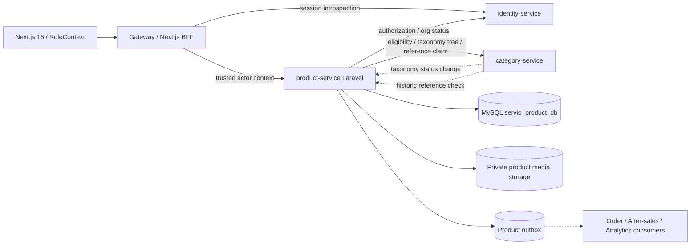
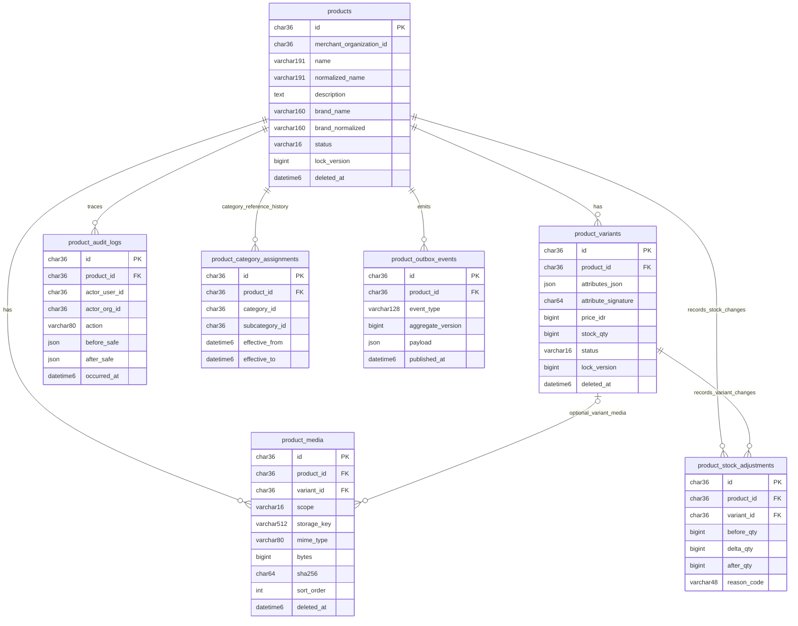
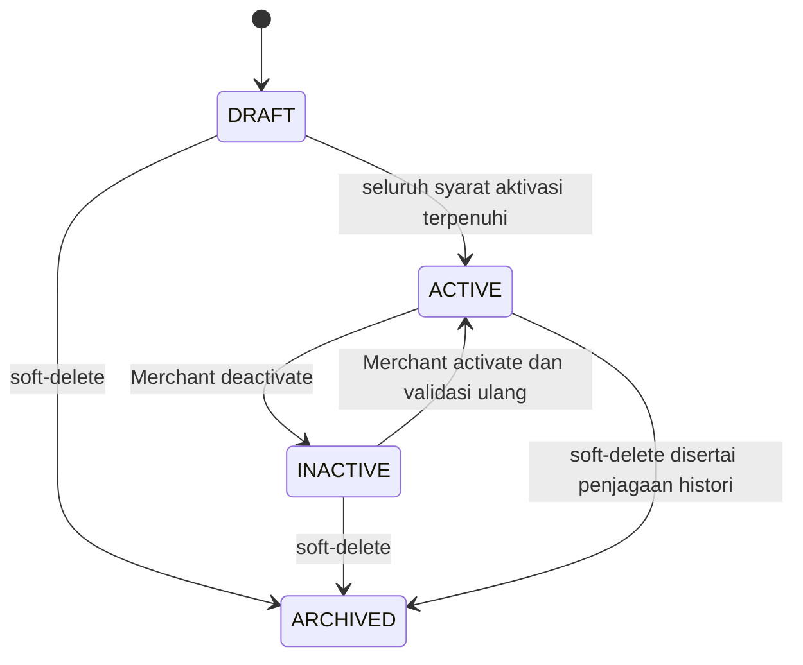
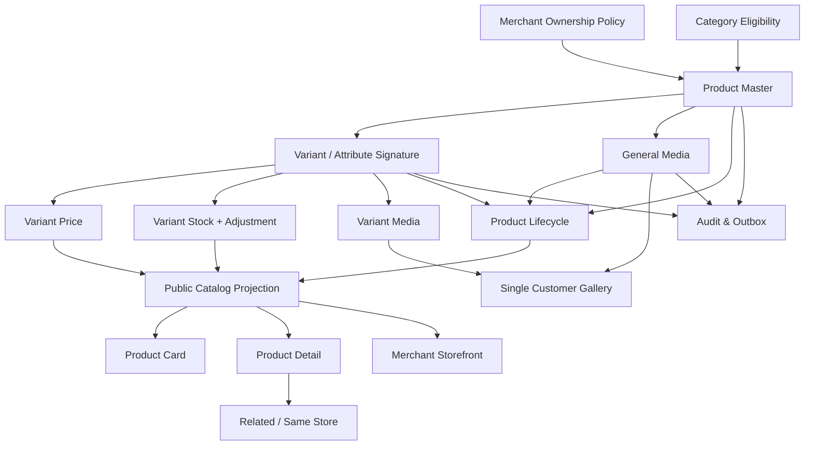

# SERVIO — BACKEND TECHNICAL SPECIFICATION
## MODUL 03 — PRODUCT / CATALOG SERVICE
### Arsitektur Laravel Microservices, MySQL, Kontrak API, Integrasi, dan Panduan Implementasi

> **Cakupan dokumen:** pengelolaan barang milik Merchant dan penyajiannya kepada Customer/Guest: Product Master, referensi Category/Subcategory, varian/atribut, harga, stok katalog, media umum/varian, lifecycle, katalog publik, product card/detail, storefront, related products, serta akses dan audit domain Product. Dokumen ini menguraikan desain backend dan kontrak antarmuka; bukan bukti bahwa kode atau integrasinya sudah dijalankan.
>
> **Basis bisnis:** `PHASE-03-PRODUCT-CATALOG- PLAN.md` (29 bagian; 63 business rules; 35 edge cases). **Rujukan integrasi:** `PHASE-01-PLAN`, `01-identity-access-CR02-BACKEND`, `PHASE-02-CATEGORY - PLAN`, `02-category-management-BACKEND`, `GLOBAL DEVELOPMENT RULES`, dan `SERVIO_GLOBAL_DATA_PREPARATION`. Jika contoh lama menyebut MongoDB, gunakan **MySQL localhost** sesuai keputusan global terbaru. Jika pernyataan lama mengenai akun/otorisasi bertentangan dengan kontrak Modul 01 yang lebih baru, gunakan kontrak Modul 01.
>
> **Penanda ketetapan:** **[B]** = aturan bisnis yang secara eksplisit ada dalam planning; **[T]** = pilihan desain implementasi yang diperlukan agar bisa dikodekan dan diuji; **[P]** = kontrak antarmicroservice belum dibuktikan/diimplementasikan oleh service tujuan; **[D]** = pilihan perilaku bisnis yang belum ditentukan di planning. Penanda ini mencegah pilihan teknis berubah diam-diam menjadi aturan bisnis. Tidak ada keputusan baru di dokumen ini yang mengubah kontrak Modul 01/02 atau memindahkan domain.

**Ringkasan lingkungan dan kepemilikan**

| Aspek | Ketentuan |
|---|---|
| Aplikasi frontend | Next.js 16 App Router, React 19, TypeScript, Tailwind CSS v4, RoleContext untuk pengalaman UI |
| Backend | `backend/services/product-service/` — **satu project Laravel independen** |
| Database | MySQL localhost, database logis eksklusif `servio_product_db` |
| Layanan upstream | `identity-service` untuk aktor, role, org, membership, permissions; `category-service` untuk taxonomy dan effective status |
| Layanan downstream | Order 05, After-Sales 07, Analytics 11; kontrak layanan yang belum dibangun tetap [P] |
| Resource eksternal | Media pada disk/file storage milik Product Service; path, credentials, dan URL harus dikontrol server |
| ID | UUID canonical `CHAR(36)` [T]; ID antarservice hanyalah nilai referensi, **tanpa cross-database foreign key** |
| Currency | `IDR` untuk katalog yang dibahas; nilai harga berupa bilangan rupiah nonnegatif tanpa floating point [T] |
| Business exclusion | Tidak membuat Supplier Product/B2B, SKU business layer, product compatibility, service/jasa, cart, checkout, order, reservation stock, fulfillment, payment, escrow, refund, warranty, rating engine, affiliate, notification, AI/personalized recommendation, assets, atau analytics |

---

# 01. Service Architecture & Boundary

## 1.1 Tanggung jawab domain

`product-service` adalah owner tunggal atas identitas dan konten Product Merchant serta seluruh atribut katalog yang berasal dari Product: `product`, `product_variant`, `variant_attributes`, harga, kuantitas stok katalog, foto produk, foto varian, status, catatan mutasi, dan read model katalog. **[B]** Satu Merchant memiliki banyak Product, satu Product tepat milik satu Merchant, dan satu Variant tepat milik satu Product. Product memiliki minimal satu Variant agar menjadi produk yang layak aktif; harga/stok tidak ditempatkan pada Product global.

**Dari Modul 01 (bukan data yang diduplikasi):** `merchant_organization_id`, identitas user, nama/logo publik Merchant yang disalurkan lewat kontrak resmi, status organisasi, membership dan penugasan role. **Dari Modul 02:** `category_id`, `subcategory_id`, branch `PRODUK`, relasi parent, stored/effective status, versi taxonomy. Product hanya menyimpan ID kategori untuk assignment-nya; tidak membuat kategori baru atau menyimpan taxonomy master sendiri.

| Subdomain | Owner dan data | Hal yang tidak dikerjakan |
|---|---|---|
| Product master | nama, deskripsi, brand teks [T], kategori/subkategori sebagai reference, merchant owner, status | merchant registration / legal docs |
| Variant | identitas varian, normalized attribute combination, status | SKU layer baru / supplier purchasing |
| Variant price | nominal rupiah per varian, price revision info | pembayaran, diskon platform, pajak transaksi |
| Variant stock | jumlah stok katalog per varian dan jejak penyesuaian Merchant | stock reservation/deduction/restoration dari order/refund |
| Media | attachment milik Product/Variant, scope, posisi, thumbnail, lifecycle storage | dokumen KYC atau file dari domain lain |
| Discovery/read model | public list/detail, range harga, active state, facets/filters, store/related queries | AI, ranking personalized, review/rating computation |
| Local governance | read/audit data Product berizin | mengelola role, menyetujui legalitas usaha, mengubah saldo |

**Tidak ada** direct SQL, cross-DB join/FK, controller domain lain dalam aplikasi ini. Satu API Gateway/BFF boleh mengarahkan request atau menggabungkan response yang telah diotorisasi, tetapi tidak menjadi pemilik Product business logic.

## 1.2 Arsitektur request dan dependensi



- **Public:** Guest boleh browse data yang lolos visibility. Tidak ada permission berbahaya pada public API.
- **Authenticated Merchant:** Laravel menerima actor context dari gateway yang telah mengintrospeksi sesi Sanctum Identity; Product juga mengevaluasi izin dan ownership domain pada server. Jangan percaya `servio_active_role`, `merchant_id`, atau `X-User-*` dari browser.
- **Privileged governance:** Admin/CEO hanya membaca/mengevaluasi data sesuai izin, tanpa otomatis diberi akses mengubah katalog Merchant.
- **Internal:** komunikasi authenticated service-to-service, timeout bounded, correlation ID, error fail-closed pada mutation.
- **Events:** perubahan Product dicatat ke transactional outbox lalu dikirim at-least-once dengan deduplikasi; event tidak menggantikan validasi sinkron untuk mutasi sensitif.

## 1.3 Struktur project Laravel

```text
servio/
├── backend/
│   ├── services/
│   │   ├── identity-service/                 # Modul 01; bukan lokasi Product
│   │   ├── category-service/                 # Modul 02; bukan lokasi Product
│   │   └── product-service/                  # Laravel application tersendiri
│   │       ├── app/
│   │       │   ├── Domain/Product/
│   │       │   │   ├── Actions/ Enums/ Policies/ DTOs/ Events/
│   │       │   ├── Application/Commands/ Queries/
│   │       │   ├── Infrastructure/
│   │       │   │   ├── IdentityClient/ CategoryClient/ MediaStorage/
│   │       │   │   ├── Persistence/ Outbox/ Inbox/ Idempotency/
│   │       │   ├── Http/Controllers/Requests/Resources/Middleware/
│   │       │   └── Models/
│   │       ├── bootstrap/app.php
│   │       ├── routes/api.php
│   │       ├── routes/internal.php
│   │       ├── database/migrations/
│   │       ├── database/seeders/             # Tidak membuat akun dummy
│   │       ├── tests/{Unit,Feature,Contract,Integration,Security}/
│   │       ├── config/{product,services,filesystems}.php
│   │       ├── storage/app/private/products/
│   │       ├── .env.example
│   │       ├── composer.json
│   │       └── artisan
│   └── gateway/                              # Routing infrastruktur, non-domain
└── docs/backend/03-product-catalog/03-product-catalog.md
```

Contoh environment non-rahasia:

```dotenv
APP_NAME=SERVIO_Product
APP_ENV=local
APP_DEBUG=true
APP_URL=http://localhost:8003
DB_CONNECTION=mysql
DB_HOST=127.0.0.1
DB_PORT=3306
DB_DATABASE=servio_product_db
DB_USERNAME=servio_product
DB_PASSWORD=SET_LOCALLY
IDENTITY_INTERNAL_BASE_URL=http://localhost:8001
CATEGORY_INTERNAL_BASE_URL=http://localhost:8002
PRODUCT_INTERNAL_SERVICE_CREDENTIAL=SET_LOCALLY
PRODUCT_STORAGE_DISK=local
PRODUCT_PUBLIC_MEDIA_ROUTE=/api/v1/product-media
PRODUCT_MEDIA_MAX_BYTES=5242880
PRODUCT_CATEGORY_TIMEOUT_MS=1200
PRODUCT_IDENTITY_TIMEOUT_MS=1200
PRODUCT_PUBLIC_CATALOG_PAGE_SIZE=20
QUEUE_CONNECTION=database
CACHE_STORE=database
```

`APP_KEY`, internal credential, object storage keys, trusted proxies dan secure cookie berasal dari environment yang sesuai; `.env` tidak pernah masuk repository. MySQL instance dapat dipakai bersama saat local development, **database dan DB user/privilege tetap dipisah**. Product Service tidak menerbitkan sesi browser baru.

## 1.4 Invariants yang wajib konsisten

1. **[B]** Product → satu Merchant (referensi Identity); Merchant lain tidak bisa mutasi.
2. **[B]** Semua Product menggunakan branch `PRODUK`; Category/Subcategory resmi dari Category; parent harus cocok dan efektif aktif untuk assignment baru.
3. **[B]** Product `ACTIVE` memiliki ≥1 Variant `ACTIVE`, Category/Subcategory valid, general media minimum 1, Merchant valid.
4. **[B]** Harga dan stok adalah properti Variant; keduanya ≥0. Stock=0 valid tetapi tidak tersedia.
5. **[B]** Atribut Variant yang sama, setelah normalisasi, tidak boleh duplikat di dalam Product; boleh sama pada Product lain.
6. **[B]** Product `DRAFT`/`INACTIVE` dan Variant `INACTIVE` tidak tampil/dipilih di katalog publik.
7. **[B]** Product media `GENERAL` tidak memiliki `variant_id`; media `VARIANT` wajib memiliki ID varian dari **Product yang sama**.
8. **[B]** Gallery awal = general; gallery setelah pemilihan varian = media varian terpilih (jika ada), disusul general; varian tanpa media memakai general.
9. **[B]** Storefront publik hanya memuat Product `ACTIVE` milik Merchant tersebut; satu toko bisa kosong.
10. **[B]** Related = active, subcategory terlebih dahulu kemudian category, exclude current; Same-Store = active, same Merchant, exclude current.
11. **[T]** Foreign reference tidak pernah menjadi MySQL FK lintas service; semantik eligibility dipastikan lewat service owner.
12. **[T]** Database audit menjaga jejak mutasi termasuk asal aktor/organisasi dan tidak menyimpan credential/NIK/NPWP.

## 1.5 Keputusan desain yang memerlukan pembeda jelas

Agar coding agent tidak menebak, gunakan keputusan implementasi aman berikut sebagai **[T]** sampai ketentuan bisnis tambahan ditetapkan:

- Draft boleh disimpan bertahap tanpa memenuhi syarat **publikasi**, termasuk saat varian/media belum lengkap; aktivasi tetap wajib seluruh syarat **[D-01]**. Ini tidak mengubah syarat `ACTIVE`.
- `DELETE` Merchant mengarsipkan Product secara **soft delete**, bukan menghilangkan histori secara fisik **[D-06]**; operasi historis tidak kehilangan referensi. Tidak ada public hard-delete endpoint.
- Menonaktifkan/menghapus varian aktif terakhir atau general media terakhir pada Product `ACTIVE` ditolak `409`, bukan otomatis menurunkan status Product **[D-04/D-05]**. Merchant dapat terlebih dahulu menonaktifkan Product lalu melakukan perubahan tersebut.
- Jika ada kategori/organisasi tidak lagi eligible, Product tidak ditampilkan publik. **Status tersimpan tidak diubah diam-diam**; `public_eligible=false` dihitung dari syarat terkini **[D-07/D-11]**.
- Admin/CEO mendapatkan akses baca sesuai policy, **tanpa** endpoint approve/reject/override stock atau price **[D-10]**. Jika dibutuhkan moderasi khusus, definisikan proses dan izin melalui keputusan bisnis tersendiri.
- `brand` sebagai atribut teks normalisasi milik Product (bukan `brand-service` atau master taxonomy baru) **[D-09]**. Filter brand lintas kategori tetap tersedia; governance Master Brand jika kelak dipastikan merupakan keputusan lintas modul.
- `price=0` lolos aturan nonnegatif planning, tetapi keputusan apakah harga nol dapat dipublikasikan masih **[D-08]**; pada desain awal tandai `price_policy=NEEDS_BUSINESS_CONFIRMATION` untuk aktivasi varian dengan harga nol dan jangan otomatis mengubahnya menjadi produk gratis yang bisa dibeli.

---

# 02. Entity Relationship Diagram (ERD)

## 2.1 ERD tabel milik Product Service



**Tabel teknis tambahan:** `product_idempotency_records`, `product_inbox_consumptions`, dan `product_media_uploads` (metadata upload staging bila two-step flow diperlukan) tetap satu database Product. Primary entity Product memiliki assignment kategori **sekarang** pada `products.category_id`/`subcategory_id`; tabel `product_category_assignments` menyimpan riwayat category/subcategory yang pernah melekat untuk mendukung audit dan perlindungan Hard Delete Category. Tidak ada duplikasi master taxonomy.

## 2.2 Relasi, kardinalitas dan foreign references

| Relasi | Kardinalitas | Integritas |
|---|---|---|
| Identity Organization → Product | 1:N logical | `products.merchant_organization_id` scalar UUID; bukan FK; harus MERCHANT/ACTIVE sesuai Identity |
| Product → Variant | 1:N | FK internal `product_variants.product_id`; untuk aktif minimal 1 active |
| Product → General/Variant Media | 1:N | Media selalu terhubung Product, boleh opsional ke Variant yang termasuk Product yang sama |
| Product → Category/Subcategory | N:1 logical | UUID referensi Category tanpa FK; branch PRODUK, parent match, eligibility dari Category |
| Product → Category Assignment History | 1:N | Riwayat append/close-only, bukan Category master atau transaksi |
| Variant → Stock Adjustment | 1:N | Satu baris tiap operasi manual yang benar-benar mengubah stok |
| Product → Audit/Outbox | 1:N | Audit append-only dan event outbox dalam transaction mutation |
| Product → Rating/Order masa depan | 1:N logical | Referensi service konsumen, **tidak ada** tabel Product untuk Rating atau Order |

## 2.3 Status/lifecycle dan computed visibility



`ARCHIVED` pada diagram = baris `deleted_at` terisi, **bukan nilai baru dalam kolom `status`**. Status DB Product tetap `DRAFT|ACTIVE|INACTIVE`. Status Variant: `ACTIVE|INACTIVE`; varian baru pada draft boleh `INACTIVE` sampai valid; kebijakan status default varian adalah **[T]**. Pada penghapusan Variant gunakan `deleted_at` dan jangan hilangkan audit/histori.

**Computed public visibility** (tidak disamakan dengan status tersimpan):

```text
public_eligible = merchant_eligible
              AND product.status == ACTIVE
              AND product.deleted_at == null
              AND category.effective_active == true
              AND subcategory.effective_active == true
              AND subcategory.parent_id == product.category_id
              AND EXISTS(active, nondeleted variant)
              AND EXISTS(valid, nondeleted GENERAL media)
              AND all media-serving/authorization invariants hold
```

Stock nol **tidak** mengubah `public_eligible` menjadi false; produk dapat tampil berlabel habis. Range harga dihitung dari Variant `ACTIVE` nondeleted, termasuk varian stok nol sesuai ketentuan saat ini. `price_min == price_max` ditampilkan sebagai exact price.

---

# 03. Database Schema & Laravel Migrations Design

## 3.1 Ketentuan umum

Gunakan MySQL 8.x InnoDB, collation `utf8mb4`, UTC timestamps `DATETIME(6)`, soft deletes selektif, UUID `CHAR(36)` canonical [T]. Nominal harga sebagai `BIGINT UNSIGNED` dalam **satuan rupiah utuh**, stok sebagai `BIGINT UNSIGNED` dalam **unit barang**, bukan float. Jaga `CHECK` untuk nilai nonnegatif; koreksi jumlah/price dilakukan melalui endpoint dengan version precondition, bukan update SQL acak. Jangan campur enum status Product, Variant, Media, dan Upload.

## 3.2 Kamus tabel lengkap

Semua tabel di bawah milik `servio_product_db`. `PK` = primary, `UK` = unique, `FK` = hanya antar tabel Product, `IX` = index; `NOT NULL` wajib kecuali disebut nullable. `created_at`, `updated_at` = `DATETIME(6)` kecuali append-only tables.

| Tabel | Kolom utama dan tipe | Constraints/index | Perilaku |
|---|---|---|---|
| `products` | `id CHAR(36) PK`; `merchant_organization_id CHAR(36)`; `created_by_user_id CHAR(36)`; `name VARCHAR(191)`; `normalized_name VARCHAR(191)`; `description LONGTEXT NULL`; `brand_name VARCHAR(160) NULL`; `brand_normalized VARCHAR(160) NULL`; `category_id CHAR(36) NULL`; `subcategory_id CHAR(36) NULL`; `status VARCHAR(16) DEFAULT 'DRAFT'`; `lock_version BIGINT UNSIGNED DEFAULT 1`; `deleted_at DATETIME(6) NULL`; timestamps | `IX(merchant_organization_id,status,deleted_at)`; `IX(category_id,subcategory_id,status)`; `IX(brand_normalized,status)`; `IX(normalized_name)`; index `(created_at,id)` | `category_id`/`subcategory_id` nullable **hanya ketika draft** [T]; tidak ada global unique Product name; `merchant_organization_id` immutable |
| `product_variants` | `id CHAR(36) PK`; `product_id CHAR(36) FK`; `attributes_json JSON NOT NULL`; `attribute_signature CHAR(64) NOT NULL`; `display_name VARCHAR(191) NULL`; `price_idr BIGINT UNSIGNED NOT NULL DEFAULT 0`; `stock_qty BIGINT UNSIGNED NOT NULL DEFAULT 0`; `status VARCHAR(16) DEFAULT 'INACTIVE'`; `lock_version BIGINT UNSIGNED DEFAULT 1`; `deleted_at DATETIME(6) NULL`; timestamps | `FK(product_id) RESTRICT`; `IX(product_id,status,deleted_at)`; `UK(product_id,attribute_signature,active_variant_guard)` [generated, see below] | Price/stock source of truth satu varian; `attributes_json` canonical object; no SKU column/business layer |
| `product_media` | `id CHAR(36) PK`; `product_id CHAR(36) FK`; `variant_id CHAR(36) NULL`; `scope VARCHAR(16)`; `storage_disk VARCHAR(32)`; `storage_key VARCHAR(512)`; `original_filename VARCHAR(191) NULL`; `mime_type VARCHAR(80)`; `bytes BIGINT UNSIGNED`; `sha256 CHAR(64)`; `width INT UNSIGNED`; `height INT UNSIGNED`; `sort_order INT UNSIGNED`; `is_primary BOOLEAN DEFAULT FALSE` **[T]**; `storage_state VARCHAR(16) NOT NULL DEFAULT 'PENDING'` (`PENDING|READY|FAILED`); `deleted_at DATETIME(6) NULL`; timestamps | `FK(product_id) RESTRICT`; composite `FK(variant_id,product_id) -> product_variants(id,product_id)` bila digunakan; `IX(product_id,scope,sort_order,deleted_at)`; `IX(variant_id,sort_order)`; unique `(storage_disk,storage_key)` | `GENERAL` harus variant null; `VARIANT` harus nonnull; file private, public disajikan melalui authorized media handler |
| `product_category_assignments` | `id CHAR(36) PK`; `product_id CHAR(36) FK`; `category_id CHAR(36)`; `subcategory_id CHAR(36)`; `assigned_by_user_id CHAR(36)`; `effective_from DATETIME(6)`; `effective_to DATETIME(6) NULL`; `category_claim_id CHAR(36) NULL`; `subcategory_claim_id CHAR(36) NULL`; `operation_id CHAR(36)`; timestamps | `FK(product_id) RESTRICT`; `IX(category_id)`; `IX(subcategory_id)`; `IX(product_id,effective_to)`; `UK(operation_id,product_id)` | Histori assignment untuk proving reference ke Category; retention melampaui soft delete |
| `product_stock_adjustments` | `id CHAR(36) PK`; `product_id CHAR(36) FK`; `variant_id CHAR(36) FK`; `actor_user_id CHAR(36)`; `actor_org_id CHAR(36)`; `before_qty BIGINT UNSIGNED`; `delta_qty BIGINT SIGNED`; `after_qty BIGINT UNSIGNED`; `reason_code VARCHAR(48)`; `note TEXT NULL`; `operation_id CHAR(36)`; `occurred_at DATETIME(6)` | FKs internal RESTRICT; `UK(operation_id,variant_id)`; `IX(variant_id,occurred_at)` | Audit stok manual pada katalog, bukan reservasi/fulfillment Order |
| `product_audit_logs` | `id CHAR(36) PK`; `product_id CHAR(36) FK`; `actor_user_id CHAR(36)`; `actor_role VARCHAR(64)`; `actor_org_id CHAR(36) NULL`; `action VARCHAR(80)`; `entity_type VARCHAR(32)`; `entity_id CHAR(36)`; `before_safe JSON NULL`; `after_safe JSON NULL`; `reason TEXT NULL`; `request_id VARCHAR(96)`; `correlation_id VARCHAR(96) NULL`; `occurred_at DATETIME(6)` | `IX(product_id,occurred_at)`; `IX(actor_user_id,occurred_at)`; `IX(entity_type,entity_id,occurred_at)` | Append-only, redacted, tetap ada saat Product soft-deleted |
| `product_outbox_events` | `id CHAR(36) PK`; `product_id CHAR(36) FK`; `event_type VARCHAR(128)`; `aggregate_version BIGINT`; `payload JSON`; `occurred_at DATETIME(6)`; `published_at DATETIME(6) NULL`; `attempts INT DEFAULT 0`; `correlation_id VARCHAR(96) NULL` | `IX(published_at,occurred_at)`; `IX(product_id,aggregate_version)` | Dispatch at-least-once; consumer deduplicate by `id` |
| `product_inbox_consumptions` | `id CHAR(36) PK`; `source_service VARCHAR(40)`; `event_id CHAR(36)`; `aggregate_id CHAR(36)`; `aggregate_version BIGINT`; `processed_at DATETIME(6)`; `payload_hash CHAR(64)` | `UK(source_service,event_id)`; `IX(aggregate_id,aggregate_version)` | Consumer dedup dan version checks untuk Identity/Category events |
| `product_idempotency_records` | `id CHAR(36) PK`; `actor_key VARCHAR(128)`; `endpoint_key VARCHAR(128)`; `idempotency_key VARCHAR(191)`; `request_hash CHAR(64)`; `response_code SMALLINT`; `response_body JSON`; `expires_at DATETIME(6)`; timestamps | `UK(actor_key,endpoint_key,idempotency_key)`; `IX(expires_at)` | Replay response untuk mutation yang aman retry, tidak menyimpan rahasia |
| `product_media_uploads` **[T]** | `id CHAR(36) PK`; `product_id CHAR(36) FK`; `owner_user_id CHAR(36)`; `temporary_storage_key VARCHAR(512)`; `mime VARCHAR(80)`; `bytes BIGINT UNSIGNED`; `sha256 CHAR(64)`; `status VARCHAR(16)`; `expires_at DATETIME(6)`; `consumed_at DATETIME(6) NULL`; timestamps | `IX(status,expires_at)`; `UK(temporary_storage_key)` | Opsional jika implementasi memakai staging/upload terpisah; jika upload multipart diselesaikan sinkron, tabel ini tidak diperlukan |

**Catatan penting `product_media`:** untuk memastikan varian benar-benar anak Product yang sama di level DB, buat `UNIQUE(id,product_id)` pada `product_variants`, lalu composite FK `(variant_id,product_id)` jika kombinasi NULL sesuai aturan MySQL, dan CHECK kesesuaian `scope`; service-level validation dan transaction tetap wajib. File path tidak pernah menggunakan `original_filename` sebagai key publik.

**Keunikan Variant dengan soft delete:** `active_variant_guard` adalah generated column bernilai `1` bila `deleted_at IS NULL` dan `NULL` bila soft-deleted; `UNIQUE(product_id,attribute_signature,active_variant_guard)` mencegah dua kombinasi aktif identik sekaligus memungkinkan riwayat varian yang diarsipkan. Gunakan MySQL 8 generated STORED column atau indeks ekuivalen yang benar-benar teruji. Signature = SHA-256 representasi JSON canonical yang menormalisasi **nama atribut dan nilai atribut**: trim, collapse whitespace, unicode lowercase, key sorted, tipe data diseragamkan; collision check redundan dengan canonical JSON saat membaca. Data dengan kombinasi atribut yang sama pada Product lain tidak konflik.

## 3.3 Contoh migration Laravel inti

```php
Schema::create('products', function (Blueprint $table) {
    $table->uuid('id')->primary();
    $table->uuid('merchant_organization_id'); // Identity external scalar, NO FK
    $table->uuid('created_by_user_id');       // Identity external scalar, NO FK
    $table->string('name', 191);
    $table->string('normalized_name', 191);
    $table->longText('description')->nullable();
    $table->string('brand_name', 160)->nullable();
    $table->string('brand_normalized', 160)->nullable();
    $table->uuid('category_id')->nullable();  // Category external scalar, NO FK
    $table->uuid('subcategory_id')->nullable();
    $table->string('status', 16)->default('DRAFT');
    $table->unsignedBigInteger('lock_version')->default(1);
    $table->softDeletes('deleted_at', 6);
    $table->timestamps(6);
    $table->index(['merchant_organization_id', 'status', 'deleted_at']);
    $table->index(['category_id', 'subcategory_id', 'status']);
    $table->index(['brand_normalized', 'status']);
});

Schema::create('product_variants', function (Blueprint $table) {
    $table->uuid('id')->primary();
    $table->foreignUuid('product_id')->constrained('products')->restrictOnDelete();
    $table->json('attributes_json');
    $table->char('attribute_signature', 64);
    $table->string('display_name', 191)->nullable();
    $table->unsignedBigInteger('price_idr')->default(0);
    $table->unsignedBigInteger('stock_qty')->default(0);
    $table->string('status', 16)->default('INACTIVE');
    $table->unsignedBigInteger('lock_version')->default(1);
    $table->softDeletes('deleted_at', 6);
    $table->timestamps(6);
    $table->unique(['id', 'product_id'], 'uk_variant_product');
    $table->index(['product_id', 'status', 'deleted_at']);
});

// Migration lanjutan MySQL (DB::statement + up/down secara eksplisit):
// generated active_variant_guard = IF(deleted_at IS NULL, 1, NULL)
// UNIQUE(product_id, attribute_signature, active_variant_guard)
// CHECK(price_idr >= 0), CHECK(stock_qty >= 0), CHECK(status IN ('ACTIVE','INACTIVE'))
// Pada products CHECK(status IN ('DRAFT','ACTIVE','INACTIVE'))
// Tambah product_media, assignments, stock adjustments, audit, inbox/outbox, idempotency.
```

`price_idr`/`stock_qty` tidak boleh berubah lewat operasi mass assignment sembarangan. Migration wajib mencakup seluruh kolom §3.2, check constraints, indeks, dan up/down. `SHOW CREATE TABLE` serta integration test MySQL harus membuktikan constraint benar-benar aktif, bukan hanya test SQLite.

## 3.4 Transaksi, integritas dan concurrency

**Create/update Product:** authorization → organization ownership → normalize → validasi branch/category reference bila assignment disubmit → begin local DB transaction → insert/update + audit + outbox → commit. Category claim yang disyaratkan dilakukan dengan protokol terkoordinasi §07; tidak ada transaksi lintas DB. Jangan menganggap `GET eligibility` saja cukup untuk melindungi race dengan Hard Delete.

**Edit harga/stok:** gunakan `If-Match` (versi Variant) dan `SELECT ... FOR UPDATE` di satu transaksi; increment `lock_version`. Update stok baru `after = before + delta`, reject jika negatif/out of range, audit sebelum-sesudah. **Pencegahan double submit:** `Idempotency-Key` dengan request hash. Jangan mengurangi stok otomatis saat lihat produk atau saat buka Cart (Order di luar scope).

**Media:** file upload diverifikasi ukuran/MIME/magic bytes dan dimensions; simpan awal ke path temporary non-public, lalu commit metadata DB. Jika commit gagal, hapus staged file secara idempotent; bila promosi file gagal, metadata jangan muncul sebagai valid public media. Delete media = soft delete metadata, invalidasi cache lalu garbage collection setelah retensi [T]; jangan orphan file terbuka. Reorder semua media satu scope dilakukan dalam transaksi dan memakai version precondition Product untuk mencegah lost updates.

**Mutation yang memengaruhi ACTIVE:** sebelum commit verifikasi invariant sesudah operasi. Jika akan tersisa nol ACTIVE varian atau nol general media, kembalikan `409 PRODUCT_ACTIVE_REQUIREMENTS_VIOLATED`; tidak auto-ganti status tanpa instruksi eksplisit. Category/merchant menjadi tidak eligible: public view menghilangkan produk, local status preserved; mutation/activation yang butuh eligibility harus fail closed.

**Historical references:** mengubah Category menutup assignment lama (`effective_to`) dan menambah row baru; histori lama tidak dihapus. Soft delete Product atau Variant tidak menghapus assignment/audit, sehingga verifikasi referensi kategori tetap authoritative.

---
# 04. API Endpoint Specification & JSON Contract

## 4.1 Konvensi umum

Prefix API publik/merchant/governance melalui Gateway: `/api/v1`. Prefix service-only: `/internal/v1`. Semua path Product dirutekan ke `product-service`. Browser menggunakan Laravel Sanctum SPA stateful session **milik Identity** via cookie `HttpOnly` dan CSRF melalui BFF/Gateway; tidak menggunakan browser bearer fallback. Gateway memeriksa sesi, membersihkan user-header dari browser, membuat actor context tepercaya, dan Product Service memverifikasi role/permission/ownership ulang. Endpoint baca publik mengizinkan Guest tanpa sesi.

Seluruh **JSON success** memakai bentuk:

```json
{
  "success": true,
  "code": "PRODUCT_OPERATION_SUCCEEDED",
  "data": {},
  "meta": {"request_id": "req_7b", "version": "v1"}
}
```

**List/pagination** memakai `data.items` serta `meta.page`: `{"limit":20,"next_cursor":null,"has_more":false}`. Error:

```json
{
  "success": false,
  "code": "PRODUCT_VALIDATION_FAILED",
  "message": "Data produk tidak valid.",
  "error": {
    "field_errors": {"category_id": ["Kategori tidak layak digunakan."]},
    "details": null,
    "retry_after_seconds": null
  },
  "meta": {"request_id": "req_7b", "version": "v1"}
}
```

HTTP: `200` success, `201` created, `204` delete void (jika tidak perlu receipt), `400` malformed, `401` unauthenticated, `403` permission denied, `404` missing atau objek tenant lain, `409` duplicate/state/version conflict, `413` file oversized, `415` invalid MIME, `422` field validation, `428` missing `If-Match`, `429` throttling, `502/503` upstream/storage temporary failure. Header `Retry-After` jika relevan. Request IDs dan version harus tercatat dalam log non-sensitif.

**Mutation version:** `If-Match: "<lock_version>"` untuk edit, status, delete, media order. Kontrak memakai `409 PRODUCT_VERSION_CONFLICT` untuk stale version dan `428 PRODUCT_PRECONDITION_REQUIRED` jika header hilang [T]. Untuk mutasi varian, versi adalah versi Variant; untuk media dan assignment Product, versi Product. Missing field pada PATCH tidak mengubah nilai; `null` di field nullable bermakna clear hanya jika whitelist mengizinkan.

**Idempotency:** `Idempotency-Key` wajib untuk POST create/upload/stock adjustment dan DELETE yang rentan retry; kombinasi `(actor,endpoint,key)` menyimpan request hash + response. Key yang digunakan untuk body berbeda -> `409 PRODUCT_IDEMPOTENCY_KEY_REUSED`. Upload binary didedup via sha256+operation id; raw file tidak tersimpan di idempotency response JSON. Semua list `limit=20`, maksimum 100, cursor opaque stabil, `sort` allowlist dan tidak boleh menerima raw SQL field names.

## 4.2 Resource contract yang digunakan semua endpoint

**ProductAdminView [T]:**

```json
{
  "id":"9bdb2ec1-e502-4e7f-b7ef-c1530d816abd",
  "merchant_organization_id":"0d6928ad-1c31-4380-98f8-98355100336a",
  "name":"AC Portable 1 PK",
  "description":"AC portabel untuk ruangan",
  "brand":"ACME",
  "category_id":"11111111-1111-4111-8111-111111111111",
  "subcategory_id":"22222222-2222-4222-8222-222222222222",
  "status":"DRAFT",
  "lock_version":1,
  "variants":[
    {
      "id":"33333333-3333-4333-8333-333333333333",
      "attributes":{"kapasitas":"1 PK","warna":"Putih"},
      "display_name":"Putih / 1 PK",
      "price_idr":2500000,
      "stock_qty":8,
      "status":"ACTIVE",
      "lock_version":1,
      "media":[]
    }
  ],
  "media":[
    {
      "id":"44444444-4444-4444-8444-444444444444",
      "scope":"GENERAL","variant_id":null,
      "url":"/api/v1/product-media/44444444-4444-4444-8444-444444444444",
      "sort_order":0,"is_primary":true
    }
  ],
  "activation_requirements":{
    "merchant_eligible":true,"category_eligible":true,
    "subcategory_eligible":true,"has_active_variant":true,
    "has_general_media":true,"can_activate":true,"blocking_reasons":[]
  },
  "created_at":"2026-10-19T02:00:00Z",
  "updated_at":"2026-10-19T02:00:00Z"
}
```

`activation_requirements` adalah evaluasi terbaru pada saat response; **bukan** hak permanen untuk mengaktifkan tanpa revalidasi saat mutation. ProductAdminView dapat memuat varian kosong saat draft [T]. Field `created_by_user_id`, audit/trace, dan notes internal hanya dikirim ke pengguna dengan izin spesifik.

**ProductCardView (publik):**

```json
{
  "id":"9bdb2ec1-e502-4e7f-b7ef-c1530d816abd",
  "name":"AC Portable 1 PK",
  "primary_image": {"url":"/api/v1/product-media/44444444-4444-4444-8444-444444444444", "alt":"AC Portable 1 PK"},
  "display_price": {"currency":"IDR","kind":"RANGE","min":2500000,"max":3000000,"formatted_hint":null},
  "availability":"IN_STOCK",
  "merchant":{
    "organization_id":"0d6928ad-1c31-4380-98f8-98355100336a",
    "store_name":"ACME Elektronik",
    "storefront_url":"/merchants/0d6928ad-1c31-4380-98f8-98355100336a/storefront"
  },
  "category_id":"11111111-1111-4111-8111-111111111111",
  "subcategory_id":"22222222-2222-4222-8222-222222222222"
}
```

`formatted_hint=null` berarti frontend mengatur tampilan rupiah; angka tetap integer. `availability=OUT_OF_STOCK` bila seluruh active Variant memiliki `stock_qty=0`. Rating **tidak** dikirim sebelum tersedia sumber rating sah dari Modul 07; tidak boleh disubstitusi angka dummy.

**ProductDetailView (publik):** memuat seluruh field Card yang relevan, `description`, `brand`, `category:{id,name}`, `subcategory:{id,name}`, `general_media:[MediaView]`, `variants:[{id,display_name,attributes,price_idr,stock_qty,available,media:[MediaView]}]`, `merchant:{organization_id,store_name,logo_url?,public_description?,verified_badge?}`, `related_products:[ProductCardView]` dan `same_store_products:[ProductCardView]` jika `include=related,same_store`. `available` bagi Variant ACTIVE adalah `stock_qty>0` (Variant ACTIVE berstok nol masih boleh dipilih untuk melihat informasi, tetapi tidak tersedia untuk dibeli [T]); daftar publik **tidak memuat** Variant INACTIVE. `verified_badge` hanya true jika dikonfirmasi Identity, bukan dari input Merchant atau nilai hardcode.

**MerchantStorefrontView:** `{merchant:{organization_id,store_name,logo_url?,public_description?,business_status}, active_product_count, active_categories:[{id,name}], products:[ProductCardView]}`. Seluruh informasi identitas bisnis publik berasal dari Identity melalui kontrak yang diotorisasi, bukan tabel Merchant baru di Product.

## 4.3 Inventory endpoint eksternal

| ID | Method / URI | Actor | Input utama | Output utama |
|---|---|---|---|---|
| P01 | `GET /products` | Guest / authenticated read | `search,categories,subcategories,brands,price_min,price_max,merchant_id,availability,sort,limit,cursor,include_facets` | `200 ListPage<ProductCardView>` dan optional `meta.facets` |
| P02 | `GET /products/{product_id}` | Guest / authenticated read | `include=related,same_store` | `200 ProductDetailView`; `404` jika tidak public eligible |
| P03 | `GET /merchants/{merchant_organization_id}/storefront` | Guest / authenticated read | `search,categories,subcategories,brands,sort,limit,cursor` | `200 MerchantStorefrontView` (boleh empty products) |
| P04 | `GET /product-media/{media_id}` | Guest / Owner-authenticated | `media_id`, optional `mode=inline` | streamed image / redirect short-lived URL; no draft leak |
| M01 | `GET /merchant/products` | Merchant own | `status,category_id,search,sort,limit,cursor` | `200 ListPage<ProductSummaryAdminView>` |
| M02 | `GET /merchant/products/{id}` | Merchant own | `id` | `200 ProductAdminView` |
| M03 | `POST /merchant/products` | Merchant own | basic fields, category/subcategory optional draft, optional inline variants | `201 ProductAdminView` |
| M04 | `PATCH /merchant/products/{id}` | Merchant own | allowlisted product fields, `If-Match` | `200 ProductAdminView` |
| M05 | `PATCH /merchant/products/{id}/status` | Merchant own | `{status:"ACTIVE"|"INACTIVE"}` + `If-Match` | `200 {id,status,lock_version,activation_requirements}` |
| M06 | `DELETE /merchant/products/{id}` | Merchant own | `If-Match`, `Idempotency-Key`, optional `{reason}` | `200 DeletionReceipt` (soft delete [T]) |
| M07 | `POST /merchant/products/{id}/variants` | Merchant own | `{attributes,display_name?,price_idr,stock_qty,status?}` | `201 VariantView` |
| M08 | `PATCH /merchant/products/{id}/variants/{variant_id}` | Merchant own | selected variant fields, stock change reason if updating stock, `If-Match` | `200 VariantView` |
| M09 | `PATCH /merchant/products/{id}/variants/{variant_id}/status` | Merchant own | `{status:"ACTIVE"|"INACTIVE"}` + `If-Match` | `200 VariantView` |
| M10 | `DELETE /merchant/products/{id}/variants/{variant_id}` | Merchant own | `If-Match`, `Idempotency-Key` | `200 DeletionReceipt` (soft delete [T]) |
| M11 | `POST /merchant/products/{id}/media` | Merchant own | multipart file + `{scope,variant_id?}` | `201 MediaView` (single reusable upload for general/variant) |
| M12 | `PUT /merchant/products/{id}/media/order` | Merchant own | `{scope,variant_id?,ordered_media_ids:[...]}` + `If-Match` | `200 List<MediaView>` |
| M13 | `DELETE /merchant/products/{id}/media/{media_id}` | Merchant own | `If-Match`, `Idempotency-Key` | `200 DeletionReceipt` |
| G01 | `GET /governance/products` | Admin/CEO read permission | `merchant_id,status,category_id,search,limit,cursor` | `200 ListPage<ProductGovernanceView>` |
| G02 | `GET /governance/products/{id}` | Admin/CEO read permission | `id` | `200 ProductGovernanceView` |
| G03 | `GET /product-audit` | Authorized Merchant own / Admin/CEO audit | `product_id,action,actor,from,to,limit,cursor` | `200 ListPage<ProductAuditView>` |

**Tidak dibuat endpoint duplikat** `/merchants/{id}/products` karena P01 dengan `merchant_id` sudah melayaninya. Tidak dibuat `/products/{id}/related` tersendiri karena P02 dapat menyertakan dua daftar ringkas melalui `include`. Tidak dibuat API `/variant-prices` atau `/variant-stocks` yang terpisah tanpa kebutuhan; M08 adalah resource mutation Variant. Media M11/M12/M13 menangani **dua scope** dengan validasi ketat. P01 yang dipakai Storefront tetap menggunakan Product Service, bukan SQL ke Identity.

## 4.4 Kontrak request/response terperinci per resource

### P01 — Public Product Listing, search, multi-filter, pagination, and location proximity

```http
GET /api/v1/products?categories=11111111-1111-4111-8111-111111111111&subcategories=22222222-2222-4222-8222-222222222222&brands=acme,daikin&price_min=100000&price_max=3500000&sort=price_asc&customer_city=Surabaya&same_city_only=1&limit=20&include_facets=1
Accept: application/json
```

**Filtering [B/T]:** comma-separated UUID lists untuk `categories`/`subcategories`, comma-separated normalized brand strings untuk `brands` (encoded safely), OR di dalam kelompok yang sama, AND antar kelompok. Filter `brands` independen dari pilihan Category (cross-category); harga minimum/maksimum dalam IDR; produk lolos harga bila **minimal satu ACTIVE Variant** berada dalam rentang yang ditentukan [T]. `search` cocok name/brand normalized (escaped LIKE atau full-text index aman). `sort`: `newest`, `name_asc`, `price_asc`, `price_desc` (tie-breaker UUID); `availability=IN_STOCK|OUT_OF_STOCK` opsional. **Filter Lokasi:** `customer_city` (string nama kota pembeli untuk evaluasi kedekatan pengiriman) dan `same_city_only=1` (filter hanya toko sekota dengan pembeli). `include_facets=1` mengembalikan brand/category/subcategory yang valid untuk katalog produk setelah public eligibility; brand tidak disaring berdasarkan kategori semata karena independen. Invalid/unknown inactive filter IDs tidak menyebabkan data inactive terungkap: hasil kosong/sanitized, bukan detail status tersembunyi. Batas jumlah filter per query [T] configurable (mis. 30 ID/kelompok) untuk menghindari query abuse.

```json
{
  "success": true,
  "code": "PRODUCT_LISTED",
  "data": {
    "items": [{
      "id": "9bdb2ec1-e502-4e7f-b7ef-c1530d816abd",
      "name": "AC Portable 1 PK",
      "primary_image": {"url": "/api/v1/product-media/44444444-4444-4444-8444-444444444444", "alt": "AC Portable 1 PK"},
      "display_price": {"currency": "IDR", "kind": "RANGE", "min": 2500000, "max": 3000000, "formatted_hint": null},
      "availability": "IN_STOCK",
      "merchant": {
        "organization_id": "0d6928ad-1c31-4380-98f8-98355100336a",
        "store_name": "ACME Elektronik",
        "storefront_url": "/merchants/0d6928ad-1c31-4380-98f8-98355100336a/storefront",
        "city": "Kota Surabaya",
        "province": "Jawa Timur",
        "district": "Gubeng",
        "postal_code": "60281"
      },
      "category_id": "11111111-1111-4111-8111-111111111111",
      "subcategory_id": "22222222-2222-4222-8222-222222222222"
    }]
  },
  "meta": {
    "request_id": "req_list",
    "version": "v1",
    "page": {"limit": 20, "next_cursor": null, "has_more": false},
    "facets": {"brands": [{"value": "acme", "label": "ACME", "count": 1}], "categories": [], "subcategories": []}
  }
}
```

`count` facets dihitung dari produk layak tampil, bukan dari draft. Query harga rendah/tinggi tidak menambahkan pajak, ongkir, diskon, rating, ataupun simulasi pembayaran.

### P02 — Product Detail dan dua related sections

```http
GET /api/v1/products/9bdb2ec1-e502-4e7f-b7ef-c1530d816abd?include=related,same_store
```

```json
{
  "success": true,
  "code": "PRODUCT_FOUND",
  "data": {
    "id": "9bdb2ec1-e502-4e7f-b7ef-c1530d816abd",
    "name": "AC Portable 1 PK",
    "description": "AC portabel untuk ruangan",
    "brand": "ACME",
    "category": {"id": "11111111-1111-4111-8111-111111111111", "name": "Elektronik"},
    "subcategory": {"id": "22222222-2222-4222-8222-222222222222", "name": "Peralatan Pendingin"},
    "display_price": {"currency": "IDR", "kind": "RANGE", "min": 2500000, "max": 3000000},
    "general_media": [{
      "id": "44444444-4444-4444-8444-444444444444",
      "scope": "GENERAL",
      "variant_id": null,
      "url": "/api/v1/product-media/44444444-4444-4444-8444-444444444444",
      "sort_order": 0
    }],
    "variants": [
      {
        "id": "33333333-3333-4333-8333-333333333333",
        "display_name": "Putih / 1 PK",
        "attributes": {"warna": "Putih", "kapasitas": "1 PK"},
        "price_idr": 2500000,
        "stock_qty": 8,
        "available": true,
        "media": []
      }
    ],
    "merchant": {
      "organization_id": "0d6928ad-1c31-4380-98f8-98355100336a",
      "store_name": "ACME Elektronik",
      "logo_url": null,
      "verified_badge": null,
      "city": "Kota Surabaya",
      "province": "Jawa Timur",
      "district": "Gubeng",
      "postal_code": "60281",
      "street_address": "Jl. Raya Gubeng No. 12"
    },
    "related_products": [],
    "same_store_products": []
  },
  "meta": {"request_id": "req_detail", "version": "v1"}
}
```

**Aturan gallery pada client dari payload backend:** initial `general_media` sorted; bila `selected_variant.media` nonempty, susun `selected_variant.media + general_media`, jika kosong general saja. Jangan masukkan media milik varian lain. `related_products`: cari same subcategory terlebih dahulu, isi kekurangan dengan same category, exclude current dan deduplicate ID, semuanya public-eligible (default 6 [T]). `same_store_products`: same organization, exclude current, semuanya public-eligible (default 6 [T]).

### P03 — Merchant Storefront

```http
GET /api/v1/merchants/0d6928ad-1c31-4380-98f8-98355100336a/storefront?search=ac&sort=newest&limit=20
```

```json
{
  "success":true,"code":"MERCHANT_STOREFRONT_FOUND",
  "data":{
    "merchant":{"organization_id":"0d6928ad-1c31-4380-98f8-98355100336a","store_name":"ACME Elektronik","logo_url":null,"public_description":null,"business_status":"ACTIVE"},
    "active_product_count":0,
    "active_categories":[],
    "products":[]
  },
  "meta":{"request_id":"req_store","version":"v1","page":{"limit":20,"next_cursor":null,"has_more":false}}
}
```

**Empty storefront** valid meski belum ada produk publik. Namun jika status organisasi terkonfirmasi tidak memenuhi kebijakan keterlihatan publik [D-11], kembalikan not-found atau unavailable sesuai keputusan kebijakan, **bukan** menampilkan data private. Field `store_name` dan `logo_url` wajib diambil dari kontrak Identity public-safe **[P]**. Jika belum tersedia, endpoint tidak boleh mengarang informasi bisnis; respons dependency error dengan indikator integrasi belum aktif.

### P04 — Media delivery

`GET /api/v1/product-media/{media_id}` hanya untuk `storage_state=READY`, lalu mengembalikan binary dengan `Content-Type`, `ETag`/`Cache-Control` yang sesuai, dan `Content-Disposition:inline`, atau redirect ke URL jangka pendek yang disetujui. Untuk Guest/Customer, media harus terkait Product dan (bila variant media) Variant **yang masih public eligible**. Untuk Merchant owner, media draft dapat dilihat via session; pihak lain menerima `404`. Jangan memberi path filesystem/private object key kepada browser. Validasi source media record dan storage object di tiap request, bukan mempercayai file ID.

### M01/M02 — Merchant list dan detail private

```http
GET /api/v1/merchant/products?status=DRAFT&search=portable&sort=updated_desc&limit=20
```

```json
{"success":true,"code":"MERCHANT_PRODUCTS_LISTED","data":{"items":[{"id":"9bdb2ec1-e502-4e7f-b7ef-c1530d816abd","name":"AC Portable 1 PK","status":"DRAFT","variant_count":1,"lock_version":1,"primary_image_url":null}]},"meta":{"request_id":"req_mlist","version":"v1","page":{"limit":20,"next_cursor":null,"has_more":false}}}
```

`M02 GET /merchant/products/{id}` mengembalikan `ProductAdminView` §4.2 lengkap berikut semua variant/media dan requirement blockers. Merchant organization ID selalu diambil dari server session assignment, bukan dari parameter query yang dapat dimodifikasi. Jika ID milik organisasi lain → `404` untuk mencegah enumerasi, kecuali kebijakan standar security menyatakan `403` tanpa data (planning EC-002 mensyaratkan ditolak `403`; kontrak internal policy tetap membuktikan denial).

### M03 — Create Product (draft, dengan/ tanpa inline variants)

```http
POST /api/v1/merchant/products
Content-Type: application/json
Idempotency-Key: product-create-7f8a
```

```json
{
  "name":"AC Portable 1 PK",
  "description":"AC portabel untuk ruangan",
  "brand":"ACME",
  "category_id":"11111111-1111-4111-8111-111111111111",
  "subcategory_id":"22222222-2222-4222-8222-222222222222",
  "variants":[
    {"attributes":{"warna":"Putih","kapasitas":"1 PK"},"display_name":"Putih / 1 PK","price_idr":2500000,"stock_qty":8,"status":"ACTIVE"}
  ]
}
```

`status` awal diset server `DRAFT`; **tidak** menerima `merchant_organization_id`, `created_by_user_id`, `lock_version`, `deleted_at` dari client. `variants` inline opsional; bila dikirim validasi seluruh item secara atomik. Kategori yang dikirim harus valid dan eligible, dengan claim anti-hard-delete §07; draft tanpa kategori tetap boleh disimpan [T]. Media memakai M11 setelah ID produk ada. Response `201`: `code:PRODUCT_CREATED`, `data:ProductAdminView`, `meta` standar. Pembuatan Product tidak mengaktifkannya otomatis.

### M04 — Edit Product

```http
PATCH /api/v1/merchant/products/9bdb2ec1-e502-4e7f-b7ef-c1530d816abd
If-Match: "1"
Content-Type: application/json

{"name":"AC Portable 1 PK Hemat Daya","brand":"ACME","description":"Deskripsi baru"}
```

Response `200 PRODUCT_UPDATED` dengan `data:ProductAdminView` dan `lock_version:2`. Field allowed: `name`, `description`, `brand`, `category_id`, `subcategory_id`. `merchant_organization_id`, price/stock Product-level, status langsung pada PATCH, KYC/legal fields, dan extra JSON keys ditolak. Ganti category/subcategory harus **bersamaan dan tervalidasi sebagai pasangan**; assignment lama tetap tercatat, claim baru dikelola sesuai §07. Penggantian category pada Product `ACTIVE` hanya jika kategori baru valid/aktif; saat Category unavailable mutasi ditolak sementara (`503`).

### M05 — Activate/deactivate Product

```http
PATCH /api/v1/merchant/products/9bdb2ec1-e502-4e7f-b7ef-c1530d816abd/status
If-Match: "2"
Content-Type: application/json

{"status":"ACTIVE"}
```

```json
{"success":true,"code":"PRODUCT_STATUS_UPDATED","data":{"id":"9bdb2ec1-e502-4e7f-b7ef-c1530d816abd","status":"ACTIVE","lock_version":3,"activation_requirements":{"merchant_eligible":true,"category_eligible":true,"subcategory_eligible":true,"has_active_variant":true,"has_general_media":true,"can_activate":true,"blocking_reasons":[]}},"meta":{"request_id":"req_status","version":"v1"}}
```

`ACTIVE` menuntut validasi **real-time** syarat publikasi, termasuk eligibility Identity dan Category; media `PENDING`/`FAILED` tidak dianggap valid. Jika ada Variant dengan harga nol, terapkan guard keputusan harga-nol [D-08] secara eksplisit (konfigurasi aman awal: tolak aktivasi varian berharga nol sampai kebijakannya ditetapkan), tanpa mengubah data draft. `INACTIVE` mempertahankan data/histori. Untuk status `DRAFT` ulang atau `INACTIVE -> DRAFT`, planning tidak menetapkan transisi eksplisit [D-02]: bukan endpoint bebas; kembalikan `422 PRODUCT_INVALID_STATUS_TRANSITION` sebelum ada ketentuan bisnis.

### M06 — Delete Product (arsip data)

```http
DELETE /api/v1/merchant/products/9bdb2ec1-e502-4e7f-b7ef-c1530d816abd
If-Match: "3"
Idempotency-Key: product-delete-1
Content-Type: application/json

{"reason":"Produk tidak dijual lagi"}
```

```json
{"success":true,"code":"PRODUCT_ARCHIVED","data":{"product_id":"9bdb2ec1-e502-4e7f-b7ef-c1530d816abd","deleted_at":"2026-10-19T03:00:00Z","physical_delete":false},"meta":{"request_id":"req_delete","version":"v1"}}
```

Hanya Merchant owner. Default **[T/D-06]** menggunakan soft delete untuk mencegah kerusakan referensi historis. Variants/media tetap tersimpan privat/diarsipkan secara logis dan tidak lagi public eligible. Tidak menyediakan hard delete untuk order-referenced products. Tidak memutuskan hak menghapus jejak hukum/keuangan di modul lain.

### M07 — Add Variant

```http
POST /api/v1/merchant/products/9bdb2ec1-e502-4e7f-b7ef-c1530d816abd/variants
Idempotency-Key: variant-add-9
Content-Type: application/json

{"attributes":{"warna":"Hitam","kapasitas":"1.5 PK"},"display_name":"Hitam / 1.5 PK","price_idr":3000000,"stock_qty":0,"status":"ACTIVE"}
```

```json
{"success":true,"code":"VARIANT_CREATED","data":{"id":"55555555-5555-4555-8555-555555555555","product_id":"9bdb2ec1-e502-4e7f-b7ef-c1530d816abd","attributes":{"warna":"Hitam","kapasitas":"1.5 PK"},"display_name":"Hitam / 1.5 PK","price_idr":3000000,"stock_qty":0,"status":"ACTIVE","lock_version":1,"media":[]},"meta":{"request_id":"req_variant","version":"v1"}}
```

`attributes` adalah object key→string scalar, tidak menerima array arbitrer, nested JSON atau duplicate normalized keys. Nama atribut dan nilai masing-masing trimmed/normalized; signature canonical untuk uniqueness. Varian berbeda Product boleh sama. Varian ACTIVE dengan stok nol valid tetapi `available=false`.

### M08 — Edit Variant, including price/stock

```http
PATCH /api/v1/merchant/products/9bdb2ec1-e502-4e7f-b7ef-c1530d816abd/variants/55555555-5555-4555-8555-555555555555
If-Match: "1"
Idempotency-Key: variant-edit-11
Content-Type: application/json

{"price_idr":2950000,"stock_qty":12,"stock_change_reason":"MERCHANT_CORRECTION","stock_change_note":"Hasil hitung stok fisik"}
```

```json
{"success":true,"code":"VARIANT_UPDATED","data":{"id":"55555555-5555-4555-8555-555555555555","product_id":"9bdb2ec1-e502-4e7f-b7ef-c1530d816abd","attributes":{"warna":"Hitam","kapasitas":"1.5 PK"},"display_name":"Hitam / 1.5 PK","price_idr":2950000,"stock_qty":12,"status":"ACTIVE","lock_version":2,"media":[]},"meta":{"request_id":"req_variant_edit","version":"v1"}}
```

Editable fields: `attributes`, `display_name`, `price_idr`, `stock_qty`. Bila `stock_qty` ada, `stock_change_reason` wajib (allowlist mis. `MERCHANT_CORRECTION`, `RESTOCK_MANUAL`, `INITIAL_STOCK_EDIT` [T]); catat adjustment `before`, `delta`, `after`. Jika hanya update harga tidak membuat stock adjustment. Duplicate normalized attributes -> `409 PRODUCT_DUPLICATE_VARIANT`; wrong product relation -> `404/403`; negative values -> `422`.

### M09 — Variant status

```http
PATCH /api/v1/merchant/products/9bdb2ec1-e502-4e7f-b7ef-c1530d816abd/variants/55555555-5555-4555-8555-555555555555/status
If-Match: "2"
Content-Type: application/json

{"status":"INACTIVE"}
```

`200 VARIANT_STATUS_UPDATED` mengembalikan `VariantView` dengan `status` dan versi terbaru. Untuk Product ACTIVE, server menolak jika transaksi menghasilkan nol active Variant. Variant INACTIVE tidak muncul pada selector ataupun price range publik. Reaktivasi varian mengharuskan data dan Product parent valid; status varian tidak otomatis mengaktifkan Product.

### M10 — Delete Variant

```http
DELETE /api/v1/merchant/products/9bdb2ec1-e502-4e7f-b7ef-c1530d816abd/variants/55555555-5555-4555-8555-555555555555
If-Match: "2"
Idempotency-Key: variant-delete-1
```

`200 VARIANT_ARCHIVED` mengembalikan `{variant_id,product_id,deleted_at,physical_delete:false}`; Variant terakhir yang membuat Product ACTIVE invalid harus ditolak. Historis media varian tetap tersimpan secara terproteksi, tidak muncul pada gallery publik. Jika secara teknis menjadi referensi downstream Order nanti, aturan soft delete tetap menjaga referensinya.

### M11 — Upload Product Media, general atau variant

```http
POST /api/v1/merchant/products/9bdb2ec1-e502-4e7f-b7ef-c1530d816abd/media
Content-Type: multipart/form-data
Idempotency-Key: media-upload-2

file=<binary PNG or JPEG or WebP>
scope=VARIANT
variant_id=33333333-3333-4333-8333-333333333333
```

Response `201 PRODUCT_MEDIA_CREATED`:

```json
{"success":true,"code":"PRODUCT_MEDIA_CREATED","data":{"id":"66666666-6666-4666-8666-666666666666","scope":"VARIANT","product_id":"9bdb2ec1-e502-4e7f-b7ef-c1530d816abd","variant_id":"33333333-3333-4333-8333-333333333333","url":"/api/v1/product-media/66666666-6666-4666-8666-666666666666","sort_order":0,"is_primary":false,"storage_state":"PENDING"},"meta":{"request_id":"req_media","version":"v1"}}
```

`storage_state` tidak dapat ditulis klien. Background worker/adapter menandai READY sesudah storage object terbukti tersedia. `scope=GENERAL` mewajibkan `variant_id` absent/null. `scope=VARIANT` mewajibkan varian valid dari Product yang sama. Batasi file sebagai image sesuai allowlist `image/jpeg`, `image/png`, `image/webp`, ukuran default 5 MiB [T], pixel budget, extension/MIME/magic byte, malware scanner jika tersedia, dan image re-encode stripping metadata sensitif. Nama file asli tidak dipercaya. Simpan per Product namespace tanpa path traversal. Video/format lain tidak diaktifkan hanya berdasarkan fitur upload generik.

### M12 — Reorder Product Media

```http
PUT /api/v1/merchant/products/9bdb2ec1-e502-4e7f-b7ef-c1530d816abd/media/order
If-Match: "4"
Content-Type: application/json

{"scope":"GENERAL","variant_id":null,"ordered_media_ids":["44444444-4444-4444-8444-444444444444","77777777-7777-4777-8777-777777777777"]}
```

`200 PRODUCT_MEDIA_REORDERED` → `data:{product_id,scope,variant_id,media:[MediaView],product_lock_version}`. Array harus merupakan **permutasi tepat** semua active media di scope tersebut; reject duplicate/missing/foreign media. Scope `VARIANT` hanya menyusun foto varian terpilih; jangan memindahkan foto lintas varian saat reorder.

### M13 — Delete Product Media

```http
DELETE /api/v1/merchant/products/9bdb2ec1-e502-4e7f-b7ef-c1530d816abd/media/44444444-4444-4444-8444-444444444444
If-Match: "5"
Idempotency-Key: media-delete-4
```

`200 PRODUCT_MEDIA_ARCHIVED` → `data:{media_id,product_id,deleted_at,physical_delete:false}`. Jika General Media `READY` terakhir dari Product ACTIVE, `409 PRODUCT_ACTIVE_REQUIRES_GENERAL_MEDIA`. Media milik Product lain ditolak. Storage cleanup asynchronous hanya setelah metadata tidak public dan masa retensi terpenuhi.

### G01/G02 — Governance read

```http
GET /api/v1/governance/products?merchant_id=0d6928ad-1c31-4380-98f8-98355100336a&status=INACTIVE&limit=20
```

`200 PRODUCT_GOVERNANCE_LISTED` → `data.items:[{id,name,merchant_organization_id,status,variant_count,category_id,subcategory_id,created_at,updated_at}]`; detail `G02` memuat `ProductGovernanceView` tanpa raw user PII atau private merchant credentials. Authorization terpisah dari Merchant mutation. Tidak ada action `approve`, `reject`, `force active`, `override price` dalam spesifikasi ini.

### G03 — Local Product Audit

`GET /api/v1/product-audit?product_id={id}&from=2026-10-01&to=2026-10-31&limit=20` → `200 PRODUCT_AUDIT_LISTED` dengan `data.items:[{id,product_id,action,entity_type,entity_id,actor_role,occurred_at,before_safe,after_safe,reason}]`. Merchant hanya own Product; Admin/CEO yang mendapat permission audit dapat melihat sesuai scope. Raw session token, OTP, NIK, NIB, NPWP, atau object private URL **tidak** boleh muncul pada audit payload.

## 4.5 Validasi field dan error code per endpoint

| Field/operasi | Validasi server-side | Error dominan |
|---|---|---|
| `name` | string nonblank trim, max 191; tidak global unique, case variant nama lintas Merchant diperbolehkan | `422 PRODUCT_NAME_REQUIRED` |
| `description` | nullable string, sanitasi output text, batas panjang konfigurabel [T] | `422 PRODUCT_DESCRIPTION_INVALID` |
| `brand` | nullable max 160, normalize whitespace/case, tidak menyisipkan brand sebagai category master | `422 PRODUCT_BRAND_INVALID` |
| `category_id`/`subcategory_id` | UUID; pasangan parent benar; branch PRODUK; active untuk assignment baru | `422 PRODUCT_CATEGORY_INVALID`, `503 PRODUCT_CATEGORY_UNAVAILABLE` |
| `attributes` | nonempty object default [T], max key count dan panjang; sorted canonical; unique per Product | `409 PRODUCT_DUPLICATE_VARIANT` |
| `price_idr` | integer IDR ≥0, upper safety bound config [T], bukan float, bukan formatted string | `422 PRODUCT_PRICE_INVALID` |
| `stock_qty` | integer ≥0, signed delta computation overflow guarded | `422 PRODUCT_STOCK_INVALID` |
| Product activate | merchant eligible + category/subcategory eligible + ≥1 active variant + ≥1 general media | `409 PRODUCT_ACTIVATION_REQUIREMENTS_NOT_MET` |
| Last active Variant / last general Media | tidak boleh membuat Product ACTIVE invalid | `409 PRODUCT_ACTIVE_REQUIREMENTS_VIOLATED` |
| Media create | MIME, size, checksum, trusted path, proper scope/product/variant ownership | `413 PRODUCT_MEDIA_TOO_LARGE`, `415 PRODUCT_MEDIA_UNSUPPORTED`, `422 PRODUCT_MEDIA_SCOPE_INVALID` |
| `If-Match` | wajib edit/status/delete/reorder, versi tepat | `428 PRODUCT_PRECONDITION_REQUIRED`, `409 PRODUCT_VERSION_CONFLICT` |
| Identity invalid | account suspended, role revoked, no membership, org berbeda | `401/403 PRODUCT_ACCESS_DENIED` |
| Upstream unreachable | Identity/Category unavailable dan keputusan tidak aman | `503 PRODUCT_IDENTITY_UNAVAILABLE`, `503 PRODUCT_CATEGORY_UNAVAILABLE` |

**Sifat errors:** `400/422` untuk syntactic/field invalid, `409` untuk invariant/state/duplikat/konkurensi, `403` untuk actor yang dapat dibuktikan tidak berizin, `404` untuk sembunyikan resource lintas tenant. Setiap response error berisi `request_id`, tanpa stack trace atau detail SQL.

---

# 05. Role-Based Access & Authorization Matrix

## 5.1 Matriks seluruh 9 role dan Guest

| Aktor | Public catalog / storefront | Product own CRUD | Variant/price/stock/media own | Governance baca | Product audit |
|---|---|---|---|---|---|
| `MERCHANT` | Ya | Ya, **org miliknya** | Ya, **org miliknya** | Tidak global | Own |
| `CUSTOMER` | Ya | Tidak | Tidak | Tidak | Tidak |
| `ADMIN_OPERATIONS` | Ya | Tidak otomatis | Tidak otomatis | Sesuai izin platform | Sesuai izin |
| `CEO_PRODUCT_OWNER` | Ya | Tidak otomatis | Tidak otomatis | Oversight/read | Sesuai izin |
| `SERVICE_PROVIDER` | Ya | Tidak | Tidak | Tidak | Tidak |
| `WORKER_TECHNICIAN` | Ya bila relevan | Tidak | Tidak | Tidak | Tidak |
| `CUSTOMER_SUPPORT` | Ya | Tidak | Tidak | Tidak | Tidak |
| `FINANCE_PAYMENT_OPS` | Ya bila relevan | Tidak | Tidak | Tidak | Tidak |
| `SUPPLIER` | Public read saja bila relevan | **Tidak**, Supplier Product/B2B tidak termasuk | **Tidak** | Tidak | Tidak |
| Guest (tanpa role akun) | Ya, data ACTIVE yang eligible | Tidak | Tidak | Tidak | Tidak |

Status `MERCHANT` tanpa active organization/membership/role assignment tidak memberikan mutation access. Satu user yang punya role ganda memakai **assignment aktif dari server-side session**, bukan string role `MERCHANT` yang dikirim klien. Admin Operations bukan superuser lintas tenant untuk mengubah barang. CEO oversight tidak berarti operator harian.

## 5.2 Permission code dan scope [T]

| Permission name (kebutuhan registrasi Identity) | Resources | Scope | Endpoint |
|---|---|---|---|
| `product.catalog.read` | Produk yang public eligible | `PUBLIC` | P01–P04 |
| `product.own.read` | Product organisasi aktif sendiri | `ORGANIZATION` | M01, M02 |
| `product.own.create` | Product baru organisasi sendiri | `ORGANIZATION` | M03 |
| `product.own.update` | Edit Product sendiri | `ORGANIZATION` | M04 |
| `product.own.status` | Activate/deactivate sendiri | `ORGANIZATION` | M05 |
| `product.own.delete` | Arsip Product sendiri | `ORGANIZATION` | M06 |
| `product.variant.manage` | Varian Product sendiri | `ORGANIZATION` | M07–M10 |
| `product.media.manage` | Media Product sendiri | `ORGANIZATION` | M11–M13 |
| `product.governance.read` | Read list/detail platform berizin | `PLATFORM` | G01, G02 |
| `product.audit.read` | Audit own/platform sesuai actor | `ORGANIZATION` / `PLATFORM` | G03 |
| `product.internal.reference_check` | Internal historical category reference | `SYSTEM` | internal I01 |
| `product.internal.read` | Internal product snapshot untuk domain konsumen mendatang | `SYSTEM` | internal I02 [P] |

**Penting:** permission codes `product.*` adalah kebutuhan baru yang harus didaftarkan pada registry Identity melalui prosedur perubahan kompatibel di Modul 01; belum boleh diasumsikan sudah ter-seed di runtime. Jangan langsung menulis tabel `permissions` di DB Identity dari Product Service, dan jangan memberikan wildcard grant secara otomatis. `PUBLIC` adalah policy endpoint baca, bukan role kesepuluh.

## 5.3 Middleware / Policies / pemeriksaan identitas

Request mutasi melewati urutan:

```text
Gateway authenticates Sanctum session (Identity I01)
→ trusted actor context (user_id, assignment_id, active_org_id, authz_version)
→ Product middleware verifies trusted service channel
→ Identity I02 evaluates permission
→ Identity I03 confirms user/role/membership as necessary
→ Identity I04 confirms organization status/type = eligible MERCHANT
→ Product Policy validates product.merchant_organization_id == active_org_id
→ Product Action validates category, business state, media/variant integrity
→ Local DB transaction + audit + outbox
```

Identity I01/I02/I03/I04 tidak dijalankan sebagai SQL ke database Identity oleh Product; semuanya melalui authenticated service contract. JWT/bearer alternatif untuk login browser tidak ditambahkan. Product juga tidak menerima `organization_id` request sebagai bukti authority; yang dipakai adalah yang telah disahkan server.

**Kode Laravel konseptual [T]:**

```php
public function update(ActorContext $actor, Product $product): bool
{
    return $actor->hasEffectivePermission('product.own.update')
        && $actor->activeRoleCode() === 'MERCHANT'
        && $actor->organizationType() === 'MERCHANT'
        && $actor->organizationIsActive()
        && $product->merchant_organization_id === $actor->organizationId()
        && ! $product->trashed();
}
```

`hasEffectivePermission` harus berdasarkan evaluasi Identity yang masih valid dan context server-side, bukan `RoleContext` browser. Organisasi suspended/deactivated, membership revoked, account inactive, stale active role, atau error Identity => **deny/fail closed** untuk private access/mutation. Policy media/variant selalu memuat Product parent sebelum authorization.

## 5.4 Privilege escalation dan data minimization

- Jangan mass-assign `merchant_organization_id`, `created_by_user_id`, `status`, `lock_version`, `deleted_at`, `storage_key`, dan ID Category berbeda scope hanya karena body berisi field tersebut.
- Merchant A mencoba Product B: denial; body berisi `variant_id` Product B atau `media_id` Product B: denial. Tes menggunakan dua merchant nyata yang berbeda organization assignment, bukan hanya mengubah role UI.
- Public list/detail tidak expose draft/inactive Product, inactive Variant, private filesystem path, audit, actor IDs, atau organization legal documents.
- Governance read yang membutuhkan data non-publik harus selalu authenticate dan authorize, tidak memakai `include_inactive=1` pada P01 public.
- Internal Product endpoints hanya untuk allowlisted machine clients; user browser tidak bisa memakai role header untuk memanggilnya.
- Modifikasi permission/role tetap hanya pada Identity via proses yang berwenang; Product tidak menyediakan `set_permissions`.

---

# 06. Internal Feature Integration

## 6.1 Peta dependensi fitur internal



## 6.2 Atomic write sequences

**Create Product:** verify actor org → optional Category reference eligibility/claims → DB insert Product DRAFT, inline Variants, Category assignment (bila ada), audit/outbox → commit → return ProductAdminView. File media upload adalah aksi terpisah setelah Product ID tersedia, agar file staging dan DB commit dapat dikelola terpisah.

**Activate:** fetch/validate Identity org+owner and Category → lock Product row → count valid active variants → count valid GENERAL media → validate price policy if price zero -> `D-08` handling → update status ACTIVE, version++ → append audit/outbox → commit. Browser tidak bisa memaksa `ACTIVE` melalui create body.

**Edit Variant:** policy parent → lock Product/Variant dengan urutan konsisten → validate attr combination uniqueness, price and stock → adjust stock log if needed → verify active invariant → update version and Product aggregate version if visibility/price range changed → audit/outbox → commit. Perubahan harga menginvalidasi price range card/list. Perubahan stock menginvalidasi availability card/detail.

**Media upload:** staging file private → metadata check → resolve correct owner/product/variant, determine sort order transactionally → commit media+audit/outbox → promote file → final valid/available media state. Jika file promotion fail, `storage_state=FAILED` dan media tidak dianggap valid untuk activation; retry/cleanup dalam job idempotent. M11 dapat mengembalikan `201` dengan `storage_state=PENDING`; UI harus memeriksa readiness sebelum aktivasi dan media serving hanya untuk `READY`. Dibutuhkan mekanisme `READY/PENDING/FAILED` internal untuk media storage state [T] meskipun media business scope tetap `GENERAL/VARIANT`.

**Status mutation:** `Product ACTIVE→INACTIVE` menyembunyikan seluruh produk dan varian dari public; tidak mengubah `variant.status`, `price_idr`, `stock_qty`. `Variant ACTIVE→INACTIVE` menyembunyikan varian dari public dan rentang harga; menolak bila parent ACTIVE akan kehilangan varian active terakhir. Category/Organization deactivation tidak menghapus Product atau mengubah stored status secara tersembunyi.

## 6.3 Lifecycle dan transisi failure

| Perubahan | Precondition | Hasil commit | Gagal bila |
|---|---|---|---|
| Create Product | Merchant eligible, nama valid | DRAFT + audit | not owner/invalid ID/duplicate idempotency conflict |
| Change Category | referenced category/subcategory PRODUK active, match, safe claim | current IDs berubah, assignment history append | Category down/inactive/mismatch/fence active |
| Add Variant | Product own; unique attribute signature; nonnegative price/stock | Variant + audit | normalized duplicate/foreign Product |
| Update price | Variant own, version current, nonnegative | exact price & card range invalidation | stale/overflow/bad input |
| Update stock | Variant own, version current, reason valid | stock qty + adjustment record | negative/overflow/stale |
| Delete last general image | Product may not remain ACTIVE without it | reject if ACTIVE; otherwise archive media | active invariant |
| Deactivate last active Variant | Product may not remain ACTIVE without one | reject if ACTIVE; otherwise status change | active invariant |
| Activate Product | all conditions true | ACTIVE + event | missing media/active variant/category/merchant |
| Deactivate Product | owner and correct version | INACTIVE + event | role revoked/stale |
| Archive Product | owner, safe historical retention | soft delete + event | unauthorized/stale/dependency policy constraint |

## 6.4 Event inventory dan data flow

| Event | Trigger | Payload minimum (tanpa PII) | Consumer / tujuan |
|---|---|---|---|
| `product.created.v1` | Create DRAFT | `product_id,merchant_org_id,status,aggregate_version` | eventual search/read model |
| `product.updated.v1` | Edit basic/category | `product_id,category_id,subcategory_id,version` | cache invalidation |
| `product.status_changed.v1` | ACTIVE/INACTIVE | `product_id,status,version` | catalogs/downstream notifications [P] |
| `product.archived.v1` | Soft delete | `product_id,archived_at,version` | consumers referencing Product [P] |
| `product.variant.created.v1` | Variant add | `product_id,variant_id,status,version` | internal catalog |
| `product.variant.updated.v1` | attributes/price/stock | `product_id,variant_id,version,changed_fields` | read model, future Order [P] |
| `product.variant.status_changed.v1` | Variant activate/deactivate | `product_id,variant_id,status,version` | public catalog |
| `product.media.changed.v1` | add/delete/reorder | `product_id,media_scope,version` | gallery/read cache |
| `product.stock.adjusted.v1` | Merchant manual stock change | `product_id,variant_id,stock_qty,version` | future Order data freshness [P] |

**Event envelope standar:**

```json
{
  "event_id":"ba6a9cb0-f430-4ed8-97b7-5aa5c7d9be0c",
  "event_type":"product.variant.updated.v1",
  "source_service":"product-service",
  "aggregate_type":"PRODUCT",
  "aggregate_id":"9bdb2ec1-e502-4e7f-b7ef-c1530d816abd",
  "aggregate_version":5,
  "occurred_at":"2026-10-19T03:00:00Z",
  "correlation_id":"req-abc",
  "payload":{"product_id":"9bdb2ec1-e502-4e7f-b7ef-c1530d816abd","variant_id":"33333333-3333-4333-8333-333333333333","changed_fields":["price_idr"]}
}
```

- Audit dan outbox harus ditulis dalam **transaction yang sama** dengan domain mutation; jika enqueue gagal setelah commit, outbox worker retry.
- Idempotent consumer menyimpan `event_id`; aggregate_version mencegah event lama menimpa state baru.
- Event dari Identity/Category digunakan untuk invalidasi proyeksi status, tetapi mutasi/aktivasi tidak boleh menggantungkan izin hanya pada event cache.
- Jika transport mati, source domain tetap menyimpan state dengan outbox pending. Tanpa subscriber implementasi, jangan menganggap cross-service realtime telah terpasang.

## 6.5 Read model publik dan konsistensi

Product listing/merchant catalog dapat memakai optimized query/index di database Product. Category labels dan Merchant public profile diperoleh melalui authorized integration dan cache/projection yang mempertahankan ownership owner service. **Snapshot/cache tidak menjadi master data Category atau Identity.** Untuk keputusan eligibility krusial, lakukan validasi authoritative atau gunakan kontrak snapshot-versi dan invalidation yang disepakati. Jika upstream belum bisa membuktikan status active, jangan bocorkan Product dalam public read. Eventual consistency tidak boleh diartikan “tampilkan sampai cache kedaluwarsa” tanpa SLA dan persetujuan keamanan.

---
# 07. Inter-Microservice API/Event Contract

## 7.1 Trust boundary dan klasifikasi integrasi

Setiap request internal memiliki service identity, permission caller/allowlist, request ID, correlation ID, batas timeout, dan keamanan transport di luar browser. Public endpoints ditangani gateway; service internal tidak boleh diakses langsung dari client. Service credentials berbeda antarservice dan disimpan di environment. Browser session hanya Identity yang memilikinya. Endpoint yang hanya diusulkan untuk domain lain tidak boleh diletakkan diam-diam pada route Product atau route Identity/Category.

| Arah | Kebutuhan | Kontrak / status | Perlakuan gagal |
|---|---|---|---|
| Gateway → Identity | Introspeksi sesi user | `POST /internal/v1/auth/sessions/introspect` (Modul 01) | protected request fail closed |
| Product → Identity | Evaluasi permission aktor | `POST /internal/v1/authorization/evaluate` (Modul 01) | mutation fail closed |
| Product → Identity | Status user / membership aktif | `GET /internal/v1/users/{user_id}/access-context` (Modul 01) | mutation fail closed |
| Product → Identity | Org MERCHANT dan status | `GET /internal/v1/organizations/{id}/status` (Modul 01) | mutation/public eligibility fail closed |
| Product → Category | Eligibility category/subcategory | `POST /internal/v1/taxonomy/eligibility/check` (Modul 02) | new assignment/activate fail closed |
| Product → Category | Tree/root/parent cross-check | `GET /internal/v1/taxonomy/tree` / `/taxonomy/masters` (Modul 02) | cannot resolve references → reject/503 |
| Product → Category | Guarded reference claim | `POST /internal/v1/taxonomy/reference-claims` **[P]** | cannot guarantee safety → no new reference commit |
| Category → Product | Historical reference verification for delete | `POST /internal/v1/category-references/check` **[P]** (Product-owned proposed endpoint) | Category must not hard-delete without proof |
| Product → Identity | Public-safe store name/logo/status | **[P]**: belum ada endpoint publik read yang eksplisit pada kontrak Identity yang diberikan; butuh kontrak owner Identity | no fabricated/store-hardcoded data |
| Order 05 → Product | Price/variant/stock snapshot + future stock reservation | **[P]** hanya kontrak kebutuhan dari sisi Product | jangan memproses reservation/deduction pada Modul 03 |
| After-Sales 07 → Product | Identitas Product/Variant untuk referensi ulasan | **[P]** | rating absent until valid source exists |
| Analytics 11 ← Product | Product events | **[P]** | no analytics tables di Product |
| Recommendation masa depan ← Product | Product metadata publik untuk recommendation | **FUTURE_MODULE** | jangan buat recommendation endpoints sekarang |

**Catatan:** Modul 02 memuat I01–I06 internal Category dengan sebagian reference claims/fence masih memerlukan koordinasi dua service. Modul 03 **tidak** menganggap endpoint provisional sudah tersedia. Unit/contract tests memakai mock **yang diberi identitas sebagai mock dalam tests saja**, bukan response sukses palsu di runtime.

## 7.2 Existing Identity contracts — bentuk panggilan

**A. Session introspection (Gateway → Identity):**

```http
POST /internal/v1/auth/sessions/introspect
Content-Type: application/json
X-Service-Authentication: <private service credential>

{"session_reference":"opaque-session-reference","request_context":{"request_id":"req_123","origin":"servio-web"}}
```

Respons minimal sesuai Modul 01: `data:{active,user_id,role_assignment_id,organization_id,authz_version,expires_at}`. `active=false` / gagal introspection berarti tidak ada trusted identity context. Jangan kirim session cookie asli ke Product Service sebagai proof login.

**B. Permission evaluation (Product → Identity):**

```http
POST /internal/v1/authorization/evaluate
Content-Type: application/json
X-Service-Authentication: <private service credential>

{
  "actor_user_id":"5e0409f7-94bc-4933-8c26-92427e0dfd2e",
  "active_role_assignment_id":"ea6c6a8c-9e0d-4c8a-8a40-9b0937fa0bcb",
  "organization_id":"0d6928ad-1c31-4380-98f8-98355100336a",
  "permission":"product.variant.manage",
  "resource_owner_context":{"domain":"PRODUCT","merchant_organization_id":"0d6928ad-1c31-4380-98f8-98355100336a"}
}
```

```json
{"success":true,"code":"IDENTITY_AUTHORIZATION_EVALUATED","data":{"allow":true,"reason_code":"POLICY_ALLOW","authz_version":11},"meta":{"request_id":"req_123","version":"v1"}}
```

Identity mengevaluasi actor/permission/membership; Product tetap memeriksa pemilik resource di database Product. Permission `product.*` baru wajib diaktifkan secara resmi dalam registry Identity sebelum dipakai. `allow=true` tidak mengizinkan Merchant A mengedit Merchant B.

**C. Organization check:** `GET /internal/v1/organizations/{id}/status` → `data:{organization_id,type,status,authorization_version}`. Hanya `type=MERCHANT` dan status yang eligible untuk operasi Merchant. Approval bisnis tidak dinilai ulang dari NIB/KYB raw di Product; Identity yang mengelolanya. Jangan mengirim NIK atau dokumen legal ke Product API.

**D. Access context:** `GET /internal/v1/users/{id}/access-context?purpose=authorization` untuk user status, role assignment, membership. Client wajib membatasi purpose, TTL cache pendek dan invalidation pada revoke. Identity down pada mutation → `503 PRODUCT_IDENTITY_UNAVAILABLE`.

## 7.3 Public Merchant identity/profile and physical location contract [IMPLEMENTED]

Product Card, Product Detail, dan Storefront mewajibkan `merchant_name`/`store_name` serta **lokasi fisik toko** (`city`, `province`, `district`, `postal_code`, `street_address`) untuk mendukung aturan pengiriman berbasis jangkauan (*local delivery proximity*). Kontrak ini telah aktif diimplementasikan secara resmi di `identity-service` dan dikonsumsi oleh `product-service` via internal M2M API.

**Kontrak M2M Internal Identity Service:**

```http
GET /internal/v1/organizations/{id}/public-profile
X-Internal-Gateway-Key: <internal service credential>
```

```json
{
  "success": true,
  "code": "IDENTITY_ORGANIZATION_PUBLIC_PROFILE_FOUND",
  "data": {
    "organization_id": "0d6928ad-1c31-4380-98f8-98355100336a",
    "type": "MERCHANT",
    "status": "ACTIVE",
    "store_name": "ACME Elektronik",
    "logo_url": null,
    "public_description": null,
    "city": "Kota Surabaya",
    "province": "Jawa Timur",
    "district": "Gubeng",
    "postal_code": "60281",
    "street_address": "Jl. Raya Gubeng No. 12",
    "public_profile_version": 4,
    "verified_public_badge": null
  },
  "meta": {"request_id": "req_puborg", "version": "v1"}
}
```

**Data minimization & Caching:** hanya data aman publik dan lokasi toko operasional; tidak pernah mengembalikan NIK, NPWP, NIB rahasia, rekening bank, maupun data pengguna internal. `store_name` dan alamat toko tetap **dimiliki sepenuhnya oleh Identity Service**. Product Service melakukan agregasi read-model katalog dengan cache terdistribusi/memori singkat (*bounded TTL*) yang diinvalir bila terdapat event perubahan profil dari Identity. Data lokasi ini digunakan untuk mengevaluasi kelayakan pengiriman sekota vs luar kota (`isSameCity`).

## 7.4 Category eligibility I01 dan parent relation

Product harus memeriksa **dua ID** dan relasi induknya. Category `eligibility/check` menjawab node tertentu; tambahan detail parent dapat diperoleh melalui `taxonomy/tree` atau kontrak batch resmi (jika dikembangkan, keputusan owner Category). Tidak boleh Product membuat Category baru untuk menutupi query yang gagal.

```http
POST /internal/v1/taxonomy/eligibility/check
X-Service-Authentication: <private service credential>
Content-Type: application/json

{"node_type":"SUBCATEGORY","node_id":"22222222-2222-4222-8222-222222222222","operation":"NEW_ASSIGNMENT"}
```

```json
{
  "success":true,"code":"CATEGORY_ELIGIBILITY_CHECKED",
  "data":{"exists":true,"node_type":"SUBCATEGORY","node_id":"22222222-2222-4222-8222-222222222222",
          "master_code":"PRODUK","stored_status":"ACTIVE","effective_active":true,
          "eligibility_version":9,"claim_required_for_safe_reference":true},
  "meta":{"request_id":"req_tax","version":"v1"}
}
```

Validation Product:

1. `category_id` exists, branch `PRODUK`, `effective_active=true` untuk new assignment.
2. `subcategory_id` exists, branch `PRODUK`, `effective_active=true`.
3. Subcategory parent di Category = `category_id` yang dipilih.
4. Category/source status yang muncul dari event lama bukan pengganti authoritative eligibility.
5. Bila salah satu node tidak ditemukan/tidak eligible, mutation yang mengikat reference baru ditolak `422` atau `409` sesuai kondisi; dependency timeout `503`.
6. Product lama dengan Category inactive tetap punya historical reference dan stored status. Public visibility mengikuti computed `public_eligible` yang ketat; data **tidak di-hard-delete** oleh Product.

## 7.5 Guarded Category Hard Delete: reference claim + authoritative check [P]

**Tujuan keamanan:** Category tidak boleh hard-delete Category/Subcategory yang pernah dipakai Product, termasuk Product/Variant yang sudah diarsipkan. Source of truth referensi historis adalah Product DB (`products` dan `product_category_assignments`), bukan cache Category. Semua Category consumers (termasuk Service Modul 04) harus mengikuti protokol interoperable yang sama sebelum deletion aman.

**Writer protocol (Product → Category):**

1. Buat `product_id` dan `operation_id` UUID **sebelum** mutation yang akan menambahkan reference.
2. Lakukan authenticated `eligibility/check` pada Category dan Subcategory, dengan parent/match verification.
3. Catat reference claim ke Category melalui `POST /internal/v1/taxonomy/reference-claims` untuk kedua node sebelum/di sekitar commit Product menggunakan handshake idempotent yang **mematuhi fence Category**. Category claim harus menolak node yang sedang difence/deleted/inactive untuk assignment baru.
4. Jika kedua klaim berhasil, commit local Product transaction dengan Category IDs, category assignment history, claim IDs, audit dan outbox. Jika timeout/gagal klaim, Product **tidak** commit reference baru.
5. Jika Product DB commit gagal sesudah claim dibuat, klaim orphan dianggap sebagai **penghalang konservatif** untuk deletion sampai reconciler membuktikan tidak ada current/historical Product reference; jangan auto-release hanya berdasarkan retry/timeout.
6. Jika Product sudah commit tetapi ack call gagal, retry idempotent dengan operation ID yang sama; audit evidence tidak boleh hilang.
7. Verifikasi stabilitas parent/category eligibility tepat sebelum publikasi/aktivasi; jika state berubah, activation tidak dilanjutkan.

**Consumer historical reference endpoint Product (proposed I01):**

```http
POST /internal/v1/category-references/check
X-Service-Authentication: <category-service-only credential>
Content-Type: application/json

{"node_type":"SUBCATEGORY","node_id":"22222222-2222-4222-8222-222222222222","fence_generation":19,"operation_id":"127c9a43-ab73-432c-a9b1-ad771397998b"}
```

```json
{
  "success":true,"code":"PRODUCT_CATEGORY_REFERENCES_CHECKED",
  "data":{
    "node_type":"SUBCATEGORY","node_id":"22222222-2222-4222-8222-222222222222",
    "has_any_current_or_historical_reference":true,
    "reference_count_at_least":1,
    "authoritative":true,
    "checked_at":"2026-10-19T04:00:00Z",
    "fence_generation":19,
    "evidence_version":"product-reference-db-v1"
  },
  "meta":{"request_id":"req_refcheck","version":"v1"}
}
```

`reference_count_at_least` bisa dipotong/bool untuk meminimalkan paparan. Query harus memeriksa semua `product_category_assignments` tanpa mengabaikan `effective_to`/soft delete, plus current `products.category_id` / `subcategory_id` untuk backfill legacy. `authoritative=true` **hanya** jika writer claim/fence protocol terpasang, database Product terjangkau, semua consumer writers mematuhinya dan hasil dibaca dalam konsistensi yang disepakati. Bila tidak, respons `503 PRODUCT_REFERENCE_PROOF_NOT_AVAILABLE`, bukan `has_any...:false` yang menyesatkan. Hard Delete tetap dimiliki Category dan harus fail-closed bila salah satu consumer/writer belum lengkap.

**Anti-race:** `GET references=0` saja tidak cukup karena write baru bisa masuk sebelum DELETE Category. Harus ada fence Category yang menolak claim baru sebelum sampai verifikasi final. Tidak ada cross-service transaction/2PC MySQL yang dianggap otomatis tersedia. Category I04/I06 dan Product I01 wajib diuji dua arah pada concurrency sebelum Delete Category diaktifkan operasional. I01 sendiri tidak melakukan delete atau membuat Category.

## 7.6 Category/Identity events, timeout dan consistency

| Sumber / event | Consumer Product | Aksi aman |
|---|---|---|
| Identity account suspended / role revoked | Product access cache | invalidate actor context; recheck on next mutation |
| Identity organization deactivated | Product store visibility/read model | invalidate eligibility; block mutation, hide public until verified |
| Category category/subcategory status changed | Product category status projection | invalidate public eligibility dan catalog counts; lazy authoritative refresh |
| Category hard-deleted (only if no references) | Product | invalidate taxonomy projection; flag any unexpected reference as integrity incident |
| Product variant/stock/price changed | future Order consumer | update hints only; order pricing/stock authorization later owns transaction flow |

**Timeout/retry strategy [T]:** Identity/Category synchronous call timeout 1.2s default, one bounded retry only untuk idempotent reads apabila circuit breaker mengizinkan; mutasi jangan diputar ulang tanpa idempotency. `503` untuk unconfirmed eligibility; jangan fallback ke “ACTIVE” palsu. Events delivered at-least-once, idempotent processed, out-of-order version guarded. Untuk public list banyak ID, gunakan cached authoritative taxonomy snapshot ber-versi atau Category tree contract dengan freshness yang benar-benar disepakati; bila tidak dapat mempertahankan isolasi node inactive secara ketat, fail closed. Remote service outage tidak boleh menampilkan katalog privasi-sensitif atau mempublikasikan produk baru tanpa validasi.

## 7.7 Consumer Product snapshot untuk modul selanjutnya [P]

Domain Order nantinya memerlukan Product ID, Variant ID, Merchant org ID, status, harga dan stok terakhir. Kontrak konseptual (jangan dianggap diimplementasi) dapat berupa `GET /internal/v1/products/{id}/variants/{variant_id}/snapshot` yang mengembalikan `{product_id,variant_id,merchant_organization_id,price_idr,currency,stock_qty,product_public_eligible,variant_active,version}`. **Bukan reservasi**, bukan konfirmasi harga kontraktual order, bukan pengurangan stok. Ketika Order mulai dirancang, perlu protokol transaksi/reservasi yang benar dan perubahan resmi pada ownership/kontrak; tidak boleh `PATCH stock` merchant dipakai sebagai mekanisme internal order tanpa rancangan.

---

# 08. Frontend–Backend API Mapping

## 8.1 Mapping UI, action dan API

| UI/komponen Next.js | Aksi/status UI | Backend API | Klasifikasi |
|---|---|---|---|
| `/merchant/products` | tabel own products, search, status/category filter | M01 | `SUPPORTED` |
| `/merchant/products` tambah | create Product draft | M03; Category GET tree/eligible reference | `SUPPORTED` + integrasi Category |
| Product edit page/modal | load Product, edit name/brand/category/description | M02, M04 | `SUPPORTED` |
| Product status switch | activate/deactivate setelah syarat lengkap | M05 | `SUPPORTED` |
| Product Delete action | archive dengan konfirmasi, preserve history | M06 [T] | `SUPPORTED` secara domain, detail delete [D-06] |
| General image panel | upload/delete/reorder | M11–M13 | `SUPPORTED` |
| Variant form | add/edit/status/delete variant attributes | M07–M10 | `SUPPORTED` |
| Price editor | edit harga varian | M08 | `SUPPORTED` |
| Stock editor | edit stok varian dan alasan penyesuaian | M08 | `SUPPORTED` |
| `/products` | browse/search, category/subcategory multi-filter, cross-category brands, price range, URL sync | P01 + Category C01/C02/S01 | `SUPPORTED` dengan dependency Modul 02 |
| Product card | primary photo, name, min-max price, store name | P01, P04 | `SUPPORTED` + Identity public profile [P] |
| `/products/{id}` (route final berdasarkan source frontend) | detail, variant selector, gallery | P02, P04 | `SUPPORTED` |
| Product detail related products | similar products & same-store list | P02 `include=related,same_store` | `SUPPORTED` |
| Merchant store link/storefront | business public info + own active products | P03 + Identity public profile [P] | `SUPPORTED` pada Product; `PENDING_INTEGRATION` untuk public profile |
| Admin catalog oversight | list/detail product global view | G01/G02 | `SUPPORTED` untuk read, UI route perlu verifikasi source |
| CEO product oversight | read-only catalog governance | G01/G02 | `SUPPORTED` untuk read, UI route perlu verifikasi source |
| Merchant/Admin audit | lihat jejak mutasi katalog sesuai policy | G03 | `SUPPORTED` |
| Customer Add to Cart | memasukkan varian terpilih | Modul 05 | `PENDING_INTEGRATION` — jangan buat Cart di Product |
| Customer Checkout/Payment | transaksi | Modul 05/06 | `PENDING_INTEGRATION` |
| Customer Rating/Review | rating sah atas pembelian | Modul 07 | `PENDING_INTEGRATION` — jangan isi dummy |
| Supplier Catalog/B2B | supplier product/procurement | tidak dimiliki Modul 03 | `OUT_OF_SCOPE` untuk backend 03; keputusan modul masa depan |
| Product Compatibility | kecocokan teknis alat/part | tidak dibahas | `OUT_OF_SCOPE` |
| AI suggestion | rekomendasi personal/diagnosis | modul AI mendatang | `FUTURE_MODULE` |
| Asset management | inventaris aset milik pengguna | tidak termasuk arsitektur aktif | `OUT_OF_SCOPE` |

Route Next.js persis hanya dapat dikunci setelah `src/app` dan komponen terkait diperiksa. Path contoh backend di §04 merupakan kontrak resource untuk integrasi, **bukan klaim bahwa frontend sudah menggunakan path tersebut**. Jangan menghapus UI existing hanya karena backend modul lain belum tersedia. Hanya UI yang benar-benar dummy/tidak masuk scope platform yang dapat direkomendasikan hide/remove setelah diverifikasi, bukan atas asumsi dari nama halaman.

## 8.2 UI states yang harus didukung

| Scenario | Perilaku frontend |
|---|---|
| Loading list/detail | skeleton/spinner; filter dan selection dipertahankan |
| Empty merchant Product | empty state dengan Add Product untuk aktor berizin |
| Empty public catalog | “Produk tidak ditemukan” tanpa menampilkan data inactive |
| Empty storefront | “Belum ada produk yang tersedia”; identitas toko tetap dari Identity jika eligible |
| Create DRAFT succeeded | tampil status DRAFT; lanjut tambah media/variant |
| Activate blocked | tampil daftar `activation_requirements.blocking_reasons` dari backend, tanpa mengubah UI menjadi aktif |
| Duplicate Variant (409) | field-level error pada kombinasi atribut; data form tidak hilang |
| Invalid price/stock (422) | error dekat input, format IDR di UI tetapi kirim integer |
| Version conflict (409) | tampil perubahan data terbaru, beri pilihan refresh in-app, jangan overwrite diam-diam |
| Unauthorized 401/403 | redirect login jika unauthenticated; permission denied UI jika signed-in tanpa hak |
| Cross-merchant resource | tidak tampil detail Product orang lain di portal own; backend tetap deny |
| Identity/Category unavailable (503) | tampil gangguan dependensi + retry, jangan gunakan dummy fallback |
| Media upload running | progress, failed/retry; gambar baru belum ditampilkan sebagai valid sampai READY |
| Media file missing/corrupt | placeholder error visual tanpa menandai Product aktif secara palsu |
| Variant selected | update exact price + availability + gallery variant-first secara atomik di React state |
| Variant changed | reset gallery index ke awal varian baru; foto varian sebelumnya hilang |
| Variant with zero stock | tampil habis; tidak dianggap available, tidak diubah jadi inactive otomatis |
| Filter changes | sinkronkan URL query string; clear filter tetap mempertahankan filter lain yang belum dihapus |
| Audit read | redacted, cursor pagination; unauthorized field tidak diekspos |

## 8.3 Frontend API adapter/authorization

Gunakan API adapter TypeScript tunggal (mis. `servioApi` modul Product) untuk cookies+CSRF via BFF, request IDs, typed responses, cursor, validation errors. `RoleContext` mengatur display/hide/disabled sesuai permission efektif dari Identity untuk UX, tetapi bukan pemutus backend. Tombol `Activate` harus mempertimbangkan `activation_requirements`, namun validasi mutasi tetap server-side. Kategori dinavigasikan menggunakan reference stable UUID, bukan nama tampilan yang dapat berubah. Brand filter tetap independen terhadap kategori dan subkategori. Satu Product Detail response menyuplai selector, gallery, related dan same-store tanpa saling bertentangan.

**Example view binding:** setelah `selectedVariantId` berubah, cari varian dari `detail.variants`, render `selected.price_idr`, `selected.stock_qty`, `selected.available`, lalu susun gambar: `selected.media.length ? [...selected.media,...detail.general_media] : detail.general_media`. Hanya media varian yang terpilih, tidak campur semua foto varian lain. Jangan compute price range sendiri dari draft/inactive variants pada frontend; gunakan angka canonical response.

## 8.4 UI integrasi yang belum dapat dibuktikan

- `src/app` route aktual, `RoleContext.tsx`, `src/proxy.ts` dan adapter API belum disertakan, sehingga mapping di atas adalah target integrasi.
- Identity public merchant profile endpoint belum tersedia dalam kontrak yang dikirim; hanya setelah resolved dapat dibuktikan ProductCard wajib memuat store name yang sah.
- Category claim/fence dan status freshness harus diselaraskan sebelum mengaktifkan Category Hard Delete.
- Cart/Checkout/Order, Rating, dan AI tidak dapat diberi respons dummy untuk mensimulasikan backend completed; UI boleh `PENDING_INTEGRATION` dengan perilaku yang transparan.

---
# 09. Error Handling, Edge Cases & Testing Scenarios

## 9.1 Error taxonomy, recovery dan observability

| Jenis | HTTP / code | Expected handling |
|---|---|---|
| Tidak login | `401 PRODUCT_UNAUTHENTICATED` | client mengarah login; tidak mengubah data |
| Role/permission tidak sah | `403 PRODUCT_ACCESS_DENIED` | deny; audit security attempt; tidak mengungkap data tenant |
| Resource tidak ada/di luar organisasi | `404 PRODUCT_NOT_FOUND` atau `403 PRODUCT_ACCESS_DENIED` menurut policy keterbukaan | no data leakage |
| Input salah (nama, price, stock, media) | `422 PRODUCT_VALIDATION_FAILED` | field errors, tidak commit |
| Duplicate attribute normalized | `409 PRODUCT_DUPLICATE_VARIANT` | tidak membuat varian ganda |
| Parent Category JASA / inactive / mismatch | `422 PRODUCT_CATEGORY_INVALID` | tidak membuat/mengubah assignment |
| Syarat aktivasi tidak lengkap | `409 PRODUCT_ACTIVATION_REQUIREMENTS_NOT_MET` | tetap DRAFT/INACTIVE |
| Last active variant/general media | `409 PRODUCT_ACTIVE_REQUIREMENTS_VIOLATED` | mutation ditolak secara atomik |
| Version header hilang | `428 PRODUCT_PRECONDITION_REQUIRED` | tidak commit |
| Version stale / simultaneous update | `409 PRODUCT_VERSION_CONFLICT` | salah satu commit; lainnya refresh |
| Duplicate request with same key and body | replay result | tidak double create/stock adjustment |
| Same idempotency key different body | `409 PRODUCT_IDEMPOTENCY_KEY_REUSED` | tidak mutate |
| Identity unavailable | `503 PRODUCT_IDENTITY_UNAVAILABLE` | no unauthorized fallback |
| Category unavailable | `503 PRODUCT_CATEGORY_UNAVAILABLE` | no new assignment/activation; public deny unknown eligibility |
| Media storage unavailable | `503 PRODUCT_MEDIA_STORAGE_UNAVAILABLE` | no partially published media; retry safely |
| Oversized/invalid image | `413/415 PRODUCT_MEDIA_*` | no new file/media row valid |
| High request rate | `429 PRODUCT_RATE_LIMITED` | `Retry-After`, no partial changes |
| Storage/DB deadlock | `503 PRODUCT_TEMPORARY_FAILURE` atau retry bounded [T] | rollback + idempotent retry, tidak double log |

Logs/traces memuat `request_id`, actor ID, active org ID, action, resource ID, dependency latency, DB transaction outcome, event dispatch status tanpa menyimpan cookie, raw credentials, dokumen Identity, atau image body. Metrics minimal: error per code, latency query listing, Identity/Category failure rate, media invalid/upload fail, outbox lag, count orphan staged media, category claim failures, rate of denied cross-tenant access, concurrent conflict rate.

## 9.2 Traceability seluruh 63 Business Rules (rule → enforcement → test)

**Product (9 rules)**

| Business Rule | Enforcement konkret | Test wajib |
|---|---|---|
| `BR-PRODUCT-001` | `products.merchant_organization_id NOT NULL`, Identity MERCHANT org | Create without eligible org denied |
| `BR-PRODUCT-002` | `ProductPolicy` org-owned mutations | Merchant B cannot edit Merchant A Product |
| `BR-PRODUCT-003` | Category eligibility `master_code=PRODUK` | JASA category rejected |
| `BR-PRODUCT-004` | Category IDs only via Category external contract | ID foreign/unknown rejected |
| `BR-PRODUCT-005` | No category CRUD in Product routes/DB | Route/table audit no Taxonomy owner |
| `BR-PRODUCT-006` | ≥1 Variant untuk produk siap diaktifkan; draft staging [T] | activation of variantless draft rejected |
| `BR-PRODUCT-007` | invariant Product ACTIVE requires active Variant | last active Variant removal rejected |
| `BR-PRODUCT-008` | P01/P02/P03 query excludes INACTIVE | Inactive Product absent everywhere public |
| `BR-PRODUCT-009` | P01/P02/P03 query excludes DRAFT | Draft Product absent everywhere public |

**Variant (7 rules)**

| Business Rule | Enforcement | Test |
|---|---|---|
| `BR-VARIANT-001` | FK Variant→Product internal | orphan/foreign Product variant denied |
| `BR-VARIANT-002` | `price_idr` per Variant NOT NULL | no missing price on publish |
| `BR-VARIANT-003` | `stock_qty` per Variant NOT NULL | no missing stock on publish |
| `BR-VARIANT-004` | Variant status enum enforced | invalid status denied |
| `BR-VARIANT-005` | public selector includes active Variant only | active Variant rendered/selectable |
| `BR-VARIANT-006` | public selector excludes inactive Variant | guessed inactive Variant access not leaked |
| `BR-VARIANT-007` | canonical signature + DB unique partial guard | concurrent duplicate same Product rejected |

**Price (6 rules)**

| Business Rule | Enforcement | Test |
|---|---|---|
| `BR-PRICE-001` | unsigned int, Laravel integer/min:0 | negative/fraction/string formatted rejected |
| `BR-PRICE-002` | Variant owns price; no Product global price | schema/source check |
| `BR-PRICE-003` | range query active Variants only | inactive high price excluded |
| `BR-PRICE-004` | one active Variant → `kind=EXACT`, min=max | exact price card test |
| `BR-PRICE-005` | multiple active Variants → MIN/MAX | mixed 150/175/250 prices → 150–250 |
| `BR-PRICE-006` | selected Variant exact `price_idr` | selected variant price, not card min |

**Stock (6 rules)**

| Business Rule | Enforcement | Test |
|---|---|---|
| `BR-STOCK-001` | `stock_qty` only Variant | no Product.stock source |
| `BR-STOCK-002` | nonnegative constraint and safe delta transaction | update below zero rollback |
| `BR-STOCK-003` | zero is valid persisted | Variant with stock zero saves |
| `BR-STOCK-004` | `available=stock_qty>0` | zero variant unavailable |
| `BR-STOCK-005` | card availability from active Variants | all zero → OUT_OF_STOCK |
| `BR-STOCK-006` | no order inventory reserve/deduct/restore logic/routes | source/route ownership test |

**Media (12 rules)**

| Business Rule | Enforcement | Test |
|---|---|---|
| `BR-MEDIA-001` | General Media entity and active image requirement | active without media rejected |
| `BR-MEDIA-002` | Variant media optional | variant without media valid |
| `BR-MEDIA-003` | GENERAL media `variant_id=NULL` CHECK | GENERAL with variant ID rejected |
| `BR-MEDIA-004` | VARIANT media `variant_id NOT NULL` CHECK | VARIANT missing variant ID rejected |
| `BR-MEDIA-005` | composite Variant+Product FK and policy | foreign Product media rejected |
| `BR-MEDIA-006` | general images reused as supporting gallery images | general always available for valid active Product |
| `BR-MEDIA-007` | media scope VARIANT specific to its variant | selected B never gets media A |
| `BR-MEDIA-008` | one gallery contract/detail list | UI uses single gallery component |
| `BR-MEDIA-009` | no variant selection → general list | default gallery general only |
| `BR-MEDIA-010` | selected variant media first | ordering variant-first then general |
| `BR-MEDIA-011` | variant media absent → general fallback | fallback test |
| `BR-MEDIA-012` | M12 reorder scoped, transaction and version | sort stable after refresh; cross-scope denied |

**Storefront (6 rules)**

| Business Rule | Enforcement | Test |
|---|---|---|
| `BR-STORE-001` | storefront read model, no storefront account model | no new user/role created |
| `BR-STORE-002` | Identity public profile owner, Product only reference | no NIK/business identity replicated |
| `BR-STORE-003` | `P03` filters public-eligible ACTIVE own products | no draft in storefront |
| `BR-STORE-004` | query `merchant_organization_id` exactly | Merchant B product never appears A |
| `BR-STORE-005` | inactive excluded and detail 404 | inactive not public |
| `BR-STORE-006` | P03 empty products response valid | empty state without dummy item |

**Discovery (6 rules)**

| Business Rule | Enforcement | Test |
|---|---|---|
| `BR-DISCOVERY-001` | public eligibility filter all P01–P03 | suspended Merchant/inactive Category hidden |
| `BR-DISCOVERY-002` | Card primary GENERAL media URL | public card contains valid image |
| `BR-DISCOVERY-003` | Card `name` | name always present |
| `BR-DISCOVERY-004` | Card `display_price` EXACT/RANGE | computed active variant prices only |
| `BR-DISCOVERY-005` | Card merchant `store_name` from Identity public profile [P] | real upstream name; no hardcoded data |
| `BR-DISCOVERY-006` | `related_products` exclude current ID | self not included in result |

**Category integration (6 rules)**

| Business Rule | Enforcement | Test |
|---|---|---|
| `BR-CATEGORY-001` | master_code must PRODUK | JASA prohibited |
| `BR-CATEGORY-002` | I01 eligibility on new assignment | category inactive rejected |
| `BR-CATEGORY-003` | I01 eligibility on Subcategory | inactive Subcategory rejected |
| `BR-CATEGORY-004` | compare Subcategory parent ID | wrong parent rejected |
| `BR-CATEGORY-005` | no Category schema/CRUD in Product | DB and route structural test |
| `BR-CATEGORY-006` | deactivation only changes public eligibility; Product row preserved | category inactive → history preserved |

**Ownership (5 rules)**

| Business Rule | Enforcement | Test |
|---|---|---|
| `BR-OWNERSHIP-001` | `merchant_organization_id` stored and nonnull | row has valid Identity org reference |
| `BR-OWNERSHIP-002` | private CRUD own organization only | own allowed vs foreign denied |
| `BR-OWNERSHIP-003` | ProductPolicy compare active org | direct IDOR attempt denied |
| `BR-OWNERSHIP-004` | VariantPolicy resolves parent Product | foreign Variant denied |
| `BR-OWNERSHIP-005` | MediaPolicy resolves Product and Variant parent | foreign Media denied |

## 9.3 Seluruh 35 Edge Cases dan expected results

| EC | Scenario yang diuji | Expected result |
|---|---|---|
| EC-001 | Product tanpa Merchant | `401/403/422`, no Product inserted; no owner ID from client |
| EC-002 | Merchant mengubah Product Merchant lain | `403` according planning, no mutation; masked resource detail may use 404 to prevent enumeration |
| EC-003 | Category dari cabang JASA | `422 PRODUCT_CATEGORY_INVALID` |
| EC-004 | Subcategory bukan child Category terpilih | `422 PRODUCT_CATEGORY_INVALID` |
| EC-005 | Category inactive saat create/change Product | no assignment commit; valid historical Product preserved |
| EC-006 | Subcategory inactive | new assignment rejected |
| EC-007 | Product tanpa Variant | tidak dapat ACTIVE; draft tetap tersimpan jika staging allowed |
| EC-008 | Duplicate Variant `Black/M` pada satu Product | `409`, canonical unique index prevents race |
| EC-009 | Negative Price | `422`, no update |
| EC-010 | Negative Stock | `422`, no update |
| EC-011 | Variant INACTIVE | not selectable and excluded from public price range |
| EC-012 | Product INACTIVE | absent public list/detail/storefront |
| EC-013 | Semua Variant INACTIVE | Product tidak boleh ACTIVE; mutasi last active rejected |
| EC-014 | Satu Active Variant | Card EXACT price |
| EC-015 | Banyak Active Variants | Card MIN–MAX active prices |
| EC-016 | Semua stok active Variant = 0 | Card OUT_OF_STOCK; data retained |
| EC-017 | Variant tanpa foto | general image fallback |
| EC-018 | Product tanpa General Photo | activation blocked |
| EC-019 | Nama Product sama antar Merchant | allowed; no global unique name |
| EC-020 | Nama Product sama di Merchant sama | not auto-rejected; names not hard-unique |
| EC-021 | Kombinasi Variant sama di Product berbeda | allowed |
| EC-022 | Variant Media milik Product lain | `403/422`, no media linked |
| EC-023 | Scope GENERAL berisi Variant ID | `422 PRODUCT_MEDIA_SCOPE_INVALID`, do not silently mislink |
| EC-024 | Scope VARIANT tanpa Variant ID | `422 PRODUCT_MEDIA_SCOPE_INVALID` |
| EC-025 | Hapus General Media terakhir pada ACTIVE | `409`; Product remains valid, no orphan public item |
| EC-026 | Hapus/deactivate Variant ACTIVE terakhir | `409`; Product remains ACTIVE with original variant |
| EC-027 | Storefront tanpa Product ACTIVE | `200`, products=[], empty state |
| EC-028 | Product INACTIVE muncul Storefront | must never appear |
| EC-029 | Product INACTIVE muncul Related | must never appear |
| EC-030 | Current Product muncul Related | excluded |
| EC-031 | Customer belum pilih Variant | General Media only |
| EC-032 | Customer pilih Variant dengan media | selected Variant Media + General Media |
| EC-033 | Customer beralih Variant | new Variant media only; index reset |
| EC-034 | Variant beda harga | Card MIN–MAX, selection exact price |
| EC-035 | Unauthorized direct API | `403`, no mutation even if UI bypassed |

**Outcome evidence:** pada setiap test tulis expected HTTP, `code`, database delta/rollback, audit/outbox delta, object storage effect (bila media), actor/org context, dan expected UI mapping. Assertion tidak cukup hanya `response.status=200`.

## 9.4 Test tambahan untuk concurrency, keamanan, dan dependensi

| Test ID | Skenario | Expected result |
|---|---|---|
| T-CON-01 | Dua POST create Product dengan `Idempotency-Key` sama | satu Product; kedua response setara atau replay |
| T-CON-02 | Key sama, body berbeda | 409; tidak membuat Product kedua |
| T-CON-03 | Dua create Variant normalized sama simultan | tepat satu menang, lainnya 409; DB unique menjaga |
| T-CON-04 | Dua update Variant stock dari versi sama | satu commit; satunya version conflict, tidak lost update |
| T-CON-05 | Concurrent media reorder/delete | tidak ada duplicate order, last media invariant tetap valid |
| T-CON-06 | Concurrent deactivate last active Variant dan activate Product | serializable business invariant; ACTIVE tidak tanpa variant |
| T-CON-07 | Concurrent media delete terakhir dan activate Product | ACTIVE tidak tanpa General Media |
| T-CON-08 | Category status berubah ketika create Product | claim/fence/eligibility memutuskan secara konsisten; unsafe commit ditolak |
| T-CON-09 | Category Hard Delete fence dibuat saat Product claim | salah satu operasi tertolak; tidak ada dangling category ref |
| T-CON-10 | Product local DB commit fails after Category claim | konservatif orphan claim / reconciler, tidak ada untracked Product reference |
| T-CON-11 | Category reference check saat historical Product soft-deleted | hasil tetap `has_any...=true` |
| T-CON-12 | Multi-worker outbox publish duplikat | event consumer hanya diterapkan sekali |
| T-SEC-01 | Forged `X-User-ID` / `servio_active_role` browser | gateway strips, policy denies |
| T-SEC-02 | Stolen/stale session after revoke/suspension | Identity denies, Product denies mutation |
| T-SEC-03 | Merchant changes `merchant_organization_id` in body | rejected/ignored by strict allowlist; cannot reassign ownership |
| T-SEC-04 | Merchant B guesses Variant/Product/Media IDs | denied, no object data leak |
| T-SEC-05 | Guest guesses DRAFT Product or media ID | 404; no binary disclosure |
| T-SEC-06 | File with false extension/MIME, zip bomb, huge dimensions | 415/413/422; no valid media entry |
| T-SEC-07 | Path traversal in filename | sanitized; no private traversal/read |
| T-SEC-08 | SQL injection via filter/sort/search | allowlisted, query parameterized |
| T-SEC-09 | XSS text via name/description/brand | stored as text, safely rendered and no script execution |
| T-RES-01 | Identity I02 timeout on Merchant PATCH | 503; no commit |
| T-RES-02 | Category eligibility timeout on activate | 503; not activated |
| T-RES-03 | Identity public profile missing on ProductCard | no fake store name, dependency clearly surfaced |
| T-RES-04 | Category inactive while catalog read | no inactive-category product leaks (fail closed if unknown) |
| T-RES-05 | Media storage fails mid upload | no public broken record, idempotent cleanup/retry |
| T-RES-06 | Broker/event unavailable after successful DB mutation | outbox pending; event later retried |
| T-RES-07 | Event reordered or redelivered | projection uses version + event ID dedup |
| T-RES-08 | Query burst or oversize filters | 429/422; bounded DB workload |
| T-RES-09 | One upstream reference verifier unreachable during Category delete | Category delete fails closed |
| T-RES-10 | Public storefront has no products but eligible Merchant exists | 200 empty state (not error) |

## 9.5 Jenis suites dan bukti yang diperlukan

- **Unit:** status transitions, attribute canonicalization/signature, MIN–MAX, stock availability, gallery rule, related ranking, input validators.
- **Feature (Laravel):** setiap P/M/G endpoint dengan request+response JSON contract, FormRequests, policies, storage faker, idempotency, version preconditions.
- **Contract:** Identity I01–I04, Category I01–I04/I06, future Category→Product I01, public Merchant profile [P], event envelope schema.
- **Integration:** MySQL **asli** untuk foreign keys, generated unique guard, `CHECK`, trigger jika ada, transaction races; storage adapter dan BFF cookie/CSRF integration.
- **Security:** IDOR across organizations, mass assignment, CSRF, forged headers, route bypass, inactive data enumeration, private media leakage, file upload hardening.
- **Resilience:** service failures, retries, event duplicates, queue downtime, orphan claim, stale projection; no “success” without actual evidence.
- **UI end-to-end:** Merchant creates draft→media+variant→active; Guest product card/detail/variant/gallery/storefront; status/filter changes; empty/error states; no fake integration.

Gunakan fixtures akun/organisasi/role yang berasal dari Identity integration atau test fixture ephemeral **hanya di environment testing terisolasi**; jangan membuat akun bisnis canonical baru ke database aplikasi aktif. Simpan hasil test (`php artisan test`, test output, migration status, request/response samples, diff) untuk pemeriksaan implementasi selanjutnya.

---
# 10. Final Technical Audit & Implementation Checklist

## 10.1 Cross-feature traceability: flow → persistence → API → authorization → tests

| Business flow | Tabel Product | Endpoint Product | Authorization + dependency | Acceptance evidence |
|---|---|---|---|---|
| Merchant creates DRAFT | `products`, `product_category_assignments`, audit/outbox | M03 | Identity role/org + Category eligibility/claim jika selected | Product created own org, no dummy |
| Merchant edits Product/category | `products`, category assignment history, audit | M04 | Identity owner + Category validation | old assignment preserved, new valid |
| Merchant activates/deactivates | `products`, variant/media lookups, audit/outbox | M05 | ProductPolicy + Identity/Category | active invariants, public visibility |
| Merchant archives Product | `products.deleted_at`, audit/outbox | M06 | owner + version | public hidden; history retained |
| Merchant creates/edits Variants | `product_variants`, audit/outbox | M07/M08 | owner/VariantPolicy | normalized combination unique |
| Merchant edits price | `product_variants.price_idr`, outbox | M08 | owner/VariantPolicy + version | card range accurate |
| Merchant edits stock | `product_variants.stock_qty`, `product_stock_adjustments` | M08 | owner + version/idempotency | no negative/double adjustment |
| Merchant changes Variant status | `product_variants.status`, audit/outbox | M09 | owner + Product ACTIVE invariant | no zero-active-invalid Product |
| Merchant archives Variant | `product_variants.deleted_at`, audit | M10 | owner + Product ACTIVE invariant | no orphan media exposure |
| Merchant uploads media | `product_media` (+ optional staging) | M11/P04 | owner, scope, storage | safe upload/serve; no cross Product |
| Merchant reorders/deletes media | `product_media` + audit | M12/M13 | owner + version | deterministic gallery and image invariant |
| Guest/Customer browse/search/filter | `products`, `product_variants`, `product_media` | P01 | public eligibility + Category + Identity public profile | multi-category/brand/price filter |
| Guest/Customer views detail/variant/gallery | same Product data | P02/P04 | public visibility | correct selected exact price/stock/media |
| Customer visits Merchant storefront | Product query by org ID | P03 | Identity merchant public profile [P] | only one Merchant, valid empty state |
| Related and same-store products | Product read queries | P02 `include` | public visibility | related priority + current excluded |
| Admin/CEO catalog oversight | Product reads/audit | G01/G02/G03 | Identity `product.governance.read`/audit | platform read only |
| Category hard-delete verification | `product_category_assignments` + `products` | Internal I01 [P] | caller Category machine auth + fence | historical references not lost |

## 10.2 Service boundaries & repository safety checklist

- [ ] Project Laravel Product dibuat dalam `backend/services/product-service/`, tidak di dalam `identity-service` atau `category-service`.
- [ ] Database hanya `servio_product_db`; migration dan DB credentials hanya untuk database tersebut.
- [ ] Tidak ada cross-database SQL, cross-service FK, atau Model Category/Identity yang menjadi master baru di Product.
- [ ] Satu `merchant_organization_id` yang berasal dari Identity menjadi owner referensi Product; bukan user login bebas atau nama Merchant.
- [ ] SKU business layer, Supplier Catalog, Product Compatibility, AI, Order, Cart, Payment, Asset tidak disisipkan.
- [ ] Tidak ada logic katalog yang ditempatkan di API Gateway; Gateway hanya trusted routing/auth/aggregation sesuai izin.
- [ ] Product permission `product.*` didaftarkan lewat proses resmi owner Identity; tidak mengedit permission service lain diam-diam.
- [ ] Project target mempunyai FormRequests, Policies, Domain Actions, API Resources, tests, configuration, dan `.env.example` non-secret.

## 10.3 MySQL/schema dan migration checklist

- [ ] Create tabel `products`, `product_variants`, `product_media`, `product_category_assignments`, `product_stock_adjustments`.
- [ ] Create tabel `product_audit_logs`, `product_outbox_events`, `product_inbox_consumptions`, `product_idempotency_records`; `product_media_uploads` hanya jika upload staging dua langkah digunakan.
- [ ] Seluruh PK/UUID dan internal FK kompatibel `CHAR(36)` MySQL; external IDs tanpa FK.
- [ ] `products.merchant_organization_id` immutable, scoped dan NOT NULL; Product name tidak globally unique.
- [ ] `product_variants.price_idr/stock_qty` nonnegative BIGINT; Variant unique canonical signature per nondeleted Product.
- [ ] Media `GENERAL` vs `VARIANT` CHECK; FK varian tidak dapat menunjuk Product lain.
- [ ] `deleted_at` pada Product/Variant/Media menutup akses public tetapi tidak menghapus historical references/audit.
- [ ] Category assignment history retained ketika category berubah/produk diarsipkan; verification of historical usage authoritative.
- [ ] `lock_version` optimistic version increment tested untuk Product dan Variant, idempotency unique indexes applied.
- [ ] Media storage-state dan cleanup dapat membedakan `PENDING`, `READY`, `FAILED`; hanya `READY` dapat memenuhi syarat aktivasi.
- [ ] CHECK constraints, unique generated guard dan `SHOW CREATE TABLE` dibuktikan di MySQL nyata.
- [ ] Seeding tidak menciptakan Merchant/Customer canonical palsu; contoh Product hanya fixture testing secara terisolasi.

## 10.4 API, policy dan frontend mapping checklist

- [ ] P01–P04, M01–M13, G01–G03 memiliki route, FormRequest, Policy, Response Resource, contract tests sesuai §04.
- [ ] Error envelope, request IDs, HTTP status, cursor pagination dan sort allowlists konsisten.
- [ ] Browser Sanctum SPA cookie HttpOnly+CSRF dan BFF trust boundary diterapkan; tidak ada bearer fallback browser.
- [ ] Server tidak mempercayai org ID/body user role, `RoleContext` atau forgable headers.
- [ ] Merchant A/B data terisolasi pada Product/Variant/Media, termasuk direct guessed IDs.
- [ ] Identity I01–I04 diverifikasi lewat contract tests dan dependency failures menolak protected mutation.
- [ ] Category I01/I03 eligibility dan parent validation tidak dipalsukan; category claim protocol dipenuhi atau mutation aman tetap tertahan.
- [ ] Merchant store_name/logo yang tampil berasal dari data resmi Identity, bukan hardcode.
- [ ] Public list/detail/storefront hanya Product eligible; inactive Variant dan foto varian lain tidak terpapar.
- [ ] Single gallery UI mempertahankan order GENERAL/selected VARIANT; changing selected Variant memperbarui price, stock, gallery.
- [ ] Price range dihitung hanya Variant ACTIVE; stok nol tetap ditandai tidak tersedia.
- [ ] P01 mendukung multi-select Category/Subcategory dan brand independent cross-category; URL deep linking tidak rusak.
- [ ] Related first same Subcategory then Category; same-store Product same Merchant; exclude current and inactive.
- [ ] UI dummy tidak dipakai sebagai alternatif data real; fitur downstream diberi `PENDING_INTEGRATION` tanpa menghapus UI sah.

## 10.5 Event/security/quality checklist

- [ ] Domain mutation, audit, outbox committed atomically dalam DB Product.
- [ ] Internal events memiliki event ID, aggregate version, UTC occurred_at, correlation ID dan safe payload.
- [ ] Event consumer idempotent/out-of-order safe; outbox retry failure tested.
- [ ] Semua media punya real content checks (mime, magic bytes, size, dimensions, path safety).
- [ ] Private media hanya disajikan setelah policy public/own terpenuhi; object storage paths tidak bocor.
- [ ] Perubahan price/stock mendukung concurrency dan audit; tidak double-adjust karena retry.
- [ ] Category old/new references dan Product soft delete tetap memblokir unsafe Category hard delete.
- [ ] Rate limit dan DB index/query plan diuji pada pencarian & filters berskala.
- [ ] Semua 63 BR dan 35 EC memiliki test trace serta expected response/DB impact.
- [ ] Lakukan `composer validate`, `php artisan migrate:status`, `php artisan route:list`, `php artisan test`, lint/static analysis jika tersedia, dan simpan evidence output yang nyata.
- [ ] Verifikasi `git diff --name-status` memastikan tidak ada file domain lain diubah tanpa proses perubahan kontrak.
- [ ] Status implementasi dinyatakan berdasarkan file kode dan hasil tes terlampir, bukan hanya ringkasan klaim AI Coding Agent.

## 10.6 Urutan implementasi coding agent yang disarankan

1. Bootstrap Laravel Product independen, env non-secret, koneksi terbatas `servio_product_db`, config, routes skeleton.
2. Implement model/entity, migrations, constraints, UUIDs, canonical normalization, transactional audit/outbox/idempotency.
3. Buat internal clients Identity dan Category dengan timeout, auth, contract fixtures dan explicit dependency errors (tanpa runtime dummy success).
4. Integrasikan trusted context dari BFF, middleware/permission evaluation, Product/Variant/Media Policies.
5. Implement M03/M01/M02/M04/M05/M06 untuk Product master, category refs dan lifecycle. Jangan mengaktifkan Product tanpa real eligibility.
6. Implement M07–M10 Variant attributes, normalized duplicate guard, price/stock adjustment transaction, last-active-variant invariant.
7. Implement M11–M13 safe media upload, storage state, reorder/delete dan last-GENERAL invariant.
8. Implement P01/P02/P04 public catalog, range/availability/gallery, related/same-store, filters/facets, pagination; gunakan true public eligibility.
9. Integrasikan Identity public Merchant profile resmi lalu aktifkan P03/merchant name di card tanpa hardcoded values.
10. Implement G01–G03 governance-only read & audit, scoping and redaction.
11. Implement Category reference-claim handshake dan Product I01 historical verification bersama Category owner contract; tanpa kesepakatan/fence jangan aktifkan Category hard-delete operasi.
12. Jalankan 63 BR, 35 EC, concurrency/security/resilience contract & E2E suites. Hubungkan frontend via adapter setelah source actual tersedia; daftar seluruh pending modules secara eksplisit.

## 10.7 Hal yang belum ditentukan dalam planning — aturan penanganan aman

Bagian ini **tidak mengganti business rules**. Ia menandai batas agar implementasi tidak menambahkan aturan bisnis secara tidak sengaja. Perilaku [T] di kolom tengah adalah default desain konservatif untuk pengembangan, dan perlu konfirmasi produk sebelum mengaktifkan perilaku yang berpotensi mengubah hak/hasil bisnis.

| ID | Persoalan | Default desain teknis yang aman | Dampak bila keputusan bisnis berbeda |
|---|---|---|---|
| D-01 | Draft tanpa varian/media lengkap | Draft bertahap boleh disimpan; `ACTIVE` wajib minimum 1 active Variant + general image | perlu revisi create/form validation jika draft juga harus lengkap |
| D-02 | Status/transisi detail | only `DRAFT→ACTIVE`, `ACTIVE→INACTIVE`, `INACTIVE→ACTIVE`; transaksi lain ditolak kecuali archive | jika ingin re-draft perlu business transition baru |
| D-03 | Variant tanpa atribut | normalisasi canonical object, atribut nonempty untuk varian baru [T] | bila perlu default single variant tanpa atribut, definisikan signature unik sentinel dan UI-nya |
| D-04 | Deactivate last active Variant | reject saat Product ACTIVE; Merchant deactivate Product dulu | opsi auto-downgrade harus disetujui |
| D-05 | Delete last General Media | reject saat Product ACTIVE; Merchant deactivate dulu | opsi auto-downgrade harus disetujui |
| D-06 | Product delete semantics | soft delete + audit/reference preserved, never silent hard delete | bila Product dapat hard-delete, perlu historical dependency proof lebih lengkap |
| D-07 | Product dengan inactive category | stored state preserved; hide public; do not allow new category assignment/activate pada node inactive | detail edit non-category saat status inactive category perlu rule lebih eksplisit |
| D-08 | `price=0` & zero-stock selector | zero-price valid numeric, tetapi publication free-price membutuhkan keputusan; stock zero visible as unavailable, not purchasable | jika harga 0 adalah promo/gratis, perlu kejelasan Order/Payment semantics |
| D-09 | Brand governance | `brand` free text normalized milik Product; cross-category filter supported | bila master brand ada, owner/service, CRUD, mapping existing data perlu kontrak resmi |
| D-10 | Admin catalog moderation | governance read only; no approve/reject/force-update Merchant Product | moderasi baru memerlukan event/status/permission/action terdefinisi |
| D-11 | Suspended Merchant storefront | fail-closed hide product; treat store public eligibility based Identity status | apakah profile toko sendiri tetap tampil perlu kebijakan konten publik |
| D-12 | Category hard-delete writer handshake | Reference claim + fence + authoritative history check; operasi gagal aman bila belum lengkap | Category API I04/I06, caller allowlist dan format evidence harus diharmonisasi |

**Dependency khusus yang tidak boleh ditutup dengan asumsi:**

1. **Identity public profile:** nama/logo Merchant untuk P01/P02/P03 masih butuh kontrak publik aman dari Identity. P06 internal owner-only dan I04 status-only tidak cukup untuk public Storefront.
2. **Category hard-delete safety:** reference claim/fence dan Product verification belum dapat dianggap operasional sampai kedua implementasi berkoordinasi. Histori Category reference tidak boleh dihapus saat Product archive.
3. **Permission registration:** `product.*` harus terdaftar/diberikan sesuai prosedur Identity; kode permission Product tidak otomatis ada pada 9 role.
4. **Frontend real routes:** bukti source Next.js dan adapter perlu diperiksa untuk menyimpulkan integrasi yang benar-benar berjalan.
5. **Order/After-Sales:** jangan mengimplementasikan reservasi stok, pengurangan stok order, review/rating, cart/checkout, warranty ataupun commission di Product. Jika domain lain membutuhkan snapshot, rancang consumer contract pada modulnya.
6. **Kontrak Category status:** planning kategori mendukung effective-active dan inactive visibility; sesuaikan algoritma public Product agar tidak menampilkan produk dengan parent Category inactive.

## 10.8 Ringkasan ketentuan implementasi

**Modul 03 hanya memiliki data barang Merchant beserta Variant, Price, Stock katalog, Media, Status, Product Catalog, Product Detail, Product Card, Storefront presentation dan query related products.** Product tidak membuat identitas Merchant atau master Category. Seluruh foreign reference antarmodul memakai internal APIs/events, bukan database join. Harga/stok per Variant, perhitungan gallery/price hanya dari varian eligible, dan server-side authorization/scoping berlaku pada semua mutation. Data historis tetap aman meski produk menjadi inactive/archived; UI publik hanya menampilkan data yang benar-benar eligible. Ketika kontrak integrasi belum siap, respons harus menunjukkan ketergantungan tersebut secara jujur, bukan simulasi berhasil.

---

## Rujukan internal proyek

- `PHASE-03-PRODUCT-CATALOG- PLAN.md` — definisi 63 business rules, 35 edge cases, UI dan alur Product/Catalog.
- `GLOBAL DEVELOPMENT RULES.md` — satu domain/satu microservice, MySQL, frontend real integration, anti-dummy.
- `SERVIO_GLOBAL_DATA_PREPARATION(2).md` — 9 role, Next.js 16/React 19, RBAC serta aturan discovery lintas kategori (gunakan pembaruan MySQL).
- `PHASE-01-PLAN(1).md` dan `01-identity-access-CR02-BACKEND.md` — Account/Organization/Membership, Sanctum SPA, Identity internal I01–I04.
- `PHASE-02-CATEGORY - PLAN(1).md` dan `02-category-management-BACKEND.md` — Branch PRODUK/JASA, effective_active, discovery filter, Category eligibility, reference safety.
