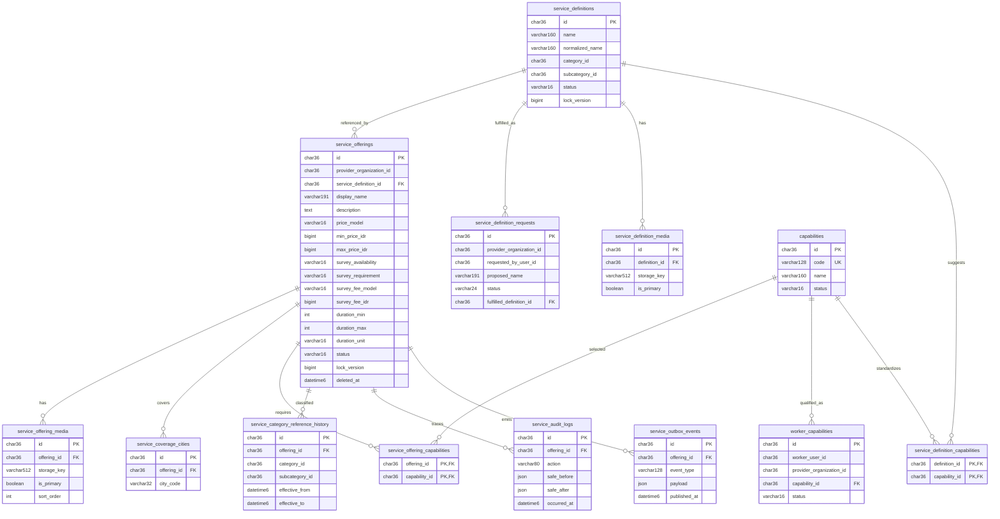
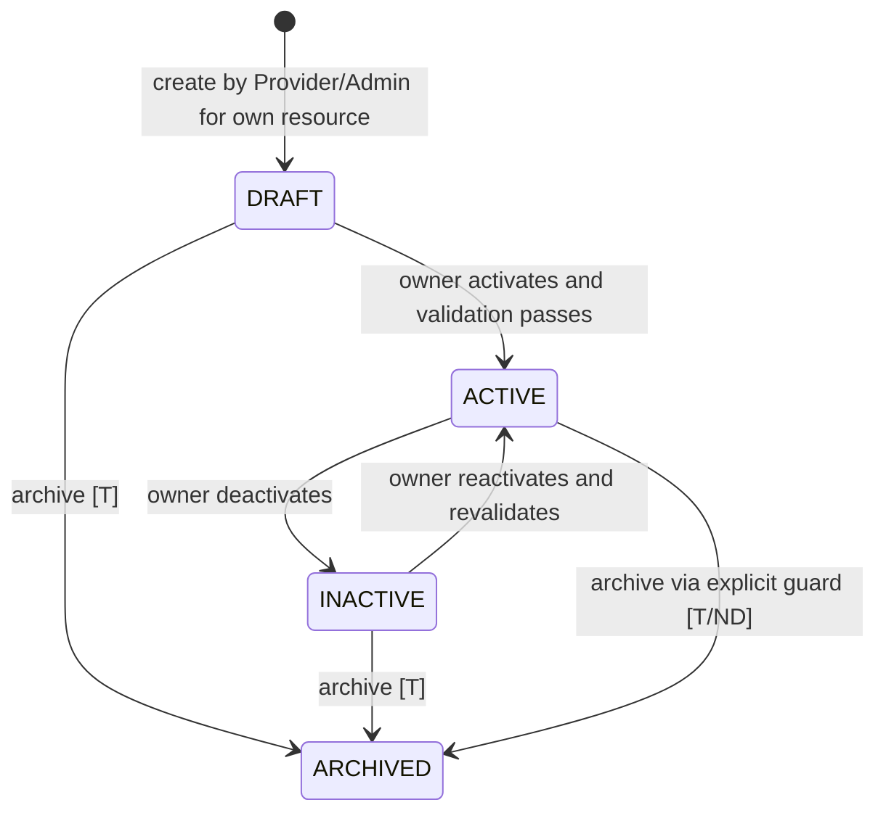
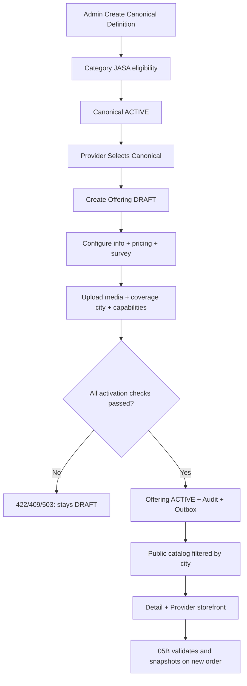

# SERVIO — BACKEND TECHNICAL SPECIFICATION
## MODUL 04 — SERVICE / JASA CATALOG SERVICE
### 10 Komponen Terintegrasi · Technical Draft untuk Final Review

| Metadata | Nilai |
|---|---|
| Kode/domain | `04` — Service / Jasa Catalog |
| Business source of truth | `PHASE-04-SERVICE-JASA-PLAN-REVISI-V1.1.md` — **PLANNING_APPROVED / LOCKED BY USER (ACC 20-10-2026)** |
| Dokumen target | `docs/backend/04-service-jasa/04-service-jasa.md` |
| Microservice | `service-service` — aplikasi Laravel independen |
| Direktori | `backend/services/service-service/` |
| Database | MySQL localhost, **`servio_service_db`** milik Modul 04 saja |
| Frontend | Next.js 16 App Router · React 19 · TypeScript · Tailwind CSS v4 · RoleContext |
| Upstream | Modul 01 `identity-service` (CR-02 FINAL); Modul 02 `category-service` (kontrak approved yang harus diperiksa pada kode) |
| Referensi pengalaman | Modul 03 `product-service` untuk pola katalog / detail / storefront, **tanpa berbagi database atau ownership** |
| Downstream | Modul **05B** Order Jasa; Modul 07 After-Sales untuk rating/ulasan di kemudian hari; Modul 11 Analytics |
| Status dokumen ini | **TECHNICAL_SPEC_DRAFT_FOR_FINAL_REVIEW** — menunggu ACC teknis tersendiri; **BUKAN implementasi terverifikasi** |
| Penanda | **[B]** keputusan bisnis locked; **[T]** desain teknis usulan; **[P]** provisional/pending kontrak atau implementasi; **[ND]** membutuhkan keputusan pengguna |

> **Aturan prioritas:** Planning V1.1 yang telah di-ACC mengikat perilaku bisnis Modul 04. Kontrak Modul 01 CR-02 dan Modul 02/03 yang sudah disetujui menentukan integrasi; jika ada ketidakcocokan, berhenti pada dependency/Change Request, bukan mengubah modul sebelumnya sepihak. Teks historis `SERVICE` untuk root diperbaiki menjadi **kode master `JASA`** sesuai Category Service. Rujukan MongoDB lama **tidak berlaku**: seluruh data operasional menggunakan **MySQL localhost per database microservice**. `service-service` tidak menjalankan autentikasi browser sendiri.

> **Dua keputusan mutlak [B]:** (1) Provider mengaktifkan penawaran valid → `ACTIVE` dan langsung eligible di katalog publik **tanpa persetujuan Admin atas offering**; (2) **tidak ada radius km, geofencing, proximity distance badge, atau kalkulasi jarak**. Penemuan lokasi adalah **keanggotaan `city_code` dalam daftar kota/kabupaten administratif tiap offering**, bukan kedekatan lokasi kantor Provider. Admin memantau offering **read-only**; Admin dapat mengelola **canonical Service Definition** dan **Capability Master** yang berbeda.

> **Batas pembuktian:** spesifikasi ini mendesain API, DB dan test; **tidak** membuktikan migrasi, route, permission grant, integrasi Next.js, profil publik Identity, daftar kota administratif, atau kontrak Modul 05B sudah aktif. Persetujuan dokumen ini belum berarti backend selesai. Jangan menambahkan seeder akun baru/dummy, simulasi status transaksi, atau data palsu pada UI produksi.

### Daftar isi
1. Service Architecture & Boundary  
2. Entity Relationship Diagram (ERD)  
3. Database Schema & Laravel Migrations Design  
4. API Endpoint Specification & JSON Contract  
5. Role-Based Access & Authorization Matrix  
6. Internal Feature Integration  
7. Inter-Microservice API/Event Contract  
8. Frontend–Backend API Mapping  
9. Error Handling, Edge Cases & Testing  
10. Final Technical Audit & Implementation Checklist

---
# 01. Service Architecture & Boundary

## 1.1 Kepemilikan domain

| Entitas/fungsi | Owner domain | Apa yang diimplementasikan di Modul 04 | Yang **tidak** diimplementasikan |
|---|---|---|---|
| Service Definition (canonical) | Service 04 | Admin create/edit/activate/deactivate, kategori/subkategori `JASA`, list pilihan Provider, permintaan canonical yang tidak tersedia | CRUD Category/Subcategory; verifikasi dokumen legal Provider |
| Provider Service Offering | Service 04 | Display name, deskripsi, included/excluded, syarat Customer, status draft/aktif/nonaktif, owner Provider | Booking/order, quotation transaksi, pekerjaan teknisi |
| Pricing | Service 04 | `FREE`, `RANGE`, `AFTER_SURVEY`, min/max rupiah, harga katalog saat ini | Payment, pajak, invoice/escrow, snapshot order |
| Survey policy | Service 04 | Tersedia/tidak, wajib/opsional, gratis/berbayar, biaya survei | Menjadwalkan/menjalankan diagnosis/survei, pembayaran survei |
| Estimasi durasi | Service 04 | Durasi min/max dan unit | Slot booking / alokasi jadwal |
| Coverage | Service 04 | Daftar **kode kota/kabupaten** yang dilayani tiap offering | Radius km, GPS/latitude/longitude untuk discovery, worker proximity, biaya perjalanan |
| Capability | Service 04 | Capability master milik Admin, capability requirement offering, referensi kemampuan Worker yang tercatat dalam scope org | Akun Worker, invitation, assignment booking, attendance |
| Media | Service 04 | Foto/galeri offering dan primary image; media canonical bila digunakan | Foto profil/berkas legal Identity, bukti kerja order |
| Public experience | Service 04 | List/search/filters, card/detail, same-definition/same-subcategory related, daftar jasa Provider | AI recommendation, rating/review computed, checkout |
| Provider storefront | Service 04 + data publik Identity | List jasa Provider yang eligible; presentation/aggregation dari profil publik Identity | Membuat akun toko/organisasi baru atau menyalin legal profile |
| Admin catalog oversight | Service 04 | List/detail/audit semua offering berizin, search/filter status/Provider/kategori/kota | Admin approve/reject offering atau edit tarif Provider |
| Admin Service Ops screenshot | Modul 05B/06, **bukan** Service 04 | Hanya area UI/tab Katalog Jasa yang mengambil data Service 04 | ID order, pelanggan, teknisi, jadwal, escrow, SLA, intervensi |

**Pemisahan canonical vs offering [B]:** satu `service_definition` dapat digunakan banyak Provider; satu `service_offering` punya tepat satu `provider_organization_id` dan satu `service_definition_id`. Kategori/subkategori canonical berada pada branch `JASA`; offering **mewarisi** kategori dari canonical, tidak boleh mengubah penempatan kategori secara mandiri. Kategori yang dipilih pada UI memfilter pilihan canonical, bukan otomatis membuat jenis jasa resmi.

## 1.2 Arsitektur request dan deployment

```mermaid
flowchart LR
  B[Browser Next.js 16] --> GW[Gateway / BFF\nRouting + cookies/CSRF]
  GW -->|Session introspection| ID[identity-service :8001]
  GW -->|Verified actor context| SVC[service-service :8004]
  SVC -->|Authz/org + public profile [P]| ID
  SVC -->|Taxonomy eligibility/claims [P]| CAT[category-service :8002]
  SVC --> SDB[(MySQL servio_service_db)]
  SVC --> MS[(Service media private disk)]
  SVC --> OB[(Transactional outbox)]
  OB -.-> O5B[order-jasa-service 05B [P]]
  OB -.-> AN[Analytics 11 [P]]
```

- **Guest:** public list/detail/storefront boleh tanpa login; hanya memuat informasi publik `ACTIVE` yang eligible, tidak ada `include_inactive` di public surface.
- **Customer:** memakai kontrak publik yang sama, boleh mengirim `city_code` dari kota pilihan alamat kerjanya; service tidak memerlukan/membaca NIK atau alamat jalan lengkap.
- **Provider:** Identitas, role assignment, organization/membership dan status diverifikasi oleh Identity; kebijakan ownership offering ditentukan **server-side** Modul 04. `organization_id` dari request body tidak menjadi authority.
- **Admin/CEO:** authenticated governance; Admin CRUD canonical/capabilities dan baca offering, CEO oversight baca; keduanya tidak override offering Provider.
- **M2M:** komunikasi internal memakai kredensial khusus service/mTLS atau trust boundary ekuivalen, timeout + `X-Request-ID`; **tidak** menerima cookie/`X-User-*` browser langsung sebagai klaim tepercaya.
- **Gateway/BFF bukan domain service** dan tidak menulis tabel Modul 04. Direct product-service DB access dilarang meskipun UX serupa.

## 1.3 Struktur proyek Laravel [T]

```text
backend/
  services/
    identity-service/          # 01; tidak diubah
    category-service/          # 02; tidak diubah
    product-service/           # 03; tidak diubah
    service-service/           # 04 Laravel APP INDEPENDEN
      app/
        Domain/Service/{Actions,DTOs,Enums,Events,Policies,Validators}/
        Application/{Commands,Queries}/
        Infrastructure/{IdentityClient,CategoryClient,MediaStorage,Outbox,Inbox,Idempotency}/
        Http/{Controllers,Requests,Resources,Middleware}/
        Models/
      routes/{api.php,internal.php}
      database/{migrations,seeders,factories}/
      tests/{Unit,Feature,Contract,Integration,Security}/
      config/{service_catalog,services,filesystems}.php
      storage/app/private/service-media/
      .env.example
      composer.json
      artisan
  gateway/                     # optional infrastructure, not domain owner

docs/backend/04-service-jasa/
  planning.md                  # or actual approved V1.1 filename
  04-service-jasa.md           # this technical specification
```

`.env.example` (placeholder; **no secrets**):

```dotenv
APP_NAME=SERVIO_Service
APP_ENV=local
APP_DEBUG=true
APP_URL=http://127.0.0.1:8004
DB_CONNECTION=mysql
DB_HOST=127.0.0.1
DB_PORT=3306
DB_DATABASE=servio_service_db
DB_USERNAME=servio_service
DB_PASSWORD=SET_LOCALLY
IDENTITY_INTERNAL_BASE_URL=http://127.0.0.1:8001
CATEGORY_INTERNAL_BASE_URL=http://127.0.0.1:8002
SERVICE_INTERNAL_CREDENTIAL=SET_LOCALLY
SERVICE_MEDIA_DISK=local
SERVICE_PUBLIC_PAGE_SIZE=20
SERVICE_IDENTITY_TIMEOUT_MS=1200
SERVICE_CATEGORY_TIMEOUT_MS=1200
SERVICE_CITY_REFERENCE_SOURCE=PENDING_CONFIG
QUEUE_CONNECTION=database
CACHE_STORE=database
```

Laravel menggunakan DB user dengan hak **hanya** terhadap `servio_service_db`; semua migration, session domain dan queue domain dibatasi ke DB ini. Session browser Sanctum berada pada Identity (`HttpOnly`, CSRF) sesuai CR-02; implementasi hostname/proxy harus diperiksa dengan frontend. Infrastructure queue/Redis opsional; jangan mengada-adakan broker terpisah tanpa kebutuhan operasional.

## 1.4 Invariants, asumsi, dan hal yang perlu keputusan

1. **[B]** Tidak ada endpoint approval/rejection offering; activate Provider valid langsung menghasilkan `ACTIVE` (setelah validasi atomik) dan eligible untuk public discovery.
2. **[B]** `ACTIVE` tidak otomatis tampil di semua kota: `public_eligible = provider_eligible AND canonical_active AND taxonomy_effective_active AND offering_ACTIVE AND required_fields_valid`; **listing** juga wajib `coverage contains viewer_city_code`.
3. **[B]** Tanpa kota aktif, listing publik meminta pilih kota; bukan inferensi IP/GPS/geolocation dan bukan menampilkan penawaran lintas kota sebagai katalog sekota.
4. **[B]** Direct URL detail offering yang aktif namun di luar coverage **boleh** membuka informasi publik, tetapi flag `serviceable_in_selected_city=false` dan CTA order mati. Draft/inactive tidak boleh dibuka via public endpoint.
5. **[B]** Perubahan katalog tidak mengubah order historis; snapshot saat order dibuat milik 05B, pembayaran milik 06.
6. **[T]** `service_definition_id` pada offering **immutable setelah dibuat**; jika hendak mengganti jenis jasa, buat offering baru atau ubah draft melalui alur keputusan yang secara eksplisit disetujui. Membatasi cross-canonical perubahan mencegah audit/category claim rusak. **[ND]** Kebijakan edit canonical category ketika ada offering aktif perlu dipastikan; baseline aman: tolak sampai bebas dari referensi/histori.
7. **[T/ND]** Satu offering non-archived per `(provider_org_id,service_definition_id)` untuk menghindari duplikasi aktif (baseline conservative); **dukungan multi-paket per canonical** belum ada keputusan, jangan diam-diam aktifkan. Archive/soft delete tidak menghilangkan history claim.
8. **[T]** `FREE` boleh tanpa service min/max, `AFTER_SURVEY` wajib survey available+required, `RANGE` wajib angka >=0 dan max>=min. Harga `0..0` dalam RANGE secara teknis valid, tetapi labelnya tetap `Rp0` (bukan otomatis pindah FREE) **[ND]** jika aturan bisnis ingin khusus FREE wajib klarifikasi.
9. **[T]** Mutasi status/field memakai optimistic concurrency `lock_version` + `If-Match`, idempotency untuk create/retry, audit append-only + transactional outbox.
10. **[P]** Master kode kota administratif: gunakan satu katalog referensi nasional stabil yang **benar-benar tersedia/terverifikasi**. `city_code` scalar yang tidak merujuk DB lintas service; sumber, namespace, pembaruan kota administratif, dan UI pencarian perlu keputusan integrasi. Jangan seed daftar palsu atau validasi hanya terhadap teks kota yang diketik user.
11. **[P]** Public Provider profile API dari Identity CR-02 saat ini belum dibuktikan sebagai kontrak yang mengembalikan display_name/logo aman. Status organization I04 yang tersedia **tidak cukup** untuk storefront. Rancang read adapter/proposal melalui CR jika belum tersedia.
12. **[P]** Permission `service.*` tidak diasumsikan telah terdaftar di registry Identity; butuh verifikasi dan CR/grant tersendiri bila perlu.

---
# 02. Entity Relationship Diagram (ERD)

## 2.1 ERD utama — seluruh FK hanya di `servio_service_db`



**Pelengkap teknis:** `service_idempotency_records`, `service_inbox_consumptions` dan (bila diperlukan) `service_media_uploads` untuk staged upload. Audit atas canonical/capability/request memakai tabel audit yang sama dengan `entity_type/entity_id`; `offering_id` boleh nullable agar log master tetap masuk. ERD notasi di atas memperlihatkan relasi utama, sedangkan kolom lengkap, FK, dan unique constraints yang wajib diikuti ada pada §03.

## 2.2 Kardinalitas dan foreign references

| Hubungan | Kardinalitas & integritas |
|---|---|
| Identity Provider Organization → Offering | 1:N **logis**; `provider_organization_id` UUID external scalar, **tanpa FK** ke Identity |
| Category/Subcategory → Definition | N:1 **logis**; canonical menyimpan `category_id`, `subcategory_id` dari Category 02 dengan branch `JASA` dan parent sesuai |
| Definition → Offering | 1:N (beda Provider); FK internal `service_offerings.service_definition_id` |
| Offering → Media | 1:N; satu primary READY sebelum ACTIVE; no variant media |
| Offering → CoverageCity | 1:N; pada ACTIVE **>=1** valid city_code berbeda; unique (offering,city) |
| Offering → Capability | M:N via pivot internal; boleh kosong jika tidak diperlukan [B] |
| Definition → Capability master | M:N berupa template/saran, **bukan** pemberian izin Worker atau syarat wajib semua offering |
| Worker Identity → Worker Capability | 1:N **logis**; Worker ID/Provider Org scalar diperiksa ke Identity bila fitur diaktifkan, tidak FK lintas DB |
| Offering → Category Ref History | 1:N audit reference stabil; tidak dipangkas hanya karena offering inactive/soft-deleted |
| Definition request → Definition | 0..1:1 reference fulfillment; hanya setelah Admin membuat/memilih canonical resmi secara manual |
| Offering → Order 05B | 1:N **logis**, Order menyimpan `offering_id` dan snapshot sendiri, **tanpa Order table di Service** |

## 2.3 State machine dan public eligibility



`ARCHIVED` = `deleted_at IS NOT NULL` soft-delete teknis **bukan** status bisnis baru. Untuk canonical, Admin satu-satunya pemilik mutasi; untuk offering, Provider pemilik satu-satunya mutator. Perubahan canonical/category/organization menjadi tidak eligible **tidak mengubah stored status offering**, melainkan menghitung `public_eligible=false`.

```text
catalog_displayable(offering, viewer_city) :=
  offering.status == ACTIVE && offering.deleted_at == null
  && definition.status == ACTIVE && definition.deleted_at == null
  && category.master_code == JASA
  && category.effective_active && subcategory.effective_active
  && provider.organization_type == PROVIDER && provider.status == ACTIVE
  && offering_content_and_primary_media_valid
  && offering_price_and_survey_consistent
  && exists(valid coverage row with city_code == viewer_city)
```

Semua operasi menulis validasi kelayakan dari sumber tepercaya. Public listing saat tak ada kota aktif memberikan hasil kosong dengan `location_required=true`, bukan katalog lintas kota. Direct detail mengizinkan status luar cakupan untuk offering publik yang eligibility non-lokasinya valid; CTA tetap disabled. Jangan mengirim daftar status nonpublik/organisasi disuspensi ke public response.

---
# 03. Database Schema & Laravel Migrations Design

## 3.1 Konvensi MySQL [T]

- MySQL 8.x, InnoDB, `utf8mb4`, UTC `DATETIME(6)`; UUID Laravel `$table->uuid()` secara logis `CHAR(36)` kompatibel referensi Modul 01–03. Nama DB hanya `servio_service_db`; **tidak** ada foreign key ke `servio_identity_db`, `servio_category_db`, atau `servio_product_db`.
- Harga: `BIGINT UNSIGNED` **rupiah utuh** (integer IDR), tidak float/decimal pecahan. `min_price_idr`, `max_price_idr`, `survey_fee_idr` nullable berdasarkan kombinasi harga/survei.
- Nama dan string dinormalisasi `trim + collapse whitespace + lowercase Unicode` pada kolom `normalized_name`/`normalized_display_name`; DB unique sebagai pertahanan kedua terhadap duplikasi.
- Pemberian `id` dan `provider_organization_id` dari server, bukan dipercaya dari browser; status `ACTIVE` hanya lewat action khusus dengan revalidasi.
- Semua mutable entity `lock_version UNSIGNED BIGINT DEFAULT 1`; `If-Match` atau `expected_version` dipakai pada PATCH/DELETE. Transaction + `lockForUpdate()` untuk perubahan status/gambar/cakupan dan unique constraints untuk concurrency.
- `deleted_at` untuk offering/definition/capability opsional **[T]** dan tidak boleh merusak historical snapshots/audit/reference-claims. Hard-delete publik tidak ada. Data audit, outbox, dan history tetap disimpan.
- Field radius, `radius_km`, `max_distance`, `latitude`, `longitude`, geofence, worker GPS, distance fee **tidak dibuat** dalam skema Modul 04.

## 3.2 Kamus tabel — lengkap untuk implementasi

**Semua tabel hanya dimiliki `service-service`.** `PK` = primary; `FK` = foreign key internal DB Service; `UK` = unique index; `IX` = index biasa. Semua mutable tables memiliki `created_at`, `updated_at` kecuali disebut lain; kolom `NULL` eksplisit jika boleh kosong.

| Tabel | Kolom & tipe penting | Constraint / index | Fungsi dan invariants |
|---|---|---|---|
| `service_definitions` | `id CHAR(36) PK`; `code VARCHAR(40) UK` [T]; `name VARCHAR(160) NOT NULL`; `normalized_name VARCHAR(160) NOT NULL`; `description TEXT NULL`; `category_id CHAR(36) NOT NULL`; `subcategory_id CHAR(36) NOT NULL`; `status VARCHAR(16) NOT NULL DEFAULT 'DRAFT'`; `created_by_user_id CHAR(36) NOT NULL`; `lock_version BIGINT UNSIGNED DEFAULT 1`; `deleted_at DATETIME(6) NULL`; timestamps | `IX(category_id,subcategory_id,status)`; `UK(subcategory_id,normalized_name,live_guard)` [T generated guard] | Canonical master Admin; category IDs eksternal, bukan FK; status `DRAFT/ACTIVE/INACTIVE` |
| `service_definition_media` **[T]** | `id CHAR(36) PK`; `definition_id CHAR(36) FK`; `storage_disk VARCHAR(32)`; `storage_key VARCHAR(512)`; `mime_type VARCHAR(80)`; `bytes BIGINT UNSIGNED`; `sort_order INT UNSIGNED`; `is_primary BOOLEAN`; `storage_state VARCHAR(16) DEFAULT 'PENDING'`; `deleted_at DATETIME(6) NULL`; timestamps | FK restrict; `UK(storage_disk,storage_key)`; `IX(definition_id,sort_order)` | Media canonical opsional, Admin-only; **bukan** galeri milik Provider |
| `service_offerings` | `id CHAR(36) PK`; `provider_organization_id CHAR(36) NOT NULL`; `service_definition_id CHAR(36) FK NOT NULL`; `created_by_user_id CHAR(36) NOT NULL`; `display_name VARCHAR(191) NOT NULL`; `normalized_display_name VARCHAR(191) NOT NULL`; `description TEXT NULL`; `included_items JSON NULL`; `excluded_items JSON NULL`; `customer_requirements JSON NULL`; `price_model VARCHAR(16) NOT NULL DEFAULT 'RANGE'` **[T default hanya untuk draft]**; `min_price_idr BIGINT UNSIGNED NULL`; `max_price_idr BIGINT UNSIGNED NULL`; `currency CHAR(3) DEFAULT 'IDR'`; `survey_availability VARCHAR(20) DEFAULT 'NOT_AVAILABLE'`; `survey_requirement VARCHAR(16) NULL`; `survey_fee_model VARCHAR(16) NULL`; `survey_fee_idr BIGINT UNSIGNED NULL`; `duration_min INT UNSIGNED NULL`; `duration_max INT UNSIGNED NULL`; `duration_unit VARCHAR(12) NULL`; `status VARCHAR(16) NOT NULL DEFAULT 'DRAFT'`; `lock_version BIGINT UNSIGNED DEFAULT 1`; `activated_at DATETIME(6) NULL`; `deleted_at DATETIME(6) NULL`; timestamps | `FK(service_definition_id)` RESTRICT; `IX(provider_organization_id,status,deleted_at)`; `IX(service_definition_id,status)`; `IX(status,created_at,id)`; `UK(provider_organization_id,service_definition_id,live_guard)` [T] | Satu owner Provider; harga dan survei terpisah; no approval fields (`approved_by`, `pending_approval`) |
| `service_offering_media` | `id CHAR(36) PK`; `offering_id CHAR(36) FK`; `storage_disk VARCHAR(32)`; `storage_key VARCHAR(512)`; `mime_type VARCHAR(80)`; `bytes BIGINT UNSIGNED`; `sha256 CHAR(64)`; `sort_order INT UNSIGNED`; `is_primary BOOLEAN DEFAULT FALSE`; `storage_state VARCHAR(16) DEFAULT 'PENDING'`; `deleted_at DATETIME(6) NULL`; timestamps | `FK(offering_id)` RESTRICT; `IX(offering_id,sort_order,deleted_at)`; `UK(storage_disk,storage_key)`; one primary per offering via `UNIQUE(offering_id,primary_live_guard)` generated nullable | Foto offering tanpa variant ID; primary `READY` wajib untuk ACTIVE; file private served via controlled media handler |
| `service_coverage_cities` | `id CHAR(36) PK`; `offering_id CHAR(36) FK`; `city_code VARCHAR(32) NOT NULL`; `city_label_snapshot VARCHAR(160) NULL` **[T read fallback]**; timestamps | `FK(offering_id)` RESTRICT; `UK(offering_id,city_code)`; `IX(city_code,offering_id)` | Daftar administrasi kota/kabupaten **tanpa radius/km**; validasi code terhadap sumber registry administratif yang disepakati **[P]** |
| `capabilities` | `id CHAR(36) PK`; `code VARCHAR(128) NOT NULL UK`; `name VARCHAR(160) NOT NULL`; `normalized_name VARCHAR(160) NOT NULL`; `description TEXT NULL`; `status VARCHAR(16) DEFAULT 'ACTIVE'`; `created_by_user_id CHAR(36)`; `lock_version BIGINT DEFAULT 1`; `deleted_at DATETIME(6) NULL`; timestamps | `UK(normalized_name,live_guard)`; `IX(status,name)` | Global capability master hanya Admin yang dapat mutate; deactivate tidak delete histori |
| `service_definition_capabilities` | `definition_id CHAR(36) PK/FK`; `capability_id CHAR(36) PK/FK`; timestamps | Composite PK; FKs restrict | Capability template canonical **tidak** memaksa assignment Worker |
| `service_offering_capabilities` | `offering_id CHAR(36) PK/FK`; `capability_id CHAR(36) PK/FK`; timestamps | Composite PK; FKs restrict | Capability yang dipilih Provider; harus ACTIVE untuk assignment baru |
| `worker_capabilities` **[T]** | `id CHAR(36) PK`; `worker_user_id CHAR(36) NOT NULL`; `provider_organization_id CHAR(36) NOT NULL`; `capability_id CHAR(36) FK`; `status VARCHAR(16) DEFAULT 'ACTIVE'`; `recorded_by_user_id CHAR(36)`; `lock_version BIGINT DEFAULT 1`; `recorded_at DATETIME(6)`; `deleted_at DATETIME(6) NULL`; timestamps | `UK(worker_user_id,provider_organization_id,capability_id,live_guard)`; `IX(provider_organization_id,worker_user_id,status)` | Hanya deklarasi skill untuk Provider; Worker harus memiliki membership eligible menurut Identity; tidak meng-assign pekerjaan; detail UI/role jika belum ada **[P]** |
| `service_definition_requests` | `id CHAR(36) PK`; `requester_user_id CHAR(36)`; `provider_organization_id CHAR(36)`; `proposed_name VARCHAR(191)`; `normalized_name VARCHAR(191)`; `category_id CHAR(36)`; `subcategory_id CHAR(36)`; `reason TEXT`; `status VARCHAR(24) DEFAULT 'NEW'` **[T/ND]**; `reviewer_user_id CHAR(36) NULL`; `review_note TEXT NULL`; `fulfilled_definition_id CHAR(36) FK NULL`; `lock_version BIGINT DEFAULT 1`; timestamps | `IX(provider_organization_id,status,created_at)`; `IX(status,created_at)`; FK fulfillment `RESTRICT` | **Permintaan canonical service**, bukan Category suggestion. Admin membuat canonical secara manual; `NEW/PROCESSING/REJECTED/FULFILLED` state usulan [T/ND] harus dikonfirmasi sebelum di-LOCK |
| `service_category_reference_history` | `id CHAR(36) PK`; `definition_id CHAR(36) FK`; `offering_id CHAR(36) FK NULL`; `category_id CHAR(36)`; `subcategory_id CHAR(36)`; `category_claim_id CHAR(36) NULL`; `subcategory_claim_id CHAR(36) NULL`; `operation_id CHAR(36) NOT NULL`; `effective_from DATETIME(6)`; `effective_to DATETIME(6) NULL`; timestamps | `IX(category_id)`, `IX(subcategory_id)`; `UK(operation_id,definition_id,offering_id)` requires nullable handling (see below) | Riwayat referensi Category untuk hard-delete checks, termasuk canonical/or offering; retain saat inactive/archived; claim integration **[P]** |
| `service_audit_logs` | `id CHAR(36) PK`; `entity_type VARCHAR(40)`; `entity_id CHAR(36)`; `offering_id CHAR(36) NULL` **FK optional**; `actor_user_id CHAR(36)`; `actor_role VARCHAR(64)`; `actor_org_id CHAR(36) NULL`; `action VARCHAR(80)`; `safe_before JSON NULL`; `safe_after JSON NULL`; `reason TEXT NULL`; `request_id VARCHAR(96)`; `occurred_at DATETIME(6)` | `IX(entity_type,entity_id,occurred_at)`; `IX(actor_user_id,occurred_at)` | Append-only, redacted, tidak menyimpan legal docs/PII/token; canonical/capability/request juga tercatat |
| `service_outbox_events` | `id CHAR(36) PK`; `aggregate_type VARCHAR(32)`; `aggregate_id CHAR(36)`; `offering_id CHAR(36) NULL` **FK optional**; `event_type VARCHAR(128)`; `aggregate_version BIGINT`; `payload JSON`; `occurred_at DATETIME(6)`; `published_at DATETIME(6) NULL`; `attempts INT DEFAULT 0`; `correlation_id VARCHAR(96) NULL` | `IX(published_at,occurred_at)`; `IX(aggregate_type,aggregate_id,aggregate_version)` | Transactional outbox untuk service changes; publish at least once dan dedup consumer |
| `service_inbox_consumptions` | `id CHAR(36) PK`; `source_service VARCHAR(40)`; `event_id CHAR(36)`; `aggregate_id CHAR(36)`; `aggregate_version BIGINT`; `payload_hash CHAR(64)`; `processed_at DATETIME(6)` | `UK(source_service,event_id)`; `IX(aggregate_id,aggregate_version)` | Deduplikasi event Identity/Category; tidak menggantikan live verification mutation |
| `service_idempotency_records` | `id CHAR(36) PK`; `actor_key VARCHAR(128)`; `route_key VARCHAR(128)`; `idempotency_key VARCHAR(191)`; `request_hash CHAR(64)`; `response_status SMALLINT`; `response_body JSON`; `expires_at DATETIME(6)`; timestamps | `UK(actor_key,route_key,idempotency_key)`; `IX(expires_at)` | POST/mutation retry-safe, false replay beda payload `409` |
| `service_media_uploads` **[T opsional]** | `id CHAR(36) PK`; `scope VARCHAR(20)`; `owner_entity_id CHAR(36)`; `owner_user_id CHAR(36)`; `temp_storage_key VARCHAR(512)`; `mime VARCHAR(80)`; `bytes BIGINT UNSIGNED`; `status VARCHAR(16)`; `expires_at DATETIME(6)`; `consumed_at DATETIME(6) NULL`; timestamps | `UK(temp_storage_key)`; `IX(status,expires_at)` | Hanya bila upload memakai staging; tidak perlu jika one-step multipart sudah aman |

**Koreksi migrasi penting untuk nullable uniqueness [T]:** MySQL mengizinkan banyak `NULL` dalam UNIQUE. Untuk `service_category_reference_history`, gunakan **`UK(operation_id,definition_id)`** pada history canonical (satu operasi per definisi) dan index `offering_id` terpisah, atau gunakan generated column `COALESCE(offering_id,'00000000-...')` dalam unique key. Pilih satu pada migrasi aktual; **jangan** mengandalkan `UK(operation_id,definition_id,offering_id)` nullable untuk uniqueness. Untuk `live_guard`, gunakan generated nullable `CASE WHEN deleted_at IS NULL THEN 1 ELSE NULL END` + indeks komposit. Untuk primary live guard: `CASE WHEN is_primary=1 AND deleted_at IS NULL AND storage_state='READY' THEN 1 ELSE NULL END`; service-level enforcement tetap memastikan hanya satu primary READY dan tidak ada dua primary staging yang lolos race.

## 3.3 SQL/Laravel migration blueprint

```php
// Contoh ringkas; migration final memuat seluruh kolom dari tabel §3.2.
Schema::create('service_definitions', function (Blueprint $table) {
    $table->uuid('id')->primary();
    $table->string('code', 40)->unique();
    $table->string('name', 160);
    $table->string('normalized_name', 160);
    $table->uuid('category_id');      // External Category ID: NO constrained()
    $table->uuid('subcategory_id');   // External Category ID: NO constrained()
    $table->text('description')->nullable();
    $table->string('status', 16)->default('DRAFT');
    $table->uuid('created_by_user_id'); // External Identity user ID: no FK
    $table->unsignedBigInteger('lock_version')->default(1);
    $table->softDeletesTz(6);
    $table->timestamps(6);
    $table->index(['category_id','subcategory_id','status']);
});

Schema::create('service_offerings', function (Blueprint $table) {
    $table->uuid('id')->primary();
    $table->uuid('provider_organization_id');  // external scalar, NEVER foreignUuid()->constrained('organizations')
    $table->foreignUuid('service_definition_id')->constrained('service_definitions')->restrictOnDelete();
    $table->uuid('created_by_user_id');
    $table->string('display_name', 191);
    $table->string('normalized_display_name', 191);
    $table->text('description')->nullable();
    $table->json('included_items')->nullable();
    $table->json('excluded_items')->nullable();
    $table->json('customer_requirements')->nullable();
    $table->string('price_model',16)->default('RANGE');
    $table->unsignedBigInteger('min_price_idr')->nullable();
    $table->unsignedBigInteger('max_price_idr')->nullable();
    $table->char('currency',3)->default('IDR');
    $table->string('survey_availability',20)->default('NOT_AVAILABLE');
    $table->string('survey_requirement',16)->nullable();
    $table->string('survey_fee_model',16)->nullable();
    $table->unsignedBigInteger('survey_fee_idr')->nullable();
    $table->unsignedInteger('duration_min')->nullable();
    $table->unsignedInteger('duration_max')->nullable();
    $table->string('duration_unit',12)->nullable();
    $table->string('status',16)->default('DRAFT');
    $table->unsignedBigInteger('lock_version')->default(1);
    $table->timestamp('activated_at',6)->nullable();
    $table->softDeletesTz(6);
    $table->timestamps(6);
    $table->index(['provider_organization_id','status','deleted_at']);
});

Schema::create('service_coverage_cities', function (Blueprint $table) {
    $table->uuid('id')->primary();
    $table->foreignUuid('offering_id')->constrained('service_offerings')->restrictOnDelete();
    $table->string('city_code',32);
    $table->string('city_label_snapshot',160)->nullable();
    $table->timestamps(6);
    $table->unique(['offering_id','city_code']);
    $table->index(['city_code','offering_id']);
});
```

**SQL guards/checks yang langsung aman untuk DRAFT maupun ACTIVE** (MySQL 8.x; terapkan lewat `DB::statement` saat migration jika Schema Builder belum mendukung):

```sql
ALTER TABLE service_offerings
 ADD CONSTRAINT chk_service_status CHECK (status IN ('DRAFT','ACTIVE','INACTIVE')),
 ADD CONSTRAINT chk_service_price_model CHECK (price_model IN ('FREE','RANGE','AFTER_SURVEY')),
 ADD CONSTRAINT chk_service_survey_avail CHECK (survey_availability IN ('NOT_AVAILABLE','AVAILABLE')),
 ADD CONSTRAINT chk_service_currency CHECK (currency='IDR'),
 ADD CONSTRAINT chk_service_price_when_active CHECK (
   status <> 'ACTIVE'
   OR (price_model='RANGE' AND min_price_idr IS NOT NULL
       AND max_price_idr IS NOT NULL AND max_price_idr>=min_price_idr)
   OR (price_model IN ('FREE','AFTER_SURVEY') AND min_price_idr IS NULL
       AND max_price_idr IS NULL)
 );
```

**Penting:** `DRAFT` boleh parsial sehingga CHECK harga lengkap hanya berlaku jika `status='ACTIVE'`. Untuk `DRAFT`, FormRequest tetap menolak nilai yang dikirim tetapi tidak valid (contoh harga negatif, min>max, fee kontradiktif), tanpa memaksa seluruh field terisi. Pada transisi `ACTIVE`, validator domain wajib menegakkan semua persyaratan, termasuk kombinasi survei dan harga serta relasi dari tabel lain. **Jangan** menambahkan CHECK kedua yang mensyaratkan rentang harga lengkap pada `DRAFT` karena akan membuat tombol Simpan Draft gagal.

**DB CHECK tidak mampu membuktikan** `ACTIVE` mempunyai coverage row, primary READY image, valid canonical/taxonomy, atau active Provider; Laravel action dengan transaction + adapter upstream wajib mengawal ini. `duration_min<=duration_max` dan >0 bila keduanya diisi, serta fee-model conditional constraints dapat ditambah dengan CHECK ketika input diisi; incomplete draft diperbolehkan, namun reject ACTIVE yang invalid.

## 3.4 Aturan transaksional & race condition

1. `create offering` [T]: autentikasi, resolve provider org dari trusted actor, valid canonical/category [P], reserve idempotency, write offering DRAFT + audit + outbox satu transaksi DB.
2. `activate` [B/T]: `lockForUpdate(offering)` + If-Match → verify Provider/current canonical/category via internal APIs, price/survey, media READY, coverage codes, required capability → update status/lock_version/activated_at + audit/outbox **satu transaksi**; tidak ada approval queue Admin. Bila upstream timeout, **gagal tertutup** (503), jangan publikasikan setengah jalan. Untuk validasi lintas DB, gunakan version/claim protocol dan recheck bila berubah saat operasi.
3. `replace coverage` [T]: ganti seluruh daftar dalam satu transaksi, lock offering, dedup codes; jika ACTIVE dan hasil kosong, reject `409`; perubahan cukup menambah/mengurangi kota tidak menyentuh order historis.
4. `delete primary media` [T]: jika active akan kehilangan primary READY, `409`; Provider mengganti gambar terlebih dahulu atau nonaktifkan offering. Reorder dan pemilihan primary diserialisasi via offering row lock.
5. `archive` [T/ND]: soft delete saja, tahan jika referensi historis/kontrak downstream belum siap; tidak mengeksekusi hard-delete bersamaan dengan order yang belum selesai. Tidak ada layanan Order query langsung dari DB.
6. `definition deactivate` [B/T]: hanya Admin; offering tetap tersimpan dengan status miliknya, public eligibility tidak terpenuhi. Aktivasi ulang offering memvalidasi canonical terkini.
7. `category hard delete` [P]: Category tetap owner deleting dan historical reference verification; Service harus melaporkan semua referensi canonical/offering termasuk soft-deleted, bukan sekadar offering ACTIVE.
8. `create/update worker capability` [T/P]: hanya Provider dari org worker yang memiliki membership valid (Identity), bukan assignment; Worker yang keluar tidak otomatis menghapus offering.

## 3.5 Migrasi, seeder, dan pemisahan data

- Urutan: `service_definitions` → `capabilities` → `service_offerings` → media/cities/pivots → requests/worker capabilities/ref history → audit/outbox/inbox/idempotency.
- Seeder boleh berisi **lookup status/permission manifest dan definisi capability yang disetujui Admin** [T/ND], **tidak membuat user/Provider/Worker dummy**. Canonical service bisnis tidak auto-seed acak jika belum ada master yang disetujui.
- Foto dipersist via private disk/key internal; response memberikan signed/controlled URL apabila diotorisasi. Bersihkan orphan file ketika DB rollback/upload failure via compensation; jangan membiarkan public file path mengekspose filesystem.
- Lakukan `php artisan migrate:fresh` hanya di DB development milik service dengan izin eksplisit; test dengan dedicated MySQL test DB, **jangan** menyentuh DB Identity/Category/Product.

---
# 04. API Endpoint Specification & JSON Contract

## 4.1 Konvensi umum

- Public prefix: `/api/v1`, melalui gateway/BFF Next.js yang merutekan ke **Service 04**. Internal prefix: `/internal/v1`, **tidak** diekspos ke browser.
- Service Laravel menetapkan response envelope yang konsisten:

```json
{
  "success": true,
  "code": "SERVICE_OFFERING_CREATED",
  "data": { "id": "d0000000-0000-4000-8000-000000000001" },
  "meta": { "request_id": "req_example", "version": "v1" }
}
```

```json
{
  "success": false,
  "code": "SERVICE_COVERAGE_CITY_NOT_SUPPORTED",
  "error": {
    "message": "Kota layanan tidak termasuk cakupan penawaran.",
    "fields": { "city_code": ["Lokasi di luar cakupan jasa."] }
  },
  "meta": { "request_id": "req_example", "version": "v1" }
}
```

- `request_id` dari gateway/request atau generated UUID; jangan expose stack trace, internal hostname, credential, KYC. Semua harga JSON integer rupiah, bukan string bertanda `Rp`; display dilakukan frontend.
- Format query multi-select `categories=UUID1,UUID2`, `subcategories=...`; OR dalam field yang sama, AND antar kelompok. `category/subcategory` di-filter hanya branch `JASA` efektif ACTIVE. `city_code` **wajib untuk list katalog publik**; direct detail boleh tanpa city dan memberi `location_required`.
- `sort` allowlist `newest`, `name_asc`, `price_asc`, `price_desc`; harga campuran `FREE/RANGE/AFTER_SURVEY` perlu stabil: `price_asc/desc` hanya sorting entry harga numerik; `AFTER_SURVEY` selalu ditempatkan di akhir [T/ND]; `FREE` bernilai display 0 tetapi beda model dari `RANGE(0)`. Tie-break `(created_at,id)`/`(normalized_display_name,id)`.
- `limit` default 20 max 100; pagination cursor opaque, input divalidasi, tidak offset-race. Status/tenant filters pada protected endpoint diberi server-side scopes.
- `If-Match: "<lock_version>"` wajib PATCH/DELETE/status/reorder (missing `428`, stale `409` dalam desain ini). `Idempotency-Key` (UUID/string <=191) wajib untuk create, request, dan aksi dengan replay risk [T]; same key+different payload `409`, same payload replay same result.
- Error umum: `400` malformed query; `401` tidak login; `403` izin ditolak; `404` resource tidak ditemukan/tidak publik; `409` business/conflict/duplicate/version; `422` validasi; `428` missing precondition; `429` throttle; `503` upstream fail-closed; `500` unexpected (redacted). Pengecualian public list dengan city yang belum dipilih: `200` list kosong plus `location_required=true`, bukan `422` yang menyulitkan UI pemilih kota.

## 4.2 Inventaris endpoint domain Modul 04

Singkatan `PUB` = publik Guest/Customer, `PRV` = Provider own org, `ADM` = Admin Operations, `GOV` = Admin/CEO readonly, `SYS` = internal authenticated service. Semua path di bawah berada **di Service 04**, tidak membuat API pada Modul 01–03.

| ID | Method/path (`/api/v1` prefix) | Role/scope | Input utama | Output/status |
|---|---|---|---|---|
| P01 | `GET /services` | PUB | `city_code,search,categories,subcategories,provider_id,price_model,price_min,price_max,survey_requirement,sort,cursor,limit` | `200 ServiceCatalogPage` dengan cards yang eligible |
| P02 | `GET /services/{offering_id}` | PUB | `city_code?`, `include=related,same_provider` opsional | `200 PublicServiceDetail`, luar kota CTA off; `404` inactive |
| P03 | `GET /providers/{provider_org_id}/services` | PUB | `city_code,search,categories,subcategories,cursor,limit` | `200 PublicProviderStorefront`; only eligible active services |
| P04 | `GET /service-definitions` | PRV/GOV | `category_id,subcategory_id,search,status?` | `200 CanonicalListPage` (Provider: ACTIVE only; Admin/CEO per read scope) |
| P05 | `GET /capabilities` | PRV/ADM/GOV | `search,status?,cursor,limit` | `200 CapabilityPage`, Provider ACTIVE only |
| M01 | `GET /provider/services` | PRV | `status,category_id,search,cursor,limit` | `200 ProviderOfferingPage` own org all statuses |
| M02 | `GET /provider/services/{id}` | PRV | `id` | `200 ProviderOfferingDetail` own org |
| M03 | `POST /provider/services` | PRV | `service_definition_id,display_name,description?,included_items?,excluded_items?,customer_requirements?,pricing?,survey?,duration?,coverage_city_codes?,capability_ids?` | `201 ProviderOfferingDetail` DRAFT |
| M04 | `PATCH /provider/services/{id}` | PRV | allowlisted basic/pricing/survey/duration/requirement fields + `If-Match` | `200 ProviderOfferingDetail` |
| M05 | `PATCH /provider/services/{id}/status` | PRV | `{status:"ACTIVE"\|"INACTIVE"}` + `If-Match` | `200 ProviderOfferingDetail` dan direct publication |
| M06 | `PUT /provider/services/{id}/coverage-cities` | PRV | `{city_codes:[...]}` + `If-Match` | `200 {coverage_city_codes,lock_version}` |
| M07 | `PUT /provider/services/{id}/capabilities` | PRV | `{capability_ids:[...]}` + `If-Match` | `200 {capability_ids,lock_version}` |
| M08 | `POST /provider/services/{id}/media` | PRV | multipart `file`, `is_primary?`, `sort_order?` | `201 MediaView` |
| M09 | `PUT /provider/services/{id}/media/order` | PRV | `{ordered_media_ids:[...],primary_media_id?}` + `If-Match` | `200 MediaList` |
| M10 | `DELETE /provider/services/{id}/media/{media_id}` | PRV | `If-Match`, `Idempotency-Key` | `200 MediaDeletionReceipt` [soft delete] |
| M11 | `DELETE /provider/services/{id}` | PRV | `If-Match`, `Idempotency-Key`, `reason?` | `200 ArchiveReceipt` [T/ND guard] |
| R01 | `POST /provider/service-definition-requests` | PRV | `proposed_name,category_id,subcategory_id,reason` | `201 CanonicalRequestView(NEW)` |
| R02 | `GET /provider/service-definition-requests` | PRV | `status?,cursor,limit` | `200 own RequestPage` |
| R03 | `GET /provider/service-definition-requests/{id}` | PRV | own request | `200 CanonicalRequestView` |
| W01 | `GET /provider/worker-capabilities` | PRV | `worker_user_id?,status?,cursor,limit` | `200 WorkerCapabilityPage` [T/P] |
| W02 | `PUT /provider/workers/{worker_user_id}/capabilities` | PRV | `{capability_ids:[...]}`, `If-Match` collection version [T] | `200 WorkerCapabilityPage` [T/P] |
| A01 | `GET /admin/service-definitions` | ADM/GOV | `status,category_id,subcategory_id,search,cursor,limit` | `200 CanonicalPage`, incl inactive |
| A02 | `POST /admin/service-definitions` | ADM | `name,description?,category_id,subcategory_id,capability_ids?` | `201 CanonicalDetail(DRAFT)` |
| A03 | `GET /admin/service-definitions/{id}` | ADM/GOV | `id` | `200 CanonicalDetail` |
| A04 | `PATCH /admin/service-definitions/{id}` | ADM | editable `name,description,capability_ids` + `If-Match`; category change restricted | `200 CanonicalDetail` |
| A05 | `PATCH /admin/service-definitions/{id}/status` | ADM | `{status:"ACTIVE"\|"INACTIVE"}` + `If-Match` | `200 CanonicalDetail` |
| A06 | `POST /admin/service-definitions/{id}/media` | ADM | multipart image+sort/primary | `201 DefinitionMediaView` [T optional] |
| A07 | `DELETE /admin/service-definitions/{id}/media/{media_id}` | ADM | `If-Match` | `200 MediaDeletionReceipt` [T optional] |
| A08 | `GET /admin/service-definition-requests` | ADM/GOV | `status,category,provider,cursor,limit` | `200 RequestPage` |
| A09 | `PATCH /admin/service-definition-requests/{id}/review` | ADM | `{action:"START_REVIEW"\|"REJECT"\|"FULFILL",reason?,definition_id?,expected_version}` | `200 CanonicalRequestView` [state labels T/ND] |
| A10 | `GET /admin/capabilities` | ADM/GOV | `status,search,cursor,limit` | `200 CapabilityPage` incl inactive |
| A11 | `POST /admin/capabilities` | ADM | `{code,name,description?}` | `201 CapabilityView` |
| A12 | `PATCH /admin/capabilities/{id}` | ADM | `{name?,description?,status?}` + `If-Match` | `200 CapabilityView` |
| G01 | `GET /governance/service-offerings` | GOV | `provider_id,status,category_id,subcategory_id,city_code,search,limit,cursor` | `200 GovernanceOfferingPage` across Providers |
| G02 | `GET /governance/service-offerings/{id}` | GOV | `id` | `200 GovernanceOfferingDetail`, read-only |
| G03 | `GET /service-audit` | ADM/GOV/PRV own | `entity_type,entity_id,actor,from,to,cursor,limit` | `200 AuditPage` according to scope |

> **Anti-redundancy:** P01 dipakai katalog, filter, dan kartu public; P02 menyertakan related/same-provider opsional sehingga tidak butuh endpoint sendiri `/related`; P03 dipakai semua storefront Provider, bukan menduplikasi akun organisasi. M04 mengubah field offering bersama, M06/M07 disendirikan hanya karena operasi **replace seluruh koleksi** dan atomic concurrency. Tidak ada endpoint price/fee harian, approval offering, radius, booking, order, payment, atau dispatch dalam Service 04.

**Catatan W02:** Untuk menghindari endpoint PUT dengan `If-Match` yang tidak mempunyai collection version, gunakan satu `worker_capabilities_version` per `(org_id,worker_user_id)` [T] atau `expected_version` dihitung dari ETag daftar. Jika integrasi Worker UI/Identity belum tersedia, klasifikasikan `PENDING_INTEGRATION` dan jangan menerbitkan API semu.

## 4.3 Kontrak canonical request/response — provider add service

**`POST /api/v1/provider/services`** — Context Provider didapat dari session+Identity, bukan dari field owner yang dimasukkan client. Fields dapat opsional pada draft, tetapi tidak boleh aktif hingga lengkap.

```http
POST /api/v1/provider/services
Content-Type: application/json
Idempotency-Key: 01HX_EXAMPLE_CREATE_KEY
```

```json
{
  "service_definition_id": "11111111-1111-4111-8111-111111111111",
  "display_name": "Cuci AC Inverter Tekanan Tinggi",
  "description": "Pembersihan unit indoor dan outdoor.",
  "included_items": ["Pemeriksaan awal", "Pencucian unit"],
  "excluded_items": ["Penggantian suku cadang"],
  "customer_requirements": ["Akses listrik tersedia"],
  "pricing": { "model": "RANGE", "min_price_idr": 75000, "max_price_idr": 150000, "currency": "IDR" },
  "survey": { "availability": "AVAILABLE", "requirement": "OPTIONAL", "fee_model": "PAID", "fee_idr": 50000 },
  "duration": { "min": 1, "max": 2, "unit": "HOUR" },
  "coverage_city_codes": ["CITY_CODE_1", "CITY_CODE_2"],
  "capability_ids": ["22222222-2222-4222-8222-222222222222"]
}
```

`CITY_CODE_1` hanya **placeholder struktur payload**, **bukan kode kota administratif yang dianggap valid**. Implementation test harus memakai fixture kode resmi dari registry yang sudah disetujui. Client tidak mengirim `provider_organization_id`, `status=ACTIVE`, `approved_by`, `radius_km` atau posisi GPS. Unsupported fields termasuk radius ditolak dengan `422 SERVICE_UNSUPPORTED_FIELD`, bukan diabaikan diam-diam.

```json
{
  "success": true,
  "code": "SERVICE_OFFERING_CREATED",
  "data": {
    "id": "d0000000-0000-4000-8000-000000000001",
    "provider_organization_id": "33333333-3333-4333-8333-333333333333",
    "service_definition_id": "11111111-1111-4111-8111-111111111111",
    "display_name": "Cuci AC Inverter Tekanan Tinggi",
    "description": "Pembersihan unit indoor dan outdoor.",
    "included_items": ["Pemeriksaan awal", "Pencucian unit"],
    "excluded_items": ["Penggantian suku cadang"],
    "customer_requirements": ["Akses listrik tersedia"],
    "pricing": { "model": "RANGE", "min_price_idr": 75000, "max_price_idr": 150000, "currency": "IDR", "display_type": "RANGE" },
    "survey": { "availability": "AVAILABLE", "requirement": "OPTIONAL", "fee_model": "PAID", "fee_idr": 50000 },
    "duration": { "min": 1, "max": 2, "unit": "HOUR" },
    "coverage_city_codes": ["CITY_CODE_1", "CITY_CODE_2"],
    "capability_ids": ["22222222-2222-4222-8222-222222222222"],
    "media": [],
    "status": "DRAFT",
    "lock_version": 1,
    "activation_requirements": { "eligible": false, "missing": ["PRIMARY_MEDIA_READY"] },
    "created_at": "2026-10-20T08:00:00Z"
  },
  "meta": { "request_id": "req_create", "version": "v1" }
}
```

**Kompleksitas media:** Jika insert/create berhasil tanpa foto, tetap `DRAFT`. Penerbitan memerlukan primary `READY`. `include/exclude/customer_requirements` masing-masing array string normalisasi dengan max item+length, disimpan sebagai JSON, bukan HTML/JS. Jika `service_definition_id` salah branch/canonical nonaktif, buat/edit yang memakai assignment baru gagal `422/409`; tidak pernah membuat master otomatis.

**Contoh `PATCH` M04:**

```http
PATCH /api/v1/provider/services/d0000000-0000-4000-8000-000000000001
If-Match: "1"
Content-Type: application/json
```

```json
{
  "display_name": "Cuci AC Inverter Premium",
  "pricing": { "model": "AFTER_SURVEY", "min_price_idr": null, "max_price_idr": null, "currency": "IDR" },
  "survey": { "availability": "AVAILABLE", "requirement": "REQUIRED", "fee_model": "PAID", "fee_idr": 50000 }
}
```

Response **`200 ProviderOfferingDetail`** struktur data sama M03 dengan harga/survei baru, `lock_version:2` dan audit. Jangan membolehkan `service_definition_id` diganti; edit harga tidak pernah menulis snapshot order historis 05B.

## 4.4 Direct activation & coverage replacement

```http
PATCH /api/v1/provider/services/d0000000-0000-4000-8000-000000000001/status
If-Match: "2"
Content-Type: application/json
```

```json
{ "status": "ACTIVE" }
```

```json
{
  "success": true,
  "code": "SERVICE_OFFERING_ACTIVATED",
  "data": {
    "id": "d0000000-0000-4000-8000-000000000001",
    "status": "ACTIVE",
    "publication": { "requires_admin_approval": false, "visibility": "IMMEDIATE_ELIGIBILITY", "published_at": "2026-10-20T08:10:00Z" },
    "public_eligible": true,
    "coverage_city_codes": ["CITY_CODE_1", "CITY_CODE_2"],
    "lock_version": 3
  },
  "meta": { "request_id": "req_activate", "version": "v1" }
}
```

`public_eligible=true` di sini bermakna **tanpa memilih kota khusus** eligible pada kota-kota cakupan saat sumber dependency sehat, **bukan** bahwa semua kota dilayani. Penemuan di kota lain tetap false; perubahan eksternal dapat membuat `public_eligible` kemudian false meskipun stored `ACTIVE`. Provider tidak menunggu approve/reject Admin.

**M06 replace coverage** (atomic, valid codes only):

```http
PUT /api/v1/provider/services/d0000000-0000-4000-8000-000000000001/coverage-cities
If-Match: "3"
Content-Type: application/json
```

```json
{ "city_codes": ["CITY_CODE_1"] }
```

```json
{
  "success": true,
  "code": "SERVICE_COVERAGE_UPDATED",
  "data": { "id": "d0000000-0000-4000-8000-000000000001", "coverage_city_codes": ["CITY_CODE_1"], "lock_version": 4 },
  "meta": { "request_id": "req_city_update", "version": "v1" }
}
```

Saat ACTIVE, mengirim `[]` → `409 SERVICE_COVERAGE_REQUIRED`; saat DRAFT, [] boleh tetapi tidak bisa activate. Kode kota diverifikasi pada authoritative city registry [P]; `city_label` (jika ada) hanya display projection, bukan dasar matching. `M07` replace capability paralel menggunakan body `{"capability_ids":["cap-uuid"]}`; output `capability_ids,lock_version` dan menolak inactive/nonexistent master.

## 4.5 Public catalog: list, detail, storefront

### P01 — Public list dan multi-filter sekota

```http
GET /api/v1/services?city_code=CITY_CODE_1&categories=cat-uuid-a,cat-uuid-b&subcategories=sub-uuid-a&price_model=RANGE&price_min=50000&price_max=200000&sort=newest&limit=20
```

```json
{
  "success": true,
  "code": "SERVICE_CATALOG_OK",
  "data": {
    "items": [{
      "id": "d0000000-0000-4000-8000-000000000001",
      "display_name": "Cuci AC Inverter Tekanan Tinggi",
      "primary_media": { "id": "44444444-4444-4444-8444-444444444444", "url": "/api/v1/service-media/44444444-4444-4444-8444-444444444444" },
      "pricing": { "model": "RANGE", "min_price_idr": 75000, "max_price_idr": 150000, "currency": "IDR" },
      "survey_summary": { "required": false, "available": true, "fee_model": "PAID", "fee_idr": 50000 },
      "provider": { "organization_id": "33333333-3333-4333-8333-333333333333", "display_name": "Bintang Teknik Mandiri", "logo_url": null },
      "category": { "id": "cat-uuid-a", "name": "Perawatan" },
      "subcategory": { "id": "sub-uuid-a", "name": "Cuci AC" },
      "service_area": { "selected_city_code": "CITY_CODE_1", "serviceable": true },
      "status": "ACTIVE"
    }],
    "location_required": false,
    "selected_city_code": "CITY_CODE_1",
    "facets": { "categories": [], "subcategories": [], "pricing_models": ["FREE", "RANGE", "AFTER_SURVEY"] },
    "pagination": { "next_cursor": null, "limit": 20, "has_more": false }
  },
  "meta": { "request_id": "req_catalog", "version": "v1" }
}
```

`cat-uuid-a`/`sub-uuid-a` hanyalah nilai ilustrasi JSON **bukan UUID valid untuk test**. Implementasi real memakai UUID sah dari Category. Provider identity display, jika kontrak profil publik belum ada, **tandai PENDING_INTEGRATION dan jangan isi nama/logo dummy**; respon 503 terjelaskan atau fallback data minimal yang jujur hanya jika UX menerima, bukan menyatakan profil terverifikasi tanpa sumber.

Tanpa `city_code`: `200` dengan `items:[]`, `location_required:true`, `selected_city_code:null`, `pagination.has_more:false`; UI membuka location selector. Filter `price_min/max` berlaku pada offering `RANGE` saja (berdasarkan rentang overlap [T]); model `FREE` bisa dipilih terpisah, `AFTER_SURVEY` tidak dipaksa menjadi harga Rp0. Mengirim category/subcategory inactive tidak membocorkan node inactive (result kosong/sanitized).

### P02 — Public detail

```http
GET /api/v1/services/d0000000-0000-4000-8000-000000000001?city_code=CITY_CODE_9&include=related,same_provider
```

```json
{
  "success": true,
  "code": "SERVICE_DETAIL_OK",
  "data": {
    "id": "d0000000-0000-4000-8000-000000000001",
    "service_definition": { "id": "11111111-1111-4111-8111-111111111111", "name": "Cuci AC" },
    "display_name": "Cuci AC Inverter Tekanan Tinggi",
    "gallery": [{ "id": "44444444-4444-4444-8444-444444444444", "url": "/api/v1/service-media/44444444-4444-4444-8444-444444444444", "is_primary": true }],
    "description": "Pembersihan unit indoor dan outdoor.",
    "included_items": ["Pemeriksaan awal", "Pencucian unit"],
    "excluded_items": ["Penggantian suku cadang"],
    "customer_requirements": ["Akses listrik tersedia"],
    "pricing": { "model": "RANGE", "min_price_idr": 75000, "max_price_idr": 150000, "currency": "IDR" },
    "survey": { "availability": "AVAILABLE", "requirement": "OPTIONAL", "fee_model": "PAID", "fee_idr": 50000 },
    "duration": { "min": 1, "max": 2, "unit": "HOUR" },
    "coverage_cities": [{ "city_code": "CITY_CODE_1", "label": "Kota Contoh" }],
    "provider": { "organization_id": "33333333-3333-4333-8333-333333333333", "display_name": "Bintang Teknik Mandiri", "office_city": null },
    "location": { "selected_city_code": "CITY_CODE_9", "serviceable": false, "location_required": false },
    "next_action": { "kind": "ORDER_JASA", "enabled": false, "reason_code": "OUTSIDE_SERVICE_COVERAGE" },
    "related_services": [],
    "other_provider_services": []
  },
  "meta": { "request_id": "req_detail", "version": "v1" }
}
```

Untuk location belum ditentukan: `next_action.enabled=false`, `reason_code=LOCATION_REQUIRED`. Detail lain `DRAFT/INACTIVE` → `404` tanpa membocorkan eksistensi; governance detail memiliki API sendiri. `next_action.enabled=true` bukan jaminan jadwal/Worker tersedia; 05B **wajib** memeriksa eligibility dan snapshot pada saat membuat order.

### P03 — Provider storefront

`GET /api/v1/providers/{provider_org_id}/services?city_code=...&search=...` → `200 {data:{provider_public_profile:{organization_id,display_name,logo_url,office_city?},selected_city_code,items:[ServiceCard],pagination,...}}`. `provider_public_profile` hanya berasal dari kontrak Identity 01 yang benar-benar mempublikasikan field aman **[P]**; tidak dibuat ulang pada tabel Service. Bila Provider aktif namun tidak ada penawaran pada kota user: `items:[]`, storefront boleh tetap dibuka. Jika Provider suspended/invalid, tidak boleh menampilkan offering seolah bisa dipesan; status publik/visibility mengikuti kebijakan Identity [P].

## 4.6 Canonical, capability, requests, governance, media

**Canonical creation** `A02`:

```json
{ "name": "Cuci AC", "description": "Pembersihan AC rumah tangga", "category_id": "55555555-5555-4555-8555-555555555555", "subcategory_id": "66666666-6666-4666-8666-666666666666", "capability_ids": [] }
```

`201 CanonicalDetail`: `{id,code,name,description,category_id,subcategory_id,status:"DRAFT",capability_ids:[],lock_version:1,created_at}` dalam envelope. `A04` editable `name,description,capability_ids` saja; `category_id/subcategory_id` diubah hanya setelah kebijakan reclassification disetujui [ND]. `A05` status `ACTIVE` menguji kategori efektif ACTIVE dan nama, tidak menunggu review Provider. `P04` Provider melihat hanya canonical ACTIVE sesuai kategori yang dipilih.

**Capability** `A11`: body `{code:"AC_REPAIR",name:"Perbaikan AC",description?}` → `201 CapabilityView {id,code,name,status:"ACTIVE",lock_version:1}`; `A12` body `{name?,description?,status?}` + If-Match → `200 CapabilityView`; Provider `P05` hanya melihat capability ACTIVE. Deactivate master tidak menghapus semua pivots/history.

**Canonical service request** `R01`: `{proposed_name,category_id,subcategory_id,reason}` → `201 {id,status:"NEW",proposed_name,category_id,subcategory_id,requester_organization_id,created_at}`. `R02/R03` dibatasi current org. `A09` contoh `{"action":"FULFILL","definition_id":"...","expected_version":2}` **hanya berhasil jika canonical resmi telah dibuat/dipilih manual oleh Admin**, status usulan bergerak `PROCESSING→FULFILLED`; tidak auto-create. Penolakan `{"action":"REJECT","reason":"Sudah tersedia"}` ditulis audit; status request adalah **[T/ND]** bukan approval offering.

**Governance** `G01`: query `?provider_id=&status=DRAFT|ACTIVE|INACTIVE&category_id=&subcategory_id=&city_code=&search=&limit=&cursor=` → `200 {data:{items:[{offering_id,provider_public_name?,display_name,canonical_name,category,subcategory,pricing,survey,status,coverage_city_codes,primary_media,updated_at}],pagination:{...}}}`. `G02` menampilkan `ProviderOfferingDetail` ditambah metadata audit berizin. Admin **tidak** diberi endpoint untuk PATCH, Approve, Reject, atau mengganti status offering.

**Media** M08: validasi `image/jpeg|png|webp` allowlist [T], ukuran mis. max 5 MiB [T configurable], MIME/magic bytes, decode image, content scan bila tersedia, private storage. `201 MediaView {id,offering_id,url,mime_type,bytes,sort_order,is_primary,storage_state:"READY"}`; `M09` dengan `ordered_media_ids` dan `primary_media_id` memastikan **semua** media milik offering yang sama, tidak duplikat, status READY; satu primary. `M10` soft-delete media berotorisasi; jika active kehilangan primary, reject 409. Media URL hanya disajikan jika offering publik eligible atau aktor berizin membaca miliknya/governance; URL tidak memperbolehkan traversal atau akses silang. `A06/A07` untuk gambar canonical mengikuti prinsip yang sama dengan auth Admin.

**Audit** `G03`: output `{items:[{id,entity_type,entity_id,action,actor_id,occurred_at,summary_redacted}],pagination:{...}}` tanpa PII; Provider hanya untuk own-org offering, Admin/CEO sesuai global audit permission. **Tidak** mencampur audit order/payment. Semua field `request_id` dan timestamps UTC.

---
# 05. Role-Based Access & Authorization Matrix

## 5.1 Matriks 9 role + Guest

`CR` create, `RU` read/update, `R` read, `GOV` governance/read only, `—` denied. **Permission server-side menentukan hasil akhir**; matriks menjelaskan eligibility yang ingin didaftarkan di Identity, bukan bukti permission seed sudah terpasang.

| Role | Canonical Definition | Offering | Public listing/detail | Provider storefront | Capability Master | Worker Capability | Canonical Request | Admin offering oversight |
|---|---|---|---|---|---|---|---|---|
| Guest (tanpa role) | — | — | R only ACTIVE/city | R only public | — | — | — | — |
| `CUSTOMER` | — | — | R ACTIVE/city | R public | — | — | — | — |
| `SERVICE_PROVIDER` | R ACTIVE | **CRUD own** [soft archive] | R public | R public | R ACTIVE | RU own org [T/P] | CR/read own | — |
| `WORKER_TECHNICIAN` | R public where applicable | — | R public | R public | R reference if authorized | R own [T/P] | — | — |
| `MERCHANT` | — | — | R public | R public | — | — | — | — |
| `SUPPLIER` | — | — | R public | R public | — | — | — | — |
| `CUSTOMER_SUPPORT` | R for reference if permitted | — | R public | R public | R if permitted | — | — | — |
| `FINANCE_PAYMENT_OPS` | R for reference if permitted | — | R public | R public | R if permitted | — | — | — |
| `ADMIN_OPERATIONS` | **CR/update/status** | **GOV/read only** | R public | R public | **CR/update/status** | read by explicit permission [T/P] | review & read all | GOV/read all |
| `CEO_PRODUCT_OWNER` | GOV/read | GOV/read | R public | R public | GOV/read | GOV aggregate [T/P] | GOV/read all | GOV/read all |

`ADMIN_OPERATIONS` mengelola canonical/capability, **bukan** approve offering. CEO tidak otomatis memiliki operator CRUD walaupun role tertinggi. Business application/legal review dari Identity bukan izin mengubah tarif atau status suatu offering.

## 5.2 Permission manifest yang diperlukan dari Identity [P]

| Permission candidate | Role yang secara bisnis eligible | Guard tambahan |
|---|---|---|
| `service.catalog.read_public` | Anonymous read path / semua | hanya public eligibility + city constraint |
| `service.definition.read_active` | Provider, authorized references | filter ACTIVE sesuai branch JASA |
| `service.definition.manage` | Admin | internal staff operational-ready, canonical owner only |
| `service.definition.read_all` | Admin, CEO | governance scope; no edit CEO |
| `service.offering.read_own` | Provider | verified current Provider org membership |
| `service.offering.create` | Provider | org ACTIVE, role assigned ACTIVE; no owner override |
| `service.offering.update_own` | Provider | same org + concurrency + state rules |
| `service.offering.publish_own` | Provider | same org + full activation validator; **no Admin approval** |
| `service.offering.archive_own` | Provider | soft-delete and downstream guard [T/ND] |
| `service.offering.read_all` | Admin, CEO | read only across tenant; no financial mutation |
| `service.capability.read_active` | Provider (and permitted worker) | only ACTIVE |
| `service.capability.manage` | Admin | own role + operations readiness |
| `service.worker_capability.manage_own_org` | Provider | Worker belongs to same Provider according Identity [P] |
| `service.definition_request.submit` | Provider | active org, authenticated, no auto-create |
| `service.definition_request.read_own` | Provider | requester/organization matched |
| `service.definition_request.review` | Admin | canonical request only (not offering approval) |
| `service.audit.read` | Admin/CEO, own-scope Provider | least privilege, sensitive redaction |

**Integrasi Identity permission registry [P]:** nama di atas adalah manifest yang diusulkan untuk didaftarkan melalui mekanisme resmi Modul 01. Sebelum grant terverifikasi, protected API harus menolak (fail closed); **tidak** mengganti dengan `if(role==='ADMIN')` di frontend saja atau mengedit microservice Identity tanpa CR.

## 5.3 Policy flow dan middleware Laravel

```text
HTTP request
  → gateway validates Sanctum Identity session + CSRF (browser mutation)
  → remove spoofed identity headers
  → trusted actor context (user_id, role_assignment_id, org_id, authz_version)
  → identity authorization evaluate [P]
  → service-specific policy checks resource provider_organization_id == actor.org_id
  → canonical/category/org state & business state validation
  → concurrency If-Match/idempotency
  → action & audit/outbox
```

Contoh policy pseudo-PHP (tidak bergantung pada shared DB):

```php
public function update(ActorContext $actor, ServiceOffering $offering): bool
{
    return $actor->roleCode() === 'SERVICE_PROVIDER'
        && $actor->organizationId() === $offering->provider_organization_id
        && $actor->organizationIsActive()
        && $actor->membershipIsActive()
        && $actor->hasPermission('service.offering.update_own');
}
```

Authorization final juga memeriksa `authz_version` terbaru terhadap revoke/suspend. Dilarang percaya `provider_organization_id`, `X-Organization-ID`, `servio_active_role`, atau cookie buatan browser tanpa verifikasi. Query M01/M02/G01 harus memiliki query-scope server-side; akses offering Provider lain balas `404` teredaksi atau `403` sesuai kebijakan tanpa mengungkap data. Mutasi canonical oleh Provider/CEO/Worker gagal `403`; mutasi offering oleh Admin gagal `403`, meski bisa melihatnya.

## 5.4 Endpoint → policy enforcement

| Endpoint | Permission/policy | Scope tambahan |
|---|---|---|
| P01–P03 | `read_public` anonymous | ACTIVE, eligibility, selected city, privacy-safe profile |
| P04–P05 | `definition.read_active`/`capability.read_active` atau governance | active only unless Admin/CEO explicit read_all |
| M01–M02 | `offering.read_own` | provider org strictly from actor |
| M03 | `offering.create` | valid Provider ACTIVE + allowed canonical |
| M04/M06/M07/M08/M09/M10 | `offering.update_own` | same org, status, If-Match, related media/capabilities |
| M05 | `offering.publish_own` | activation requirements if ACTIVE; no approval workflow |
| M11 | `offering.archive_own` | soft-delete + historical safety [T/ND] |
| R01–R03 | request submit/read_own | active Provider; request ownership |
| W01–W02 | worker_capability.manage_own_org | same-org Worker validation from Identity [P] |
| A01/A03 | definition.read_all | Admin/CEO GOV read-only |
| A02/A04/A05/A06/A07 | definition.manage | Admin operational-ready only |
| A08 | definition_request.read_all | Admin/CEO |
| A09 | definition_request.review | Admin only, canonical request not offering approval |
| A10 | capability.read_all | Admin/CEO |
| A11/A12 | capability.manage | Admin |
| G01–G02 | offering.read_all | Admin/CEO read-only |
| G03 | audit.read | Admin/CEO or Provider own scope |
| Internal I01–I07 | mTLS/service credential, allowlisted caller | **not** browser/RoleContext; least-privilege contracts |

---
# 06. Internal Feature Integration

## 6.1 Flow lintas submodul di dalam Service 04



Tiap transaksi lokal Service 04 hanya menulis tabel Service 04. Panggilan upstream sinkron (Identity/Category) merupakan **read/eligibility preconditions**, bukan distributed MySQL transaction. Gunakan versioning/outbox/revalidation untuk mencegah stale visibility. Error downstream notifikasi/analytics **tidak** membuat create offering diputar ulang tanpa idempotency.

## 6.2 State transition matrix

| Resource | From → To | Actor | Syarat | Efek |
|---|---|---|---|---|
| Canonical | NEW → `DRAFT` | Admin create | category/subcategory `JASA`, nama valid | Admin-only master baru, belum eligible Provider |
| Canonical | `DRAFT → ACTIVE` | Admin | category ACTIVE; identitas canonical valid | Provider boleh memilih, offering yang sudah terdaftar tetap cek state |
| Canonical | `ACTIVE → INACTIVE` | Admin | version & authority | Tidak ada offering yang dapat tampil publik memakai canonical tersebut; data retained |
| Canonical | `INACTIVE → ACTIVE` | Admin | validation ulang | Offering `ACTIVE` yang valid dapat eligible lagi tanpa persetujuan offering |
| Offering | new → `DRAFT` | Provider owner | active org & valid canonical reference | Provider bisa menyimpan bertahap |
| Offering | `DRAFT → ACTIVE` | Provider owner | semua activation requirements terpenuhi | **Publikasi langsung**, version++/outbox; tanpa antrian Admin |
| Offering | `ACTIVE → INACTIVE` | Provider owner | version valid | Hilang dari public listing segera/invalidated cache; historis tidak berubah |
| Offering | `INACTIVE → ACTIVE` | Provider owner | validasi ulang semua dependencies | eligible publik langsung lagi |
| Offering | `DRAFT/INACTIVE → ARCHIVED` | Provider owner | domain guard [T/ND] | soft delete, tidak hard-delete referensi |
| Capability | `ACTIVE ↔ INACTIVE` | Admin | version, no illegal reuse | inactive tidak bisa dipilih baru; history reference retained |
| Canonical request | `NEW → PROCESSING → FULFILLED/REJECTED` | Admin | manual review/link canonical | **hanya** request canonical, bukan publication queue [T/ND] |

State validation dilakukan pada Laravel action, bukan sekadar frontend. Unexpected transition: `409 SERVICE_INVALID_STATE_TRANSITION`. `status=ACTIVE` dalam create M03 tidak diterima; harus melalui M05 supaya semua checks serta audit kepatuhan selalu dijalankan.

## 6.3 Price/survey rules (single validator)

| Price model | Price fields | Survey consistency | Public display |
|---|---|---|---|
| `FREE` | min/max `NULL` | bisa `NOT_AVAILABLE` atau AVAILABLE dengan pilihan valid | **Gratis**; tidak menafsirkan `AFTER_SURVEY` sebagai 0 |
| `RANGE` | min>=0, max>=min | bisa tidak ada/opsional/wajib, masing-masing konsisten | `Rp min–max`; bila sama tampil satu harga |
| `AFTER_SURVEY` | min/max `NULL` | **AVAILABLE + REQUIRED**; fee FREE/PAID masing-masing valid | **Harga ditentukan setelah survei** |

Survei available+optional/required memiliki `fee_model=FREE` dengan `fee_idr=0` atau `PAID` dengan `fee_idr>0`; `NOT_AVAILABLE` memerlukan `survey_requirement=NULL`, `fee_model=NULL`, `fee_idr=NULL`. Jangan menampilkan biaya survei sebagai bagian harga jasa kecuali kontrak transaksi downstream secara eksplisit menghitungnya. `RANGE(0..0)` masih numerik harga 0; [ND] apakah dibatasi jadi `FREE`.

**DTO internal**:

```php
final readonly class ServicePriceSurveyConfiguration
{
    public function __construct(
        public string $priceModel,
        public ?int $minPriceIdr,
        public ?int $maxPriceIdr,
        public string $surveyAvailability,
        public ?string $surveyRequirement,
        public ?string $surveyFeeModel,
        public ?int $surveyFeeIdr,
    ) {}
}
```

`validateForDraft()` memeriksa field yang dikirim tidak kontradiktif; `validateForActivation()` memeriksa **seluruh** required fields. Untuk harga yang diubah pada offering ACTIVE, **perubahan harus menyisakan konfigurasi ACTIVE valid pada akhir transaksi**, tidak boleh bertahap menghasilkan state invalid; client dapat PATCH pricing+survey bersama lewat M04.

## 6.4 Media ordering dan invariant public gallery

- Setiap offering hanya mempunyai media `GENERAL` implisit; tidak ada varian jasa/foto varian. Galeri urutan `sort_order`, lalu `media_id` deterministic.
- Satu primary `READY` wajib saat ACTIVE; uploading belum lengkap diberi `PENDING` dan tidak dianggap valid; file corrupt `FAILED` tidak bisa menjadi primary.
- Media request memvalidasi offering owner org, file MIME/bytes/dimensi [T] dan staging expiry; public image URL menampilkan hanya media dari offering eligible atau sesuai authorization.
- Upload/DELETE/reorder/primary toggle memakai lock offering; perubahan harus mempertahankan active requirement; event `ServiceOfferingMediaChanged` termasuk media ID dan aggregate version.

## 6.5 Coverage dan availability

- **Coverage per offering**, bukan global Provider. Kota kantor Identity digunakan **hanya** untuk informasi storefront, bukan otomatis diterima sebagai coverage.
- `match_city` memakai equality `city_code` (kode administratif stabil) terhadap row `service_coverage_cities`; tidak melakukan distance calculation, reverse geocoding, bounding box, kecamatan/radius inference.
- Guest/cust memilih kota. Identitas alamat Customer (Modul 01) tetap milik Identity; service tidak menyimpan full address, hanya kode kota saat request dan pilihan coverage milik offering.
- ACTIVE tanpa coverage ditolak. Saat coverage diubah, perubahan langsung memengaruhi **eligibility transaksi baru**; Modul 05B hanya percaya hasil checker saat order baru dibuat, tidak meniru view hasil cache.
- Jika zero eligible offering, return `items=[]` dan empty state. Jika selected city invalid/unknown, return validation error yang tidak menampilkan kode internal registry rahasia.

## 6.6 Capability dan Worker boundary

- Admin membuat `capabilities` resmi, Provider memilih `ACTIVE capability_ids` pada offering. Capability template canonical boleh disarankan, tidak otomatis mewajibkan semua skill Worker untuk mengaktifkan offering kecuali ada requirement eksplisit di offering.
- `worker_capabilities` (jika diaktifkan) adalah data skill dalam scope Provider, bukan data akun. `worker_user_id` harus lolos validasi ACTIVE membership dengan organisasi Provider melalui kontrak Identity yang **benar-benar tersedia** [P]; jangan membuat membership dummy.
- Modul 05B memutuskan matching, worker eligibility terhadap keahlian dan assignment. **Offering ACTIVE tidak otomatis dinonaktifkan** walau Worker sementara tidak tersedia.

## 6.7 Domain events, failure paths, cache

| Event outbox [T] | Trigger | Payload minimum tanpa PII | Consumer/dependency |
|---|---|---|---|
| `ServiceDefinitionActivated.v1` | Admin ACTIVE canonical | event_id, definition_id, category/subcategory IDs, version, occurred_at | Service local cache/other dependent [P] |
| `ServiceDefinitionDeactivated.v1` | Admin INACTIVE | same identifiers + reason_code | Service read model; 05B if needed [P] |
| `ServiceOfferingPublished.v1` | Provider ACTIVE | offering_id, provider_org_id, definition_id, coverage_city_codes, version, occurred_at | 05B discovery/invalidation [P], Analytics [P] |
| `ServiceOfferingUpdated.v1` | Provider changes catalog | offering_id, version, changed_fields allowlist | 05B new-order snapshots if needed [P] |
| `ServiceOfferingDeactivated.v1` | Provider INACTIVE | offering_id, provider_org_id, version | 05B new-order restriction [P] |
| `ServiceOfferingCoverageChanged.v1` | coverage replaced | offering_id, city_codes, version | search cache invalidation [T] |
| `ServiceCapabilityUpdated.v1` | Admin capability changed | capability_id, status, version | 05B eligibility [P] |

Outbox written **same DB transaction** as entity change; publisher marks `published_at` only after broker/API accepted message; at-least-once consumer dedups `(source_service,event_id)`. Retrying failed notification must not re-activate offering twice. Cache key `(city_code,filters,cursor,public_eligibility_version)`; invalidate on own status/coverage/media and external Category/Identity status events. If external status cannot be validated/refresh policy not met, do **not** serve an ineligible offering as confidently bookable; fail closed for protected/mutation and public visibility when safety/security status unknown.

---
# 07. Inter-Microservice API/Event Contract

## 7.1 Dependency matrix dan status kesiapan

| Peer | Arah | Kontrak | Status & aturan |
|---|---|---|---|
| Identity 01 → Service 04 | Gateway/service introspection | `POST /internal/v1/auth/sessions/introspect` dengan `{session_reference,request_context}` | **DEFINED IN IDENTITY CR-02**, runtime harus diverifikasi; hanya gateway tepercaya |
| Service 04 → Identity 01 | Permission verify | `POST /internal/v1/authorization/evaluate` | **DEFINED**, permission codes Modul 04 **[P]** until grant |
| Service 04 → Identity 01 | Org status/type | `GET /internal/v1/organizations/{id}/status` | **DEFINED**; `type=PROVIDER,status=ACTIVE` required |
| Service 04 → Identity 01 | User/membership access | `GET /internal/v1/users/{user_id}/access-context?purpose=authorization` | **DEFINED**, must verify membership scope, no raw NIK |
| Service 04 → Identity 01 | Public profile | `GET /internal/v1/organizations/{id}/public-profile` (candidate) | **[P]/CR REQUIRED** unless truly implemented; I04 status endpoint alone insufficient for logo/name |
| Service 04 → Identity 01 | Customer selected address/city | Customer address book / authorized city claim | **[P]** interface exact not verified; manual city selection works independent of address lookup |
| Service 04 → Category 02 | Taxonomy eligibility | `POST /internal/v1/taxonomy/eligibility/check` with branch guard | **DEFINED IN CATEGORY TECH**, verify code/runtime; master `JASA`, `effective_active` |
| Service 04 → Category 02 | Reference claim | `POST /internal/v1/taxonomy/reference-claims` | **[P]** claim/fence and historical retention; prevent unsafe hard-delete |
| Category 02 → Service 04 | Reference existence guard | internal `service-category-references/check` proposed in §7.3 | **[P]** until both sides agree; all historical refs count |
| Order 05B → Service 04 | Offering eligibility and catalog snapshot | `POST /internal/v1/service-offerings/{id}/eligibility` | **[P]** consuming service not yet final; read-only, not order creation |
| Service 04 → Order 05B | Events | `ServiceOfferingPublished/Updated/Deactivated` | **[P]**; Order 05B owns snapshots and business state |
| Service 04 → 07/11 | Events/public projections | Service events/aggregate reads | **[P]** no rating/analytics tables in Service 04 |
| City reference registry (TBD) → Service 04 | Code validation | Verified list/cache of administrative regency/city codes | **[P]/[ND]** choice of owner, namespace, dataset validity, freshness |

**No cross-service FK, joins or direct DB reads**; source of truth tetap masing-masing. Satu service unavailable tidak boleh ditutupi dengan fabricated fake profile, fake city, atau fabricated order status.

## 7.2 Outbound M2M request/response JSON

### Identity authorization

```http
POST /internal/v1/authorization/evaluate
Content-Type: application/json
Authorization: [INTERNAL_SERVICE_CREDENTIAL]
X-Request-ID: req_abc
```

```json
{
  "actor_user_id": "77777777-7777-4777-8777-777777777777",
  "active_role_assignment_id": "88888888-8888-4888-8888-888888888888",
  "organization_id": "33333333-3333-4333-8333-333333333333",
  "permission": "service.offering.publish_own",
  "resource_owner_context": { "provider_organization_id": "33333333-3333-4333-8333-333333333333" }
}
```

```json
{ "allow": true, "reason_code": "AUTHORIZED", "authz_version": 17 }
```

**Public identity profile** belum dijamin pada Identity CR-02. Candidate request jika CR disetujui:

```http
GET /internal/v1/organizations/33333333-3333-4333-8333-333333333333/public-profile
```

```json
{
  "organization_id": "33333333-3333-4333-8333-333333333333",
  "public_display_name": "Bintang Teknik Mandiri",
  "public_logo_url": null,
  "public_office_city_code": "CITY_CODE_OFFICE",
  "public_visibility_allowed": true,
  "profile_version": 3
}
```

**Ini PROPOSED, bukan klaim kontrak terimplementasi.** Field harus disepakati Identity; `public_office_city_code` tidak digunakan sebagai coverage.

### Category eligibility (Category owner contract)

```http
POST /internal/v1/taxonomy/eligibility/check
```

```json
{ "node_type": "SUBCATEGORY", "node_id": "66666666-6666-4666-8666-666666666666", "operation": "NEW_ASSIGNMENT" }
```

```json
{ "exists": true, "master_code": "JASA", "effective_active": true, "version": 12 }
```

**Tambahan validation service:** verifikasi `subcategory.parent_category_id` cocok category canonical melalui tree/detail yang benar-benar terdefinisi; jika endpoint eligibility tidak mengembalikan parent, baca kontrak `GET /internal/v1/taxonomy/tree` dan implementasikan resolver ter-cache aman. **Jangan** menerima kombinasi kategori branch PRODUK atau subkategori dari parent berbeda.

### Category reference claim [P]

```json
{
  "consumer_service": "service-service",
  "consumer_reference_id": "11111111-1111-4111-8111-111111111111",
  "node_type": "SUBCATEGORY",
  "node_id": "66666666-6666-4666-8666-666666666666",
  "operation_id": "99999999-9999-4999-8999-999999999999"
}
```

Successful claim reply (proposed concrete shape) `{claim_id,eligibility_version}`. Kategori dan subkategori masing-masing perlu referensi; **tidak** menghapus claim historis ketika offering hanya nonaktif. Jika claim/fence belum ada, aksi Category hard-delete harus **fail-closed** sesuai kontrak Category, bukan menghapus sambil berasumsi tidak ada referensi.

## 7.3 Internal API yang DIMILIKI Service 04 (belum dikonsumsi modul lain)

| Internal ID | Method/path (`/internal/v1` prefix) | Caller | JSON input | JSON response |
|---|---|---|---|---|
| I01 | `POST /service-offerings/{id}/eligibility` | 05B (trusted only) | `{city_code,expected_version?,purpose:"CREATE_ORDER"}` | `{eligible,reason_code,offering_id,provider_org_id,definition_id,offering_version,eligible_city_code,pricing_snapshot,survey_snapshot,duration_snapshot,requirements_snapshot,capability_ids,checked_at}` |
| I02 | `GET /service-offerings/{id}/catalog-snapshot` | 05B (trusted only) | query `city_code` + auth | `ServiceCatalogSnapshot` same pricing/survey/coverage/identity references; no order fields |
| I03 | `POST /category-references/check` | Category 02 (trusted only) | `{node_type,node_id,include_historical:true,verification_operation_id}` | `{referenced,reference_count,known_consumer:"service-service",checked_at,authoritative:true}` |
| I04 | `GET /service-definitions/{id}/status` | Category/05B as needed | query | `{definition_id,status,category_id,subcategory_id,version}` |
| I05 | `GET /capabilities/{id}/status` | 05B | query | `{capability_id,status,version}` |
| I06 | `POST /worker-capabilities/eligibility` | 05B | `{provider_org_id,worker_user_id,required_capability_ids:[...]}` | `{capabilities_match,missing_capability_ids,checked_at}` [P] |
| I07 | `GET /integrations/health` | monitoring only | no PII | `{service:"service-service",schema_ready,dependency_status}` [T; not a public domain API] |

**`I01` sample:**

```json
{ "city_code": "CITY_CODE_1", "expected_version": 5, "purpose": "CREATE_ORDER" }
```

```json
{
  "eligible": true,
  "reason_code": "ELIGIBLE",
  "offering_id": "d0000000-0000-4000-8000-000000000001",
  "provider_org_id": "33333333-3333-4333-8333-333333333333",
  "definition_id": "11111111-1111-4111-8111-111111111111",
  "offering_version": 5,
  "eligible_city_code": "CITY_CODE_1",
  "pricing_snapshot": { "model": "RANGE", "min_price_idr": 75000, "max_price_idr": 150000, "currency": "IDR" },
  "survey_snapshot": { "availability": "AVAILABLE", "requirement": "OPTIONAL", "fee_model": "PAID", "fee_idr": 50000 },
  "duration_snapshot": { "min": 1, "max": 2, "unit": "HOUR" },
  "requirements_snapshot": ["Akses listrik tersedia"],
  "capability_ids": ["22222222-2222-4222-8222-222222222222"],
  "checked_at": "2026-10-20T08:20:00Z"
}
```

**Race safety:** `expected_version` yang stale → `409 SERVICE_OFFERING_VERSION_CONFLICT`, bukan eligible from stale snapshot. 05B tetap owner transaksi dan harus menjamin penyimpanan snapshot/hold yang disepakati sebelum payment; Service 04 hanya memberikan versi *point-in-time*. Jika state berubah setelah validasi, 05B mendefinisikan cara recheck/reservation sesuai planning 05B (belum bisa diasumsikan sekarang). **Tidak ada** POST `/orders` di Modul 04.

**`I03` category hard delete guard:** harus menghitung referensi **canonical definitions**, offering, ref history, dan soft-deleted entities; `include_historical=false` tidak boleh digunakan untuk mengesahkan hard-delete. Bila pencarian/error DB belum lengkap, balas `503 SERVICE_REFERENCE_CHECK_UNAVAILABLE`, bukan `referenced=false` palsu. Protocol fencing/claim dari Category diadopsi setelah kontrak service owner disetujui.

## 7.4 Timeout, retries, idempotency, keamanan dan eventual consistency

| Mekanisme | Usulan [T] | Alasan |
|---|---|---|
| Client connect/read timeout | 300ms/1200ms untuk Identity dan Category, configurable | request UX tidak menggantung; nilai awal perlu diuji lokal |
| Retry GET/read internal | max 1–2 retry exponential jitter untuk transient 503/timeout, total deadline bounded | tidak memperparah outage; tanpa replay side effect |
| Retry write M2M (claims) | hanya bila `operation_id`/idempotency supported dan status commit dapat diketahui | menghindari double claim |
| Machine auth | mTLS atau service credential scoped per consumer; rotasi dari env/secret store | jangan meminjam Sanctum cookie browser |
| Trace | `X-Request-ID`, correlation ID, event ID; redacted logs | audit lintas Modul 01/02/04/05B |
| Cache public | keyed city + current eligible status + query + cursor; invalidation via events | tidak tampilkan suspended Provider/out-of-area dari cache basi |
| Eventual consistency | outbox/inbox dedup, monotonic version checks | event duplikat/out of order aman |
| Degraded mode | protected mutations/booking eligibility **fail closed** bila Identity/Category/registry kota unavailable | tidak membuat listing/order eligible secara keliru |

**Classification setiap dependency saat implementasi:** `LIVE_VERIFIED`, `MOCK_TEST_ONLY`, `PENDING_INTEGRATION`, `FAILED` (atau nomenklatur kontrak implementasi yang sama). Mock hanya di test isolated dan tidak dianggap integrasi berjalan. Dokumentasikan env URLs dan contract tests terhadap sistem hidup sebelum menandai LIVE.

---
# 08. Frontend–Backend API Mapping

## 8.1 Status mapping dan aturan frontend

- `SUPPORTED`: kemampuan dimiliki Modul 04 dan kontrak pada §04 dapat mendukungnya (**bukan** bukti UI telah terhubung).
- `PENDING_INTEGRATION`: peran UI membutuhkan kontrak/implementation nyata dari service lain atau source Next.js belum diverifikasi.
- `FUTURE_MODULE`: capability masa depan di luar scope aktif (contoh AI).
- `OUT_OF_SCOPE`: tidak ada ownership pada Modul 04; jika sudah ada UI untuk domain lain, pertahankan sambil memetakan owner benar—**jangan hapus UI karena backend belum siap**.
- Route paths di bawah berasal dari planning/screenshot; `src/app/...` sebenarnya dan adapter aktual **harus diperiksa pada codebase**, tidak mengklaim screenshot sebagai bukti implementasi.
- `loading`, `empty`, `success`, `422 validation`, `403 permission`, `409 stale version`, `503 dependency` serta refresh in-app ditangani tanpa mock yang menyamar sebagai data live.

## 8.2 Provider: My Services dan modal Tambah Layanan

| UI route/komponen | Interaksi | API Service 04 dan dependensi | Status |
|---|---|---|---|
| Provider My Services (cek route aktual) | daftar jasa sendiri; filter DRAFT/ACTIVE/INACTIVE, search, perbarui | M01 → `GET /provider/services` | SUPPORTED; route UI perlu verifikasi |
| Tambah Layanan — Langkah 1 | pilih kategori JASA efektif aktif | Category 02 `GET /categories?master=JASA` (cek route final) | PENDING_INTEGRATION ke Category UI adapter |
| Tambah Layanan — Langkah 2 | pilih subkategori sesuai parent JASA | Category 02 tree/subcategory read | PENDING_INTEGRATION ke Category |
| Ajukan Subkategori | navigasi ke usulan Category 02, bukan create service definition | Category R03/Provider Taxonomy Request | SUPPORTED oleh Modul 02, bukan Service 04 |
| **Langkah 2A (perlu UI sinkronisasi)** | pilih canonical service ACTIVE tersaring Category/Subcategory | P04 `GET /service-definitions` | SUPPORTED API, **PENDING UI AUDIT** |
| Langkah 3 & 4 | input display name, deskripsi, included/excluded/requirements | M03 saat create, M04 saat edit | SUPPORTED |
| Konfigurasi Harga | pilih FREE/RANGE/AFTER_SURVEY, field harga kondisional | M03/M04 `pricing` | SUPPORTED |
| Biaya Survei / Diagnosis | pilih available, optional/required, free/paid; nominal terpisah | M03/M04 `survey` | SUPPORTED; pelaksanaan diagnosis 05B |
| Unggah foto | media gallery/primary, progress, reorder/delete | M08–M10; controlled media URL | SUPPORTED |
| Estimasi Durasi | min/max + unit; optional, bukan jadwal | M03/M04 `duration` | SUPPORTED |
| Kota cakupan | multiple city picker, **no radius/km** | M06 + registry referensi kota [P] | SUPPORTED API; PENDING valid city registry |
| Pilih capability | daftar capability aktif, terapkan pada offering | P05 + M07 | SUPPORTED |
| Preview | render detail draft khusus owner (bukan public) | M02 `GET /provider/services/{id}` | SUPPORTED |
| Simpan Draft | submit awal/partial field dan audit | M03/M04 | SUPPORTED |
| Aktifkan Langsung | aksi `ACTIVE`, validasi, publish tanpa Admin approve | M05 | SUPPORTED [B] |
| Nonaktifkan | set `INACTIVE` dan public hide | M05 | SUPPORTED |
| Archive/hapus | jika benar ada UI destructive action | M11 soft delete [T/ND] | PENDING policy/downstream safety |
| Worker skill management | daftar dan update skill Worker milik Provider | W01/W02 + Identity membership [P] | PENDING_INTEGRATION (bukan assignment 05B) |

**Form sesuai screenshot:** kategori/subkategori langsung → nama layanan perlu tambahan langkah 2A *Service Definition*. Jika UI existing tidak memiliki pilihan canonical, jangan membuat definition otomatis dari `Nama Layanan Service`, karena itu melanggar Admin ownership. Load category saat screenshot menampilkan "Memuat kategori…" harus diganti real API; empty/no data/error dibedakan, bukan placeholder permanen. Input contoh Rp75.000/Rp150.000/Rp50.000 adalah **contoh**, bukan tarif hardcoded seluruh penawaran.

### UI state matrix form

| State | UI behavior | Service response |
|---|---|---|
| Initial loading | skeleton/spinner per section, submit disabled | category/canonical/capabilities load |
| Empty category/canonical | pesan + alur pengajuan sesuai owner | 200 items=[] tanpa auto-create |
| Validation error | field-highlight dan pesan spesifik, preserve form values | 422 `error.fields` |
| Price/survey conflict | reset/tandai field incompatible ketika model diganti; ask confirmation jika ada data | 422 `SERVICE_PRICE_SURVEY_CONFLICT` jika bypass |
| Save success | toast, update local query/refetch tanpa full Chrome reload | 201/200, lock_version baru |
| Activation success | toast “Layanan aktif dan tersedia untuk kota yang dilayani”, tidak tampil status tunggu Admin | M05 200 ACTIVE |
| Stale edit | tampilkan "data berubah" dan fetch terbaru sebelum mencoba kembali | 409 version conflict |
| Identity/Category/city registry outage | submit/publish tidak mengaku berhasil; retry tombol | 503 dependency |
| Upload failed | retry upload + status FAILED; tidak dianggap gambar utama valid | 415/422/503 |

## 8.3 Customer/Guest — `/services` & filter lokasi

| UI | Interaksi | API | Status |
|---|---|---|---|
| Location chip `Layanan di [Kota]` | pilih/ganti kota manual Guest; Customer pilih address city jika tersedia | P01 via `city_code`; Identity address book [P] | SUPPORTED Service; address link PENDING |
| Tanpa kota | pemilih lokasi, **bukan** hasil sekota palsu | P01 `location_required=true` | SUPPORTED |
| Search | nama jasa & Provider publik | P01 `search` | SUPPORTED |
| Category/Subcategory multi-select | sinkron URL query; filter branch JASA | P01 `categories,subcategories` + Category 02 public tree | SUPPORTED API; Category adapter PENDING |
| Filter harga | range numerik hanya berlaku `RANGE`; pemilihan FREE/AFTER_SURVEY by model | P01 `price_model,price_min,max` | SUPPORTED |
| Filter survei/Provider | pilihan opsional UI | P01 `survey_requirement,provider_id` | SUPPORTED |
| Sort + pagination | deterministic cursor, query state URL | P01 | SUPPORTED |
| Service Card | image, nama, harga, Provider, `Melayani [Kota]`, ringkasan survei; tanpa badge km | P01 `ServiceCard` | SUPPORTED; Provider public profile PENDING |
| Klik kartu | buka detail, tetap mempertahankan city selection | P02 | SUPPORTED |
| Empty on selected city | tampilkan "Belum ada jasa untuk kota ini" + ganti kota | P01 items=[] | SUPPORTED |
| Error backend | refresh async, error retry, jangan append dummy cards | P01 error envelope | SUPPORTED |

## 8.4 Public Service Detail dan Kunjungi Toko/Provider

| Komponen | API/data | Kondisi UI |
|---|---|---|
| Gallery | P02 `gallery[]` / Service 04 media | slider primary/ordered images; no variant selector |
| Nama, canonical, kategori | P02 + Category 02 read model | active-only; no inactive metadata leak |
| Harga jasa & biaya survey | P02 pricing & survey | **dua blok informasi terpisah**; AFTER_SURVEY bukan gratis |
| Included/excluded & persyaratan | P02 | sanitize text |
| Duration | P02 duration | indikatif, bukan booked slot |
| Kota layanan | P02 coverage_cities | display daftar kota; **tanpa radius** |
| Provider public profile | P02 provider, Identity public profile [P] | nama/logo/kota kantor hanya data publik nyata |
| Direct link outside city | P02 next_action.disabled | tampilkan “Belum melayani kota yang dipilih” + ganti kota |
| Lanjut Pesan | P02 next_action (precheck), lanjut modul 05B | **PENDING_INTEGRATION** Order Jasa; booking server recheck |
| Jasa Serupa | P02 `include=related` | same canonical > subcategory > category, exclude current, same city |
| Jasa Lain Provider | P02 `include=same_provider` | Provider sama, eligibility/city filter |
| Kunjungi Toko | P03 `/providers/{id}/services` | storefront bukan akun toko baru |
| Storefront kosong | P03 items=[] | public profile jika valid, “Belum ada jasa untuk kota ini” |
| Guest klik Pesan | navigasi ke auth/05B flow yang sesuai | PENDING_INTEGRATION 01/05B; no 04 booking |

**Rating/Review:** jika belum ada Modul 07 live, **jangan** membuat rating dummy atau kolom rating di DB Service. AI personalized search juga `FUTURE_MODULE` di luar 04.

## 8.5 Admin Ops screenshot `/admin/services` — pemisahan katalog vs order

Dari screenshot existing, UI `Monitoring Operasional Layanan Jasa (Service Ops)` menampilkan ID pesanan, pelanggan, lokasi, Provider/teknisi, tanggal/jam, escrow, status siklus dan tombol SOP Detail/Alihkan. Ini **bukan** katalog offering. Perubahan UI yang aman:

| Subview | Kolom/konten | Endpoint | Domain backend | Status |
|---|---|---|---|---|
| **Katalog Jasa** | thumbnail, nama jasa, Provider, canonical, kategori, biaya, survei, kota cakupan, `DRAFT/ACTIVE/INACTIVE`, filter, detail | G01/G02 | **Modul 04** | SUPPORTED API; UI tab/routing audit PENDING |
| Master Service Definition | nama canonical/kategori/status/CRUD Admin | A01–A05 | **Modul 04** | SUPPORTED |
| Capability Master | skill/code/status/CRUD Admin | A10–A12 | **Modul 04** | SUPPORTED |
| Pengajuan Canonical Jasa | request Provider, review, link official canonical | A08/A09 | **Modul 04** | SUPPORTED [T/ND statuses] |
| **Operasional Pesanan** | order ID, pelanggan, teknisi, jadwal, SOP intervention | **Bukan API 04** | **Modul 05B** | PENDING_INTEGRATION |
| Escrow/payment dalam tabel operasional | angka bayar/locked/refund | **Bukan API 04** | **Modul 06** | PENDING_INTEGRATION |

**Aturan UX:** sidebar `Operasional Servis` **tetap ada**, dipisah via tab/submenu atau route setelah audit kode. Jangan menghapus tabel transaksi yang ada hanya karena Modul 05B belum dihubungkan. Jangan membuat tabel order/escrow dummy di `service-service`. Katalog jasa Admin read-only terhadap offering Provider; tombol `Approve/Reject` offering tidak boleh ada. Tampilan public dan admin boleh berbagi reusable UI component tetapi memakai scoped query terpisah.

## 8.6 CEO dan role lainnya

CEO view read-only canonical/Capability/governance offering/audit sesuai policy. Customer Support/Finance/Worker/Merchant/Supplier hanya memakai public read untuk konteks katalog jika relevan; tidak mendapat mutasi master atau offering. UI hide/disable berdasarkan `RoleContext` tetap perlu, tetapi backend **tetap** menjalankan policies. Jika UI saat ini tidak punya CEO service dashboard, jangan menambah satu tanpa planning; gunakan view oversight yang benar-benar diminta/tersedia.

---
# 09. Error Handling, Edge Cases & Testing Scenarios

## 9.1 Katalog error code dan expected HTTP status

| Code | HTTP | Contoh penyebab | Expected result |
|---|---|---|---|
| `SERVICE_UNAUTHENTICATED` | 401 | mutasi tanpa session | deny, tidak menulis tabel |
| `SERVICE_FORBIDDEN` | 403 | CEO/Worker/Merchant menulis offering atau Provider update other org | deny, no cross-tenant data leak |
| `SERVICE_NOT_FOUND` | 404 | guessed own resource/private canonical nonpublik | not exposed |
| `SERVICE_UNSUPPORTED_FIELD` | 422 | client mengirim `radius_km`, `approved_by`, `provider_org_id` spoofed | reject payload, bukan silent ignore |
| `SERVICE_VALIDATION_FAILED` | 422 | name kosong/field type salah | field errors, no mutation |
| `SERVICE_CATEGORY_INVALID_BRANCH` | 422 | branch `PRODUK` | reject |
| `SERVICE_CANONICAL_INACTIVE` | 409 | canonical tidak ACTIVE saat activation | retain DRAFT/INACTIVE |
| `SERVICE_DUPLICATE_OFFERING` | 409 | Provider+canonical active duplicate | no second row |
| `SERVICE_PRICE_RANGE_INVALID` | 422 | min>max, nilai negatif/overflow | reject |
| `SERVICE_PRICE_SURVEY_CONFLICT` | 422 | AFTER_SURVEY+OPTIONAL/NOT_AVAILABLE atau FREE with contradictory price | reject |
| `SERVICE_SURVEY_FEE_INVALID` | 422 | PAID fee=0, FREE fee>0 | reject |
| `SERVICE_COVERAGE_REQUIRED` | 409/422 | ACTIVE with [] cities | activation/coverage change rejected |
| `SERVICE_COVERAGE_CITY_INVALID` | 422 | unknown/nonstandard city code | reject, registry must be real |
| `SERVICE_MEDIA_PRIMARY_REQUIRED` | 409/422 | Active without READY primary image | reject activation/delete |
| `SERVICE_CAPABILITY_INVALID` | 422 | missing/inactive capability | reject new assignment |
| `SERVICE_INVALID_STATE_TRANSITION` | 409 | invalid status transition | reject |
| `SERVICE_VERSION_PRECONDITION_REQUIRED` | 428 | missing `If-Match` | do not overwrite |
| `SERVICE_VERSION_CONFLICT` | 409 | stale version / concurrent edit | no lost update; frontend refetch |
| `SERVICE_IDEMPOTENCY_KEY_REUSED` | 409 | same key diff payload | no double insert |
| `SERVICE_IDENTITY_UNAVAILABLE` | 503 | authz/org/public identity unavailable | deny protected mutations, no fake profile |
| `SERVICE_CATEGORY_UNAVAILABLE` | 503 | no effective-active verification | deny activation/new assignment; no success claim |
| `SERVICE_CITY_REGISTRY_UNAVAILABLE` | 503 | city reference cannot validate | block new city assignment/activation |
| `SERVICE_RATE_LIMITED` | 429 | request burst | `Retry-After`, no invalid state |
| `SERVICE_REFERENCE_CHECK_UNAVAILABLE` | 503 | incomplete historical Category check | block Category hard delete; fail closed |
| `SERVICE_MEDIA_INVALID` | 415/422 | file MIME/size/security invalid | no public file; safe cleanup |

## 9.2 Edge cases E01–E33 dari Planning V1.1

| EC | Skenario | Enforcement/test | Expected |
|---|---|---|---|
| E01 | Provider memerlukan canonical tidak ada | R01 create `service_definition_request`; A09 manual review | no canonical auto-create |
| E02 | Nama canonical sama di kategori berbeda | per-parent normalized unique + policy placement | no ambiguous duplicate same scoped parent; historical policy noted [ND] |
| E03 | Canonical INACTIVE | public eligibility & M05 validate | offerings retained; hidden/new activation denied |
| E04 | Duplicate offering same Provider/canonical | DB UK/transaction | 409, single live row |
| E05 | Deactivate offering dengan order historis | status update only | new discovery off; 05B history untouched |
| E06 | Provider suspended | Identity status check + cache invalidation | public hidden/new order denied, data retained |
| E07 | Min price > max | FormRequest + DB guard | 422 |
| E08 | Negative price | unsigned + validation | 422 |
| E09 | FREE with min/max data | model validator | 422 or explicit normalization only if agreed; **[T] reject** to avoid silent lost data |
| E10 | AFTER_SURVEY tanpa survei | survey validator | 422 |
| E11 | AFTER_SURVEY + OPTIONAL | survey validator | 422 |
| E12 | Paid survey with fee 0 | validator | 422 |
| E13 | Free survey with negative fee | validator | 422 |
| E14 | Catalog price changed while viewing | `offering_version` + 05B snapshot/recheck [P] | current detail updated; historical order price untouched |
| E15 | No coverage | M05 activation validator | 409/422, cannot become ACTIVE |
| E16 | Coverage removed after order | M06 replacement, Order snapshot independent | old order remains intact |
| E17 | No Worker available | Service does NOT deactivate offering | 05B owns operational availability |
| E18 | Customer city not in coverage | P01 filter, P02 CTA disabled, I01 ineligible | no new 05B order via 04 precheck |
| E18A | Guest no city | P01 location_required flag | select city; no inferred IP/GPS |
| E18B | Provider office city differs from covered city | match coverage row, not Identity office address | offering visible if city covered |
| E18C | Provider sends radius km | strict allowlist rejects field | no radius persisted/filter applied |
| E19 | Nonexistent capability | P05/M07 action validation | 422 |
| E20 | Capability deactivated | M07 rejects new selection; historical links kept | no fake skill status |
| E21 | No matching Worker capability | 04 keeps offering, 05B handles | no auto-delete |
| E22 | Worker assignment attempted in 04 | route not registered, service rejects unknown `worker_assignment_id` | 404/422; no booking assignment |
| E23 | No primary image | activate validator | no public ACTIVE without READY primary |
| E24 | Upload media cross-Provider | M08/M09/M10 policy + ownership | 403/404; no changed files |
| E25 | Delete ACTIVE primary image | M10 invariant & row lock | 409 unless primary replacement first |
| E26 | Required paid survey hidden | P01/P02 include correct fee, I01 snapshot | UI shows fee; 05B must validate consent [P] |
| E27 | Survey free→paid | M04 change current config only | new orders price/fee current; old snapshot unchanged |
| E28 | Required→optional | same | old orders unchanged |
| E29 | Survey removed during existing transaction | no cross-service mutation | existing 05B snapshot retained |
| E30 | Provider ACTIVE direct publication | M05 status->ACTIVE, audit/outbox | visible immediately for eligible city; **no approval** |
| E31 | Admin reads offering list | G01/G02 read only | all allowed statuses, no admin price/status edit |
| E32 | Existing Admin order screen | frontend tab separation | no order/escrow tables in Service 04 |
| E33 | Canonical/category/org becomes ineligible | effective status checked on public/activation | offering stored status preserved but hidden until valid |

**Edge-case note:** `E18C` specifically verifies absence of radius fields. Any imported data/model containing obsolete `service_radius_km` must be rejected or handled in an explicit migration/cleanup plan, not silently transformed into kilometer-based filters.

## 9.3 Additional concurrency, dependency and security tests

| Test ID | Type | Setup/action | Expected |
|---|---|---|---|
| T-01 | Unit | `FREE`, `RANGE`, `AFTER_SURVEY` validators (valid combinations) | deterministic normalized DTO |
| T-02 | Unit | Survey 5 allowed models incl no-survey | only valid state passes |
| T-03 | Unit | `AFTER_SURVEY` with paid REQUIRED and fee>0 | valid; min/max null |
| T-04 | Unit | duration min=0/max<min and overflow | rejected |
| T-05 | Unit | equality normalized city_code vs office city | coverage determines eligibility exclusively |
| T-06 | Unit | related sorting canonical→subcat→cat, exclude current | deterministic and city scoped |
| T-07 | Feature | Provider CRUD own offering | correct org scope and audit |
| T-08 | Security | Provider A accesses B's offering by UUID | 403/404 and no info leak |
| T-09 | Security | Admin/CEO PATCH offering status despite read access | 403 |
| T-10 | Security | role header/cookie spoof, forged provider_org body | server ignores or rejects, actor context valid only |
| T-11 | Feature | publish offering with image primary+city+active canonical | immediate ACTIVE, no pending approval |
| T-12 | Feature | publish while Category/Identity timeout | 503, stays DRAFT/INACTIVE, no published event |
| T-13 | Feature | parallel activation+deactivation | exactly one transition per version, no lost update |
| T-14 | Feature | parallel M06 replace coverage; stale ETag | one succeeds, other 409 |
| T-15 | Feature | two identical POST with same idempotency key | one row, same response; distinct payload reuse 409 |
| T-16 | Security | guest guesses draft offering ID | 404; no status or private metadata |
| T-17 | Feature | public P01 without selected city | `location_required=true` with no fake results |
| T-18 | Feature | public search with inactive category query param | never expose inactive node |
| T-19 | Feature | price/range filter with FREE and AFTER_SURVEY | correct semantics, no unknown as zero |
| T-20 | Feature | Provider office Bandung, coverage Cimahi, Customer Cimahi | visible despite office-city difference |
| T-21 | Feature | serving City A but selected City B | hidden P01; detail CTA disabled; I01 false |
| T-22 | Feature | media primary upload or delete race while ACTIVE | invariant holds; no ACTIVE missing primary |
| T-23 | Feature | unknown city_code and city registry offline | 422 or 503; no unchecked status ACTIVE |
| T-24 | Integration | Identity org becomes SUSPENDED | public cache invalidated/hidden, protected API denied |
| T-25 | Contract | Identity permission codes & public profile fields | schema exact/denied until deployed |
| T-26 | Contract | Category `master_code=JASA/effective_active` and parent match | correct; no assignment to PRODUK |
| T-27 | Contract | Category hard delete with historical service reference | reference check true, delete blocked |
| T-28 | Contract | Order 05B snapshot eligibility version mismatch | 409/recheck; no stale price fabricated |
| T-29 | Security | image traversal/executable disguised as JPG | reject, private file never executable/public |
| T-30 | Feature | admin catalog G01 with DRAFT/ACTIVE/INACTIVE | permitted read, never editable from G endpoint |
| T-31 | Frontend | Admin Service Ops tab retains old order screen and new catalog | both routes mounted without domain mix |
| T-32 | Frontend | provider form handles `422` and refetch `409` | field errors and stale feedback |
| T-33 | Security | Worker capability update for other Provider Worker | deny with no cross-org data |
| T-34 | Unit/Integration | Outbox publication retries duplicates/out-of-order | idempotent versioned consumption |
| T-35 | Feature | Archive offering, Category reference history retains | no false hard-delete eligibility |
| T-36 | Security | Guest receives raw Identity legal documents/NIK or internal addresses | must NOT happen |

## 9.4 Test categories and evidence expected

- **Unit:** price/survey/duration normalization, status machine, coverage matching, ranking, input validation.
- **Feature/Laravel:** role policies, REST JSON envelopes/status codes, optimistic concurrency, idempotency, upload lifecycle, query pagination/filters, no route leakage.
- **Contract:** actual Identity I01–I04, Category eligibility+claims+history check, City registry [P], 05B eligibility/snapshot [P]. Use schema-driven tests with real target endpoints before labeling integrated.
- **Integration:** MySQL migration and indexes, media filesystem, gateway cookies/CSRF, access-context and suspended Provider propagation, public listing refresh.
- **Security:** cross-tenant, spoofed headers, IDOR, mass-assignment, CSRF, rate limits, file validation, PII leaks, secret redaction.
- **Frontend E2E:** form screenshot field sequence, city picker, detail, storefront, Admin monitoring tab, no radius, no dummy.

**Bukti minimal audit:** `php artisan route:list --path=api`, `php artisan route:list --path=internal`, `php artisan migrate:status`, DB table/constraint introspection, PHPUnit/Pest output, example cURL/request-response sanitized, UI interaction evidence, git diff, Identity/Category/Order integration contract checks. **Jangan** tulis PASS jika bukti belum ada.

---
# 10. Final Technical Audit & Implementation Checklist

## 10.1 Traceability: Planning → DB → API → Authorization → Frontend → Testing

| Business requirement dari Planning V1.1 | DB tables (Service only) | API | Actor & permission | UI | Test/gate |
|---|---|---|---|---|---|
| Admin canonical Service Definition | `service_definitions`, `service_definition_capabilities` | A01–A05, P04 | Admin `definition.manage`; CEO read | Admin master + Provider select | E01–E03, T-26 |
| Provider offering own org | `service_offerings` | M01–M04 | Provider `create/update_own` | My Services + form | E04, T-07/08/10 |
| **Publikasi langsung tanpa approval** | `service_offerings.status,activated_at` + audit/outbox | **M05** | Provider `publish_own` | Aktifkan → langsung eligible | **E30, T-11/12** |
| Price FREE/RANGE/AFTER_SURVEY | `service_offerings` pricing fields | M03/M04/P01/P02/I01 | Provider own; public read | conditional fields, card/detail | E07–E14, T-01/19 |
| Survey free/paid/optional/required | `service_offerings` survey fields | M03/M04/P02/I01 | Provider own | separate survey fee block | E10–E13, E26–E29 |
| Estimasi durasi | `service_offerings.duration_*` | M03/M04/P02 | Provider own, read public | duration display | T-04 |
| **Daftar kota coverage, tanpa radius** | `service_coverage_cities` | M06/P01/P02/P03/I01 | Provider own + public | location chip, multi-city picker | **E15/E18/E18A/B/C, T-20/23** |
| Media galeri jasa | `service_offering_media` | M08–M10, P02 | Provider own | upload/primary/gallery | E23–E25, T-22/29 |
| Capability Master | `capabilities` | A10–A12, P05 | Admin manage | admin capability + Provider selection | E19–E21 |
| Capability requirements | `service_offering_capabilities` | M07, I01 | Provider own | skill multi-select | E19/E20 |
| Worker skill referensi (tanpa assignment) | `worker_capabilities` [T/P] | W01/W02, I06 | Provider own org + Identity | worker skill UI if exists | E21/E22, T-33 |
| Canonical request missing | `service_definition_requests` | R01–R03, A08–A09 | Provider submit, Admin review | request form/inbox | E01 |
| Public Guest/Customer catalog | `service_offerings`, media/cities | **P01** | public ACTIVE eligibility | `/services` | E18A/B, T-17/18 |
| Detail jasa & CTA coverage | service offering aggregate | **P02** | public ACTIVE only | `/services/{id}` | E18, T-21 |
| Kunjungi Toko/Provider | offering + Identity public profile [P] | **P03** | public only | storefront | T-24/25 |
| Related/same Provider | offering read queries | P02 `include=...` | public eligible, city | detail suggestions | T-06 |
| Admin monitoring all offerings **read-only** | offering data + audit | **G01/G02/G03** | Admin/CEO oversight | Admin Katalog Jasa | E31, T-09/30 |
| Admin existing Service Ops preserved | **no Service DB tables** for order/escrow | **05B/06 APIs** [P] | 05B/06 permissions | same sidebar, separate tab | E32, T-31 |
| Category reference integrity/hard-delete | ref history + outbox/inbox | Category Ixx + Service I03 [P] | Service M2M | hidden infra | T-26/27/35 |
| Order eligibility/snapshot | no order table | Service I01/I02 [P] | 05B M2M | booking CTA only | E14/E16, T-28 |
| Public role/org eligible | local offering + Identity state only | Identity I01–I04 [P runtime] | all permissions server-side | all | E06/E33, T-24 |

## 10.2 Mandatory technical checklist sebelum mulai Coding Agent

- [ ] `MODUL_AKTIF=04`, target path `backend/services/service-service/`, DB `servio_service_db` diperlihatkan eksplisit oleh Coding Agent.
- [ ] Tidak ada route, migrations atau controller 04 di dalam `identity-service`, `category-service`, atau `product-service`.
- [ ] Source of truth adalah Planning V1.1 **LOCKED**, tanpa `radius_km`, Admin offering approval, atau booking/order.
- [ ] Directory Laravel mandiri, `.env.example`, `composer.json`, `artisan`, route `api.php/internal.php`, migrations, policies, tests tersedia.
- [ ] DB MySQL `servio_service_db` dan user berhak hanya ke DB sendiri, **tidak ada cross-service FK/direct join**.
- [ ] Data schema §03 dan ERD §02 sinkron: status, price/survey, FK internal, coverage city unique, worker capability reference.
- [ ] **Migration active vs draft**: CHECK constraints tidak memblokir penyimpanan DRAFT parsial; CHECK business invariant ACTIVE benar-benar dapat diuji.
- [ ] `service_definition_id` dan `provider_organization_id` tidak dapat diambil dari spoofed browser context untuk mengganti ownership; canonical category branch `JASA`.
- [ ] `service.*` permission registry/grants diperiksa pada Identity actual; jika belum ada, buat **Change Request scoped** sebelum mengklaim RBAC berjalan.
- [ ] Identity CR-02 Sanctum SPA cookie+CSRF diikuti; `X-User-*` dari browser tidak dipercaya; cross-service auth scoped.
- [ ] Category reference eligibility `JASA`, `effective_active`, parent match dan delete-guard contracts terverifikasi; jika belum, `PENDING_INTEGRATION`.
- [ ] City code registry valid/authoritative dan contract dengan Customer address city disepakati; **tidak seed kota palsu**.
- [ ] Public Provider profile contract tersedia secara nyata atau dicatat Pending; tidak memasukkan data PII atau nama/logo dummy.
- [ ] `Provider ACTIVE` status validation dan `Provider org ACTIVE` saat publication. `ACTIVE` offering langsung publik tanpa approval queue.
- [ ] `FREE`, `RANGE`, `AFTER_SURVEY` serta lima kombinasi survey diuji seluruhnya; fee selalu terpisah.
- [ ] Media primary READY invariant dijaga saat activate, delete, reorder dan pada concurrency; private storage aman.
- [ ] Coverage city list wajib saat ACTIVE, `[]` saat ACTIVE ditolak. **Tidak** ada radius/distance/proximity badge/worker GPS API ataupun tabel.
- [ ] Listing Guest/Customer hanya kota yang dipilih; no city → location selector; direct detail out-of-city → CTA disabled.
- [ ] Provider storefront menggabungkan profil publik Identity dan Service offerings; no new Provider account/store table.
- [ ] Admin `G01/G02` read-only; tidak ada `/admin/approve-service-offering` atau writable override status/harga.
- [ ] Admin `/admin/services` yang berisi order/escrow dipertahankan sebagai subview 05B/06, tanpa migrasi logic ke Modul 04.
- [ ] API contracts §04 seluruhnya memuat input/validasi/response/error dan pagination/If-Match/Idempotency per mutasi.
- [ ] Transactional audit/outbox, trace IDs, inbox dedup, idempotency, optimistic concurrency, test fail-closed saat dependency down.
- [ ] Semua 9 role + Guest diuji dengan own/other org, CEO read-only, inactive/suspended state, IDOR.
- [ ] `php artisan route:list`, `migrate:status`, PHPUnit/Pest, request/response cURL, diff dan bukti UI E2E disimpan dalam laporan implementasi.
- [ ] Tidak ada klaim `PASS`/`IMPLEMENTED` tanpa bukti berjalan di kode/source/runtime.

## 10.3 Keputusan yang belum boleh diperlakukan sebagai business rule final

| ID | Hal | Status | Rekomendasi atau tindakan |
|---|---|---|---|
| ND-04-01 | Dukungan lebih dari satu paket offering untuk canonical sama dari Provider yang sama | **[ND]** | Baseline teknis aman satu live offering per Provider+canonical; jika ingin paket Basic/Premium, tetapkan diferensiasi dan unique key via keputusan baru |
| ND-04-02 | Perubahan kategori/subkategori canonical setelah punya histori offering | **[ND]** | Tolak perubahan parent/category sampai ada rule reclassification/historical reference |
| ND-04-03 | Konfirmasi state permintaan canonical baru (NEW/PROCESSING/REJECTED/FULFILLED) | **[ND]** | Setujui istilah/status dan requirement alasan/link; **bukan offering approval** |
| ND-04-04 | Retensi/archive offering aktif, termasuk transaksi berjalan | **[ND]** | Soft-delete/guard; tentukan aturan jika ada order 05B belum selesai, bukan membuat order DB baru |
| ND-04-05 | Policy harga `RANGE(0..0)` vs `FREE` | **[ND]** | Dari planning RANGE >=0 sah; pertahankan distinct model hingga diputuskan |
| ND-04-06 | Master kota: namespace/owner/sumber referensi, alias kabupaten/kota hasil pemekaran | **[P]/[ND]** | Butuh kode resmi stabil yang konsisten dengan alamat Customer 01; tanpa lokasi nyata validasi/publish ditahan |
| ND-04-07 | Profil publik Provider dari Identity | **[P]** | Verifikasi existing contract. Bila tidak tersedia ajukan change request scoped untuk public_display_name/logo, bukan mengambil organization_profiles DB langsung |
| ND-04-08 | Hak/field Worker Capability & validation ke Identity worker membership | **[P]** | Audit UI dan kontrak; model tetap service-owned, assignment 05B |
| ND-04-09 | Category claim/fence protokol dengan Service 04 | **[P]** | Audit apakah Category I04/I06 dan Service I03 kompatibel; Category Hard Delete tetap blocked sampai semua consumer live |
| ND-04-10 | Pilihan admin tab vs submenu di `/admin/services` | **[P]** | Setelah audit source Next.js; mempertahankan existing Service Ops 05B |
| ND-04-11 | Harga sorting mixed models, toleransi cache eligibility; format TTL | **[T]/[ND]** | Desain default sederhana §04, test terhadap UX; jangan mengubah business eligibility |
| ND-04-12 | Public detail saat dependency Identity/Category down | **[T]/[ND]** | Baseline fail-closed untuk bookable; UI beri retry, tidak mengganti data palsu |
| ND-04-13 | Isi Master Canonical/Capability awal dan kepemilikan media canonical | **[T]/[ND]** | Admin seeding/manual migration hanya data yang disetujui, tidak mengarang data layanan/skill |

**Penting:** keputusan bisnis locked seperti **direct publication**, **no radius**, **same-city via coverage**, **Admin read-only offering**, dan **5B Order boundary** **tidak** masuk daftar yang boleh ditawar atau diubah. Item [P]/[ND] hanya untuk melengkapi kontrak/teknis tanpa mengubah aturan tersebut.

## 10.4 Status kesiapan per area (sebelum source code ada)

| Area | Audit specification sekarang | Bukti runtime |
|---|---|---|
| Coverage Planning 04 V1.1 | **DESIGNED** dalam §01–§10 | NOT VERIFIED |
| ERD/schema/migrations | **DESIGNED** | NOT VERIFIED |
| Public & Provider & Admin API | **DESIGNED** | NOT VERIFIED |
| RBAC 9 roles/Guest dan ownership | **DESIGNED**, permission integration [P] | NOT VERIFIED |
| Identity CR-02 / Category 02 | **CONTRACT MAPPED** | PENDING DEPENDENCY / NOT VERIFIED |
| City code registry | **CONTRACT NEEDED** | PENDING DEPENDENCY |
| Media and filesystem | **DESIGNED** | NOT VERIFIED |
| Order 05B handoff | **PROVISIONAL CONTRACT** | PENDING DEPENDENCY |
| Frontend Next.js real wiring | **MAPPED FROM PLANNING/SCREENSHOT** | NOT VERIFIED |
| Tests/route output | **TEST PLAN WRITTEN** | NOT VERIFIED |

## 10.5 Instruksi eksekusi bagi AI Coding Agent sesudah technical spec ACC

1. Baca *Planning FINAL LOCKED*, spesifikasi 10 komponen ini, Global Development Rules dan kontrak Modul 01–03; laporkan mismatch sebelum coding.
2. Buat hanya service Laravel `service-service`, MySQL `servio_service_db`, dan routes milik Service 04; jangan mengubah service lain secara diam-diam.
3. Tampilkan sebelum implementasi: modul aktif, target dir, database, fitur, endpoint, dependencies, dan boundary declaration.
4. Implementasikan migration/schema + policies/identity adapters + Category adapters + domain validators + repositories/actions + controllers + API resource + audit/outbox + tests.
5. Gunakan existing Provider canonical account dan org dari Identity. **Jangan** membuat akun demo atau secara diam-diam men-seed offering untuk menyiasati katalog kosong.
6. Integrasi frontend tahap khusus: audit route source sebenar, data adapter, cookie/CSRF dan UI states; provider/guest/customer/admin memakai API owner sesuai mapping, tanpa hardcoded fake data.
7. Laporkan bukti: changed file list, git diff, route:list count yang **sesuai output** (tidak asal klaim jumlah), migration status, test output, cURL response, modul dependency state (`LIVE/PENDING/FAILED`).
8. Audit akhir bersama Product Owner dengan kategori `PASS`, `PARTIAL`, `FAIL`, `NOT VERIFIED`, `PENDING DEPENDENCY`. Jangan menulis “Modul 04 selesai” sebelum ACC hasil implementasi terpisah.

---

## FINAL REVIEW SUMMARY — DOKUMEN MODUL 04

**Cakupan keseluruhan:** 10 komponen teknis dalam **satu spesifikasi Markdown**, domain service independen, canonical Admin + offering Provider, harga/survei/durasi/capability/media, coverage kota administratif tanpa radius, public catalog/detail/storefront, Admin governance read-only, serta kontrak provisional 05B.

**Keputusan arsitektur utama:** satu Laravel microservice + satu MySQL logical DB; external IDs skalar & internal API/event only; browser Sanctum session milik Identity; root kategori `JASA` milik Category; satu offering `ACTIVE` langsung publik ke kota cakupannya tanpa persetujuan Admin; Admin Service Ops order tetap domain 05B/06.

**Status akhir:** `TECHNICAL_SPEC_DRAFT_FOR_FINAL_REVIEW` — **MENUNGGU ACC SPESIFIKASI TEKNIS**. Setelah ACC, boleh diberi label `TECHNICAL_SPEC_FINAL_LOCKED` dan digunakan sebagai baseline implementasi; **tidak ada klaim bahwa implementasi/pengujian sudah dilakukan**.
