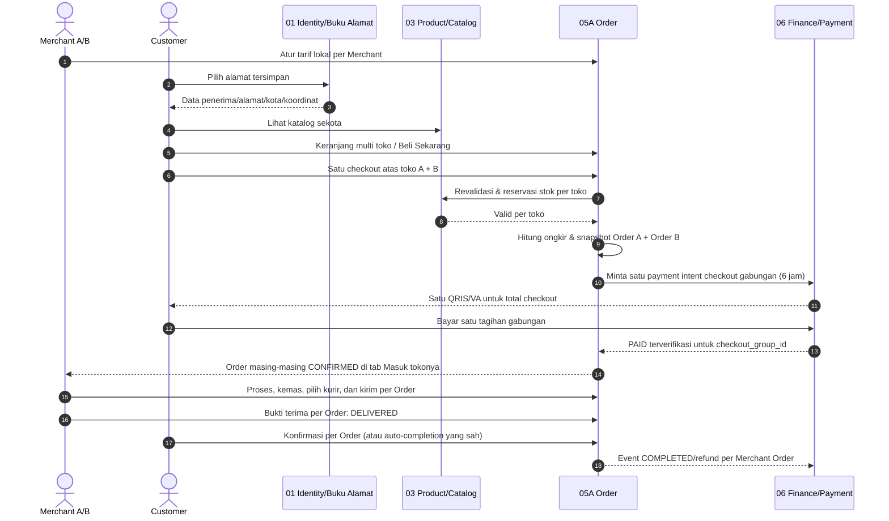
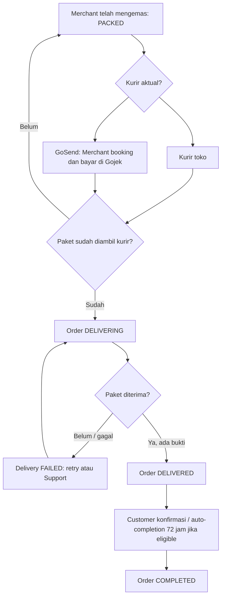
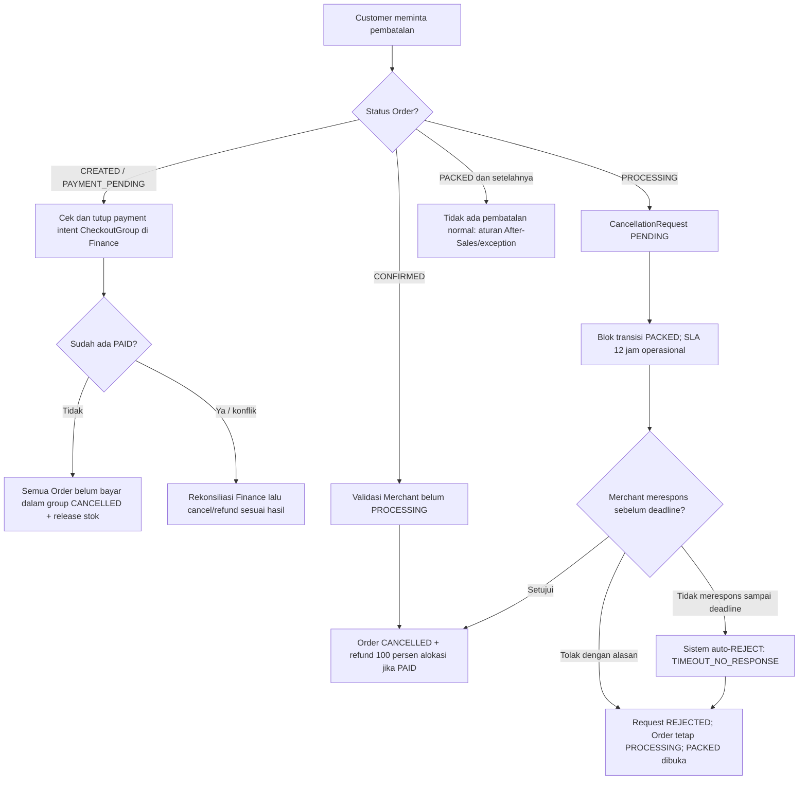

# SERVIO — PHASE 05A: ORDER BARANG
## Revisi Spesifikasi Bisnis, Domain, UI/UX, Integrasi, dan Skenario Operasional

**Status dokumen:** REVISED V3 — checkout gabungan multi-Merchant, pembayaran 6 jam, refund penuh, UI lima tab, **auto-completion 72 jam**, dan **SLA respons pembatalan 12 jam operasional dengan auto-reject** telah **LOCKED**.  
**Menggantikan baseline:** `PHASE-05A-ORDER-BARANG- PLAN.md` (versi lama).  
**Domain:** Phase 05 — Order | **Subdomain:** 05A — Order Barang  
**Arsitektur:** Domain-oriented microservices | **Stack acuan:** Next.js → Laravel REST API → MySql  
**Pembayaran:** Full payment melalui Payment Gateway di Phase 06 (QRIS/Virtual Account sesuai channel gateway)  
**Pengiriman:** Pengiriman Lokal yang dikelola Merchant; kurir toko atau GoSend yang dipesan Merchant, tanpa integrasi API GoSend  
**Prinsip:** Satu canonical Order lifecycle, satu tampilan tracking sederhana, dan satu konfigurasi tarif pengiriman lokal.

> **Rekonsiliasi V2 (LOCKED):** Kembali ke baseline **checkout gabungan multi-Merchant**: satu proses checkout Customer, satu tagihan/pembayaran gabungan di Phase 06, lalu **satu Merchant Order terpisah per toko** (masing-masing memiliki fulfillment, pengiriman, pembatalan dan status sendiri). Customer melihat card/order per toko dalam lima tab yang sudah LOCKED; Merchant hanya melihat Order tokonya. Tidak ada satu status gabungan yang memaksa semua Merchant selesai bersamaan. Pembayaran memiliki batas **6 jam**, dan pembatalan sah mendapat **refund penuh sesuai total yang dialokasikan ke Merchant Order terdampak**. Bila seluruh Order satu checkout dibatalkan, refund seluruh nilai checkout.
>
> **Rekonsiliasi V3 (LOCKED):** `DELIVERED → COMPLETED` otomatis setelah **72 jam** dari bukti penerimaan valid apabila Customer tidak mengonfirmasi dan tidak ada hold/laporan masalah aktif. Pada Order `PROCESSING`, Customer boleh mengajukan pembatalan. Merchant diberi waktu **12 jam operasional toko** untuk menyetujui/menolak. Bila tenggat terlewati tanpa keputusan, **sistem otomatis MENOLAK pengajuan** (`CancellationRequest=REJECTED`, alasan `TIMEOUT_NO_RESPONSE`); Order **tetap `PROCESSING`**, blokir `PACKED` dilepas, **tanpa eskalasi ke Support**. Waktu operasional harus memiliki sumber jadwal yang valid sebelum aturan ini diimplementasikan. Kebijakan di bagian **TBD** yang lain tetap belum disepakati.

---

# 1. TUJUAN DAN BATASAN

## 1.1 Tujuan

Phase 05A mengelola transaksi produk fisik dari Customer memilih barang sampai pembayaran tervalidasi, Merchant melakukan fulfillment dan pengiriman, Customer menerima barang, Order selesai, atau Order dibatalkan melalui lifecycle yang sah.

Tujuan revisi: (1) katalog barang lokal sekota; (2) satu tarif pengiriman dari Merchant; (3) Merchant bebas memilih kurir toko/GoSend; (4) tidak membangun platform logistik; (5) pengalaman Customer/Merchant dengan lima tab yang konsisten; (6) pembayaran dan refund tetap menjadi domain Finance.

## 1.2 In scope Phase 05A

- Cart dan Cart Item; jalur **Tambah ke Keranjang** serta **Beli Sekarang**.
- Checkout gabungan multi-Merchant: satu checkout/payment gabungan, validasi harga/stok/alamat/ongkir **per Merchant**, dan penciptaan satu Merchant Order terpisah per toko; jalur Beli Sekarang tetap satu Merchant.
- Order dan Order Item, snapshot historis, order status history.
- **Pengaturan Pengiriman** Merchant: aktif/nonaktif, titik asal toko, jangkauan maksimum, tarif bertingkat menurut jarak.
- Fulfillment Merchant: menerima Order lunas, memproses, mengemas, menyiapkan pengiriman.
- Delivery coordination: pilih kurir aktual, input referensi/tracking resmi bila ada, Simple Tracking, proof of delivery, delivery failure/retry.
- Customer confirmation dan **auto-completion LOCKED 72 jam** sejak `DELIVERED` yang valid, dengan pemeriksaan bukti dan hold.
- Cancellation langsung, cancellation request ketika PROCESSING, serta koordinasi pengembalian dana dengan Phase 06.
- UI pesanan Customer dan Merchant beserta grouping lima tab dan action berbasis status.

## 1.3 Out of scope dan tetap pada pemiliknya

- Akun/role, Buku Alamat Customer, penerima/alamat tersimpan, konteks Merchant dan otorisasi → **Phase 01**.
- Kategori produk → **Phase 02**.
- Product/Variant, price, stock, pencarian/filter katalog, validasi dan reservasi stok → **Phase 03**.
- Offering jasa, booking dan pelaksanaan jasa → **Phase 04/05B**.
- QRIS/VA, Payment Gateway, payment verification, biaya layanan, pajak, ledger, escrow, settlement, payout, refund execution → **Phase 06**.
- Return, Warranty, Claim, refund decision untuk purnajual, Rating & Review → **Phase 07**.
- Complaint, Dispute, mediasi, kasus pengiriman bermasalah → **Phase 09**.
- Pengiriman notifikasi → **Phase 10**; analytics → **Phase 11**.
- Tidak ada role Courier, akun/komisi/dompet Courier, dispatch engine, live GPS, tracking API GoSend, pembuatan QRIS sendiri, atau mesin logistik lengkap.

## 1.4 Prinsip dan batas keamanan

1. Database masing-masing service dimiliki service tersebut; tidak boleh direct query/write lintas database.
2. Laravel adalah security boundary; UI menyembunyikan aksi hanya sebagai UX, bukan validasi keamanan.
3. Total uang dihitung server-side dan diverifikasi Phase 06; Customer/Merchant tidak boleh menetapkan `PAID` sendiri.
4. Cart/checkout boleh melibatkan beberapa Merchant; **setiap Order tepat satu Merchant**, terhubung ke referensi `checkout_group_id` yang sama untuk satu pembayaran gabungan.
5. **Satu pembayaran penuh gabungan** wajib `PAID` dan terverifikasi sebelum Merchant mana pun dapat memproses Order. Masa berlaku tagihan **6 jam sejak checkout/payment intent yang sah diterbitkan**, tidak diperpanjang hanya karena halaman dibuka ulang.
6. Satu metode pengiriman yang dijual kepada Customer: **Pengiriman Lokal oleh Merchant**. Jenis kurir aktual baru dipilih Merchant saat fulfillment.
7. Pemilihan GoSend tidak menambah canonical Order Status. Merchant memesan dan membayar GoSend melalui Gojek di luar SERVIO.
8. Ongkir checkout adalah tarif Merchant, **bukan klaim tarif aktual GoSend**. Selisih ongkir aktual ditanggung Merchant; Customer tidak ditagih ulang secara sepihak.
9. Cancellation dan Refund adalah lifecycle yang berbeda.
10. Detail historis produk, alamat, ongkir dan pembayaran harus stabil melalui snapshot.
11. Produk/varian pada histori Order tidak boleh kehilangan jejak referensi akibat hard-delete.
12. Status Order, Payment, Delivery, dan Cancellation Request diperlakukan sebagai state yang terpisah.
13. Refund normal atas **pembatalan Order yang sah** adalah **100% nilai pembayaran Customer yang dialokasikan ke Merchant Order terdampak**, termasuk ongkir lokal, biaya layanan dan pajak yang dibebankan pada alokasi tersebut; refund gabungan seluruh Order adalah 100% total checkout. Detail pencatatan dan eksekusi tetap milik Phase 06.

---

## 1.5 Diagram bisnis inti (lintas role)



**Catatan diagram:** satu pembayaran gabungan **bukan** satu lifecycle Order. Status tiap Merchant Order bisa berbeda setelah `PAID`. Payment expiry **6 jam**; auto-completion **72 jam sejak `DELIVERED` valid**; SLA pembatalan **12 jam operasional Merchant dengan auto-reject saat tidak dijawab**. Phase 05A tidak menerima dana langsung.

## 1.6 Diagram pemilihan kurir tanpa mengubah lifecycle



---

# 2. ROLE DAN KEPEMILIKAN DATA

| Role/Domain | Tanggung jawab utama dalam flow 05A | Tidak boleh dilakukan |
|---|---|---|
| Customer | Pilih alamat tersimpan, browse, Cart/Beli Sekarang, checkout, bayar, lacak, konfirmasi, pembatalan sah | Mengubah harga/ongkir, memalsukan pembayaran, mengubah fulfillment |
| Merchant | Atur tarif/jangkauan, lihat Order lunas, proses, kemas, pesan/kelola kurir, bukti terima, respons pembatalan | Mengubah `PAID`, memodifikasi harga historis, memutuskan refund Finance |
| Identity / Phase 01 | Auth, RBAC, Buku Alamat dan penerima tersimpan, informasi lokasi resmi Merchant | Menjadi pemilik snapshot historis Order |
| Product / Phase 03 | Katalog sekota, harga, variant, stock availability/reservation/commit/release | Menjadi pemilik Order atau Payment |
| Order / Phase 05A | Cart, checkout, shipping quote, Order, delivery coordination, cancellation lifecycle | Menangani saldo, gateway atau refund execution |
| Finance / Phase 06 | Kalkulasi fee/pajak, payment intent, validasi webhook, ledger/escrow, refund execution, settlement | Mengubah fulfillment tanpa proses Order |
| After-Sales / Phase 07 | Retur, klaim, garansi dan keputusan refund purnajual | Merekayasa payment status |
| Support / Phase 09 | Sengketa, mediasi, eskalasi dan operasi kasus | Menjalankan payout sepihak |
| Notification / Phase 10 | Notifikasi status dari event yang sah | Mengubah lifecycle Order |

### 2.1 Buku Alamat dari Phase 01 — sumber kebenaran

- Nama penerima, nomor HP, alamat terstruktur, kode kota/kabupaten, patokan dan koordinat diambil dari **Buku Alamat yang sudah disimpan di Phase 01**.
- Alamat default dipilih otomatis jika ada. Customer dapat **Pilih/Ubah Alamat** melalui data Buku Alamat Phase 01; jika belum ada alamat valid, arahkan menambahnya di Phase 01.
- Checkout tidak membuat entitas Buku Alamat baru di Phase 05A. Catatan untuk pesanan merupakan field Order, bukan perubahan Buku Alamat.
- Identitas penerima dapat dipilih dari isi alamat; perubahan identitas penerima permanen dilakukan lewat Buku Alamat di Phase 01. Untuk MVP, jangan membuat input nama/telepon bebas yang berbeda dari data terpilih tanpa mekanisme sinkronisasi dan validasi khusus.
- Phase 05A mengambil referensi alamat dan data tervalidasi dari Phase 01, lalu menyimpan **snapshot penerima, nomor telepon, alamat lengkap, kode kota/kabupaten dan koordinat** ketika Order dibuat.
- Mengedit/menghapus alamat di Phase 01 **tidak mengubah** data pengiriman Order historis.
- Customer mengganti alamat saat checkout → Phase 03 perlu memfilter ulang eligible product; Phase 05A menghitung ulang jarak, ongkir dan total.
- Setelah Order tercipta, perubahan alamat pengiriman bukan perubahan Buku Alamat biasa. Jika perlu perubahan tujuan, lakukan prosedur koreksi operasional yang memvalidasi jangkauan, biaya, dan tahap fulfillment; bila tidak memenuhi syarat, gunakan cancellation/reorder sesuai status.

---

# 3. KATALOG PRODUK LOKAL SEKOTA

## 3.1 Aturan tampil

1. Customer memilih alamat aktif dari Buku Alamat Phase 01.
2. Sistem memperoleh **kode kota/kabupaten administratif** dari alamat aktif (bukan teks bebas).
3. Katalog Phase 03 menampilkan produk ACTIVE dan variant ACTIVE dari Merchant eligible dengan **kode kota/kabupaten asal toko yang sama**.
4. Kota dan kabupaten adalah entitas administratif berbeda meskipun nama mirip, contoh Kota Bandung ≠ Kabupaten Bandung.
5. Produk di luar kota/kabupaten alamat aktif tidak muncul pada hasil discovery untuk Customer tersebut.
6. Customer tanpa alamat aktif melihat prompt **Pilih Alamat untuk Melihat Produk**, bukan katalog semua kota secara diam-diam.
7. Lokasi toko resmi berasal dari data Merchant yang tervalidasi; Merchant tidak bebas memalsukan koordinat tujuan/order saat checkout.
8. **Sekota belum tentu terjangkau layanan antar Merchant**. Jika jarak melebihi coverage/tarif belum aktif, item tidak boleh checkout untuk alamat tersebut; UI dapat menunjukkan *Di luar jangkauan pengiriman toko*.
9. Ganti alamat → catalog dan cart eligibility direfresh; item lama boleh tetap tersimpan di Cart tetapi tidak bisa di-checkout sebelum valid.

## 3.2 UI katalog & detail produk

- Header menunjukkan **alamat aktif** dengan aksi **Ganti Alamat** (Buku Alamat Phase 01).
- Card produk: gambar, nama, varian/ringkasan harga, nama Merchant, kota, stock availability (dari Phase 03).
- Detail produk: pilih variant dan qty, batas stok, harga terkini, info **Pengiriman Lokal oleh Toko** dan kelayakan alamat jika tersedia.
- Dua aksi yang sama-sama menggunakan checkout engine 05A: **Tambah ke Keranjang** dan **Beli Sekarang**.

---

# 4. KONFIGURASI PENGIRIMAN MERCHANT — SIDEBAR BARU

## 4.1 Letak dan ownership

Tambahkan submenu/menu sidebar Merchant **Pengaturan Pengiriman**. Ini adalah konfigurasi delivery dan ongkir di **Phase 05A**, bukan microservice baru.

Contoh sidebar Merchant:

```text
Dashboard
Produk                         [Phase 03]
Pesanan Barang                 [Phase 05A]
Pengaturan Pengiriman          [Phase 05A — BARU]
Keuangan                       [Phase 06]
```

## 4.2 Field konfigurasi pengiriman

| Field UI | Asal/aturan | Wajib? |
|---|---|---|
| Status Pengiriman Lokal | Aktif / Nonaktif | Ya |
| Toko/titik asal | Lokasi Merchant terverifikasi; tampil read-only bila sudah disahkan di Phase 01 | Ya |
| Jangkauan maksimum | Merchant memilih batas km yang dilayani | Ya jika aktif |
| Metode perhitungan jarak | Untuk MVP: jarak garis lurus koordinat (jelas diberi label); routing jalan opsi masa depan | Ya, fixed oleh sistem |
| Tarif bertingkat | Rentang `>min` sampai `<=max` dengan nominal ongkir rupiah | Ya, menutup seluruh coverage |
| Catatan pengiriman | Informasi operasional singkat kepada Customer (opsional) | Tidak |
| Diperbarui pada | Audit perubahan konfigurasi | Otomatis |

**Contoh ilustratif, BUKAN tarif resmi SERVIO ataupun GoSend:**

| Rentang jarak | Ongkir Merchant |
|---|---:|
| 0–3 km | Rp7.000 |
| >3–5 km | Rp12.000 |
| >5–10 km | Rp18.000 |

Contoh: 4,2 km cocok di rentang **>3–5 km**, maka ongkir checkout Rp12.000.

## 4.3 Validasi tarif dan jarak

- Rentang harus lengkap mulai 0 hingga maksimum coverage, urut, tanpa celah atau tumpang tindih.
- Nilai ongkir integer rupiah, tidak negatif, dengan batas minimal/maksimal konfigurasi platform bila ditetapkan kemudian.
- Perhitungan dilakukan di Laravel, bukan percaya hasil jarak/ongkir dari browser.
- Jarak dihitung dari koordinat resmi toko ke koordinat alamat tersimpan menggunakan perhitungan geodesik sederhana (misal Haversine). **Ini bukan jarak tempuh jalan.**
- Sematkan label jelas mengenai basis jarak; tarif Merchant sebaiknya mengantisipasi bahwa perjalanan jalan bisa lebih panjang.
- Jika koordinat salah/tidak lengkap, jangan menebak ongkir; blok checkout sampai alamat/toko diperbaiki.
- Jika metode tidak aktif, coverage tidak mencukupi, atau tier kosong → produk tidak dapat dibeli melalui pengiriman untuk alamat tersebut.
- Tarif yang diubah berlaku bagi checkout berikutnya; **Order yang sudah dibuat tetap memakai shipping fee snapshot**.
- Merchant tidak boleh mengubah tarif untuk menaikkan nominal Order yang sudah dibayar.
- Tidak ada perhitungan otomatis tarif aktual GoSend, karena tidak ada GoSend API.

## 4.4 Tanggung jawab selisih ongkir

- Pada checkout, Customer membayar tarif **Pengiriman Lokal** milik Merchant, bukan estimasi GoSend.
- Saat `PACKED`, Merchant bebas memilih kurir toko atau GoSend.
- Bila menggunakan GoSend, **Merchant** memesan dan membayar biaya riil di Gojek; pembayaran ini berlangsung di luar SERVIO.
- Ongkir riil > ongkir Customer → selisih beban Merchant. Ongkir riil < ongkir Customer → perlakuan selisih sesuai kebijakan harga/settlement Merchant; Customer tidak otomatis ditagih/direfund selisih harga kurir.
- Merchant tidak boleh membebankan selisih tambahan kepada Customer setelah `PAID` tanpa alur persetujuan dan perubahan finansial yang sah (tidak termasuk scope normal 05A).
- Jika GoSend tidak tersedia/mahal, Merchant dapat memilih kurir toko; keterbatasan kurir bukan alasan otomatis yang sah untuk membatalkan Order sesudah menerima pembayaran.

---

# 5. KERANJANG DAN BELI SEKARANG

## 5.1 Jalur A — Tambah ke Keranjang

1. Customer pilih produk, variant dan quantity.
2. Tekan **Tambah ke Keranjang**.
3. Phase 05A menaruh referensi product/variant, quantity dan Merchant; harga yang terlihat di Cart bersifat indikatif.
4. Cart menampilkan kelompok Merchant, foto/nama item, variant, qty, harga terkini dan subtotal.
5. Customer boleh tambah/kurangi qty, hapus item, pilih item yang dibeli.
6. Cart boleh menampung item dari lebih dari satu Merchant.
7. Customer dapat memilih item eligible dari **beberapa Merchant sekaligus**, lalu menekan **Checkout (N toko)** dan membayar dengan **satu tagihan gabungan**.
8. Di checkout, sistem menampilkan **section per Merchant**: item, subtotal, ongkir lokal masing-masing, fee/pajak yang dialokasikan, dan total per Merchant.
9. Setelah pembayaran sukses, Merchant Orders tetap **terpisah per toko**. Item yang tidak dicentang tetap berada di Cart; item yang dibayar baru dihapus setelah pembayaran dipastikan sukses/ditangani idempotent.

## 5.2 Jalur B — Beli Sekarang

1. Customer pilih produk, variant dan qty.
2. Tekan **Beli Sekarang**.
3. Frontend langsung menuju checkout untuk satu Merchant tanpa keharusan menyimpan item ke Cart permanen.
4. Engine validasi harga, stock, alamat, ongkir dan fee sama dengan Jalur A.

## 5.3 UI Cart

**Konten utama:** kelompok Merchant, checkbox per item dan **Pilih Semua per Toko**, foto, nama, variant, harga terbaru, qty controls, subtotal tiap Merchant dan indikator tidak eligible. Footer sticky: **Jumlah N toko / M barang**, estimasi subtotal terpilih, tombol **Checkout (N Toko)**. Satu Merchant pun bisa dipilih; Merchant lain boleh tidak dicentang.

**Pesan UX:** jika qty/harga berubah, beri informasi dan minta Customer meninjau ulang; produk luar kota atau pengiriman tidak tersedia diberi alasan eksplisit, bukan diam-diam dihapus.

## 5.4 Checkout gabungan multi-Merchant — perilaku UI (LOCKED)

- Customer memilih item dari **1 atau lebih Merchant** yang eligible pada Cart dan menekan **Checkout (N Toko)**.
- **Satu alamat Buku Alamat Phase 01** berlaku untuk semua Merchant Order dalam checkout itu. Sistem menghitung jarak/ongkir **masing-masing toko** karena titik asalnya berbeda.
- Checkout menampilkan **section Toko A, Toko B, ...** dengan subtotal item, ongkir lokal, fee/pajak yang dialokasikan, total per toko; footer **Grand Total**.
- Checkout menghasilkan `CheckoutGroup` (referensi orkestrasi), bukan satu Order campuran. Di bawahnya tercipta **Order A** untuk toko A, **Order B** untuk toko B, dst.
- Phase 06 menerima breakdown semua Merchant Order lalu membuat **satu payment intent QRIS/VA** untuk grand total checkout (masa berlaku 6 jam).
- Setelah `PAID`, semua Merchant Order menjadi `CONFIRMED`, tetapi **masing-masing Order bebas berbeda status** sesuai aktivitas Merchant.
- UI Customer menampilkan **Order per toko** di tab sesuai status tiap Order. UI Merchant hanya menampilkan Order tokonya. Tidak ada satu status gabungan yang mengunci semua toko bersama-sama.
- Halaman bukti pembayaran gabungan boleh mengelompokkan transaksi dalam `checkout_group_id`, tetapi **Detail Pesanan** dan tracking tetap per Merchant Order.

**Contoh:** Checkout Toko A Rp112.000 dan Toko B Rp208.000 → **satu bayar Rp320.000**, dua nomor Order. Ketika Toko A `PACKED` dan Toko B `DELIVERING`, Customer melihat A di **Diproses** dan B di **Dikirim**. Pembatalan/refund Order A yang sah = **Rp112.000**, tidak membatalkan Order B; Payment gabungan dapat menjadi `PARTIALLY_REFUNDED`.

---

# 6. CHECKOUT — FORM DAN KALKULASI

## 6.1 Urutan Checkout

```text
Cart (satu atau banyak Merchant) / Beli Sekarang
→ Ambil Buku Alamat Phase 01
→ Pilih satu alamat tujuan untuk checkout ini
→ Kelompokkan semua item terpilih menurut Merchant
→ Revalidasi eligibility kota/coverage, harga, stok PER TOKO via Phase 03
→ Hitung ongkir Pengiriman Lokal PER TOKO di Phase 05A
→ Minta rincian fee/pajak dan TOTAL GABUNGAN ke Phase 06
→ Customer review tiap toko + grand total
→ Reservasi stok semua item dan buat CheckoutGroup + Order A/B/... ber-snapshot
→ Phase 06 buat SATU pembayaran gabungan dengan expiry 6 jam
→ Semua Order terkait PAYMENT_PENDING sampai Finance konfirmasi
→ Satu halaman pilih QRIS/VA untuk total gabungan
```

## 6.2 Form checkout Customer

| Bagian | Field ditampilkan | Editability |
|---|---|---|
| Penerima | Nama penerima, nomor telepon | Dari Buku Alamat Phase 01; ubah melalui fitur alamat tersimpan |
| Alamat | Label Rumah/Kantor, alamat lengkap, kota, koordinat/pin valid | Pilih/Ubah alamat dari Phase 01 |
| Item pesanan per Merchant | Section **Toko A / Toko B / ...**: foto, nama, varian, qty, harga satuan, subtotal toko | Quantity bisa melalui revisi keranjang/checkout dengan revalidasi |
| Catatan Order | Catatan **per Merchant Order** | Opsional, milik 05A |
| Pengiriman | **Pengiriman Lokal per toko**; jarak asal toko→alamat Customer, ongkir per toko, info layanan | Read-only, tidak memilih kurir aktual |
| Biaya | **Subtotal, ongkir, fee/pajak per Merchant yang dialokasikan**, total per Merchant, dan **grand total checkout** | Read-only dari kalkulasi server |
| Persetujuan | Ringkasan akhir dan tombol **Lanjut ke Pembayaran** | Customer mengonfirmasi |

**Tidak ada field wajib** memilih GoSend/kurir toko di Checkout. Merchant menetapkan metode aktual belakangan. **Alamat tujuan satu untuk checkout gabungan**, disalin sebagai snapshot di setiap Merchant Order. Jika salah satu toko tidak eligible, Customer harus memperbaiki/menghapus pilihan tersebut sebelum satu pembayaran diterbitkan.

## 6.3 Total pembayaran

Komponen dasar (ilustrasi struktur, bukan penetapan tarif):

```text
untuk setiap Merchant Order m:
  subtotal_m = Σ(qty_i × harga_unit_snapshot_i) milik toko m
  ongkir_m = hasil tier Merchant m untuk jarak asal toko m→alamat Customer
  fee_customer_m = alokasi biaya layanan/customer gateway dari Phase 06
  pajak_customer_m = alokasi pajak yang dibebankan Customer oleh Phase 06
  diskon_m = hanya jika eligible dan divalidasi modul terkait
  TOTAL_ORDER_m = subtotal_m + ongkir_m + fee_customer_m + pajak_customer_m - diskon_m

TOTAL_CHECKOUT = Σ(TOTAL_ORDER_m)
SATU_PAYMENT_INTENT.nominal = TOTAL_CHECKOUT
```

- Produk & base price authoritative → Phase 03; item qty/cart → Phase 05A.
- Ongkir lokal/coverage quote → Phase 05A; fee, pajak, gateway charge, total finansial yang disahkan → Phase 06.
- Komisi platform yang dibebankan pada Merchant merupakan **deduction settlement**, bukan otomatis biaya tambahan Customer.
- Bukti pembayaran Customer harus menampilkan biaya/pajak yang memang **dibebankan kepada Customer**, bukan seluruh potongan settlement Merchant.
- Contoh: **Order Toko A Rp112.000 + Order Toko B Rp208.000 = satu pembayaran checkout Rp320.000** (ilustratif termasuk komponen yang dialokasikan). Setiap Order menyimpan breakdown sendiri; total checkout sama dengan jumlah seluruh alokasi dan disahkan Phase 06. Tidak boleh menagih ongkir hanya sekali bila ada dua toko yang berbeda, kecuali kebijakan promo terpisah secara sah.

## 6.4 Reservasi stok dan commit

- Cart tidak mereservasi stok.
- Checkout wajib melakukan stock revalidation dan mekanisme reservasi sementara **melalui kontrak Phase 03** agar stok terakhir tidak dibeli ganda.
- Setelah pembayaran tervalidasi, Phase 03 meng-commit pengurangan stok sesuai kebijakan inventory yang disepakati; pada gagal/expired/cancel sebelum fulfill, Phase 03 menerima perintah/referensi release/reconcile yang idempotent.
- Perubahan nyata terhadap implementasi Phase 03 yang sudah LOCKED hanya dilakukan melalui kesepakatan kontrak integrasi, bukan memindahkan kepemilikan stok ke 05A.
- Pembayaran gabungan memiliki batas **6 jam**. Kontrak reservasi di Phase 03 harus **menahan stok untuk jendela pembayaran 6 jam** atau menerapkan mekanisme setara yang mencegah oversell; perpanjangan dan retry hanya boleh sesuai aturan gateway/inventory yang konsisten. Semua reservasi dalam checkout group ditelusuri terpisah dan dapat dilepas bila checkout expired/cancel.

## 6.5 Validasi checkout gabungan dan error parsial

- **Sebelum bayar:** checkout berlaku **all-or-nothing**. Setiap Merchant dan item wajib eligible. Jika satu item habis, out of coverage atau konfigurasi ongkir tidak valid, jangan diam-diam hanya membuat Order toko lain; tampilkan item bermasalah dan minta Customer meninjau pilihan atau menghapus item tersebut, lalu hitung ulang total.
- **Sesudah berhasil bayar:** tiap Merchant Order dikelola independen. Kegagalan fulfillment satu toko tidak mengubah Order toko lain; Finance menjalankan refund **khusus alokasi Merchant Order** yang dibatalkan secara sah.
- Tidak boleh ada pembuatan payment gabungan tanpa rekonsiliasi/order references semua child yang eligible; bila sebagian proses creation/stock reserve gagal, jalankan rollback/kompensasi sebelum menyediakan metode bayar.
- Item Cart dipilih hanya dihapus/ditandai sudah dibeli sesudah payment confirmed atau lewat flow pemulihan yang menjamin konsistensi.

---

# 7. ORDER CREATION DAN SNAPSHOT

## 7.1 Aturan

- **Satu CheckoutGroup** dapat menghasilkan **banyak Merchant Order** (satu per Merchant terpilih), masing-masing dengan satu atau lebih Order Item. Jalur Beli Sekarang membuat CheckoutGroup dengan satu Merchant Order.
- Setiap Merchant Order memiliki `order_id`, `order_number` unik, `checkout_group_id`, referensi customer/merchant, timestamps, status dan referensi **satu payment gabungan** di Phase 06.
- Checkout gabungan **harus lolos revalidasi semua toko** sebelum Payment diterbitkan (all-or-nothing untuk creation/payment). Tidak ada pembayaran atas subset tersembunyi ketika salah satu item invalid.
- Setelah `PAID`, fulfillment, delivery, cancel dan refund **independen per Merchant Order**; membatalkan Order A tidak membatalkan Order B. Payment gabungan dapat berubah menjadi `PARTIALLY_REFUNDED` saat hanya A yang direfund.
- Tidak boleh dibuat dua CheckoutGroup atau Order duplikat akibat double click/retry request yang sama; gunakan satu idempotency key per checkout group dan referensi child yang stabil.
- Jika pembuatan Order berhasil tetapi pembayaran/reservasi gagal, lakukan pemulihan/release/expire yang eksplisit; jangan mengandalkan atomic transaction lintas MongoDB milik layanan berbeda.

## 7.2 Snapshot minimum

| Kelompok | Data snapshot |
|---|---|
| Identitas order | `order_id`, `order_number`, `checkout_group_id`, `customer_id`, `merchant_id`, `created_at` |
| Penerima | Nama, telepon, `address_id` referensi, alamat lengkap, kode kota/kabupaten, lat/lng titik kirim |
| Merchant | Referensi Merchant, identitas tampilan toko, lokasi asal/titik pickup yang digunakan |
| Item | `product_id`, `variant_id`, nama produk, atribut varian, foto referensi bila perlu, qty, unit_price, subtotal |
| Pengiriman | `delivery_service = LOCAL_MERCHANT_MANAGED`, calculated_distance, distance_method, shipping_tier, shipping_fee |
| Keuangan | **Alokasi total per Merchant Order** (item, ongkir, fee Customer, pajak, diskon), currency, referensi satu pembayaran gabungan Phase 06, quote/invoice/version |
| Audit | Status, actor, source, timestamp, cancellation info bila ada |

Perubahan katalog, harga tier, nama penerima/alamat tersimpan setelah Order dibuat **tidak mengubah snapshot historis**.

## 7.3 Referensi CheckoutGroup dan independensi Merchant Order

`CheckoutGroup` adalah unit orkestrasi pembelian dan **satu pembayaran**, **bukan Order bisnis tambahan dengan fulfillment sendiri**. Minimal berisi `checkout_group_id`, `customer_id`, `address_snapshot_ref`, `order_ids[]`, `total_checkout`, `payment_reference`, `expires_at`, status orkestrasi/audit. Data resmi uang tetap milik Phase 06. Pembuatan beberapa Merchant Order dan relasinya harus konsisten/idempotent.

```text
CheckoutGroup CG-001 — satu total bayar dan satu expiry 6 jam
  ├─ Order SV-A001 (Merchant A) — subtotal/ongkir/fee/pajak sendiri — status sendiri
  └─ Order SV-B001 (Merchant B) — subtotal/ongkir/fee/pajak sendiri — status sendiri

Phase 06: Payment P-001 (jumlah = Σ total Order terkait)
```

Order A dan B **tidak saling menahan transisi fulfillment, delivery, cancellation atau completion** sesudah pembayaran dinyatakan sah. Satu Order bisa `CANCELLED` ketika Order lain `COMPLETED`.

---

# 8. PEMBAYARAN QRIS DAN VIRTUAL ACCOUNT — PHASE 06

## 8.1 Alur normal

```text
Customer klik Lanjut ke Pembayaran untuk item dari satu/lebih toko
  ↓
05A validasi semua toko, cadangkan stok, buat CheckoutGroup + Merchant Order A/B/...
  ↓
Semua Order CREATED → PAYMENT_PENDING, Phase 06 buat SATU payment intent
  ↓
Expiry tagihan: 6 JAM sejak diterbitkan (disinkronkan dengan gateway)
  ↓
Customer pilih SATU QRIS atau Virtual Account untuk TOTAL_CHECKOUT
  ↓
Gateway mengirim webhook/notifikasi server-to-server ke 06
  ↓
06 validasi signature, referensi group, nominal gabungan, status, idempotency
  ↓
06 catat PAID + alokasi saldo/ledger per Merchant Order
  ↓
06 kirim satu event payment paid yang mencakup CheckoutGroup dan referensi seluruh Order
  ↓
05A ubah semua Order dalam group: PAYMENT_PENDING → CONFIRMED (idempotent)
  ↓
Merchant A/B melihat hanya Order miliknya di tab Masuk
Customer melihat Order A/B terpisah di tab Diproses
```

## 8.2 Aturan QRIS/VA

- Halaman payment hanya menyediakan channel yang benar-benar diaktifkan oleh gateway/Phase 06.
- Pilih **QRIS** → QR/payload dinamis yang dikembalikan gateway untuk transaksi itu; tidak menggambar QR acak di frontend.
- Pilih **Virtual Account** → daftar bank dari gateway, nomor VA dan petunjuk pembayaran diterbitkan/diterima dari gateway; jangan membuat nomor VA sendiri.
- Jika redirect/hosted checkout dipakai gateway, UI mengikutinya tanpa menduplikasi alur keamanan.
- Simpan `checkout_group_id`, satu `payment_reference`, dan `expires_at` dari response yang sah; masa pembayaran **6 jam**, dihitung berdasarkan waktu server. Pastikan channel gateway benar-benar mendukung expiry tersebut; jika tidak, tentukan konfigurasi/pemilihan channel yang kompatibel sebelum production.
- Browser yang kembali ke halaman sukses **bukan** sumber bukti `PAID`.
- Customer boleh memperbarui tampilan status melalui poll/refresh ke backend; sumber akhir tetap hasil verifikasi Phase 06.
- QRIS/VA adalah metode bayar, **bukan** status Order baru.

## 8.3 Payment state dan sinkronisasi

Konseptual Payment Status di Phase 06:
`PENDING`, `PAID`, `FAILED`, `EXPIRED`, `REFUNDED`, `PARTIALLY_REFUNDED`.

- `PENDING`: semua Merchant Order dalam checkout group berada di `PAYMENT_PENDING` dan terlihat **sebagai card per toko** di tab Belum Bayar Customer. Tombol **Bayar Sekarang** pada card mana pun kembali ke **satu tagihan gabungan** yang sama, tidak membuat tagihan baru untuk satu toko.
- `PAID` tervalidasi: seluruh Merchant Order dalam group berubah `CONFIRMED`; masing-masing Merchant boleh `PROCESSING` secara independen.
- `FAILED`/`EXPIRED` termasuk setelah batas **6 jam**: Finance memastikan hasil final dari gateway, lalu semua Order **belum berbayar** dalam group dibatalkan/release stok secara terkoordinasi. Pembayaran terlambat yang ternyata berhasil harus direkonsiliasi/refund; jangan ada Order berbayar yang diproses sebagai belum dibayar.
- `REFUNDED`/`PARTIALLY_REFUNDED`: status pembayaran **gabungan**; ketika hanya Order A dibatalkan/refund, pembayaran gabungan bisa menjadi `PARTIALLY_REFUNDED` sementara Order B tetap `PROCESSING`/`DELIVERING`/`COMPLETED`. Refund per Order dilihat dari alokasi dan referensi Finance masing-masing; **tidak mengubah otomatis canonical Order Status** lain.
- Notifikasi webhook berulang atau out of order wajib idempotent, tidak mengubah Order dua kali.
- Race payment-vs-cancel/expiry: 05A wajib memperoleh kondisi pembayaran terverifikasi dari 06 sebelum memfinalkan cancel tanpa refund. Bila dana ternyata berhasil masuk, 06 menangani rekonsiliasi/refund sesuai policy; tidak boleh ada uang tak tercatat.

## 8.4 Bukti pembayaran dan struk

Setelah satu Payment checkout `PAID`, Customer dapat melihat **Bukti Pembayaran gabungan** di checkout history dan **rincian/struk per Merchant Order** dari detail tiap toko:

- Logo/identitas SERVIO, `checkout_group_id`/referensi checkout, **nomor Merchant Order terkait**, satu nomor pembayaran gabungan dan waktu pembayaran.
- Merchant yang bersangkutan, daftar barang, varian, qty, unit price snapshot, subtotal; untuk bukti gabungan tampilkan bagian tiap Merchant.
- Nama/alamat penerima sesuai snapshot bila relevan untuk bukti pembelian.
- **Ongkir per Merchant**, biaya layanan Customer dan pajak yang dialokasikan per Merchant, diskon bila ada, **total Merchant Order** dan **total checkout gabungan** pada dokumen gabungan. Total alokasi harus sama dengan nominal Payment.
- Metode QRIS/VA, status **LUNAS** berdasarkan Phase 06.
- Referensi pembayaran yang aman untuk ditampilkan; **jangan mempublikasikan data rahasia gateway**.
- Untuk Merchant: ringkasan penjualan, ongkir, fee/komisi platform dan status settlement tersedia dari Phase 06, **bukan** mengubah struk Customer.

## 8.5 Payment expiry 6 jam dan pembayaran gabungan (LOCKED)

1. Setiap CheckoutGroup memperoleh **satu payment intent** dengan `issued_at` dan `expires_at = issued_at + 6 jam` berdasarkan waktu **server Phase 06**, selaras expiry channel gateway.
2. QRIS/VA yang ditampilkan Customer dan countdown seluruh card `PAYMENT_PENDING` dalam group **merujuk ke intent yang sama**. Jangan membuat QRIS/VA baru saat Customer membuka card Order berbeda.
3. Setelah 6 jam tanpa `PAID` yang sah, 06 mengonfirmasi status ke gateway; 05A menutup seluruh Merchant Order yang belum dibayar dalam group, melepas seluruh reservasi stok via Phase 03. Jangan menganggap countdown browser sebagai verifikasi expiry.
4. Jika gateway tidak mendukung expiry 6 jam untuk channel tertentu, **jangan klaim 6 jam diterapkan** hanya dengan menyembunyikan UI. Integrasi wajib mengamankan expiry/penutupan dan menangani late settlement/refund; channel yang tidak kompatibel harus dievaluasi sebelum produksi.
5. Sebelum `PAID`, pembayaran group bersifat **all-or-nothing**. Setelah `PAID`, refund dilakukan **per Merchant Order**; yang lain boleh tetap aktif. Finance mencatat alokasi nominal dan status refund tiap Order dengan presisi; nominal gabungan/partial refund tetap rekonsiliasi.
6. Jika payment sukses namun propagasi event ke salah satu Order gagal, lanjutkan retry/idempotent recovery; jangan menciptakan payment baru atau membiarkan Merchant memproses Order yang belum menerima konfirmasi otoritatif.

---

# 9. CANONICAL STATUS DAN PEMETAAN UI

## 9.1 Order Status — tidak diubah

```text
CREATED
   ↓
PAYMENT_PENDING
   ↓ (Phase 06 confirmed PAID)
CONFIRMED
   ↓ (Merchant: Proses Pesanan)
PROCESSING
   ↓ (Merchant: Tandai Dikemas)
PACKED
   ↓ (Paket benar-benar diserahkan ke kurir)
DELIVERING
   ↓ (Paket benar-benar diserahkan ke penerima)
DELIVERED
   ↓ (Customer konfirmasi / auto-completion 72 jam jika eligible)
COMPLETED

CANCELLED = terminal exception melalui transition yang diizinkan.
```

Tidak ada status Order `GOSEND_BOOKED`, `DRIVER_FOUND`, `CANCELLATION_PENDING` atau `REFUND_PENDING`. Informasi tersebut, jika perlu, adalah metadata/status domain terkait.

## 9.2 Delivery Status — terpisah

```text
NOT_STARTED → READY_FOR_DELIVERY → IN_TRANSIT → DELIVERED
                                      └──────→ FAILED
                                                 ↓
                                         retry / return flow
```

- `PACKED` ↔ `READY_FOR_DELIVERY`.
- Paket sudah diambil kurir → Delivery `IN_TRANSIT`, Order `DELIVERING`.
- Paket benar-benar diterima → Delivery `DELIVERED`, Order `DELIVERED`.
- Pengiriman gagal sesudah transit → Delivery `FAILED`, Order tidak otomatis `CANCELLED`; tetap dalam tahap pengiriman dengan indikator masalah sampai ditangani.

## 9.3 Grouping lima tab — LOCKED

| Canonical Order Status | Tab Merchant | Tab Customer | Label card yang disarankan |
|---|---|---|---|
| `CREATED` | Tidak muncul | **Belum Bayar** | Pesanan Dibuat |
| `PAYMENT_PENDING` | Tidak muncul | **Belum Bayar** | Menunggu Pembayaran |
| `CONFIRMED` | **Masuk** | **Diproses** | Pesanan Baru / Pembayaran Berhasil |
| `PROCESSING` | **Diproses** | **Diproses** | Sedang Disiapkan |
| `PACKED` | **Diproses** | **Diproses** | Siap Dikirim |
| `DELIVERING` | **Dikirim** | **Dikirim** | Sedang Diantar |
| `DELIVERED` | **Dikirim** | **Dikirim** | Menunggu Konfirmasi Customer |
| `COMPLETED` | **Selesai** | **Selesai** | Selesai |
| `CANCELLED` | **Batal** jika Order pernah masuk ke Merchant | **Batal** | Dibatalkan |

- Pembatalan Order yang belum dibayar **tidak masuk daftar Merchant**, sebab tidak pernah menjadi pekerjaan Merchant.
- Permintaan pembatalan yang masih diproses **tetap di tab Diproses**, dengan badge tambahan, bukan tab atau canonical status baru.
- Customer melihat `DELIVERED` di tab **Dikirim** sampai konfirmasi/auto-completion membuat `COMPLETED`.
- Tab hanyalah **filter data dari Order Status**, bukan kolom status baru yang harus disimpan. **Setiap card = satu Merchant Order**; dari checkout gabungan, setiap toko tampil pada tabnya sendiri berdasarkan statusnya. Tidak ada satu badge status checkout yang menggantikan status per toko.

---

# 10. FULFILLMENT DAN PENGIRIMAN LOKAL

## 10.1 Flow Merchant setelah pembayaran

1. Phase 06 memverifikasi pembayaran; 05A menjadi `CONFIRMED`.
2. Order terlihat di tab **Masuk** Merchant. Merchant melihat item, alamat snapshot, ongkir dan status Lunas.
3. Merchant klik **Proses Pesanan** → `PROCESSING` (tab **Diproses**).
4. Merchant menyiapkan/mengecek dan mengemas barang.
5. Merchant klik **Tandai Dikemas** → `PACKED` (tetap tab **Diproses**).
6. Merchant memilih **Kurir Toko** atau **GoSend** sebagai pelaksana aktual; tidak mengubah tagihan Customer.
7. Jika GoSend: Merchant melakukan booking dan membayar tarif riil melalui **aplikasi Gojek secara eksternal**. Jika Kurir Toko: Merchant menugaskan kurir internal secara eksternal.
8. Booking/penugasan belum cukup untuk membuat `DELIVERING`; status berpindah saat **paket telah diambil atau diserahkan kepada kurir**.
9. Merchant klik **Mulai Pengiriman** → `DELIVERING`, delivery `IN_TRANSIT` (tab **Dikirim**).
10. Setelah ada bukti paket diserahkan ke penerima, Merchant isi informasi penerimaan lalu klik **Tandai Barang Diterima** → `DELIVERED`.
11. Customer konfirmasi → `COMPLETED` (tab **Selesai**). Jika Customer tidak merespons selama **72 jam sejak `DELIVERED` valid**, backend otomatis menyelesaikan Order **hanya jika bukti penerimaan sah dan tidak ada hold/komplain/sengketa/laporan belum diterima aktif** (LOCKED). Transisi hanya berlaku untuk Order toko itu.

## 10.2 Metode aktual kurir

| Atribut | Kurir Toko | GoSend eksternal |
|---|---|---|
| Yang melakukan booking/penugasan | Merchant | Merchant |
| Cara booking | Internal toko | Aplikasi/saluran resmi Gojek di luar SERVIO |
| Yang membayar ongkir riil | Merchant (biaya operasional sendiri) | Merchant kepada Gojek |
| Harga yang Customer bayar | Tarif Pengiriman Lokal dari checkout | Tarif Pengiriman Lokal yang sama |
| Pelacakan SERVIO | Timeline manual | Timeline manual |
| Tracking eksternal | Tidak wajib | URL tracking resmi **opsional bila tersedia** |
| Status Order | Sama | Sama |
| Aplikasi/akun Courier SERVIO | Tidak ada | Tidak ada |

**Penting:** penggunaan GoSend tunduk pada ketersediaan layanan, jenis paket, ukuran/berat dan aturan Gojek. Jangan mengklaim GoSend pasti tersedia atau menjanjikan ETA yang tidak dimiliki SERVIO. Tidak ada COD ongkir Customer ke driver sebagai alur default.

## 10.3 Informasi Delivery

Data konseptual:

```text
delivery_id
order_id
service_type = LOCAL_MERCHANT_MANAGED
actual_courier_method = MERCHANT_COURIER | THIRD_PARTY
provider = MERCHANT | GOSEND
reference / booking_reference (optional)
tracking_url (optional; validasi domain resmi)
courier_name / courier_phone (optional; akses dibatasi)
status = NOT_STARTED | READY_FOR_DELIVERY | IN_TRANSIT | DELIVERED | FAILED
picked_up_at; delivered_at; recipient_name; proof_reference; note
history[] (actor, time, action, reason)
```

- Tautan tracking GoSend **tidak wajib**. Jika ada, simpan URL yang benar-benar diberikan oleh Gojek dan validasi domain/keamanannya sebelum menjadi link Customer.
- Jika tidak ada tracking URL, Customer tetap melihat timeline manual tanpa GPS.
- Data kontak kurir dan bukti foto dibatasi hanya bagi pihak yang berhak; gunakan minimal data yang diperlukan.

## 10.4 Bukti penerimaan

- Merchant baru boleh menandai `DELIVERED` ketika ada dasar bahwa barang diserahkan ke penerima, **bukan** ketika GoSend baru dipesan.
- Minimal catat `delivered_at` (waktu server), aktor pencatat, dan informasi penerima/rujukan bukti yang tersedia; nama penerima dapat wajib untuk kurir toko, sedangkan referensi/bukti dari layanan kurir eksternal bisa menjadi alternatif sesuai SOP.
- Foto bukti serah terima opsional jika tersedia dan sesuai privasi; tidak mewajibkan Customer mengunggah foto untuk menerima barang.
- Merchant `DELIVERED` tidak otomatis sama dengan Customer `COMPLETED`.

## 10.5 Delivery failure

- GoSend gagal booking sebelum pickup → Order tetap `PACKED`/Delivery `READY_FOR_DELIVERY`; Merchant boleh coba lagi atau pilih kurir toko.
- Paket telah diambil tetapi gagal diserahkan → Delivery `FAILED`; Order tetap pada tahap `DELIVERING`, dengan badge **Pengiriman Bermasalah**.
- Merchant melakukan retry, koordinasi pengembalian paket, atau eskalasi ke Support (Phase 09) sesuai penyebab.
- Jangan otomatis set `CANCELLED` atau mengeksekusi refund ketika driver batal/tidak menemukan penerima.
- Jika retry berhasil, lanjutkan status pengiriman dan catat percobaan pengiriman di history; histori kegagalan tidak dihapus.

---

# 11. UI CUSTOMER — HALAMAN DAN DETAIL KOMPONEN

## 11.1 Navigasi relevan

```text
Beranda / Katalog Produk
Keranjang
Pesanan Saya          [Phase 05A]
Buku Alamat           [Phase 01 — link ke modul pemilik]
Bantuan               [Phase 09]
```

## 11.2 Halaman Katalog Produk

- Header alamat aktif; produk hanya sekota; pencarian/filter produk dari Phase 03.
- Card menampilkan gambar, nama, harga, Merchant, status stok; product detail menyediakan variant, qty, **Tambah ke Keranjang**, **Beli Sekarang**.
- Jika tidak ada Buku Alamat, tampil CTA **Pilih/Tambahkan Alamat** ke Phase 01.

## 11.3 Halaman Keranjang

- Kelompok card per Merchant dengan pilihan item, foto produk, variant, harga terkini, quantity, hapus, subtotal, pemberitahuan kelayakan kota/jarak.
- Tombol **Checkout (N Toko)** berdasarkan semua item yang dipilih lintas Merchant; sediakan **Pilih Semua Toko Ini** pada grup Merchant. Item tidak terpilih tetap di Cart.
- Error harga/stok/alamat muncul inline dan meminta penyesuaian, bukan checkout diam-diam.

## 11.4 Halaman Checkout

Urutan visual:

```text
[Alamat Pengiriman dari Buku Alamat — Nama/HP/Alamat; Pilih/Ubah]
[Section Merchant A: Produk/Variant/Qty, catatan A, ongkir A, biaya & total A]
[Section Merchant B: Produk/Variant/Qty, catatan B, ongkir B, biaya & total B]
[dan seterusnya sesuai item terpilih]
[Ringkasan Checkout Gabungan — Σ subtotal, Σ ongkir, Σ fee/pajak, GRAND TOTAL]
[Lanjut ke Pembayaran — satu tagihan gabungan]
```

- Semua nominal read-only dan disahkan server.
- Nama, HP dan alamat berasal dari Phase 01; jangan membuat dua pengelola alamat.
- Jika alamat berganti, hitung ulang availability, jarak dan total.

## 11.5 Halaman Pembayaran

- Nomor checkout gabungan dan daftar Merchant Order, grand total final, **batas bayar 6 jam** dan countdown `expires_at` server dari Phase 06, payment status.
- Pilih **QRIS** atau **Virtual Account** yang tersedia; QR gateway/nomor VA gateway muncul sesudah intent terbentuk.
- Instruksi langkah bayar/copy VA/refresh status sesuai channel; jangan menampilkan QR palsu.
- Jika `PAID`: halaman konfirmasi pembayaran dan tautan **Lihat Pesanan**.
- Jika `FAILED`/`EXPIRED`: pemberitahuan gagal/kedaluwarsa bagi **semua Merchant Order terkait checkout**, sinkronisasi Finance sebelum release stok/cancel; jangan memaksa melanjutkan pembayaran yang tidak valid.

## 11.6 Halaman Pesanan Saya — LIMA TAB LOCKED

**Urutan tab:** `Belum Bayar | Diproses | Dikirim | Selesai | Batal`.

**Komponen umum tiap card:** **satu card per Merchant Order**, nama toko, nomor Order, tanggal, thumbnail satu/lebih item, ringkasan item/jumlah, **total alokasi per toko**, badge status, satu aksi relevan, **Lihat Detail**. Card dalam checkout gabungan boleh memiliki referensi checkout sama, tetapi **tidak digabung menjadi satu status**. Search nomor Order/filter tanggal berlaku lintas tab.

### Tab 1 — Belum Bayar (`CREATED`, `PAYMENT_PENDING`)

- Card **per toko**: nomor Merchant Order, Merchant, barang, **total per toko**, label **Tagihan checkout gabungan** (jika lebih dari satu toko), metode pembayaran yang sama, batas **6 jam** yang sama dan badge **Menunggu Pembayaran**.
- Aksi: **Bayar Sekarang** membawa ke **satu halaman pembayaran gabungan** yang sama. **Batalkan Pesanan** pada kondisi belum bayar menutup **checkout group/tagihan aktif** sesuai policy dan membatalkan semua Order belum bayar terkait; Customer harus diberi konfirmasi jelas bahwa toko lain pada tagihan yang sama ikut terdampak.
- Order canceled/expired dipindahkan ke tab **Batal** setelah rekonsiliasi payment.

### Tab 2 — Diproses (`CONFIRMED`, `PROCESSING`, `PACKED`)

- `CONFIRMED`: label **Pembayaran Berhasil — Menunggu Diproses**; aksi **Batalkan Pesanan Toko Ini** jika memenuhi policy. Order toko lain pada checkout yang sama tetap berjalan.
- `PROCESSING`: label **Sedang Disiapkan**; aksi **Ajukan Pembatalan Toko Ini** dengan alasan dan status request. Bila `PENDING`, tampilkan **Menunggu Keputusan Merchant**, tenggat 12 jam operasional, dan catatan bahwa tanpa jawaban sistem akan **menolak otomatis**. Bila ditolak manual/otomatis, tampilkan alasan dan status Order tetap `PROCESSING`. Merchant toko lain tidak terdampak.
- `PACKED`: label **Siap Dikirim**; tidak ada cancellation normal.
- Detail tetap menyediakan ringkasan pembayaran, alamat snapshot, item, timeline, bukti lunas.

### Tab 3 — Dikirim (`DELIVERING`, `DELIVERED`)

- `DELIVERING`: label **Sedang Diantar**, timeline, metode kurir aktual (Kurir Toko/GoSend), tombol **Lacak via GoSend** hanya jika URL resmi tersedia; **Laporkan Masalah** untuk exception.
- `DELIVERED`: label **Menunggu Konfirmasi**, waktu penyerahan, bukti bila boleh ditampilkan; tombol **Pesanan Diterima** dan **Laporkan Masalah**.
- Pengiriman gagal: kartu tetap di sini, badge **Pengiriman Bermasalah**, info tindakan lanjut Merchant/Support.

### Tab 4 — Selesai (`COMPLETED`)

- Card: status selesai, tanggal selesai, Merchant, item, total.
- Aksi: **Lihat Struk/Bukti Pembayaran**, **Beri Ulasan** dan **Ajukan Retur/Klaim** bila eligible melalui Phase 07.
- Refund/claim yang berjalan ditampilkan sebagai status tersendiri dari modul pemilik, tanpa menghapus riwayat selesai.

### Tab 5 — Batal (`CANCELLED`)

- Card: status dibatalkan, alasan, aktor dan waktu pembatalan, total; jika belum dibayar tulis **Tidak Ada Refund**.
- Jika sempat `PAID`, tampilkan status refund dari Finance **khusus Order toko ini**: mis. **Menunggu Proses / Diproses / Berhasil / Gagal**, jumlah refund penuh per alokasi; satu Payment checkout bisa `PARTIALLY_REFUNDED` sementara toko lain tetap berjalan.
- Aksi: **Lihat Detail Pembatalan**; **Hubungi Bantuan** jika ada sengketa.

## 11.7 Detail Order Customer — satu halaman adaptif

| Bagian | Selalu/bersyarat | Detail |
|---|---|---|
| Header | Selalu | Nomor Order, Merchant, tanggal, canonical status dan label UX |
| Produk | Selalu | Foto, nama snapshot, variant, quantity, harga satuan, subtotal |
| Penerima & alamat | Selalu | Nama/HP, alamat snapshot, kota, patokan yang relevan |
| Pengiriman | Selalu | Pengiriman Lokal, ongkir snapshot; kurir aktual muncul setelah dipilih Merchant |
| Timeline | Selalu | Order dibuat, pembayaran, proses, dikemas, diantar, diterima, selesai + waktu aktual |
| Tracking eksternal | Bila ada | Tautan resmi GoSend, tidak menampilkan peta GPS internal |
| Finansial | Selalu | Subtotal, ongkir, biaya layanan/pajak yang dibebankan, total, payment status |
| Struk | Setelah `PAID` | Bukti pembayaran dari data Phase 06 |
| Cancellation | Jika eligible | Batal langsung / Ajukan Pembatalan / lihat **batas respons 12 jam operasional** dan alasan penolakan manual/otomatis `TIMEOUT_NO_RESPONSE` |
| Konfirmasi | Jika `DELIVERED` | Pesanan Diterima atau Laporkan Masalah |
| Purnajual | Jika eligible | Link Phase 07/09 tanpa mengubah Order lifecycle |

---

# 12. UI MERCHANT — SIDEBAR, LIMA TAB, DETAIL ORDER

## 12.1 Navigasi Merchant

```text
Dashboard
Produk                     [Phase 03]
Pesanan Barang             [Phase 05A]
Pengaturan Pengiriman      [Phase 05A — menu baru]
Keuangan                   [Phase 06]
```

Merchant hanya boleh melihat Order dari Merchant context yang sedang aktif (resource ownership backend).

## 12.2 Halaman Pesanan Barang — LIMA TAB LOCKED

**Urutan:** `Masuk | Diproses | Dikirim | Selesai | Batal`.

**Komponen card/list umum:** nomor dan waktu Order, thumbnail dan ringkasan item, nama penerima, kota tujuan, total Customer/komponen relevan, badge payment status, badge Order, dan action kontekstual. Daftar mendukung pencarian nomor Order, filter tanggal serta badge jumlah perlu tindakan.

### Tab 1 — Masuk (`CONFIRMED`)

- Hanya Order berstatus pembayaran **PAID terverifikasi**; Order pending tidak terlihat. **Merchant melihat satu Order miliknya**, meskipun Customer checkout dan membayar bersama Merchant lain.
- Card: nomor Order, waktu, penerima, barang/qty, alamat ringkas, total, badge **Lunas**.
- Action utama: **Proses Pesanan** → `PROCESSING`.
- Action sekunder: **Lihat Detail**; pembatalan Merchant hanya untuk alasan operasional sah.
- Setelah diproses, card otomatis berpindah ke tab **Diproses**.

### Tab 2 — Diproses (`PROCESSING`, `PACKED`)

- `PROCESSING`: daftar item untuk disiapkan, catatan Customer, tombol **Tandai Dikemas** → `PACKED`.
- `PACKED`: label **Siap Dikirim**; aksi **Atur Pengiriman** (pilih kurir toko/GoSend) lalu **Mulai Pengiriman** saat paket benar-benar diserahkan → `DELIVERING`.
- Jika cancellation request Customer aktif: tampil badge **Permintaan Pembatalan — Perlu Tindakan**, sisa/tenggat **12 jam operasional**, serta tindakan **Setujui** / **Tolak dengan Alasan**. Tombol **Tandai Dikemas** dinonaktifkan dan backend menolak transisi selama request `PENDING`. Jika Merchant diam sampai tenggat, request otomatis `REJECTED` (`TIMEOUT_NO_RESPONSE`), badge berubah menjadi **Ditolak Otomatis — Tidak Ada Respons**, dan tombol mengemas kembali tersedia setelah status terbaru tervalidasi.
- Jika memilih GoSend, Merchant diberi penjelasan bahwa booking dan pembayaran Gojek dilakukan di luar SERVIO.

### Tab 3 — Dikirim (`DELIVERING`, `DELIVERED`)

- `DELIVERING`: menampilkan metode kurir aktual, waktu pickup, nomor referensi opsional, URL tracking GoSend resmi opsional, catatan, aksi **Catat Barang Diterima** atau **Laporkan Pengiriman Gagal**.
- `FAILED` pada Delivery: tetap di tab Dikirim dengan badge **Pengiriman Bermasalah**, aksi retry/koordinasi/support; Order tidak otomatis CANCELLED.
- `DELIVERED`: label **Menunggu Konfirmasi Customer**, waktu/bukti penerimaan, tanpa tombol memaksa status `COMPLETED`.

### Tab 4 — Selesai (`COMPLETED`)

- Riwayat Order final dan POD, daftar item, total historis, waktu selesai.
- Informasi settlement/payout **read-only** dari Phase 06; tidak ada aksi ubah payment atau fulfillment.

### Tab 5 — Batal (`CANCELLED`)

- Menampilkan **hanya Merchant Order toko ini** yang dibatalkan; alasan, waktu, pihak yang membatalkan, status refund per-order bila sudah dibayar. Order Merchant lain pada checkout gabungan tidak otomatis ikut dibatalkan.
- Tidak ada tombol Merchant untuk mengeksekusi refund; detail dikaitkan ke Phase 06 atau Support.

## 12.3 Detail Order Merchant — satu halaman adaptif

| Bagian | Detail | Aksi kondisional |
|---|---|---|
| Header | Order ID, waktu, status, badge Lunas | Sesuai status |
| Penerima | Nama, nomor telepon, alamat snapshot, pin referensi bila tersedia | Tidak mengedit Buku Alamat Phase 01 |
| Produk | Item snapshot, variant, qty, catatan | Checklist internal opsional tidak membuat Order Status |
| Ongkir & finansial | Ongkir yang dibayar Customer, total, settlement preview/status dari Finance | Read-only |
| Fulfillment | `CONFIRMED`/`PROCESSING`/`PACKED` | Proses Pesanan / Tandai Dikemas |
| Pengiriman | Pemilihan Kurir Toko/GoSend, booking ref opsional, tracking URL opsional, POD | Mulai Pengiriman / Catat Barang Diterima |
| Pembatalan | Alasan/request dan hasil | Setujui/Tolak request atau pembatalan operasional jika sah |
| Audit | Timeline status, aktor, timestamp, reason | Read-only |

## 12.4 Form Merchant: Atur Pengiriman untuk Order `PACKED`

```text
[Metode kurir aktual]
( ) Kurir Toko
( ) GoSend (Merchant booking sendiri di Gojek)
[Nomor referensi pengiriman — opsional]
[URL tracking resmi — opsional khusus bila tersedia]
[Catatan operasional — opsional]
[Mulai Pengiriman — aktif SETELAH paket diserahkan ke kurir]
```

- Nominal ongkir checkout **read-only**. Metode kurir baru tidak boleh mengubahnya.
- Pilih GoSend bukan berarti integrasi API terjadi; tidak ada booking otomatis maupun otomatisasi status.

## 12.5 Form Merchant: Catat Penyerahan Paket

```text
[Nama penerima yang menerima paket / keterangan penyerahan]
[Referensi atau bukti serah terima — bila tersedia]
[Catatan — opsional]
[Tandai Barang Diterima]
```

Backend mengisi waktu pencatatan, aktor dan menyimpan audit; jika valid `DELIVERING → DELIVERED`.

---

# 13. PEMBATALAN ORDER — ALUR CUSTOMER, MERCHANT, FINANCE

## 13.1 Kebijakan berdasarkan Order Status

| Status | Customer | Merchant | Efek refund |
|---|---|---|---|
| `CREATED` | Batal langsung | Belum menerima Order | Tidak ada refund jika belum bayar |
| `PAYMENT_PENDING` | Batal langsung setelah sinkronisasi/penutupan payment intent | Belum menerima Order | Tidak ada refund jika terbukti belum bayar; rekonsiliasi jika dana ternyata masuk |
| `CONFIRMED` | **Batal langsung** sebelum Merchant mulai `PROCESSING` | Bisa batal dengan alasan operasional valid | Jika `PAID`, 06 memproses refund |
| `PROCESSING` | **Ajukan Pembatalan**, bukan otomatis | Setujui/Tolak dengan alasan; bisa batal operasional sah | Refund 06 jika disetujui dan sudah `PAID` |
| `PACKED` | Tidak ada pembatalan normal | Tidak ada pembatalan normal | Masalah serius melalui Support/operational exception |
| `DELIVERING` | Tidak ada pembatalan normal | Delivery failure/retry/support | Tidak otomatis refund |
| `DELIVERED` | Tidak ada pembatalan normal | Tidak ada pembatalan normal | Phase 07/09 jika bermasalah |
| `COMPLETED` | Tidak ada pembatalan normal | Tidak ada pembatalan normal | Purnajual Phase 07/09 |

`CANCELLED` adalah hasil final pembatalan Order, **bukan** status bahwa refund sudah berhasil.

## 13.2 Cancellation Customer sebelum pembayaran

1. Customer masuk **Pesanan Saya → Belum Bayar → Batalkan Pembayaran Checkout** dari salah satu card Merchant Order.
2. Karena semua Order belum bayar **berbagi satu QRIS/VA**, UI menampilkan konfirmasi jelas: **membatalkan tagihan akan membatalkan seluruh Merchant Order yang termasuk checkout gabungan tersebut**. Jika Customer hanya ingin melepas satu toko, ia perlu membatalkan checkout belum bayar ini dan membuat checkout baru dengan pilihan item yang diperbarui; tidak memodifikasi nominal QRIS/VA aktif.
3. 05A berkoordinasi dengan 06 untuk menutup/mengecek **satu payment intent checkout group**; wajib tangani race pembayaran.
4. Bila pembayaran benar-benar belum berhasil, **seluruh Merchant Order pada group** → `CANCELLED`; Phase 03 melepas seluruh reservasi stok terkait.
5. Setiap card Order pindah ke tab **Batal** Customer; Merchant tidak menerima Order belum bayar.
6. Jika pembayaran ternyata sudah sukses/terjadi konflik dengan kedaluwarsa, Finance merekonsiliasi dan melakukan refund sesuai nilai yang benar; tidak boleh memberi label "tidak memerlukan refund" secara keliru.

Payment expired ditangani melalui validasi status gateway dan kebijakan expiry; jangan menandai cancel hanya karena penghitung waktu di browser nol.

## 13.3 Cancellation Customer pada `CONFIRMED`

1. Customer **Pesanan Saya → Diproses → Batalkan Pesanan**.
2. Isi alasan, konfirmasi.
3. 05A atomik memeriksa Order masih `CONFIRMED` dan tidak sedang diproses Merchant.
4. 05A menetapkan `CANCELLED`, memicu release/reconcile stock, mengirim permintaan refund ke 06 jika `PAID`.
5. Customer melihat **Batal + Status Refund**; Merchant yang sebelumnya melihatnya di tab **Masuk** melihat histori pada tab **Batal**.
6. Finance memproses refund dengan idempotency sebesar **100% total yang Customer bayar untuk Merchant Order ini** (barang + ongkir + komponen biaya layanan/pajak teralokasi yang ditagihkan, setelah diskon). Nominal berasal dari alokasi final Phase 06, bukan ditetapkan Merchant. Jika hanya Order ini batal, Payment checkout gabungan bisa `PARTIALLY_REFUNDED`; Order toko lain tidak terdampak.

## 13.4 Cancellation Request Customer pada `PROCESSING` — SLA LOCKED

1. Customer membuka **Pesanan Saya → Diproses → Ajukan Pembatalan Toko Ini**.
2. Customer memilih alasan (salah barang/varian, salah alamat, berubah pikiran, lainnya) dan catatan opsional.
3. Backend membuat **satu `CancellationRequest` berstatus `PENDING`** untuk Merchant Order tersebut. Canonical Order **tetap `PROCESSING`** dan seluruh Merchant Order lain dalam CheckoutGroup tidak terdampak.
4. Backend mencatat `requested_at`, **jadwal jam operasional Merchant yang valid**, dan `response_deadline_at` yang dihitung dari **12 jam operasional Merchant** sejak request aktif. Jam di luar operasional tidak dihitung; hasil deadline harus ditetapkan secara konsisten dan dapat diaudit. Jam operasional perlu tersedia sebagai sumber data yang valid sebelum fitur ini diproduksikan.
5. Di Merchant **Pesanan Barang → Diproses**, card menampilkan badge **Permintaan Pembatalan — Perlu Tindakan**, alasan Customer, batas waktu, serta tombol **Setujui Pembatalan** dan **Tolak Pembatalan**.
6. Selama request `PENDING`, backend **memblok transisi `PROCESSING → PACKED`**. Customer melihat **Menunggu Keputusan Merchant** pada tab **Diproses**; tidak ada tab keenam.
7. Jika Merchant merespons **sebelum tenggat**:
   - **Setujui**: jika aturan kelayakan pembatalan terpenuhi, request → `APPROVED`, Order → `CANCELLED`, stok direkonsiliasi Phase 03, dan Finance Phase 06 mengeksekusi **refund 100% alokasi Order** yang sudah dibayar.
   - **Tolak**: Merchant **wajib mengisi alasan**, request → `REJECTED`; Order tetap `PROCESSING`, blokir `PACKED` dilepas, Customer melihat alasan penolakan.
8. Jika **12 jam operasional berakhir tanpa keputusan Merchant**, **backend otomatis menolak request**, tanpa persetujuan Merchant dan tanpa eskalasi:
   - `CancellationRequest.status = REJECTED`.
   - `decision_source = SYSTEM`, `decision_reason = TIMEOUT_NO_RESPONSE`, `decided_at = waktu keputusan sistem`.
   - Order **tetap `PROCESSING`**, bukan `CANCELLED`; **tidak memicu refund**.
   - Blokir `PACKED` **dilepas setelah request benar-benar ditutup**, sehingga Merchant bisa melanjutkan pengemasan.
   - Customer melihat label **Ditolak Otomatis — Merchant Tidak Merespons dalam Batas Waktu**; Merchant melihat **Pengajuan Ditutup Otomatis** pada histori Order.
9. Sistem mencatat riwayat keputusan dan mengirim event notifikasi melalui Phase 10. **Tidak ada eskalasi otomatis, tiket Support, ataupun tombol eskalasi pembatalan pada scope 05A saat ini.** Penolakan tidak menghapus Order atau histori request.
10. Maksimal **satu request `PENDING` per Order**. Batas waktu, persetujuan manual, dan penolakan otomatis wajib aman dari race condition: hanya **satu keputusan final** menang berdasarkan waktu server, state guard, dan idempotency. Respons Merchant yang terlambat ditolak dengan menampilkan state terbaru.

**Kebijakan LOCKED:** SLA = **12 jam operasional Merchant**, tanpa respons = **`REJECTED` otomatis**, Order tetap **`PROCESSING`**, `PACKED` kembali dapat dilakukan; tidak memakai Phase 09 untuk eskalasi cancellation request. Definisi operasional **materially processed** dan sumber jadwal kerja Merchant tetap harus didefinisikan dengan cermat saat implementasi, tanpa mengubah hasil timeout yang sudah LOCKED.

## 13.5 Cancellation Merchant karena kendala operasional

- Merchant boleh membatalkan `CONFIRMED`/`PROCESSING` hanya untuk alasan operasional valid: stok fisik tidak tersedia, barang rusak, mismatch inventory, atau kendala nyata yang membuat Order tak dapat dipenuhi.
- Pilih **Batalkan Pesanan**, alasan wajib, catatan/bukti bila relevan.
- 05A memvalidasi state, ownership, status payment dan policy; Order → `CANCELLED` bila sah; Finance menangani refund, Phase 03 melakukan stock reconciliation.
- Merchant **tidak boleh** menjadikan selisih ongkir GoSend yang lebih mahal sebagai alasan otomatis membatalkan Order sesudah menerima pembayaran; gunakan kurir alternatif atau ikuti penanganan exception operasional yang memang sah.
- Setelah `PACKED`, pembatalan normal ditutup. Kasus langka/serius melalui Support/operational intervention yang diaudit.

## 13.6 Form UI Cancellation

**Customer — Cancel/Ajukan Pembatalan**

```text
Nomor Order + nama Merchant + ringkasan item
[Alasan]
- Salah barang/varian
- Salah alamat
- Berubah pikiran
- Lainnya
[Catatan opsional]
[Penjelasan: langsung dibatalkan ATAU menunggu persetujuan, sesuai Order Status]
[Konfirmasi Batal / Kirim Pengajuan]
```

**Merchant — Tinjau Cancellation Request**

```text
Order, produk, waktu request, alasan Customer
[Status: Menunggu Keputusan]
[Batas respons: 12 jam operasional Merchant]
[Setujui Pembatalan]
[Tolak Pembatalan + alasan wajib]
[Jika melewati tenggat: DITOLAK otomatis oleh sistem; tombol dinonaktifkan]
```

**Customer — Status pengajuan di detail Order `PROCESSING`**

```text
[Menunggu Keputusan Merchant — batas respons: ...]
[Jika timeout: Ditolak Otomatis — Merchant tidak merespons tepat waktu]
[Order tetap Diproses; tidak ada refund]
```

Tidak ada form/tombol eskalasi untuk pengajuan cancellation Phase 05A.

**Tab placement:** request pending atau ditolak manual/otomatis tetap pada **Diproses**; hasil approved menjadi **Batal**. Jangan membuat tab ke-6. History request dan tenggat tetap bisa dilihat dari Detail Order.

## 13.7 Refund — batas Phase 06/07/09

- **Cancellation lifecycle** dan dasar alasan pada Order normal dikelola Phase 05A; Refund Execution dilakukan Phase 06.
- **Refund Decision purnajual** setelah diterima/selesai diproses Phase 07; sengketa dibawa Phase 09 sesuai policy.
- 05A hanya menampilkan status refund read-only dari Finance, misalnya `REQUESTED`, `PROCESSING`, `SUCCEEDED`, `FAILED` sebagai **label UI refund** jika Phase 06 memang menyediakan status tersebut; bukan canonical Order Status.
- Dana tidak dianggap dikembalikan sampai Finance mengonfirmasi hasil sebenarnya.
- Refund harus menggunakan referensi unik/idempotency untuk mencegah dua kali pengembalian.
- **LOCKED untuk pembatalan Order 05A yang sah:** refund **100% dari total yang dibayarkan dan dialokasikan ke Merchant Order tersebut**; termasuk barang, ongkir lokal, biaya layanan, pajak Customer dan komponen lain yang ditagihkan setelah diskon. Jika semua Merchant Order dalam satu checkout dibatalkan, **jumlah refund = 100% total pembayaran checkout**.
- Jika hanya **satu Order toko** dibatalkan dari checkout gabungan, **refund hanya total Order tersebut**, dan payment gabungan dapat menjadi `PARTIALLY_REFUNDED`. Merchant Order lain tetap berlanjut.
- **Alokasi biaya gabungan** (misalnya biaya layanan yang semula dihitung di checkout level) harus dikunci secara deterministik per Order saat pembayaran dibuat, termasuk penanganan pembulatan agar `Σ total_order = total_payment`; tidak boleh ada fee tersisa tanpa pemilik saat refund penuh.
- Bila gateway tidak bisa mengembalikan langsung melalui channel awal, Finance harus menangani metode pengembalian alternatif yang sah dan terverifikasi **tanpa memotong hak refund 100% Customer**. Biaya gateway nonrefundable menjadi urusan internal SERVIO/mitra sesuai kontrak, bukan potongan Customer.
- Kebijakan refund untuk kasus After-Sales pascapengiriman tetap milik Phase 07/09 dan tidak otomatis disamakan dengan cancellation normal 05A.

---

## 13.8 Diagram keputusan pembatalan



**Diagram memakai Order Status yang sama untuk semua kurir.** Auto-reject hanya menutup **request pembatalan**; tidak membatalkan Order dan tidak mengeksekusi refund. Tidak ada jalur eskalasi otomatis ke Support untuk request ini.

---

# 14. SELESAI, ESCROW, SETTLEMENT DAN AFTER-SALES

## 14.1 Konfirmasi Customer dan auto-completion 72 jam — LOCKED

1. Merchant menandai `DELIVERED` berdasarkan bukti serah terima valid; backend mencatat `delivered_at` untuk **Merchant Order tersebut**.
2. Customer melihat Order pada tab **Dikirim** dengan aksi **Pesanan Diterima** atau **Laporkan Masalah**.
3. Jika Customer menekan **Pesanan Diterima**, backend memvalidasi dan mengubah `DELIVERED → COMPLETED`; catat aktor dan waktu.
4. Jika Customer **tidak mengonfirmasi selama 72 jam (`3 × 24 jam`) sejak `delivered_at` yang valid**, backend otomatis menjalankan **`DELIVERED → COMPLETED`** untuk Order tersebut saja, **asalkan bukti serah terima sah dan tidak ada laporan barang belum diterima, komplain, dispute, atau hold aktif**. Durasi **72 jam LOCKED**.
5. Jika terdapat laporan/hold aktif sebelum transisi, auto-completion **tidak dieksekusi** hingga masalah ditangani sesuai domain pemilik; jangan menjalankan completion hanya karena timer habis. Sistem mencatat keputusan skip/hold secara dapat diaudit.
6. Konfirmasi manual dan job auto-completion harus idempotent dan concurrency-safe agar satu Order tidak diselesaikan dua kali.
7. Customer boleh mengonfirmasi lebih awal; selesai satu Merchant Order **tidak otomatis** menyelesaikan Merchant Order lain dalam satu checkout gabungan.
8. Tombol `Tandai Barang Diterima` milik Merchant **bukan** tombol persetujuan Customer. `DELIVERED` ≠ `COMPLETED`; `COMPLETED` melalui konfirmasi Customer atau auto-completion yang sah.

## 14.2 Escrow/settlement

- Gateway menerima pembayaran, Phase 06 mencatat pembayaran/ledger dan pengaturan escrow sesuai mekanisme yang sah.
- `COMPLETED` merupakan input untuk mengevaluasi eligibility settlement, **bukan** jaminan payout instan.
- Phase 06 menerapkan komisi Merchant, pajak, biaya layanan, komponen ongkir dan syarat pembekuan dana bila ada kasus After-Sales/Dispute.
- Ongkir lokal yang dibayar Customer terpisah dalam breakdown agar dapat dihitung benar dalam settlement/refund. Biaya riil GoSend yang dibayarkan Merchant di luar SERVIO **tidak direkayasa sebagai transaksi gateway SERVIO**.
- Finance Operations melihat Payment/Refund/Settlement secara read-only dari Order context; mutasi dana hanya melalui Phase 06.

## 14.3 Setelah selesai

- Rating & Review, Return, Warranty, Claim → Phase 07.
- Complaint, sengketa bukti terima, paket hilang, mediasi → Phase 09.
- 05A mempertahankan histori Order yang utuh; kasus purnajual tidak menghapus/mengubah snapshot atau memalsukan status pengiriman terdahulu.

---

# 15. BUSINESS FLOW PER ROLE — CHECKLIST BERURUTAN

## 15.1 Merchant — end-to-end

1. Login sebagai Merchant yang eligible (Phase 01).
2. Kelola katalog, varian, harga, stok di Phase 03 (di luar 05A).
3. Buka sidebar **Pengaturan Pengiriman**, aktifkan pengiriman lokal, atur coverage km dan tarif tier; simpan.
4. Saat Customer membayar, buka **Pesanan Barang → Masuk** (hanya `CONFIRMED`/`PAID`).
5. Baca item, alamat snapshot, catatan dan ongkir; klik **Proses Pesanan**.
6. Siapkan dan kemas; klik **Tandai Dikemas**.
7. Pilih **Kurir Toko** atau **GoSend**; bila GoSend, pesan/bayar via Gojek di luar SERVIO.
8. Saat paket benar-benar diambil/serahkan ke kurir, klik **Mulai Pengiriman**.
9. Catat bukti penerimaan saat paket sampai; klik **Tandai Barang Diterima**.
10. Tunggu konfirmasi Customer/auto-completion sesuai policy; Order masuk **Selesai**.
11. Pantau settlement/payout dari Phase 06; tangani cancellation request selama `PROCESSING` bila ada.

## 15.2 Customer — end-to-end

1. Login; pilih alamat penerima dari Buku Alamat Phase 01.
2. Browse produk Merchant sekota dari Phase 03.
3. Pilih variant + qty → **Tambah ke Keranjang** atau **Beli Sekarang**.
4. Pilih item dari **satu atau beberapa Merchant** lalu checkout **gabungan**: setiap toko punya ongkir/totals sendiri; lihat **grand total** sebelum bayar.
5. Checkout: pastikan penerima/alamat dari Phase 01, item, catatan, ongkir lokal, fee/pajak dan total final.
6. Klik **Lanjut ke Pembayaran**, pilih **satu QRIS/VA** dari gateway Phase 06 untuk seluruh toko terpilih; selesaikan dalam **6 jam**.
7. **Setiap Merchant Order** pindah **Belum Bayar → Diproses** setelah satu Payment gabungan dikonfirmasi `PAID`.
8. Lihat detail/timeline **per toko**: Diproses → Dikemas → Dikirim; toko A bisa di Diproses saat toko B sudah Dikirim.
9. Setelah Merchant menandai sampai, klik **Pesanan Diterima** atau **Laporkan Masalah**.
10. Order menjadi **Selesai**, struk/riwayat dan fitur After-Sales tersedia menurut kelayakan.
11. Jika ingin batal, ikuti mekanisme status: batal langsung sebelum proses, ajukan saat `PROCESSING`, bukan normal cancellation setelah `PACKED`.

## 15.3 Finance/Payment Ops — end-to-end

1. Menerima rincian **per Merchant Order** (item, ongkir, alokasi biaya) dalam satu CheckoutGroup; hitung fee/pajak, alokasi per toko, serta grand total yang persis sama dengan jumlah alokasi.
2. Membuat **satu transaksi gateway** per CheckoutGroup dengan expiry **6 jam** dan menyajikan opsi QRIS/VA tersedia.
3. Memvalidasi notifikasi resmi gateway; mencatat `PAID`/gagal/expired secara aman; mengirim konfirmasi yang sah kepada 05A.
4. Menjaga ledger/escrow dan reconciliation **per Merchant Order** meski pembayaran gabungan; refund pembatalan sah sebesar **100% alokasi Order terdampak**, termasuk ongkir/fee/pajak Customer, tanpa mengganggu toko lain.
5. Menghitung komisi, komponen ongkir dan settlement; menjalankan payout saat eligible.
6. Menyediakan status payment/refund/settlement untuk tampilan Customer dan Merchant tanpa mengubah lifecycle Order sepihak.

## 15.4 Admin Operations dan Support

- **Admin Operations:** melihat monitoring seluruh pesanan sesuai permission, audit status, menangani exception dengan jejak tindakan; bukan mengganti status PAID secara manual.
- **Customer Support / Phase 09:** tetap memiliki domain komplain/dispute, termasuk barang tidak sampai dan bukti penyerahan disengketakan. **Phase 05A tidak membuat eskalasi otomatis atau tiket Support akibat Merchant tidak menjawab/menolak CancellationRequest** pada versi ini.
- **Phase 10 Notification:** mengirim informasi Order dibuat, payment berhasil/expired, perubahan fulfillment, cancellation request/result, pengiriman sampai, refund update sesuai event valid; tidak mengubah Order sendiri.

---

# 16. KONTRAK ANTAR-SERVICE DAN KONSISTENSI

| Interaksi | Pemilik data/mutasi | Informasi dipertukarkan |
|---|---|---|
| 01 → 05A | Buku Alamat tetap milik 01 | `address_id`, nama/telepon penerima, kode wilayah, alamat, koordinat untuk snapshot |
| 01 → 03 | Lokasi/address context dari 01, filter milik 03 | Kode kota Customer dan lokasi eligible Merchant |
| 03 ↔ 05A | Stock/price milik 03 | Revalidation, reserve/commit/release stok, product/variant/price snapshot |
| 05A ↔ 06 | Merchant Order dan delivery fee milik 05A; payment/fee/pajak milik 06 | **checkout_group_id**, order_ids[], quote & breakdown/alokasi per toko, **satu** payment intent 6 jam, paid/expired group event, refund request per Order, ledger/escrow/settlement per Merchant read model |
| 05A → 07 | After-Sales milik 07 | Order snapshot, status delivered/completed, detail pembelian |
| 05A → 09 | Support/dispute milik 09 | Kasus pengiriman/serah terima yang disengketakan; **tidak digunakan untuk auto-escalation CancellationRequest** |
| 05A/06 → 10 | Notification milik 10 | Event valid dan template type; delivery status notifikasi tetap 10 |

**Panduan teknis:**

- Hindari endpoint satu per tombol apabila API reuse dengan query/action terstruktur sudah cukup; tetap pertahankan authorization, versioning dan state machine.
- Gunakan idempotency pada CheckoutGroup, semua child Merchant Order, payment callbacks, cancellation/refund per order dan fulfillment action.
- Cross-service flow tidak mengandalkan satu database transaction global; gunakan event/outbox, retry, reconciliation, atau mekanisme setara sesuai arsitektur yang disetujui.
- Setiap perubahan status memeriksa previous state, actor, resource ownership, payment requirement, dan active cancellation request, lalu menulis `OrderStatusHistory`.
- Event duplikat/telat tidak boleh mengembalikan Order mundur atau menggandakan pengurangan stok/refund.
- `Σ total_order` wajib persis sama dengan total Payment checkout gabungan. Total final tidak berubah sepihak setelah pembayaran; selisih biaya GoSend adalah beban Merchant. Partial refund satu toko tidak membatalkan toko lain.
- Contract request/response detail dan nama API tidak ditetapkan oleh dokumen business plan ini; disesuaikan dengan global API standard SERVIO.

---

# 17. OBJEK DATA KONSEPTUAL

| Objek | Pemilik | Field kunci yang dibutuhkan |
|---|---|---|
| `Cart` | 05A | customer_id, updated_at, items grouped by merchant |
| `CartItem` | 05A | product_id, variant_id, merchant_id, quantity |
| `CheckoutGroup` | 05A (referensi orkestrasi, **bukan Order**) | checkout_group_id, customer_id, address snapshot ref, order_ids[], total checkout, payment reference, expires_at, audit |
| `MerchantDeliverySetting` | 05A | merchant_id, enabled, origin reference, maximum_distance, distance_method, tier version |
| `MerchantDeliveryTier` | 05A | min/max km, fee integer, valid_from/updated_at |
| `Order` | 05A | order_number, **checkout_group_id**, customer/merchant refs, **total allocation**, status, shipping snapshot, financial references, timestamps |
| `OrderItem` | 05A | product/variant refs, title/attrs snapshot, qty, unit price, subtotal |
| `Delivery` | 05A | order_id, local service, actual courier, provider, status, refs, timestamps, evidence |
| `DeliveryAttempt/History` | 05A | attempt number, event, actor, failed reason, time, note bila diperlukan |
| `CancellationRequest` | 05A | order_id, initiator, reason, status PENDING/APPROVED/REJECTED, **requested_at, response_deadline_at, merchant_operating_schedule_reference, decision_source (MERCHANT/SYSTEM), decision_reason (termasuk TIMEOUT_NO_RESPONSE), decided_at**, audit |
| `OrderStatusHistory` | 05A | previous/new status, actor, timestamp, reason, source/reference |
| `Payment`, `Refund`, `Ledger`, `Settlement` | 06 | Hanya referensi/representasi baca di 05A, bukan tabel milik 05A |
| `AddressBook` | 01 | 05A menyimpan reference dan snapshot, bukan master |
| `Product`, `Variant`, `Stock` | 03 | 05A menyimpan reference dan snapshot, bukan master |

Objek ini bersifat konseptual, bukan keputusan final mengenai nama collection, indeks, atau jumlah endpoint MongoDB. Implementasi mengikuti standar skema SERVIO yang ada.

---

# 18. BUSINESS RULES — REVISI TERPADU

| ID | Rule |
|---|---|
| BR-01 | Product dan variant harus ACTIVE serta Merchant eligible, tervalidasi dari Phase 03/01. |
| BR-02 | Katalog hanya menampilkan Merchant dalam kode kota/kabupaten yang sama dengan alamat aktif Customer. |
| BR-03 | Checkout mensyaratkan alamat tersimpan Phase 01 yang valid, termasuk koordinat dan kode wilayah. |
| BR-04 | Quantity integer minimal 1; stock dan harga direvalidasi server-side. |
| BR-05 | Checkout boleh melibatkan beberapa Merchant dengan **satu pembayaran gabungan**, tetapi dibuat **Merchant Order terpisah per toko**. |
| BR-06 | Setiap Order hanya satu Merchant dengan satu atau lebih Order Items. Status fulfillment, delivery, completion, cancellation dan refund per Order independen. |
| BR-07 | Pengiriman Lokal Merchant harus aktif, tujuan dalam coverage dan match tier tanpa celah. |
| BR-08 | Ongkir adalah tarif tier Merchant dan snapshot pada Order; bukan tarif GoSend API. |
| BR-09 | Customer tidak memilih kurir; Merchant memilih kurir toko/GoSend saat `PACKED`. |
| BR-10 | Merchant melakukan booking/pembayaran GoSend eksternal dan menanggung selisih biaya aktual. |
| BR-11 | Customer membayar **satu total CheckoutGroup** via Payment Gateway Phase 06; payment intent berlaku **6 jam**. Seluruh Order baru boleh diproses setelah paid confirmed. |
| BR-12 | QRIS/VA, fee, tax, Payment verification dan refund execution dimiliki Phase 06. |
| BR-13 | Fulfillment baru boleh `PROCESSING` sesudah konfirmasi `PAID` yang sah. |
| BR-14 | Merchant memulai `DELIVERING` hanya sesudah paket diserahkan ke kurir. |
| BR-15 | Merchant menandai `DELIVERED` hanya sesudah ada dasar bukti penyerahan ke penerima. |
| BR-16 | `DELIVERED` ≠ `COMPLETED`; konfirmasi Customer/auto-completion butuh policy. |
| BR-17 | Delivery failure tidak otomatis menjadi cancellation/refund. Auto-completion terjadi pada 72 jam setelah DELIVERED valid hanya jika tidak ada active hold/complaint. |
| BR-18 | Customer membatalkan langsung sebelum `PROCESSING` jika valid; saat `PROCESSING` melalui CancellationRequest. |
| BR-19 | CancellationRequest PENDING menahan transisi `PROCESSING → PACKED` hingga diputus. |
| BR-19A | **LOCKED:** Merchant memiliki SLA respons **12 jam operasional**; tanpa respons request otomatis `REJECTED` (`TIMEOUT_NO_RESPONSE`), Order tetap `PROCESSING`, `PACKED` kembali diizinkan; tidak ada escalation flow 05A. |
| BR-20 | Setelah `PACKED` tidak tersedia cancellation normal; exception sesuai aturan operasional/After-Sales. |
| BR-21 | Pembatalan Merchant wajib alasan operasional valid; selisih GoSend mahal tidak otomatis alasan yang sah. |
| BR-22 | `CANCELLED` tidak berarti `REFUNDED`; refund cancellation 05A yang sah = **100% total alokasi Merchant Order**, termasuk ongkir, fee dan pajak Customer yang ditagihkan; Payment gabungan bisa partial refund. |
| BR-23 | Snapshot harga/item/ongkir/alamat/finansial tidak berubah karena perubahan data master. |
| BR-24 | Merchant hanya mengakses Order miliknya; Customer hanya Order miliknya; Laravel validasi semua mutasi. |
| BR-25 | Status tab UI adalah grouping canonical status, bukan state backend baru. |
| BR-26 | Webhook pembayaran sah dan idempotent menjadi dasar PAID, bukan redirect atau klaim manual. |
| BR-27 | Settlement/payout hanya dilakukan Phase 06 sesuai eligibility, bukan otomatis saat Merchant klik Delivered. |
| BR-28 | Historical product/variant tidak boleh kehilangan identitas referensi karena hard-delete. |

---

# 19. EDGE CASES DAN RESPONS SISTEM

| ID | Kasus | Respons yang benar |
|---|---|---|
| EC-01 | Customer belum punya Buku Alamat aktif | Tampilkan CTA pilih/tambah alamat Phase 01; belum bisa checkout. |
| EC-02 | Customer pindah alamat beda kota | Filter katalog ulang; item di Cart tetap tetapi tidak eligible bila luar kota. |
| EC-03 | Kota sama tetapi jarak di luar coverage Merchant | Checkout diblok dengan alasan *di luar jangkauan*. |
| EC-04 | Koordinat alamat/toko tidak lengkap | Jangan menghitung ongkir asal; perbaiki alamat/lokasi dulu. |
| EC-05 | Pengiriman Merchant nonaktif/tier berlubang | Tidak bisa checkout untuk pengiriman hingga konfigurasi sah. |
| EC-06 | Harga/stock berubah setelah item masuk Cart | Revalidation meminta Customer review ulang; stok habis blok checkout. |
| EC-07 | Merchant suspended atau Product/Variant inactive | Order baru diblok; histori lama tidak dihapus. |
| EC-08 | Cart memuat Merchant A dan B | Item terpilih dari **dua toko** masuk satu CheckoutGroup, satu pembayaran, dua Order; masing-masing ongkir dan status sendiri; item tak terpilih tetap Cart. |
| EC-09 | Double click checkout / request timeout | Idempotency mencegah duplikasi Order/tagihan/reservasi. |
| EC-10 | Payment belum dibayar hingga **6 jam** | Pastikan status gateway; tutup intent, batalkan **seluruh Order pending** pada checkout group dan release reservasi; jangan putuskan hanya dari countdown browser. |
| EC-11 | Customer mengaku sudah membayar tetapi webhook belum sampai | Tampilkan status pending; 06 melakukan status query/reconciliation, bukan ubah PAID dari screenshot. |
| EC-12 | Payment sukses tepat ketika cancel/expire | 05A/06 rekonsiliasi secara atomik/idempotent; uang masuk tidak hilang. |
| EC-13 | Merchant menekan Proses sebelum PAID | Backend tolak. |
| EC-14 | Customer cancel saat `CONFIRMED` bersamaan Merchant klik Proses | Satu transisi sah menang berdasarkan concurrency control; yang kalah mendapat status terkini. |
| EC-15 | CancellationRequest PENDING, Merchant klik Tandai Dikemas | Backend tolak; request harus diputus dulu. |
| EC-16 | Merchant menolak pembatalan tanpa alasan | Backend tolak; alasan wajib. |
| EC-17 | Merchant kekurangan stok setelah PAID | Exception operasional, cancellation sah, Finance refund; stock reconciliation Phase 03. |
| EC-18 | Tarif GoSend naik saat booking | Merchant tanggung selisih atau gunakan kurir toko; tidak ubah ongkir snapshot. |
| EC-19 | GoSend tidak menemukan driver sebelum pickup | Order tetap `PACKED`; Merchant booking ulang/kurir toko. |
| EC-20 | GoSend/kurir membatalkan setelah pickup | Delivery failed/retry; Order tetap proses pengiriman; audit. |
| EC-21 | Customer tidak ada di lokasi | Catat Delivery failure, retry/return, bukan cancel otomatis. |
| EC-22 | Merchant memilih jenis kurir lain setelah gagal booking | Boleh sebelum pickup; catat perubahan metode; total Customer tetap. |
| EC-23 | Merchant menandai Delivered tetapi Customer tidak menerima | Customer lapor ke Phase 09; bukti dipertahankan; cegah auto-complete saat hold sengketa aktif. |
| EC-24 | Customer tidak menekan Pesanan Diterima | **LOCKED**: auto-completion **72 jam** sejak `DELIVERED` valid jika ada bukti dan tidak ada hold/komplain/dispute aktif; hanya untuk Merchant Order itu. |
| EC-25 | Barang rusak/salah/retur | Phase 07/09 menangani, bukan Cancellation normal Order. |
| EC-26 | Merchant mengubah tarif ongkir | Order baru memakai tier baru, histori Order tetap snapshot lama. |
| EC-27 | Customer mengubah Buku Alamat setelah bayar | Histori alamat Order tidak berubah; koreksi pengiriman harus melalui prosedur khusus. |
| EC-28 | URL tracking diisi Merchant mengarah ke website palsu | Tolak URL tidak valid/tidak resmi; tidak tampilkan link berisiko pada Customer. |
| EC-29 | Refund event duplikat/terlambat | 06 idempotent; 05A tidak menambahkan cancel/refund ulang. |
| EC-30 | Kurir membawa barang yang di luar ketentuan GoSend | Merchant harus memilih metode layak; checkout tidak boleh menjanjikan ketersediaan GoSend. |
| EC-31 | Pembayaran selesai tetapi informasi stok commit gagal | Jalankan kompensasi/retry dan eskalasi; jangan hilangkan Order atau pembayaran. |
| EC-32 | Merchant Order dibatalkan sebelum pernah ditampilkan | Tidak menambahkan order belum bayar ke tab Merchant. |
| EC-33 | Order A batal setelah checkout gabungan A+B sudah PAID | Finance refund **100% alokasi Order A**; Payment group mungkin PARTIALLY_REFUNDED; Order B tetap berjalan dan muncul pada tabnya sendiri. |
| EC-34 | Customer klik Bayar dari card A lalu card B di tab Belum Bayar | Keduanya membuka **payment intent checkout gabungan yang sama**, bukan membuat dua tagihan. |
| EC-35 | Satu toko gagal revalidasi sebelum pembayaran | Blok checkout group dan minta Customer revisi pilihan; jangan menagih sebagian tanpa persetujuan. |
| EC-36 | SLA request cancellation terlampaui | **LOCKED:** pada 12 jam operasional tanpa respons, sistem set `CancellationRequest=REJECTED` (`TIMEOUT_NO_RESPONSE`); Order tetap `PROCESSING`, blokir `PACKED` dilepas, Customer diberi notifikasi, **tanpa eskalasi ke Support**. |
| EC-37 | Merchant klik Setujui/Tolak bersamaan dengan job auto-reject SLA | Backend memastikan hanya satu keputusan final; apabila deadline sudah lewat dan auto-reject sah, respons Merchant ditolak sebagai terlambat dengan state terbaru. |
| EC-38 | Ada komplain/hold saat auto-completion 72 jam jatuh tempo | Jangan ubah `DELIVERED → COMPLETED`; catat hold dan cek kembali sesuai penanganan masalah, tanpa menyelesaikan Order sepihak. |

---

# 20. SECURITY, VALIDASI DAN AUDIT

## 20.1 Authorization chain

```text
Authentication → Account Status → Role/Permission
→ Merchant Context (jika MERCHANT) → Resource Ownership
→ Order/Payment/Delivery/Cancellation State Validation
→ Stock/Price/Address/Amount Business Validation
→ Concurrency/Idempotency Check → Mutation → Audit/Event
```

- Customer `GET` hanya Order miliknya, Merchant hanya Order Merchant aktifnya.
- Merchant tidak berhak menulis payment state, fee, pajak, refund, payout.
- Customer tidak berhak mengubah kurir aktual, bukti serah terima Merchant atau status fulfillment.
- Phase 06 menerima hanya request jumlah uang terpercaya dari server, memverifikasi total dan referensi; raw total dari browser tidak otoritatif.
- File proof, nomor HP dan tracking URL mengikuti kebijakan privacy, sanitization dan access control.
- Snapshot alamat/nama penerima tidak dibocorkan ke pengguna yang tidak memiliki hak akses.

## 20.2 Audit minimal

`previous_status`, `new_status`, `actor_id/actor_role`, `occurred_at`, `action`, `reason`, `related_reference`, serta source event (Customer/Merchant/Finance/System). Bagi cancellation, simpan reason, reviewer, keputusan dan timestamp. Bagi delivery, simpan pickup, gagal/retry dan proof referensi.

---

# 21. ACCEPTANCE CRITERIA (UAT)

## 21.1 Address, katalog dan ongkir

- [ ] Customer tanpa alamat melihat prompt pilih alamat, tidak mendapat katalog sekota yang keliru.
- [ ] Produk yang ditampilkan berasal dari Merchant dalam kode kota/kabupaten yang sama.
- [ ] Ganti alamat memicu filter dan validasi ulang.
- [ ] Merchant memiliki sidebar **Pengaturan Pengiriman** dengan status aktif, coverage, tarif tier.
- [ ] Tier gap/overlap, coverage kurang dan koordinat tidak valid ditolak backend.
- [ ] Checkout menampilkan ongkir tier lokal, bukan GoSend live price; perubahan tarif tidak mengubah Order lampau.

## 21.2 Cart dan checkout

- [ ] Tambah Keranjang, ubah qty, hapus item dan Beli Sekarang bekerja melalui engine yang konsisten.
- [ ] Customer dapat memilih produk **multi-Merchant dalam satu checkout**, menerima **satu pembayaran gabungan**, sistem membuat **satu Order per Merchant**.
- [ ] Penerima, HP dan alamat berasal dari Buku Alamat Phase 01; Order menyimpan snapshot.
- [ ] Backend memvalidasi Product/Variant/Price/Stock/Address/coverage/Total sebelum Order/payment.
- [ ] Stock reservation/release/reconcile melalui Phase 03 mencegah oversell, sesuai kontrak yang disepakati.

## 21.3 Pembayaran dan struk

- [ ] `PAYMENT_PENDING` tidak muncul pada Merchant.
- [ ] Satu QRIS/VA resmi untuk seluruh Merchant dalam satu checkout; **masa pembayaran 6 jam** berlaku konsisten dengan gateway dan server.
- [ ] Pembayaran dinyatakan berhasil hanya berdasarkan verifikasi server Phase 06.
- [ ] Callback duplikat/telat tidak menggandakan Order/Payment.
- [ ] Setiap **card per Merchant Order** berpindah Belum Bayar → Diproses ketika satu Payment gabungan PAID; tiap Merchant mendapat hanya Order tokonya di Masuk.
- [ ] Ada bukti pembayaran gabungan dan detail per Order; **jumlah breakdown semua Order sama dengan total Payment**.

## 21.4 Fulfillment dan tracking

- [ ] Merchant transisi CONFIRMED → PROCESSING → PACKED → DELIVERING → DELIVERED sesuai guard.
- [ ] Kurir Toko dan GoSend menggunakan canonical Order Status dan timeline yang **identik**.
- [ ] Merchant yang booking GoSend secara eksternal menanggung biaya riil; Customer tidak ditagih ulang.
- [ ] Tidak ada GPS GoSend internal/role Courier/dispatch engine.
- [ ] GoSend booking sebelum pickup tidak boleh menjadi DELIVERING.
- [ ] Delivery failure tidak otomatis CANCELLED; retry dan evidence terekam.
- [ ] DELIVERED tetap di tab Dikirim sampai Customer konfirmasi atau **auto-completion LOCKED 72 jam** dengan bukti valid, tanpa hold/komplain/dispute; **tiap toko independen**.

## 21.5 UI lima tab — LOCKED

- [ ] Merchant: **Masuk / Diproses / Dikirim / Selesai / Batal**.
- [ ] Customer: **Belum Bayar / Diproses / Dikirim / Selesai / Batal**.
- [ ] Semua status backend dipetakan sesuai tabel; tidak menambah state tab di database.
- [ ] Detail Order per role menampilkan breakdown, timeline, address snapshot, dan action sesuai status.

## 21.6 Cancellation, refund, settlement

- [ ] Customer membatalkan Order belum bayar secara aman dengan rekonsiliasi payment.
- [ ] Customer pada CONFIRMED dapat batal sebelum PROCESSING dan Finance menerima refund request jika PAID.
- [ ] PROCESSING memakai CancellationRequest terpisah, Merchant wajib setujui/tolak dengan alasan jika merespons.
- [ ] **SLA LOCKED 12 jam operasional Merchant** dengan tenggat yang dihitung server dan ditampilkan di kedua role.
- [ ] Selama request pending, transisi PROCESSING → PACKED diblok backend.
- [ ] Jika SLA habis tanpa respons, sistem **auto-reject** request `TIMEOUT_NO_RESPONSE`, Order tetap `PROCESSING`, buka kembali PACKED, catat audit dan kirim notifikasi. **Tidak membuat eskalasi/tiket Support otomatis.**
- [ ] Keputusan Merchant vs timeout job aman terhadap race condition/idempotency.
- [ ] PACKED ke atas tidak menyediakan pembatalan normal.
- [ ] Merchant cancel hanya karena kendala operasional valid dengan reason wajib.
- [ ] CANCELLED dan REFUND status independen; **refund pembatalan sah 100% per Order** termasuk ongkir/fee/pajak Customer; jika satu toko batal, Order lain tetap berjalan. Settlement/payout hanya Phase 06.
- [ ] Seluruh aksi aman terhadap race conditions, duplikasi event dan akses lintas role.

---

# 22. KEPUTUSAN TERKUNCI DAN PARAMETER YANG MASIH TBD

## 22.1 Kesepakatan LOCKED dalam revisi ini

1. Buku Alamat Phase 01 adalah sumber nama, telepon dan alamat penerima checkout; 05A membuat snapshot.
2. Katalog Customer hanya menampilkan Merchant dalam **kota/kabupaten administratif yang sama**.
3. Merchant memiliki menu sidebar **Pengaturan Pengiriman** di Phase 05A.
4. Merchant menetapkan **satu tarif Pengiriman Lokal** berbasis jangkauan/rentang jarak.
5. Customer tidak memilih GoSend vs kurir toko pada checkout; Merchant memilih kurir aktual setelah `PACKED`.
6. Merchant memesan dan membayar GoSend secara eksternal; tanpa GoSend API/GPS/internal courier role.
7. Selisih ongkir aktual GoSend menjadi tanggung jawab Merchant; total Order Customer tidak berubah sepihak.
8. **LOCKED:** satu checkout dan satu pembayaran dapat mencakup beberapa Merchant; **satu Merchant Order per toko** dan setiap Order punya status/tab independen. Beli Sekarang adalah kasus khusus satu Merchant.
9. Pembayaran penuh melalui **satu** QRIS/VA gateway Phase 06 dengan **expiry 6 jam**; QR/VA muncul dari response asli gateway.
10. Canonical Order Status tetap CREATED, PAYMENT_PENDING, CONFIRMED, PROCESSING, PACKED, DELIVERING, DELIVERED, COMPLETED, CANCELLED.
11. **Merchant tab:** Masuk, Diproses, Dikirim, Selesai, Batal.
12. **Customer tab:** Belum Bayar, Diproses, Dikirim, Selesai, Batal.
13. Merchant tidak melihat Order sebelum pembayaran `PAID` yang terverifikasi.
14. Kurir Toko/GoSend memakai **status dan Simple Tracking sama**; link GoSend opsional bila sah.
15. Pembatalan Customer sebelum PROCESSING langsung; saat PROCESSING melalui permintaan dan pemeriksaan Merchant.
16. Selama CancellationRequest pending, PACKED diblok sampai diputus; tidak ada tab tambahan.
17. Setelah PACKED, pembatalan normal ditutup; delivery failure bukan auto-cancel.
18. Refund Execution serta settlement/escrow tetap di Phase 06; After-Sales di Phase 07, sengketa di Phase 09.
19. Riwayat Order dan total transaksi menggunakan snapshot dan audit.
20. **LOCKED:** refund pembatalan 05A yang sah = **100% alokasi nilai Merchant Order**, termasuk ongkir, fee dan pajak Customer yang terbayar; pembatalan semua toko = refund total checkout.
21. Status Merchant **Masuk/Diproses/Dikirim/Selesai/Batal** dan Customer **Belum Bayar/Diproses/Dikirim/Selesai/Batal** menampilkan setiap Merchant Order sebagai card terpisah, meski dibayar bersama.
22. **LOCKED:** Auto-completion `DELIVERED → COMPLETED` setelah **72 jam** dengan bukti valid dan tanpa issue/hold aktif; berlaku per toko.
23. **LOCKED:** CancellationRequest `PROCESSING` memiliki SLA **12 jam operasional Merchant**; saat Merchant tidak merespons sampai tenggat, sistem **otomatis menolak request**, mempertahankan Order `PROCESSING`, melepaskan blokir `PACKED`, mencatat audit dan notifikasi. Tidak ada eskalasi otomatis ke Support pada Phase 05A.

## 22.2 TBD — hanya kebijakan yang memang belum ditetapkan

| Keputusan terbuka | Dampak | Pemilik diskusi |
|---|---|---|
| Kompatibilitas expiry **6 jam** di channel gateway dan kontrak reservasi stok | Parameter **sudah LOCKED 6 jam**; validasi dukungan implementasi gateway/Phase 03 | 03 + 05A + 06 |
| Jangkauan maksimum dan batas tarif toko secara global | Validasi konfigurasi Merchant | Product/Ops + 05A |
| Definisi "materially processed" untuk penolakan request | Keadilan Customer/Merchant | Product/Ops + 05A |
| Refund **100% sudah LOCKED** untuk cancellation Order 05A yang sah | Detail alokasi, routing metode refund dan ledger/rekonsiliasi **masih implementasi**, bukan perubahan nominal hak Customer | 06 |
| Batas tahan escrow, release eligibility, jadwal settlement/payout | Hak Merchant/Customer | 06 + 07/09 |
| SOP bukti penerimaan minimal per tipe kurir dan dispute | Ketepatan delivered, privasi | 05A + 09 |
| Perlakuan fee platform pada ongkir lokal | Komisi dan settlement | 06 |
| SOP penyelesaian alamat salah setelah payment | Fulfillment dan tarif snapshot | 05A + 09 |

### 22.3 Kebijakan yang sudah LOCKED, tetapi implementasinya perlu dipastikan

| Kebijakan LOCKED | Persyaratan implementasi | Pemilik |
|---|---|---|
| **SLA CancellationRequest 12 jam operasional**; timeout → `REJECTED` otomatis, tanpa eskalasi | Perlu sumber jam buka/tutup Merchant, kalkulasi `response_deadline_at`, job auto-reject idempotent, audit dan notifikasi. Jam operasional bukan waktu 12 jam kalender. | 01 (jika sumber profil Merchant) + 05A + 10 |
| **Auto-completion 72 jam** sejak `DELIVERED` valid | Perlu `delivered_at`, bukti serah terima, validasi tidak ada hold/komplain/sengketa aktif, serta job idempotent. | 05A + 07/09 |
| **Pembayaran 6 jam** dan **refund 100% cancellation sah** | Implementasi kompatibel gateway; alokasi per Merchant Order dan rekonsiliasi finansial tidak boleh mengubah hak Customer. | 05A + 06 |

> **Kesimpulan:** Dokumen ini menjadi referensi hasil brainstorming terbaru Phase 05A. Semua keputusan dalam §22.1 menjadi baseline rancangan. Parameter §22.2 harus difinalkan sebelum fitur yang bergantung padanya masuk production. Tidak ada kebutuhan microservice Courier/Logistics baru, dan status Order utama tetap dipertahankan.

---

# 23. REFERENSI REVISI DAN PERUBAHAN TERHADAP DOKUMEN LAMA

| Area | Baseline lama | Revisi terbaru |
|---|---|---|
| Katalog | Produk ACTIVE, tanpa aturan sekota eksplisit | Filter sama kota/kabupaten dari Buku Alamat aktif |
| Sumber alamat | Address snapshot saat checkout | Master penerima/alamat Phase 01 + snapshot 05A |
| Tarif kirim | Fee delivery jika ada; pilihan kurir saat checkout | Pengaturan ongkir tier Merchant di sidebar, satu harga lokal |
| Kurir | Merchant/third-party local | Merchant memilih kurir toko/GoSend saat fulfillment; Customer tidak memilih |
| GoSend tracking | Manual local delivery | Manual tracking identik, URL tracking eksternal opsional, no API |
| Cart dan checkout | Cart multi-merchant; split Merchant Orders per toko | **Dikembalikan dan LOCKED:** checkout gabungan multi-Merchant, satu Payment gabungan, Merchant Order independen per toko |
| Payment UI | Full gateway payment tanpa UI channel rinci | **Satu QRIS/VA untuk CheckoutGroup**, expiry **6 jam**, status per Merchant Order sesudah PAID |
| UI Merchant | Filter status teknis lengkap | Lima tab Masuk/Diproses/Dikirim/Selesai/Batal |
| UI Customer | Cart/Checkout/Order Detail/Timeline | Lima tab Belum Bayar/Diproses/Dikirim/Selesai/Batal, detail adaptif |
| Cancellation CONFIRMED | Sesuai policy, belum eksplisit | Customer dapat batal langsung sebelum PROCESSING, bersyarat validasi konkurensi |
| Cancellation PROCESSING | Request conditional | Request menahan PACKED; respons Merchant paling lambat **12 jam operasional**, tanpa respons **auto-reject**, Order tetap PROCESSING, PACKED terbuka, **tanpa eskalasi Support** |
| Refund pembatalan sah | Refund terpisah dari cancellation, angka belum rinci | **Refund penuh 100% dari alokasi Merchant Order terdampak**, termasuk ongkir, biaya layanan dan pajak Customer; toko lain tetap aktif |
| Auto-completion | Dapat digunakan menurut policy, tanpa angka | **LOCKED 72 jam** setelah DELIVERED valid, tanpa komplain/hold/dispute aktif, berlaku per Merchant Order |
| Refund dan Finance | Pemisahan domain | Dipertahankan, diperinci integrasi dan UI read-only |
| Canonical Order Status | CREATED s.d. COMPLETED + CANCELLED | **Tidak berubah** |

**End of revised specification V3 — SERVIO Phase 05A.**
