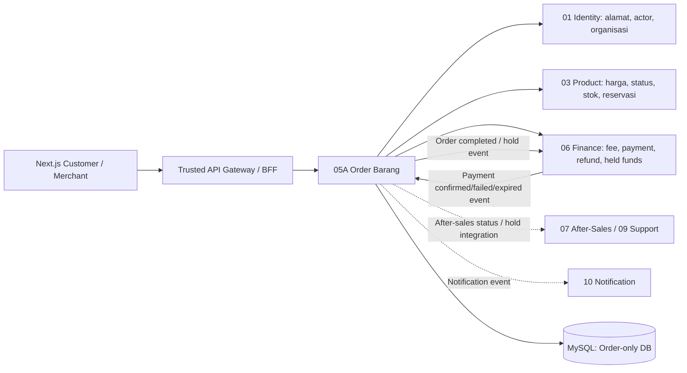
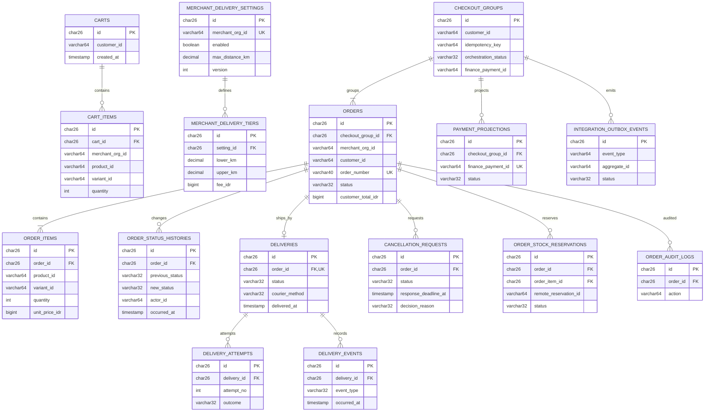
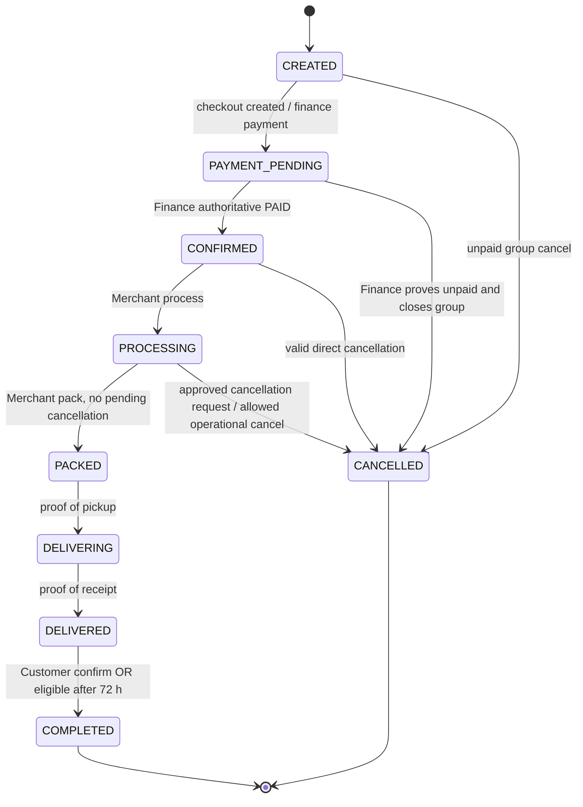
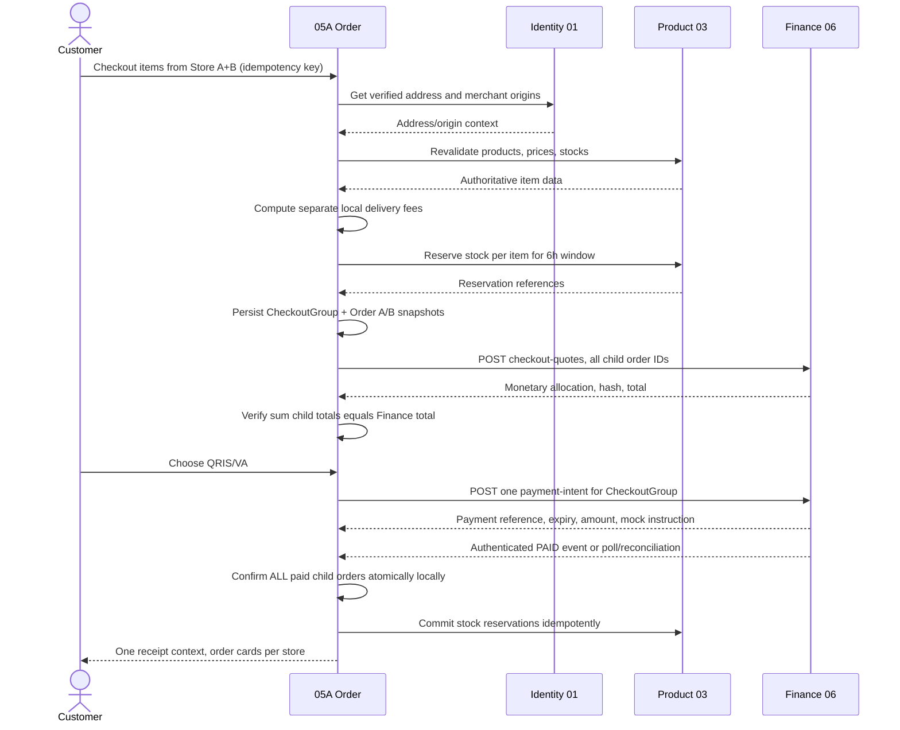

# SERVIO — PHASE 05A: ORDER BARANG
## FULL BACKEND TECHNICAL SPECIFICATION — 10 KOMPONEN

**Versi:** Technical Draft V1 — 22 Oktober 2026  
**Status:** `DRAFT_FOR_USER_ACC` — rancangan teknis untuk ditelaah, **bukan** keputusan FINAL ACC, **bukan** kode yang sudah diimplementasikan.  
**Sumber bisnis:** `PHASE-05A-ORDER-BARANG-REVISED-LOCKED.md` (versi yang diunggah), beserta konfirmasi pengguna bahwa file kerjanya sudah diperbarui menjadi **72 jam** dan **MySQL**.  
**Sumber keuangan:** `SERVIO_PHASE-06-PEMBAYARAN-SPAY-V3-FINAL-LOCKED-ORDER-BARANG.md`, technical spec Finance 06, dan inspeksi langsung `SERVIO_finance-service_PROMPT05_source-only.zip` (source Finance pasca Prompt 05).  
**Lingkup implementasi yang kelak disetujui:** Backend 05A saja. Tidak membuat frontend atau mengubah Modul 01/03/06/05B/07/09/10.

> **REKONSILIASI VERSI YANG EKSPLISIT** — Dokumen 05A yang terunggah di percakapan ini masih menuliskan *48 jam* dan *MongoDB*. Pengguna sudah mengonfirmasi revisi pada file kerja lokalnya: **`DELIVERED → COMPLETED` otomatis 72 jam setelah penyerahan valid**, dan stack data **MySQL localhost**. Dua nilai ini dipakai sebagai *user-approved overrides* dalam dokumen teknis ini. Jangan diam-diam mengubah aturan lain dari planning. Dana Finance tetap **ditahan 120 jam setelah `COMPLETED`**, bukan sejak `DELIVERED`.

> **Aturan kepastian:** `[LOCKED]` berasal dari planning/keputusan pengguna; `[VERIFIED_FINANCE_SOURCE]` berasal dari source Finance yang diperiksa; `[PROPOSED]` adalah desain baru yang perlu ACC; `[PENDING_CONTRACT]` membutuhkan konfirmasi/kontrak service lain; `[FUTURE_MODULE]` tidak boleh diimplementasikan pada Phase 05A.

---

## RINGKASAN KEPUTUSAN BISNIS YANG TIDAK BOLEH DIUBAH

| Area | Baseline implementasi |
|---|---|
| Checkout | Multi-Merchant dalam satu `CheckoutGroup`, **satu Merchant Order per toko**, status setiap order independen setelah bayar. |
| Metode pembayaran | Satu payment intent QRIS/VA **MOCK** melalui Finance 06; berlaku **6 jam dari waktu server Finance**. 05A bukan pemilik pembayaran. |
| Keranjang | Tambah ke Keranjang dan Beli Sekarang memakai satu checkout engine; revalidasi semua Merchant sebelum pembayaran, *all-or-nothing*. |
| Penerima | Buku Alamat Identity 01, disalin sebagai snapshot alamat/penerima ke setiap Order. |
| Produk dan stok | Product/Variant/Price/Stock milik Product 03; 05A memvalidasi dan menyimpan snapshot. |
| Katalog | Merchant harus berada di kota/kabupaten administratif yang sama; cakupan delivery diverifikasi **tersendiri**. |
| Ongkir | Tier jarak Merchant, per toko, dihitung server memakai titik resmi dan jarak Haversine; bukan tarif aktual GoSend. |
| Kurir | Saat `PACKED`, Merchant memilih kurir toko atau GoSend eksternal. Booking/bayar GoSend di luar SERVIO; tanpa API live tracking. |
| Status Order | `CREATED`, `PAYMENT_PENDING`, `CONFIRMED`, `PROCESSING`, `PACKED`, `DELIVERING`, `DELIVERED`, `COMPLETED`, `CANCELLED`. |
| Cancellation | Sebelum processing: pembatalan langsung bila memenuhi guard; saat `PROCESSING`: request, Merchant setujui/tolak; `PACKED` ke atas bukan pembatalan normal. |
| SLA cancellation | **12 jam operasional Merchant**; bila tidak direspons: request otomatis `REJECTED` dengan `TIMEOUT_NO_RESPONSE`, Order tetap `PROCESSING`, `PACKED` kembali terbuka, **tanpa eskalasi otomatis**. |
| Completion | Konfirmasi Customer dapat lebih awal; otomatis setelah **72 jam dari `delivered_at` valid** hanya bila bukti dan pemeriksaan tidak ada hold/keluhan/dispute aktif. |
| Refund | Finance 06 mengkreditkan **100% alokasi yang dibayar Customer untuk Merchant Order yang sah dibatalkan** ke S-Pay Customer; Merchant lainnya tidak berubah. |
| Dana Merchant | Finance 06 memulai hold saat menerima `ORDER_COMPLETED` yang valid, lalu rilis paling dini **120 jam** sesudah completed jika tidak terblokir. |
| Status tab | Customer: Belum Bayar / Diproses / Dikirim / Selesai / Batal. Merchant: Masuk / Diproses / Dikirim / Selesai / Batal. *Derived filters*, bukan kolom status lain. |
| Database | Laravel + MySQL, satu database 05A miliknya sendiri; dilarang foreign key/query cross-service. |

---

# 01 — SERVICE ARCHITECTURE & DOMAIN BOUNDARY

## 1.1 Struktur service

- **[PROPOSED]** Nama service `order-barang-service`, folder `backend/services/order-barang-service/`, port lokal `8005`, database `servio_order_barang_db`, database test `servio_order_barang_test_db`. **Konfirmasi terhadap konvensi repo** sebelum dibuat; port/nama ini bukan hasil inspeksi backend 05A yang belum ada.
- Laravel REST JSON dengan route publik `/api/v1/order-barang/...` dan internal `/internal/v1/order-barang/...` **[PROPOSED]**. Tidak boleh memakai `/api/v1/finance/...` untuk resource Order.
- Modul internal: `Cart`, `DeliverySettings`, `CheckoutOrchestration`, `Orders`, `OrderFulfillment`, `Delivery`, `Cancellation`, `PaymentReadProjection`, `IntegrationInboxOutbox`, `Schedulers`, `Audit`.
- Database transaction hanya menjamin mutasi tabel 05A; komunikasi Identity/Product/Finance memakai API terautentikasi dan pola retry/outbox/kompensasi.
- Simpan seluruh nominal sebagai integer **Rupiah** (`BIGINT UNSIGNED`/`BIGINT` dengan nonnegative validation); waktu UTC pada database, dengan timezone toko terverifikasi untuk jam operasional cancellation.
- Service tidak menampung saldo S-Pay, payment-provider secrets, ledger, fee-policy master, atau data master produk/alamat.

## 1.2 Diagram batas domain



## 1.3 Kepemilikan data dan batas akses

| Service | Data authoritative | Apa yang 05A boleh lakukan |
|---|---|---|
| 01 Identity | Auth, user/org, membership, Buku Alamat, titik merchant, **jadwal toko jika memang tersedia** | Baca lewat kontrak terpercaya dan snapshot yang diperlukan; **jangan** membuat Buku Alamat atau mengarang membership. |
| 02 Category | Taksonomi | Hanya tampil referensi yang dikirim Product; tidak query DB Category. |
| 03 Product | Product, Variant, current price/stock, reservation | Baca/revalidate/reserve/commit/release **hanya setelah kontrak tersedia**, simpan id + snapshot. |
| **05A Order Barang** | Cart, CheckoutGroup, Merchant Orders, lokal shipping config, delivery, cancellation, history, event projection | Satu-satunya penulis canonical Order Status. |
| 06 Finance | Fee/tax, payment, allocation, refund, S-Pay, escrow/held, settlement | Minta kalkulasi dan payment, simpan salinan hasil serta referensi; jangan meniru ledger. |
| 05B Jasa | Booking, service order | **OUT_OF_SCOPE**, jangan dibuat tabel, route atau event. |
| 07/09 | Claim, complaint, dispute, hold | Cek hold ketika auto-complete; tanpa API resmi, fail closed pada keputusan berisiko. |
| 10 Notification | Pengiriman notif | Hasilkan event transisi, bukan mengirim notif user secara langsung dari transaction kritis. |

## 1.4 Urutan pembangunan domain [PROPOSED]

1. Bootstrap service, auth boundary, migrations, health, test isolation, audit/inbox/outbox.
2. Merchant delivery setting/tier + validasi cakupan & jarak.
3. Cart, Beli Sekarang, Product & Identity adapters.
4. CheckoutGroup, Merchant Order snapshots, stock reservation coordination.
5. Finance quote + payment intent + payment event receiver.
6. Customer/Merchant list/detail, fulfillment/delivery/POD/timeline.
7. Cancellation request 12 jam operasional + auto-reject; refund delegation.
8. Completion 72 jam, hold event, Finance 120 jam delegation.
9. Contract + integration + concurrency + RBAC + recovery tests.

## 1.5 Dependensi pemblokir yang HARUS ditandai

- `[PENDING_CONTRACT]` **Product 03 reserve/commit/release**: jangan mengklaim anti-oversell berhasil hanya dari pembacaan stok. Desain adapter dan test contract boleh ada; sebelum API tersedia, blok checkout yang tidak bisa menjamin stok.
- `[PENDING_CONTRACT]` **Jam operasional Merchant**: sumber resmi, timezone, libur/penutupan sementara, versioning; SLA 12 jam operasional tidak boleh diganti 12 jam kalender.
- `[PENDING_CONTRACT]` **Finance outbox delivery**: source Finance menulis event `finance.payment.confirmed.v1`, `.failed.v1`, `.expired.v1`, tetapi keberadaan *publisher/consumer wiring* sampai 05A wajib diverifikasi. 05A menyiapkan authenticated inbox dan reconciliation polling internal.
- `[PENDING_CONTRACT]` **Void/close unpaid checkout di Finance**: route internal yang diperiksa belum menyediakan API untuk membatalkan intent PENDING secara aman. Alur `cancel-unpaid` 05A wajib tetap terblokir pada tahap yang memerlukan penutupan Finance sampai ada kontrak asli atau mekanisme rekonsiliasi yang disetujui; tidak boleh hanya mengubah status lokal lalu menganggap tagihan tidak dapat dibayar.
- `[PENDING_CONTRACT]` **Issue/hold authority**: sumber status komplain/dispute dari 07/09 agar scheduler 72 jam tidak menyelesaikan order yang sedang disengketakan. Jika status tidak dapat diverifikasi, auto-completion ditahan dan dicatat.
- `[PENDING_CONTRACT]` Penerbitan QRIS/VA saat ini **mock**; tidak dapat diperlakukan sebagai transaksi bank riil.

---

# 02 — ENTITY RELATIONSHIP DIAGRAM (ERD)

## 2.1 ERD MySQL 05A (relasi internal saja)



**Additional infrastructure tables:** `integration_inbox_events`, `idempotency_records`, `integration_delivery_attempts` (opsional bila tidak tersimpan pada outbox metadata), dan `merchant_schedule_snapshots` **hanya jika** kontrak jadwal disetujui. `PAYMENT_PROJECTIONS` menyimpan *read model*; tidak menjadi bukti final uang masuk tanpa konfirmasi Finance.

## 2.2 Kardinalitas dan constraint bisnis

1. Satu Customer dapat mempunyai satu Cart aktif; satu Cart banyak CartItem; CartItem dikelompokkan berdasarkan `merchant_org_id` yang authoritative dari Product/Identity.
2. Satu `CheckoutGroup` punya **1..N Orders**, dan tiap Order tepat **satu Merchant**. `UNIQUE(checkout_group_id, merchant_org_id)` untuk MVP satu order/toko/checkout.
3. Satu Order punya **1..N OrderItems**. Item menyimpan snapshot tidak berubah setelah pembayaran.
4. Satu Order punya satu Delivery utama, banyak attempt/event delivery. JANGAN buat “GoSend Order” sebagai canonical Order.
5. Satu Order bisa punya banyak riwayat CancellationRequest tetapi paling banyak **satu PENDING**; gunakan locking + kolom guard `active_cancellation_request_id` pada Orders (nullable) dan constraint transaksi, bukan berharap pengecekan frontend.
6. Entity eksternal (`user_id`, `merchant_org_id`, `product_id`, `variant_id`, `address_id`, `finance_payment_id`, `remote_reservation_id`) **hanya string referensi**, tanpa foreign key MySQL lintas service.
7. Satu CheckoutGroup memiliki paling banyak satu payment intent *aktif* secara logis; nomor intent final dikembalikan Finance. Larang 05A membuat payment ganda saat retry.
8. Event inbox unik `(source_service, source_event_id)`, outbox event ID unik, `idempotency_records` unik `(actor_scope, route_key, idempotency_key)`.

---

# 03 — DATABASE SCHEMA & LARAVEL MIGRATION DESIGN

## 3.1 Aturan migrations

- Semua nama tabel snake_case; PK `CHAR(26)` ULID **[PROPOSED]**. External ID `VARCHAR(64)` mengikuti validasi Finance (`max:64`). Gunakan `utf8mb4`, InnoDB, UTC timestamps nullable sesuai lifecycle.
- Column money `BIGINT UNSIGNED` dan validasi nonnegative; quantity `INT UNSIGNED` >0; latitude/longitude `DECIMAL(10,7)`; jarak `DECIMAL(10,3)` km.
- Status berupa `VARCHAR(32)` + Laravel enum/value object, state machine guard dan bila layak MySQL `CHECK`, bukan kebebasan update string pada controller.
- `created_at`/`updated_at` pada entity mutable; `deleted_at` hanya untuk Cart atau pengaturan yang memang boleh nonaktif. **Jangan hard-delete Order, snapshot, histori, pembayaran referensi, cancellation/audit.**
- JSON dipakai hanya untuk immutable snapshot dan payload event yang tervalidasi/ukuran dibatasi, **bukan** menggantikan kolom indexed penentu ownership/status.
- Gunakan `lockForUpdate()`, compare-and-set `version` dan unique constraint untuk semua transisi kritis. Tidak ada `migrate:fresh` pada DB utama.

## 3.2 Rancangan tabel detail

### A. Cart dan Shipping Settings

| Tabel | Kolom (tipe MySQL; `!` = NOT NULL) | Key, constraint, index |
|---|---|---|
| `carts` | `id CHAR(26)!`, `customer_id VARCHAR(64)!`, `cart_state VARCHAR(20)! DEFAULT ACTIVE`, `version INT UNSIGNED! DEFAULT 1`, timestamps | PK id; `UNIQUE(customer_id, cart_state)` **[PROPOSED]** bila satu Cart ACTIVE per Customer; hindari conflict riwayat terarsip lewat partial logic. |
| `cart_items` | `id CHAR(26)!`, `cart_id CHAR(26)!`, `merchant_org_id VARCHAR(64)!`, `product_id VARCHAR(64)!`, `variant_id VARCHAR(64)!`, `quantity INT UNSIGNED!`, `added_at TIMESTAMP!`, timestamps | FK internal cart_id; `UNIQUE(cart_id, variant_id)` jika variant global unique; index merchant_org_id. Harga Cart bukan snapshot final. |
| `merchant_delivery_settings` | `id CHAR(26)!`, `merchant_org_id VARCHAR(64)!`, `is_enabled BOOLEAN!`, `origin_reference_id VARCHAR(64)!`, `origin_lat DECIMAL(10,7)`, `origin_lng DECIMAL(10,7)`, `origin_region_code VARCHAR(32)`, `maximum_distance_km DECIMAL(10,3)!`, `distance_method VARCHAR(24)! DEFAULT HAVERSINE`, `operational_note VARCHAR(1000)`, `version INT!`, `last_updated_by VARCHAR(64)!`, timestamps | `UNIQUE(merchant_org_id)`; index enabled; origin data berasal dari 01, pembaruan divalidasi dan versioned. |
| `merchant_delivery_tiers` | `id CHAR(26)!`, `delivery_setting_id CHAR(26)!`, `setting_version INT!`, `from_km DECIMAL(10,3)!`, `to_km DECIMAL(10,3)!`, `shipping_fee_idr BIGINT UNSIGNED!`, `position SMALLINT!`, timestamps | FK internal; `UNIQUE(setting_id, setting_version, position)`; satu versi harus menutup 0..max tanpa gap/overlap; cek aplikasi/transaction. |

**Design note:** Tier shipping harus tetap dapat ditelusuri saat versi baru diterbitkan. **[PROPOSED]** Menyimpan baris tier dengan `setting_version` dan tidak menghapus versi lama sampai snapshot Order memadai; `merchant_delivery_settings.version` menunjuk versi aktif. Terlalu banyak versi tidak boleh mengganti snapshot Order historis.

### B. Checkout, Order dan snapshots

| Tabel | Kolom lengkap inti | Constraints/index |
|---|---|---|
| `checkout_groups` | `id CHAR(26)!`, `customer_id VARCHAR(64)!`, `address_id VARCHAR(64)!`, `recipient_snapshot JSON!`, `address_snapshot JSON!`, `selected_items_hash CHAR(64)!`, `idempotency_key VARCHAR(128)!`, `quote_revision INT! DEFAULT 1`, `orchestration_status VARCHAR(32)!`, `payment_status_projection VARCHAR(32)`, `finance_quote_hash CHAR(64)`, `finance_payment_id VARCHAR(64)`, `customer_total_idr BIGINT UNSIGNED`, `currency CHAR(3)! DEFAULT IDR`, `finance_expires_at TIMESTAMP NULL`, `failure_code VARCHAR(64)`, `version INT!`, timestamps | PK id; unique `(customer_id, idempotency_key)`; index `(customer_id, created_at)`, `(payment_status_projection, finance_expires_at)`; projection bukan authoritative. |
| `orders` | `id CHAR(26)!`, `order_number VARCHAR(40)!`, `checkout_group_id CHAR(26)!`, `customer_id VARCHAR(64)!`, `merchant_org_id VARCHAR(64)!`, `merchant_display_snapshot JSON!`, `address_id VARCHAR(64)!`, `recipient_snapshot JSON!`, `address_snapshot JSON!`, `origin_snapshot JSON!`, `shipping_snapshot JSON!`, `product_subtotal_idr BIGINT UNSIGNED!`, `shipping_customer_idr BIGINT UNSIGNED!`, `app_fee_allocated_idr BIGINT UNSIGNED! DEFAULT 0`, `customer_tax_allocated_idr BIGINT UNSIGNED! DEFAULT 0`, `discount_allocated_idr BIGINT UNSIGNED! DEFAULT 0`, `discount_bearer VARCHAR(12)`, `customer_total_idr BIGINT UNSIGNED!`, `finance_allocation_reference VARCHAR(64)`, `payment_status_projection VARCHAR(32)!`, `status VARCHAR(32)!`, `active_cancellation_request_id CHAR(26) NULL`, `notes TEXT NULL`, `delivered_at TIMESTAMP NULL`, `completed_at TIMESTAMP NULL`, `cancelled_at TIMESTAMP NULL`, `cancel_reason_code VARCHAR(64) NULL`, `version INT UNSIGNED!`, timestamps | FK checkout_group_id; unique order_number; unique `(checkout_group_id, merchant_org_id)`; indexes `(customer_id,status,created_at)`, `(merchant_org_id,status,created_at)`, `(checkout_group_id,status)`; index delivered_at; active cancellation relation applied separately to avoid cyclic FK constraint. |
| `order_items` | `id CHAR(26)!`, `order_id CHAR(26)!`, `product_id VARCHAR(64)!`, `variant_id VARCHAR(64)!`, `product_snapshot JSON!`, `variant_snapshot JSON!`, `product_image_ref VARCHAR(2048) NULL`, `quantity INT UNSIGNED!`, `unit_price_idr BIGINT UNSIGNED!`, `line_subtotal_idr BIGINT UNSIGNED!`, timestamps | FK order_id; unique `(order_id, variant_id)` only if duplicate line merge rule; index product_id for referential lookup. |
| `order_status_histories` | `id CHAR(26)!`, `order_id CHAR(26)!`, `previous_status VARCHAR(32)`, `new_status VARCHAR(32)!`, `action VARCHAR(80)!`, `actor_id VARCHAR(64)`, `actor_role VARCHAR(40)`, `source_service VARCHAR(40)!`, `reason_code VARCHAR(64)`, `reason_note VARCHAR(1000)`, `related_event_id VARCHAR(64)`, `order_version INT!`, `occurred_at TIMESTAMP!` | FK order_id; index `(order_id,occurred_at)`, `(source_service,related_event_id)`; append-only. |
| `order_stock_reservations` | `id CHAR(26)!`, `order_id CHAR(26)!`, `order_item_id CHAR(26)!`, `variant_id VARCHAR(64)!`, `remote_reservation_id VARCHAR(64)`, `quantity INT UNSIGNED!`, `reservation_status VARCHAR(24)!`, `reserved_until TIMESTAMP`, `last_sync_at TIMESTAMP`, `attempt_count INT! DEFAULT 0`, `last_error_code VARCHAR(64)` | FK internal order/order item; `UNIQUE(order_item_id)`; index `(status,reserved_until)`; remote ID only if returned Product 03. |

### C. Delivery, cancellation dan Finance read model

| Tabel | Kolom lengkap inti | Constraints/index |
|---|---|---|
| `deliveries` | `id CHAR(26)!`, `order_id CHAR(26)!`, `service_type VARCHAR(40)! DEFAULT LOCAL_MERCHANT_MANAGED`, `status VARCHAR(32)!`, `courier_method VARCHAR(32)`, `provider VARCHAR(32)`, `booking_reference VARCHAR(128)`, `tracking_url VARCHAR(2048)`, `courier_name_ciphertext TEXT`, `courier_phone_ciphertext TEXT`, `picked_up_at TIMESTAMP`, `delivered_at TIMESTAMP`, `recipient_name VARCHAR(255)`, `proof_reference VARCHAR(2048)`, `proof_verified BOOLEAN! DEFAULT 0`, `last_failure_code VARCHAR(64)`, `attempt_count INT! DEFAULT 0`, `version INT!`, timestamps | FK order_id, `UNIQUE(order_id)`; tracking URL allowlist; evidence access controlled. |
| `delivery_attempts` | `id CHAR(26)!`, `delivery_id CHAR(26)!`, `attempt_no INT!`, `courier_method VARCHAR(32)`, `failure_reason_code VARCHAR(64)`, `outcome VARCHAR(24)!`, `attempted_at TIMESTAMP!`, `note VARCHAR(1000)` | FK delivery_id; `UNIQUE(delivery_id,attempt_no)`. |
| `delivery_events` | `id CHAR(26)!`, `delivery_id CHAR(26)!`, `event_type VARCHAR(50)!`, `actor_id VARCHAR(64)`, `evidence_reference VARCHAR(2048)`, `event_payload JSON`, `occurred_at TIMESTAMP!` | FK delivery_id; index `(delivery_id,occurred_at)`. |
| `cancellation_requests` | `id CHAR(26)!`, `order_id CHAR(26)!`, `requested_by_id VARCHAR(64)!`, `reason_code VARCHAR(64)!`, `reason_note VARCHAR(1000)`, `status VARCHAR(24)!`, `requested_at TIMESTAMP!`, `response_deadline_at TIMESTAMP!`, `merchant_schedule_source VARCHAR(64)!`, `merchant_schedule_version VARCHAR(64)`, `merchant_timezone VARCHAR(64)!`, `operational_schedule_snapshot JSON!`, `decided_at TIMESTAMP`, `decision_source VARCHAR(32)`, `decision_actor_id VARCHAR(64)`, `decision_reason VARCHAR(64)`, `decision_note VARCHAR(1000)`, `version INT!`, timestamps | FK order_id; index `(status,response_deadline_at)`, `(order_id,requested_at)`; `orders.active_cancellation_request_id` diset saat PENDING. |
| `payment_projections` | `id CHAR(26)!`, `checkout_group_id CHAR(26)!`, `finance_payment_id VARCHAR(64)!`, `payment_status VARCHAR(32)!`, `amount_idr BIGINT UNSIGNED!`, `currency CHAR(3)!`, `paid_at TIMESTAMP`, `expires_at TIMESTAMP`, `finance_event_id VARCHAR(64)`, `finance_event_version INT`, `last_verified_at TIMESTAMP`, timestamps | FK checkout_group_id; unique finance_payment_id, unique checkout_group_id (V3 satu intent aktif); index payment_status; Finance tetap sumber kebenaran. |
| `order_audit_logs` | `id CHAR(26)!`, `order_id CHAR(26) NULL`, `checkout_group_id CHAR(26) NULL`, `actor_id VARCHAR(64)`, `actor_role VARCHAR(40)`, `action VARCHAR(80)!`, `before_state JSON`, `after_state JSON`, `result VARCHAR(24)!`, `correlation_id VARCHAR(64)`, `occurred_at TIMESTAMP!` | FK internal nullable; index order_id, checkout_group_id, action, occurred_at; PII minimization. |

### D. Reliable messaging dan idempotency

| Tabel | Kolom lengkap inti | Constraints/index |
|---|---|---|
| `integration_inbox_events` | `id CHAR(26)!`, `source_service VARCHAR(64)!`, `source_event_id VARCHAR(128)!`, `event_type VARCHAR(100)!`, `aggregate_id VARCHAR(64)!`, `payload_hash CHAR(64)!`, `payload_json JSON!`, `status VARCHAR(24)!`, `received_at TIMESTAMP!`, `processed_at TIMESTAMP`, `attempt_count INT!`, `last_error VARCHAR(512)` | `UNIQUE(source_service,source_event_id)`; index `(status,received_at)`. |
| `integration_outbox_events` | `id CHAR(26)!`, `destination_service VARCHAR(64)!`, `event_type VARCHAR(100)!`, `aggregate_type VARCHAR(64)!`, `aggregate_id VARCHAR(64)!`, `aggregate_version INT!`, `payload_json JSON!`, `status VARCHAR(24)!`, `available_at TIMESTAMP!`, `attempt_count INT!`, `next_attempt_at TIMESTAMP`, `sent_at TIMESTAMP`, `last_error VARCHAR(512)`, `correlation_id VARCHAR(64)!` | PK id; index `(status,next_attempt_at)`; event immutable; lease/locking for workers. |
| `idempotency_records` | `id CHAR(26)!`, `actor_scope VARCHAR(128)!`, `route_key VARCHAR(100)!`, `idempotency_key VARCHAR(128)!`, `request_hash CHAR(64)!`, `response_status SMALLINT`, `response_body JSON`, `state VARCHAR(24)!`, `created_at TIMESTAMP!`, `expires_at TIMESTAMP` | `UNIQUE(actor_scope,route_key,idempotency_key)`; key reused with different request_hash → 409; lock/lease/recovery. |

## 3.3 Perkiraan urutan migration [PROPOSED]

1. `000001_create_carts_table` → `000002_create_cart_items_table`.
2. `000003_create_merchant_delivery_settings_table` → `000004_create_merchant_delivery_tiers_table`.
3. `000005_create_checkout_groups_table` → `000006_create_orders_table` → `000007_create_order_items_table` → `000008_create_order_status_histories_table`.
4. `000009_create_order_stock_reservations_table`.
5. `000010_create_deliveries_table` → `000011_create_delivery_attempts_table` → `000012_create_delivery_events_table`.
6. `000013_create_cancellation_requests_table`; lalu `000014_add_active_cancellation_request_reference_to_orders_table` untuk menghindari siklus FK.
7. `000015_create_payment_projections_table`.
8. `000016_create_order_audit_logs_table`.
9. `000017_create_integration_inbox_events_table` → `000018_create_integration_outbox_events_table` → `000019_create_idempotency_records_table`.

Migration harus disesuaikan dengan tabel repository yang telah ada (jangan membuat duplikat). **Jangan** berasumsi id pihak lain dapat dijadikan FK SQL.

## 3.4 Invariant pada database dan service layer

- `sum(order_items.line_subtotal_idr)` = `orders.product_subtotal_idr`.
- `sum(orders.customer_total_idr for checkout_group)` = `checkout_groups.customer_total_idr` = nilai Finance yang terkonfirmasi dari quote/snapshot. Jika tak sama, **blok payment intent**.
- `orders.status` tidak dapat berubah dari `PAYMENT_PENDING` menjadi `CONFIRMED` hanya dari request browser.
- Semua Order dalam satu checkout group terikat `customer_id` yang sama; Merchant memiliki ID org valid. Semua item sebuah Order milik Merchant yang sama.
- `DELIVERED` wajib memiliki `deliveries.delivered_at`, referensi bukti/konteks penerima, dan `proof_verified`/aturan SOP yang sah. `COMPLETED` membutuhkan `completed_at` dan status sebelumnya `DELIVERED`.
- Cancellation `PENDING` menghalangi `PROCESSING -> PACKED`; proses scheduler dengan row lock menghilangkan request aktif sebelum melepas blokir.
- `COMPLETED`/`CANCELLED` terminal; no silent rollback.
- Status Payment/Refund 05A **projection saja**; hanya Finance mutasi uang.

# 04 — API ENDPOINT SPECIFICATION & JSON CONTRACT

## 4.1 Konvensi API [PROPOSED — wajib mengikuti standar SERVIO yang benar-benar ada di repository]

- Public Customer & Merchant routes dikunci oleh Identity-authenticated gateway dan policy Order; internal routes memakai **service identity** yang terverifikasi, bukan `X-Actor-Role` yang bisa dikirim bebas dari browser.
- JSON success yang diusulkan mengikuti pola existing Finance: `{ "success": true, "code": "ORDER_OK", "data": {}, "meta": { "request_id": "...", "version": "v1" } }`. Error: `{ "success": false, "error": { "code": "...", "message": "...", "details": null, "fields": {} }, "meta": { "request_id": "..." } }`.
- Semua angka rupiah integer, seluruh waktu ISO-8601 dengan offset/UTC, ID dari backend, bukan nilai yang dapat dipilih client.
- Mutasi checkout/order/cancellation dan proses event wajib `Idempotency-Key`; sistem mengenali body hash dan actor scope, mengembalikan hasil tersimpan pada request identik dan **409** jika key sama tetapi payload berbeda.
- Pagination default `per_page=20`, maksimum `100` **[PROPOSED]**; whitelist sort `created_at`, `updated_at`, `order_number`. Cursor pagination lebih disukai untuk history event yang besar.
- Error HTTP: 400 malformed, 401 unauthenticated, 403 forbidden, 404 not owned/not found, 409 transition/revision/duplicate conflict, 410 expired payment, 422 validation/business ineligible, 429 rate limit, 502/503 dependency unavailable, 504 timeout. Jangan tampilkan stack trace atau rahasia integrasi.
- **Transaction amounts bukan input otoritatif client.** Client memilih item/address/channel; Order mengambil harga/stok dan ongkir, Finance menghitung fee, tax, allocation dan grand total.

## 4.2 Public Customer endpoints [PROPOSED]

| Method | Path | Role | Request / filter | Response `data` utama |
|---|---|---|---|---|
| `GET` | `/api/v1/order-barang/cart` | CUSTOMER | — | cart, kelompok Merchant, item; harga tampilan indikatif. |
| `POST` | `/api/v1/order-barang/cart/items` | CUSTOMER | `product_id`, `variant_id`, `quantity` | item Cart beserta merchant dari Product; idempotent add policy. |
| `PATCH` | `/api/v1/order-barang/cart/items/{item_id}` | CUSTOMER | `quantity` positif | item dan cart_revision. |
| `DELETE` | `/api/v1/order-barang/cart/items/{item_id}` | CUSTOMER | — | konfirmasi item dihapus. |
| `POST` | `/api/v1/order-barang/checkout-quotes` | CUSTOMER | `cart_item_ids[]` atau `buy_now_item`, `address_id`, `merchant_notes` | quote hasil revalidasi per Merchant, shipping dan hasil fee Finance; belum membuat payment. |
| `POST` | `/api/v1/order-barang/checkouts` | CUSTOMER | `quote_reference`, `quote_revision`, `address_id`, `selected_shipping`, `merchant_notes` + idempotency key | `checkout_group_id`, `merchant_orders[]`, status PAYMENT_PENDING/processing, Finance quote hash; reserve stock. |
| `POST` | `/api/v1/order-barang/checkouts/{id}/payment-intents` | CUSTOMER | `method` enum yang ditawarkan Finance; idempotency key | **satu** payment ref, amount, instruction MOCK, `expires_at`; read-only dari Finance. |
| `GET` | `/api/v1/order-barang/checkouts/{id}` | CUSTOMER owner | — | checkout group, orders, server-projected payment; *terverifikasi*, bukan browser. |
| `GET` | `/api/v1/order-barang/checkouts/{id}/payment` | CUSTOMER owner | — | payment status Finance, ref, instruction bila aman, expiry. |
| `POST` | `/api/v1/order-barang/checkouts/{id}/cancel-unpaid` | CUSTOMER owner | `reason_code`, idempotency key | hasil penutupan satu checkout dan seluruh order belum bayar bila Finance memastikan tidak PAID. |
| `GET` | `/api/v1/order-barang/orders` | CUSTOMER | `tab`, `search`, `from`, `to`, `page`, `per_page` | order cards per Merchant + meta pagination. |
| `GET` | `/api/v1/order-barang/orders/{order_id}` | CUSTOMER owner | — | snapshot, timeline, delivery, cancellation, payment/refund read model. |
| `POST` | `/api/v1/order-barang/orders/{order_id}/cancel` | CUSTOMER owner | `reason_code`, `note`, key | direct cancellation saat CONFIRMED (atau redirect ke group-cancel unpaid); hasil status + refund pending. |
| `POST` | `/api/v1/order-barang/orders/{order_id}/cancellation-requests` | CUSTOMER owner | `reason_code`, `note`, key | PENDING request dengan `response_deadline_at` **12 jam operasional**, order tetap PROCESSING. |
| `GET` | `/api/v1/order-barang/orders/{order_id}/cancellation-requests` | CUSTOMER owner | — | active dan histori request. |
| `POST` | `/api/v1/order-barang/orders/{order_id}/confirm-received` | CUSTOMER owner | konfirmasi + key | `COMPLETED`, `completed_at`, event ke Finance. |
| `GET` | `/api/v1/order-barang/orders/{order_id}/receipt-context` | CUSTOMER owner | — | snapshot 05A + referensi **receipt Finance**, tidak merangkai bukti PAID palsu. |

**Catatan anti-duplikasi checkout:** `POST /checkout-quotes` boleh mengembalikan quote sementara; `POST /checkouts` menentukan ID `checkout_group_id` yang stabil. Idempotency scoped to Customer+checkout selection. Satu CheckoutGroup yang sudah memiliki Finance quote berbeda hash **tidak boleh** diam-diam diubah; ulangi checkout dengan ID baru setelah menutup/menyelesaikan yang lama.

**Body contoh — quote multi-Merchant yang belum otoritatif**:

```json
{
  "cart_item_ids": ["CITEM_01", "CITEM_02"],
  "address_id": "ADDR_CUSTOMER_01",
  "merchant_notes": {
    "ORG_STORE_A": "Tolong kemas rapi",
    "ORG_STORE_B": "Titip satpam"
  }
}
```

Server mengambil harga, kepemilikan toko, stok, lokasi dan alamat dari service sumber; **bukan dari body request**. Response 05A sementara **[PROPOSED]**:

```json
{
  "success": true,
  "code": "ORDER_CHECKOUT_QUOTED",
  "data": {
    "quote_reference": "Q_01",
    "quote_revision": 1,
    "address_id": "ADDR_CUSTOMER_01",
    "merchant_orders": [
      {"merchant_org_id": "ORG_STORE_A", "product_subtotal_idr": 100000, "shipping_customer_idr": 12000, "customer_total_idr": 112000, "distance_method": "HAVERSINE"},
      {"merchant_org_id": "ORG_STORE_B", "product_subtotal_idr": 50000, "shipping_customer_idr": 6000, "customer_total_idr": 56000, "distance_method": "HAVERSINE"}
    ],
    "finance_quote_status": "AWAITING_FINAL_CHECKOUT",
    "currency": "IDR"
  },
  "meta": {"request_id": "REQ_01", "version": "v1"}
}
```

> **Angka hanya ilustratif.** Fee dan total final berasal Finance 06 setelah ada `merchant_order_id` yang stabil dan kebijakan fee aktif. *Pre-checkout preview* tidak boleh mengunci nilai fee lama sebagai kebenaran. Pastikan desain quote awal/akhir konsisten supaya tidak salah menganggap angka ilustratif itu hasil Finance.

**Checkout/payment response contoh** (setelah Finance benar-benar mengembalikan quote):

```json
{
  "success": true,
  "code": "ORDER_CHECKOUT_CREATED",
  "data": {
    "checkout_group_id": "CG_01",
    "merchant_orders": [
      {"order_id": "MORD_A_01", "merchant_org_id": "ORG_STORE_A", "status": "PAYMENT_PENDING", "customer_total_idr": 114000},
      {"order_id": "MORD_B_01", "merchant_org_id": "ORG_STORE_B", "status": "PAYMENT_PENDING", "customer_total_idr": 57000}
    ],
    "finance_quote_payload_hash": "0123456789abcdef0123456789abcdef0123456789abcdef0123456789abcdef",
    "grand_total_idr": 171000,
    "currency": "IDR",
    "payment_status": "NOT_ISSUED"
  }
}
```

Payload final wajib cocok dengan `allocations[]` Finance, **bukan** hasil angka client. `merchant_order_id` yang dikirim ke Finance = order ID 05A yang sudah dipersist.

## 4.3 Merchant endpoints [PROPOSED]

| Method | Path | Permission/ownership | Request | Response |
|---|---|---|---|---|
| `GET` | `/api/v1/order-barang/merchant/delivery-settings` | MERCHANT org member | — | konfigurasi Ongkir dan semua tier aktif. |
| `PUT` | `/api/v1/order-barang/merchant/delivery-settings` | Merchant org authorized | `is_enabled`, `maximum_distance_km`, `tiers[]`, `operational_note`, `version` | setting versi baru; origin lokasi dari Identity, tidak menerima spoof koordinat. |
| `GET` | `/api/v1/order-barang/merchant/orders` | MERCHANT current org | `tab`, `search`, `from/to`, paging | order cards **hanya** untuk org yang aktif. |
| `GET` | `/api/v1/order-barang/merchant/orders/{id}` | MERCHANT owner | — | detail order, snapshot, pembatalan/delivery. |
| `POST` | `/api/v1/order-barang/merchant/orders/{id}/process` | MERCHANT authorized | key, expected_version | CONFIRMED→PROCESSING. |
| `POST` | `/api/v1/order-barang/merchant/orders/{id}/pack` | MERCHANT authorized | key, expected_version | PROCESSING→PACKED jika tidak ada pending cancellation. |
| `PUT` | `/api/v1/order-barang/merchant/orders/{id}/delivery` | MERCHANT authorized | courier method, ref, official tracking URL | menyimpan pengaturan kurir tanpa mengubah ongkir/status pickup. |
| `POST` | `/api/v1/order-barang/merchant/orders/{id}/dispatch` | MERCHANT authorized | proof of pickup, key | PACKED→DELIVERING, delivery IN_TRANSIT. |
| `POST` | `/api/v1/order-barang/merchant/orders/{id}/delivered` | MERCHANT authorized | recipient/evidence, key | DELIVERING→DELIVERED dengan waktu server dan POD. |
| `POST` | `/api/v1/order-barang/merchant/orders/{id}/delivery-failure` | MERCHANT authorized | failure reason, note, key | Delivery FAILED, Order tetap DELIVERING; catat attempt. |
| `POST` | `/api/v1/order-barang/merchant/orders/{id}/delivery-retry` | MERCHANT authorized | metode ulang, note, key | membuat attempt baru, tidak hapus history. |
| `POST` | `/api/v1/order-barang/merchant/orders/{id}/cancel` | MERCHANT authorized | operational reason, evidence if needed, key | hanya CONFIRMED/PROCESSING dengan reason valid; Finance refund jika PAID. |
| `POST` | `/api/v1/order-barang/merchant/cancellation-requests/{request_id}/decision` | MERCHANT authorized | `decision=APPROVED/REJECTED`, `reason` wajib ketika reject, key | hasil keputusan dan status Order. |

Untuk Merchant dengan lebih dari satu organisasi, **merchant org dipilih dari signed Identity context**, bukan `merchant_org_id` arbitrer pada query untuk memperluas akses.

**Shipping tiers example**:

```json
{
  "is_enabled": true,
  "maximum_distance_km": 10,
  "tiers": [
    {"from_km": 0, "to_km": 3, "shipping_fee_idr": 7000},
    {"from_km": 3, "to_km": 5, "shipping_fee_idr": 12000},
    {"from_km": 5, "to_km": 10, "shipping_fee_idr": 18000}
  ],
  "operational_note": "Antar lokal sesuai jangkauan toko",
  "version": 3
}
```

Interpretasi tier: pertama `0<=d<=3`, selanjutnya `(3<d<=5)`, berikutnya `(5<d<=10)`; d ditentukan **server** menggunakan koordinat valid dan aturan pembulatan/precision yang dicatat.

**Decision cancellation example**:

```json
{
  "decision": "REJECTED",
  "reason_code": "STOCK_AVAILABLE_CAN_FULFILL",
  "decision_note": "Pesanan sedang disiapkan dan bisa dikirim",
  "expected_request_version": 1
}
```

## 4.4 Internal Order Event & Reconciliation API [PROPOSED; belum ada source Order 05A]

| Method | Path | Caller yang diizinkan | Tujuan |
|---|---|---|---|
| `POST` | `/internal/v1/order-barang/finance-events` | Verified Finance 06 | Terima outbox `finance.payment.confirmed.v1`, `.failed.v1`, `.expired.v1`, dan refund success yang sah; inbox dedup. |
| `GET` | `/internal/v1/order-barang/checkouts/{checkout_group_id}` | Finance 06 / authorized internal | Read-only status group + daftar child Order untuk rekonsiliasi; data minimal. |
| `GET` | `/internal/v1/order-barang/orders/{id}` | Internal 07/09/06 dengan izin | Snapshot minimal dan order version untuk cross-domain. |
| `POST` | `/internal/v1/order-barang/holds/order-events` | 07/09 verified internal | Memperbarui projection hold/dispute **hanya berdasarkan kontrak resmi**; jika belum tersedia, `PENDING_INTEGRATION`. |

**Jangan buat endpoint arbitrary `set-paid`, `force-complete`, atau `force-refund` untuk Customer/Merchant/Admin**. FINANCE events harus dipastikan orisinal, amount/reference match, versi benar, dan state belum terminal. Outbox finalization worker tetap mencatat delivery status dan retry.

## 4.5 Validasi dan sample errors

| Input/aksi | Guard | Error |
|---|---|---|
| Customer menambahkan item luar kota | Region code alamat vs Merchant mismatch; Cart boleh simpan jika belum checkout | `OUT_OF_CITY`, 422 pada checkout, jangan silently drop. |
| Qty/harga berubah | Product 03 authoritative | `PRICE_CHANGED` / `STOCK_CHANGED`, 409/422 + data perubahan aman. |
| Shipping out-of-range | coverage+tier valid | `DELIVERY_OUT_OF_RANGE`, 422. |
| Checkout tanpa active CEO fee policy | Finance mengembalikan fail-closed | `FINANCE_PRICING_UNAVAILABLE`, 422/503 sesuai error upstream. |
| Quote hash berbeda saat payment | Finance conflict | `CHECKOUT_SNAPSHOT_CONFLICT`, 409. |
| Payment active/expired | Referensi Finance terverifikasi | `PAYMENT_ALREADY_ACTIVE` 409 / `PAYMENT_EXPIRED` 410. |
| Merchant memproses unpaid | `PAID` telah diproyeksi lewat bukti Finance | `PAYMENT_NOT_CONFIRMED`, 409. |
| Pack saat request cancel PENDING | `active_cancellation_request_id != NULL` | `CANCELLATION_REVIEW_PENDING`, 409. |
| Merchant reject tanpa alasan | Validation | `DECISION_REASON_REQUIRED`, 422. |
| Merchant respons melewati deadline | `now >= response_deadline_at` terverifikasi | `CANCELLATION_DECISION_EXPIRED`, 409 dan status terbaru. |
| Confirm received pada bukan DELIVERED | State guard | `INVALID_ORDER_TRANSITION`, 409. |
| Retry dengan key sama tetapi body berbeda | Idempotency hash mismatch | `IDEMPOTENCY_CONFLICT`, 409. |
| Identity/Product/Finance unavailable | Fail safely; do not mark PAID, stock committed or refund succeeded | `DEPENDENCY_UNAVAILABLE`, 503 + retry metadata tanpa rahasia. |

---

# 05 — ROLE-BASED ACCESS & AUTHORIZATION MATRIX

## 5.1 Sembilan role resmi

`CEO_PRODUCT_OWNER`, `ADMIN_OPERATIONS`, `CUSTOMER`, `SERVICE_PROVIDER`, `WORKER_TECHNICIAN`, `CUSTOMER_SUPPORT`, `FINANCE_PAYMENT_OPS`, `MERCHANT`, `SUPPLIER`.

| Resource/tindakan 05A | Customer | Merchant (own org) | CEO | Admin Ops | Finance Ops | Support | Provider/Worker/Supplier |
|---|---|---|---|---|---|---|---|
| Cart + Checkout + bayar via referensi Finance | **own** | — | — | — | — | — | — |
| List/detail Order | **own** | **own org** | — | Read-only **jika** kontrak global izinkan | Read-only finansial via 06, bukan mutasi Order | Read-only **jika** case/permission sah | — |
| Pengaturan Pengiriman | — | **own org + write permission** | — | — | — | — | — |
| Proses/Pack/Dispatch/Delivered | — | **own org + fulfill permission** | — | — | — | — | — |
| Konfirmasi penerimaan | **own** | — | — | — | — | — | — |
| Ajukan pembatalan | **own** | — | — | — | — | — | — |
| Setujui/tolak cancellation request | — | **own org + authorize** | — | — | — | — | — |
| Baca status refund/settlement | **own** | **own org** | — | — | Melalui 06 | case only | — |
| Ubah Payment/Refund/Ledger | — | — | — | — | **Finance 06 saja**; bukan API 05A | — | — |
| Internal payment event ingestion | — | — | — | — | **Finance Service identity** bukan role browser | — | — |
| Hold dispute / After-Sales | — | — | — | — | — | **melalui Modul 07/09** | — |

**Konvensi permission [PROPOSED]:** `order.cart.read/write`, `order.checkout.create`, `order.order.read_own`, `order.order.read_organization`, `order.fulfillment.manage`, `order.delivery.manage`, `order.cancellation.request`, `order.cancellation.decide`, `order.delivery_settings.manage`, `order.order.read_operations`. Harus dicocokkan dengan permission registry FINAL Modul 01. **Jangan membuat role baru atau memodifikasi Identity diam-diam.**

## 5.2 Authorization chain

1. API Gateway/BFF mengautentikasi session/token, menandatangani/memasang trusted identity context; 05A memverifikasi trust boundary.
2. Cek account active, role, permission, membership/organization active ketika Merchant.
3. Scope query ID resource di database (`where('customer_id', actor_id)` atau `where('merchant_org_id', active_org_id)`) **sebelum** membaca detail, bukan `find()` lalu mempercayai frontend.
4. Cek state dan ownership *lagi dalam DB transaction dan row lock* saat mutasi.
5. Untuk critical request cross-service, service-to-service auth memeriksa remote service identity, allowlist caller, nonce/expiry/replay bila kontrak mendukung; tidak percaya header yang bisa dikirim Customer.
6. Semua perubahan finansial datang lewat Finance owner dan event yang diverifikasi, bukan role Ops yang mengirim status `PAID` manual.
7. Batasi PII: Customer owner/Merchant own order saja melihat penerima dan alamat; masked nomor HP untuk operasi yang tidak perlu; audit log tanpa secret.

## 5.3 Security tests minimum

- Customer A `GET/POST` Order/Checkout milik Customer B → 403/404 tanpa bocor data.
- Merchant A menebak `order_id` Merchant B, mencoba pack/cancel/lihat penerima → 403/404.
- Merchant bukan anggota aktif org atau permission dicabut → 403 meskipun header org cocok.
- CEO/Finance Ops mengirim `POST /merchant/orders/{id}/delivered` → 403.
- Customer mengirim `payment_status=PAID`/`shipping_fee_idr=1` pada payload → diabaikan sebagai input tidak dikenal/ditolak 422.
- Event `finance.payment.confirmed.v1` tanpa service auth valid → 401/403.
- Forged source event ID, mismatched checkout/payment/amount, duplicate event id with changed hash → 409/422 + audit, tanpa konfirmasi Order.
- URL tracking eksternal phishing, XSS pada note, invalid proof upload → ditolak/disanitasi.

---

# 06 — INTERNAL FEATURE INTEGRATION, TRANSACTIONS & STATE MACHINES

## 6.1 Service classes dan tanggung jawab [PROPOSED]

| Class | Fungsi |
|---|---|
| `CartService` | Cart CRUD, unique variant, merchant grouping, quantity. |
| `DeliverySettingService` | Konfigurasi coverage dan tier yang lengkap/versioned. |
| `DeliveryQuoteService` | Region match, Haversine, tier lookup, shipping snapshot. |
| `IdentityAddressClient` | Customer address + official Merchant origin + auth/member context. |
| `ProductReservationClient` | Validate and reserve/commit/release remote stock. **PENDING_CONTRACT**. |
| `CheckoutService` | Idempotency checkout, all-Merchant validation, snapshots, saga/compensation. |
| `FinanceCheckoutClient` | Call verified internal Finance quote and payment intent endpoints. |
| `PaymentEventHandler` | Authenticated Finance inbox; status projection and confirm all child Orders atomically locally. |
| `OrderTransitionService` | Guard canonical state machine, order version/history/outbox. |
| `DeliveryService` | Courier selection, pickup, failed retry, proof of delivery, distinct delivery status. |
| `CancellationService` | Cancel group/Order, request creation, decisions, SLA and Finance refund dispatch. |
| `OperatingHoursCalculator` | Count **12 operational hours**, skip closed hours, timezone and schedule snapshot. |
| `AutoCompletionService` | 72h job, evidence/hold checks, idempotent `COMPLETED` and Finance event. |
| `OrderAuditService` | Append audit entries and correlation ID. |
| `InboxProcessor`/`OutboxDispatcher` | Dedup, event replay/retry/dead-letter and reconciliation. |

## 6.2 Canonical Order transitions [LOCKED]



- **Tidak ada** `CANCELLATION_PENDING`/`GOSEND_BOOKED`/`REFUND_PENDING` sebagai canonical order state.
- Delivery state **terpisah**: `NOT_STARTED → READY_FOR_DELIVERY → IN_TRANSIT → DELIVERED`; `IN_TRANSIT → FAILED → retry`, Order tidak otomatis CANCELLED.
- Cancellation request state **terpisah**: `PENDING → APPROVED | REJECTED`; rejected manual ataupun `TIMEOUT_NO_RESPONSE` tetap Order `PROCESSING`.
- Finance payment state **terpisah** `PENDING`, `PAID`, `FAILED`, `EXPIRED`, `PARTIALLY_REFUNDED`, `REFUNDED`; 05A adalah projection pembaca.
- 72h dihitung **sejak `deliveries.delivered_at` valid**, tidak sejak `PACKED`/`DELIVERING`. Konfirmasi manual boleh lebih cepat.
- 120h hold **milik Finance** dihitung sejak `orders.completed_at`, **tidak** diimplementasikan sebagai saldo/settlement job dalam 05A.

## 6.3 Checkout gabungan: transaksi lokal dan saga antarservice



**Failure policy**:

1. `PREPARING`: validated items/address and shipping quote; **jangan** menagih sebelum semua toko eligible.
2. `RESERVING`: reserva seluruh item Product 03; bila satu gagal, kompensasi release yang sudah berhasil. Jangan buat payment atas subset.
3. `ORDERS_CREATED`: commit lokal CheckoutGroup + child snapshots/order status + outbox. Jika Finance quote ditolak, tandai checkout `PREPARATION_FAILED` dan release semua reservation; jangan direct-delete audit Order.
4. `FINANCE_QUOTED`: verifikasi `Σ allocation.customer_total_idr == finance.customer_total_idr` dan identity/order reference match; persist hash+allocation snapshots.
5. `PAYMENT_PENDING`: intent hanya satu sesuai Finance; jika network retry, **re-use** checkout_id dan Finance quote hash; conflicting method pada intent aktif → 409, jangan buat intent kedua.
6. `PAID_CONFIRMED`: receiver Finance menvalidasi event, membaca payment status internal saat mencurigakan/terlambat, kemudian **dalam satu transaksi lokal** menaikkan semua child Orders yang masih PAYMENT_PENDING ke CONFIRMED dan menyimpan inbox+history+outbox.
7. Stok commit jika Product 03 berhasil; kalau gagal setelah PAID, catat `STOCK_COMMIT_RECONCILIATION_REQUIRED`, retry/compensation/operational alert—**jangan diam-diam kehilangan order berbayar**.
8. Payment `FAILED`/`EXPIRED`: sebelum cancel group, pastikan Finance final tidak `PAID`; release reservation idempotently. Jika payment PAID terlambat terdeteksi, reconcile refund dan jangan memalsukan paid-to-unpaid.
9. Outbox worker menggunakan bounded retry/backoff, idempotent upstream/downstream. Network call **di luar** SQL transaction yang tidak singkat untuk mencegah lock jangka panjang.

## 6.4 Fulfillment, delivery & status history

- Merchant `CONFIRMED→PROCESSING`: verify paid, version, membership, org ownership. Record status history.
- `PROCESSING→PACKED`: row-lock Order, cek pending cancellation; bila ada reject 409. Setelah pack, status delivery READY_FOR_DELIVERY.
- Merchant memilih `MERCHANT_COURIER` atau `THIRD_PARTY`/`GOSEND` tanpa mengubah shipping snapshot, bill atau canonical Order Status.
- `PACKED→DELIVERING`: harus ada pickup/hand-over bukti/attestation yang sah; booking GoSend saja tidak memenuhi.
- `DELIVERING→DELIVERED`: wajib bukti penerimaan dan waktu server, simpan `deliveries.delivered_at` dan `orders.delivered_at` konsisten; foto opsional sesuai SOP, bukti mandatory minimal ditentukan SOP.
- Delivery gagal → attempt + delivery status FAILED; Order tetap DELIVERING sampai retry, tidak refund otomatis.
- Customer confirm `DELIVERED→COMPLETED`: actor owner, row lock + evidence and active hold check, append history and outbox `ORDER_COMPLETED` ke Finance. Event hanya satu dengan idempotency.

## 6.5 Cancellation ketika `PROCESSING`: SLA 12 jam OPERASIONAL

**[LOCKED]** Timeout = `REJECTED` otomatis, tidak ada eskalasi. **[PENDING_CONTRACT]** sumber jadwal toko.

Algoritma penghitungan deadline **[PROPOSED]**:

1. Ambil jadwal resmi untuk merchant org, termasuk timezone IANA, hari buka/tutup, split shifts, libur/tutup temporer dan versi data. **Jangan** percaya jadwal bebas dari request Customer.
2. Saat request diterima, simpan `requested_at`, snapshot jadwal yang tervalidasi, timezone dan `merchant_schedule_version`.
3. Akumulasikan **720 menit operasional (12 × 60)** dari requested_at dengan melewati interval tutup; interval saat toko sedang buka dihitung hingga tutup, lanjut waktu buka berikutnya. Tidak membulatkan menjadi 12h kalender.
4. Simpan `response_deadline_at` UTC. UI boleh menampilkan waktu lokal toko disertai penjelasan “12 jam operasional”.
5. Jika jadwal invalid/hilang, **jangan** menerbitkan deadline palsu; tandai dependency dan blok fitur request yang tidak bisa menjamin SLA sampai kontrak dipenuhi.
6. Merchant `APPROVED/REJECTED`: lock `cancellation_requests` dan `orders`, cek `PENDING` serta `now < response_deadline_at`; tolak penolakan tanpa alasan. Jika approve, Order CANCELLED + refund orchestration, jika reject tetap PROCESSING dan `active_cancellation_request_id=NULL`.
7. Scheduler `order:reject-overdue-cancellations` tiap interval wajar **[PROPOSED: setiap 5 menit]** memakai `WHERE status=PENDING AND deadline<=now()`, row lock, mencatat `decision_source=SYSTEM`, `decision_reason=TIMEOUT_NO_RESPONSE`, `decided_at` dan membersihkan pointer aktif. **Hasil akhirnya** ditentukan deadline server, bukan menit kapan scheduler berjalan. Tidak membuat tiket Support.
8. Merchant yang menekan `PACKED` saat request belum diputus → 409. Bila scheduler dan Merchant berlomba, tepat satu keputusan terminal menang.

## 6.6 Auto-completion 72 jam, safety gates dan 120 jam Finance

- Scheduler `order:auto-complete-delivered` **[PROPOSED: setiap 10 menit]** memilih `status=DELIVERED`, `delivered_at <= now()-72h`, evidence valid.
- Lock row Order; recheck `DELIVERED`, waktu/bukti, fulfillment/complaint flags terbaru, tidak ada active issue/hold/dispute. **Jika sumber 07/09 tidak dapat dicek secara otoritatif**, catat `SKIPPED_PENDING_HOLD_VERIFICATION`, jangan auto-complete.
- Setelah semua guards lolos: `COMPLETED`, `completed_at=now()` (waktu completion sebenarnya, bukan backdate `delivered_at+72h`), history, outbox `ORDER_COMPLETED`. Idempotency by order/version.
- Manual Customer confirmation menempuh guard yang sama untuk status/ownership dan menolak complete saat verified unresolved hold; jangan bergantung pada asumsi bahwa tiadanya response berarti tanpa sengketa.
- Finance memulai **120h sejak completed_at** yang dinyatakan sah. Order 05A tidak mengurangi, mentransfer atau menerbitkan saldo Merchant sendiri.

Contoh tanpa aksi manual: `DELIVERED` 1 November pukul 10.00 WIB → eligible auto-completion setelah **4 November 10.00 WIB** (72h); jika job memproses pukul 10.05, `completed_at=4 November 10.05` → Finance earliest release **9 November 10.05 WIB** (120h), sepanjang tidak ada hold.

## 6.7 Refund cancellation dan pencegahan double route

Finance 06 source saat ini menyediakan **dua cara**: endpoint `POST /internal/v1/finance/refunds/order-cancellations`, dan `POST /internal/v1/finance/order-events` bertipe `ORDER_CANCELLED` yang juga menjalankan refund.

**[PROPOSED] PILIH SATU jalur canonical untuk 05A V1:** pemrosesan pembatalan memakai **refund endpoint langsung melalui outbox/worker ber-idempotency**. Jangan mengirim `ORDER_CANCELLED` lagi sebagai event operasional ke endpoint Finance yang juga memicu refund. Jika perlu notifikasi umum `order.cancelled.v1` untuk modul lain, jangan meneruskannya secara otomatis ke handler refund Finance.

- 05A menetapkan Order `CANCELLED` berdasarkan hak/status; tulis `refund_execution_status=REQUESTED` pada read model/operational tracking bila alokasi dibayar.
- Outbox mengirim refund **sebesar alokasi Finance**, **tanpa** `amount_idr` buatan Merchant/Customer. Finance yang menentukan 100% alokasi sebenarnya dan kreditan S-Pay Customer.
- Bila request gagal/time out, tetap Order CANCELLED tetapi tampil refund `REQUESTED/PROCESSING/FAILED` sesuai sumber Finance dan retry idempotent; **jangan** menganggap uang telah kembali.
- Refund satu Merchant tidak mengubah Merchant Order lainnya; payment group bisa `PARTIALLY_REFUNDED`.
- Pembatalan belum bayar harus menyinkronkan/menutup **satu** intent secara aman sebelum menyatakan `NOT_REQUIRED`; jangan membatalkan hanya sebagian order pending dalam satu checkout.
- Jika Finance sudah merilis hasil penjualan dan refund otomatis tidak bisa didanai, pindahkan ke exception yang dapat ditangani, jangan mengkredit atau mendebit langsung dari 05A.

---

# 07 — INTER-MICROSERVICE API & EVENT CONTRACT

## 7.1 Matriks status integrasi

| Kontrak | Arah | Status | Bukti / tindakan berikutnya |
|---|---|---|---|
| Address saved + recipient snapshot | 05A→01 | `[PENDING_CONTRACT]` | Planning jelas ownership; verifikasi route/schema Identity service sebelum implementasi. |
| Merchant official origin & active membership | 05A→01 | `[PENDING_CONTRACT]` | Wajib status org, coordinates, city/region code. |
| Merchant operating hours | 05A→01 atau source authorized | `[PENDING_CONTRACT]` **blocking SLA** | Perlu jadwal resmi, timezone, holiday schedule, version. |
| Product Variant + Price + City + Stock | 05A→03 | `[PENDING_CONTRACT]` | Validasi API 03 yang telah ada. |
| Reserve/commit/release inventory 6h | 05A↔03 | `[PENDING_CONTRACT]` **blocking checkout** | Jangan tulis Product DB. |
| Checkout quote/allocations | 05A→06 | `[VERIFIED_FINANCE_SOURCE]` | `POST /internal/v1/finance/checkout-quotes`. |
| Create one payment intent | 05A→06 | `[VERIFIED_FINANCE_SOURCE]` | `POST /internal/v1/finance/checkouts/{checkout_group_id}/payment-intents`. |
| Read Checkout/Payment authoritative | 05A→06 | `[VERIFIED_FINANCE_SOURCE]` | `GET /internal/v1/finance/checkouts/{id}` dan `/payments/{payment_id}`. |
| Refund cancellation per Merchant Order | 05A→06 | `[VERIFIED_FINANCE_SOURCE]` | `POST /internal/v1/finance/refunds/order-cancellations`. |
| Read refund by Merchant Order | 05A→06 | `[VERIFIED_FINANCE_SOURCE]` | `GET /internal/v1/finance/refunds/by-order/{merchant_order_id}`. |
| 05A completed/hold event to Finance | 05A→06 | `[VERIFIED_FINANCE_SOURCE]` | `POST /internal/v1/finance/order-events` accepts enum. |
| Finance payment paid/expired/failed dispatch to 05A | 06→05A | `[VERIFIED_FINANCE_SOURCE: outbox rows]`, **delivery wiring pending** | Finance produces `finance.payment.confirmed.v1`, `finance.payment.failed.v1`, `finance.payment.expired.v1`; adapter receiver path proposed. |
| Finance refund succeeded notification to 05A | 06→05A | `[VERIFIED_FINANCE_SOURCE: outbox rows]`, delivery pending | Event `finance.refund.succeeded.v1`. |
| Hold/dispute issue status | 05A↔07/09 | `[PENDING_INTEGRATION]` **blocking 72h auto completion if unverified** | Need explicit authoritative condition. |
| Notifications | 05A→10 | `[FUTURE_MODULE/PROVISIONAL]` | Outbox to notification adapter; never mutate order on delivery error. |

## 7.2 Finance 06 — actual route dan payload yang TERBUKTI

**A. `POST /internal/v1/finance/checkout-quotes`** authenticated internal Finance key; exact validated keys:

```json
{
  "checkout_group_id": "CG_01",
  "customer_id": "USER_01",
  "currency": "IDR",
  "order_quote_revision": 1,
  "validated_by_order_service": true,
  "merchant_orders": [
    {
      "merchant_order_id": "MORD_A_01",
      "merchant_org_id": "ORG_A",
      "product_subtotal_idr": 100000,
      "shipping_customer_idr": 12000,
      "discount_idr": 0,
      "discount_bearer": "MERCHANT"
    },
    {
      "merchant_order_id": "MORD_B_01",
      "merchant_org_id": "ORG_B",
      "product_subtotal_idr": 50000,
      "shipping_customer_idr": 6000,
      "discount_idr": 0,
      "discount_bearer": "MERCHANT"
    }
  ]
}
```

Real response `data` includes `checkout_group_id`, `customer_id`, `quote_status`, `currency`, `product_subtotal_idr`, `shipping_total_idr`, `customer_application_fee_idr`, `tax_total_idr`, `tax_status=MOCK_FIXTURE`, `customer_total_idr`, `allocations[]`, `policy_versions`, `payload_hash`. Allocation fields include `merchant_order_id`, `merchant_org_id`, `product_subtotal_idr`, `shipping_customer_idr`, `app_fee_allocated_idr`, `discount_allocated_idr`, `discount_bearer`, `customer_total_idr`, `merchant_commission_idr`, `merchant_net_entitlement_idr`. **05A harus memetakan persis nama ini.**

Finance mengunci `checkout_group_id` dengan `payload_hash`. Jika group sama tetapi payload beda → **409**, sehingga revisi stok/harga/alamat yang berubah membutuhkan penanganan eksplisit dan mungkin CheckoutGroup baru.

**B. `POST /internal/v1/finance/checkouts/{checkout_group_id}/payment-intents`**:

```json
{
  "method": "MOCK_QRIS",
  "quote_payload_hash": "0123456789abcdef0123456789abcdef0123456789abcdef0123456789abcdef",
  "order_quote_revision": 1
}
```

Response fields: `payment_id`, `checkout_group_id`, `method`, `provider`, `status`, `amount_idr`, `currency`, `expires_at`, `payment_instruction`, `is_real_payment=false`. Input `method` diterima Finance `QRIS`, `VA`, dan metode mock tertentu; **06 saat ini dinilai MOCK**, jangan janjikan transaksi gateway nyata. Jangan membangun nomor VA/QR di 05A. **Catatan pemeriksaan source:** `CreatePaymentIntentRequest` mengizinkan `MOCK_VA`, tetapi whitelist `PaymentIntentService` yang terlihat tidak memasukkan bentuk generik `MOCK_VA` (mengizinkan VA dan sejumlah `MOCK_VA_{BANK}`). Jadikan ini contract test; 05A hanya boleh menawarkan metode yang benar-benar berhasil secara end-to-end.

> **Perhatian batas satu intent:** Sumber Finance `PaymentIntentService` mengembalikan ulang intent pending aktif untuk method sama, dan menolak method lain selama intent aktif. Source juga terlihat dapat membuat intent baru setelah intent sebelumnya expired dalam kondisi tertentu; hal itu **perlu contract test terhadap aturan satu tagihan CheckoutGroup**. Phase 05A wajib menolak renewal setelah expiry yang sudah final dan tidak boleh merestart waktu 6 jam atas kemauan browser.

**C. Gap pembatalan tagihan belum bayar `[PENDING_CONTRACT]`**: Route Finance yang diperiksa **belum menyediakan** endpoint void/close `PAYMENT_PENDING` secara eksplisit. Karena 05A mengunci pembatalan tagihan sebagai operasi **seluruh CheckoutGroup**, Coding Agent tidak boleh menciptakan route Finance fiktif atau melakukan cancel lokal seolah pembayaran mustahil terjadi. Butuh kontrak resmi untuk penutupan pembayaran aktif, verifikasi akhir terhadap payment-vs-cancel race, dan release stok setelah keadaan aman. Sampai itu tersedia, tindakan Customer `cancel-unpaid` harus `PENDING_INTEGRATION`/fail-closed, sedangkan expiry bisa diproyeksikan hanya berdasarkan status final Finance.

**D. `POST /internal/v1/finance/refunds/order-cancellations`** exact Form Request:

```json
{
  "source_event_id": "EVENT_CXL_A_01",
  "merchant_order_id": "MORD_A_01",
  "checkout_group_id": "CG_01",
  "order_status": "CANCELLED",
  "cancelled_at": "2026-10-22T14:00:00Z",
  "decision_source": "CUSTOMER",
  "reason_code": "CUSTOMER_CANCEL_BEFORE_PROCESSING"
}
```

Response `data` memuat `refund_id`, `merchant_order_id`, `status`, `refund_amount_idr`, `destination=CUSTOMER_SPAY`, `credited_amount_idr`, `is_real_refund=false`. 05A tidak menyisipkan amount seolah authoritative. Lakukan retry dengan `source_event_id` yang **sama** untuk pembatalan yang sama.

**E. `POST /internal/v1/finance/order-events`** request:

```json
{
  "event_id": "EVENT_COMPLETE_A_01",
  "event_type": "ORDER_COMPLETED",
  "merchant_order_id": "MORD_A_01",
  "payload": {
    "checkout_group_id": "CG_01",
    "completed_at": "2026-10-22T14:00:00Z",
    "order_version": 8
  }
}
```

Finance menerima hanya `ORDER_COMPLETED`, `ORDER_HOLD_CHANGED`, `ORDER_CANCELLED`. Saat ada hold resmi:

```json
{
  "event_id": "EVENT_HOLD_A_01",
  "event_type": "ORDER_HOLD_CHANGED",
  "merchant_order_id": "MORD_A_01",
  "payload": {"is_hold_active": true, "hold_reason_code": "DISPUTE_OPEN", "order_version": 9}
}
```

**Gunakan `ORDER_COMPLETED` untuk hold 120 jam**. `ORDER_CANCELLED` sebagai handler refund alternatif **jangan juga dikirim** jika refund endpoint canonical sudah digunakan.

## 7.3 Finance → Order event envelope [PROPOSED wrapper, payload verified]

Finance source sudah menghasilkan event outbox:

```json
{
  "event_id": "UUID_GENERATED_BY_FINANCE_OUTBOX",
  "event_type": "finance.payment.confirmed.v1",
  "source_service": "FINANCE_06",
  "aggregate_id": "PAYMENT_ID",
  "occurred_at": "2026-10-22T14:00:00Z",
  "payload": {
    "checkout_group_id": "CG_01",
    "payment_id": "PAY_01",
    "amount_idr": 171000,
    "currency": "IDR",
    "paid_at": "2026-10-22T14:00:00Z",
    "merchant_order_ids": ["MORD_A_01", "MORD_B_01"]
  }
}
```

Wrapper fields `event_id/source_service/occurred_at` are **PROPOSED adapter**, not evidenced as direct webhook format. `payload` keys for `finance.payment.confirmed.v1` are grounded in Finance source. Receiver verifies payment ID/group, exact amount and **set of child order IDs**; no unknown additional Orders. Invalid order set/amount → reject & audit, do not partially CONFIRM.

Finance `.failed.v1`/`.expired.v1` actual payload: `{checkout_group_id,payment_id,status}`. `finance.refund.succeeded.v1` payload needs field-level contract test from Finance source before hard-coding consumer.

## 7.4 Reliability dan keamanan lintas layanan

- Internal URLs dan secrets hanya dari server-side config; jangan pakai `NEXT_PUBLIC_*` untuk shared credentials.
- Correlation ID dari gateway → 05A checkout → Product reservation → Finance quote/payment → event outbox → inbox; log dengan masking PII.
- `connect_timeout` dan `read_timeout` **[PROPOSED]** configurable; bounded retries dengan exponential backoff + jitter; hanya retry operasi idempotent atau dengan stable key.
- Tidak ada cross-service DB transaction. Kegagalan API tidak diatasi dengan query langsung `servio_finance_db` atau `servio_product_db`.
- Inbox memvalidasi signature/identity/allowlist dan unique source ID; payload hash berbeda untuk source ID sama → critical alert.
- Outbox delivery harus menyimpan status `PENDING/PROCESSING/SENT/FAILED`, retry next-at, dan dead-letter/operational review; dedup side effect di downstream.
- Finance tidak boleh dipanggil dari client Customer untuk route internal; 05A menjadi server orchestrator dengan trusted caller identity.
- Payment event dan checkout cancel/expiry race: final payment Finance harus di-read saat close; jangan mengandalkan browser timer.
- Jika Product 03/Finance 06 atau hold provider unavailable, **mark status recoverable**, jangan memalsukan sukses.

# 08 — FRONTEND–BACKEND API MAPPING

**Tujuan section ini:** mendefinisikan mapping API untuk UI yang **sudah ada di planning**; bukan pekerjaan mengubah Next.js saat membangun backend. Status mapping = `SUPPORTED_DESIGN` (dirancang pada service ini), `PENDING_INTEGRATION` (memerlukan kontrak service lain), `FUTURE_MODULE`, `OUT_OF_SCOPE`.

## 8.1 Customer (lima tab tetap)

| Halaman/komponen | Aksi dan state | Endpoint 05A | Status / catatan |
|---|---|---|---|
| Katalog & Product Detail | Alamat aktif; tambah keranjang; Beli Sekarang | `POST /cart/items`; `POST /checkout-quotes` untuk buy now | Katalog asal 03, alamat asal 01. `PENDING_INTEGRATION` jika kontrak 03 belum mendukung address eligibility. |
| Keranjang | Pilih per item/per toko, qty, hapus, footer Checkout (N Toko) | GET/POST/PATCH/DELETE `/cart` resources | `SUPPORTED_DESIGN`; Cart boleh multi-Merchant. |
| Checkout | Alamat snapshot 01, per-toko items, ongkir, fee/tax, grand total | `POST /checkout-quotes`, `POST /checkouts` | **Single final quote** Finance; error salah satu toko membatalkan keseluruhan persiapan. |
| Pembayaran | QRIS/VA mock dari Finance; satu expiry server 6 jam; refresh status | `POST /checkouts/{id}/payment-intents`, `GET /checkouts/{id}/payment` | `SUPPORTED_DESIGN + PENDING_EVENT_DELIVERY`; UI tidak bisa memalsukan paid. |
| **Belum Bayar** | CREATED, PAYMENT_PENDING; Bayar Sekarang kembali ke satu tagihan group; cancel unpaid group | `GET /orders?tab=unpaid`; GET payment; `POST /checkouts/{id}/cancel-unpaid` | Merchant **tidak** melihat order unpaid. |
| **Diproses** | CONFIRMED, PROCESSING, PACKED; Batal atau Ajukan Pembatalan ketika eligible | `GET /orders?tab=processing`; POST `/orders/{id}/cancel` / `/cancellation-requests` | PENDING request tetap tab Diproses; tampil deadline **12 jam operasional**. |
| **Dikirim** | DELIVERING, DELIVERED; timeline, tracking URL opsional, konfirmasi received | `GET /orders?tab=shipping`; GET `/orders/{id}`; POST `/confirm-received` | Auto completion **72 jam** backend, bukan client timer. Report issue ke 09 `PENDING_INTEGRATION`. |
| **Selesai** | COMPLETED; struk; review/retur links | `GET /orders?tab=completed`; `/receipt-context` | Receipt authoritative Finance; review/retur `FUTURE_MODULE` 07. |
| **Batal** | CANCELLED; alasan, pembatalan dan status refund read-only | `GET /orders?tab=cancelled` + refund projection Finance | Beda status Order dan refund, Customer dapat 100% alokasi bila PAID. |
| Detail adaptif | Snapshot recipient, item, amounts, timeline, cancellation, delivery/POD | `GET /orders/{id}` | Semua angka final server; tidak mengubah historical snapshot. |

## 8.2 Merchant (lima tab tetap)

| Halaman/komponen | Aksi dan state | Endpoint 05A | Status / catatan |
|---|---|---|---|
| Sidebar **Pengaturan Pengiriman** | Enable, coverage km, tier tanpa gap/overlap; origin readonly; version | GET/PUT `/merchant/delivery-settings` | `SUPPORTED_DESIGN`, origin resmi Identity 01. |
| **Masuk** | CONFIRMED/PAID saja; tombol Proses Pesanan | GET `/merchant/orders?tab=incoming`; POST `/merchant/orders/{id}/process` | Belum PAID tidak pernah muncul. |
| **Diproses** | PROCESSING, PACKED; pack, pilih kurir, mulai antar; cancellation request | GET `/merchant/orders?tab=processing`; POST `/pack`; PUT `/delivery`; POST `/dispatch`; POST decision | `PACKED` diblok saat pending cancel. Keputusan lewat paling lambat SLA 12 jam operasional. |
| **Dikirim** | DELIVERING/DELIVERED; retry failure, catat penerima | GET `/merchant/orders?tab=shipping`; POST `/delivery-failure`, `/delivery-retry`, `/delivered` | Booking GoSend eksternal; URL tracking opsional. |
| **Selesai** | COMPLETED, settlement read-only | GET `/merchant/orders?tab=completed`; GET detail | Finance 06 owner held/settlement. |
| **Batal** | CANCELLED order toko; refund display | GET `/merchant/orders?tab=cancelled`; GET detail | Merchant tidak punya tombol kredit refund. |
| Detail Merchant | Item, alamat penerima valid, audit, POD, per-order fee/total | GET `/merchant/orders/{id}` | Ownership lewat org membership aktif. |

## 8.3 UI states wajib

- Semua screen: `loading`, `success`, `empty`, `validation_failed`, `forbidden`, `network_error`, `dependency_unavailable`, `retrying`, `stale_data` bila referensi Finance/Product belum sinkron.
- Button mutation: pending/disabled selama submit; jika gagal, tampilkan error code resmi dan state terakhir dari server; idempotency key konsisten saat retry.
- Tab hanya filter, satu kartu satu Merchant Order. Pelanggan yang bayar checkout A+B melihat dua kartu independen dengan payment reference sama.
- Saat Fee policy CEO belum aktif, checkout harus menampilkan pesan tidak tersedia, bukan biaya `Rp0` buatan frontend.
- Countdown 6 jam dari `expires_at` Finance; UI 0 detik **tidak** dengan sendirinya mengubah Order status, tetap melakukan server poll.
- Checkout expired atau pembatalan berbayar harus menampilkan hasil read model Finance, bukan teks “Refund berhasil” sebelum Finance mengonfirmasi.
- Untuk review/return/dispute yang memang domain 07/09, tampilkan `PENDING_INTEGRATION` bukan membangun service baru di 05A.

## 8.4 Mapping contoh grouping status menjadi tab

```text
Customer:
  unpaid      = CREATED, PAYMENT_PENDING
  processing  = CONFIRMED, PROCESSING, PACKED
  shipping    = DELIVERING, DELIVERED
  completed   = COMPLETED
  cancelled   = CANCELLED

Merchant:
  incoming    = CONFIRMED
  processing  = PROCESSING, PACKED
  shipping    = DELIVERING, DELIVERED
  completed   = COMPLETED
  cancelled   = CANCELLED (hanya pernah PAID/terlihat Merchant)
```

`CANCELLED` yang belum pernah lunas tidak muncul di Merchant. Cancellation Request PENDING/REJECTED otomatis tidak membuat tab baru dan tidak memindahkan Order dari PROCESSING.

---

# 09 — ERROR HANDLING, EDGE CASES & TESTING SCENARIOS

## 9.1 Unit test domain [minimum]

| Test ID | Fokus | Expected |
|---|---|---|
| U01 | City vs Regency code | Kota A ≠ Kabupaten A; tidak cocok ditolak. |
| U02 | Haversine dan koordinat invalid | Jarak dihitung di server, null/salah range ditolak. |
| U03 | Shipping tier adjacent bounds | `0..3`, `(3..5]`, `(5..10]` tanpa gap/overlap; nominal integer. |
| U04 | Jarak melebihi coverage | `DELIVERY_OUT_OF_RANGE`, tidak membuat checkout. |
| U05 | Shipping setting version snapshot | Perubahan tarif hanya memengaruhi order berikutnya. |
| U06 | Multi-Merchant grouping | A+B → 1 group, 2 Order, item milik org benar. |
| U07 | Money allocation invariant | `Σ child totals == Finance grand total`; mismatch blok pembayaran. |
| U08 | Payment expiry 6h | `expires_at` dari Finance, bukan browser/reused timer. |
| U09 | Canonical status transition | Transisi terlarang ditolak; tidak ada status baru. |
| U10 | Cancellation timer 12h operasional | Menyeberang tutup toko, libur, split shifts dan timezone benar. |
| U11 | SLA expired without Merchant action | Request REJECTED/TIMEOUT_NO_RESPONSE, Order PROCESSING, packing dibuka. |
| U12 | Delivered timestamp + 72h | 71h59 tidak auto-complete, >=72h valid eligible. |
| U13 | Finance hold 120h separation | 05A hanya event COMPLETED; tidak mengkredit saldo. |
| U14 | Proof/pickup guard | GoSend booking saja tidak membuat DELIVERING/DELIVERED. |
| U15 | Exact refund mapping | Refund sebesar Finance allocation, tanpa harga input client. |

## 9.2 Cross-service & concurrency integration scenarios (berbasis EC-01..EC-38 planning)

| Kasus planning | Rangkaian tes | Expected |
|---|---|---|
| EC-01, EC-02 | Tanpa alamat, lalu ubah alamat ke kode wilayah lain | Minta alamat; katalog/revalidation berubah; Cart tidak diam-diam dibuang. |
| EC-03..EC-05 | Out of coverage, koordinat invalid, shipping setting off, tier berlubang | Checkout diblok sebelum payment; error spesifik per Merchant. |
| EC-06, EC-07 | Harga/stok berubah, inactive product/merchant | Revalidation fail; tidak charge subset merchant. |
| EC-08, EC-33..EC-35 | A+B satu group; item tertinggal di Cart; A cancel setelah PAID | Satu payment, dua order; refund hanya A, B berlanjut; click pay card A/B membuka intent sama. |
| EC-09 | Dua checkout request paralel dengan same idempotency key | Exactly one CheckoutGroup, per-Merchant Orders dan Finance quote/intents. |
| EC-10..EC-12 | Expiry, late webhook, concurrent cancel-vs-paid | Konfirmasi state Finance final, dana tidak hilang, stok release hanya jika sah. |
| EC-13 | Merchant click Process sebelum Finance confirmed | 409, tidak masuk Merchant incoming. |
| EC-14 | Merchant process vs Customer direct cancel bersamaan | Satu transisi menang dengan lock/version, satunya 409. |
| EC-15, EC-16 | Pending cancellation vs Pack; reject tanpa reason | Pack blocked; reject validation 422. |
| EC-17, EC-31 | Stok committed gagal setelah PAID / fisik stok tidak ada | Rekonsiliasi/operational exception, Order dan dana tetap terlacak, tidak double refund. |
| EC-18..EC-22, EC-30 | GoSend lebih mahal, gagal booking, gagal setelah pickup, pergantian courier | Ongkir snapshot tidak berubah; status sesuai pickup; delivery retry, bukan auto cancellation. |
| EC-23, EC-38 | Customer complaint/hold aktif saat 72h | Auto-completion SKIPPED, no ORDER_COMPLETED Finance event. |
| EC-24 | Delivered valid 72h tanpa konfirmasi | Satu completion hanya untuk Order itu dan sekali ORDER_COMPLETED event; Finance 120h dihitung setelahnya. |
| EC-25 | Klaim/retur pascapengiriman | 05A tidak memproses After-Sales; 07/09 dependency. |
| EC-26, EC-27 | Merchant ubah tarif dan Customer edit Buku Alamat setelah bayar | Historical snapshot tidak berubah. |
| EC-28 | Fake GoSend tracking URL | Ditolak oleh URL validation allowlist. |
| EC-29 | Duplicate/late refund notification | Inbox dedup, Order tidak berubah ke status ilegal; projection idempotent. |
| EC-32 | Unpaid Order dibatalkan | Tidak muncul Merchant Cancelled; Customer Cancelled dengan tanpa refund jika benar unpaid. |
| EC-36 | Jadwal Merchant: 12 jam operasional terlewati, tanpa balasan | `REJECTED/TIMEOUT_NO_RESPONSE`, Order PROCESSING, PACKED terbuka, no Support auto-escalation. |
| EC-37 | Merchant decision vs auto-reject scheduler race | Exactly one final decision, audit and version consistent; late decision 409. |

## 9.3 Contract tests wajib terhadap source modul lain

1. **Identity 01**: address ownership/schema, recipient, official origin coordinates/region, Merchant status/membership, jam toko/schedule. Setiap field harus ada atau dinyatakan pending, tidak dipalsukan.
2. **Product 03**: Product/Variant validity, stock availability, atomic reservation for 6h, commit/release API, idempotency and reservation expiry; failure on one item triggers release of others.
3. **Finance 06**: exact `/checkout-quotes` JSON, policy missing failure, quote payload hash, amount per Merchant, one intent 6h; source Finance integration via test client against isolated Finance test env.
4. **Finance payment events**: `finance.payment.confirmed.v1` envelope/source identity/payload; 05A verifies ID sets and total before group commit; duplicate event id/hash behavior.
5. **Finance cancellation refund**: endpoint `source_event_id`, `order_status`, cancelled time, decision source/reason; `SUCCEEDED`, `ALREADY_REFUNDED`, `NOT_REQUIRED` semantics; avoid double trigger via `ORDER_CANCELLED` event.
6. **Finance held fund**: valid `ORDER_COMPLETED` event after actual payment, proof and timestamp; repeat once; hold changed event. Eligible balance 120h after completion and no active hold.
7. **07/09**: hold authority for automatic completion and recovery on unavailable. If endpoint absent, explicit fail closed and integration pending.

## 9.4 Security & transaction integrity tests

- IDOR Customer/Merchant, deactivated memberships, forgery identity headers, internal service secret invalid/empty, invoice amount tampering, snapshot/price overwrite, cancellation direct after PACKED, merchant force complete.
- Real MySQL multi-process tests for **checkout duplicate**, **Finance PAID vs unpaid cancel**, **Customer confirm vs 72h scheduler**, **Merchant decision vs 12h auto-reject**, **Merchant pack vs pending cancellation**, **refund retry**, **outbox/inbox replay**. Sequential request isn't concurrency proof.
- Time travel tests 6h payment, 12 *operational* hours (with closed intervals), 72h auto completion, 120h Finance release; no hardcoded system clocks in domain logic (`Clock` injectable/test time freeze).
- Privacy tests: customer sees only own recipient, Merchant sees own order only, read-model public response never exposes internal tokens/notes/actor IP or unmasked PII not required.
- Recovery: Finance 503 while creating quote, network timeout *after* payment intent created, Product 03 reservation success partial, stale paid event, outbox dispatcher failure, duplicate event under lock.
- SQL integrity: no cross-service FK, indexes and strict money types, versioned snapshots, deterministic stable IDs, invalid status cannot be persisted through service mutation.

## 9.5 Test commands (jalankan HANYA setelah test DB dipastikan benar)

```bash
cd backend/services/order-barang-service   # PROPOSED: adjust to actual path

php artisan about
php artisan route:list
php artisan migrate:status
php artisan schedule:list
php artisan test
# Integrasi MySQL paralel & kontrak Identity/Product/Finance dijalankan terpisah
# sesuai runner/testing command yang benar-benar dibuat agent.
```

**Critical:** Database test `servio_order_barang_test_db` terpisah; sebelum `RefreshDatabase`/`migrate:fresh`, assert `APP_ENV=testing` DAN active schema tersebut. Jangan pernah menjalankan perintah destructive SQL dengan wildcards pada database produksi/operasional.

---

# 10 — FINAL TECHNICAL AUDIT & IMPLEMENTATION CHECKLIST

## 10.1 Cakupan domain 05A

- [ ] Backend 05A benar-benar **Laravel microservice independen** dengan database MySQL sendiri dan health check.
- [ ] Semua entity/migrations di Section 02–03 ada, tanpa cross-service FK.
- [ ] Cart dan Beli Sekarang revalidate dan memakai engine checkout yang sama.
- [ ] Satu checkout gabungan bisa 1..N Merchant; satu child Merchant Order per toko.
- [ ] Customer hanya data ordernya; Merchant hanya order org aktif; Role 01 ditegakkan di backend.
- [ ] Same city code dan shipping coverage/tier diperiksa terpisah; Haversine dari koordinat resmi.
- [ ] Ongkir snapshot per Merchant, bukan biaya GoSend API.
- [ ] Product price/variant/stock dari Product 03; reservasi stok 6h dan idempotency diuji lewat contract resmi.
- [ ] Finance quote menggunakan `POST /internal/v1/finance/checkout-quotes` dengan field tepat.
- [ ] `Σ allocation per Merchant == total Finance` sebelum membuat satu payment intent.
- [ ] Satu intent, 6 jam, QRIS/VA mock hanya dari Finance; PAID wajib authoritative.
- [ ] Merchant order unpaid tidak muncul di tab Masuk.
- [ ] Status lifecycle, delivery, cancellation request terpisah dan historinya append-only.
- [ ] Pickup nyata dibutuhkan sebelum `DELIVERING`; bukti penerimaan sebelum `DELIVERED`.
- [ ] Customer confirmation dan auto-completion **72 jam** valid/hold-free, hanya per toko.
- [ ] Satu ORDER_COMPLETED event per Merchant Order; Finance menghitung hold **120 jam setelah COMPLETED**.
- [ ] Cancellation saat PROCESSING memakai SLA **12 jam operasional**, auto-REJECT tanpa respons, Order tetap PROCESSING, PACKED terbuka, **tanpa Support escalation otomatis**.
- [ ] Refund per Merchant Order 100% alokasi Finance; tidak pernah dieksekusi di 05A; **tepat satu jalur refund canonical**.
- [ ] Customer tabs dan Merchant tabs mapping benar; satu kartu satu Merchant Order.
- [ ] Retry/idempotency dan concurrency disahkan dengan MySQL multi-process tests.
- [ ] Audit/outbox/inbox dan mekanisme reconciliation tersedia untuk partial failure lintas service.
- [ ] 05B Order Jasa, GoSend API, Courier role, Finance wallet/ledger, 07 After-Sales dan 09 Dispute **tidak dibangun di 05A**.

## 10.2 Kontrak service dan keputusan yang masih terbuka

| ID | Kondisi/risiko | Keputusan yang diperlukan | Dampak bila belum selesai |
|---|---|---|---|
| `D01` | Path, port, database name 05A | `[PROPOSED]` folder `order-barang-service`, port 8005, DB `servio_order_barang_db` | Dapat disesuaikan saat repo audit, bukan business blocker. |
| `D02` | Sumber jam operasional Merchant untuk 12h SLA | `[PENDING_CONTRACT]` 01/sumber resmi, timezone, holiday, version, perubahan jam | **Blocking** untuk create SLA request yang mengklaim 12 jam operasional. |
| `D03` | Product 03 reserve/commit/release atomic 6h | `[PENDING_CONTRACT]` exact endpoint + lock guarantees | **Blocking** checkout riil/anti-oversell; tidak boleh diakali fake reservations. |
| `D04` | Pengiriman outbox Finance 06 ke 05A | `[PENDING_INTEGRATION]` dispatcher/webhook transport, signed event envelope | Tanpa itu, paid->confirmed memerlukan reconciliation terbatas; integration not ready. |
| `D05` | Finance on same group after expired intent | `[NEEDS_CONTRACT_TEST]` closed/expired group must not silently renew intent | Potensi expiry 6h bergeser bila implementasi 06 tidak menutup group secara ketat. |
| `D06` | Validitas HOLD/complaint/dispute | `[PENDING_CONTRACT]` 07/09 issue status service/events | **Blocking** auto-completion 72h bila kondisi hold tidak dapat diverifikasi. |
| `D07` | Cancellation `materially processed` threshold | `[NEEDS_DECISION]` standar guard/operational evidence | Hindari Merchant cancel alasan yang tidak sah. |
| `D08` | SOP bukti terima kurir toko vs GoSend | `[NEEDS_DECISION]` minimum POD, bukti alternatif, privasi | **Blocking** `DELIVERED` yang mengaktifkan timer 72h bila bukti tidak sah. |
| `D09` | Refund trigger 05A ke Finance | `[PROPOSED]` gunakan `/refunds/order-cancellations` saja; jangan dua jalur | Keputusan desain untuk mencegah double event. |
| `D10` | Tax/discount seller/platform | Finance 06 authoritative, `tax_status=MOCK_FIXTURE`, platform subsidy sesuai config | Jangan mengklaim pajak mock sebagai tarif sah atau menghitung subsidi palsu. |
| `D11` | Reuse stock reservation across method/payment retries | `[PENDING_CONTRACT]` stock TTL minimum 6h selaras Finance expiry | Oversell/paid stock gap risk. |
| `D12` | Operasional mock payment untuk E2E | Finance Ops only; Customer tidak trigger simulation | Pengujian paid flow membutuhkan fixture/status internal yang aman. |
| `D13` | Finance void/close **unpaid CheckoutGroup** | `[PENDING_CONTRACT]` belum ada route close/void yang terverifikasi pada Finance 06 | **Blocking** Customer cancel-unpaid dengan tagihan aktif; jangan hanya cancel Order lokal. |
| `D14` | Payment method `MOCK_VA` generik | `[NEEDS_CONTRACT_TEST]` FormRequest menerima, PaymentIntentService tampak menolak bentuk generik | Jangan tawarkan opsi yang tidak dapat dibuat Finance; gunakan bank-specific valid methods yang terbukti. |

**User ACC untuk dokumen teknis ini baru layak setelah** konflik D02/D03/D04/D05/D06/D08/D13 diakui dan penanganan `fail-closed` diterima; user boleh memberikan ACC rancangan dasar sambil menandai fitur yang `PENDING_CONTRACT`, tetapi implementasi tidak boleh mengklaim end-to-end ready sampai kontrak dipenuhi.

## 10.3 Matriks status implementasi yang harus diisi Coding Agent

| Domain | Spec status | Implemented | Tests run | Contract verified | Audit result |
|---|---|---|---|---|---|
| Cart/Buy Now | Draft | — | — | Product 03 pending | PENDING |
| Merchant Shipping | Draft | — | — | Identity origin pending | PENDING |
| Checkout Group + Orders | Draft | — | — | Finance quote verified | PENDING |
| Finance Payment | Draft | — | — | Event delivery pending | PENDING |
| Fulfillment + Delivery | Draft | — | — | POD SOP pending | PENDING |
| Cancellation 12 Operational Hours | Draft | — | — | Operating schedule pending | PENDING |
| Completion 72h | Draft | — | — | Hold authority pending | PENDING |
| Refund 100% Allocation | Draft | — | — | Finance refund endpoint verified | PENDING |
| RBAC / IDOR / Concurrency | Draft | — | — | Identity auth pending | PENDING |
| Cross-Service Reconciliation | Draft | — | — | Product/Finance availability | PENDING |

## 10.4 Perintah audit untuk Coding Agent **setelah ACC eksplisit dari pengguna**

1. Baca planning 05A terbaru yang benar-benar ada di repository; verifikasi dua revisi 72h dan MySQL telah masuk file final pengguna.
2. Audit source 01 Identity (address, Merchant org, hours), 03 Product (reservation), Finance 06 terbaru (route, request, response, outbox). **Jangan mengarang endpoint**.
3. Buat *contract gap matrix* dan implement hanya fitur yang dapat divalidasi atau fail-closed pada dependency yang belum tersedia.
4. Pastikan arsitektur sesuai repo, tidak mengubah modul lain tanpa change request.
5. Lakukan migrations hanya di schema 05A; test database benar-benar isolated.
6. Implement transaction-safe state machines, idempotency, outbox/inbox, scheduler, tests dan laporan.
7. Jalankan test unit/feature/integration/concurrency (MySQL), audit keamanan IDOR, total allocation, refunds dan waktu 6h/12h/72h/120h.
8. Serahkan daftar file berubah, route:list, migration status, scheduler list, hasil test, contract matrix, dan ZIP source **tanpa `.env`, secrets, atau `vendor/`**.

### Status penerimaan hasil implementasi (bukan status dokumen ini)

- `ORDER_05A_BACKEND_READY_FOR_ACC` — seluruh fungsi inti dengan kontrak tersedia dan lolos verifikasi.
- `ORDER_05A_BACKEND_PARTIAL_NEEDS_FIX` — bug/celah pengujian/kontrak yang belum memenuhi guard.
- `ORDER_05A_BACKEND_BLOCKED` — dependency yang membuat pembayaran/stock/autocompletion tidak aman.

**Jangan menerbitkan status READY berdasarkan sekadar laporan agent tanpa audit source/test independen.**

---

# LAMPIRAN A — STRATEGI KONSISTENSI & TIMELINE

```text
Satu CheckoutGroup CG-001
  ├── Merchant Order A (Merchant A)
  │     PAID -> CONFIRMED -> PROCESSING -> PACKED -> DELIVERING -> DELIVERED
  │                                                          -> COMPLETED (manual atau +72h)
  │                                                               -> event Finance
  │                                                               -> held funds +120h
  └── Merchant Order B (Merchant B)
        PAID -> CONFIRMED -> PROCESSING -> CANCELLED (jika sah)
                                             -> Finance refund 100% allocation B

Payment gabungan: P-001 (PAID; setelah refund B dapat PARTIALLY_REFUNDED).
Customer: kartu A dan B bisa berada di tab berbeda; tidak ada status gabungan yang memaksa sama.
```

**Illustrative order timing**: tanggal/jam hanya contoh; final completion timestamp adalah waktu transaksi completion yang sah (tidak backdate ke jam minimal eligible). Timeouts jadwal Merchant **bukan** 12 jam kalender.

---

# LAMPIRAN B — PRIORITAS TEST ACCEPTANCE SEBELUM DEPLOY

**P0 (gagal = STOP):** source financial trust, qty/stock reserve, one-payment/one-checkout, 6h expiry, payment paid validation, no payout mutation, refund amount owned by Finance, race checkout/paid/cancel, IDOR Merchant, 72h hold safeguards, 12h operational timeout guard.

**P1:** origin distance/tier config, snapshots, full audit history, delivery retry, failure compensation, inbox/outbox delivery, stable 5-tab filters, docs and consistent error responses.

**P2:** reports/read-model caching, incremental optimization, noncritical aggregate query performance. Jangan mengurangi P0 untuk mengejar UI cepat.

---

# LAMPIRAN C — RINGKASAN DOKUMEN YANG TELAH DIREKONSILIASI

| Acuan | Aturan yang dipakai | Batas validasi |
|---|---|---|
| Planning 05A revisi terunggah | Semua business flow, status, tab, cancellation, pengiriman lokal, multi-Merchant, refund | File yang terlihat masih 48h/MongoDB; revisi lokal terbaru dikonfirmasi pengguna, belum diunggah ulang. |
| Konfirmasi terbaru pengguna | Auto-completion **72h** dan Laravel+**MySQL** | Override dua nilai saja. |
| Finance 06 V3 LOCKED | Payment 6h, refund 100%, hold 120h setelah completed, mock S-Pay | Finance tidak menjadi Order owner. |
| Source Finance 06 pasca Prompt 05 | Exact internal route + Form Request + outbox payload (ditinjau) | Event delivery wiring dan kontrak stock/Identity belum diverifikasi. |
| Master prompt SERVIO | 10 komponen, satu service satu DB, ACC sebelum implementasi | Nama service/port/schema yang belum ada hanya PROPOSED. |

**END — 05A TECHNICAL DRAFT V1, WAITING FOR USER ACC.**
