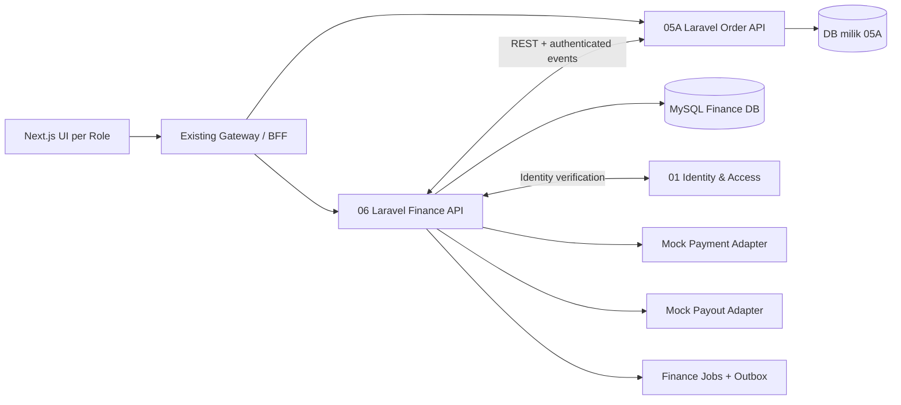
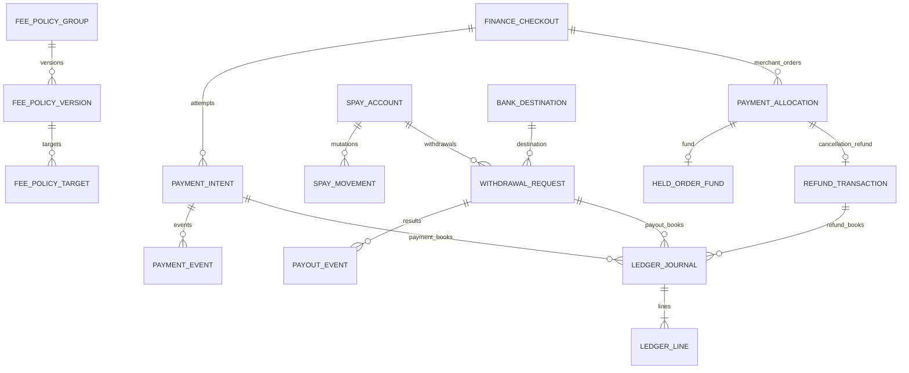
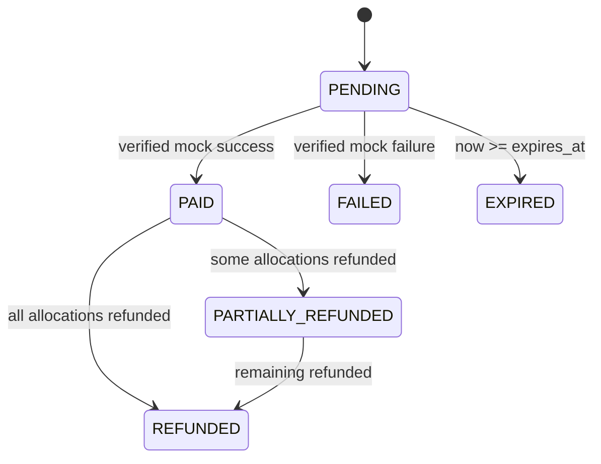
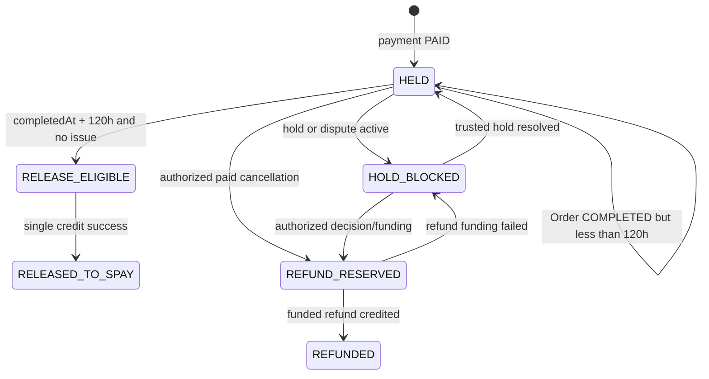
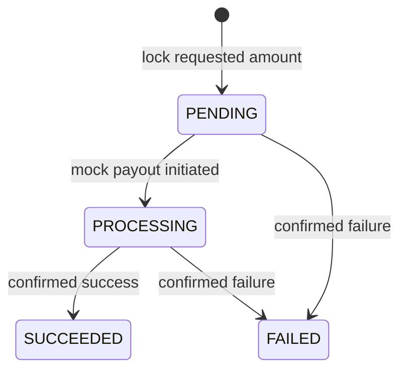

# SERVIO — PHASE 06 FINANCE & S-PAY V3
## FULL BACKEND TECHNICAL SPECIFICATION — 10 KOMPONEN + PERINTAH IMPLEMENTASI AI CODING AGENT

| Metadata | Isi |
|---|---|
| Project | SERVIO — Super Apps |
| Modul aktif | **06 — Finance / Pembayaran / Dana Pesanan / S-Pay** |
| Integrasi bisnis aktif | **05A — ORDER BARANG SAJA** |
| Status planning | **V3 FINAL LOCKED — ACC 22 Oktober 2026** |
| Status dokumen ini | **TECHNICAL_SPEC_DRAFT_REVIEW — menunggu ACC teknis**, bukan kode yang sudah terimplementasi |
| Target stack | Next.js 16 / React 19 / TS → Laravel REST microservice → **MySQL localhost** |
| Mode transaksi | **MOCK_ONLY**: QRIS/VA dummy dan transfer rekening dummy, tanpa perpindahan dana nyata |
| Path yang disarankan | `docs/backend/06-finance/06-finance-backend-v3.md` |
| Kontrak cross-service | 05A↔06 **PROVISIONAL** sampai dibandingkan dengan implementasi/technical spec aktual 05A |

> **URUTAN SUMBER KEBENARAN:** (1) keputusan bisnis Finance V3 FINAL LOCKED khusus 05A; (2) Master Prompt backend terbaru yang secara eksplisit menetapkan **MySQL lokal**; (3) dokumen Identity & Access FINAL dan Global Development Rules; (4) 05A Order Barang REVISED LOCKED plus *change request* 72 jam; (5) kode/repository aktual setelah audit. Dokumen Finance V3 sebelumnya masih menuliskan MongoDB dalam metadata: **untuk implementasi backend, instruksi MySQL yang lebih baru mengesampingkan pilihan database itu**, tanpa mengubah peraturan bisnis. Jangan mengubah database service 01–04 diam-diam. Bila repository aktual memakai lain, tandai `BLOCKED_BY_REPO_CONFLICT`, laporkan dan minta keputusan migrasi, **jangan memigrasi service lama otomatis**.
>
> **Batas:** jangan menambah flow, tabel aktif, endpoint atau fee operasional Order Jasa 05B. Kode klasifikasi jasa boleh disebut sebagai *reserved enum contract*, bukan menciptakan flow 05B. Jangan memakai kredensial contoh pada dokumentasi sebagai secret atau data seed.

---

## KEPUTUSAN BISNIS YANG TIDAK BOLEH DIUBAH OLEH CODING AGENT

1. CEO mengatur biaya dengan **satu form multi-target**, komponen disimpan terpisah menurut `policy_code`; saat ini *aktif dihitung* hanya `CUSTOMER_PRODUCT_APP_FEE` dan `MERCHANT_PRODUCT_COMMISSION`.
2. Biaya aplikasi Customer barang **sekali per CheckoutGroup**, **bukan per item atau Merchant Order**. Setiap Merchant Order mendapat *alokasi pencatatan* deterministik untuk refund.
3. Checkout multi-Merchant = **satu payment QRIS/VA dengan expiry 6 jam**, Merchant Order independen. Merchant hanya menerima `CONFIRMED` sesudah status pembayaran benar-benar `PAID` oleh Finance.
4. Finance adalah owner fee, payment, alokasi, ledger, Dana Pesanan, S-Pay, refund, rekening pencairan milik Finance, dan withdraw; 05A owner Order, stok, pengiriman, cancellation, `completed_at`.
5. Perubahan terkait 05A: **auto-completion setelah 72 jam dari `DELIVERED` valid**, menggantikan 48 jam, **wajib via change request di 05A**. Finance **tidak** mengubah Order status sendiri.
6. Setelah setiap Merchant Order `COMPLETED`, hak bersihnya **tetap tertahan 120 jam dari `completed_at`**; hanya setelah pemeriksaan tanpa hold/refund/sengketa aktif, dikreditkan sekali ke **S-Pay Merchant**.
7. S-Pay **BUKAN wallet belanja**: tanpa top-up, pembayaran order memakai saldo, transfer S-Pay antarpengguna atau saldo gaji Worker. Merchant balance scoped organisasi; Customer balance untuk refund sah didanai.
8. Pencairan **manual** oleh Customer atau pemilik/anggota Merchant berizin; minimal **Rp20.000** sebelum fee, boleh parsial dan berulang sampai saldo tersedia. Fee transfer **dipotong dari nominal tarik**. Tujuan rekening terverifikasi, konfirmasi tambahan, lock saldo dan idempotency wajib.
9. Pembatalan **PAID** yang sah menurut 05A → refund **100% alokasi Customer** untuk Merchant Order tersebut (barang, ongkir, aplikasi yang dialokasi, dan pajak/komponen Customer terkait); refund **hanya** dikreditkan ke S-Pay Customer setelah didanai dan berhasil.
10. Refund Customer di bawah Rp20.000 **tetap tercatat namun tidak dapat dicairkan** sampai akumulasi tersedia ≥ Rp20.000 (perlu review perlindungan konsumen sebelum live); tidak ada refund untuk unpaid cancellation.
11. Mock payment/payout **hanya melalui kanal internal terotorisasi** pada environment demo; `PAID`/`SUCCEEDED` dummy bukan bukti transfer asli.
12. Tarif fee/komisi nyata, pajak produksi dan biaya bank nyata **belum ditetapkan**. Tidak ada seed tarif produksi implisit. Fixture contoh boleh hanya di lingkungan testing.

## KONVENSI TEKNIS

- ID internal Finance: `ULID CHAR(26)` (**PROPOSED**) untuk semua entitas baru; ID lintas-service (`customer_id`, `merchant_org_id`, `checkout_group_id`, `merchant_order_id`) sebagai `VARCHAR(64)`/string opaque, **tanpa foreign key lintas database**. Validasi kesesuaian dengan ID existing 01/05A sebelum migrasi.
- Uang Rupiah: `BIGINT` jumlah Rupiah bulat (*integer*), `currency='IDR'`. Tidak gunakan `float/double` untuk uang. Rate persentase: `DECIMAL(12,6)`; kalkulasi pakai decimal/integer-safe dan pembulatan deterministik.
- Timestamp: `DATETIME(6)` UTC dalam DB, ISO 8601 UTC di API; tampilan Jakarta ditangani frontend. 6h, 72h, 120h menggunakan durasi eksak, bukan tanggal kalender.
- HTTP: `/api/v1/finance/...` (public authenticated) dan `/internal/v1/finance/...` (service-to-service), contoh spesifikasi **PROPOSED**, bukan klaim endpoint sudah ada. JSON `snake_case` dan error envelope seragam; samakan dengan API convention aktual saat audit.
- Semua financial mutation: DB transaction, lock/barrier idempotency, audit event, ledger journal immutable, outbox event. Scheduler bersifat *at-least-once*, sehingga handler harus idempotent.
- Nilai status wajib dicatat sebagai enum/domain constant; *database enum* tidak diwajibkan agar penambahan status melalui migrasi tidak rapuh.

---

# 01 — SERVICE ARCHITECTURE & DOMAIN BOUNDARY

## 1.1 Arsitektur logis



**Finance adalah satu Laravel microservice independen**, bukan folder controller di Identity, Order atau frontend. DB Finance berdiri sendiri (contoh nama logis `servio_finance`). Tidak ada foreign key/join lintas-service, shared database, atau akses langsung tabel Order/Identity. REST/event per kontrak terverifikasi menjadi satu-satunya jalur komunikasi.

## 1.2 Modul internal Finance (bukan microservice baru)

| Komponen | Tanggung jawab inti | Tidak dimiliki |
|---|---|---|
| CEO Fee Policy | CRUD draft, versioning, jadwal aktif, multi-target, histori | Tax rate bebas; harga produk |
| Tax Reference | Referensi kebijakan pajak tervalidasi / mock dengan status | Menetapkan tarif pajak legal secara otomatis |
| Checkout Pricing | Server quote, per-checkout fee, merchant commission, pembulatan/alokasi dan snapshot | Menentukan stok/harga/ongkir sumber 05A |
| Payment Core | Satu invoice/CheckoutGroup, QRIS/VA mock, expiry, PAID verification | Customer menandai paid; pemindahan dana sungguhan |
| Held Funds | Alokasi dana Merchant Order, hold, eligibility 120h dan release satu kali | Mengubah `Order.COMPLETED` |
| S-Pay Account | Customer refund balance dan Merchant org withdrawable balance, histori immutable | Belanja/top-up/transfer user-to-user |
| Refund Execution | Memeriksa instruksi cancellation sah dan pendanaan mock, credit S-Pay | Keputusan cancel/after-sales eligibility |
| Bank Destination | Rekening owner/org, masking, verifikasi mock & re-verifikasi perubahan | Menyimpan data identitas asal secara independen |
| Withdrawal | Quote fee, PIN/step-up, lock balance, mock payout, hasil/failure | Transfer bank asli |
| Ledger & Audit | Double-entry journal, report projection, outbox/reconciliation mock | Mutasi saldo langsung dari UI |

## 1.3 Dependency resmi

- **01 Identity:** validasi token/session, principal, account state, organization membership, finance permission dan step-up. *Tidak membuat tabel user/organization tiruan*.
- **03 Catalog dan 01 Address:** hanya dipakai 05A untuk validasi harga/stok/alamat; Finance menerima hasil yang sudah disahkan oleh 05A, bukan membaca katalog/addresses langsung.
- **05A Order Barang:** owner CheckoutGroup, Merchant Order, delivery, cancellation, `COMPLETED`, `completed_at`, hold signal. Integrasi masih `PROVISIONAL` karena endpoint kode aktual belum diperiksa.
- **07/09:** menerima sinyal hold/sengketa di masa depan (kontrak *PENDING_INTEGRATION*); untuk saat ini handler Finance dapat menggunakan internal authorized hold signal tanpa memalsukan 07/09 yang belum ada.
- **05B / Provider:** `OUT_OF_SCOPE` pada implementasi ini.

## 1.4 Urutan implementasi domain Finance

1. Audit repo & kontrak awal 05A/01; migration DB baru.
2. Kebijakan CEO dan calculator; quote snapshot.
3. Payment mock, expiry & payment confirmed outbox.
4. Held fund + 120-hour release + S-Pay Merchant.
5. Refund mock + Customer S-Pay.
6. Bank destination + withdrawal mock.
7. Ledger reconciliation, dashboard read models dan smoke/contract tests.

**Jangan** mengubah service 05A selama membangun domain 06; buat contract tests/stub terlebih dahulu. Integrasi 05A dilakukan pada change request terpisah sesuai ACC.

---

# 02 — ENTITY RELATIONSHIP DIAGRAM (ERD)



**Kardinalitas utama:** (1) satu policy group banyak versi; satu versi satu/lebih target (`policy_code` stabil); (2) satu CheckoutGroup di 05A memiliki satu `finance_checkout` dan banyak `payment_allocation`, per Merchant Order tepat satu alokasi; (3) finance checkout dapat memiliki riwayat attempt, tetapi **maksimal satu intent pembayaran aktif** dan **maksimal satu pembayaran PAID sah**; (4) satu alokasi memiliki paling banyak satu held fund dan satu refund pembatalan 05A berhasil, dengan retry idempotent; (5) satu S-Pay account memiliki banyak movements dan withdrawals; (6) jurnal memiliki minimal dua lines. `outbox_events`, `inbox_events`, `finance_audit_logs` adalah **entitas lintas-agregat di dalam Finance** dan sengaja tidak dihubungkan ke satu `finance_checkout` dalam ERD; `aggregate_type`/`aggregate_id` adalah referensi kontekstual, bukan FK wajib. Peristiwanya bisa berasal dari fee policy, payment, refund, atau withdrawal.

> Diagram di atas adalah ERD logis **hanya milik service 06**. `checkout_group_id`, `merchant_order_id`, `customer_id`, `merchant_org_id`, `actor_user_id` dari service lain sengaja **tidak digambar sebagai FK**.

## 2.1 Entitas dan ownership

| Entitas | PK | FK internal | Unik penting |
|---|---|---|---|
| `fee_policy_groups` | `id` | — | `slug` |
| `fee_policy_versions` | `id` | `group_id` | (`group_id`,`version_no`) |
| `fee_policy_targets` | `id` | `version_id` | (`version_id`,`policy_code`,`scope`) |
| `tax_rule_references` | `id` | — | (`tax_code`,`version_no`) |
| `finance_checkouts` | `id` | — | `checkout_group_id` |
| `payment_intents` | `id` | `finance_checkout_id` | `provider_reference` unique; active intent controlled transactionally |
| `payment_allocations` | `id` | `finance_checkout_id` | (`finance_checkout_id`,`merchant_order_id`) and `merchant_order_id` for this scope |
| `payment_events` | `id` | `payment_intent_id` | (`provider`,`provider_event_id`) |
| `held_order_funds` | `id` | `payment_allocation_id` | `payment_allocation_id` |
| `spay_accounts` | `id` | — | (`owner_type`,`owner_external_id`,`currency`) |
| `spay_movements` | `id` | `spay_account_id` | (`source_type`,`source_id`,`movement_type`) |
| `refund_transactions` | `id` | `payment_allocation_id`, `payment_intent_id`, `spay_account_id?` | (`payment_allocation_id`,`refund_reason_scope`) |
| `bank_destinations` | `id` | — | scoped fingerprint reference as appropriate |
| `withdrawal_requests` | `id` | `spay_account_id`, `bank_destination_id` | (`spay_account_id`,`idempotency_key_hash`) |
| `payout_events` | `id` | `withdrawal_request_id` | (`provider`,`provider_event_id`) |
| `ledger_journals` | `id` | payment/refund/withdrawal FK nullable | (`source_type`,`source_id`,`journal_type`) |
| `ledger_lines` | `id` | `ledger_journal_id` | none; journal balance invariant |
| `outbox_events` | `id` | — | `event_id` |
| `inbox_events` | `id` | — | (`source_service`,`source_event_id`) |
| `finance_audit_logs` | `id` | — | audit ID, timestamp indexes |

*PROPOSED:* ledger journaling cross-reference FK fields may use nullable `payment_intent_id`, `refund_transaction_id`, `withdrawal_request_id`, **all within Finance DB**. No FK to another service.

---

# 03 — DATABASE SCHEMA & LARAVEL MIGRATION DESIGN

## 3.1 MySQL conventions, indexing and data integrity

- MySQL 8-compatible InnoDB (`utf8mb4`); Laravel migrations owned **only by Finance service**.
- `id CHAR(26) PRIMARY KEY` ULID; `created_at`, `updated_at` DATETIME(6) UTC for mutable rows; finance movement/journal/audit/outbox append-only (do not soft-delete).
- `amount_* BIGINT NOT NULL DEFAULT 0` with app-level `>=0` and DB `CHECK` where supported; `rate DECIMAL(12,6)`, precision tested.
- Non-float money. Constrain statuses in validation and domain state machine; DB `CHECK` for simple bound only.
- Multi-row financial mutations run in transactions with `lockForUpdate()`, consistent lock order, reasonable isolation and bounded retry for deadlocks.
- Do not use `softDeletes()` on transactions, ledger or policy versions once published; archive via status.
- Cross-service IDs indexed strings; internal FK `ON DELETE RESTRICT` or explicit retention; do not cascade-delete historical financial data.
- Encryption at rest of bank-account number using framework-supported encryption/key management; `account_last4` for display; searchable/dedup fingerprint as keyed HMAC, never unkeyed hash.

### 3.2 Detailed table design (columns, type, constraints)

> `PK` primary key; `FK` internal Finance FK; `NN` NOT NULL; `UQ` unique; `IDX` indexed; `?` nullable. All `id` fields `CHAR(26) PK`. For compactness, `created_at DATETIME(6) NN`, `updated_at DATETIME(6) NN` apply to mutable tables unless noted; all timestamp columns UTC. Add operational `correlation_id VARCHAR(64)?` to mutation-oriented tables where applicable.

**01. `fee_policy_groups`**

- `id CHAR(26) PK`, `slug VARCHAR(100) NN UQ`, `display_name VARCHAR(180) NN`, `description TEXT?`, `business_status VARCHAR(24) NN DEFAULT 'ACTIVE'`, `created_by_user_id VARCHAR(64) NN`, `created_at`, `updated_at`.
- `slug` is not pricing engine identity; actual economic category is child `policy_code`.

**02. `fee_policy_versions`**

- `id`, `group_id CHAR(26) FK NN`, `version_no INT UNSIGNED NN`, `status VARCHAR(24) NN` (`DRAFT/SCHEDULED/ACTIVE/HISTORICAL/INACTIVE`), `effective_from DATETIME(6)?`, `effective_until DATETIME(6)?`, `change_reason TEXT NN`, `created_by_user_id VARCHAR(64) NN`, `published_by_user_id VARCHAR(64)?`, `published_at DATETIME(6)?`, `snapshot_hash CHAR(64)?`, timestamps.
- UQ(`group_id`,`version_no`), IDX(`status`,`effective_from`), `effective_until > effective_from` when both set. Editing published versions forbidden.

**03. `fee_policy_targets`**

- `id`, `version_id CHAR(26) FK NN`, `policy_code VARCHAR(64) NN`, `scope VARCHAR(24) NN` (`PRODUCT` only active), `payer_type VARCHAR(24) NN` (`CUSTOMER/MERCHANT` active), `fee_type VARCHAR(20) NN` (`FIXED/PERCENTAGE`), `fixed_amount_idr BIGINT?`, `percentage_rate DECIMAL(12,6)?`, `charge_scope VARCHAR(32) NN` (`CHECKOUT` for CUSTOMER_PRODUCT_APP_FEE; `MERCHANT_ORDER` for MERCHANT_PRODUCT_COMMISSION), `calculation_base VARCHAR(48) NN` (`CHECKOUT_ELIGIBLE_SUBTOTAL/MERCHANT_PRODUCT_SUBTOTAL`), `rounding_method VARCHAR(24) NN`, `min_fee_idr BIGINT?`, `max_fee_idr BIGINT?`, timestamps.
- UQ(`version_id`,`policy_code`,`scope`); exactly one of `fixed_amount_idr` or `percentage_rate` set depending on `fee_type`; 0≤percentage_rate≤100 as **PROPOSED technical guard** for ordinary commission (if future business requires >100, require explicit change); no negative fee.
- `CUSTOMER_SERVICE_APP_FEE/PROVIDER_SERVICE_COMMISSION` are **reserved constants**, not active rows/endpoints in 05A phase.

**04. `tax_rule_references`**

- `id`, `tax_code VARCHAR(64) NN`, `version_no INT NN`, `tax_type VARCHAR(64) NN`, `liable_party VARCHAR(32) NN`, `taxable_base_code VARCHAR(64) NN`, `rate DECIMAL(12,6)?`, `source_reference TEXT?`, `verification_status VARCHAR(36) NN` (`UNCONFIGURED/MOCK/VERIFIED`), `effective_from DATETIME(6)?`, `effective_until DATETIME(6)?`, `reviewed_by_user_id VARCHAR(64)?`, timestamps.
- UQ(`tax_code`,`version_no`); unverified tax must **not be presented as actual legal rate**; production finalization blocked while required tax is unconfigured.

**05. `finance_checkouts`**

- `id`, `checkout_group_id VARCHAR(64) NN UQ`, `customer_id VARCHAR(64) NN IDX`, `currency CHAR(3) NN DEFAULT 'IDR'`, `status VARCHAR(24) NN` (`QUOTED/PAYMENT_PENDING/PAID/EXPIRED/CANCELLED`), `product_subtotal_idr BIGINT NN`, `shipping_total_idr BIGINT NN`, `customer_app_fee_idr BIGINT NN`, `customer_tax_total_idr BIGINT NN DEFAULT 0`, `discount_total_idr BIGINT NN DEFAULT 0`, `customer_payable_total_idr BIGINT NN`, `pricing_policy_snapshot JSON NN`, `tax_snapshot JSON NN`, `checkout_payload_hash CHAR(64) NN`, `expires_at DATETIME(6)?`, `quoted_at DATETIME(6) NN`, timestamps.
- Invariant: total = sum of `payment_allocations.customer_total_idr` and breakdown formula. `checkout_payload_hash` guards replay/mismatched payload under same group.

**06. `payment_intents`**

- `id`, `finance_checkout_id CHAR(26) FK NN IDX`, `method VARCHAR(12) NN` (`QRIS/VA`), `provider VARCHAR(32) NN DEFAULT 'MOCK'`, `provider_reference VARCHAR(100) NN UQ`, `instruction_payload JSON NN` (only DEMO values), `amount_idr BIGINT NN`, `currency CHAR(3) NN`, `status VARCHAR(32) NN`, `issued_at DATETIME(6) NN`, `expires_at DATETIME(6) NN IDX`, `paid_at DATETIME(6)?`, `last_provider_event_id VARCHAR(100)?`, `is_active TINYINT(1) NN`, timestamps.
- `is_active` atomic and controlled under checkout lock. Do not allow second active invoice for same group. Strict one successful payment per `finance_checkout_id` using transactional guard; add generated-key unique if required by chosen MySQL strategy. Eventual abandoned/retry intent behavior only as allowed by 05A contract.

**07. `payment_allocations`**

- `id`, `finance_checkout_id CHAR(26) FK NN`, `merchant_order_id VARCHAR(64) NN UQ`, `merchant_org_id VARCHAR(64) NN IDX`, `customer_id VARCHAR(64) NN`, `product_subtotal_idr BIGINT NN`, `shipping_customer_idr BIGINT NN`, `app_fee_allocated_idr BIGINT NN`, `customer_tax_allocated_idr BIGINT NN`, `discount_allocated_idr BIGINT NN`, `customer_total_idr BIGINT NN`, `merchant_commission_idr BIGINT NN`, `merchant_tax_or_withholding_idr BIGINT NN DEFAULT 0`, `merchant_net_entitlement_idr BIGINT NN`, `fee_snapshot JSON NN`, `allocation_rank INT NN`, `status VARCHAR(24) NN`, timestamps.
- UQ(`finance_checkout_id`,`merchant_order_id`); `merchant_order_id` UQ in this MVP. Cross-service references (ID 05A) are opaque, no FK to orders.

**08. `payment_events`**

- `id`, `payment_intent_id CHAR(26) FK NN`, `provider VARCHAR(32) NN`, `provider_event_id VARCHAR(100) NN`, `event_type VARCHAR(40) NN`, `reported_amount_idr BIGINT?`, `provider_occurred_at DATETIME(6)?`, `received_at DATETIME(6) NN`, `validation_result VARCHAR(24) NN`, `payload JSON NN` (sanitize, no secrets), timestamps optional.
- UQ(`provider`,`provider_event_id`), immutable; `INVALID` events logged without state mutation.

**09. `held_order_funds`**

- `id`, `payment_allocation_id CHAR(26) FK NN UQ`, `status VARCHAR(36) NN` (`HELD/RELEASE_ELIGIBLE/RELEASED_TO_SPAY/REFUND_RESERVED/REFUNDED/HOLD_BLOCKED`), `gross_held_idr BIGINT NN`, `merchant_entitlement_idr BIGINT NN`, `completed_at DATETIME(6)?`, `eligible_release_at DATETIME(6)? IDX`, `hold_reason_code VARCHAR(64)?`, `hold_source VARCHAR(64)?`, `released_at DATETIME(6)?`, `refunded_at DATETIME(6)?`, `order_event_version BIGINT?`, timestamps.
- `eligible_release_at = completed_at + 120h`; release never before this, and never if order-level refund/hold active. Internal transition guarded by locked row.

**10. `spay_accounts`**

- `id`, `owner_type VARCHAR(32) NN` (`CUSTOMER/MERCHANT_ORGANIZATION`), `owner_external_id VARCHAR(64) NN`, `currency CHAR(3) NN DEFAULT 'IDR'`, `available_idr BIGINT NN DEFAULT 0`, `withdrawal_locked_idr BIGINT NN DEFAULT 0`, `account_status VARCHAR(24) NN DEFAULT 'ACTIVE'`, `last_movement_at DATETIME(6)?`, timestamps.
- UQ(`owner_type`,`owner_external_id`,`currency`); no Provider wallet account actively created in 05A scope. `available_idr >=0`, `withdrawal_locked_idr>=0` invariant.

**11. `spay_movements`**

- `id`, `spay_account_id CHAR(26) FK NN`, `movement_type VARCHAR(40) NN` (`MERCHANT_RELEASE/REFUND_CREDIT/WITHDRAWAL_LOCK/WITHDRAWAL_SUCCEEDED/WITHDRAWAL_UNLOCK/REVERSAL`), `direction VARCHAR(12) NN` (`CREDIT/DEBIT/LOCK/UNLOCK`), `amount_idr BIGINT NN`, `source_type VARCHAR(40) NN`, `source_id VARCHAR(64) NN`, `available_before_idr BIGINT NN`, `available_after_idr BIGINT NN`, `locked_before_idr BIGINT NN`, `locked_after_idr BIGINT NN`, `created_at DATETIME(6) NN`.
- UQ(`source_type`,`source_id`,`movement_type`); append-only; changes to account balances permitted **only** alongside a movement/journal within one DB transaction.

**12. `refund_transactions`**

- `id`, `payment_allocation_id CHAR(26) FK NN`, `payment_intent_id CHAR(26) FK NN`, `customer_spay_account_id CHAR(26) FK?`, `refund_reason_scope VARCHAR(32) NN DEFAULT 'ORDER_CANCELLATION_05A'`, `order_cancellation_event_id VARCHAR(100) NN`, `requested_amount_idr BIGINT NN`, `funded_amount_idr BIGINT NN DEFAULT 0`, `credited_amount_idr BIGINT NN DEFAULT 0`, `status VARCHAR(24) NN` (`PENDING/PROCESSING/SUCCEEDED/FAILED`), `source_funding_reference VARCHAR(100)?`, `funded_at DATETIME(6)?`, `credited_at DATETIME(6)?`, `failure_code VARCHAR(64)?`, timestamps.
- UQ(`payment_allocation_id`,`refund_reason_scope`), UQ(`order_cancellation_event_id`), IDX(`status`,`created_at`). One 05A cancellation refund per Merchant Order; future partial after-sales refunds are **out of scope** and must not be forced through this uniqueness without new specification.

**13. `bank_destinations`**

- `id`, `owner_type VARCHAR(32) NN`, `owner_external_id VARCHAR(64) NN`, `bank_code VARCHAR(30) NN`, `account_number_ciphertext TEXT NN`, `account_number_hmac CHAR(64) NN`, `account_last4 CHAR(4) NN`, `account_holder_name_ciphertext TEXT NN`, `account_holder_name_masked VARCHAR(150) NN`, `verification_status VARCHAR(24) NN` (`PENDING/VERIFIED/REJECTED/REVOKED`), `verification_method VARCHAR(40)?`, `verified_at DATETIME(6)?`, `is_default TINYINT(1) NN DEFAULT 0`, `created_by_user_id VARCHAR(64) NN`, timestamps.
- IDX(`owner_type`,`owner_external_id`,`verification_status`), UQ(`owner_type`,`owner_external_id`,`bank_code`,`account_number_hmac`) where practical. Never expose raw account number in ordinary GET, event, logs, snapshot or audit.

**14. `withdrawal_requests`**

- `id`, `spay_account_id CHAR(26) FK NN`, `bank_destination_id CHAR(26) FK NN`, `requested_by_user_id VARCHAR(64) NN`, `requested_amount_idr BIGINT NN`, `transfer_fee_idr BIGINT NN`, `net_to_bank_idr BIGINT NN`, `status VARCHAR(24) NN` (`PENDING/PROCESSING/SUCCEEDED/FAILED`), `idempotency_key_hash CHAR(64) NN`, `provider VARCHAR(32) NN DEFAULT 'MOCK'`, `provider_reference VARCHAR(100)?`, `step_up_proof_reference VARCHAR(100)?`, `bank_snapshot_masked JSON NN`, `initiated_at DATETIME(6) NN`, `completed_at DATETIME(6)?`, `failure_code VARCHAR(64)?`, timestamps.
- UQ(`spay_account_id`,`idempotency_key_hash`); requested ≥20000, fee >=0, `net = requested − fee >0`. At creation **lock** amount; during PROCESSING it remains locked; terminal success consumes lock, confirmed failure unlocks.

**15. `payout_events`**

- `id`, `withdrawal_request_id CHAR(26) FK NN`, `provider VARCHAR(32) NN`, `provider_event_id VARCHAR(100) NN`, `event_type VARCHAR(40) NN`, `reported_net_idr BIGINT?`, `validation_result VARCHAR(24) NN`, `payload JSON NN`, `received_at DATETIME(6) NN`; UQ(`provider`,`provider_event_id`).

**16. `ledger_journals`**

- `id`, `journal_type VARCHAR(48) NN`, `source_type VARCHAR(48) NN`, `source_id VARCHAR(64) NN`, `payment_intent_id CHAR(26) FK?`, `refund_transaction_id CHAR(26) FK?`, `withdrawal_request_id CHAR(26) FK?`, `currency CHAR(3) NN`, `posted_at DATETIME(6) NN`, `description VARCHAR(255)?`, `created_at DATETIME(6) NN`.
- UQ(`source_type`,`source_id`,`journal_type`); immutable, `SUM(DEBIT) = SUM(CREDIT)` for each journal.

**17. `ledger_lines`**

- `id`, `ledger_journal_id CHAR(26) FK NN`, `account_code VARCHAR(64) NN`, `owner_type VARCHAR(32)?`, `owner_external_id VARCHAR(64)?`, `entry_side VARCHAR(6) NN` (`DEBIT/CREDIT`), `amount_idr BIGINT NN`, `created_at DATETIME(6) NN`; IDX(`account_code`,`owner_external_id`), IDX(`ledger_journal_id`).

**18. `outbox_events`**

- `id`, `event_id CHAR(26) NN UQ`, `event_type VARCHAR(100) NN`, `aggregate_type VARCHAR(48) NN`, `aggregate_id VARCHAR(64) NN`, `payload JSON NN`, `schema_version SMALLINT UNSIGNED NN`, `dispatch_status VARCHAR(24) NN DEFAULT 'PENDING'`, `attempts INT NN DEFAULT 0`, `next_attempt_at DATETIME(6)?`, `published_at DATETIME(6)?`, `created_at DATETIME(6) NN`; IDX(`dispatch_status`,`next_attempt_at`).

**19. `inbox_events`**

- `id`, `source_service VARCHAR(48) NN`, `source_event_id VARCHAR(100) NN`, `event_type VARCHAR(100) NN`, `aggregate_id VARCHAR(64) NN`, `status VARCHAR(24) NN`, `received_at DATETIME(6) NN`, `processed_at DATETIME(6)?`, `failure_reason VARCHAR(255)?`, `payload_hash CHAR(64) NN`; UQ(`source_service`,`source_event_id`).

**20. `finance_audit_logs`**

- `id`, `actor_user_id VARCHAR(64)?`, `actor_service VARCHAR(48)?`, `action VARCHAR(100) NN`, `subject_type VARCHAR(48) NN`, `subject_id VARCHAR(64) NN`, `result VARCHAR(24) NN`, `before_state JSON?`, `after_state JSON?`, `reason_code VARCHAR(64)?`, `correlation_id VARCHAR(64)?`, `ip_hash CHAR(64)?`, `created_at DATETIME(6) NN`; IDX(`subject_type`,`subject_id`,`created_at`), IDX(`actor_user_id`,`created_at`). Redact PII/payment secrets.

### 3.3 Migration plan (urutan)

1. `create_fee_policy_groups`, `create_fee_policy_versions`, `create_fee_policy_targets`, `create_tax_rule_references`.
2. `create_finance_checkouts`, `create_payment_intents`, `create_payment_allocations`, `create_payment_events`.
3. `create_held_order_funds`, `create_spay_accounts`, `create_spay_movements`, `create_refund_transactions`.
4. `create_bank_destinations`, `create_withdrawal_requests`, `create_payout_events`.
5. `create_ledger_journals`, `create_ledger_lines`, `create_outbox_events`, `create_inbox_events`, `create_finance_audit_logs`.
6. Tambah indexes, scoped UQ constraints and check constraints verified against MySQL version and Laravel schema support; `migrate:fresh` **HANYA DB uji khusus Finance**.

### 3.4 Invariant transaksi, race dan konsistensi

| Invariant | Penegakan |
|---|---|
| Total checkout = Σ alokasi Merchant Order | Pricing service + DB transaction + feature test |
| Fee Customer sekali checkout | Policy charge_scope + unique finance_checkout + snapshot |
| Pembayaran sukses tunggal | `SELECT ... FOR UPDATE` checkout/payment, event UQ dan journal UQ |
| Full cancellation refund ≤ order allocated amount | Locked allocation, unique refund dan `funded_amount=customer_total` |
| Hold release sekali | Lock held fund, status compare-and-set, movement UQ |
| S-Pay available tidak negatif | Lock account + CHECK + refusal when insufficient |
| Payout lock satu kali | Withdrawal UQ; movement and ledger in transaction |
| Fee pencairan tidak dipotong dua kali | Snapshot fee at request; net math once |
| Tidak ada uang mock dari endpoint publik | mode guard, system signature, actor RBAC |
| Snapshot lawan perubahan tarif | Immutable JSON/version/hash, quote payload consistency |

**Rounding PROPOSED:** hitung nilai fixed secara Rupiah bulat; persentase: `eligible_base_idr × rate / 100` dengan pembulatan HALF_UP ke satu Rupiah; fee aplikasi gabungan dialokasikan dengan *largest remainder method* menurut subtotal barang eligible masing-masing Merchant Order, *tie-breaker* `merchant_order_id` lexicographic ascending. Contoh A 100rb, B 200rb, total app fee 3rb → A 1rb, B 2rb tepat. Refund memakai snapshot asli, **jangan kalkulasi tarif ulang**.

---
# 04 — API ENDPOINT SPECIFICATION & JSON CONTRACT

**Catatan:** Semua URL dan payload di bagian ini **PROPOSED**. Ini spesifikasi untuk dibangun, **bukan endpoint yang telah diverifikasi ada di repository**. Wajib cek URI, HTTP verbs, auth convention, dan response contract existing sebelum implementasi. Gunakan gateway/BFF yang sudah ada; jangan membuat proxy baru yang menambah round trip tanpa alasan.

## 4.1 Standard response, auth & security

Public endpoint memakai session/token resmi Modul 01 Identity (samakan implementasi actual: Sanctum SPA stateful cookie apabila itu kontrak existing; jangan membuat login/JWT baru). Internal endpoint memakai service identity signed/mTLS or existing approved mechanism: token browser **tidak bisa** memanggil internal route.

**Sukses:**

```json
{
  "data": { "id": "01FinanceULIDExample", "status": "PENDING" },
  "meta": { "request_id": "req-001", "mode": "MOCK" }
}
```

**Error:**

```json
{
  "error": {
    "code": "FINANCE_INSUFFICIENT_AVAILABLE_BALANCE",
    "message": "Saldo S-Pay tersedia tidak mencukupi.",
    "details": { "available_idr": 15000, "minimum_withdrawal_idr": 20000 },
    "request_id": "req-002"
  }
}
```

- Public request modifying resources: `Idempotency-Key: <client-generated-opaque-id>` wajib untuk create checkout payment (service-side), withdrawal, refund internal, policy publish. Stored as keyed hash plus request hash; mismatched body with same key → `409 IDEMPOTENCY_KEY_REUSED`.
- `/api/v1/...` frontend owner-scoped; `/internal/v1/...` service-to-service; `/api/v1/finance/demo/...` gated via nonproduction environment **AND** finance/developer demo permission.
- `422` invalid input; `401` no session; `403` permission; `404` hidden foreign resource; `409` state/idempotency collision; `410` expired resource as appropriate; `429` rate-limited; `502/503` dependency unavailable. All error `code` stable.
- No public `set_balance`, `mark_paid`, `credit_refund`, `release_hold`, `force_withdrawal_succeeded` endpoints.

## 4.2 Public CEO policies and dashboard

| HTTP | Endpoint | Permission | Body / query | Result |
|---|---|---|---|---|
| `GET` | `/api/v1/finance/policies?status=ACTIVE&page=1&per_page=20` | `finance.policy.read` CEO / Finance read-only | `status,search,scope,page,sort` | paged policy group/version/target rows |
| `POST` | `/api/v1/finance/policies` | `finance.policy.manage` CEO | `name,slug,description,targets[],change_reason` | creates group + draft version |
| `GET` | `/api/v1/finance/policies/{group_id}` | CEO / Finance authorized | — | active + draft/scheduled/historical versions |
| `POST` | `/api/v1/finance/policies/{group_id}/revisions` | CEO | `targets[],change_reason` | new immutable version `DRAFT` |
| `PATCH` | `/api/v1/finance/policy-versions/{version_id}` | CEO | draft-only fields; `If-Match`/version | updated DRAFT only |
| `POST` | `/api/v1/finance/policy-versions/{version_id}/publish` | CEO | `{ "effective_from": "...", "reason": "..." }` | ACTIVE or SCHEDULED, audit |
| `POST` | `/api/v1/finance/policies/{group_id}/deactivate` | CEO | `{ "effective_from": "...", "reason": "..." }` | policy inactive from effective time |
| `GET` | `/api/v1/finance/tax-references` | CEO/Finance read-only | `status,type,page` | tax statuses/reference records; no free-form edit |
| `GET` | `/api/v1/finance/revenue/overview` | CEO/Finance authorized | `from,to,period=day,breakdown` | four separately classified sources, product active; mock flag |

**Example: CEO creates multi-target group draft**

```http
POST /api/v1/finance/policies
Idempotency-Key: policy-create-001
Content-Type: application/json
```

```json
{
  "name": "Biaya & Komisi SERVIO Barang",
  "slug": "biaya-komisi-produk-01",
  "description": "Kebijakan contoh pengujian produk",
  "change_reason": "Inisialisasi DEMO",
  "targets": [
    {
      "policy_code": "CUSTOMER_PRODUCT_APP_FEE",
      "scope": "PRODUCT", "payer_type": "CUSTOMER",
      "fee_type": "FIXED", "fixed_amount_idr": 3000,
      "charge_scope": "CHECKOUT", "calculation_base": "CHECKOUT_ELIGIBLE_SUBTOTAL"
    },
    {
      "policy_code": "MERCHANT_PRODUCT_COMMISSION",
      "scope": "PRODUCT", "payer_type": "MERCHANT",
      "fee_type": "PERCENTAGE", "percentage_rate": "5.000000",
      "charge_scope": "MERCHANT_ORDER", "calculation_base": "MERCHANT_PRODUCT_SUBTOTAL"
    }
  ]
}
```

Response `201`:

```json
{
  "data": {
    "group_id": "01EXAMPLEPOLICYGROUP00001",
    "version_id": "01EXAMPLEPOLICYVER000001",
    "version_no": 1,
    "status": "DRAFT",
    "targets_count": 2
  },
  "meta": { "mode": "MOCK", "request_id": "req-policy-001" }
}
```

Validation: `targets` min 1, distinct(`policy_code`,`scope`); active product codes only; require correct `payer_type/charge_scope/calculation_base`; rate/amount mutually exclusive; `published_at` never client supplied; `effective_from` valid and no policy overlap. `409 POLICY_SCOPE_CONFLICT` if same economic component is already actively covered by overlapping published group/version; group naming alone cannot bypass conflict. Publishing creates audit/outbox event.

## 4.3 Internal checkout quote and payment creation (05A → 06)

| HTTP | Endpoint | Auth | Result |
|---|---|---|---|
| `POST` | `/internal/v1/finance/checkout-quotes` | trusted 05A service | quote, policy snapshot, allocations |
| `POST` | `/internal/v1/finance/checkouts/{checkout_group_id}/payment-intents` | trusted 05A service | single mock QRIS/VA invoice, expiry |
| `GET` | `/internal/v1/finance/checkouts/{checkout_group_id}` | trusted 05A service | reconciled quote/payment allocations/status |
| `GET` | `/internal/v1/finance/payments/{payment_id}` | trusted 05A | status + evidence metadata (no secrets) |

**Quote request (from 05A, server-verified):**

```json
{
  "checkout_group_id": "CHK-2026-001",
  "customer_id": "USER-CUSTOMER-01",
  "currency": "IDR",
  "validated_by_order_service": true,
  "order_quote_revision": 1,
  "merchant_orders": [
    {
      "merchant_order_id": "MORD-A-01",
      "merchant_org_id": "ORG-MERCHANT-A",
      "product_subtotal_idr": 100000,
      "shipping_customer_idr": 10000,
      "discount_idr": 0
    },
    {
      "merchant_order_id": "MORD-B-01",
      "merchant_org_id": "ORG-MERCHANT-B",
      "product_subtotal_idr": 200000,
      "shipping_customer_idr": 15000,
      "discount_idr": 0
    }
  ]
}
```

**Quote response `200/201` (example fee fixture only):**

```json
{
  "data": {
    "checkout_group_id": "CHK-2026-001",
    "quote_status": "QUOTED",
    "product_subtotal_idr": 300000,
    "shipping_total_idr": 25000,
    "customer_application_fee_idr": 3000,
    "tax_total_idr": 0,
    "tax_status": "MOCK_FIXTURE",
    "customer_total_idr": 328000,
    "allocations": [
      { "merchant_order_id": "MORD-A-01", "app_fee_allocated_idr": 1000, "customer_total_idr": 111000, "merchant_commission_idr": 5000, "merchant_net_entitlement_idr": 105000 },
      { "merchant_order_id": "MORD-B-01", "app_fee_allocated_idr": 2000, "customer_total_idr": 217000, "merchant_commission_idr": 10000, "merchant_net_entitlement_idr": 205000 }
    ],
    "policy_versions": [{ "policy_code": "CUSTOMER_PRODUCT_APP_FEE", "version_no": 1 }, { "policy_code": "MERCHANT_PRODUCT_COMMISSION", "version_no": 1 }],
    "payload_hash": "<sha256-of-canonical-payload>"
  },
  "meta": { "mode": "MOCK", "request_id": "req-quote-01" }
}
```

Client cannot directly choose `customer_total_idr`, app fee or commission: those are computed by Finance. `validated_by_order_service` is **not** accepted solely because it is `true`; route service identity must be verified. If required policy absent, return `409 FEE_POLICY_NOT_CONFIGURED` (unless intentionally using explicit named MOCK fixtures in test), not silent zero fee.

**Payment create request:**

```json
{
  "method": "QRIS",
  "quote_payload_hash": "<same-hash-from-quote>",
  "order_quote_revision": 1
}
```

**Response `201`:**

```json
{
  "data": {
    "payment_id": "01EXAMPLEPAYMENT000000001",
    "checkout_group_id": "CHK-2026-001",
    "method": "QRIS",
    "provider": "MOCK",
    "status": "PENDING",
    "amount_idr": 328000,
    "currency": "IDR",
    "expires_at": "2026-10-22T12:00:00Z",
    "payment_instruction": { "type": "DEMO_QRIS", "display_text": "SIMULASI - BUKAN UNTUK PEMBAYARAN NYATA", "reference": "MOCK-QR-001" },
    "is_real_payment": false
  },
  "meta": { "mode": "MOCK", "request_id": "req-payment-01" }
}
```

- Expiry exactly `issued_at + 6h`; immutable on page refresh. No actual QRIS payable encoded, no account real in mock VA.
- On duplicate same idempotency key and payload → return same intent; different method on active existing intent → `409 PAYMENT_INTENT_ALREADY_ACTIVE`; don't fabricate another paid obligation.
- If existing quote and same payload hash, idempotent reuse; same checkout ID with changed amounts after creating payment → `409 CHECKOUT_SNAPSHOT_LOCKED` (05A must abandon/restart checkout through agreed contract rather than mutate historical invoice).

## 4.4 Customer payment read API and receipt

| HTTP | Endpoint | Permission | Output |
|---|---|---|---|
| `GET` | `/api/v1/finance/payments/{payment_id}` | Customer owner, authorized Finance | status, amount, DEMO instruction, countdown timestamp |
| `GET` | `/api/v1/finance/payments/{payment_id}/receipt` | Customer owner / authorized Finance | receipt after PAID; mock label, allocations and tax/fee breakdown |
| `GET` | `/api/v1/finance/me/refunds?status=SUCCEEDED&page=1` | Customer own | refund history including below-minimum funds |

Receipt must not imply any real-world payment settlement, must not expose other customers' data or bank full number; Merchant cannot access *all* checkout contents of other organizations.

## 4.5 Mock payment provider operator (non-production only)

| HTTP | Endpoint | Permission | Body |
|---|---|---|---|
| `POST` | `/api/v1/finance/demo/payments/{payment_id}/simulate` | `FINANCE_PAYMENT_OPS` + demo permission OR dedicated developer operator, **AND environment MOCK** | `outcome,provider_event_id,reported_amount_idr` |
| `POST` | `/api/v1/finance/demo/withdrawals/{withdrawal_id}/simulate` | same nonprod actor | `outcome,provider_event_id` |

```json
{
  "outcome": "SUCCESS",
  "provider_event_id": "MOCK-PAY-EVT-00001",
  "reported_amount_idr": 328000
}
```

`SUCCESS/FAILED` only, `EXPIRED` driven by deadline job; `SUCCESS` after expiry rejected. **Request is converted by a Mock Adapter into a provider event, and the same verification service checks reference/amount/method/expiry/state/idempotency; operator route does NOT directly update payment status.** Mock events must have durable unique IDs. Production env returns `404/403` even to CEO/Finance.

## 4.6 S-Pay owner-scoped and merchant organization-scoped APIs

| HTTP | Endpoint | Permission | Query/result |
|---|---|---|---|
| `GET` | `/api/v1/finance/spay/me` | Customer | refund available/locked, min, mock mode |
| `GET` | `/api/v1/finance/spay/me/movements` | Customer | filter/date/pagination |
| `GET` | `/api/v1/finance/spay/organizations/{org_id}` | Merchant member with finance view permission | merchant available, pending, held summary |
| `GET` | `/api/v1/finance/spay/organizations/{org_id}/movements` | same | own org only |
| `GET` | `/api/v1/finance/held-funds?organization_id={org_id}&status=HELD` | Merchant authorized OR Finance ops | per-order held fund read with strict scoping |
| `GET` | `/api/v1/finance/withdrawals?owner_type=...&owner_id=...` | owner-scope / Finance Ops read | paged own history; never trust browser owner alone |
| `GET` | `/api/v1/finance/withdrawals/{withdrawal_id}` | owner-scope / Finance Ops | amount, fee, net, masked bank, result |

**Customer response:**

```json
{
  "data": {
    "owner_type": "CUSTOMER", "currency": "IDR",
    "available_idr": 17000, "withdrawal_locked_idr": 0,
    "minimum_withdrawal_idr": 20000, "can_withdraw": false,
    "source_label": "REFUND_ONLY", "is_wallet_payment_enabled": false
  },
  "meta": { "mode": "MOCK", "request_id": "req-spay-me" }
}
```

## 4.7 Bank destinations & withdrawal contract

| HTTP | Endpoint | Permission | Contract |
|---|---|---|---|
| `GET` | `/api/v1/finance/bank-destinations?organization_id=...` | Customer self / Merchant finance role | masked bank records own scope |
| `POST` | `/api/v1/finance/bank-destinations` | owner / merchant bank-manage | bank code, account number, holder name, owner scope + step-up |
| `POST` | `/api/v1/finance/bank-destinations/{id}/verify-demo` | demo privileged verified step-up; or internally backed verification | updates `VERIFIED` mock after validation; not arbitrary user toggle |
| `POST` | `/api/v1/finance/withdrawals/quote` | owner/authorized | nominal + bank id → fee/net/min, short-lived signed quote |
| `POST` | `/api/v1/finance/withdrawals` | owner/authorized with step-up | quote id/hash, amount, destination, acknowledgment + idempotency |

**Add bank destination request (customer example):**

```json
{
  "owner_type": "CUSTOMER",
  "bank_code": "BCA",
  "account_number": "1234567890",
  "account_holder_name": "Contoh Penerima",
  "step_up_reference": "STEP-UP-VERIFIED-BY-IDENTITY"
}
```

**Quote withdrawal request:**

```json
{
  "owner_type": "MERCHANT_ORGANIZATION",
  "owner_id": "ORG-MERCHANT-A",
  "amount_idr": 100000,
  "bank_destination_id": "01EXAMPLEBANKDEST0000001"
}
```

**Quote response:**

```json
{
  "data": {
    "quote_id": "wdq-example-01",
    "amount_idr": 100000,
    "transfer_fee_idr": 2500,
    "net_to_bank_idr": 97500,
    "bank": { "bank_code": "BCA", "account_last4": "7890", "account_holder_name_masked": "C***** P*******" },
    "expires_at": "2026-10-22T12:05:00Z",
    "is_real_transfer": false,
    "warning": "Pastikan bank, nomor rekening dan nama penerima sudah benar."
  },
  "meta": { "mode": "MOCK", "request_id": "req-wdq-01" }
}
```

**Create withdrawal:**

```json
{
  "quote_id": "wdq-example-01",
  "bank_destination_id": "01EXAMPLEBANKDEST0000001",
  "step_up_reference": "STEP-UP-VERIFIED-BY-IDENTITY",
  "bank_details_confirmed": true
}
```

**Response `201`:**

```json
{
  "data": {
    "withdrawal_id": "01EXAMPLEWITHDRAWAL00001",
    "status": "PENDING",
    "requested_amount_idr": 100000,
    "transfer_fee_idr": 2500,
    "net_to_bank_idr": 97500,
    "locked_amount_idr": 100000,
    "remaining_available_idr": 5000,
    "mode": "MOCK"
  }
}
```

- Server derives identity scope from session + membership. User-supplied `owner_id` does not authorize access. For Merchant Org, verify permission against that org via Modul 01; Member financial access must be real permission, not mere Merchant role string.
- Required money constraints: `amount_idr >= 20000`, `amount <= available`, `0 <= fee < amount`, bank `VERIFIED`, step-up proof still fresh and bound to operation/destination. Entire reserve/lock in one DB transaction.
- Simulation bank verification **cannot prove real bank ownership**; mark `verification_method=MOCK`/`verification_status=VERIFIED` with `mode=MOCK` and block real payouts until re-verification via licensed provider.

## 4.8 Refund internal API & operations read

| HTTP | Endpoint | Auth | Outcome |
|---|---|---|---|
| `POST` | `/internal/v1/finance/refunds/order-cancellations` | trusted 05A service | create refund only from committed paid & canceled order event |
| `GET` | `/internal/v1/finance/refunds/by-order/{merchant_order_id}` | trusted 05A | status/amount for Order UI |
| `POST` | `/internal/v1/finance/order-events` | trusted 05A event handler | `ORDER_COMPLETED`, `ORDER_HOLD_CHANGED`, ... signed/verified |
| `GET` | `/api/v1/finance/ops/payments` | Finance Ops | filter/status/period + pagination |
| `GET` | `/api/v1/finance/ops/refunds` | Finance Ops | read + exception reasons |
| `GET` | `/api/v1/finance/ops/withdrawals` | Finance Ops | read + retry/exception monitoring |
| `GET` | `/api/v1/finance/ops/reconciliation` | Finance Ops | mock statement vs posted ledger discrepancies |

**Trusted cancellation refund request:**

```json
{
  "source_event_id": "05A-ORDER-CANCEL-EVENT-A-01",
  "merchant_order_id": "MORD-A-01",
  "checkout_group_id": "CHK-2026-001",
  "order_status": "CANCELLED",
  "cancelled_at": "2026-10-22T10:10:00Z",
  "decision_source": "05A_ORDER_SERVICE",
  "reason_code": "MERCHANT_UNABLE_TO_FULFILL"
}
```

**Response after actual MOCK refund credit `200`/after accepted `202`:**

```json
{
  "data": {
    "refund_id": "01EXAMPLEREFUND00000001",
    "merchant_order_id": "MORD-A-01",
    "status": "SUCCEEDED",
    "refund_amount_idr": 111000,
    "destination": "CUSTOMER_SPAY",
    "credited_amount_idr": 111000,
    "is_real_refund": false
  },
  "meta": { "mode": "MOCK", "request_id": "req-refund-01" }
}
```

Important: `refund_amount_idr` **computed from immutable payment allocation**, never accepted from request. Full refund if eligible. If payment still pending/unpaid → notify Order that cancellation has **no refund**. If held fund already released/withdrawn, place in `EXCEPTION_REQUIRES_FUNDING` operational substatus (**PROPOSED**) with zero Customer credit until actual mock funding/source is confirmed; do not create fake balance or negative Merchant ledger. The available code path for late after-sales decisions stays pending future modules.

## 4.9 Fee receipt and Revenue reporting

- Finance Ops `GET /api/v1/finance/ops/payment-allocations?merchant_org_id=...&from=...&to=...` with scope, for drill-down 05A product fees, Merchant commissions, app fees, Customer refund amounts, payable rights.
- CEO `GET /api/v1/finance/revenue/overview` returns: `customer_product_app_fee`, `merchant_product_commission`, product total, reversal, mock payment volume, held liability, merchant payable; Provider/Service columns **not faked as active** and labeled `NOT_IMPLEMENTED` until 05B.
- `PAID` does not automatically mean *recognized revenue*. Revenue read model should expose `collected_fee` vs `recognized_revenue`, and when recognition timing is not approved show `PENDING_ACCOUNTING_POLICY`, not artificially sum completed payments into recognized profit.

## 4.10 API validation / status codes matrix

| Scenario | HTTP | Error code |
|---|---:|---|
| Customer tries demo paid mutation | 403 | `DEMO_OPERATION_FORBIDDEN` |
| Demo endpoint on production | 404/403 | `DEMO_ENDPOINT_DISABLED` |
| Quote missing active fee policy | 409 | `FEE_POLICY_NOT_CONFIGURED` |
| Duplicate/reused checkout hash mismatch | 409 | `CHECKOUT_SNAPSHOT_LOCKED` |
| Payment success after expiry | 409/410 | `PAYMENT_EXPIRED` |
| Payment mock amount mismatch | 422/409 | `PAYMENT_AMOUNT_MISMATCH` |
| Unauthorized Merchant org | 404 | `FINANCE_RESOURCE_NOT_FOUND` |
| Payout < Rp20.000 | 422 | `WITHDRAWAL_BELOW_MINIMUM` |
| Payout balance insufficient | 409 | `FINANCE_INSUFFICIENT_AVAILABLE_BALANCE` |
| Bank not verified | 422 | `BANK_DESTINATION_UNVERIFIED` |
| Bank owner mismatch | 403 | `BANK_OWNER_MISMATCH` |
| Fee leaves net ≤0 | 422 | `WITHDRAWAL_NET_NOT_POSITIVE` |
| Duplicate refund same event | 200 replay | same refund result, no extra credit |
| Refund allocation already refunded, different claim | 409 | `REFUND_ALREADY_EXECUTED` |
| No order-completed evidence | 409 | `ORDER_NOT_ELIGIBLE_FOR_RELEASE` |
| 120 hours not elapsed | 409 | `FUNDS_HOLD_NOT_MATURED` |
| Authorized dependency unavailable | 503 | `DEPENDENCY_UNAVAILABLE` |

---

# 05 — ROLE-BASED ACCESS & AUTHORIZATION MATRIX

## 5.1 Sembilan role resmi (Modul 01 sebagai sumber identitas)

| Role | Baca fee/policy | Ubah/publish fee | Baca transaksi Finance | Baca S-Pay | Cairkan S-Pay | Simulasi pembayaran |
|---|---|---|---|---|---|---|
| `CEO_PRODUCT_OWNER` | Semua | **Ya** | Dashboard/revenue berizin | **Tidak sebagai saldo pribadi role CEO** | Tidak mengambil saldo user | Tidak |
| `ADMIN_OPERATIONS` | Hanya yang diizinkan | Tidak | Tidak otomatis | Tidak | Tidak | Tidak |
| `CUSTOMER` | Breakdown miliknya | Tidak | Payment/refund **milik sendiri** | Customer milik sendiri | **Ya**, milik sendiri | Tidak |
| `SERVICE_PROVIDER` | Tidak dalam scope | Tidak | 05B pending | 05B **PENDING_INTEGRATION** | Tidak untuk 05A | Tidak |
| `WORKER_TECHNICIAN` | Tidak | Tidak | Tidak | Tidak | Tidak | Tidak |
| `MERCHANT` | Komisi applied milik org | Tidak | Alokasi Order org sendiri | **Organisasi berizin** | **Owner/izin finance org saja** | Tidak |
| `SUPPLIER` | Tidak | Tidak | Tidak | Tidak | Tidak | Tidak |
| `CUSTOMER_SUPPORT` | Ringkasan insiden jika disetujui kontrak | Tidak | Tidak secara default | Tidak | Tidak | Tidak |
| `FINANCE_PAYMENT_OPS` | Semua (read-only) | **Tidak** | Semua dalam lingkup tugas | Read/monitor seluruh account | **Tidak atas nama pengguna** | **Ya, DEMO-only** |

`DEVELOPER/DEMO_OPERATOR` adalah capability nonproduction khusus, **bukan role ke-10 pengguna bisnis**; konfigurasinya harus berasal dari izin keamanan internal, bukan boolean client-side.

## 5.2 Proposed permission codes (map ke registry 01 bila tersedia)

| Permission (contoh) | Aksi |
|---|---|
| `finance.policy.read` | lihat policy aktif/histori |
| `finance.policy.manage` | create/edit draft/publish/deactivate oleh CEO |
| `finance.payment.read_own` | Customer lihat payment sendiri |
| `finance.ops.read` | Finance Ops dashboard, exception, refund/payout report |
| `finance.spay.read_self` | Customer own account |
| `finance.spay.read_organization` | merchant read own org |
| `finance.spay.withdraw_self` | Customer withdraw sendiri |
| `finance.spay.withdraw_organization` | Owner/authorized finance membership of org |
| `finance.bank.manage_self` | Customer bank own |
| `finance.bank.manage_organization` | Merchant org bank management |
| `finance.mock.simulate` | non-prod Finance/Developer mock only |
| `finance.internal.order_sync` | signed 05A service principal |

**Permission code `PROPOSED`**, exact action/membership names **MUST** compare against locked Identity API/registry before migrations/guards. Don't fabricate a second identity membership table inside Finance.

## 5.3 Middleware and policy chain

```text
HTTP request
 → Auth by 01 Identity / existing gateway
 → Validate account active and role membership
 → Validate route permission
 → Verify business ownership (user_id or merchant_org_id from 01)
 → Validate resource state + quote hash + step-up (where critical)
 → Database mutation under row lock + audit + journal + outbox
```

Recommended Laravel middleware/policies (names PROPOSED):

- `EnsureFinanceAuthenticated`, `EnsureFinancePermission`, `EnsureVerifiedOrganizationMembership`, `EnsureDemoMode`, `EnsureInternalServiceIdentity`, `EnsureStepUpAuthorized`.
- `FeePolicyPolicy`, `FinanceCheckoutPolicy`, `SPayAccountPolicy`, `BankDestinationPolicy`, `WithdrawalPolicy`, `RefundReadPolicy`.
- Multi-organization support: choose organization explicitly and verify binding **for every request**; do not trust active organization from UI `RoleContext` as backend permission.
- Ownership checks must be applied to list filters, resource detail, exports, counts/aggregates (to avoid leaks), masked account numbers and outbox reads.
- Customer can never request bank verification `VERIFIED` by sending a JSON boolean; finance demo verify is a protected distinct action. Changes to bank require fresh step-up plus audit.
- Payment callback protected by service signature/provider adapter; no CSRF/session on signed internal callback, but user web mutations under SPA session follow CSRF contract of 01.

## 5.4 RBAC test acceptance

- All 9 roles tested with both permitted and denied paths; 403/404 as appropriate.
- Merchant with two organizations cannot withdraw org B funds by swapping URL from org A; owner without finance permission cannot if 01 contract says restricted.
- Finance Ops cannot publish fee nor initiate Customer/Merchant withdrawal.
- CEO cannot simulate PAID nor credit S-Pay manually.
- Customer cannot view another Customer payment/refund/bank, nor Merchant S-Pay.
- Worker, Supplier, Support, Provider in current scope cannot use active 05A Finance mutation endpoints.

---

# 06 — INTERNAL FEATURE INTEGRATION, TRANSACTIONS & STATE MACHINES

## 6.1 Service classes (PROPOSED, adjust to repo conventions)

```text
app/
  Domain/Finance/
    Policies/FeePolicyPublisher.php
    Pricing/CheckoutPricingService.php
    Pricing/LargestRemainderAllocator.php
    Payments/PaymentIntentService.php
    Payments/PaymentVerificationService.php
    Payments/MockPaymentProviderAdapter.php
    Funds/HeldFundService.php
    Funds/FundReleaseEligibilityService.php
    WalletlessSPay/SPayAccountService.php
    Refunds/RefundExecutionService.php
    Withdrawals/WithdrawalQuoteService.php
    Withdrawals/WithdrawalService.php
    Withdrawals/MockPayoutAdapter.php
    Ledger/FinanceJournalService.php
    Security/BankDestinationService.php
    Security/FinanceAuditService.php
    Integration/Order05AClient.php
    Integration/OutboxDispatcher.php
app/Jobs/
  ExpireFinancePayments.php
  ActivateScheduledFeePolicies.php
  ReleaseEligibleOrderFunds.php
  DispatchFinanceOutbox.php
  ReconcileMockPaymentsAndPayouts.php
routes/api.php
routes/internal.php (if project convention supports it)
```

> Naming folder `WalletlessSPay` is intentional to prevent implementing top-up/spend semantics; refactor naming to repository conventions if needed, keeping functionality unchanged.

## 6.2 Canonical state transition diagrams

**Payment:**



Only `PENDING → PAID` creates funds and sends `PaymentConfirmed`; `PAID/PARTIALLY_REFUNDED/REFUNDED` must not revert into PENDING.

**Held fund:**



`RELEASE_ELIGIBLE` can be ephemeral internal state in same transaction as `RELEASED_TO_SPAY`, but must be auditable. Cancellation after payout follows exception handling and cannot naively transition `RELEASED_TO_SPAY → REFUNDED` with automatic unbacked Customer credit.

**Withdraw:**



Timeout/unknown outcome **stays PROCESSING** with operator exception; do not unlock a payout that might have succeeded.

## 6.3 Detailed atomic transaction flows

**Flow A — CEO publish policy:** lock category/scope uniqueness, verify effective-period collision, insert immutable policy version/targets, schedule/activate, audit+outbox, commit. Draft edit isolated; old checkout fee snapshot preserved.

**Flow B — Quote:** 05A validates cart/order → Finance authenticates 05A principal → canonicalizes input, finds fee policy applicable as of quote time → app fee once + Merchant commission per merchant order → largest remainder allocation → persist quote, allocations, policy snapshot and hash (transaction) → response. No API accepts fee amount supplied by browser.

**Flow C — Payment confirm:** Mock adapter emits event → inbox/event uniqueness barrier → lock intent+checkout → verify reference, exact amount, `PENDING`, `received/provider_occurred_at` within expiry and mock adapter source, checkout open → change to `PAID`, create held funds per allocation, append ledger journal, event+outbox → commit. Later outbox sends `PaymentConfirmed`. Duplicate event replay must not rebook.

**Flow D — 05A Order completion → release:** verified event `OrderCompleted` with valid `completed_at` and increasing order version → set `completed_at`,`eligible_release_at=+120h` under lock; repeated event ignored. Scheduler scans matured rows; rechecks paid order, no cancellation/refund/hold, optional authoritative status 05A if event consistency uncertain, locks held fund and destination account; posts movement/journal and marks RELEASED once, commit. Payout request can now use available balance.

**Flow E — Refund:** trusted cancellation event → verify allocation/payment paid and canceled evidence → lock held fund & payment → reserve exactly allocated customer total → in `MOCK` confirm funding/refund success and allocate financial reversal → create/find customer S-Pay account → append credit movement + ledger/journal → mark refund `SUCCEEDED`, held fund `REFUNDED`, payment status `PARTIALLY_REFUNDED/REFUNDED`, outbox, commit. If funding mock FAILS, no S-Pay available credit. If allocation already released/withdrawn, flag exception; **never invent balance or silently debit a different Merchant**.

**Flow F — Withdrawal:** owner verified → quote fee + bank snapshot → step-up validation → transaction lock account, verify available and minimum and quote not stale, decrement available and increment locked by requested amount, append `WITHDRAWAL_LOCK` movement, create request+audit, commit → mock payout. For success: lock row/request, decrement locked, ledger debit S-Pay liability gross withdrawal and mock provider clearing credit split net+bank fee (or provider fee expense structure per reconciled accounts), movement/journal and SUCCEEDED once. For confirmed fail: decrement locked, credit available same gross amount, movement/journal and FAILED once. Unknown leaves locked.

## 6.4 Accounting journal rules / ledger invariant

Every financial mutation is append-only journal with **debit total exactly credit total**. Example account code vocabulary (**PROPOSED internal**, not statutory chart of accounts):

- `MOCK_PROVIDER_CLEARING` — simulation equivalent of settlement source balance, not real cash.
- `ORDER_FUNDS_HELD` — liability for per-order gross held funds.
- `SPAY_MERCHANT_PAYABLE` — amount available/locked owed to Merchant org.
- `SPAY_CUSTOMER_REFUND_PAYABLE` — funded amount owed to Customer after refund.
- `PLATFORM_FEE_PENDING_OR_RECOGNIZED` — pending/recognized fee tracking per approved accounting policy, not automatically recognized on PAID.
- `TAX_PAYABLE_IF_APPLICABLE` — tax liability separate from platform revenue.
- `MOCK_PAYOUT_FEE_CLEARING` — transfer fee collected by mock provider as part of total gross payout.

Illustrative **balanced** transitions:

| Event | Debit | Credit | Amount |
|---|---|---|---|
| Customer payment PAID | MOCK_PROVIDER_CLEARING | ORDER_FUNDS_HELD | gross payment |
| Merchant release after 120h | ORDER_FUNDS_HELD | SPAY_MERCHANT_PAYABLE + PLATFORM_FEE_PENDING... + TAX_PAYABLE | split of same gross |
| Cancellation refund before release | ORDER_FUNDS_HELD | SPAY_CUSTOMER_REFUND_PAYABLE | allocated gross refunded |
| Successful withdrawal (merchant/customer) | SPAY_*_PAYABLE | MOCK_PROVIDER_CLEARING (net) + MOCK_PAYOUT_FEE_CLEARING (fee) | requested gross |

**Important:** fee/revenue recognition may require accrual/reversal journal specific to approved accounting timing; *collected_fee* and *recognized_revenue* MUST NOT be conflated. If no approved recognition policy, keep reporting recognition pending, not an unsubstantiated profit figure. For mock, reconcile total clearing, held, S-Pay liability, fee/tax liability, and refunds without assuming real bank balance.

## 6.5 Failure recovery & consistency

- DB commit succeeds but 05A event delivery fails: outbox retries; 05A inbox idempotent, keep `payment.status=PAID` as finance truth; Merchant UI does not display CONFIRMED until trusted 05A state advances.
- 05A returns timeout after checkout quote: repeat same idempotency key and hash returns same record, not a fresh fee.
- Policy activated during checkout: snapshot fixed at quote; payment issuance uses same hash, no recomputation with new CEO rate.
- Release job crashes after journal write: journal/movement/status in a **single** DB transaction; retry detects already released.
- Two withdrawal requests race: row lock account; only requests within available balance pass. No negative available or double transfer.
- Mock payout status unknown: never auto-unlock; route to manual read-only exception and provider reconciliation.
- Refund vs release racing for same Merchant Order: lock held fund, enforce mutually exclusive final action; cancellation order evidence wins only if valid per 05A rules; no double allocation.

---

# 07 — INTER-MICROSERVICE API / EVENT CONTRACT

## 7.1 Matrix and contract status

| Source → Destination | Mechanism | Payload | Status |
|---|---|---|---|
| 05A → 06 | POST internal checkout quote | checkout group/customer/merchant orders validated, subtotal/ongkir | **PROVISIONAL** |
| 05A → 06 | POST internal create payment | checkout group, method, quote hash, idempotency | **PROVISIONAL** |
| 06 → 05A | Event `finance.payment.confirmed.v1` | payment ID, checkout group ID, PAID time, amounts | **PROVISIONAL** |
| 06 → 05A | Event `finance.payment.expired.v1` / `.failed.v1` | payment ID, checkout group ID, status, event_id | **PROVISIONAL** |
| 05A → 06 | Event `orders.product.completed.v1` | order ID, org ID, completed_at, version | **PROVISIONAL** |
| 05A → 06 | Event `orders.product.cancelled.v1` | order ID, checkout ID, cancelled_at, event ID | **PROVISIONAL** |
| 05A / 07 / 09 → 06 | Event `orders.product.fund_hold_changed.v1` | order ID, active flag, reason, version | **05A provisional; 07/09 PENDING_INTEGRATION** |
| 06 ↔ 01 | Existing Identity auth/membership/step-up API | principal, role, org permission or validated claims | **MUST_VERIFY locked 01 contract** |
| 03 / 01 Address → 06 | No direct call needed for 05A fee | 05A performs catalog/address validation | **NO DIRECT DEPENDENCY** |
| 06 → 05B | None now | — | **OUT_OF_SCOPE** |

## 7.2 Event envelope and versioning

```json
{
  "event_id": "EVT-06-000001",
  "event_type": "finance.payment.confirmed.v1",
  "source_service": "finance-06",
  "schema_version": 1,
  "occurred_at": "2026-10-22T10:00:00Z",
  "correlation_id": "CHK-2026-001",
  "data": {
    "checkout_group_id": "CHK-2026-001",
    "payment_id": "01EXAMPLEPAYMENT000000001",
    "amount_idr": 328000,
    "currency": "IDR",
    "paid_at": "2026-10-22T10:00:00Z",
    "merchant_order_ids": ["MORD-A-01", "MORD-B-01"]
  }
}
```

**05A→06 `orders.product.completed.v1`:**

```json
{
  "event_id": "05A-COMPLETE-ORDER-A-V3",
  "event_type": "orders.product.completed.v1",
  "source_service": "order-05a",
  "schema_version": 1,
  "occurred_at": "2026-10-25T09:00:00Z",
  "data": {
    "merchant_order_id": "MORD-A-01",
    "checkout_group_id": "CHK-2026-001",
    "merchant_org_id": "ORG-MERCHANT-A",
    "status": "COMPLETED",
    "completed_at": "2026-10-25T09:00:00Z",
    "order_version": 17,
    "active_hold": false
  }
}
```

Do not interpret `active_hold:false` from an unauthenticated client as authority; it must be a validated event from 05A or domain owner. Finance stores last seen `order_version` and dedupes by event ID. Final release may read 05A status when stale event or hold unknown.

**05A→06 `orders.product.cancelled.v1`:**

```json
{
  "event_id": "05A-CANCEL-ORDER-A-01",
  "event_type": "orders.product.cancelled.v1",
  "source_service": "order-05a",
  "schema_version": 1,
  "occurred_at": "2026-10-22T11:00:00Z",
  "data": {
    "merchant_order_id": "MORD-A-01",
    "checkout_group_id": "CHK-2026-001",
    "status": "CANCELLED",
    "reason_code": "CUSTOMER_CANCELLED_CONFIRMED",
    "cancelled_at": "2026-10-22T11:00:00Z"
  }
}
```

**SLA clarification:** 05A alone implements `CancellationRequest` `PENDING/APPROVED/REJECTED`, and timeout **12 jam operasional** → auto `REJECTED` reason `TIMEOUT_NO_RESPONSE`; this does **not** emit a cancellation/refund instruction. 06 never implements this timer or decides those states.

## 7.3 S2S safety and availability

- Auth: service credential/mTLS/signed JWT as supported by existing gateway and Identity; request body integrity, allowlist, correlation ID; never use frontend bearer as trusted internal instruction.
- Retry with exponential backoff+bounded attempts; durable failed outbox rows/dead letter operational review. Receiver inbox dedupes event ID, handles out-of-order order versions, replays success response without double effect.
- API timeout PROPOSED 2–5s internal depending local stack; explicit circuit breaker not required unless measured need. Service offline → queue/retry; don't assume atomic transactions across MySQL databases.
- Events are **at least once**; status projections eventually consistent. In checkout UI display `Processing confirmation` during legitimate delivery delay, not Merchant order confirmation before 05A consumes `PaymentConfirmed`.
- Payment intent expiry scheduler in 06 → durable event to 05A; 05A is sole owner of unpaid Order cancellation/stock release. If 05A unavailable, expiry still recorded in Finance and event waits.
- To release after 120h, if 05A truth unavailable/uncertain and lack of active hold cannot be established, **fail closed**: keep funds held; retry reconciliation later. Don't incorrectly credit S-Pay due to network outage.
- Contract changes must be a documented change request (including 05A auto-completion 48h→72h). Reuse any existing 05A integration endpoint/event verified in code instead of duplicating it.

---
# 08 — FRONTEND–BACKEND API MAPPING

Frontend Next.js 16/React 19/Tailwind v4 memakai halaman/komponen existing bila ada. **Audit route/component frontend aktual sebelum coding**; path UI di bawah adalah nama layar logis, **bukan klaim route literal sudah tersedia**. RoleContext digunakan untuk pengalaman UI, **bukan pengganti authorize backend**. Jangan menghapus layar modul lain yang masih `PENDING_INTEGRATION`.

| Role / halaman logis | Elemen UI | Backend endpoint | Data/state UI | Klasifikasi |
|---|---|---|---|---|
| CEO → Kebijakan Platform → Biaya & Komisi | Tabel 5 tab Active, Draft, Scheduled, History, Inactive | `GET /finance/policies` | filter/status/version, empty/loading/error | `SUPPORTED` |
| CEO → Tambah Aturan Biaya | Multi-select target; fixed/percent, amount, base, reason | `POST /finance/policies` | validation per target, draft success | `SUPPORTED` |
| CEO → Edit Draft | Form draft version | `PATCH /finance/policy-versions/:id` | dirty/error/409 conflict | `SUPPORTED` |
| CEO → Publish/Schedule | Confirm dialog effective_at | `POST /finance/policy-versions/:id/publish` | scheduled/active/history | `SUPPORTED` |
| CEO → Nonaktifkan | Confirmation + reason | `POST /finance/policies/:id/deactivate` | no retroactive impact | `SUPPORTED` |
| CEO → Ketentuan Pajak | Read-only verified/mock reference table | `GET /finance/tax-references` | MOCK/UNCONFIGURED/VERIFIED badge | `SUPPORTED` (read only) |
| CEO → Pendapatan SERVIO | KPI collected fee, product commission, volume and obligations | `GET /finance/revenue/overview` | period loading, mock, separated revenue vs liability | `SUPPORTED` with recognition caveat |
| Admin Finance → Ringkasan | Payment KPI/exception/reconcile | `/finance/ops/payments`, `/finance/ops/reconciliation` | DEMO, stale/error, counts | `SUPPORTED` |
| Admin Finance → Pembayaran | Filterable table; detail intent | `/finance/ops/payments`, `GET /finance/payments/:id` as ops | PENDING/PAID/FAILED/EXPIRED/REFUNDED | `SUPPORTED` |
| Admin Finance → Simulator | Mock success/failure controls, **only demo** | `/finance/demo/payments/:id/simulate` | amount validation, preview/audit | `SUPPORTED` DEMO only |
| Admin Finance → Dana Pesanan | Per-order held/eligible/read-only | `/finance/held-funds` with ops scope | held/hold reason/eligible time | `SUPPORTED` |
| Admin Finance → Refund | List/details, exception case | `/finance/ops/refunds` | PENDING/PROCESSING/SUCCEEDED/FAILED | `SUPPORTED` execution read; decision owned 05A/07/09 |
| Admin Finance → Pencairan | Withdraw history, failed/processing | `/finance/ops/withdrawals` | bank masked, fee/net/result | `SUPPORTED` |
| Customer → 05A Checkout | Grouped merchants, one Customer app fee, one total | quote via 05A backend → `/internal/finance/checkout-quotes` | loading, 409 stale quote, recalculation notice | `PENDING_INTEGRATION` with 05A |
| Customer → 05A Payment | QRIS/VA DEMO + expires countdown | via 05A payment orchestration + `GET /finance/payments/:id` | refresh-safe countdown; no simulate button | `PENDING_INTEGRATION` |
| Customer → Pesanan Barang detail | Paid/refund/receipt read | finance read + 05A order endpoint | payment distinct from order status | `PENDING_INTEGRATION` |
| Customer → S-Pay | Available refund, under-minimum note, history | `GET /finance/spay/me[ /movements ]` | `available <20000`: withdrawal disabled | `SUPPORTED` |
| Customer → Rekening | List/add, secure verify, masking | `/finance/bank-destinations` | pending/verified/failed | `SUPPORTED` (mock verification) |
| Customer → Cairkan | Amount, fee quote, confirm bank & step-up | `/finance/withdrawals/quote`, `POST /finance/withdrawals` | ≥20000, lock/pending/success/failure | `SUPPORTED` |
| Merchant → S-Pay Organisasi | Available, held, locked, history | `GET /finance/spay/organizations/:org` | strict chosen org, no cross-org leak | `SUPPORTED` |
| Merchant → Rekening Organisasi | Add/change/list | `/finance/bank-destinations?organization_id=...` | permission+step-up required | `SUPPORTED` |
| Merchant → Cairkan | Amount, bank, confirm PIN/step-up | withdrawal quote and create | `min=20000`, fee deducted, no doubleclick | `SUPPORTED` |
| Merchant → Pesanan Masuk 05A | 5 tabs/status and Order details | existing 05A Order API + Finance read allocations | Merchant sees only CONFIRMED onwards | `PENDING_INTEGRATION` |
| Provider/Worker → Jasa/S-Pay | Not implemented in active phase | none | preserve existing mock frontend if waiting next module; clearly mark scope | `PENDING_INTEGRATION` / `OUT_OF_SCOPE` current API |
| Customer top-up/pay from S-Pay/peer transfer | **Do not display** for Finance V3 | none | forbidden business feature | `OUT_OF_SCOPE` |

### 8.1 Frontend component behavior and error handling

- CEO policy form: don't allow percentage without base or target incompatibility, but **server repeats validation**; versioned draft/publish UI must show conflict if another policy active.
- Multi-Merchant checkout shows `App fee` **one row per group**; order detail can show *allocated portion* for that merchant, but never describe it as another charge.
- Payment UI DEMO shows `SIMULASI / BUKAN PEMBAYARAN NYATA` conspicuously; no payable QR string or live bank number. Countdown derives from `expires_at` and refetches if tab reloads.
- S-Pay Merchant `Dana Ditahan` is informational and excluded from withdrawable balance; `Saldo Tersedia` derived Finance DB, not local storage.
- Customer under-minimum available Rp12.000: show actual amount + explanation; disable withdrawal, never secretly discard the balance.
- Withdrawal create button enabled only after bank `VERIFIED`, amount quoted and owner confirmed bank warning; disable while submitting, but backend still idempotent.
- Withdrawal error includes error code, amount remains visible, no optimistic `SUCCEEDED` before backend/provider event.
- Use accessible loading, empty, forbidden, validation, timeout, reconciliation, and stale-state screens; frontend must not silently substitute fixture data on backend failure.

### 8.2 Suggested screen payload aggregation

Use compact read models (`GET /spay/...` with `available`, `locked`, `held_summary`, `last_movements`) to avoid 4–5 separate requests per dashboard if codebase permits. Sensitive bank details live in separate GET because access and masking differ. Do not join data from other services in Finance DB.

---

# 09 — ERROR HANDLING, EDGE CASES & TESTING SCENARIOS

## 9.1 Test suite coverage matrix (expected outcomes)

| Test ID | Class | Skenario | Expected outcome |
|---|---|---|---|
| P01 | Unit | FIXED Rp3.000 untuk checkout 3 item/2 merchants | biaya aplikasi **Rp3.000 sekali**, bukan 6rb/9rb |
| P02 | Unit | PERCENTAGE checkout eligible Rp300.000 2% | fee Rp6.000 satu kali |
| P03 | Unit | Komisi 5% per Merchant harga 100rb/200rb | merchant commission 5rb/10rb |
| P04 | Unit | Fee Rp1 dialokasikan ke 3 merchant dengan subtotal sama | allocation sum=1, deterministic tie-breaker |
| P05 | Unit | Diskon/pajak mock dialokasi penuh | total allocation = invoice total, no floating residual |
| P06 | Feature | CEO creates multi-target draft | group draft created, separate policy codes |
| P07 | Feature | Finance Ops attempts publish CEO fee | 403; no policy changed |
| P08 | Feature | Published policy edited in place | rejected; revision V2 required |
| P09 | Feature | Scheduled V2 activates while payment V1 still pending | existing quote V1 immutable; next checkout V2 |
| P10 | Feature | Two active overlapping policy versions | publish 409; no double-charge |
| P11 | Feature | Required fee policy missing | quote blocked or explicit named test fixture only |
| M01 | Feature | Checkout 2 Merchants | one payment; 2 allocations; correct gross/net |
| M02 | Feature | Payment QRIS and VA mock | never real payable QR/account; DEMO labels |
| M03 | Feature | 6-hour countdown page reload | same `expires_at`; no reset |
| M04 | Security | Customer submits simulate SUCCESS | 403; remains PENDING |
| M05 | Feature | Operator demo exact amount valid | PAID once, held funds once, outbox once |
| M06 | Feature | Duplicate same event ID/replay | no duplicate journal/fund/outbox |
| M07 | Feature | Mismatched amount/method/provider reference | invalid event, no PAID |
| M08 | Race | Success arrives at/after expiration | deterministic expiry guard; no late PAID |
| M09 | Race | Two simulation callbacks at same time | exactly one PAID financial effect |
| M10 | Integration | 05A unavailable for PaymentConfirmed | 06 remains PAID; outbox retry eventually delivers |
| M11 | Feature | Unpaid checkout expires | no held funds/no refund; 05A expiry event queued |
| H01 | Integration | Merchant A completes, B still delivering | only A eligible; B remains HELD |
| H02 | Feature | `completed_at + 119h59m` | no S-Pay release |
| H03 | Feature | `completed_at + 120h` and no hold | one Merchant S-Pay credit |
| H04 | Feature | Completed manual on day 1 vs auto day 3 | release at day 6 vs day 8 respectively |
| H05 | Feature | Order hold/dispute active at release time | no credit; remains blocked/held |
| H06 | Race | scheduler two workers on same order | exactly one release, journal, movement |
| H07 | Integration | 05A unreachable while verifying held release | fail closed, retry later |
| H08 | Integration | 05A old 48h auto vs V3 72h not migrated | detected contract test failure; DO NOT modify 05A silently |
| R01 | Feature | Paid Order A cancellation (111rb), B stays active | Refund A exactly 111rb; B unaffected |
| R02 | Feature | Both paid Merchant Orders cancelled | total refund exactly checkout paid amount |
| R03 | Feature | PROCESSING cancellation request PENDING or auto-REJECTED | **no refund** without order CANCELLED |
| R04 | Feature | Unpaid Order cancellation | no funded refund or S-Pay credit |
| R05 | Feature | Refund source funding fails | refund FAILED; Customer balance unchanged |
| R06 | Race | Duplicate cancellation event | Customer S-Pay credit only once |
| R07 | Feature | Customer refund 12rb then 10rb | available 22rb; withdrawing ≥20rb now possible |
| R08 | Feature | Customer refund 12rb only | visible, cannot withdraw (<20rb) |
| R09 | Exception | Cancellation/refund attempted after Merchant withdrew money | no unbacked Customer credit; operational funding exception |
| W01 | Feature | Merchant withdraw 100rb, mock bank fee 2500 | lock/debit 100rb, net bank 97500 |
| W02 | Feature | Withdraw 19999 | 422 below minimum |
| W03 | Feature | Withdraw 20000, fee leaves positive net | accepted if available and bank verified |
| W04 | Feature | Withdraw more than available | 409; balance unchanged |
| W05 | Feature | Withdraw in parallel beyond balance | at most one succeeds; no negative balance |
| W06 | Feature | Withdraw to unverified bank | 422; no lock |
| W07 | Security | Customer uses someone else's bank ID | 403/404, no lock |
| W08 | Security | Merchant org A tries org B balance | denied even if same UI RoleContext |
| W09 | Feature | Mock payout success replay | no duplicate debit/net transfer |
| W10 | Feature | Mock payout confirmed failure | locked released to available exactly once |
| W11 | Feature | Provider payout timeout/unknown | remain PROCESSING & locked, not false FAILED |
| W12 | Security | Change bank without step-up proof | denied; old bank remains valid |
| A01 | Accounting | Each journal summed | debit exactly equals credit |
| A02 | Accounting | Payment gross reconcile with allocations | exact equality |
| A03 | Accounting | S-Pay projection from movements | available and locked totals reconcile |
| A04 | Reporting | CEO product fee vs Merchant commission | counted separately; gross not treated as revenue |
| A05 | Security | One role lacks permission | 401/403/404; no data leak |
| A06 | Security | Demo routes in production env | absent/denied |
| A07 | Reliability | Outbox dispatch fails then recovers | at least once delivery, inbox exactly-once effect |
| A08 | Data | PII bank appears in response/audit/log | forbidden; only masked display |
| A09 | Data | Refund/withdrawal mutation without audit | test fails |

## 9.2 Test fixture timeline and sample dataset

Use frozen server clock for deterministic tests:

- `2026-10-22T09:00:00Z`: QRIS/VA issued → expiry `2026-10-22T15:00:00Z`.
- Payment PAID before expiry, two Merchant Orders A/B 111000 and 217000 IDR allocation.
- A `DELIVERED` at `2026-10-22T09:00:00Z`; absent Customer confirmation, 05A amend schedule auto complete **at 2026-10-25T09:00:00Z** (72h), subject to no hold.
- Finance eligibility A **at 2026-10-30T09:00:00Z** (120h after completed).
- B remains DELIVERING → Finance must not credit B S-Pay.
- Refund B 217000 → Customer S-Pay funded 217000; withdraw 200000 with mock fee 2500 leaves balance 17000.
- All times in UTC. UI can convert to WIB/Asia-Jakarta display; database timestamps do not use local timestamps internally.

## 9.3 Test commands and evidence

Run **only after code actually exists** inside Finance microservice, with isolated test MySQL DB:

```bash
# Path illustrative; confirm actual repository first
cd services/06-finance

# PHP + Laravel checks
php -v
php artisan --version
php artisan route:list --path=api
php artisan migrate:status --database=mysql

# Test target FINANCE TEST database, NEVER shared/existing production DB
php artisan test --testsuite=Unit
php artisan test --testsuite=Feature
php artisan test --filter=Finance

# Scheduled workflow & failed jobs (only if configured in repo)
php artisan schedule:list
php artisan queue:failed

# Syntax / code style (if tool available in composer.json)
./vendor/bin/pint --test
```

Never run `migrate:fresh`, `db:wipe`, seed scripts that reset production accounts, or destructive tests on Module 01–04 or non-isolated databases. Build tests for fixtures only in test DB and capture result with command, exit code, timestamp and pass/fail counts.

## 9.4 Severity categories for verification

- `PASS`: test executed and evidence shows correct behavior.
- `PARTIAL`: mostly implemented but missing covered branches.
- `FAIL`: contract/invariant violated or test failed.
- `NOT_VERIFIED`: no code/log/evidence to verify.
- `PENDING_DEPENDENCY`: requires 05A/Identity endpoint/contract not yet implemented.

**Agent must never claim PASS for test not actually run.**

---

# 10 — FINAL TECHNICAL AUDIT & IMPLEMENTATION CHECKLIST

## 10.1 Audit categories (must be filled by coding agent)

### A. Architecture / Boundaries

- [ ] Independent Laravel project, own `.env`, composer, routes, service classes, migrations, tests.
- [ ] MySQL finance DB standalone; no MongoDB adapter for this service; no cross-service table access.
- [ ] Reads auth/org via approved 01 contract; Order state only via 05A contracts.
- [ ] 05B Provider business/order flows not accidentally added.
- [ ] All external integrations in `MOCK` and clearly isolated adapters.

### B. CEO Fee & Tax

- [ ] CEO multi-target form stored separate target rows/code/scope.
- [ ] Only product application fee and Merchant commission actively applied.
- [ ] Fixed or Percentage validated; no negative/ambiguous base.
- [ ] One Customer app fee per CheckoutGroup.
- [ ] Draft/Scheduled/Active/History/Inactive version workflow audited.
- [ ] Fee policy changes never recalc old payment snapshots.
- [ ] Tax not freely editable as arbitrary business fee; unverified tax never presented as production-ready.

### C. Payment and Allocation

- [ ] One group invoice with QRIS/VA mock, expiry server-side 6 hours.
- [ ] Item count or Merchant count does not multiply Customer fee.
- [ ] All allocations sum exactly invoice gross, no rounding lost.
- [ ] Payment may become PAID only after server verification, once.
- [ ] Customer cannot use demo API; real payment cannot be simulated by production route.
- [ ] `PaymentConfirmed` arrives as trusted event to 05A, not direct browser status.

### D. Held Funds / S-Pay Merchant

- [ ] Held funds tracked per Merchant Order, not per group-only balance.
- [ ] 72h auto-completion change in 05A is documented as **external CR**, not silently coded in 06.
- [ ] Finance releases only at `completed_at + 120h` with eligibility check.
- [ ] Hold blocks release; scheduler retry and concurrency safe.
- [ ] S-Pay `available` belongs to Merchant organization; available vs held vs locked separate.

### E. Refund / Customer S-Pay

- [ ] Only trusted, valid PAID cancellation makes refund.
- [ ] Refund is full *allocated Customer payment* for affected Merchant Order.
- [ ] 05A partial cancellation does not touch unaffected Merchant Order.
- [ ] Paid refund is funded before Customer S-Pay credit.
- [ ] Customer refund balance <Rp20.000 visible but withdraw blocked.
- [ ] No duplicate refund credit; no cancellation-request timeout auto-refund.

### F. Withdrawals / Bank / Security

- [ ] Customer and Merchant authorized finance user may withdraw self/org, not Finance Ops on their behalf.
- [ ] Minimum amount Rp20.000 before bank fee; partial withdrawal permitted.
- [ ] Fee deducted **from amount**, net bank = amount − fee > 0.
- [ ] Bank verified and ownership scoped; masked in read UI.
- [ ] Additional confirmation/step-up; bank change triggers fresh verification.
- [ ] Amount locked atomically; success consumes lock, confirmed failure restores exactly once.
- [ ] Unknown payout result does not auto-unlock.

### G. Full Traceability

- [ ] SQL FK only within Finance; cross-service IDs indexed strings.
- [ ] Migration column types/nullability/indexes align with ERD.
- [ ] API validation/state machine aligns with business rules.
- [ ] Role permission matrix enforced in Laravel, not just React.
- [ ] Frontend mapping does not invent nonexistent features or delete pending UI.
- [ ] Journals balanced; all financial mutations append-only + audit/outbox.
- [ ] Unit/feature/contract/security/integration tests executed with evidence.
- [ ] No secrets, raw bank details, real QRIS account, production money claims.
- [ ] Reconciliation report differentiates MOCK vs actual.

## 10.2 Mandatory audit report table

| Area | Result (PASS/PARTIAL/FAIL/NOT_VERIFIED/PENDING_DEPENDENCY) | Proof path/command/log | Fix / next step |
|---|---|---|---|
| Service boundary | NOT_VERIFIED | Await repository | Audit actual Laravel tree |
| Fee policy | NOT_VERIFIED | Await code | Implement and test |
| MySQL migrations | NOT_VERIFIED | Await isolated DB | Migrate/test |
| Payment mock | NOT_VERIFIED | Await code | Verify no customer-set PAID |
| Held 120h + S-Pay | NOT_VERIFIED | Await code | Time travel tests |
| Refund 05A | NOT_VERIFIED | Await 05A event | Contract tests |
| Withdrawal + mock payout | NOT_VERIFIED | Await code | Bank/lock tests |
| Ledger/reconciliation | NOT_VERIFIED | Await code | Journal balance audit |
| UI integration | NOT_VERIFIED | Await frontend repo | API mapping check |
| 05A CR 72h | PENDING_DEPENDENCY | Existing 05A source still refers to 48h | Separate authorized change request |

## 10.3 Critical cross-document alignment

1. Business source `SERVIO_PHASE-06-PEMBAYARAN-SPAY-V3-FINAL-LOCKED-ORDER-BARANG.md` governs Finance; **no alteration** to S-Pay, 5-day hold, minimum 20rb, gross refund.
2. `PHASE-05A-ORDER-BARANG-REVISED-LOCKED.md` previously states auto-completion 48h; **business amendment 72h already decided**, but implementation/document update in 05A requires explicit scoped change request. Module 06 consumes `completed_at` from 05A and does not run its auto-completion job.
3. **Latest Master Prompt explicitly selects MySQL localhost** while earlier global/finance metadata may say MongoDB. The chosen target here is MySQL for Finance; **do not silently alter DBs of other modules**.
4. Identity 01 exact auth/permissions/organization membership contract remains locked. `MUST_VERIFY` actual route/token implementation before coding. No invented login accounts or credentials.
5. Tax production rules, real providers/payment custody, refund under minimum consumer treatment: **NOT PRODUCTION READY**; simulation can be completed without claiming regulatory approval.
6. HTTP URLs, ULID schema, event names, MySQL ledger accounts, bank fee mock fixture, timeouts, account fields are **PROPOSED technical contracts** pending repository verification. Not automatic new LOCK business decisions.

## 10.4 Implementation readiness gate

**Ready for backend implementation after TECHNICAL_SPEC ACC only if:**

- Planning Finance V3 final is available + this spec reviewed.
- Current 01 auth/membership interfaces and 05A provisional contract mapped (or isolated mocks contract-tested).
- Existing microservice naming/DB configuration and Laravel version inspected.
- `.env.example` contains `DB_CONNECTION=mysql`, isolated DB name, mock flags; no production secrets hardcoded.
- `MOCK_PAYMENT_ENABLED` and `MOCK_PAYOUT_ENABLED` used only in non-production gates.
- 10 components have actual test map and no owner conflicts.

**Separate future go-live gate:** compliant/approved payment custodian & payout provider, provider refund mechanism, lawful treatment of stored value/refund balances, bank verification and tax/compliance review, production observability, security audit and reconciled real-world settlements. No need to implement live gateway now.

---

# LAMPIRAN A — PERINTAH UTAMA UNTUK AI CODING AGENT (COPY–PASTE)

> **PENTING:** Instruksi ini untuk dipakai **setelah pemilik proyek meng-ACC technical specification**. Jika dokumen belum ACC, agent boleh audit dan menghasilkan gap report, tetapi jangan mengklaim source code sudah dibangun. *Prompt ini tidak meminta mengganti business rules.*

```text
KAMU ADALAH SENIOR LARAVEL BACKEND ENGINEER + MICROSERVICE ARCHITECT + SECURITY AUDITOR UNTUK SERVIO.

MODUL AKTIF: 06 — FINANCE & PAYMENT / S-PAY V3.
SCOPE AKTIF: INTEGRASI 05A ORDER BARANG SAJA. JANGAN IMPLEMENTASI ORDER JASA 05B.
DATABASE TARGET: MySQL localhost, terisolasi khusus microservice Finance.
MODE: MOCK PAYMENT (QRIS/VA) + MOCK PAYOUT; tidak ada transaksi uang sungguhan.

WAJIB BACA DULU:
1) SERVIO_PHASE-06-PEMBAYARAN-SPAY-V3-FINAL-LOCKED-ORDER-BARANG.md
2) SERVIO_PHASE-06-FINANCE-SPAY-V3-BACKEND-TECHNICAL-SPEC-10-POINT.md
3) GLOBAL DEVELOPMENT RULES.md dan SERVIO_GLOBAL_DATA_PREPARATION.md yang paling relevan
4) Technical Spec FINAL Modul 01 Identity dan kontrak terkait 05A
5) Kode backend Finance / 01–04 / 05A yang benar-benar tersedia serta struktur frontend Next.js.

URUTAN WAJIB:
1. AUDIT REPOSITORY, bukan langsung menebak file dan nama route. Tampilkan service tree, composer Laravel version, DB config, auth, migrations, existing services, tests. Jangan ubah Modul 01–04.
2. BANDINKAN source of truth. Jika dokumen lama menyebut MongoDB atau 05A 48 jam, catat konflik dan ikuti aturan versi terbaru sesuai scope. Untuk implementasi 05A 72h gunakan change request, bukan perubahan sembunyi-sembunyi.
3. TENTUKAN DESIGN IMPLEMENTASI yang kompatibel dengan repo (sebut bagian PROPOSED yang disesuaikan, tanpa mengubah business rule).
4. IMPLEMENTASIKAN backend Finance dalam 10 komponen: service boundary, ERD, migrations MySQL, API JSON, RBAC, internal flow, kontrak 05A, frontend API mapping, tests, final audit.
5. FEE: CEO multi-target versioned; Customer app fee ONCE PER CHECKOUT; Merchant commission per merchant order, fee allocation sum exact, immutable snapshot.
6. PAYMENT: mock QRIS/VA, 6h expiry; PAID only after verified internal mock event; create held funds exactly once, deliver event to 05A via outbox.
7. HELD FUNDS: trust 05A completed_at; +120h from completed; check no hold/cancel/refund; release exactly once to organization S-Pay.
8. S-PAY: Merchant organization and Customer refund accounts ONLY, no top-up/pay-with-SPay/user-to-user transfer. Ensure append-only financial movement + balanced ledger.
9. REFUND: only from authorized 05A cancellation, full per-order allocated payment, credit Customer SPay only after mock funding success, no duplicate.
10. WITHDRAW: owner/authorized org member, minimum Rp20.000, bank VERIFIED, fee DEDUCTED FROM requested amount, quote + confirmation + step-up, transactional lock, success/failure mock, no duplicate payout.
11. TEST: unit, feature, contract, concurrency, permission matrix 9 roles, money/invariant checks, time freezing 6h/72h/120h. Never mark PASS without command evidence.
12. FRONTEND: backend first; map existing Next.js screens to real endpoints; do not delete PENDING_INTEGRATION UI or invent backend for out-of-scope features. After backend tests pass, integrate frontend Finance; integrate 05A only in separately authorized scope.
13. DOCUMENT each code change, migration, endpoint, test, audit status, blocked dependency. No hardcoded credentials or live bank/payment integration.

SAFEGUARDS:
- Jangan mengakses/mengubah DB service lain secara langsung.
- Jangan menjalankan destructive migration/seed pada DB existing/non-test.
- Jangan membuat endpoint publik untuk set PAID, set balance, set refund success, atau force transfer success.
- Jangan menerima fee/commission/gross/net atau organisasi target secara otoritatif dari browser.
- Jika auth/organization/05A contract tidak tersedia, tulis PENDING_DEPENDENCY + contract fake/test doubles, jangan klaim end-to-end selesai.
- Jangan menjadikan data DEMO sebagai bukti dana nyata dipindahkan.

OUTPUT YANG HARUS KAMU BERIKAN:
A) Ringkasan audit repo dan dependencies.
B) Daftar file dibuat/diubah + alasan; per service.
C) Migrations/ERD/schema yang terpasang dan aman.
D) API list + request/response samples + auth.
E) Implementasi state machines, outbox/inbox, ledger, Finance mocks.
F) Screenshot/readout frontend integration hanya jika benar diuji.
G) Log hasil semua test (command, pass/fail counts, exit code), dengan FAIL / PARTIAL / NOT VERIFIED / PENDING DEPENDENCY yang jujur.
H) Final Checklist 10 komponen dan daftar issue sebelum ACC.

JANGAN PERNAH MENGKLAIM SUDAH SELESAI JIKA BELUM ADA SOURCE CODE + TEST EVIDENCE.
```

# LAMPIRAN B — PERINTAH IMPLEMENTASI BERTAHAP & SAFE SHELL CHECKS

Perintah shell **contoh**, dijalankan oleh agent setelah audit folder dan permission. **Tidak dieksekusi pada saat dokumen ini disusun.**

```bash
# 1. Audit repository first — non-mutating commands
pwd
find . -maxdepth 3 -name composer.json -o -name artisan
find . -maxdepth 4 -path '*/routes/*.php' -type f
find . -maxdepth 4 -name '*finance*' -type d

# 2. Masuk ke microservice Finance yang benar-benar ditemukan
# cd <repo-path>/services/06-finance
composer validate
php artisan --version
php artisan about
php artisan route:list
php artisan migrate:status --database=mysql

# 3. Baru setelah migration diperiksa dan koneksi BENAR ke DB Finance sendiri
# php artisan migrate --database=mysql
# PASTIKAN test DB terisolasi sebelum menjalankan test yang mutatif
php artisan test --testsuite=Unit
php artisan test --testsuite=Feature

# 4. Static code-style/test evidence jika dependency ada
# ./vendor/bin/pint --test
# php artisan schedule:list
# php artisan queue:failed
```

**Jangan jalankan `migrate:fresh` pada DB non-test, jangan menghapus fixture user existing, jangan menyalin kredensial dari global rules ke `.env` yang akan di-commit.**

# LAMPIRAN C — CONTRACT & IMPLEMENTATION TRACKER

| Item | Status sekarang | Siapa owner | Tindak lanjut |
|---|---|---|---|
| Finance business plan V3 Order Barang | **FINAL LOCKED** | Product owner | Pertahankan |
| Finance backend 10-point technical spec | **DRAFT REVIEW** | Product owner/Backend architect | ACC teknis sebelum dianggap FINAL |
| Laravel Finance source code | **NOT VERIFIED** | Backend | Audit repository |
| MySQL Finance logical DB | **PROPOSED TARGET** | Backend | Verifikasi versi/isolasi |
| Identity auth contract 01 | **FINAL di domain 01; detail runtime MUST VERIFY** | Identity | Integrasi tanpa copy |
| 05A checkout/payment API contract | **PROVISIONAL** | 05A/Finance | Contract test & route mapping |
| 05A auto-completion 72h | **BUSINESS DECISION, CR PENDING** | 05A | Amend 48h → 72h dengan scope jelas |
| Payment gateway / payout real | **OUT_OF_SCOPE** | Future integrations | Jangan aktifkan |
| Tax production configuration | **NEEDS_COMPLIANCE_REVIEW** | CEO/compliance | Jangan hardcode |
| Provider Order Jasa 05B | **OUT_OF_SCOPE** | Future Module 05B | Tidak implement sekarang |
| Unit/integration/security tests | **NOT VERIFIED** | Backend agent | Jalankan dan lampirkan bukti |

---

**END OF DOCUMENT — SERVIO MODUL 06 V3, BACKEND TECHNICAL SPEC (10 POINTS) + EXECUTION COMMANDS.**
**Planning Finance V3 sudah LOCKED; spesifikasi teknis ini masih untuk REVIEW/ACC, tidak berarti kode dibuat atau diuji.**
