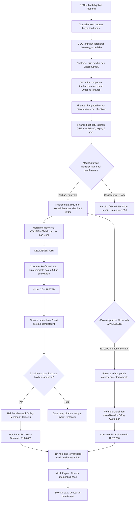

# SERVIO — PHASE 06: PEMBAYARAN, DANA PESANAN & S-PAY
## Rancangan Bisnis dan Implementasi Lengkap V3 — Fokus Integrasi Order Barang (05A)

| Informasi | Keterangan |
|---|---|
| Nama proyek | SERVIO |
| Modul | **06 — Pembayaran & Dana Pesanan (S-Pay)** |
| Versi | **V3 — FINAL LOCKED (22 Oktober 2026)** |
| Fokus integrasi saat ini | **Phase 05A — Order Barang** |
| Modul jasa 05B | **Tidak dibahas dan tidak diimplementasikan dalam rencana ini**; integrasi berikutnya menyusul |
| Arsitektur | Next.js → Laravel REST API → MongoDB; domain-oriented services |
| Pembayaran | **Mock Payment Gateway**: QRIS dan Virtual Account dummy |
| Pencairan | **Mock Payout**: simulasi transfer ke bank; tidak ada pemindahan uang asli |
| Referensi | Rancangan Finance V2 Model C; PHASE-05A-ORDER-BARANG-REVISED-LOCKED (V3); keputusan diskusi terbaru |

**STATUS: FINAL LOCKED — ACC pemilik proyek pada 22 Oktober 2026.**

> Dokumen ini adalah **source of truth Phase 06 V3 untuk alur Order Barang 05A**, menggantikan ketentuan Finance V2 yang bertentangan dengan keputusan V3 pada lingkup barang. Aspek jasa 05B **tetap menunggu pembahasan dan tidak otomatis diubah**. Persetujuan dokumen **tidak otomatis mengubah source code, database, atau dokumen 05A yang sudah ada**. Amendemen 05A terkait auto-completion 48 jam → 72 jam harus diterapkan secara eksplisit saat penyelarasan/integrasi. Seluruh tarif dalam contoh adalah simulasi, bukan tarif produksi.

---

## KEPUTUSAN LOCK & PENGENDALIAN PERUBAHAN

- **ACC:** Disetujui pemilik proyek, 22 Oktober 2026.
- **Scope aktif:** Modul 06 Finance untuk Order Barang 05A: kebijakan CEO, perhitungan tagihan per checkout, QRIS/VA mock, verifikasi backend Finance, Dana Pesanan, S-Pay Customer/Merchant, refund, dan pencairan dummy.
- **Perubahan dari Finance V2:** S-Pay bukan wallet belanja; biaya aplikasi Customer Barang sekali per CheckoutGroup; pencairan manual minimal Rp20.000 dengan biaya transfer dipotong dari nominal penarikan; dana Merchant ditahan 120 jam setelah Order COMPLETED; refund Customer yang berhasil didanai masuk S-Pay Customer.
- **Amendemen terkait 05A:** auto-completion menjadi 72 jam setelah DELIVERED valid dan tidak ada hold/masalah aktif; aturan lama 48 jam harus diperbarui melalui perubahan dokumen 05A tersendiri.
- **Belum masuk scope:** bisnis dan lifecycle pembayaran jasa 05B, implementasi provider jasa, payment gateway/payout nyata, serta pajak produksi yang belum ditetapkan secara sah.
- **Kontrol:** Setiap perubahan bisnis setelah LOCK harus melalui diskusi dan persetujuan baru; contoh nominal dalam dokumen tidak berubah menjadi tarif otomatis.
- **Status implementasi:** penguncian dokumen **bukan** bukti backend/frontend sudah diimplementasikan atau diuji.

---

# 1. TUJUAN, PRINSIP DAN BATASAN

## 1.1 Tujuan

Modul 06 mengelola uang **berdasarkan pesanan**: CEO menentukan kebijakan biaya dan komisi; Finance menghitung total tagihan; Customer membayar lewat QRIS/VA dummy; backend Finance memeriksa hasil simulasi; dana pesanan tercatat sebagai **ditahan**; setelah Order selesai dan melewati **5 hari masa tahan**, hak bersih Merchant menjadi **Saldo S-Pay Tersedia**; pemilik saldo dapat mengajukan pencairan ke rekening bank. Jika Order sah dibatalkan, Finance mengembalikan **100% alokasi pembayaran yang memenuhi aturan 05A** ke S-Pay Customer.

## 1.2 Arti S-Pay dalam SERVIO

**S-Pay = akun pencatatan dana hasil transaksi/refund yang bisa dicairkan, BUKAN dompet untuk berbelanja.**

- **Customer S-Pay:** hanya berisi hasil refund yang sah dan telah didanai.
- **Merchant S-Pay:** hanya berisi hak bersih penjualan organisasi Merchant yang sudah eligible untuk pencairan.
- **Provider S-Pay:** konsep akun organisasi untuk jasa di masa depan, **belum diimplementasikan di scope 05A**.
- Tidak ada top-up, checkout dengan saldo S-Pay, transfer antarpengguna, pembayaran tagihan memakai saldo, atau saldo Worker.
- Uang asli **tidak** disimpan pada MongoDB. Selama fase ini seluruh nominal, dana ditahan, refund dan transfer adalah simulasi backend. Integrasi penyedia pembayaran dan pengelolaan dana yang sah dilakukan terpisah sebelum produksi.

## 1.3 Prinsip tetap

1. **CEO membuat/merilis kebijakan**; Finance membaca dan menerapkan, tidak bebas mengganti tarif.
2. **Pajak bukan komisi**; CEO tidak menetapkan tarif pajak sekehendak hati.
3. **Biaya aplikasi Customer Barang dikenakan SEKALI untuk satu checkout**, tidak per item dan tidak per toko.
4. **Satu checkout bisa terdiri dari beberapa Merchant**, tetapi setiap Merchant mempunyai Order, alokasi dana, dan status sendiri.
5. Merchant hanya menerima Order setelah Finance mengonfirmasi `PAID` yang sah.
6. Dana yang masih ditahan **bukan** S-Pay Tersedia dan **tidak bisa ditarik**.
7. Keputusan pembatalan milik 05A; **eksekusi refund** milik 06.
8. Pencairan S-Pay **diminta manual oleh pemilik saldo/anggota organisasi yang berwenang**; Admin Finance bukan pemilik dana.
9. Data historis biaya, pembayaran, refund, dan pencairan tidak ditimpa diam-diam.
10. Sistem backend wajib memvalidasi setiap perubahan penting; UI hanya menampilkan aksi dan respons.

## 1.4 Di dalam scope sekarang

- Kebijakan Platform CEO: biaya/komisi, penjadwalan versi, monitoring pendapatan.
- Konfigurasi simulasi QRIS, Virtual Account, dan pencairan dummy.
- Penghitungan biaya aplikasi per checkout dan komisi Merchant per Order.
- Pembayaran gabungan dan alokasi per Merchant Order.
- Pemeriksaan status pembayaran mock oleh backend Finance.
- Dana Pesanan ditahan, pemeriksaan eligible, pemindahan hak bersih ke S-Pay setelah masa tahan.
- S-Pay Customer (refund) dan S-Pay Merchant (hasil penjualan).
- Bank penerima, pencairan manual, potongan biaya transfer, dan riwayat.
- Refund penuh untuk pembatalan sah 05A.
- UI CEO, Admin Finance, Customer, Merchant; laporan, keamanan, audit, uji simulasi.

## 1.5 Di luar scope saat ini

- **05B Order Jasa**: booking, survey fee, proposal, pembayaran bertahap, komisi Provider operasional, dan aturan refund jasa.
- Integrasi gateway asli, QRIS/VA sungguhan, bank API atau transfer asli.
- Dompet belanja, top-up, transfer S-Pay ke pengguna lain.
- Pembayaran gaji Worker.
- Pemrosesan Return/Claim/Dispute itu sendiri (hak keputusan di Modul 07/09).
- Penentuan tarif pajak produksi tanpa verifikasi peraturan/kondisi usaha.

---

# 2. SEMUA ROLE DAN KEWENANGAN

| Role / sistem | Boleh / bertanggung jawab | Tidak boleh |
|---|---|---|
| **CEO_PRODUCT_OWNER** | Mengatur Kebijakan Platform: membuat nama biaya, target, Rupiah/persen, nilai, tanggal berlaku, mengelola versi; melihat Pendapatan SERVIO | Menandai payment PAID, mencairkan saldo orang lain, mengedit histori uang manual, mengubah tarif pajak secara bebas |
| **FINANCE_PAYMENT_OPS** | Mengelola operasional tagihan, melihat kebijakan CEO read-only, memeriksa pembayaran, memantau dana ditahan, refund, pencairan, dan exception; simulator hanya di mode demo | Mengganti aturan fee CEO; menyetujui pembatalan pesanan sendiri; mencairkan tanpa permintaan sah pemilik |
| **CUSTOMER** | Checkout, memilih QRIS/VA, melihat invoice/payment/struk, melihat refund dan S-Pay Customer, menambahkan rekening, mengajukan pencairan refund | Membuat status PAID, mengubah alokasi biaya, mengakses S-Pay Merchant |
| **MERCHANT_OWNER** | Mengakses S-Pay organisasi, melihat dana ditahan/tersedia, memilih rekening dan mengajukan pencairan | Mengubah fee, status pembayaran atau dana organisasi lain |
| **MERCHANT_FINANCE_AUTHORIZED** | Anggota organisasi Merchant yang memang mendapat izin keuangan: melihat saldo dan, jika diizinkan, mengajukan pencairan | Mencairkan organisasi lain/tanpa izin |
| **DEVELOPER / DEMO OPERATOR** | Menguji Mock Payment/Mock Payout melalui kontrol khusus non-production | Memakai simulator untuk transaksi nyata |
| **05A ORDER SERVICE** | Memiliki checkout, Merchant Order, status, pembatalan, delivery, completedAt; mengirim event tepercaya ke Finance | Membuat uang, mengubah S-Pay, mengesahkan PAID dari browser |
| **06 FINANCE SYSTEM** | Hitung tagihan, verifikasi mock, catat alokasi, refund, holding, S-Pay dan pencairan; tolak duplikasi | Mengubah status pengemasan/pengiriman Order sesuka hati |
| **01 IDENTITY/RBAC** | Memberikan identitas pemilik, membership organisasi, izin, dan data rekening sesuai boundary yang disepakati | Memiliki transaksi dan saldo Finance |

**Catatan:** Akun Provider dan hak keuangannya dapat menggunakan arsitektur S-Pay organisasi yang sama di tahap berikutnya, tetapi tidak dibuat sebagai flow aktif 05B dalam dokumen ini.

---

# 3. MASTER FLOW — DARI CEO SAMPAI PENCAIRAN



> **Alur utama selesai:** CEO menetapkan kebijakan → Customer checkout dan pembayaran mock → Finance verifikasi → dana ditahan → Order selesai → tahan 5 hari → S-Pay Merchant tersedia → Merchant cairkan. **Alur pembatalan:** Finance memproses refund sah → S-Pay Customer tersedia → Customer cairkan.

---

# 4. TAHAP 1 — CEO MENENTUKAN KEBIJAKAN PLATFORM

## 4.1 Lokasi menu CEO

**Sidebar CEO → Kebijakan Platform → Biaya & Komisi**.

Tambahan: **Kebijakan Platform → Ketentuan Pajak** (hanya aturan yang diverifikasi), dan **Pendapatan SERVIO** (dashboard pemasukan, terpisah dari dana Customer).

## 4.2 Form `+ Tambah Aturan Biaya`

| Input | Aturan / UI |
|---|---|
| **Nama Aturan** | Bebas, contoh `Biaya Layanan SERVIO` atau `Komisi Penjualan` |
| **Berlaku Untuk** | Multi-select **Customer**, **Merchant Barang**, **Provider Jasa**; boleh pilih satu, dua, atau tiga |
| **Jenis Transaksi** | Barang / Jasa berdasarkan target relevan. Dalam implementasi scope sekarang, hanya **Barang** aktif |
| **Bentuk Biaya** | **Rupiah Tetap (FIXED)** atau **Persentase (PERCENTAGE)** |
| **Besaran** | Angka nonnegatif; persentase menggunakan basis yang jelas |
| **Dasar Perhitungan** | Customer Barang: **per checkout**. Merchant Barang: atas nilai barang eligible per Merchant Order. Target jasa dikonfigurasi nanti |
| **Mulai Berlaku** | Timestamp efektif kebijakan |
| **Berakhir** | Opsional, sesuai penjadwalan kebijakan |
| **Catatan / Alasan** | Diisi saat menambah/mengubah kebijakan |
| **Aksi** | Simpan Draft, Terbitkan Sekarang, Jadwalkan, Nonaktifkan |

**Penyederhanaan UX:** CEO boleh memilih beberapa pihak dalam satu form, tetapi sistem menyimpan **rincian kebijakan terpisah per target dan jenis transaksi**. Mode satu nilai sama untuk beberapa target boleh digunakan jika kompatibel; jika berbeda, tampilkan input nilai per target. Jangan menggabungkan komisi Merchant dan biaya Customer menjadi satu nominal tidak jelas.

## 4.3 Klasifikasi sumber pemasukan Model C

Tetap tersedia empat kode stabil di belakang layar agar Finance tidak salah menghitung:

1. `CUSTOMER_PRODUCT_APP_FEE` — biaya aplikasi Customer Barang (**per checkout gabungan**).
2. `CUSTOMER_SERVICE_APP_FEE` — biaya aplikasi Customer Jasa (**bukan scope implementasi ini**).
3. `MERCHANT_PRODUCT_COMMISSION` — komisi Merchant atas penjualan barang eligible.
4. `PROVIDER_SERVICE_COMMISSION` — komisi Provider Jasa (**bukan scope implementasi ini**).

**Untuk 05A hanya kode 1 dan 3 yang dihitung aktif.** Satu nama kebijakan CEO bisa mempunyai lebih dari satu rincian target, tetapi Finance memproses berdasarkan kode/target/versinya, bukan berdasarkan nama teks.

## 4.4 Lima tab pengelolaan kebijakan

| Tab | Isi | Aksi |
|---|---|---|
| **Aktif** | Aturan yang sekarang digunakan untuk transaksi baru | Detail, Buat Revisi, Nonaktifkan |
| **Draft** | Aturan baru atau revisi yang belum terbit | Edit Draft, Hapus Draft, Terbitkan/Jadwalkan |
| **Terjadwal** | Versi baru dengan waktu berlaku di masa depan | Detail, Batalkan jadwal jika berwenang |
| **Riwayat** | Versi lama dan perubahan yang sudah terjadi | Lihat versi lama, tarif lama/baru, alasan, timestamp |
| **Nonaktif** | Kebijakan dihentikan untuk transaksi baru | Lihat Detail, buat versi baru jika perlu |

**Tabel utama desktop:** Kode/nama aturan, target, barang/jasa, bentuk, nominal/persen, dasar hitung, versi, tanggal berlaku, status, aksi. Mobile boleh card view.

## 4.5 Cara CEO mengubah nominal

Contoh: Biaya aplikasi Barang **Rp2.000 (V1)** menjadi **Rp3.000 (V2)**:

1. CEO membuka tab **Aktif** dan klik **Buat Revisi**.
2. Sistem Kebijakan Platform membuat **Draft V2**, tidak menimpa V1.
3. CEO mengubah nilai dan memasukkan alasan.
4. CEO memilih **Terbitkan Sekarang** atau **Jadwalkan**.
5. Saat waktu berlaku tiba, V2 menjadi Aktif dan V1 pindah Riwayat.
6. Checkout baru memakai V2; **checkout lama tetap memakai snapshot V1**, termasuk yang masih menunggu pembayaran.
7. Tidak boleh dua versi aktif bertabrakan pada target, dasar hitung, dan rentang waktu yang sama.

Nilai tarif produksi belum ditentukan. Angka contoh hanya fixture DEMO.

## 4.6 Pajak

- Pajak **tidak** dibuat dengan form bebas komisi yang sama.
- Menu CEO **Ketentuan Pajak** menampilkan jenis pajak, pihak yang berkewajiban, dasar hitung, sumber aturan terverifikasi, versi/masa berlaku dan status peninjauan.
- Finance membedakan pajak dari biaya aplikasi, komisi, serta hasil bersih mitra.
- Dalam mode mock, ketentuan pajak yang belum disetujui diberi label **MOCK / BELUM DIKONFIGURASI**. Jangan menyatakan pajak nol sebagai ketentuan produksi.

---

# 5. TAHAP 2 — FINANCE MEMPERSIAPKAN PERHITUNGAN

## 5.1 CEO vs Admin Finance

- CEO = **pemilik kebijakan bisnis biaya/komisi**.
- Admin Finance = **operator pemantauan dan pemrosesan** memakai kebijakan yang sudah terbit, **read-only terhadap tarif CEO**.
- Laravel Finance backend = **sumber hasil perhitungan resmi**; browser tidak boleh menghitung final dengan angka buatan sendiri.

## 5.2 Biaya aplikasi sekali per checkout

Misalnya satu Customer membeli **3 barang dari 2 Merchant** dalam satu checkout. Biaya aplikasi Customer hanya **1 kali**, meskipun ada 3 item dan 2 Merchant Order.

- Jika kebijakan bertipe **FIXED**, nilai sekali checkout, bukan dikalikan jumlah produk/toko.
- Jika kebijakan bertipe **PERCENTAGE**, persentase diterapkan **sekali terhadap dasar checkout eligible gabungan**, bukan dijumlahkan ulang dari biaya checkout per toko.
- Komisi Merchant berbeda: dihitung terhadap harga barang eligible **milik masing-masing Merchant**, dan dipotong dari hak mitra, bukan dikenakan lagi kepada Customer sebagai komponen komisi.
- Ongkir lokal berasal dari 05A, tarif Merchant per toko; biaya aplikasi berasal dari 06.

## 5.3 Alokasi biaya aplikasi gabungan

Supaya refund per toko selalu tepat, Finance menyimpan **alokasi biaya aplikasi checkout** ke setiap Merchant Order menggunakan rumus deterministik. Untuk mock 05A gunakan **proporsi subtotal barang eligible per toko**, lalu lakukan pembulatan sehingga **jumlah alokasi tepat sama** dengan biaya aplikasi total (sisa pembulatan dibagi dengan aturan urutan ID stabil).

Contoh: subtotal barang Toko A = Rp100.000, Toko B = Rp200.000; biaya aplikasi checkout Rp3.000 → alokasi A = Rp1.000 dan B = Rp2.000. **Customer tetap hanya membayar biaya aplikasi Rp3.000 sekali.**

Alokasi tersebut adalah pencatatan untuk rincian/refund, bukan tagihan ulang per toko.

## 5.4 Snapshot keuangan

Saat checkout diterbitkan, Finance menyimpan snapshot versi biaya aktif, jenis fee, dasar hitung, nilai, alokasi per Merchant Order, komisi per Merchant, ongkir, komponen pajak terverifikasi atau mock, total Customer dan perhitungan hak Merchant. Perubahan kebijakan CEO di kemudian hari **tidak mengubah transaksi yang sudah dibuat**.

---

# 6. TAHAP 3 — CUSTOMER MEMBUAT CHECKOUT 05A

## 6.1 Alur Customer

**Katalog Barang → Detail → Tambah ke Keranjang / Beli Sekarang → Checkout gabungan → Pilih Buku Alamat 01 → Ringkasan per toko → Pilih QRIS/VA → Bayar dummy.**

- Produk dan stok: Modul 03.
- Alamat: Buku Alamat Modul 01.
- Keranjang, ongkir Merchant, CheckoutGroup, Merchant Order: Modul 05A.
- Fee, tax, payment intent, status pembayaran, alokasi dana: Modul 06.
- Satu CheckoutGroup dapat mempunyai banyak Merchant Order; satu Merchant Order **hanya satu toko**.
- Sebelum mengeluarkan tagihan, 05A memvalidasi kelayakan alamat, harga/stok, tarif pengiriman, dan seluruh Merchant Order.

## 6.2 Contoh checkout gabungan (angka DEMO)

**Kebijakan contoh:** biaya aplikasi Customer Barang Rp3.000 **sekali per checkout**; komisi Merchant **5% dari subtotal harga barang**; ilustrasi pajak = Rp0 **khusus fixture**.

| Komponen | Toko A | Toko B | Gabungan |
|---|---:|---:|---:|
| Subtotal barang | Rp100.000 | Rp200.000 | Rp300.000 |
| Ongkir lokal | Rp10.000 | Rp15.000 | Rp25.000 |
| Alokasi biaya aplikasi | Rp1.000 | Rp2.000 | **Rp3.000 sekali** |
| Pajak mock pada contoh | Rp0 | Rp0 | Rp0 |
| **Alokasi pembayaran Customer** | **Rp111.000** | **Rp217.000** | **Rp328.000** |
| Komisi Merchant (5% barang) | Rp5.000 | Rp10.000 | Rp15.000 |
| **Hak bersih Merchant (contoh)** | **Rp105.000** | **Rp205.000** | **Rp310.000** |

Kontrol pemeriksaan: Rp328.000 total dibayar = Rp310.000 hak bersih kedua Merchant + Rp15.000 komisi contoh + Rp3.000 biaya aplikasi contoh. Pajak dan biaya penyedia pembayaran lainnya tidak dimodelkan dalam fixture ini.

**Jangan menyebut seluruh Rp328.000 sebagai pendapatan SERVIO.** Pendapatan platform dari dua fee/komisi dalam fixture = Rp18.000 sebelum penyesuaian, dengan waktu pengakuan mengikuti aturan Finance yang berlaku.

---

# 7. TAHAP 4 — PEMBAYARAN QRIS / VA DUMMY

## 7.1 Membuat tagihan

1. 05A meminta Finance menerbitkan tagihan untuk `checkout_group_id` terverifikasi beserta alokasi Order.
2. Finance menentukan total server-side dan menyimpan satu payment intent.
3. Customer memilih **QRIS** atau **Virtual Account** (sesuai kanal mock aktif).
4. Finance mengeluarkan nomor transaksi, total pembayaran, instruksi **DEMO**, serta batas waktu **6 jam** dari waktu tagihan sah dibuat.
5. Customer melihat invoice dan countdown yang mereferensikan `expires_at` dari backend (bukan timer yang reset saat reload).
6. QRIS demo **tidak dapat dibayar**; nomor VA demo bukan rekening yang aktif.

## 7.2 Payment state

- `PENDING` — menunggu hasil pembayaran mock.
- `PAID` — berhasil setelah Finance memvalidasi hasil tepercaya dari simulator.
- `FAILED` — hasil pembayaran gagal.
- `EXPIRED` — melewati tenggat dan belum berhasil dibayar.
- `PARTIALLY_REFUNDED` — sebagian alokasi Order sudah dikembalikan.
- `REFUNDED` — seluruh nilai pembayaran telah berhasil dikembalikan.

Status pembayaran **terpisah** dari status Order, Dana Pesanan, RefundTransaction, dan Pencairan.

## 7.3 Pemeriksaan Finance (wajib nyata dalam backend, input tetap dummy)

Simulator hanya untuk Admin Finance/Developer dalam lingkungan demo. **Customer tidak boleh klik `Simulate Paid`** untuk mengesahkan transaksinya sendiri.

Finance backend memeriksa:

1. Identitas payment intent benar.
2. CheckoutGroup dan alokasi Merchant Order terdaftar.
3. Jumlah pembayaran mock **persis** sama dengan jumlah tagihan.
4. Jenis metode/referensi transaksi sesuai.
5. Pembayaran belum kadaluwarsa ketika dikonfirmasi (dan kondisi race dicek secara aman).
6. Status sebelumnya masih memungkinkan transisi.
7. Konfirmasi belum pernah diproses (idempotency).
8. Sumber konfirmasi berasal dari kanal mock internal yang berizin, bukan request UI Customer.

Jika lolos → Finance catat **`PAID` satu kali**, menyimpan waktu dan rekam audit, kemudian mengirim event tepercaya ke 05A untuk mengubah **setiap Merchant Order** dari menunggu bayar menjadi `CONFIRMED`.

Jika pembayaran gagal/kedaluwarsa → Finance mencatat FAILED/EXPIRED; 05A membatalkan Merchant Order belum dibayar dan melepas reservasi stok sesuai lifecycle. Merchant **tidak pernah menerima Order unpaid**.

**Catatan:** selama tahap mock, `PAID` berarti pembayaran simulasi telah lolos pemeriksaan Finance, **bukan bukti uang benar-benar diterima**.

---

# 8. TAHAP 5 — DANA PESANAN DITAHAN

Setelah `PAID`, Finance membentuk catatan **Dana Pesanan** per Merchant Order dari alokasi pembayaran Customer yang telah diverifikasi, bukan satu saldo campur seluruh checkout.

| Contoh | Alokasi Customer | Hak bersih Merchant contoh | Kondisi |
|---|---:|---:|---|
| Order A | Rp111.000 | Rp105.000 | **Dana Ditahan** |
| Order B | Rp217.000 | Rp205.000 | **Dana Ditahan** |

- Alokasi Customer menjadi dasar refund jika Order tersebut dibatalkan secara sah.
- Hak bersih Merchant merupakan jumlah calon pencairan setelah biaya/komisi/pajak yang sah.
- Dana Ditahan **belum masuk saldo S-Pay Tersedia**.
- Setiap Merchant melihat dana pesanan **milik organisasi sendiri**; Finance melihat ringkasan seluruh organisasi sesuai permission.
- Satu Merchant Order selesai tidak memaksa Merchant Order lain ikut selesai atau dicairkan.

---

# 9. TAHAP 6 — MERCHANT MENYELESAIKAN ORDER BARANG

Seluruh fulfillment tetap di Modul 05A.

## 9.1 Canonical Order Status (tetap)

`CREATED → PAYMENT_PENDING → CONFIRMED → PROCESSING → PACKED → DELIVERING → DELIVERED → COMPLETED`; exception `CANCELLED`.

Merchant melihat Order baru **mulai `CONFIRMED`** dan memprosesnya secara terpisah per toko.

- `PACKED` tetap di tab **Diproses** Customer/Merchant.
- `DELIVERING` dan `DELIVERED` di tab **Dikirim**.
- Merchant memilih **Kurir Toko** atau **GoSend yang dipesan sendiri**, tidak perlu integrasi kurir di Finance.
- Merchant mencatat bukti serah-terima valid sebelum `DELIVERED`.
- Customer dapat menekan **Pesanan Diterima** untuk `COMPLETED` manual.

## 9.2 Perubahan waktu auto-completion 05A untuk revisi berikutnya

**Keputusan bisnis terbaru untuk dimasukkan sebagai amendemen 05A:** auto-completion menjadi **3 hari (72 jam)** setelah `delivered_at` valid, **bukan 48 jam** seperti dokumen 05A V3 sebelumnya. Auto-completion tidak dijalankan jika ada laporan masalah, sengketa, atau hold aktif.

- Jika Customer mengonfirmasi lebih cepat, `completed_at` adalah waktu konfirmasi sah.
- Jika tidak konfirmasi, eligible Order otomatis `COMPLETED` setelah 72 jam sejak `DELIVERED` valid.
- Jika ada hold aktif, Order tidak boleh dipaksa `COMPLETED` hanya karena waktu berlalu.

Perubahan waktu ini **harus disinkronkan ke dokumen 05A**, tetapi **tidak mengubah tab, CheckoutGroup, metode kirim, atau lifecycle status yang lain**.

---

# 10. TAHAP 7 — TAHAN DANA **5 HARI SETELAH COMPLETED**

## 10.1 Aturan utama

**Mulai hitung masa tahan dari `order.completed_at` yang sah**, bukan dari waktu checkout, `PAID`, `DELIVERING`, atau `DELIVERED`.

- `eligible_release_at = completed_at + 5 × 24 jam` (**120 jam**).
- Saat Order menjadi `COMPLETED`, dana **masih ditahan selama 5 hari penuh**.
- Setelah 120 jam lewat, Finance memeriksa kondisi Order, pembatalan/refund, sengketa/hold, dan ketersediaan hak dana.
- Bila lolos → hak bersih Merchant dipindahkan secara pencatatan ke **Saldo S-Pay Tersedia** **tepat sekali**.
- Bila tidak lolos → tetap Ditahan, status/alasan dapat dilihat pemilik sesuai izin.
- Sistem menghitung dari timestamp backend; scheduler/job di backend dapat menjalankan pelepasan; setiap proses tahan retry/duplikasi.

## 10.2 Contoh timeline tanpa konfirmasi manual

| Waktu relatif | Order | Dana |
|---|---|---|
| Hari 0 | `DELIVERED` valid | Ditahan |
| Hari 3 | Auto-`COMPLETED` sah (72 jam) | **Mulai** tahan tambahan 5 hari |
| Hari 3–8 | `COMPLETED` | Tetap ditahan |
| Hari 8 | Sudah 120 jam sejak `COMPLETED` dan pemeriksaan lolos | Masuk **S-Pay Tersedia** |
| Setelah hari 8 | Tetap `COMPLETED` | Merchant boleh ajukan pencairan |

Jika Customer konfirmasi pada hari pertama, `COMPLETED` di hari 1 → dana paling cepat eligible **hari 6**, bukan hari 8.

## 10.3 Perbedaan penting

- **3 hari** = batas auto-completion Order setelah penerimaan valid.
- **5 hari** = masa penahanan hasil penjualan **setelah** Order `COMPLETED`.
- **Proses bank** = waktu yang dibutuhkan untuk memproses permintaan tarik dana setelah saldo tersedia; tidak disamakan dengan dua periode di atas.

---

# 11. TAHAP 8 — S-PAY MERCHANT: SALDO HASIL PENJUALAN

## 11.1 Ownership

- S-Pay Merchant **milik organisasi Merchant**, bukan pribadi staf.
- Jika satu orang mengelola beberapa toko/organisasi, catatan S-Pay tiap organisasi tetap terpisah.
- Merchant Owner atau anggota organisasi dengan permission finance yang sesuai boleh meminta pencairan.
- Worker dan Customer tidak bisa melihat saldo organisasi Merchant.

## 11.2 Informasi di halaman S-Pay Merchant

1. **Saldo Tersedia** — hak bersih yang sudah melewati tahan 5 hari dan lolos pemeriksaan.
2. **Dana Ditahan** — ringkasan dana pesanan yang belum eligible (bukan saldo tarik).
3. **Sedang Dicairkan** — jumlah permintaan penarikan yang sudah dikunci.
4. **Total Dicairkan** — nilai historis pencairan yang dikonfirmasi berhasil.
5. **Rekening Bank** — rekening organisasi terverifikasi.
6. **Riwayat Mutasi** — dana masuk, potongan komisi, penahanan, pelepasan, permintaan/hasil pencairan.
7. Aksi **Cairkan Dana**.

## 11.3 Tidak ada fitur dompet umum

Tidak ada Top Up, Bayar Pesanan, Scan QR untuk belanja, Kirim Saldo, Transfer ke akun S-Pay lain, ataupun konversi saldo.

---

# 12. TAHAP 9 — PENCAIRAN S-PAY KE BANK

## 12.1 Kebijakan pencairan yang telah disepakati

| Aturan | Keputusan |
|---|---|
| **Minimum setiap permintaan** | **Rp20.000** (nominal sebelum biaya transfer) |
| **Maksimum** | Tidak ada batas tambahan selain **Saldo Tersedia** yang sah |
| **Pencairan sebagian** | Boleh |
| **Frekuensi** | Bebas melakukan permintaan ulang selama dana eligible dan tidak sedang dikunci |
| **Peminta** | Pemilik saldo Customer atau Owner/anggota berizin untuk organisasi Merchant |
| **Tujuan** | Rekening bank terdaftar dan terverifikasi |
| **Biaya transfer** | Ditanggung pemilik saldo |
| **Cara potong biaya** | **Dipotong dari nominal pencairan**, bukan tambahan debit di luar nominal |
| **Keamanan** | Konfirmasi rincian + PIN/konfirmasi tambahan sesuai sistem otorisasi |
| **Transfer gagal** | Nominal terkunci **dipulihkan** menjadi Saldo Tersedia setelah kegagalan terverifikasi |
| **Mode saat ini** | Mock Payout: simulasi tanpa transfer uang sungguhan |

## 12.2 Perhitungan biaya transfer

Contoh **hanya simulasi**:

| Komponen | Nominal |
|---|---:|
| Saldo tersedia sebelum pencairan | Rp250.000 |
| Nominal yang diminta | **Rp100.000** |
| Biaya transfer contoh | **Rp2.500** |
| Estimasi diterima bank | **Rp97.500** |
| Pengurangan saldo S-Pay | **Rp100.000** |
| Saldo tersedia setelah penarikan berhasil | **Rp150.000** |

Tarif Rp2.500 **tidak ditetapkan sebagai tarif produksi**. Dalam simulasi dapat dipakai fixture penyedia pencairan; saat integrasi nyata biaya berasal dari aturan/provider yang sah. Backend menolak pencairan jika nominal kurang dari Rp20.000, melebihi saldo, atau biaya transfer menyisakan jumlah terima tidak positif.

## 12.3 Alur tombol `Cairkan Dana`

1. Pemilik membuka **S-Pay → Cairkan Dana**.
2. Sistem menampilkan Saldo Tersedia.
3. Pemilik memasukkan nominal **≥ Rp20.000**, tidak lebih dari saldo eligible.
4. Pemilik memilih rekening bank yang sudah terdaftar dan **terverifikasi**.
5. Tampilkan ringkasan: bank, nomor rekening tersamarkan, nama penerima, jumlah ditarik, biaya transfer, estimasi diterima.
6. Tampilkan peringatan: **"Pastikan bank, nomor rekening dan nama penerima sudah benar sebelum mencairkan dana."**
7. Pemilik mengonfirmasi, melalui PIN/konfirmasi keamanan tambahan.
8. Backend memeriksa izin, kepemilikan saldo/rekening, minimum, saldo tersedia dan permintaan duplikat.
9. Backend mengunci nominal pencairan; **tidak lagi tersedia** untuk permintaan lain.
10. Mock Payout menerima instruksi simulasi.
11. Finance memeriksa hasil mock. **Berhasil:** catat `SUCCEEDED`. **Gagal terkonfirmasi:** lepaskan nominal terkunci kembali ke Saldo Tersedia.
12. Tampilkan histori dan tanda **DEMO / TIDAK ADA TRANSFER NYATA**.

## 12.4 Status pencairan

`PENDING → PROCESSING → SUCCEEDED` atau `FAILED` (dengan penanganan kegagalan terkonfirmasi). Jangan menganggap request yang masih `PROCESSING` sudah berhasil diterima di bank.

## 12.5 Mengubah rekening

Pemilik dapat menambah/mengganti rekening, tetapi wajib verifikasi ulang. Rekening yang masih dalam proses verifikasi **tidak boleh dipilih untuk pencairan**. Data rekening dibatasi aksesnya dan hanya ditampilkan sebagian di daftar/detail umum.

---

# 13. ALUR REFUND CUSTOMER — PEMBATALAN ORDER BARANG

## 13.1 Keputusan pemilik domain

- **05A** memutuskan apakah pembatalan Order sah, mencatat actor, reason dan perubahan Order menjadi `CANCELLED`.
- **06 Finance** memutuskan jumlah refund berdasarkan **snapshot alokasi pembayaran yang sah** dan mengeksekusi refund simulasi.
- Permintaan pembatalan `PROCESSING` yang belum disetujui **belum** menyebabkan refund.
- Jika CancellationRequest auto-reject setelah **12 jam operasional Merchant**, Order tetap `PROCESSING`, **tidak ada refund** dan tidak ada eskalasi otomatis ke Support.

## 13.2 Refund penuh 05A

Untuk satu Merchant Order yang **sah dibatalkan setelah pembayaran**, Customer mendapatkan kembali **100% nilai pembayaran yang dialokasikan ke Merchant Order itu**, mencakup barang, ongkir, biaya aplikasi Customer yang dialokasikan, dan pajak yang dibebankan pada alokasi tersebut.

**Contoh dua Merchant:**

- Total CheckoutGroup Customer = Rp328.000 (`PAID`).
- Order Toko A dibatalkan = **refund Rp111.000**.
- Order Toko B tetap berjalan = **Rp217.000** tidak ditarik ulang atau dibatalkan.
- Payment gabungan menjadi `PARTIALLY_REFUNDED` setelah pengembalian A berhasil.
- Jika kedua Order sah dibatalkan, total refund = **Rp328.000**, payment menjadi `REFUNDED`.
- Komisi/hak penjualan dan komponen pendapatan terkait Order yang dibatalkan dikoreksi agar tidak dihitung sebagai pemasukan yang masih berhak diterima.

## 13.3 Tujuan refund: **S-Pay Customer**, bukan dompet belanja

1. Finance menerima instruksi refund sah dari domain berwenang.
2. Finance memeriksa Payment `PAID`, nominal eligible, refund terdahulu dan status penahanan dana.
3. Finance menyiapkan serta mendanai **refund mock** satu kali.
4. Setelah refund simulasi benar-benar berhasil didanai/dikreditkan, **Saldo Pengembalian S-Pay Customer bertambah** tepat sekali.
5. Customer melihat sumber Order, tanggal, nominal dan status refund.
6. Customer boleh menekan **Cairkan Dana** menggunakan aturan pencairan S-Pay yang sama.

**Tidak ada top-up; tidak bisa menggunakan refund S-Pay untuk checkout baru.** Jangan pernah menambah saldo Customer hanya karena ada permintaan refund yang masih pending atau belum didanai.

## 13.4 Refund Customer di bawah Rp20.000

**Keputusan:** saldo S-Pay Customer **belum dapat dicairkan bila kurang dari Rp20.000**. Saldo tetap tercatat; jika ada refund lain, jumlahnya dapat terkumpul.

Contoh: refund Rp12.000 → tidak bisa tarik; refund berikutnya Rp10.000 → saldo Rp22.000 → bisa mengajukan tarik minimal Rp20.000. Aturan ini adalah keputusan prototipe; perlakuan saldo refund kecil perlu diperiksa sebelum transaksi nyata.

## 13.5 Refund sebelum pembayaran

Jika Customer membatalkan CheckoutGroup yang **belum dibayar**, semua Merchant Order unpaid dalam tagihan gabungan ditutup/dibatalkan oleh 05A setelah pemeriksaan status pembayaran. **Tidak ada refund ke S-Pay**, karena tidak ada pembayaran yang sudah terjadi.

## 13.6 Status refund terpisah

Tampilkan `PENDING`, `PROCESSING`, `SUCCEEDED`, `FAILED` untuk proses refund. Status refund berbeda dari `CANCELLED` dan berbeda dari `REFUNDED/PARTIALLY_REFUNDED` pada Payment.

---

# 14. CUSTOMER S-PAY DAN PENCAIRAN REFUND

## 14.1 UI Customer

**Customer → S-Pay** memuat:

- **Saldo Pengembalian Tersedia**.
- Riwayat refund dari Order Barang, termasuk nomor pesanan/toko.
- Status refund yang masih diproses (**bukan saldo tarik**).
- Daftar rekening bank terverifikasi milik Customer.
- Tombol **Cairkan Dana** jika saldo tersedia **≥ Rp20.000**.
- Riwayat permintaan pencairan beserta biaya bank dan nominal diterima.

## 14.2 Flow Customer setelah pembatalan

`Pesanan → Barang → Batal → Lihat Detail Refund → Finance menyelesaikan refund mock → S-Pay Customer bertambah → Cairkan Dana → Pilih Rekening → Konfirmasi → Mock Transfer Berhasil/Gagal`.

Customer tidak dapat memilih refund belum didanai untuk dicairkan. Dana refund Customer **tidak dikenakan masa tahan hasil penjualan 5 hari**; setelah kredit refund sah dan berhasil didanai, saldo langsung tersedia (tetap minimum Rp20.000 untuk pencairan).

---

# 15. HALAMAN DAN UI PER ROLE

## 15.1 CEO

**Menu sidebar:**

- **Kebijakan Platform → Biaya & Komisi**: tombol Tambah Aturan, form target multi-select, angka Rupiah/persen, dasar hitung, lima tab, detail versi, pengubahan tarif, jadwal berlaku.
- **Kebijakan Platform → Ketentuan Pajak**: aturan pajak yang diverifikasi (tidak disamakan dengan komisi).
- **Pendapatan SERVIO**: KPI pemasukan platform, komisi Merchant, biaya aplikasi Customer Barang; komponen Customer Jasa/Provider Jasa dapat disiapkan struktur laporan namun tanpa flow aktif 05B; grafik tren, donut komposisi, filter periode dan rincian sumber.

**Pemisahan wajib:** Nilai checkout Customer/dana ditahan/hak Merchant **bukan seluruhnya pendapatan SERVIO**.

## 15.2 Admin Finance

**Menu:**

1. **Ringkasan Finance** — total tagihan, mock PAID/PENDING/FAILED/EXPIRED, dana ditahan, refund/pencairan, kebutuhan pemeriksaan.
2. **Pembayaran** — tabel payment, detail satu CheckoutGroup, QRIS/VA, expiry, alokasi per Merchant Order, jejak konfirmasi mock.
3. **Dana Pesanan** — tabel Order, Merchant, uang dialokasikan, potongan komisi, hak bersih, `completed_at`, `eligible_release_at`, ditahan/tersedia.
4. **S-Pay & Pencairan** — monitoring S-Pay Customer/Merchant yang relevan, request pencairan, status, biaya bank, rekening tujuan tersamarkan.
5. **Pengembalian Dana** — instruksi sah, sumber Order, nominal, status pendanaan, tanggal kredit S-Pay.
6. **Pemeriksaan / Riwayat Keuangan** — histori dan perbedaan transaksi serta tindakan perbaikan operasional.
7. **Kebijakan CEO (read-only)** — tarif, versi, target, dan tanggal berlaku.

**Khusus demo:** panel **Simulasikan Payment Berhasil/Gagal/Expired** dan **Simulasikan Pencairan Berhasil/Gagal** hanya di environment demo/development dengan izin yang benar.

## 15.3 Merchant

**Sidebar Keuangan → S-Pay**, atau gunakan halaman Keuangan existing dengan subtab S-Pay; jangan membuat menu duplikat.

Kartu ringkas: **Saldo Tersedia**, **Dana Ditahan**, **Sedang Dicairkan**; tabel sumber per Merchant Order, rincian komisi, jadwal eligible, riwayat pencairan, rekening tujuan, aksi **Cairkan Dana**.

Merchant hanya melihat organisasi yang sedang dikelola; petugas berizin dapat diberi akses sesuai role.

## 15.4 Customer

- Di **Checkout**: total barang, ongkir, biaya aplikasi **sekali**, pajak jika ada, total QRIS/VA.
- Di **Pesanan → Barang**: status bayar/refund per Merchant Order, tapi satu referensi pembayaran gabungan.
- Di **Detail Pesanan**: metode bayar, alokasi harga, dan status refund.
- Di **S-Pay**: saldo refund tersedia, histori, rekening, **Cairkan Dana**.
- Tidak ada tombol **Bayar dengan S-Pay**, **Top Up**, atau **Kirim Saldo**.

---

# 16. STATUS DAN BATAS DOMAIN

| Domain | Status utama / tampilan | Penanggung jawab |
|---|---|---|
| **Order 05A** | `CREATED`, `PAYMENT_PENDING`, `CONFIRMED`, `PROCESSING`, `PACKED`, `DELIVERING`, `DELIVERED`, `COMPLETED`, `CANCELLED` | 05A |
| **Payment** | `PENDING`, `PAID`, `FAILED`, `EXPIRED`, `PARTIALLY_REFUNDED`, `REFUNDED` | 06 |
| **Dana Pesanan** | `HELD`, `RELEASE_ELIGIBLE`, `RELEASED_TO_SPAY`, `REFUND_RESERVED` (status internal konseptual) | 06 |
| **Refund** | `PENDING`, `PROCESSING`, `SUCCEEDED`, `FAILED` | 06 |
| **S-Pay** | Nilai `available`, `withdrawal_pending` + riwayat; **bukan Order Status** | 06 |
| **Pencairan** | `PENDING`, `PROCESSING`, `SUCCEEDED`, `FAILED` | 06 |
| **CancellationRequest** | `PENDING`, `APPROVED`, `REJECTED`, termasuk reason `TIMEOUT_NO_RESPONSE` | 05A |

**Catatan:** status Dana Pesanan di atas adalah rancangan internal Finance V3, bukan penambahan canonical Order Status. Status teknis final mengikuti konvensi codebase saat implementasi.

## 16.1 Lima tab Order Customer tetap

- **Belum Bayar:** CREATED / PAYMENT_PENDING.
- **Diproses:** CONFIRMED / PROCESSING / PACKED.
- **Dikirim:** DELIVERING / DELIVERED.
- **Selesai:** COMPLETED.
- **Batal:** CANCELLED.

## 16.2 Lima tab Order Merchant tetap

- **Masuk:** CONFIRMED.
- **Diproses:** PROCESSING / PACKED.
- **Dikirim:** DELIVERING / DELIVERED.
- **Selesai:** COMPLETED.
- **Batal:** CANCELLED (yang sudah pernah eligible/terlihat oleh Merchant, bukan unpaid tersembunyi).

Tidak ada perubahan tab hanya karena Finance memakai S-Pay.

---

# 17. OBJEK DATA KONSEPTUAL (MODUL 06)

Ini **bukan instruksi membuat tabel lintas-service**; detail penyimpanan mengikuti repository dan domain Finance existing.

| Objek | Data penting |
|---|---|
| `FeePolicy` | kode biaya, nama, target, tipe Rp/%, nilai, dasar hitung, scope, versi, status, berlaku dari/sampai, aktor/alasan |
| `TaxRuleReference` | jenis dan dasar pajak, pihak, sumber aturan, hasil validasi, masa berlaku |
| `PaymentIntent` | payment_id, checkout_group_id, customer_id, metode, total, expires_at, payment_status |
| `PaymentAllocation` | MerchantOrder ID, Merchant organisasi, subtotal, ongkir, alokasi biaya aplikasi/pajak, total Customer, komisi, hak bersih |
| `HeldOrderFund` | Order ID, dana tertahan, `completed_at`, `eligible_release_at`, release/hold/refund state |
| `SPayAccount` | owner_type Customer/MerchantOrganization, owner_id, currency, saldo tersedia dan dana terkunci |
| `SPayMovement` | account_id, sumber payment/order/refund, credit/debit/lock/unlock, waktu dan referensi audit |
| `RefundTransaction` | order_id, payment_id, customer_id, alokasi, sumber pendanaan, status, credited_at |
| `BankDestination` | owner_id/org_id, bank, rekening terlindungi, nama penerima, verification_status |
| `WithdrawalRequest` | owner, account_id, bank_destination_id, nominal, biaya transfer, net_to_bank, status, idempotency reference |
| `FinanceAuditEvent` | aktor, aksi, waktu, sumber, before/after state, alasan, request/correlation id |

Saldo S-Pay bukan kolom yang boleh diubah lewat form admin. Semua perubahan harus berasal dari transaksi Finance yang sah dan tercatat dalam histori keuangan internal.

---

# 18. KONTRAK INTEGRASI 05A ↔ 06

## 18.1 Dari 05A ke Finance

- Permintaan kalkulasi/quote dengan produk eligible, subtotal per Merchant, ongkir, diskon yang sah jika ada, `checkout_group_id`, dan referensi Customer/Merchant.
- Permintaan satu payment intent untuk satu CheckoutGroup yang tervalidasi.
- Event terpercaya `OrderCompleted(order_id, completed_at)` per Merchant Order.
- Instruksi pembatalan sah `OrderCancelled(order_id, reason, actor, cancelled_at)` untuk memicu pemeriksaan refund.
- Event penahanan/kendala yang relevan dari domain berwenang agar dana tidak dilepas salah.

## 18.2 Dari Finance ke 05A

- Hasil quote/tagihan final beserta alokasi per Order dan expiry.
- Event `PaymentConfirmed(checkout_group_id, payment_id, paid_at)` yang dipercaya backend 05A, **tidak bersumber langsung dari Customer browser**.
- Event `PaymentFailed`/`PaymentExpired` untuk menutup checkout unpaid sesuai aturan 05A.
- Status refund/pencairan sebagai data baca di detail Order jika relevan (pencairan Merchant tidak mengubah Order Status).

## 18.3 Anti-duplikasi wajib

- Satu CheckoutGroup tidak boleh menerbitkan dua payment aktif yang saling bertabrakan.
- Callback mock yang sama tidak boleh menggandakan payment PAID maupun alokasi dana.
- Satu Order COMPLETED tidak boleh mengkreditkan S-Pay Merchant lebih dari sekali setelah 5 hari.
- Satu refund sah tidak boleh dikreditkan ke S-Pay Customer dua kali.
- Satu request pencairan tidak boleh memotong saldo atau mentransfer dua kali.
- Double click, retry jaringan, job ulang harus aman.

---

# 19. PENGAMANAN, AKSES DAN AUDIT

1. Laravel memeriksa **authentication → account status → role/permission → ownership Customer/organisasi → business state → mutation**.
2. Customer tidak bisa membuat `PAID`, mengubah fee CEO, atau menerbitkan refund.
3. Merchant tidak bisa melihat saldo dan transaksi organisasi lain.
4. Data rekening dilindungi, ditampilkan tersamar, dan ditambah/diganti hanya oleh pemilik/aktor yang berwenang melalui verifikasi.
5. PIN/konfirmasi tambahan digunakan saat mencairkan serta perubahan rekening sensitif.
6. Simulator payment/payout **dipisahkan dari endpoint pengguna** dan tersedia **hanya dalam mode demo**, tidak bisa menandai transaksi uang nyata.
7. Histori tarif CEO, payment, alokasi, dana ditahan, S-Pay credit, refund, withdrawal, dan status gagal wajib audit-able.
8. Semua nominal menggunakan representasi uang presisi, bukan float pecahan rupiah yang menyebabkan selisih.
9. Jam disimpan sebagai timestamp konsisten; aturan 6 jam/72 jam/120 jam dihitung dari waktu server, bukan jam browser pengguna.
10. Perhitungan biaya, pajak, alokasi, dan hak Merchant selalu authoritative di Finance backend.

---

# 20. CONTOH END-TO-END PER ROLE

## 20.1 Skenario A — CEO sampai Merchant mencairkan

1. CEO membuat kebijakan DEMO: Customer Barang Rp3.000 per checkout; komisi Merchant 5% nilai barang; terbitkan V1.
2. Customer memilih tiga produk dari dua Merchant dan melakukan checkout.
3. 05A membuat CheckoutGroup serta Merchant Order A/B.
4. Finance menghitung total Rp328.000 dan alokasi A Rp111.000, B Rp217.000.
5. Finance memberi satu QRIS/VA DEMO; kedaluwarsa dalam 6 jam.
6. Operator demo mengirim konfirmasi berhasil; Finance mengecek Rp328.000 dan menandai PAID.
7. Merchant A dan B menerima Order masing-masing sebagai CONFIRMED.
8. Merchant A memproses, mengirim, dan mencatat DELIVERED valid.
9. Customer tidak mengonfirmasi; setelah **72 jam** tanpa masalah, A auto-COMPLETED.
10. Finance menahan **hak bersih A Rp105.000 selama 120 jam dari completed_at**.
11. Setelah masa tahan dan validasi, hak bersih A masuk **S-Pay Merchant A tersedia**.
12. Merchant A pilih Cairkan Rp100.000, rekening bank terverifikasi, contoh biaya Rp2.500 → estimasi diterima Rp97.500.
13. Mock Payout memproses, Finance memeriksa hasil, mencatat sukses; saldo A berkurang Rp100.000 dari Rp105.000 menjadi Rp5.000.
14. Order B tetap memiliki siklus sendiri, tidak ikut diselesaikan ataupun dicairkan.

## 20.2 Skenario B — Customer menerima refund ke S-Pay lalu mencairkan

1. Checkout dua toko PAID Rp328.000.
2. Order Toko B Rp217.000 dibatalkan **secara sah** setelah bayar; Order A tetap berjalan.
3. Finance memverifikasi alokasi B dan mencatat refund penuh **Rp217.000**; payment gabungan menjadi PARTIALLY_REFUNDED setelah refund berhasil.
4. Finance mengkreditkan **Rp217.000 ke S-Pay Customer** setelah pendanaan refund mock berhasil.
5. Customer membuka S-Pay, melihat saldo refund Rp217.000 serta asal Order B.
6. Customer memilih **Cairkan Dana Rp200.000** (≥ minimum Rp20.000) ke rekeningnya yang terverifikasi.
7. Customer memeriksa nama, bank, rekening dan biaya. Contoh fee transfer Rp2.500 → estimasi bank Rp197.500.
8. Finance mengunci Rp200.000, Mock Payout mensimulasikan transfer berhasil, saldo S-Pay Customer tersisa Rp17.000.
9. Sisa Rp17.000 **tidak bisa dicairkan** sampai total saldo eligible kembali ≥ Rp20.000.

## 20.3 Skenario C — Payment expired

1. Finance menerbitkan VA/QRIS dummy total Rp328.000.
2. Enam jam berlalu tanpa konfirmasi valid.
3. Finance mencatat EXPIRED; 05A menutup semua Merchant Order unpaid satu CheckoutGroup dan melepas reservasi stok.
4. Tidak ada uang Dana Pesanan, tidak ada refund S-Pay, Merchant tidak melihat Order tersebut.

## 20.4 Skenario D — Pengajuan pembatalan PROCESSING ditolak otomatis

1. Customer mengajukan cancellation saat Order `PROCESSING`.
2. Merchant tidak merespons dalam **12 jam operasional**.
3. CancellationRequest → REJECTED (`TIMEOUT_NO_RESPONSE`), Order tetap `PROCESSING`.
4. Finance **tidak membuat refund**. Merchant boleh melanjutkan pengemasan.

---

# 21. URUTAN IMPLEMENTASI YANG DIREKOMENDASIKAN

**Urutan pembangunan tetap Finance 06 terlebih dahulu setelah kontrak minimum 05A–06 jelas.** Nomor modul tidak ditukar.

| Tahap | Implementasi | Keluaran |
|---|---|---|
| 1 | Audit backend/frontend Finance existing dan aturan pengembangan global; tetapkan kontrak 05A–06 | Tidak merusak Modul 01–04 dan fitur lama |
| 2 | Kebijakan Platform CEO: form, target, tarif, versi, lima tab | Aturan biaya/komisi aktif serta riwayat |
| 3 | Perhitungan checkout Finance: biaya Customer sekali checkout, komisi per Merchant, snapshot dan allocation | Quote yang konsisten untuk satu atau banyak Merchant |
| 4 | Mock QRIS/VA + Finance verification backend + expiry 6 jam | Payment PENDING/PAID/FAILED/EXPIRED sah dalam demo |
| 5 | Dana Pesanan per Merchant Order | Dana ditahan dan perhitungan hak Merchant |
| 6 | Pemeriksaan `COMPLETED` + masa tahan 5 hari + kredit S-Pay Merchant | Saldo tersedia sesudah 120 jam eligible |
| 7 | Refund penuh per Merchant Order + kredit S-Pay Customer | Pengembalian benar tanpa menggandakan dana |
| 8 | Rekening, minimal tarik Rp20.000, potongan fee, Mock Payout | Pencairan Customer/Merchant berjalan dan tercatat |
| 9 | UI CEO, Finance, Merchant dan Customer; scenario demo; pengujian | Semua role dapat melihat flow dan saldo yang benar |
| 10 | Integrasikan penuh dengan backend Order Barang 05A, uji lintas-role | Checkout→PAID→fulfillment→COMPLETED→S-Pay→tarik; pembatalan→refund→S-Pay→tarik |

**05B tidak dikerjakan pada tahap ini.** Ketika 05B dibahas, arsitektur S-Pay yang sama dapat diperluas ke Provider tanpa mengubah flow barang.

---

# 22. ACCEPTANCE TEST / KRITERIA SELESAI

## 22.1 CEO dan perhitungan

- [ ] CEO dapat membuat draft kebijakan satu atau multi-target.
- [ ] CEO memilih nilai Rupiah atau persen dan dasar hitung valid.
- [ ] CEO dapat terbitkan, jadwalkan dan merevisi versi kebijakan.
- [ ] Tersedia tab Aktif, Draft, Terjadwal, Riwayat, Nonaktif beserta tabel.
- [ ] Perubahan tarif tidak mengubah checkout dan invoice historis.
- [ ] Biaya Customer Barang dikenakan **sekali per CheckoutGroup**, walau 3 item/2 toko.
- [ ] Komisi Merchant dihitung terpisah dan tidak ditagihkan dua kali kepada Customer.
- [ ] Tax dan komisi tidak dicampur; tax demo diberi label.

## 22.2 Checkout dan pembayaran

- [ ] Checkout multi-Merchant mempunyai satu Payment dan alokasi tiap Merchant Order.
- [ ] QRIS/VA yang tampil jelas **DEMO** dan tidak bisa menerima uang nyata.
- [ ] Countdown 6 jam berasal dari backend `expires_at` dan tidak reset saat reload.
- [ ] Finance backend memvalidasi konfirmasi mock dan mencegah `PAID` ganda.
- [ ] Customer tidak bisa mensimulasikan pembayaran berhasil melalui API umum.
- [ ] Merchant hanya menerima Order sesudah PAID terverifikasi.
- [ ] Gagal/expired menutup checkout unpaid tanpa refund palsu.

## 22.3 Dana Pesanan, waktu dan S-Pay Merchant

- [ ] Dana per Merchant Order dipisah dan tidak langsung withdrawable.
- [ ] 05A menggunakan auto-completion **72 jam** setelah DELIVERED valid sebagai amendemen aturan lama 48 jam.
- [ ] Finance menghitung masa tahan **120 jam setelah `COMPLETED`**, bukan setelah DELIVERED.
- [ ] Jika Customer COMPLETE manual lebih awal, masa tahan dihitung dari `completed_at` manual.
- [ ] Jika ada hold/komplain aktif, pelepasan saldo diblok.
- [ ] Dana eligible hanya dikreditkan ke S-Pay Merchant **sekali**.
- [ ] S-Pay tiap Merchant organisasi terpisah.

## 22.4 Refund dan S-Pay Customer

- [ ] Pembatalan sah satu Merchant Order setelah PAID → refund **100%** alokasi Order itu.
- [ ] Pembatalan sebagian tidak merusak Merchant Order lain.
- [ ] Refund baru menambah Saldo Customer setelah mock funding/credit sukses.
- [ ] Refund Customer < Rp20.000 tercatat tetapi belum dapat dicairkan.
- [ ] Refund transaksi sama tidak pernah masuk S-Pay dua kali.
- [ ] Pembatalan unpaid tidak menghasilkan saldo refund.

## 22.5 Pencairan dan keamanan

- [ ] Customer/Merchant berizin bisa tarik sendiri; minimal Rp20.000, tidak melebihi saldo eligible.
- [ ] Penarikan sebagian dan berulang diperbolehkan selama dana tersedia.
- [ ] Pencairan hanya ke rekening terverifikasi yang pemiliknya sesuai hak akses.
- [ ] Form konfirmasi menampilkan nomor rekening tersamar, nama, bank, fee dan estimasi diterima.
- [ ] Biaya transfer **dipotong dari nominal penarikan**.
- [ ] Nominal dikunci selama proses, tidak dapat ditarik dua kali.
- [ ] Mock Payout success dan failure dapat diuji.
- [ ] Kegagalan terkonfirmasi mengembalikan dana terkunci ke saldo tersedia.
- [ ] Semua aksi kritis dilindungi izin, validasi backend, idempotency dan audit.
- [ ] Semua layar dan transaksi mock menampilkan label **SIMULASI**.

---

# 23. CATATAN PENYELARASAN DOKUMEN

1. **Finance V2 → Finance V3:** gunakan S-Pay sebagai akun pencairan hasil penjualan/refund **tanpa top-up/belanja**; pengalaman pengguna difokuskan pada Kebijakan Platform, Pembayaran, Dana Pesanan, S-Pay, Refund, Pencairan. Kebijakan CEO kini memakai **form multi-target fleksibel dan tabel versi**. Tetap pertahankan empat klasifikasi Model C, tetapi flow aktif plan ini **hanya Barang 05A**.
2. **05A V3 lama:** masih menulis auto-completion **48 jam**. Berdasarkan keputusan baru, amendemen berikutnya harus mengganti menjadi **3 hari/72 jam** dengan syarat bukti penerimaan valid dan tanpa hold aktif. **Jangan mengubah canonical status atau lima tab.**
3. **Dana tahan S-Pay:** 5 hari/120 jam dihitung **setelah `COMPLETED`**, bukan sejak DELIVERED. Jika tidak konfirmasi manual dan auto-completion tepat hari ke-3, dana baru eligible paling cepat sekitar **hari ke-8** dari serah terima valid.
4. **Fee Customer:** sekali **per CheckoutGroup**, bukan per barang atau per Merchant Order. Nilainya dialokasikan agar refund Order parsial tetap penuh dan akurat.
5. **Refund:** tujuan default Customer adalah **S-Pay Customer**, hanya setelah didanai; pencairan minimal Rp20.000 tetap berlaku.
6. **Biaya bank:** ditanggung pemilik, **dipotong dari nominal pencairan**, belum ada angka biaya transfer produksi.
7. **Scope jasa:** belum diputuskan/diperluas di sini. Jangan menerapkan asumsi 05B pada implementasi 05A.
8. **Status dokumen FINAL LOCKED per 22 Oktober 2026 (ACC pemilik proyek).** Penguncian ini berlaku untuk rencana Finance V3 khusus Order Barang 05A. Jangan mengklaim sudah mengubah dokumen lain atau source code existing.

---

# 24. FINAL FLOW — RINGKAS UNTUK DIPEGANG SAAT DEVELOPMENT

### Merchant memperoleh dana

```text
CEO: Tambah Kebijakan Biaya & Komisi (versi aktif)
  ↓
Customer: Keranjang / Beli Sekarang → Checkout gabungan
  ↓
Finance: Hitung biaya aplikasi SEKALI + fee/pajak terpisah + alokasi Merchant Order
  ↓
Finance: QRIS/VA DEMO, expiry 6 jam
  ↓
Mock Gateway → Finance memeriksa → Payment PAID
  ↓
Merchant: CONFIRMED → PROCESSING → PACKED → DELIVERING → DELIVERED
  ↓
Customer konfirmasi ATAU auto-completion 3 hari (jika eligible)
  ↓
Order COMPLETED
  ↓
Dana tetap DITAHAN 5 HARI setelah completed_at
  ↓
Finance memeriksa eligibility dan menghitung hak bersih
  ↓
S-Pay Merchant: SALDO TERSEDIA
  ↓
Merchant berizin: CAIRKAN DANA minimum Rp20.000
  ↓
Pilih BANK terverifikasi → Tampilkan fee (dipotong nominal) → Konfirmasi/PIN
  ↓
Mock Payout → Finance memeriksa → SUCCEEDED / FAILED
  ↓
Riwayat pencairan + saldo diperbarui
```

### Customer menerima refund dan mencairkan

```text
Order Barang PAID → Pembatalan yang SAH oleh 05A
  ↓
Finance memvalidasi pembayaran dan alokasi Merchant Order
  ↓
Refund 100% alokasi Order terdampak (termasuk ongkir/fee/pajak Customer terkait)
  ↓
Finance: pendanaan/kredit refund DEMO berhasil
  ↓
S-Pay Customer: SALDO PENGEMBALIAN TERSEDIA
  ↓
Jika saldo >= Rp20.000 → Customer klik CAIRKAN DANA
  ↓
Pilih rekening terverifikasi → cek nama dan nomor → lihat biaya bank → konfirmasi
  ↓
Mock Payout → Finance memeriksa → SUCCEEDED / FAILED
  ↓
Riwayat pencairan Customer diperbarui
```

**END — SERVIO PHASE 06 V3 FINAL LOCKED, KHUSUS ORDER BARANG 05A.**
