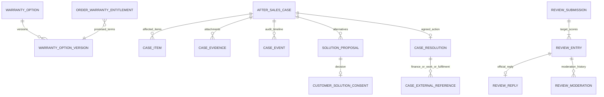

# SERVIO PLATFORM — PHASE 07 AFTER-SALES & FEEDBACK
## BACKEND TECHNICAL SPECIFICATION V1 — 10 KOMPONEN

**Status:** **DRAFT FOR TECHNICAL REVIEW — BELUM ACC TECHNICAL, BELUM IMPLEMENTED/PASS**  
**Disusun:** 3 November 2026  
**Business source of truth:** `SERVIO_PHASE-07_AFTER-SALES-FRONTEND-PLANNING-V2.2-FINAL-LOCKED.md` (V2.1 asli + amendemen solusi Customer ACC 3 November 2026).  
**Cross-reference:** Planning/technical 05A, planning/technical 05B V2, Finance 06 V3, Identity 01, Catalog 03, Offering 04, Support 09, Notification 10.  
**Target arsitektur:** Next.js (frontend), Laravel REST API (microservice), MySQL database **khusus Phase 07**, komunikasi antarmicroservice melalui HTTP service-to-service tepercaya + event outbox/inbox. Cocokkan nama folder, base path, authentication, service discovery, dan versi framework dengan repository sebenarnya **sebelum implementasi**.

> **Label keputusan:** `LOCKED BUSINESS` = keputusan yang sudah ACC dalam Planning V2.2; `PROPOSED TECHNICAL` = desain solusi backend yang masih dapat diperbaiki saat review; `CONTRACT PENDING` = dependensi yang memerlukan pemeriksaan/implementasi service lain. Dokumentasi ini **bukan hasil audit repository live**, dan contoh endpoint/payload di bawah **belum diklaim ada**. Tidak boleh mengubah LOCKED BUSINESS secara sepihak.

---

# 00 — RINGKASAN FINAL BISNIS, NON-GOALS, DAN GARIS BATAS

## 00.1 Empat domain Phase 07

1. **Rating & Ulasan:** rating Produk+Merchant atau Jasa+Provider, hanya setelah Order `COMPLETED`; teks/foto opsional, satu balasan resmi pelaku usaha per ulasan, moderasi Admin. **Tidak ada rating Worker.**
2. **Garansi & Klaim:** Merchant/Provider membuat opsi garansi (nama, durasi hari bebas, cakupan, pengecualian, status); katalog 03/04 memilih `Ada Garansi? Ya/Tidak` + **satu** opsi garansi aktif; Order menyimpan janji garansi immutable; Customer dapat mengajukan klaim saat berhak.
3. **Retur Barang:** khusus barang bermasalah, bisa parsial per item/kuantitas, tidak wajib memiliki garansi usaha aktif bila hak konsumen atas pemenuhan transaksi berlaku. **Tidak ada retur Jasa.**
4. **Refund Tracking:** Phase 07 mencatat *keputusan kasus purnajual*; **Finance 06** yang memiliki eksekusi refund, ledger, saldo S-Pay Customer, dan withdrawal. Refund bukan permintaan baru/Order kedua.

## 00.2 Amendemen bisnis V2.2 — paling penting

| Jenis pengajuan | Pilihan Customer pada form awal — WAJIB | Pemeriksa | Output yang layak |
|---|---|---|---|
| Klaim Garansi Barang | `REPLACEMENT` atau `REFUND` | Merchant pemilik Order/item | Penggantian terkait kasus atau refund Finance |
| Retur Barang | `REPLACEMENT` atau `REFUND` | Merchant pemilik Order/item | Penggantian terkait kasus atau refund Finance |
| Klaim Garansi Jasa | `REWORK` atau `REFUND` | Provider pemilik Order | Pekerjaan garansi 05B atau refund Finance |

- Pilihan awal adalah **preferensi Customer, bukan approval otomatis, bukan instruksi Finance**.
- Merchant/Provider menanggapi dalam **72 jam kalender**: menyetujui setelah pemeriksaan sah, menolak dengan alasan, meminta bukti relevan, atau menawarkan alternatif.
- Alternatif hanya dapat dilaksanakan setelah Customer **secara eksplisit** menyetujui; diam tidak dianggap persetujuan. **Perbaikan Barang** dapat menjadi alternatif klaim bila sesuai kewajiban dan disepakati; bukan pilihan wajib pada form awal.
- Lewat 72 jam tanpa respons bermakna → **TIDAK DITANGGAPI** + `Laporkan Masalah` ke Modul 09; **tidak** auto-reject, auto-approve, atau auto-refund.
- Satu masalah = satu **Case** (klaim atau retur) sepanjang negosiasi keputusan, pemenuhan, refund dan riwayat.

## 00.3 Batas domain permanen

| Owner | Domain miliknya | Phase 07 boleh melakukan |
|---|---|---|
| 01 Identity | Akun, role, membership organisasi | Verifikasi token/owner; simpan identity refs dan snapshot aman |
| 03 Product | Produk, varian, katalog dan stok | Mengelola opsi garansi 07; katalog 03 memilih ID opsi + menampilkan rating 07 |
| 04 Service Offering | Penawaran jasa | Katalog 04 memilih ID opsi garansi + menampilkan rating 07 |
| 05A Order Barang | Order Barang, item, status completed, fulfilment | Membaca snapshot Order; meminta pemenuhan penggantian terhubung, bukan Order komersial baru |
| 05B Order Jasa | Order, Worker assignment dan pengerjaan | Meminta **pekerjaan garansi** yang terhubung klaim/order asal, bukan paid Order baru |
| 06 Finance | Payment, held, S-Pay, refund execution, ledger | Mengirim **keputusan refund sah** dan membaca status Finance; tidak memindahkan saldo sendiri |
| 07 After-Sales | Review, garansi, pengajuan, solusi yang disepakati, timeline | Source of truth *case* dan *decision* |
| 09 Support/Dispute | Tiket, sengketa, mediasi, keputusan dispute | Membuka laporan dengan konteks Case, memantau hasil, tidak membangun mesin mediasi kedua |
| 10 Notification | Notifikasi/pengiriman | Menyediakan event domain yang divalidasi; 10 yang mengirim |

**Non-goals:** tidak membangun gateway/top-up/pencairan, payroll Worker, kurir baru, garansi manufaktur/integrasi asuransi, warranty asset lifecycle, chat publik bertingkat, order penggantian yang ditagih ulang, atau arbitrase sengketa di 07.

---

# 01 — SERVICE ARCHITECTURE, BOUNDED CONTEXT, KOMPONEN

## 1.1 Arsitektur logis

```text
NEXT.JS Customer / Merchant / Provider / Admin
        |
        v
Existing API Gateway / BFF + Identity 01
        |
        v
07 AFTER-SALES SERVICE (Laravel / MySQL dedicated database)
        |-- WarrantyOption / OrderWarrantyEntitlement
        |-- Review / BusinessReply / Moderation
        |-- AfterSalesCase (WarrantyClaim / ProductReturn)
        |-- ProposedSolution / Consent / Evidence / Audit
        |-- Resolution (Replacement / WarrantyRework / RefundReference)
        |-- SLA evaluator, Notification outbox, Inbox dedup, Reconciliation
        |
        +--> 05A: validated goods order/item + replacement fulfilment
        +--> 05B: validated service order + warranty job execution
        +--> 06: validated refundable payment allocation + refund transaction
        +--> 03/04: catalog warranty reference + catalog rating projections
        +--> 09: support report/dispute via existing flow
        +--> 10: events to notifier
```

**Tidak boleh:** database join antar-microservice, mengakses tabel Finance langsung, memperlakukan callback publik sebagai status PAID/SUCCEEDED, mengubah `COMPLETED` Order asli dari Phase 07, atau mengandaikan endpoint integrasi yang belum diverifikasi.

## 1.2 Modul internal yang DIUSULKAN

- `WarrantyOptionService`: opsi garansi usaha dan versi/snapshot.
- `WarrantyEntitlementService`: hak garansi dari Order, tanggal mulai/akhir.
- `ReviewService`: batch penilaian target yang diperbolehkan dan reputasi terpisah.
- `CaseService`: klaim Barang/Jasa dan retur Barang, evidence, ownership, timeline.
- `DecisionService`: keputusan awal, usulan solusi, consent Customer dan penolakan beralasan.
- `ResolutionCoordinator`: mengorkestrasi fulfilment 05A, warranty job 05B, dan refund 06.
- `SlaService`: 72h kalender, overdue, notifikasi, audit.
- `CaseProjectionService`: pembacaan Customer/Merchant/Provider/Admin; bukan sumber uang.
- `OutboxPublisher`, `InboxConsumer`, `ReconciliationJob`: integrasi idempotent.

## 1.3 Runtime dan sequencing

- Laravel route controller tipis → FormRequest → Policy/Guard → domain application service → repository → DB transaction + outbox.
- Scheduler untuk due SLA dan reconcile status, queue worker untuk S2S calls.
- Simpan timestamp UTC di database; tampilkan WIB `Asia/Jakarta` di UI; `submitted_at + 72 jam` adalah 72 jam kalender nyata, **bukan jam kerja**.
- Fitur dapat aktif bertahap melalui flags **hanya jika tidak memalsukan status dan tidak membuat proses pembayaran parsial yang tidak terjaga**.

---

# 02 — ERD LOGIS DAN SOURCE OF TRUTH



**Semua foreign keys hanya antar tabel Phase 07 sendiri.** `order_id`, `order_item_id`, `provider_org_id`, `merchant_org_id`, `worker_id`, `finance_refund_id`, `warranty_job_id` adalah string referensi dari service pemilik, **bukan FK lintas database**.

## 2.1 Record & invariant

| Record Phase 07 | Makna | Kunci unik/guard utama |
|---|---|---|
| `warranty_options` | Identitas opsi garansi suatu organisasi | `(org_type,org_id,slug)` sesuai scope |
| `warranty_option_versions` | Snapshot versi nama/durasi/syarat | `(option_id,version_no)` |
| `order_warranty_entitlements` | Hak garansi yang dijanjikan pada Order/item | `(source_kind,order_id,order_item_key)` unik untuk satu hak per unit konteks; batch item menggunakan quantity |
| `after_sales_cases` | Pengajuan klaim atau retur | `id`, `case_number` unik; `customer_id`, `owner_org_id`, `source_ref` |
| `case_items` | Barang/kuantitas terdampak atau jasa yang diklaim | Guard jumlah, item owner dan dedup |
| `case_evidence` | File bukti yang tervalidasi | `case_id`, `uploader_id`, media hash/ref, type |
| `case_events` | Timeline dan audit immutable | `(case_id,sequence)` |
| `solution_proposals` | Keputusan awal atau alternatif yang ditawarkan | `(case_id,proposal_version)` |
| `customer_solution_consents` | Approval/rejection eksplisit pada proposal alternatif | `(proposal_id,customer_id)` dengan audit |
| `case_resolutions` | **Satu solusi yang saat ini disepakati** | `(case_id)` unique, versi untuk perubahan terotorisasi |
| `case_external_refs` | ID pekerjaan garansi/penggantian/refund | `(target_service,target_id)` dan `(case_id,action_kind,sequence)` terkontrol |
| `review_submissions` | Konteks review 1 Order/suborder | `(customer_id,source_kind,source_order_id)` dengan multi-item review batch |
| `review_entries` | Nilai rating untuk target item/organisasi | `(source_kind,source_order_id,source_item_key,target_type,target_ref)` unique |
| `review_replies` | Satu balasan resmi per ulasan | `(review_entry_id)` unique |
| `review_moderations` | Keputusan tampil/sembunyi | Event immutable, reviewer/justifikasi |
| `outbox_events`, `inbox_events`, `audit_logs` | Delivery/replay/audit | `event_id` unique dan idempotency |

**Catatan desain:** Pengajuan garansi berulang untuk satu entitlement sepanjang masa berlaku boleh bila sah; **tidak otomatis mematikan hak garansi setelah klaim pertama**. Namun jumlah unit yang telah direfund/diganti tidak boleh dapat diproses ulang sebagai hak pengembalian unit yang sama. Gunakan ledger kuantitas kasus dan locking, bukan `UNIQUE(warranty_entitlement_id)` yang melarang semua klaim ulang.

---

# 03 — MYSQL SCHEMA, VALIDASI DAN KONSISTENSI

## 3.1 Konvensi

- MySQL 8.x atau versi project yang tervalidasi; charset `utf8mb4`; big integer minor units `BIGINT UNSIGNED` untuk Rupiah; hindari FLOAT untuk uang. `DATETIME(6)` UTC.
- Primary keys mengikuti standar ID repository (`ULID`/UUID); jangan buat format baru jika sistem sudah mengunci satu format.
- Foreign key lokal yang benar, index `(owner_org_id,case_status,created_at)`, `(customer_id,created_at)`, `(response_due_at,response_state)`, `(order_id,source_kind)`, dan unique idempotency; index dimutakhirkan setelah EXPLAIN plan.
- Kolom `created_at`, `updated_at`, `deleted_at` hanya jika sesuai retention. **Jangan soft-delete riwayat finansial/decision secara menghilangkan audit**.
- Bukti file: metadata & object-storage locator, bukan BLOB di MySQL. MIME, ukuran, ownership, scan policy, private signed download; jangan membocorkan informasi PII pada ulasan publik.

## 3.2 Tabel yang diusulkan (field inti)

**`warranty_options`**: `id`, `org_type ENUM(MERCHANT,PROVIDER)`, `org_id`, `slug`, `status ACTIVE/INACTIVE`, `latest_version_id`, timestamps.  
**`warranty_option_versions`**: `id`, `option_id`, `version_no`, `name`, `duration_days INT UNSIGNED >0`, `coverage_text`, `exclusion_text`, `published_at`, `changed_by`. Edit pilihan = versi baru; Order lama tetap snapshot versi asal.  
**`order_warranty_entitlements`**: `id`, `source_kind GOODS/SERVICE`, `order_id`, `merchant_order_id nullable`, `order_item_key` (untuk Jasa kunci tunggal yang stabil), `customer_id`, `owner_org_type/id`, `catalog_ref`, `warranty_option_version_id nullable`, `snapshot_name/duration_days/coverage/exclusion`, `quantity`, `status PENDING_START/ACTIVE/EXPIRED/CANCELLED`, `ordered_at`, `source_completed_at`, `starts_at`, `expires_at`, `source_event_id`, `created_at`. **Hanya buat entitlement bila katalog Order benar-benar memilih garansi aktif saat transaksi; hak konsumen non-garansi tetap dapat memakai jalur retur sah**.  
**`after_sales_cases`**: `id`, `case_number`, `type GOODS_WARRANTY/SERVICE_WARRANTY/GOODS_RETURN`, `customer_id`, `owner_org_id`, `owner_org_type`, `source_order_kind`, `source_order_id`, `source_merchant_order_id nullable`, `entitlement_id nullable` (retur tanpa garansi boleh null), `initial_solution REPLACEMENT/REWORK/REFUND`, `reason_code`, `description`, `main_status`, `response_due_at`, `response_state`, `first_meaningful_response_at`, `overdue_first_detected_at`, `resolved_at`, `rejected_at`, `reject_reason`, `version`, timestamps.  
**`case_items`**: `case_id`, `source_item_ref`, `catalog_snapshot`, `quantity_requested INT`, `quantity_allocated INT`, `is_service BOOLEAN`, `source_order_snapshot_json` (hanya field perlu), timestamps.  
**`case_evidence`**: `id`, `case_id`, `uploaded_by`, `media_ref`, `content_type`, `size_bytes`, `sha256`, `visibility`, timestamps.  
**`case_events`**: `id`, `case_id`, `sequence`, `event_type`, `from_state`, `to_state`, `actor_kind/id`, `reason`, `data_redacted_json`, `occurred_at` (immutable).  
**`solution_proposals`**: `id`, `case_id`, `version`, `proposal_type CUSTOMER_CHOICE/ACCEPTED_CHOICE/ALTERNATIVE/REJECTION`, `solution_code`, `reason`, `proposed_by`, `state`, `created_at`, `expires_at nullable` (**jangan pasang timeout consent baru tanpa keputusan bisnis**).  
**`customer_solution_consents`**: `proposal_id`, `customer_id`, `decision ACCEPT/DECLINE`, `decided_at`, `idempotency_key`, proof/audit.  
**`case_resolutions`**: `id`, `case_id UNIQUE`, `solution_code REPLACEMENT/REWORK/REFUND/REPAIR_GOODS`, `agreed_at`, `agreed_by_customer_at nullable` (untuk alternatif wajib), `status NOT_STARTED/IN_PROGRESS/VERIFIED_DONE/FAILED/ON_HOLD`, `evidence_ref`, timestamps.  
**`case_external_refs`**: `id`, `case_id`, `resolution_id`, `external_owner 05A/05B/06/09`, `external_id`, `purpose`, `external_status`, `last_checked_at`, `last_event_id`.  
**`review_submissions`**: `id`, `source_kind`, `source_order_id`, `customer_id`, `submitted_at`, `idempotency_key`.  
**`review_entries`**: `id`, `submission_id`, `source_item_key nullable`, `target_type PRODUCT/SERVICE/MERCHANT/PROVIDER`, `target_id`, `rating TINYINT 1..5`, `text nullable`, `media_refs`, `status VISIBLE/HIDDEN`, `submitted_at`; target-specific uniqueness sesuai Order/suborder.  
**`review_replies`**: `id`, `review_entry_id UNIQUE`, `owner_org_id`, `text`, `original_created_at`, `updated_at`.  
**`review_moderations`**: `id`, `review_entry_id or reply_id`, `actor_admin_id`, `action`, `reason`, `occurred_at`; record immutable.  
**`outbox_events` / `inbox_events`**: event ID, envelope version, source, destination, status, attempts, timestamps, errors redacted.

## 3.3 Konkurensi dan integritas

- Customer mengirim klik ganda → exactly one case/review via `Idempotency-Key` yang disimpan per operation/actor.
- Keputusan bersamaan vs SLA job → lock `after_sales_cases` dan recheck `first_meaningful_response_at` + `response_due_at` sebelum menandai `OVERDUE`; jangan menimpa respon sah.
- Persetujuan Customer untuk usulan lama vs revisi baru → compare `proposal_version`, `case_version`; stale request `409`.
- Refund dan penggantian untuk **kasus yang sama** tidak boleh dieksekusi ganda tanpa perubahan solusi yang sah, audit, dan penanganan kompensasi. Setelah finansial `SUCCEEDED`, tidak boleh dipindahkan sepihak ke penggantian normal.
- Qty retur: `requested <= paid_delivered - previously_refunded_or_replaced - active_reserved_eligible_qty`, dengan lock per Order item serta verifikasi service 05A; jangan mengunci semua unit selamanya untuk kasus ditolak yang tidak dipenuhi. Klaim perbaikan berulang sah tetap mungkin.
- Tidak boleh memakai harga produk terbaru untuk menghitung refund transaksi lama; gunakan **Finance paid allocation snapshot**.
- Organisasi A tidak boleh membaca atau memodifikasi organisasi B meski mengetahui ID case/review/warranty.

## 3.4 Warranty start (LOCKED vs PROPOSED)

- `LOCKED`: Customer harus melihat durasi, cakupan dan janji garansi dari saat memesan; tidak ada aktivasi manual Merchant/Provider setelah Order selesai. Garansi Jasa dimulai setelah layanan `COMPLETED`.
- `PROPOSED untuk teknis Barang`: mulai dari event Merchant Order 05A `COMPLETED` valid (`completed_at` authoritative), konsisten dengan alur Customer. **Titik awal Barang belum dinyatakan angka/fakta final dalam V2.1; minta ACC kontrak ini pada technical review, jangan mengasumsikan `DELIVERED` sebagai completed.**
- `PROPOSED`: tanggal akhir = `starts_at + duration_days` menggunakan instant UTC, tampilkan tanggal lokal kepada Customer. Uji batas hari, timezone dan leap/calendar behavior; aturan penyertaan hari akhir yang persis harus tercatat di acceptance test sebelum produksi.
- Pengubahan/penonaktifan opsi garansi setelah transaksi tidak mengubah entitlement/snapshot lama. Garansi yang habis **tidak menghapus kasus yang sudah diajukan tepat waktu**.

---

# 04 — PUBLIC API, INTERNAL API, EXAMPLE PAYLOAD

**Semua route di bab ini `PROPOSED`, bukan kontrak yang telah ditemukan di source.** Gunakan base `/api/v1/after-sales` jika sesuai gateway existing. Route internal `/internal/v1/after-sales` hanya untuk service identity tepercaya; jangan membuka melalui web session publik.

## 4.1 Public API — Customer

| Method | Path di bawah `/api/v1/after-sales` | Tindakan |
|---|---|---|
| `GET` | `/warranties?state=active/expired&type=goods/service` | Entitlement milik Customer |
| `GET` | `/warranties/{id}` | Hak, syarat, order asal, riwayat |
| `GET` | `/cases?type=&status=&page=` | Semua klaim/retur milik Customer |
| `POST` | `/cases` | Form awal dengan pilihan solusi wajib |
| `GET` | `/cases/{id}` | Timeline + tindakan + status solusi/refund/penggantian |
| `POST` | `/cases/{id}/evidence` | Bukti tambahan jika diminta |
| `POST` | `/cases/{id}/solutions/{proposal_id}/decision` | Customer menerima/menolak usulan alternatif |
| `POST` | `/cases/{id}/report-issue` | Membuka laporan Modul 09 dengan referensi kasus (bukan mengeksekusi mediasi sendiri) |
| `POST` | `/reviews` | Satu rangkaian rating pada Order COMPLETED |
| `GET` | `/reviews/my?order_id=` | Review Customer terkait Order |

### Contoh pengajuan Barang

```json
{
  "source_order_kind": "GOODS",
  "source_order_id": "ord-g-001",
  "source_merchant_order_id": "mo-001",
  "case_type": "GOODS_WARRANTY",
  "items": [{"order_item_id": "oi-001", "quantity": 1}],
  "reason_code": "DEFECTIVE",
  "description": "Barang tidak berfungsi setelah diterima",
  "initial_solution": "REPLACEMENT",
  "evidence_ids": ["ev-001"]
}
```

### Contoh klaim Jasa

```json
{
  "source_order_kind": "SERVICE",
  "source_order_id": "so-001",
  "case_type": "SERVICE_WARRANTY",
  "reason_code": "SAME_PROBLEM_RECURRED",
  "description": "AC masih tidak dingin setelah service",
  "initial_solution": "REFUND",
  "evidence_ids": ["ev-002"]
}
```

**Validation matrix** (server, bukan hanya UI):

| Case type | `initial_solution` yang valid | Guards |
|---|---|---|
| `GOODS_WARRANTY` | `REPLACEMENT`,`REFUND` | Owner Order; warranty entitlement sesuai Order/item; cakupan/masa berlaku |
| `GOODS_RETURN` | `REPLACEMENT`,`REFUND` | Owner Order/item; kelayakan barang bermasalah; qty + unit consumed; **periode retur belum fixed** |
| `SERVICE_WARRANTY` | `REWORK`,`REFUND` | Owner Order completed; warranty entitlement; no Worker rating |

Jangan menerima `initial_solution=REWORK` untuk Barang, atau `REPLACEMENT` untuk Jasa. Jangan terima `REFUND` dari tombol Customer sebagai instruksi bayar Finance.

## 4.2 Public API — Merchant/Provider

| Method | Path | Akses |
|---|---|---|
| `GET/POST` | `/business/warranty-options` | Merchant/Provider own org |
| `GET/PATCH` | `/business/warranty-options/{id}` | Update via version baru; deactivate |
| `GET` | `/business/cases?type=&status=&page=` | Own org cases; Merchant Barang, Provider Jasa |
| `GET` | `/business/cases/{id}` | Detail bukti, pilihan Customer, SLA |
| `POST` | `/business/cases/{id}/decision` | Accept / Reject with reason / Ask evidence / Propose alternative |
| `POST` | `/business/cases/{id}/resolution-action` | Start fulfillment after accepted/consented solution; idempotent |
| `GET` | `/business/reviews` | Inbox rating lintas Order milik usaha |
| `POST/PATCH` | `/business/reviews/{review_entry_id}/reply` | One official reply / edit with audit |

### Decision request example

```json
{
  "action": "PROPOSE_ALTERNATIVE",
  "alternative_solution": "REPAIR_GOODS",
  "reason": "Komponen tersedia dan perbaikan masih sesuai cakupan garansi",
  "case_version": 3
}
```

Return UI state `Menunggu Persetujuan Customer`. Tidak boleh membuat resolution external sebelum Customer menekan Setujui secara sah. Alternatif `REPAIR_GOODS` hanya untuk Barang bila kebijakan mengizinkan dan pelaksanaannya sudah jelas; jangan membangun workflow perbaikan Barang baru jika belum disetujui di lintas modul.

## 4.3 Public API — katalog & Admin

| Method | Path | Fungsi |
|---|---|---|
| `GET` | `/catalog/products/{product_id}/reviews` | Rating item Produk dan balasan yang visible |
| `GET` | `/catalog/services/{service_id}/reviews` | Rating Jasa dan balasan yang visible |
| `GET` | `/businesses/{type}/{org_id}/reputation` | Reputasi Merchant/Provider terpisah |
| `GET` | `/admin/cases?filters=` | Case monitoring sesuai permission, bukan Finance mutation |
| `GET` | `/admin/reviews/reports` | Moderation inbox |
| `POST` | `/admin/reviews/{review_id}/moderate` | Hide/restore beralasan; tidak edit review asli |

## 4.4 Internal API — dipakai setelah contract test

| Direction | Endpoint **PROPOSED** | Payload inti/hasil |
|---|---|---|
| 03/04 → 07 | `GET /internal/v1/after-sales/warranty-options/{id}/eligibility` | org owner, option active, version, terms |
| 05A/05B → 07 | `POST /internal/v1/after-sales/order-warranty-snapshots` | Valid order ID, owner, item/version, immutable warranty promise |
| 05A/05B → 07 | `POST /internal/v1/after-sales/order-completions` | Verified `COMPLETED`, completed_at; activate entitlement once |
| 07 → 05A | `GET /internal/v1/order-barang/orders/{id}/after-sales-context` | Order/item owner, quantities, delivered/completed, price snapshot |
| 07 → 05B | `GET /internal/v1/order-jasa/orders/{id}/after-sales-context` | Provider, Customer, service, completed, proof snapshot |
| 07 → 05A | `POST /internal/v1/order-barang/after-sales/replacements` | **CONTRACT PENDING**: fulfillment tracking for replacement, no new paid order |
| 07 → 05B | `POST /internal/v1/order-jasa/warranty-jobs` | **CONTRACT PENDING**: warranty job linked to Case + original Order; no paid Order |
| 07 → 06 | `POST /internal/v1/finance/after-sales/refund-decisions` | **CONTRACT PENDING**: authenticated decision+allocation refs+idempotency; Finance calculates allowable funded refund |
| 07 → 06 | `GET /internal/v1/finance/after-sales/refunds/{reference}` | **CONTRACT PENDING**: status authoritative |
| 07 → 09 | Support's verified issue/ticket interface | **CONTRACT PENDING**: case context + report reason; no auto ticket on timeout |
| 07 → 10 | Domain events | Notifications via existing 10 |

## 4.5 API response, error convention

```json
{
  "data": {
    "case_id": "case-001",
    "case_number": "CLM-001",
    "status": "SUBMITTED",
    "initial_solution": "REFUND",
    "agreed_solution": null,
    "response_due_at": "2026-11-06T06:00:00Z",
    "response_state": "WAITING",
    "finance_refund_status": null
  }
}
```

Status: `201` create; `200` read/action; `400/422` invalid fields, quantity, forbidden solution; `401` unauthenticated; `403/404` not owner; `409` stale version/conflicting active case or stale proposal; `422/409` not eligible; `429` throttle; `503` dependency outage (no fake success). Error codes machine-readable: `INVALID_SOLUTION_FOR_CASE`, `ORDER_NOT_COMPLETED`, `WARRANTY_NOT_ACTIVE`, `RETURN_POLICY_NOT_DEFINED`, `REVIEW_ALREADY_SUBMITTED`, `CASE_VERSION_CONFLICT`, `CONSENT_REQUIRED`, `CASE_NOT_OWNED`, `REFUND_NOT_FUNDED`, `S2S_DEPENDENCY_UNAVAILABLE`, `DUPLICATE_RESOLUTION_REQUEST`.

**Security:** no request payload can set `approved_refund_amount`, `payment_status`, `provider_org_id` arbitrary, `review_target_owner`, or `case_status=COMPLETED` without server verification.

---

# 05 — RBAC, ORGANIZATION SCOPE, DATA PRIVACY

| Aksi | Customer | Merchant | Provider | Worker | Admin Ops | Finance Ops | Support |
|---|---|---|---|---|---|---|---|
| Baca garansi/kasus sendiri | Own | — | — | — | Monitored | — | Linked case via 09 |
| Kirim klaim/retur + pilih solusi | Own | — | — | — | — | — | — |
| Consent alternatif | Own | — | — | — | — | — | — |
| Kelola opsi garansi | — | Own org barang | Own org jasa | — | — | — | — |
| Tinjau klaim Barang/retur | — | Own org | — | — | Read monitor | — | Issue authority 09 |
| Tinjau klaim Jasa | — | — | Own org | — | Read monitor | — | Issue authority 09 |
| Beri rating pasca `COMPLETED` | Own verified | — | — | — | — | — | — |
| Balas rating resmi | — | Own org | Own org | — | Moderation only | — | — |
| Kirim refund uang/saldo | — | — | — | — | — | **Finance 06** | — |
| Jalankan tugas garansi 05B | — | — | Request via 07/05B | Worker menjalankan di 05B | — | — | — |
| Moderasi ulasan | — | — | — | — | Authorized admin | — | Reports via 09 |

- Organization membership dan actor identity diverifikasi **Identity 01**, bukan `org_id` dari request.
- Satu checkout multi-merchant: transaksi asal dapat bersama, **kasus dan respons tetap per Merchant owner item**.
- Customer only own Order; perintah S2S hanya untuk service actor tepercaya + purpose scopes, signature/mTLS (sesuai infra resmi), event replay protection.
- Review publik: masked customer display, redacted PII, never publish full address/phone or payment references.
- File evidence private, akses by case scope; public review photo separate moderation policy.
- Support 09 mendapat konteks minimal dan hanya dengan authorization, tidak semua kasus milik perusahaan lain.

---

# 06 — STATE MACHINES DAN BUSINESS EXECUTION

## 6.1 Warranty lifecycle

```text
Business sets warranty option + version
       ↓
Catalog 03/04 toggles warranty YES and picks one eligible option
       ↓
Order 05A/05B captures immutable promised warranty terms
       ↓
Order COMPLETED legitimately
       ↓
Entitlement ACTIVE; starts_at/expires_at recorded
       ↓
At expiry → EXPIRED for new claims; existing timely claims persist
```

Tanpa garansi usaha → tidak membuat hak garansi tambahan fiktif. Jalur retur sah tanpa garansi tetap terbuka sesuai hukum dan policy yang berlaku.

## 6.2 Claim states (display five primary states)

```text
SUBMITTED → UNDER_REVIEW → IN_RESOLUTION → COMPLETED
              └──> REJECTED (alasan wajib)
```

- `SUBMITTED` ↔ label **Diajukan**.
- `UNDER_REVIEW` ↔ **Ditinjau**.
- `IN_RESOLUTION` ↔ **Dalam Penyelesaian**.
- `COMPLETED` ↔ **Selesai** hanya setelah outcome benar-benar terpenuhi.
- `REJECTED` ↔ **Ditolak** dengan alasan sah.
- `response_state=OVERDUE` ↔ tampilan **TIDAK DITANGGAPI**, **bukan `REJECTED`** dan tidak memodifikasi status `COMPLETED` palsu.
- `awaiting_customer_info`, `awaiting_customer_consent`, `cancelled` adalah substate/exception terpisah.
- Jika Merchant/Provider late reply, simpan kejadian SLA breach dan waktu respons; banner overdue boleh berubah menjadi penjelasan historical, **jangan hilangkan pelanggaran dari audit**.

## 6.3 Return states (display five main statuses)

```text
SUBMITTED → UNDER_REVIEW → AWAITING_RETURN (hanya bila barang perlu dikirim balik)
                   \___________________→ IN_RESOLUTION → COMPLETED
```

`REJECTED`, `CANCELLED`, `NO_RESPONSE`, `AWAITING_CUSTOMER_CONSENT` ditampilkan sebagai cabang/overlay. **Barang tidak diterima atau barang kurang** tidak dipaksa mengunggah resi pengembalian.

## 6.4 SLA response 72h (initial response only)

1. Ketika case submit valid: `submitted_at`, `response_due_at = submitted_at + 72h`, `response_state=WAITING`.
2. Respons bermakna: `ACCEPT_FOR_REVIEW`, `REJECT_WITH_REASON`, `PROPOSE_ALTERNATIVE`, atau `REQUEST_RELEVANT_EVIDENCE`. Permintaan bukti yang tidak relevan tidak boleh menjadi cara bypass SLA; catat substansi dan audit.
3. Scheduler menandai `response_state=OVERDUE` jika deadline terlewati dan belum ada respons bermakna. Tidak ada auto-approve/auto-reject/refund, **tidak otomatis buat Support ticket**.
4. Customer dapat `Laporkan Masalah` via Modul 09; case tetap ada dan dapat dipantau. Respons terlambat tetap dicatat sebagai terlambat.
5. **Jangan membuat timer persetujuan alternatif, timer pengiriman balik atau deadline perbaikan baru** tanpa ACC bisnis; gunakan prosedur manual/status yang jelas sambil menunggu keputusan.

## 6.5 Solution negotiation

```text
Customer initial_solution (immutable)
    ├─ Merchant/Provider ACCEPT_INITIAL (after eligibility checks)
    │    └─ Case agreed_solution=initial_solution → IN_RESOLUTION
    ├─ Merchant/Provider REJECT with reason
    │    └─ REJECTED + Customer may report dispute
    └─ Merchant/Provider PROPOSE_ALTERNATIVE (versioned)
         └─ AWAITING_CUSTOMER_CONSENT
              ├─ Customer ACCEPT explicit → agreed_solution=alternative → IN_RESOLUTION
              └─ Customer DECLINE → not auto-accept refund, remains unresolved/review/dispute
```

Perbaikan Barang sebagai solusi alternatif klaim hanya boleh bila bisa dijalankan menurut cakupan; tidak boleh menjadikan jalur pembayaran Customer baru terselubung.

## 6.6 Warranty service job resolution (05B)

- Phase 07 mendapat keputusan `REWORK` sah → outbox `after_sales.warranty_rework.requested.v1`.
- 05B menciptakan **warranty job/work record nonkomersial** (kontrak/adaptor **PENDING**) yang mereferensikan `case_id`, `source_service_order_id`, `provider_org_id` dan cakupan gratis yang telah disepakati.
- Worker flow **memanfaatkan pola penugasan dan pelaksanaan 05B**, tetapi tidak menciptakan Service Order berbayar baru, invoice baru, maupun diagnosis kedua otomatis. Worker identification visibility & acceptance rules mengikuti 05B existing.
- Harga Customer untuk **komponen yang benar-benar ditanggung** = Rp0; **tidak ada PAID event Finance palsu** untuk pekerjaan Rp0.
- Jika ternyata luar cakupan/berbayar, perlukan **penawaran baru dan consent Customer melalui flow Order Jasa biasa**; jangan menyelundupkan tagihan ke Case tanpa izin.
- 05B mengirim `warranty_job.finished` yang tervalidasi + evidence; 07 verifikasi outcome (dan konfirmasi penerimaan jika disyaratkan policy) baru boleh `COMPLETED`; Order asli tetap `COMPLETED` tanpa dibuat ulang.
- Jangan menghitung warranty job nonkomersial sebagai penjualan Order baru, penghasilan Worker/Provider berbayar, atau review transaction baru. Laporan pekerjaan Worker dapat memisahkan jenis garansi jika kemudian disetujui melalui modul analitik, tidak dicampur dengan fee jasa.

## 6.7 Replacement goods resolution (05A)

- Setelah `REPLACEMENT` disetujui (atau alternatif disetujui Customer), 07 menyimpan `case_resolution` dan mengirim permintaan fulfilment ke 05A **melalui kontrak extension yang benar**.
- Data: `case_id`, `source_merchant_order_id`, exact original `order_item_id`, approved `quantity`, `variant/SKU snapshot`, responsibility for return shipping, replacement shipping, evidence, and recipient context from Order as appropriate.
- **Tidak membuat CheckoutGroup/Merchant Order baru yang harus dibayar** dan tidak menambahkan pesanan komersial pada Pesanan Saya. Internal replacement fulfilment tracking boleh punya ID teknis tersendiri.
- Label display: `GARANSI` untuk yang berawal dari klaim garansi, `PENGGANTIAN` untuk retur biasa adalah **PROPOSED UI**, bukan keputusan locked eksplisit V2.2.
- Ongkir retur/pengganti dicatat **terpisah**; jika tanggung jawab Merchant, Customer tidak ditagih. Jangan menyatakan ongkir operasional fisik pasti Rp0; 07 **tidak membuat kurir baru**. Jika shipping contract 05A belum ada, tandai `PENDING_INTEGRATION` dan jangan memalsukan pengiriman.
- Jika memerlukan penyesuaian stok katalog 03, lakukan melalui pemilik stok/kontrak sah, jangan menulis database 03 langsung.
- Case `COMPLETED` setelah solusi pengganti benar-benar terpenuhi dengan bukti yang sah sesuai SOP yang disetujui; tidak menandai sukses hanya karena label `disetujui`.

## 6.8 Refund resolution (06)

1. `REFUND` sudah menjadi **agreed_solution** dan eligibility dijustifikasi oleh pemilik keputusan sah / keputusan Support 09 (jika sengketa).
2. 07 menyimpan **refund decision reference** tanpa mengasumsikan Customer mendapat dana.
3. Outbox S2S meminta Finance 06 mengevaluasi pembayaran/alokasi yang benar, payment received, refundable balance tersisa, komponen pajak/ongkir/fee yang sah, dan status release/withdrawal.
4. Finance 06 menerbitkan `refund_id`, nilai final, dan lifecycle `APPROVED/PROCESSING/SUCCEEDED/BLOCKED/FAILED` (mapping ke label UI Disetujui/Diproses/Berhasil/Terkendala). **Jangan mempercayai `amount` dari frontend/customer sebagai otoritas.**
5. 07 hanya memproyeksikan status; **berhasil** hanya jika Finance menyatakan refund funded dan kredit S-Pay Customer benar-benar tersedia. Tidak ada credit saldo di database 07.
6. Jika case bernilai partial, accounting merujuk original payment allocation di Finance; **tidak melebihi sisa hak refund**; duplicate request tidak membuat second refund.
7. Jika dana sudah release/withdrawal, Finance menilai recovery/exception, tidak membuat saldo negatif palsu. `Terkendala` ditampilkan dengan follow-up.
8. Refund cancellation normal dari 05A/05B atau dispute 09 tetap dieksekusi oleh domain asal/Finance yang berwenang; 07 hanya memantau link bila relevan, **tidak boleh memicu refund kedua**.

## 6.9 Review lifecycle

- Hanya 05A Merchant Order `COMPLETED` atau 05B Service Order `COMPLETED` yang terverifikasi berhak menghasilkan review.
- Barang: satu rating per produk/item layak dalam tiap Merchant Order, plus **satu rating Merchant per Merchant Order**. Unit identik lebih dari satu tidak membuat review berulang; multi-merchant memisahkan merchant owner.
- Jasa: satu rating Jasa + satu rating Provider untuk satu Service Order; **no Worker rating**.
- Dua rating utama diwajibkan oleh UX untuk konteks yang ditampilkan; review teks, tags, foto opsional. Untuk checkout multi-item, satu rangkaian form bisa menghasilkan sejumlah target Produk dan satu target Merchant secara atomik.
- Review publik yang valid tidak dihapus otomatis akibat case refund/retur belakangan. Moderasi memutuskan tampil/sembunyi dengan reason & audit, **bukan mengganti isi bintang/opini Customer**.
- Merchant/Provider punya **satu balasan per review entry** dan edit dengan audit. Tidak ada threaded reply tak terbatas.
- Aggregation: rating katalog dihitung **per product/service target**; reputasi bisnis dihitung **per merchant/provider target**. Jangan mencampur denominator/jumlah review.

---

# 07 — ANTARMICROSERVICE API / EVENT CONTRACT, RETRY, TRUST

## 7.1 Contract registry — status awal

| Integration | Business required | Design readiness |
|---|---|---|
| Identity 01 memberships and authorized actor scopes | Ya | **CONTRACT PENDING / audit source** |
| Product 03 & Service 04 warranty field references | Ya | **CONTRACT PENDING / additive changes only** |
| 05A order/item completed & warranty snapshot | Ya | **CONTRACT PENDING / audit current Order** |
| 05B service order completed & warranty snapshot | Ya | **CONTRACT PENDING / audit current Order** |
| 05A replacement fulfillment noncommercial | Ya bila solusi penggantian | **CONTRACT PENDING: belum dianggap existing** |
| 05B warranty job (reuse Worker execution) | Ya bila solusi rework | **CONTRACT PENDING: belum dianggap existing** |
| Finance 06 After-Sales case-based refund execution | Ya bila refund | **CONTRACT PENDING: tidak memaksakan route cancellation 05A** |
| Support 09 ticket/dispute linked to case | Ya bila dilaporkan | **CONTRACT PENDING: no fake escalation** |
| Notification 10 domain event delivery | Ya | **CONTRACT PENDING** |

**Blocking design gate:** Jangan mengklaim E2E PASS sebelum integrasi *replacement*, *warranty job*, *Finance refund* dan ownership checks memiliki kontrak verified. Jika service lain belum mendukung, 07 masih bisa menampilkan status `INTEGRATION_PENDING` dengan penjelasan aman, tanpa fake completion atau saldo.

## 7.2 Event envelope

```json
{
  "event_id": "evt-ulid-001",
  "event_type": "after_sales.case.solution_agreed.v1",
  "event_version": 1,
  "aggregate_type": "AFTER_SALES_CASE",
  "aggregate_id": "case-001",
  "occurred_at": "2026-11-03T07:00:00Z",
  "correlation_id": "case-001",
  "causation_id": "event-previous-id",
  "origin_service": "after-sales-service",
  "data": {"case_id": "case-001", "resolution": "REPLACEMENT", "source_order_id": "ord-g-001"}
}
```

Proposed events:

- inbound verified: `order_barang.merchant_order.completed.v1`, `order_jasa.order.completed.v1`, `finance.refund.updated.v1`, `order_barang.replacement.fulfillment_updated.v1`, `order_jasa.warranty_job.updated.v1`, `support.ticket.updated.v1`.
- outbound: `after_sales.case.created.v1`, `.first_response.v1`, `.overdue.v1`, `.solution_proposed.v1`, `.solution_agreed.v1`, `.resolution_started.v1`, `.resolved.v1`, `.rejected.v1`; `after_sales.review.created.v1`, `.reply.created.v1`, `.review.moderated.v1`.

**Event names and schemas PROPOSED**; unify with actual exchange/integration conventions of existing code. Do not subscribe to two paths that execute the same refund or replacement accidentally.

## 7.3 Exactly-once effects via idempotency (not exactly-once transport)

- Writes to local DB and outbox in **one** DB transaction; outbox worker retry at-least-once.
- Inbox records `(source_service,event_id)` unique; dedup duplicate/out-of-order events. Consumers validate signature/service auth, original reference, owner, case state, and payload schema; unknown version → quarantine.
- External write requests have stable `source_event_id` and `Idempotency-Key = case_id + action_kind + resolution_version`, not a new key on retry.
- Concurrency safe via row locks/version comparisons; events may be delayed or redelivered without duplicate refund/fulfillment or stale overwrite.
- Reconciliation scheduled for cases `IN_RESOLUTION` with external refs; if external unavailable show verified last state + pending, don't invent successful outcome.
- Circuit breaker, timeout, exponential retry/backoff, DLQ if infra supports; log errors without exposing PII.

## 7.4 Integration truth

- **Service 07 owns state of Case; 05A owns replacement fulfillment; 05B owns warranty Worker job; Finance owns funded refund; 09 owns disputes.**
- Jika 05A/05B sudah mempunyai user-facing flow yang cocok, lakukan extension additive dan tautan, bukan membuat paralel duplikat.
- 07 boleh menyatakan **case selesai** setelah receipt/evidence sukses yang sesuai business rule. Jangan merusak status original `COMPLETED` atau membuka Order komersial kedua.

---

# 08 — FRONTEND ↔ BACKEND MAPPING & UX RESPONSE CONTRACT

| Screen / role | API read/write | Tampilkan |
|---|---|---|
| Customer: Pesanan Saya | 05A/05B order read + 07 contextual links | `Beri Ulasan` hanya COMPLETED; Garansi Aktif; tombol Retur jika eligible; case link |
| Customer: Garansi Aktif / Berakhir | 07 warranties list & detail | snapshot janji, berlaku sampai, item jasa/barang, claim CTA |
| Customer: Pengajuan | 07 cases list, filter types/status | semua status termasuk selesai/ditolak/NO_RESPONSE; tidak hanya pending |
| Customer: Detail Pengajuan | 07 case detail + external projections | pilihan awal vs solusi disepakati, alasan, timeline, deadline 72h, bukti, step berikutnya |
| Customer: Form Klaim Barang | POST cases | **wajib** Penggantian / Refund |
| Customer: Form Klaim Jasa | POST cases | **wajib** Pengerjaan Ulang / Refund |
| Customer: Form Retur Barang | POST cases | **wajib** Penggantian / Refund + item qty |
| Customer: Persetujuan Alternatif | POST proposal decision | tombol `Setujui` / `Tidak Setuju`; no auto-choice |
| Customer: Refund in Detail Case | Finance projection via 07 | Disetujui, Diproses, Berhasil (S-Pay funded), Terkendala |
| Customer: Penggantian | 05A fulfillment projection linked via 07 | barang pengganti, status pengiriman/receipt, penanggung ongkir |
| Customer: Pekerjaan Garansi Jasa | 05B warranty job projection linked via 07 | badge GARANSI, ringkasan progres, Rp0 covered, link detail work |
| Merchant: After-Sales | warranty options, own cases, review inbox | klaim/retur, urgensi SLA, penanganan, balas ulasan |
| Provider: After-Sales | warranty options, own cases, review inbox | klaim jasa, pekerjaan garansi, refund case, balas ulasan |
| Worker: Pekerjaan Saya | **05B only** | Task garansi sesuai alur 05B, tanpa sidebar 07 |
| Admin: case monitoring/moderation | admin case review/list | read-case & hide/unhide reported content; no Finance mutations |
| Support: ticket | Modul 09 | linked Case, evidence/timeline, no duplicate incident form |

**UX invariants:**

1. `Detail Pengajuan` adalah satu tempat melihat tindak lanjut, termasuk retur/penggantian/perbaikan/refund. Tidak menambah menu Customer Retur/Refund mandiri.
2. `NO_RESPONSE` bukan penolakan. Timer 72h visible; late responses/audit tetap terlihat.
3. Jangan menampilkan `Berhasil` refund sampai Finance sukses kredit S-Pay.
4. Jangan menampilkan biaya gratis untuk pekerjaan/kirim yang di luar cakupan tanpa keputusan sah.
5. `Selesai` pada Case harus outcome-based; tombol/tulisan tak boleh mengubah status original Order.
6. Initial solution yang dikirim Customer tetap terlihat sepanjang revisi keputusan; alternatif memiliki version + explicit consent.
7. Multi-merchant checkout menghasilkan kasus terpisah milik masing-masing Merchant untuk itemnya; rating Merchant hanya satu per suborder.
8. Client query invalidation/polling event untuk update; jangan membuat refetch yang memalsukan status.

---

# 09 — ERROR HANDLING, EDGE CASES DAN TEST MATRIX

## 9.1 Tests business & integration (minimum)

| ID | Kasus | Expected |
|---|---|---|
| T01 | Barang klaim tanpa initial_solution | 422; tidak buat case |
| T02 | Barang pilih REWORK | 422; hanya REPLACEMENT/REFUND |
| T03 | Jasa pilih REPLACEMENT | 422; hanya REWORK/REFUND |
| T04 | Retur barang tanpa garansi toko, tapi syarat hak konsumen sah | Bisa diajukan; eligibility verified, no auto-deny |
| T05 | Retur karena berubah pikiran saja dalam kebijakan standar | Ditolak jika tidak memenuhi ketentuan, dengan penjelasan; hak wajib hukum tetap dilindungi |
| T06 | Merchant menerima pilihan Refund | Refund decision tercatat; **Finance** yang memproses, bukan 07 wallet mutation |
| T07 | Merchant mengusulkan Penggantian saat awal Refund | AWAITING_CUSTOMER_CONSENT; tidak boleh fulfilment sebelum ACC |
| T08 | Customer menolak alternatif | Tidak auto-accept solusi awal; case unresolved/review/dispute |
| T09 | Customer setuju proposal v1 setelah proposal sudah v2 | 409 stale; no fulfilment |
| T10 | Provider ACC REWORK | 05B warranty job nonkomersial, original Order tetap COMPLETED, no second invoice |
| T11 | 05B warranty job updated duplicated | Case progress only once, no second Worker task |
| T12 | Merchant ACC penggantian Barang | 05A replacement fulfillment linked, no checkout baru, qty sama |
| T13 | Merchant bertanggung jawab ongkir | Customer dikenakan ongkir pengganti Rp0; biaya operasional tetap audit sesuai keputusan |
| T14 | 72h tanpa respons | NO_RESPONSE + Laporkan Masalah; **no auto-reject/approve/refund** |
| T15 | Merchant respons 73h | Audit terlambat tetap terlihat; status per respons aktual |
| T16 | Permintaan bukti relevan dan tidak relevan | Relevant = response bermakna; abusive request tidak bypass SLA tanpa audit |
| T17 | Case customer A dibuka customer B | 403/404, tidak ada bocor data |
| T18 | Merchant A baca Case Merchant B dalam checkout yang sama | 403/404 |
| T19 | Dua unit item identik dan 1 retur | Qty 1 benar; sisa unit tidak terpengaruh |
| T20 | Duplikasi retur unit yang sudah direfund/diganti | Diblock; tidak double benefit |
| T21 | Refund full/partial, ongkir/fee/tax | Finance hitung dari allocation snapshot & approved decision; sum ≤ refundable remainder |
| T22 | Refund Finance status APPROVED tapi belum funded | Customer belum S-Pay available, UI belum Berhasil |
| T23 | Refund Finance SUCCEEDED event dua kali | S-Pay credited exactly once by 06; 07 projection one final |
| T24 | Refund gagal/terkendala | status dan support path, no fake success |
| T25 | Payout Merchant/Provider sudah released | Finance recovery or exception, no 07 negative ledger |
| T26 | Garansi katalog berubah setelah purchase | Order lama tetap terms snapshot saat transaksi |
| T27 | Garansi expired selama case berjalan | Case masih dapat diselesaikan; tidak auto-reject |
| T28 | Order belum completed | Tidak bisa review; klaim garansi belum aktif sesuai trigger |
| T29 | Goods review multi-item multi-merchant | Produk terpisah; Merchant satu rating per suborder |
| T30 | Service review | Jasa+Provider, **tidak ada Worker rating** |
| T31 | Review duplicate POST/retry | One review per target/order context |
| T32 | Merchant edit reply | One official reply, edit audit; Customer rating immutable |
| T33 | Admin moderasi | Visible/hidden dengan alasan, tidak mengubah original Customer opinion |
| T34 | Customer ajukan klaim barang/refund sesuai pilihan | Initial chosen solution immutable and visible; no auto-approval |
| T35 | Refund cancellation 05A/05B dan kasus 07 beririsan | Satu canonical refund path per allocation, no double refund |
| T36 | External 05A/05B/06 unavailable | Case pending/blocked transparan, no invented fulfillment/PAID |
| T37 | Warranty option org A dipilih pada catalog org B | Forbidden cross-organization |
| T38 | Review Order COMPLETED lalu retur/refund | Ulasan sah tidak auto-hilang |
| T39 | Job scheduler vs late merchant response concurrent | Idempotent guard & consistent response_state |
| T40 | Solusi disetujui tapi belum dikerjakan/dibayar refund | Case **belum COMPLETED** |

## 9.2 Test E2E minimum

**Flow E2E-1 Barang Garansi Penggantian:** Merchant buat opsi garansi → pilih pada Produk 03 → Customer membeli Order Barang → Order 05A COMPLETED → entitlement ACTIVE → Customer pilih REPLACEMENT pada klaim → Merchant ACC → replacement fulfillment nonkomersial → Customer pantau Detail Pengajuan → receipt/evidence sah → case COMPLETED. Verifikasi tidak ada checkout/payment kedua dan ongkir menurut penanggung.

**Flow E2E-2 Barang Retur Refund tanpa garansi tambahan:** Customer membeli barang → Order COMPLETED → pilih item & qty → pilih REFUND → Merchant ACC sesuai hak kasus → Finance after-sales refund decision & amount authoritative → Finance `SUCCEEDED` → Customer S-Pay AVAILABLE sesuai saldo funded → case COMPLETED. Verifikasi tidak ada refund request kedua.

**Flow E2E-3 Jasa REWORK:** Provider mengaktifkan pilihan garansi Offering 04 → Order Jasa COMPLETED → Customer pilih REWORK → Provider ACC → job `GARANSI` 05B → Worker melakukan pekerjaan garansi → outcome sah → case selesai. **Tidak ada Service Order komersial baru, tidak ada PAID palsu.**

**Flow E2E-4 Jasa REFUND:** Order Jasa COMPLETED → Customer pilih REFUND → Provider menilai dan menyetujui sesuai hak → 07 menginstruksikan keputusan ke Finance → ledger refund funded → Customer S-Pay available → case selesai. Pastikan 05B original tetap COMPLETED.

**Flow E2E-5 Alternatif & NO_RESPONSE:** Customer pilih refund, Merchant menawarkan penggantian, Customer menolak → tidak ada fulfilment/uang otomatis; jalur disagreement 09. Ulangi dengan Merchant tanpa respons >72h → NO_RESPONSE, bukan auto-refund.

## 9.3 Evidence wajib saat implementasi (bukan saat menulis spec)

- Test file dan exit code unit/feature/contract/integration/concurrency.
- DB test MySQL isolated, migration snapshot, unique keys, row locking/concurrency evidence.
- S2S payload verifikasi autentikasi, event inbox dedup, outbox delivery receipts.
- 05A goods Order original & replacement noncommercial proof.
- 05B service Order original & warranty job Worker proof.
- 06 refund decision request + Finance ledger & actual Customer S-Pay available proof (mock simulator authorized only).
- Screenshots Customer, Merchant, Provider, Worker, Finance/Support as applicable.
- Jangan memanggil test PASS tanpa bukti; jangan tes mutasi pada production/shared database.

---

# 10 — IMPLEMENTATION PLAN, AUDIT GATES, FINAL CHECKLIST

## 10.1 Urutan implementasi backend yang aman

**Stage 0 — Audit source & contracts (read-only):** Temukan lokasi microservice existing, identity/RBAC, status 05A/05B, Finance 06 routes/ledger, Product 03/Offering 04, existing dashboard layouts, migrations, notifications, Support 09 readiness. Isi daftar PENDING contract dengan endpoint aktual atau gap. **Jangan menulis adaptor dengan asumsi bahwa endpoint contoh sudah tersedia.**

**Stage 1 — Core 07:** Laravel service & MySQL isolated, options & versions, warranty entitlement, claim/return case, evidence storage, consent/decision, timeline, RBAC, audit, outbox/inbox, SLA 72h. Additive catalog option selection in 03/04 dan order snapshot+completion signal via kontrak yang disetujui.

**Stage 2 — Reviews:** verified completed Order → review entries dan one official reply → katalog aggregates + moderation, without Worker rating.

**Stage 3 — Resolution integration:** replacement fulfillment adapter 05A; warranty job 05B; refund decision adapter 06; issue report 09; notification 10. Cross-service contract tests sebelum membuka CTA produksi.

**Stage 4 — Frontend wiring & E2E:** Customer Garansi & Pengajuan, details, Merchant/Provider inbox, rating, katalog/Order shortcuts, automated tests (40 cases minimum), concurrency & regression 05A/05B/06, evidence, security signoff.

## 10.2 Acceptance criteria

- [ ] Form klaim Barang/retur `REPLACEMENT/REFUND` wajib, form klaim Jasa `REWORK/REFUND` wajib.
- [ ] Customer preference disimpan immutable, bukan keputusan refund/penggantian otomatis.
- [ ] Merchant/Provider meninjau kasus dengan 72h SLA; penolakan wajib alasan; alternatif wajib consent Customer.
- [ ] NO_RESPONSE tidak auto-refund dan dapat dilaporkan ke 09.
- [ ] Pusat Customer `Garansi Aktif / Pengajuan / Berakhir`; single case detail.
- [ ] Warranty options per owner, per catalog toggle, one active option, immutable Order entitlement.
- [ ] Goods/Jasa original completed validates eligibility; original Order tidak direset oleh 07.
- [ ] Goods retur parsial per item/qty + ownership + no duplicate benefit.
- [ ] Replacement noncommercial, tidak membuat checkout/order bayar atau kurir baru; ongkir jelas.
- [ ] Warranty REWORK via 05B Worker execution, Rp0 covered, no phantom invoice/PAID.
- [ ] Finance exclusively executes case-based refund, max eligibility/paid source, no duplicate allocation.
- [ ] Refund UI `Berhasil` hanya setelah funded into S-Pay; no credit from 07.
- [ ] Reviews only completed; Product & Merchant / Service & Provider separate; Worker not rated; one official reply.
- [ ] Admin moderation only hide/unhide without editing opinion; Support linkage only 09.
- [ ] Authz/IDOR, idempotency, outbox/inbox replay, reconciliation and regression tests pass.

## 10.3 Open decisions / boundaries — NOT silently LOCKED

| Item | Status | Expected follow-up |
|---|---|---|
| Numeric return submission window | **BUSINESS TBD** in V2.2 | Jangan hardcode 3/7/14 hari; keputusan kebijakan & consumer rights review |
| Warranty start for **Barang** | **PROPOSED** from 05A `COMPLETED` | ACC detail trigger + timezone end-boundary sebelum release |
| Complaint/replacement fulfilment completion evidence and failure outcome | **INTEGRATION/POLICY TBD** | Kontrak 05A and SOP proof; no auto-completion invented |
| Warranty rework job design in 05B | **CONTRACT PENDING** | Noncommercial job/work record using existing Worker lifecycle |
| Case-based partial refund API in Finance 06 | **CONTRACT PENDING** | Additive Finance extension distinct from cancellation pathway |
| Warranty repair for **Barang** offered as alternative | **ALLOWED UX but operational contract pending** | Hindari mengarang workshop/kurir/fee process |
| Shipping fees / reverse logistics / replacement responsibility | **CASE DEPENDENT** | Sumber biaya, bukti, pembiayaan dan tanggung jawab sesuai policy, bukan global Rp0 |
| Alternative consent expiry / SLA resolution | **NOT LOCKED** | Jangan menciptakan auto-accept atau auto-cancel timer |
| Admin/Support decision binding contract | **CONTRACT PENDING** | RBAC authority service 09, no silent refund override |
| Existing source/routes and test evidence | **NOT AUDITED IN THIS DOCUMENT** | Coding Agent audit source sebelum implementasi |

## 10.4 Gate for technical ACC & implementation readiness

Dokumen ini menjadi **DRAFT** sampai disetujui review technical. Planning V2.2 tetap **LOCKED BUSINESS**. Setelah review persetujuan, status technical bisa menjadi **ACC TECHNICAL** dengan menandai keputusan teknis yang dipilih. Setelah itu baru jalankan implementasi backend.

**Jangan menyatakan:** `IMPLEMENTED`, `PASS`, `INTEGRATED`, `REFUND FUNDED`, atau `END-TO-END COMPLETE` hanya karena dokumen ini dibuat.

---

# LAMPIRAN A — COPY-PASTE CODING AGENT: AUDIT READINESS SAJA

> **Gunakan setelah Technical Specification mendapat ACC.** Tujuan tahap ini AUDIT, tidak langsung mengubah data produksi.

```text
PROJECT: SERVIO PHASE 07 — AFTER-SALES & FEEDBACK
SOURCE OF TRUTH: PLANNING V2.2 FINAL LOCKED + BACKEND TECHNICAL SPEC V1 (setelah ACC).

Audit repository yang sebenarnya, temukan microservice 01, 03, 04, 05A, 05B, 06, 09, 10 dan frontend.
1. Catat endpoint, events, auth/role/organization scopes, database & migration yang VERIFIED dari source.
2. Bandingkan terhadap cross-service contract matrix Tech Spec Bab 07.
3. Bedakan VERIFIED / CONTRACT PENDING / MISSING, jangan menyebut route usulan sebagai existing.
4. Audit 05A: original merchant-order/item COMPLETED, warranty snapshot, replacement fulfillment NONCOMMERCIAL.
5. Audit 05B: original service-order COMPLETED, warranty job Worker NONCOMMERCIAL tanpa invoice bayar kedua.
6. Audit Finance 06: case-based after-sales refund API, partial allocation, idempotency, funded S-Pay, dispute hold/release.
7. Audit forms: Barang klaim/retur REPLACEMENT/REFUND wajib, Jasa REWORK/REFUND wajib, alternative explicit consent.
8. Identifikasi contract blockers, proposed additive extensions, owner service & test plan.
9. Jangan melakukan migrasi, create fake data, fake event, fake payment, atau backend mutation pada fase audit ini.
10. Laporkan route files, evidence code lines, kontradiksi dan rencana patch per service.

Output: SERVIO_PHASE07_AUDIT_READINESS_REPORT — PASS/PARTIAL dengan bukti dan blocker.
```

---

# LAMPIRAN B — RINGKASAN ALIGNMENT ANTARSPESIFIKASI

1. **05A:** original multi-merchant CheckoutGroup tidak berubah. Replacement after-sales **bukan Merchant Order berbayar**, case discope ke Merchant/item relevan.
2. **05B V2:** diagnosis paid at booking (jika berbayar), execution paid **setelah Worker FINISHED**, completion & hold sesuai aturan 05B/06. After-sales warranty job **tidak** mengulang invoice 05B normal; diagnosis-only BATAL tetap bukan order `COMPLETED` yang bisa dinilai.
3. **06:** S-Pay hanya saldo refund Customer atau earnings Merchant/Provider, bukan top-up; hold/release existing tidak boleh dibypass dengan Case. Jika refund/issue perlu hold, gunakan Finance decision/hold contract resmi; jangan debit langsung.
4. **09:** disagreement/NO_RESPONSE perlu tombol Laporkan Masalah, tidak membuat auto ticket saat countdown berakhir.
5. **10:** notification service menerima event, After-Sales tidak mengirim email/push secara independen.

**END OF TECHNICAL SPEC V1 — REVIEW REQUIRED BEFORE IMPLEMENTATION.**
